# 字节火山方舟AI知识库保姆级教程

> 来源：[https://yunyinghui.feishu.cn/docx/Ezhpdm0tmoV7JVxxfqWcPHSZnzh](https://yunyinghui.feishu.cn/docx/Ezhpdm0tmoV7JVxxfqWcPHSZnzh)

> **作 者：**孙超  **来源👸号：**Datawhale

> **推荐理由：**这篇文章介绍了如何使用字节跳动的方舟知识库来搭建个人或企业的AI知识库，重点在于其多模态能力和复杂文档处理能力。

现在大家经常使用 DeepSeek 等通用大模型。但是用着用着就会发现他们就像一个啥都懂但不太精的学霸，啥都能聊几句，但可能包含错误信息。

这时，个人的知识库就很重要。有知识库的大模型就像在学霸的基础上，给它塞了一堆专业资料。在遇到专业问题时，它会先翻自己的“小抄本”（知识库），回答更靠谱。

今天，我选了 可能是目前最好用的 AI 知识库 ：字节的方舟知识库，支持快速搭建和多模态能力，分享如何搭建自己的AI知识库。

**有多模态能力的 AI知识库**

首先过一下官方介绍和核心优势。

方舟知识库是一款基于大模型技术的智能知识库服务，旨在帮助用户快速构建和部署知识库，实现文档内容的智能问答。其核心优势在于：

+   超大容量： 单文档最大支持 300M，单库规模可达 300 万篇，切片规模百亿级别。

+   高吞吐： 单日支持百万篇文档更新，满足快速迭代需求。

+   复杂文档处理能力： 尤其擅长处理包含复杂图表的文档，如财报、论文等。

**保姆级使用教程**

# **1. ****进入知识库**

1） 登陆火山引擎账号，进入方舟知识库。

使用地址：https://console.volcengine.com/ark/region:ark+cn-beijing/knowledge/collection/list

2） 点击“ 立即开通 ”按钮，进入 AI 知识库。

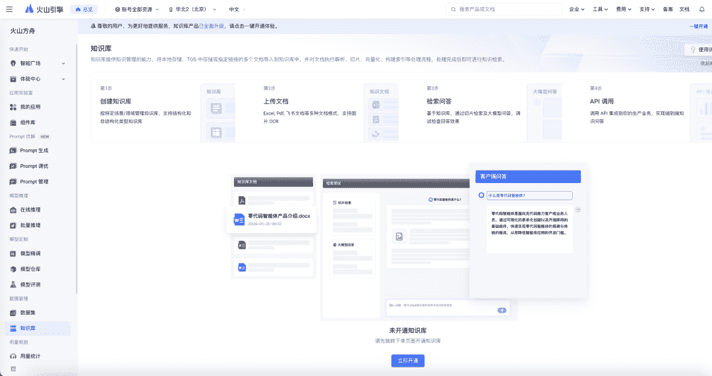

# 2. **知识库创建及使用**

在入口处点击 **“ 创建知识库 ” ****按钮，输入名称及知识库描述后**， 依据文档**类型 选择数据****类型 。目前**支持 非结构化数据 （例如文章、报告、书籍等） 和 结构化数据 （例如问答总结、数据表等） 两种类型。

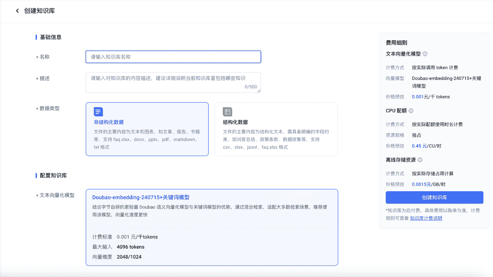

如果上传的文档中含有 **大量带有文字的图片 **，建议开启 **图片 OCR **，以提高识别准确率。这个功能 几 乎秒杀大多数需要调用视觉模型的本地知识库 。

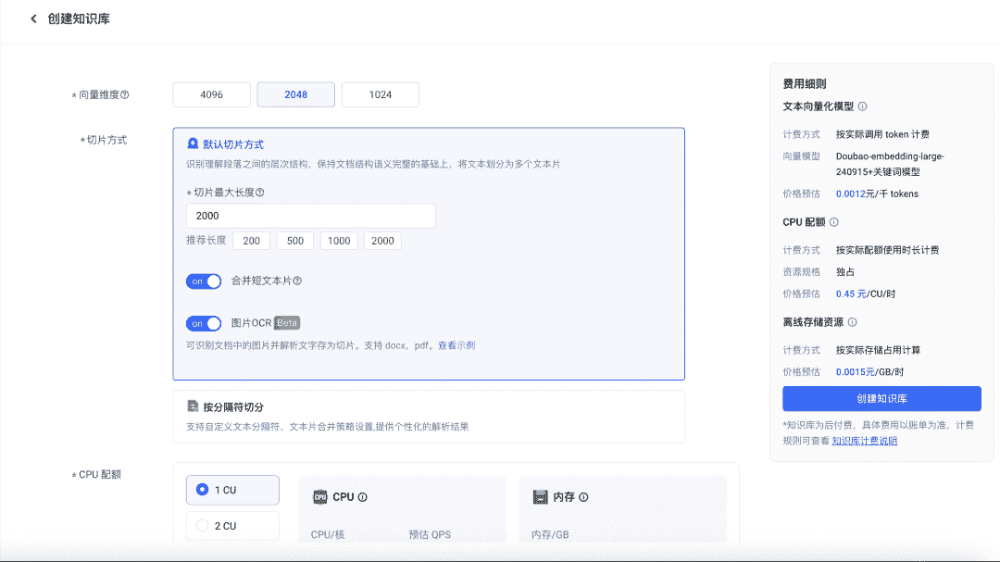

# 3. 测试文档选择：支持PDF、Word等常用文档

为了全面评估方舟知识库的性能，我们选取了以下三类文档进行测试：

+   杂志：2025 年第 8 期《证券市场周刊》(PDF 格式)

+   论文：英文文献（PDF 格式）

+   试题：安全生产试题及答案（DOCX 格式）

将测试文档上**传知识库，可以看**到，方舟**知识库对于文件格式**的支持 几乎覆盖了PDF、Word、Excel等所有常见文档 ，并且同时 支持 飞书文档 ，以及 公开下载链接导入 。

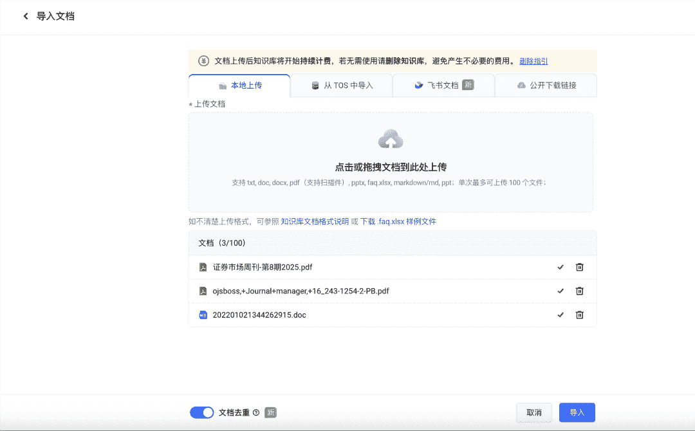

点击“导入”后， 知识库会调用文本向量化模型构建知识库索引 。对于大文件，方舟知识库构建速度依然很快，这一点比 调用本地向量化模型部署的知识库 要好很多。查看“ 切片详情 ”，可以看到 文件详细的文本切片信息， 同时 支持指定查看某一个文件的切片。

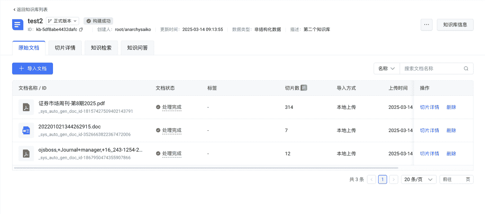

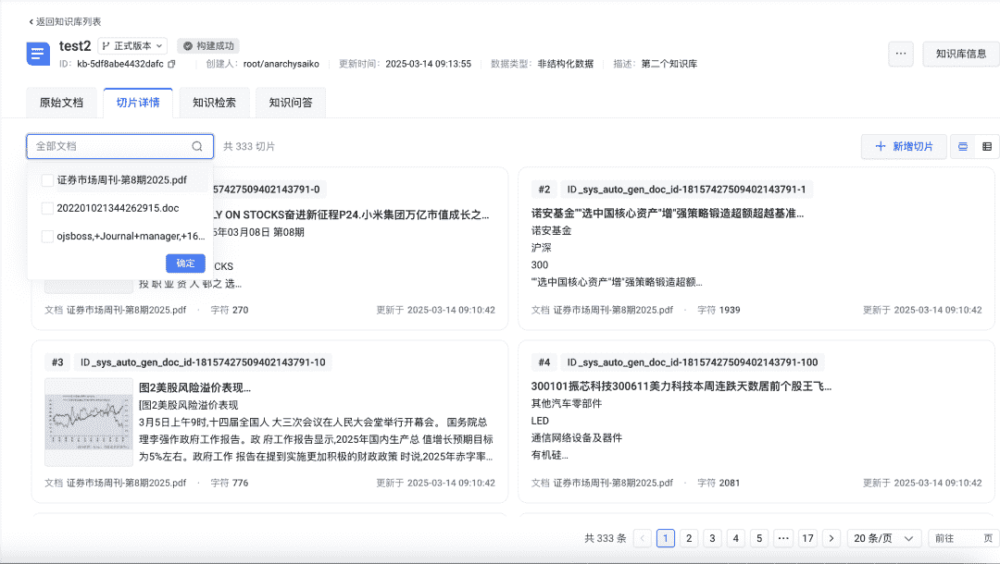

# 4. 实测体验： 辅助阅读、辅助学习、辅助解题

接下来，我们将针对以上三类文档，详细展示火山引擎方舟知识库的实测体验。

## 1） **杂志解读问答（辅助伴读场景）**

我们使用 2025 年第 8 期《证券市场周刊》扫描件进行测试，同时开启 图片 ocr， 提出了 3 个问题：

+   问题一：  公募基金针对哪一类经济板块进行积极投资？

这个问题的答案在杂志的第 44 页（总页数共 118 页），模型需要检索的篇幅非常多了。

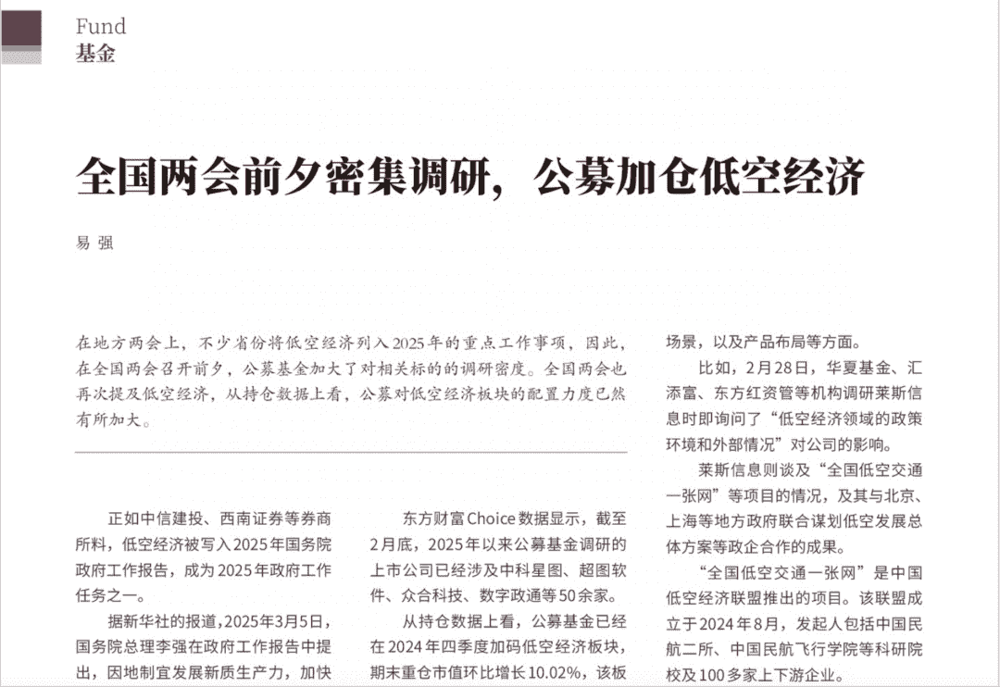

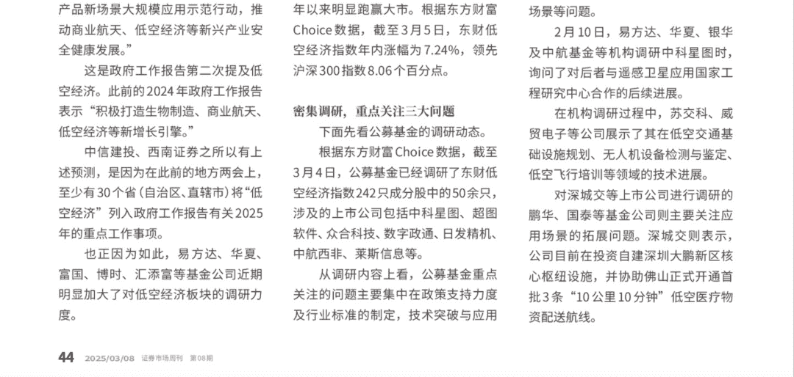

进入知识库的“ 知识问答 ”板块，输入问题，可以看到方舟知识库很快 成功找到了正确答案并给出了准确的增长数值 ，并且还 检索到了下一页 ，从产业链的角度解释公募基金 具体加仓了哪些关键环节 。

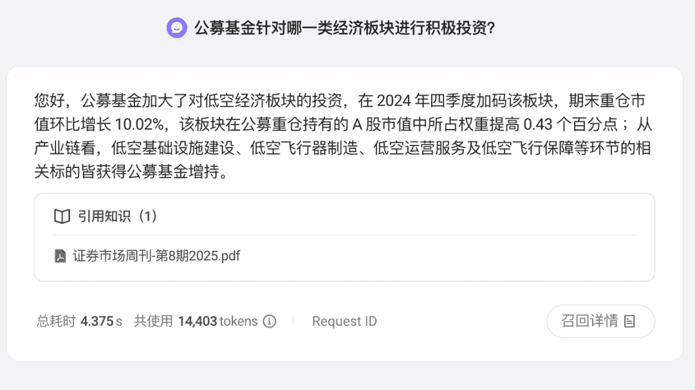

同时点击“ 召回详情 ”，还能够查到在 问答过程中召回的切片 ，并且显示 每一个切片的召回分数与召回位次 。可以看到，排在首位的召回切片成功定位到了关键信息。

值得注意的一点是，当勾选“ 文档聚合排序 ”时，召回切片 按照原始文档顺序，对召回的切片进行排序聚合 ，以保证语序和语义正确。如果需要 按照召回分数与召回位次进行排序，请取消勾选 。

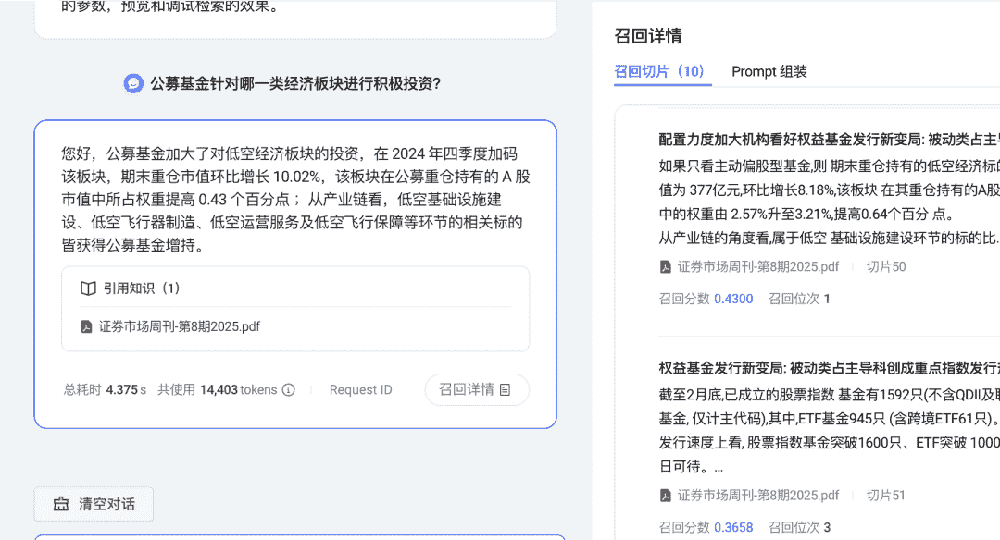

+   问题二：3 月 3 日- 3 月 7 日，百度平台周涨跌幅是多少？

这个问题的答案在杂志最末尾“ 一周市场热点及重点板块个股表现 ”，这是一份 图片格式的表格文件 。 这不仅要求图片 ocr 能够发挥作用，还需要识别表格信息 。

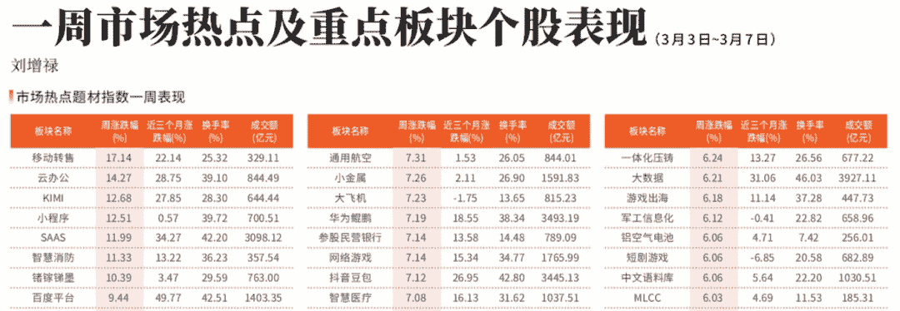

输入问题之后，方舟知识库很快 成功找到了正确答案并给出了准确的周涨跌幅。

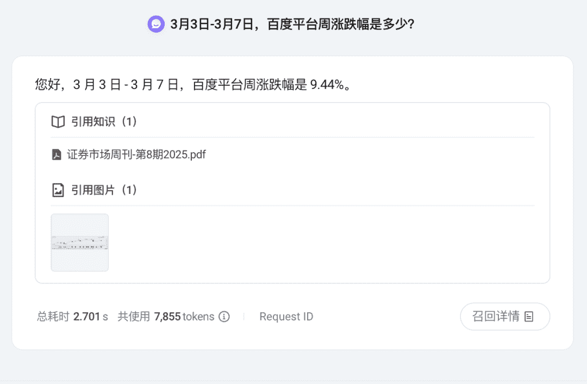

点击“ 召回详情 ”， 排在首位的召回切片自动识别出了这张图片表格里对应的所在行，而且还将表格的行列关系自动处理成了键值对的格式 。方舟知识库针对表格的识别处理能力远超本地部署的知识库。

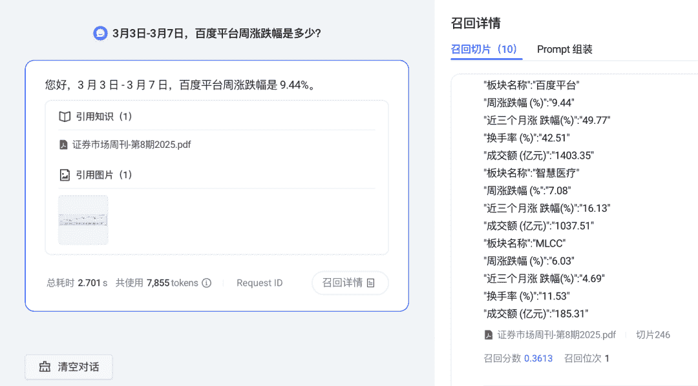

+   问题三：这本《证券市场周刊》的零售价格是多少钱？

这个问题的答案 在 杂志封面最右下角的一个价格标签中 。很多AI知识库针对杂志、书籍这种文件会 自动排除封面信息 ，因而在知识库构建上会造成一定的 信息丢失 。

输**入问题之后，可以看到**方舟知识库 直接定位到了封面的价格标签并成功返回正确价格 ，并且在下方的“ 返回图片 ”中 成功标记了这张图片 。

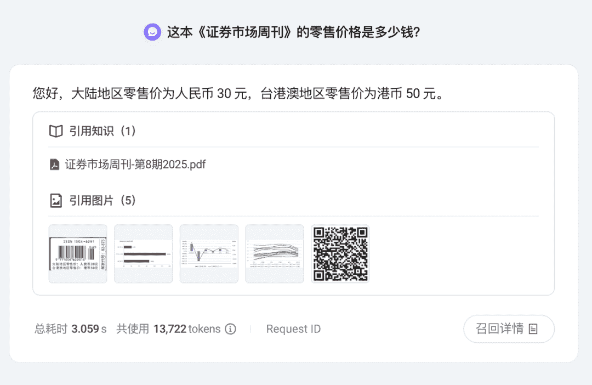

## 2） **论文解读问答（辅助学习场景）**

我们使用英文文献《 Can Hiccup Supply Enough Fish to Maintain a Dragon’s Diet?》 进行测试，提出以下问题：

+   问题一：Toothless 因为尾鳍受伤被困在洞穴多少天？

这个问题的答案在 开篇 Abstract 处，以及 结尾 Conclusion 处都有出现。

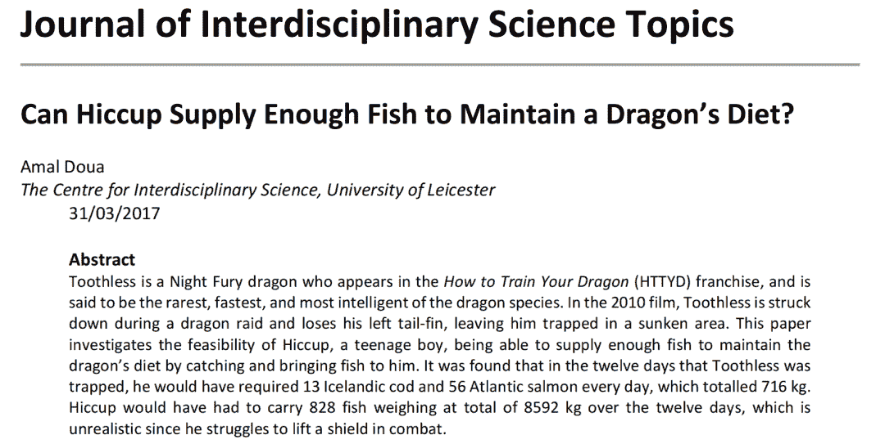

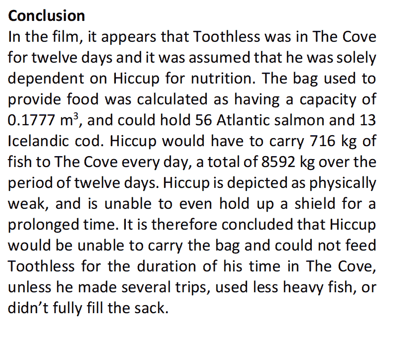

输入问题之后，可以看到方舟知识库 成功返回了正确答案。

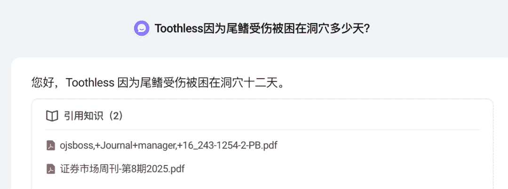

+   问题二： Hiccup 需要每天给 Toothless 喂多少鱼？给出计算过程。

这个问题的答案 涉及到大模型对于数学公式的识别，以及大模型输出是否支持 latex 渲染。

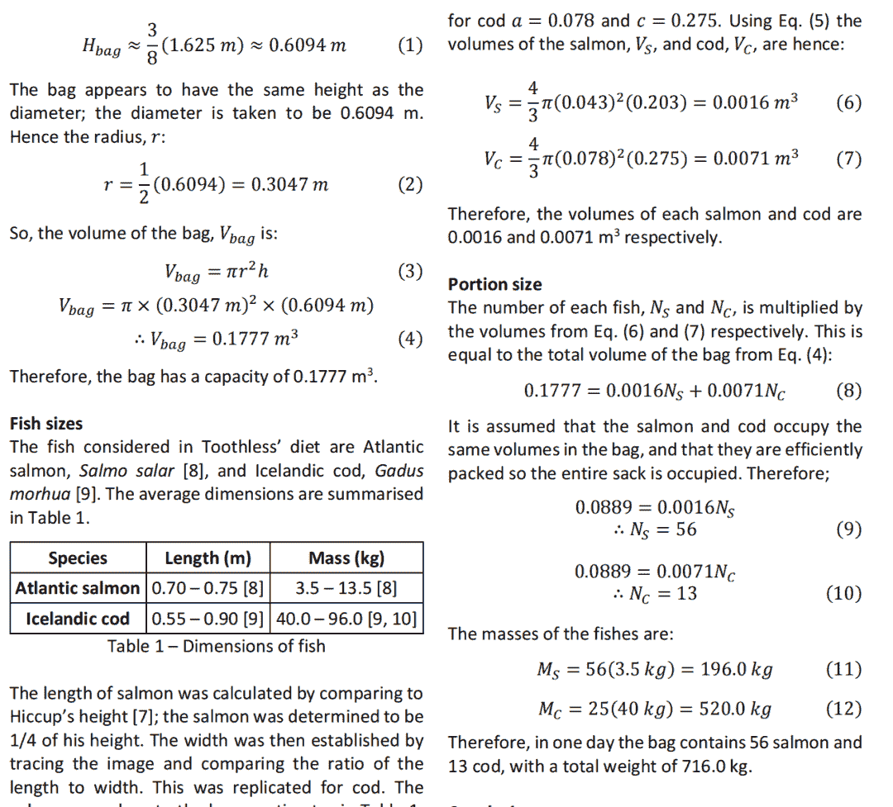

输入问题之后，方舟知识库 成功以 latex 格式输出计算过程 ，同时计算结果也是正确的 。这种对于 latex 语法的支持 也比很多知识库要优秀。

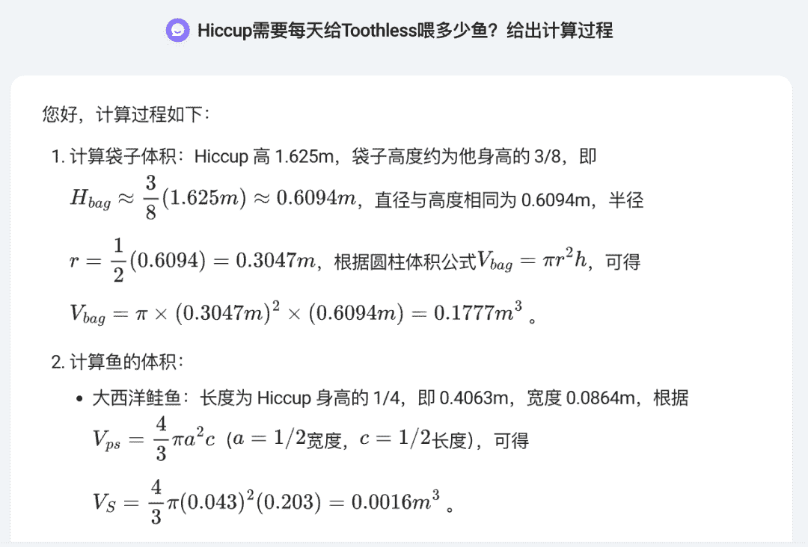

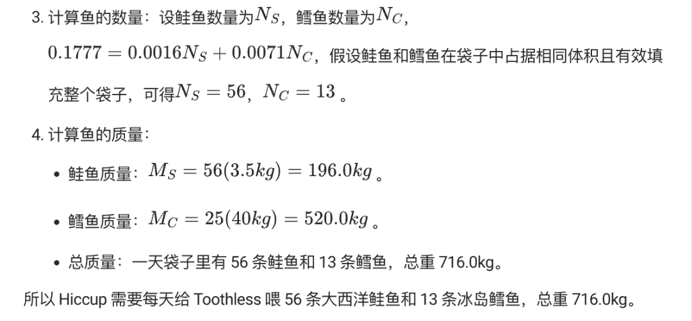

### 3） **试题问答（搜题解题）**

我们使用 Word 版本 的《安全生产试题及答案》 进行测试，并提出以下问题：

+   问题一： 我国安全生产的方针是什么？

这个题目的答案 在文档里 多次出现过 ，并且 题目和选项都略有区别 。

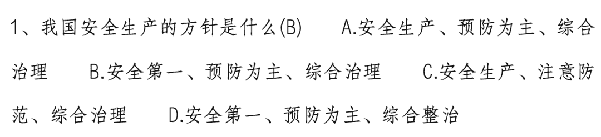

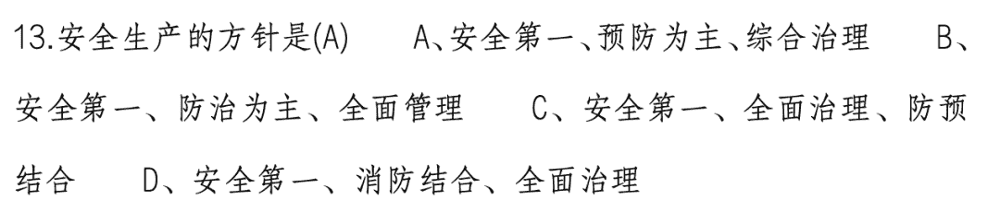

输入问题之后，方舟知识库成功分析了这些问题的区别并返回了正确答案。点击“ 召回详情 ”，可以看到 召回分数和召回位次最高的切片，包含了能够找到的题目 。

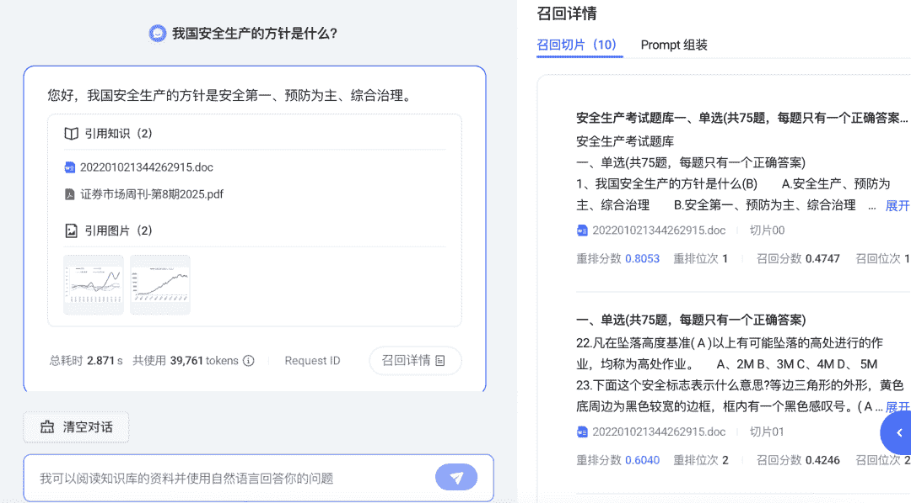

+   问题二： 上一题出现在哪些题型里，分别对应的题号是多少？

这个题目同时 **涉及到了上下文解析 **。考验大模型的上下文窗口和文档查询能力。这里可以勾选左侧的“ 问题改写 ”选项，基于历史对话对本轮问题进行改写，使其 具备更完整的语义信息，检索更准确 。

输入问题之后，方舟知识库首先 将问题依据上下文改写成了语义更加明确的题目 ，同时 返回了正确的题号，打开“召回详情”，切片信息也成功覆盖到了能够查询到的全部题目信息。 这一点与本地知识库相比 ，查询结果更为全面。

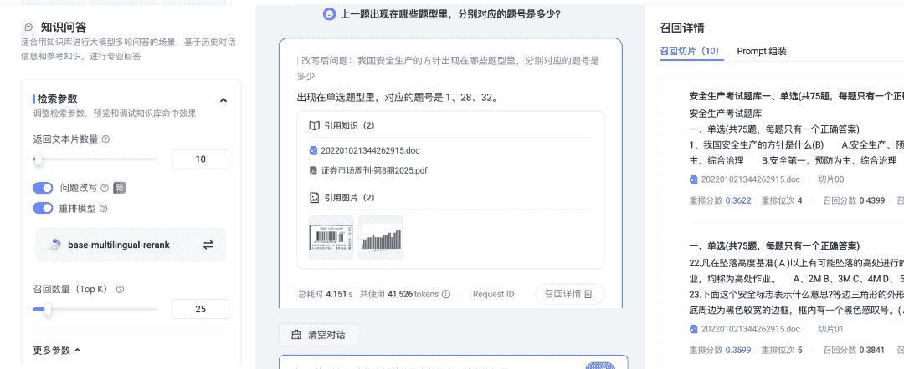

+   问题三： 依据《安全生产法》的规定，给予拘留的行政处罚由（）决定。

**这个问题的答案在原文中出现了**两次，但是 没有直接给出明确的文字信息 ，只给出了选项 。需要大语言模型对切片进行语义理解。

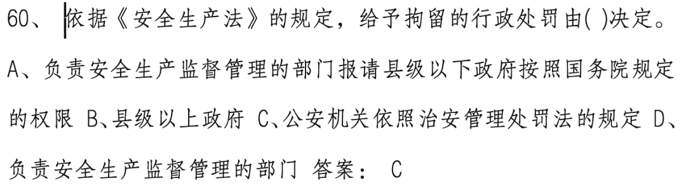

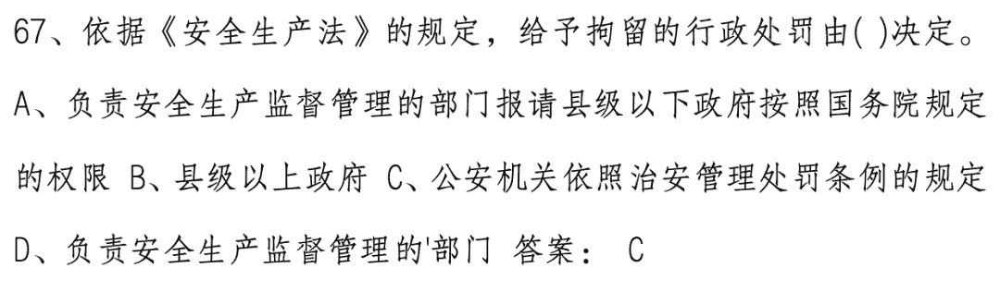

输入问题之后，方舟知识库 准确理解了正确选项对应的文字信息，并返回了正确结果 。

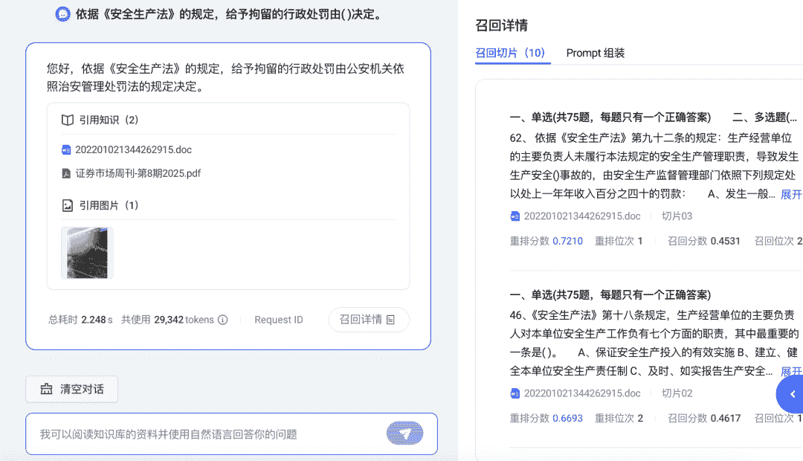

# **总结**

整个测试完，方舟知识库展现了强大的复杂文档处理能力与技术优势，还有图片 OCR、表格解析这些隐藏技能，十分强悍。这样就能够适应金融研报分析、学术研究辅助、教育智能题库等等多重场景，显著提升工作效率。

同时，方舟知识库 对于文件的支持 几乎 覆盖了所有常见文档格式 ，并且 集成了飞书文档生态，并且能够进行 API 调用。这些功能不仅能帮助大家降低使用门槛，还给开发者提供了更多个性化定制的可能性。这一点在在线的 AI 知识库中可以说是很有优势，这个之后我们 Datawhale 也可以出一个保姆教程。

当然，目前方舟知识库也有一些不足之处。例如“知识问答”部分，用户无法直接查找历史对话记录。同时，知识问答默认选择“文档聚合排序”，查看召回详情时，无法手动按照“召回分数”进行排序，希望后续能够优化这一问题。

总而言之，火山引擎方舟知识库是一款值得推荐的智能知识库服务，尤其适合需要处理复杂文档的企业和个人。它能够帮助用户高效地提取知识，提升工作效率，解锁知识价值。

在个人日常使用的场景下，构建个人知识库这事，不太需要从零开始造轮子，使用像方舟知识库这样的在线应用会比较方便。

之后查论文不用在 PDF 里玩"Ctrl+F 马拉松"，看财报不用盯着表格数行数，备考刷题不会再愁没有对应的解答...

从现在开始，让 AI 学会自己查资料！