# Claude Skills 超实用指南 从 0 到 1 带你用好 Skills

> 来源：[https://yunyinghui.feishu.cn/docx/KNPNdz2CaonWpNxnrMAcCJjXnSc](https://yunyinghui.feishu.cn/docx/KNPNdz2CaonWpNxnrMAcCJjXnSc)

> **公众号：**噪点 noisepoint

> **发文时间：**2025 年 11 月 24 日

> **推荐理由：**这篇指南深入浅出地讲解了 Claude Skills 的核心概念、优势及使用方法，帮助你快速掌握这一变革性功能，提升 AI 任务执行效率。

大家好，我是噪点

今天和大家来聊下 claude skills，虽然发布已经几周了，但我发现最近周围讨论的越来越多，感觉很多人还只是把 skills 定义为工具，或者认为和 mcp、subagent 差不多的作用， 确实 skills 这个概念相比之前推出的功能有些难理解。

但同时很多人认为这是 claude 推出的最具变革性的功能之一，应用想象力非常大。

所以我希望尽量用通俗易懂的方式和语言来介绍下 skills，包括 是什么、有什么用、与其他工具区别、以及如何使用这 4 部分 。

**skills 是什么**

skills，claude 官方的解释是技能文件夹，它包含指令、脚本和资源等；Claude 会动态加载这些文件夹来提升特定任务的执行效率。感觉直接看这句话好像懂了，又好像有点模糊。

我按自己的理解用大白话解释下， skill 就是你对解决某一问题方法经验的封装教程；把你解决该任务时的流程，包括工作流、这个工作流中用到的工具、指令、参考的文档、跑的脚本甚至提示词风格等一切对解决问题有帮助的流程都封装为标准能力单元，而这个标准能力单元就是官方所谓的技能文件夹，也就是一堆文档；说白了就是解决这一场景问题的说明书。

当你再遇到相同场景问题时，就不需要每次重复 prompt，重复对 ai 说先这么干，再那么干；只需让 ai 调用你之前创建的 skills，它就会完全按照 skills 中的标准流程自动执行了。

并且 这个说明文件也就是技能文件夹是支持不断迭代优化的，每次改文档里的内容就行，这样来看，任务解决就变成了不同能力单元的组装 ，对于解决重复问题，想象场景非常大了。

**skills 好处**

**复用性：**

skills 是支持反复调用的，所以对于我们日常让 ai 做的重复性工作或任务，直接让它调用 skill 就可以了；

既不用每次反复的去和 ai 说怎么干，同时也能保证质量，毕竟只有你验证过的流程技能你才会进行封装。只需要配一次，就可以长期使用了。

举个例子：比如每次的 ppt 创建样式风格、vibe coding 的测试部署流程、常规的日报周报写作等。

**高效性：**

skills 可以支持 ai 自动调用，只要在 SkILL.md 文档中写清楚触发场景和关键词，ai 在聊天中遇到这些关键词就会自动调用 skill 技能；

另外 skills 是渐进式披露原理，主要有 3 层：

+   Level 1: 元数据 - 只加载名字和描述（约 100 token），claude 就是通过这里的 description 描述来决定何时触发使用；

+   Level 2: 主指令 - ai 只有觉得任务匹配时才会读取完整的 SKILL.md（<5000 token）；

+   Level 3: 详细资源 - 按实践需要加载 skill 技能包的其他资源，如参考文档、脚本等（理论无上限）；

+

+   好处就是会最大程度提高上下文使用率，需要什么再加载什么，不像每次发提示词一样，完全占用上下文。

与 mcp、subagent 区别

有一些朋友会把 mcp、subagent、skills 混淆掉，这里我也用大白话解释下他们之间的核心差异点：

**mcp **：本身是一个类 api 的协议，我们最常见和最常用的就是 mcp 工具，也就是给 ai 增加第三方工具的能力；

**subagent **：本质还是 agent，是解决某一场景的子 agent，所以它会有 llm、tools 工具调用这些能力，比如通过自己的 llm 判断去调用 mcp 工具或内置工具；

**skills **：是对执行某一任务的完整流程的封装说明，是标准能力单元；这个任务的解决可能会用到多个场景 subagent，也可能会用到多个 mcp 工具，这些都是 skills 中的一部分；

比如我有一个写文章的 skill，里面可能会有选题的 subagent、写作的 subagent、排版的 subagent 等；也会有搜索 mcp、设计工具 mcp 等；但这些都是一个 skill 里，每次写文章时只需让 ai 调用这个 skill 就行了，不用每次再重复告诉他要怎么写。

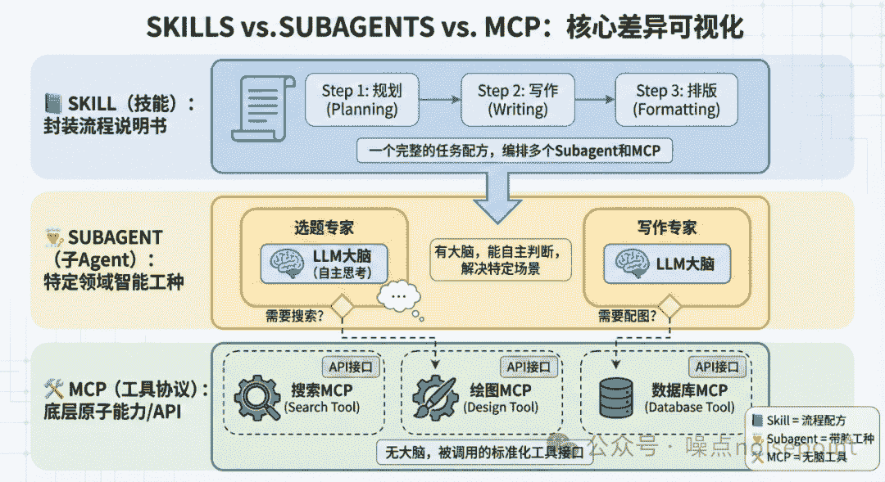

**如何使用**

现在 skills 可以在 2 个入口进行使用，一个是网页端，一个是终端，分别介绍下：

**网页端：**

进入 claude 网页，点击左下角的头像——settings；

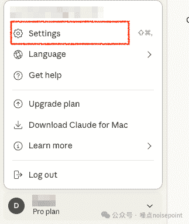

找到 capabilities，确保 Artifacts 中的 Code execution and file creation 这个按钮开启状态，默认是打开的，如果没有打开需要手动开启，否则用不了 skills；

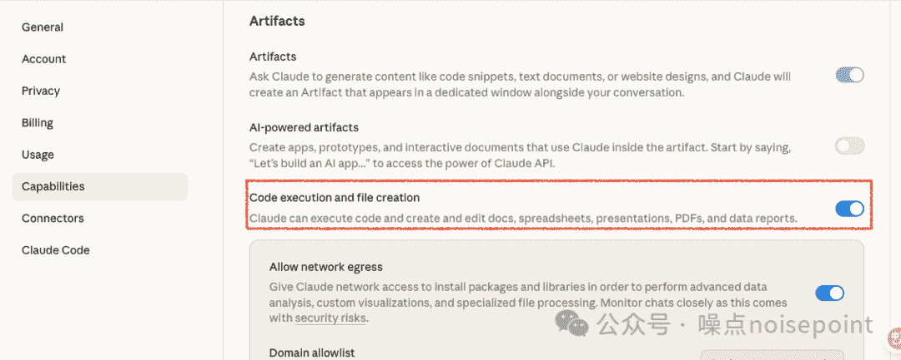

然后页面往下滑就能找到 skills 了，可以手动都打开，这是 claude 官方网页端内置的一些 skills；

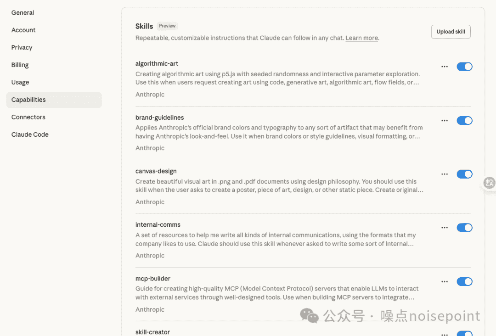

有开发类的、设计类、办公类的等，具体有品牌视觉、画布设计、mcp 创建、统一主题等；

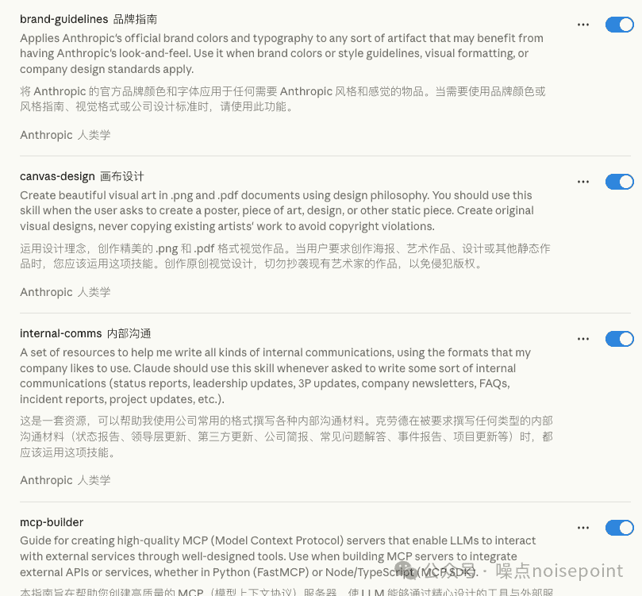

点击右上角即可在聊天中使用，或者直接在聊天窗口说明有哪个 skills；

比如我这里以 brand-guidelines 这个 skill 举个例子，这个 skill 技能是将 Claude 的官方品牌颜色和字体应用于任何需要 claude 风格的物品，我来让他用这个 skill 做个“噪点”logo；

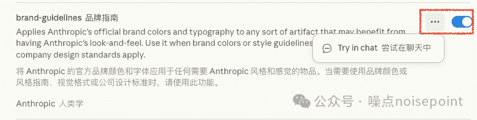

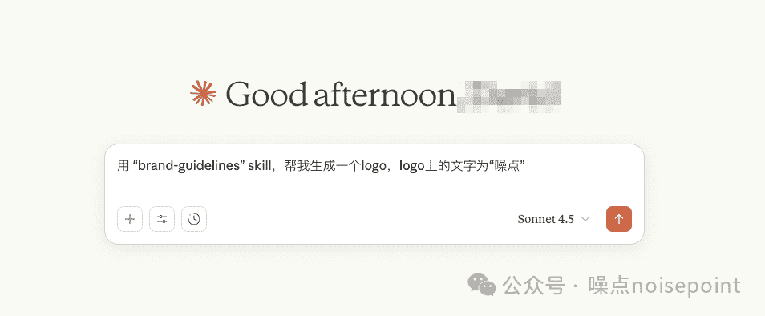

然后他就会自动分析 brand-guidelines skill 里的文档规范，直接按文档里的使用要求进行输出，不需要再去重复和它说官方品牌色和设计规范是什么样，非常方便；可以看下效果是不是和 brand-guidelines 里的要求一模一样。

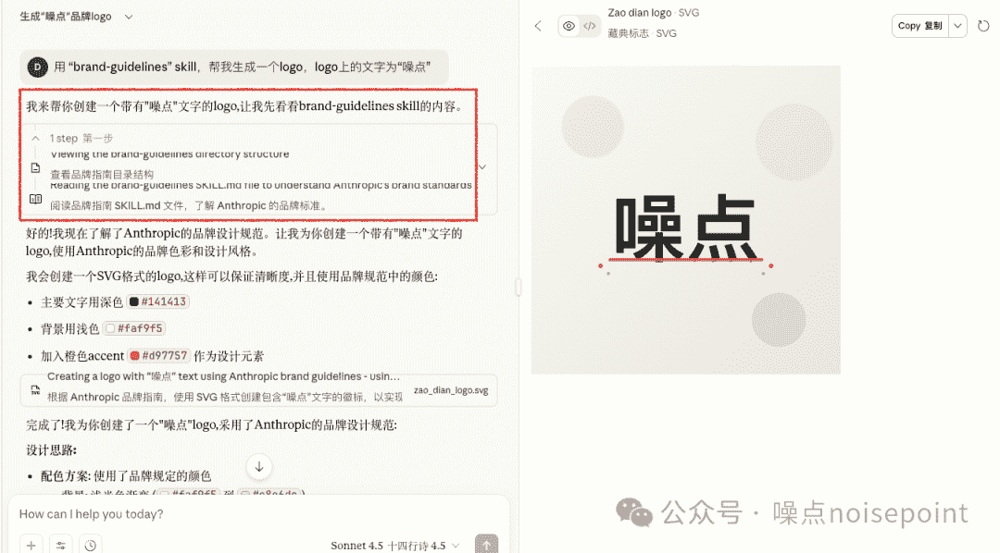

**第 2 个入口是终端：**

进入终端，打开 claude code；

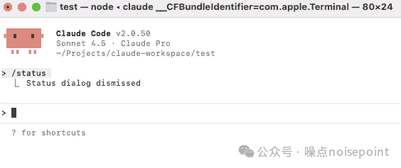

输入下方官方的 agent skills 安装命令，即可通过插件的形式进行官方 skliis 库安装；

+

```
/plugin marketplace add anthropics/skills
```

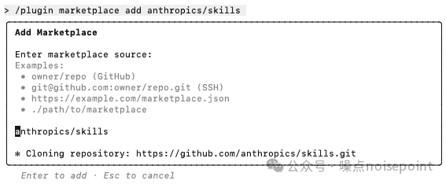

安装完毕后输入/plugin，选择 Browse and install plugins，会让你安装具体的 skill；

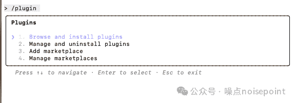

一个是 document-skills，是用来生成和管理文件的，如 ppt、word、excel 等；

一个是上面 web 入口演示的那些案例 skills ；

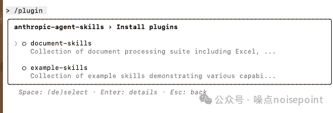

分别点击安装即可；

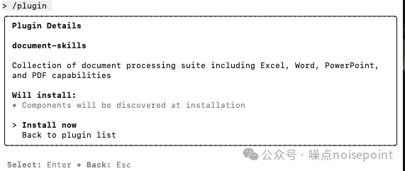

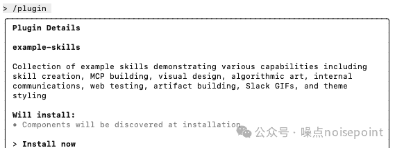

安装完毕后重启 claude code 就可以了；

上面这种插件的形式是最方便的，理论上可以 100%成功。

如果有特殊概率提示安装成功，但无法识别的，可以用第 2 种方法：

直接在 claude 的文件夹（～/。claude）里新建 skills 文件夹，把官方 skill 项目仓库的文件夹下载到本地，手动复制到 skills 里去就行，同样可以生效；

这是官方 skills 仓库地址： https://github.com/anthropics/skills

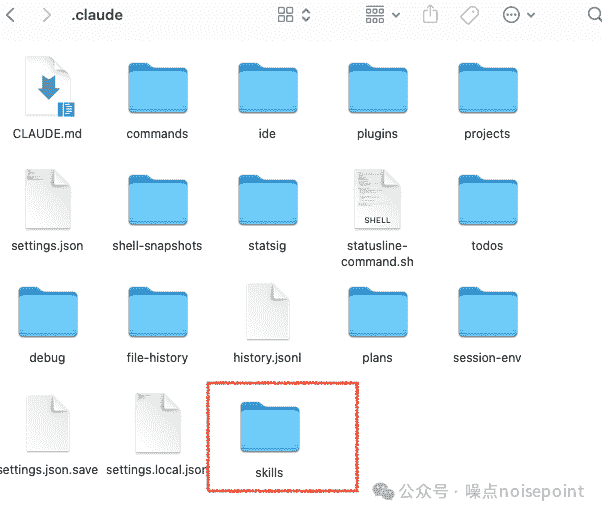

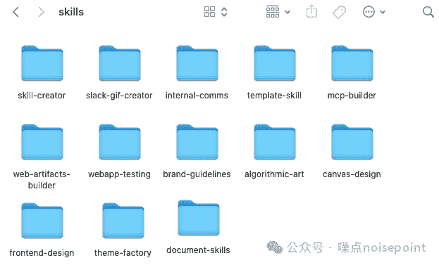

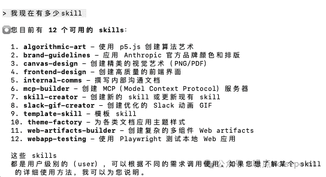

然后可以看下效果，我让他用 slack-gif-creator 这个 skills 来生成一个“hello”的 gif ，很快就按标准做好了；

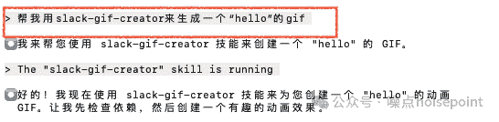

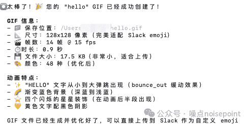

当然除了官方的 skills 外，也可以进行自定义 skills 的创建，这个详细步骤我们放在下一篇分享，欢迎关注；

以上就是本篇对 skills 的分享，包括是什么、好处以及怎么用。 核心理解 skills 是被封装的执行某一任务的标准能力单元，以文件夹的形式，可复用可迭代，配置一次即可长期使用；另外 skills 与 mcp、subagent 都不同，skills 可能会包含 mcp 和 agent；使用入口上可以通过 claude 网页和 claude code 进行使用，claude 官方内嵌了一些 skills，也可以自定义 skills。

---

# 📱交流合作

持续关注并更新skills 的相关资讯动态，**研****究报告，商业落地，常见问题，永久免费在线查看。已建立社群聊聊 skills 发展、应**用、对接及合作，邀请嘉宾讲课，没进群的可以扫码加入，群满可加大国微信 ID：zhangyuguo94s（备注：skills），已经在社群内的无需重复加入，开源知识库及社群学习全部为公开免费分享。

> **特别说明：**不要申请编辑和复制文档，有需求请进群加微信沟通。


**微信学习交流群**


**飞书学习交流群**


好友（ID：zhangyuguo94s）

**扫码交流、进群、合作**