# 从0到1搓了个Claude Skills，实现全自动写X(推特)，拿走不谢～附教程

> 来源：[https://yunyinghui.feishu.cn/docx/NPtadqCQsoJmd9x31TIcDP4xn5b](https://yunyinghui.feishu.cn/docx/NPtadqCQsoJmd9x31TIcDP4xn5b)

---

> **原创👸号：** 袋鼠帝AI客栈

> **发文时间：**2026-01-21 11:55:29

大家好，我是 **最近在做X **的袋鼠帝

但是折腾了好长一段时间也没多大水花，主要原因还是我不够勤快，更新频率跟不上。

太惨了，大家帮忙点点关注吧，你们就是我的原始股东

X上我会分享一些短平快的最新信息，还有一些感悟和理解，也会时不时更新长文。


直到上周，看到很多 **X大佬晒出了马斯克发的工资 **，我直接惊了！

卧槽，X要是做起来， 光靠自然流量一个月就能领到几百上千$！


羡慕的泪水不争气地从嘴角流了下来，要是再搞个矩阵号呢？想想都刺激


然后我观察了很多X的大佬，他们每天的更新频率非常高，可能一天能发十几条。我在评论区看了下，他们自己也说是用了AI提效。

我就在想， **其**实X这一块我完全可以打造一套Claude Skills，作为的AI创作员工，帮我自动写推文（适用于起号阶段）

当然，为了账号安全和内容质量，整个流程的最后一步我保留了人工介入，也就是让Skills把内容弄到草稿箱，最终我会审核内容，然后手动发布。

经过各种查资料，以及跟Claude Opus进行了多轮对话和优化后，这套Claude Skills终于成功落地，并开源了。

最终效果我录了个屏，还是相当不错的。


[0b2et4awgaabiuaows3owjuvdh6dmopqcyya.f10002.mp4](https://internal-api-drive-stream.feishu.cn/space/api/box/stream/download/all/RdCGb7hrzoyTNZxEWXqcWKjJn8b)

这篇文章我将 **分**享我自己使用Claude Skills的一些心得，以及从0到1创造一个Claude Skills的过程 ，你将了解：

1.Claude Skills到底是什么？（简析版）；

2.如何创造自己的Claude Skills（以及我踩过的坑）；

3.免费领取一个能自动帮自己查找信息、选题、创作，并自动保存到草稿箱的Skills：x-skills；

4.skills的适用场景，以及它的优缺点；

5.国内环境Claude Code接入Claude模型（方案推荐）。

# 一、Claude Skills到底是什么？

Claude Skills最近爆火，但可能并不是所有小伙伴都了解它。

虽然很多博主都写了科普文章，这里我还是想聊聊我自己的见解。

特别是 上周六受江树邀请去北京参加「AIGC开发者大会」 ，跟几位大佬同台圆桌讨论后，我对Claude Skills的理解又通透了几分。


一句话总结， **Claude Skills就是一个「专**业技能包」，它的本质其实就是上下文工程。

23年、24年的时候，Prompt（提示词）很火爆。

到了25年，Context（上下文）变得越来越重要，也可以说越来越火了。

为什么会出现这种现象呢？

我觉得早些年，模型的Agent能力不足，上下文长度也有限，所以大家靠一些精妙的Prompt就能更好地完成简单任务。

但是25年后，随着Manus的爆火，各家大模型都在卷Agent能力，上下文长度也越来越长。

简单的Prompt已经无法满足我们用Agent做复杂任务的需求，而Context可以。其实Prompt也是Context（上下文）的一种。

Context 简单来说，就是让一个大模型或者Agent完成任务所必须的最全信息，可以包含文档、Prompt、任务介绍、背景信息、案例，以及各种工具等等...

如果说Skills就是上下文的话，那其实我们从很早以前就在用Skills啦。

只不过Anthropic这家公司非常善于制定标准、抢占生态，它率先推出了Claude Skills。

这有两个好处： **1是统一了Context的规范和**标准；2是由此带来了生态，建立起了社区。

目**前每天都有新的Skill**s诞生，普通人构建一个高质量Context的门槛大大降低了，因为我们现在可以直接去网上找现成的，就像我今天 开源的x-skills 一样。

我们来看一下Claude Skills的经典结构：

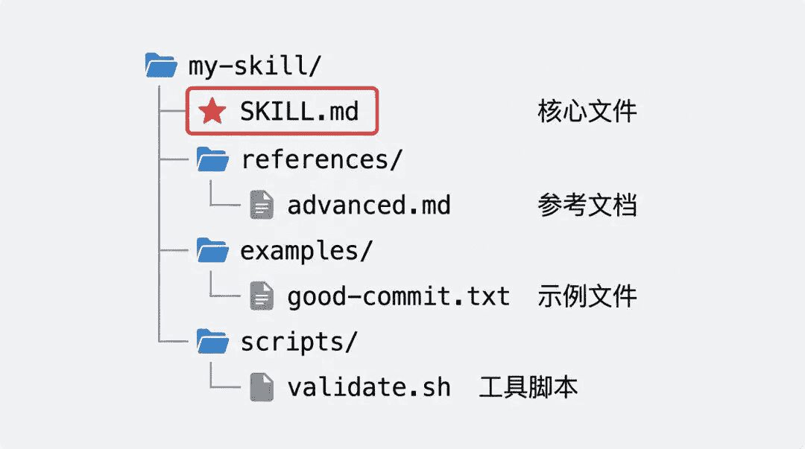

核心文件就是SKILL.md。这里面其实就包含了这个Skill的名字、描述（有什么用，什么时候该用），以及Prompt（指令）。

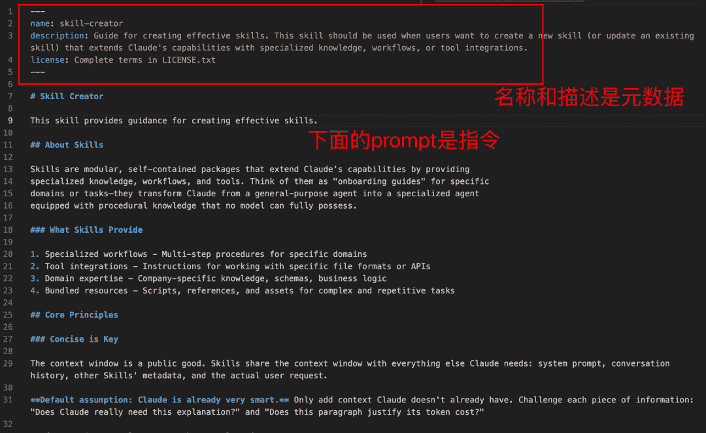

大家都说Skills有一个「渐进式披露」的设计非常天才。

其实吧，在我看来这并不是什么创新的发明。

早在23年我还在公司上班的时候，我就想到了类似的逻辑。

当时我想把AI融入业务，那时候我负责一家头部证券公司的线上营业厅。那个营业厅的业务办理入口密密麻麻，用户想找一个功能简直是大海捞针，我自己找都老费劲了。。。

我就想用AI跟程序结合，把各种业务办理入口的链接、名称和描述绑定。用户不需要面对密密麻麻的菜单，而是只需要一个对话框。

用户提需求，AI先在后台加载所有业务的名称和描述，智能筛选出用户需要的业务后，再加载具体的业务信息，并提供跳转办理的链接。

我想阿里千问最近对接了阿里生态的各种App，大概也是类似的思路。

Skills只是把旧的思想用到了新的技术领域

了解过计算机的朋友应该知道，我们的电脑或者服务器都有内存（RAM），而且内存资源非常有限，所以诞生了很多优化内存使用的方案，比如MySQL的B+Tree等等...

我觉得模型的上下文可以类比计算机的内存，那模型上下文优化的方案其实也可以直接参考很多现有的计算机内存优化方案。

而这个渐进式披露的设计，也就类似一种内存优化方案，所以算不得创新性的设计。

关于Claude Skills的概念和一些想法，我们就暂且聊到这里。

# 二、如何创造自己的Claude Skills？

在正式开始之前， 我先讲一个之前写Skills踩过的坑 。

去年10月份，我去杭州做了一次Claude Code的企业培训，内容就包含了Claude Skills。

回来之后我就想写一篇创造Skills的教程，当时我用的是国产模型，结果写出来的Skills总是缺斤少两的，不完整。

于是那篇文章就搁置了，后来我试着用Claude自家的模型来写Skills，我发现，解铃还须系铃人，写Claude Skills还得是Claude自己来，太丝滑了，特别是Opus模型，基本上一次性就能搞定。

总结下来就是，写Claude Skills尽量用Claude模型

所以，这次我就是 **在Claude Code里面使用Clau**de Opus模型来写x-skills 。

在国内环境Claude Code使用Claude模型的方案，我放在文末了，感兴趣的朋友可以看看～

这次我 **使用了Anthropic官方的一个创建Sk**ills的Skills来写Skills （哈哈哈 有点拗口）

就是它，叫 **skill-creator **，我们可以用它来写Claude Skills。

https://github.com/anthropics/skills

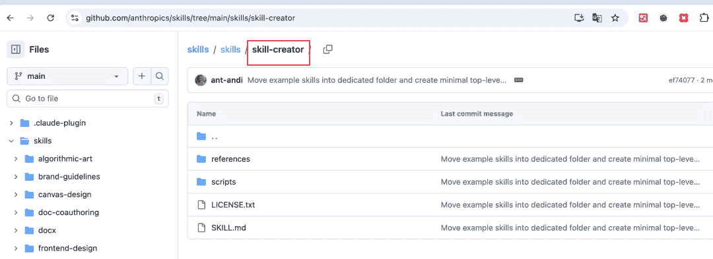

把它下载下来，放入 ~/.claude/skills 文件夹。

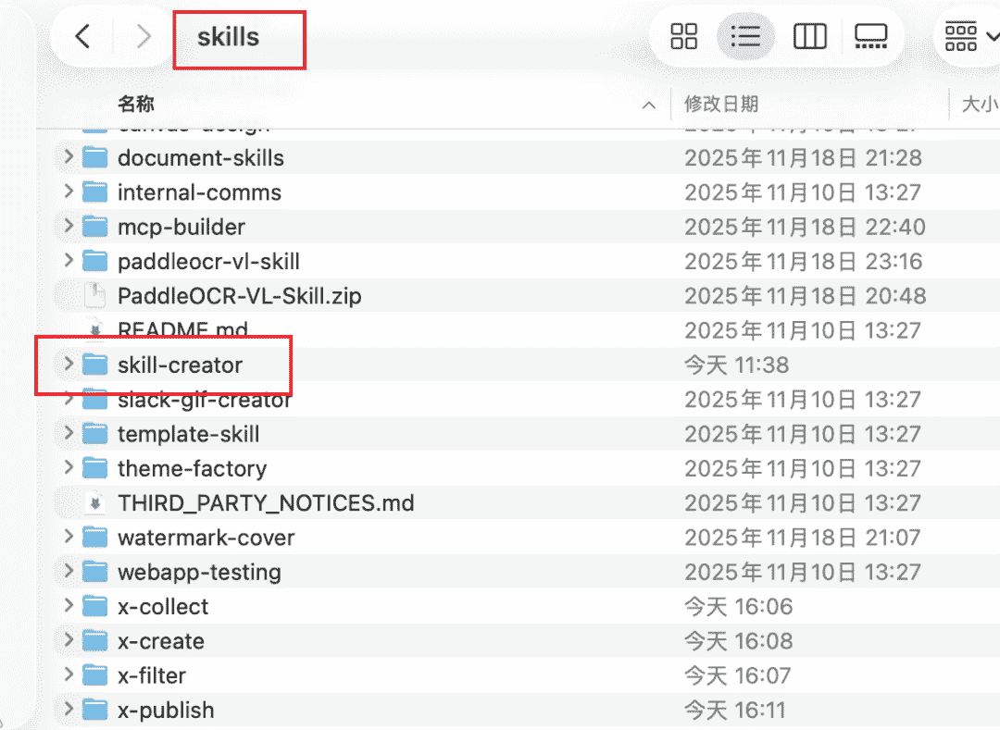

PS：如果是Windows系统，路径大概在：C盘/用户/你的用户名/.claude/skills。

这样Claude Code就能识别这个Skill了。

**接下来步入正题：**

这**篇本来就是奔着写**Skills并开源去的，所以我直接先在我的Github建了个公共仓库，为了简单好记，我给它取名叫 x-skills

https://github.com/kangarooking/x-skills

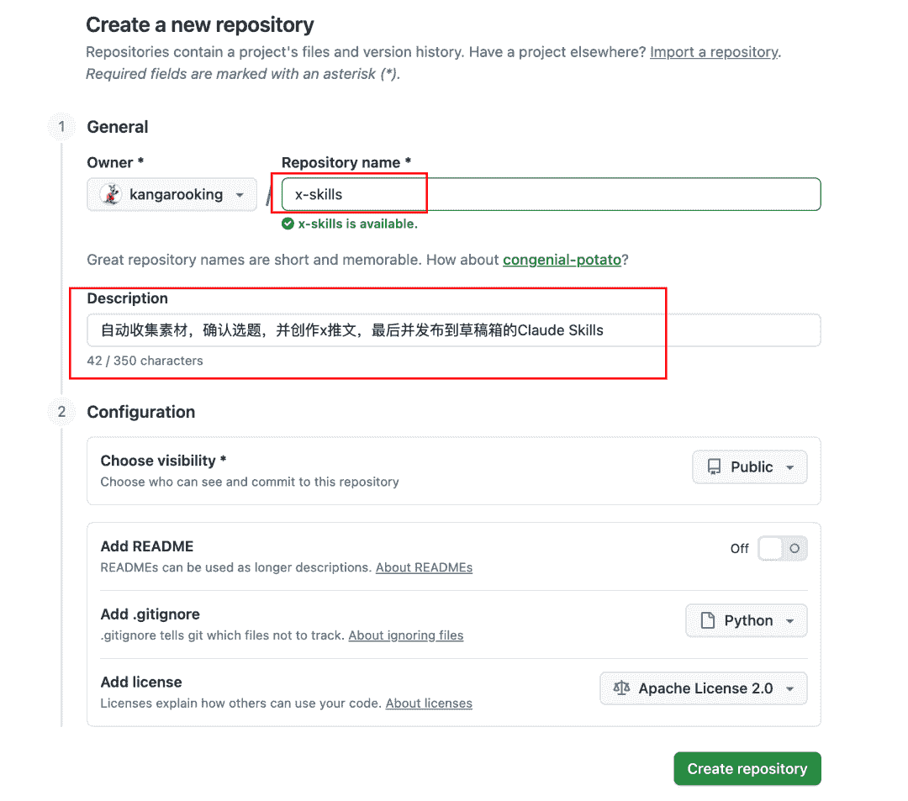

然后把这个新仓库克隆到本地：

git clone https://github.com/kangarooking/x-skills.git

以这个目录为项目根目录，进入Claude Code，切换到Opus模型。

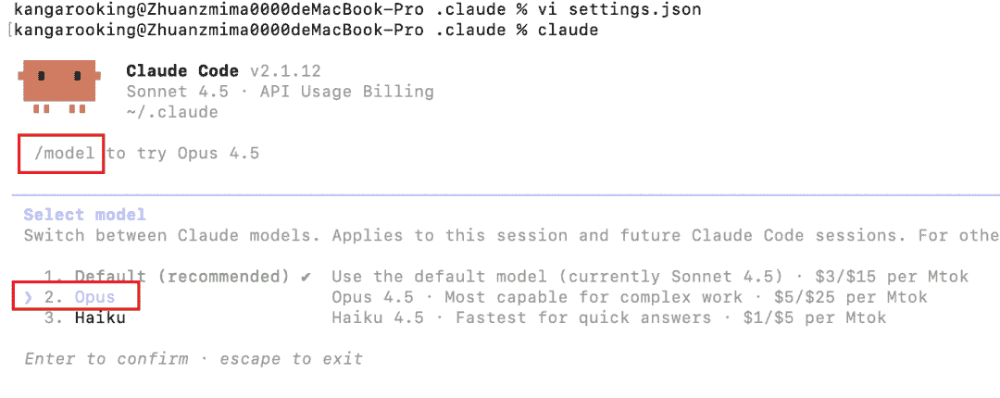

切换到Plan Mode， 先跟Claude Code对话制定一个计划。

```
Prompt： 我最近想把X做起来，在起号阶段，并且提高X创作发布频率，我想创造一个能帮我自动收集素材，筛选选题，并创造爆款X推文，最后发布到X草稿箱的Claude Skills。我希望你能给我一些灵感和建议，我们先一起沟通，对齐需求。
```

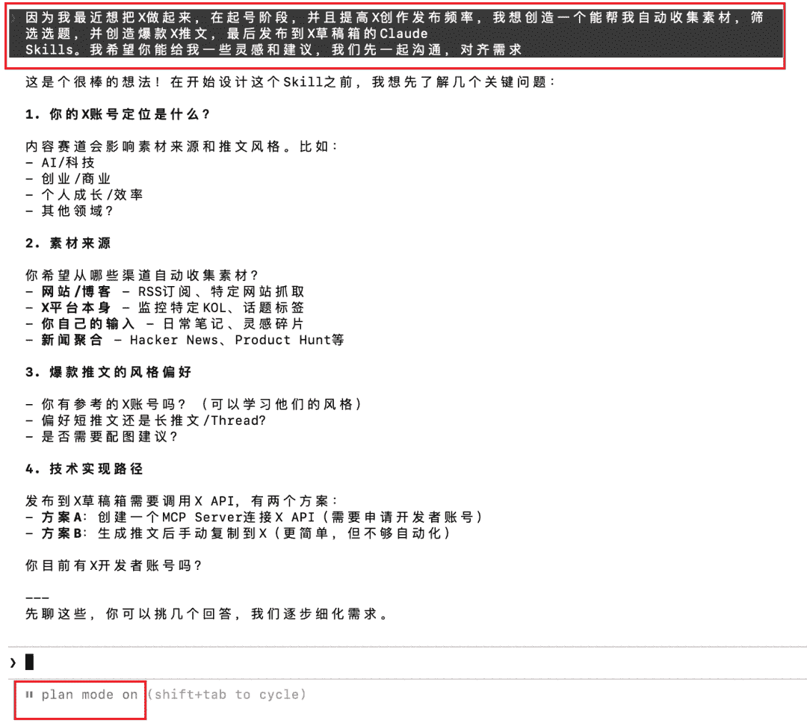

Claude Code会提出问题，然后我们一步一步细化、对齐需求。

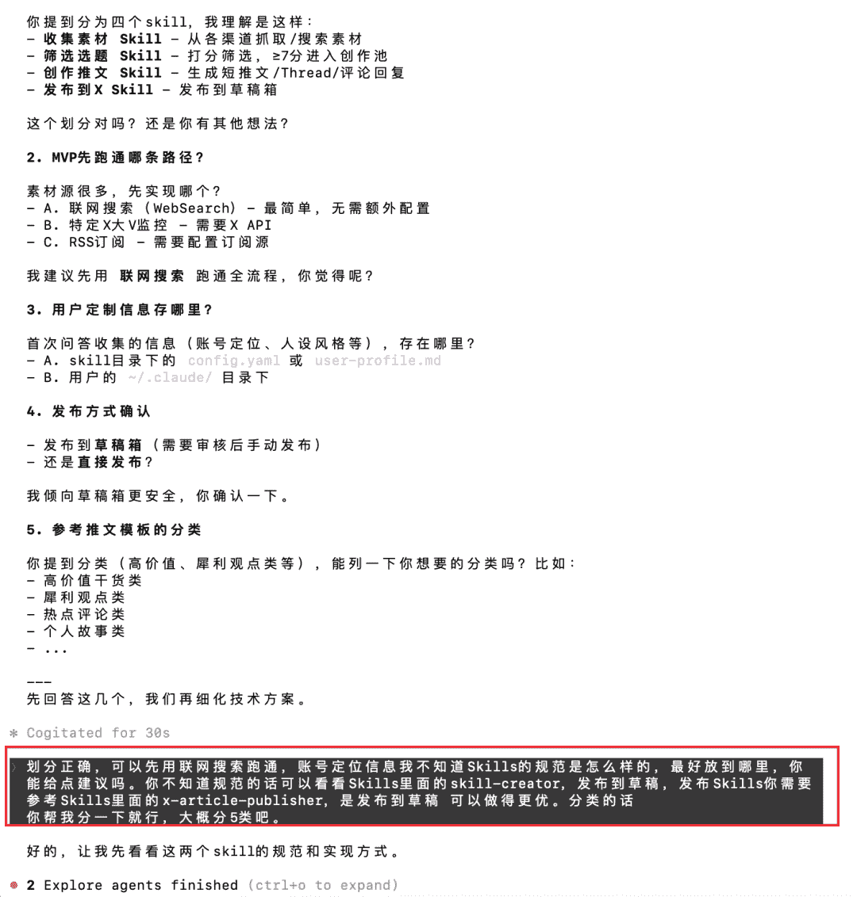

对齐需求之后，切换回Yolo Mode（自动执行模式）。

让它开干！（记得提醒Claude Code使用Anthropic官方的skill-creator）。

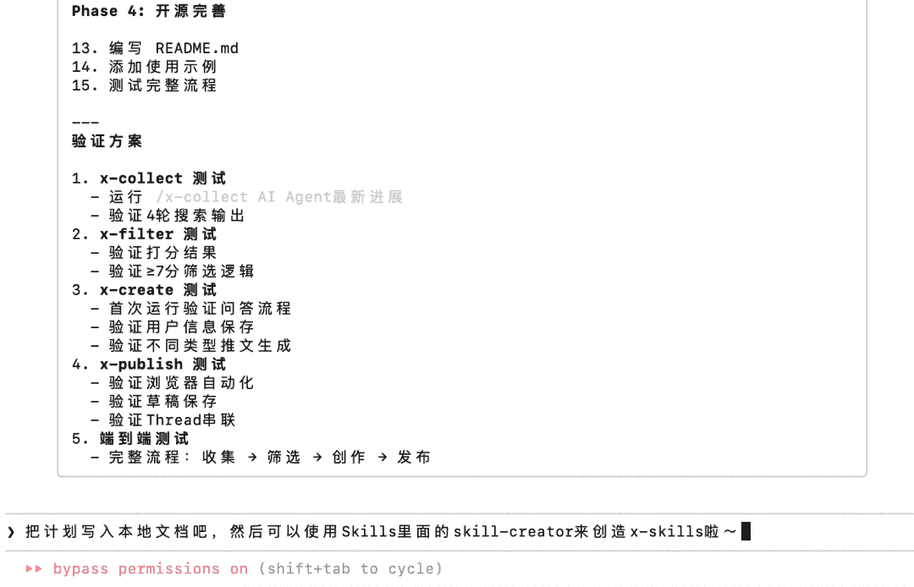

大概花了10分钟左右，这个x-skills就开发完成啦！过程如下：


[0bc3ruaaqaaadeaj66tpcjuvbdodbcgqacaa.f10002.mp4](https://internal-api-drive-stream.feishu.cn/space/api/box/stream/download/all/OV7cbWqbzogRa8xwpfscbxnDnEg)

这个x-skills包含了4个Skill：

x-collect （查找信息）

x-filter （选题）

x-create （创作）

x-publish （保存到草稿箱）

整个x-skills的结构如下图：

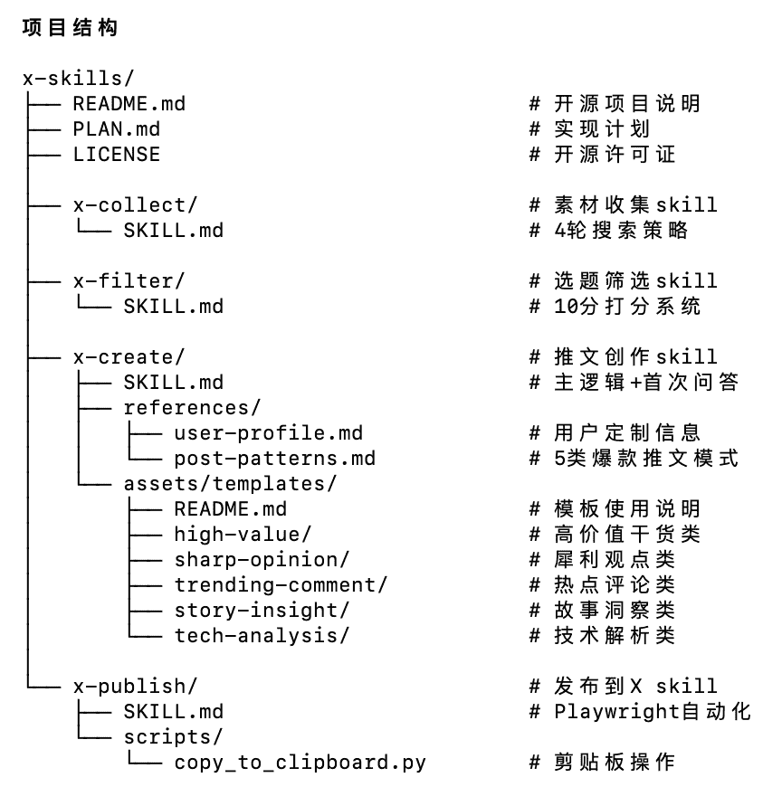

然后，把这四个Skill放入 ~/.claude/skills。

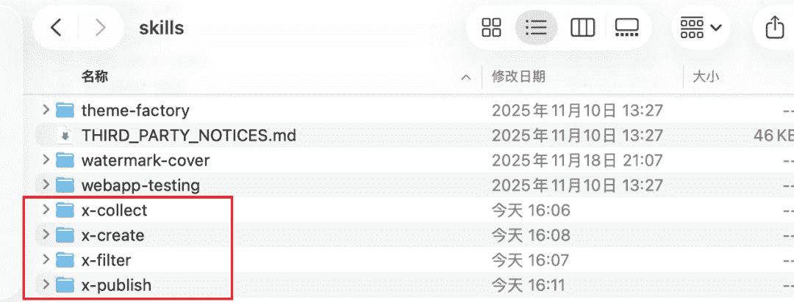

接下来看看 x-skills自动写X推文的效果：

```
Prompt：最近Claude Skills很火爆，我现在想写一篇关于Claude Skills的X推文，请你使用skills帮我完成。用x-collect 找相关选题（先确定今天是几号，然后找最近一周内的AI领域的热点），用x-filter筛选出一个打分最高的选题，用x-create创作推文，最后用x-publish把创作的推文保存到X的草稿箱。
```

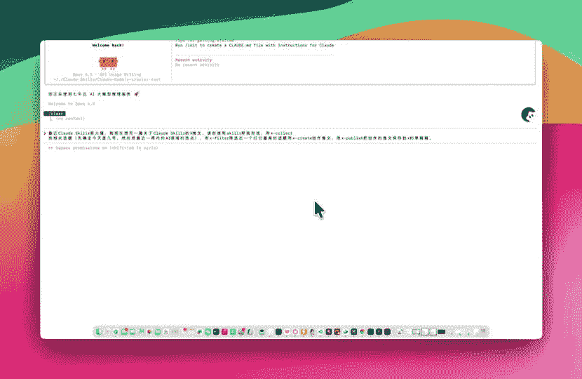

[21).mp4](https://internal-api-drive-stream.feishu.cn/space/api/box/stream/download/all/Cp4Tb2GWPo3difx0FFVcrr20nRh)

哇，效果还不错，我也没想到能这么顺利，一次就搞定了。

看来前期花大量时间对齐需求、制定计划还是非常有必要的。

PS：x-publish借鉴了x-article-publisher-skill的方式，使用了Playwright MCP（我觉得目前最好用的浏览器自动化MCP）模拟人的操作来将内容保存到草稿箱。

https://github.com/wshuyi/x-article-publisher-skill

这是目前我认为最稳妥的方案，因为如果你在X上直接使用API接口自动发布，有封号风险，为了安全，还是使用这种模拟人工操作的方式比较好。

我的x-skills Github地址：

https://github.com/kangarooking/x-skills

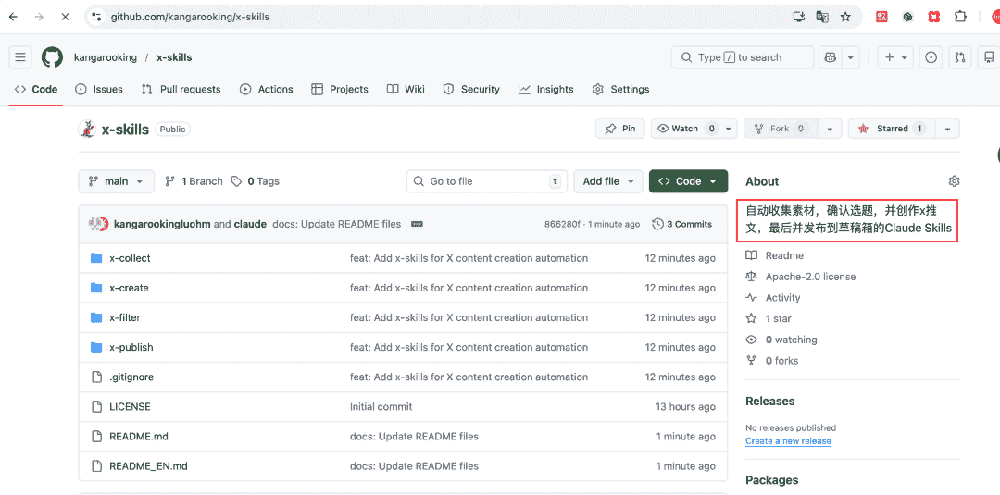

欢迎使用x-skills😄（顺便在Github帮忙点个Star吧）。

期待大家在评论区反馈各种问题，我会记录下来并优化。

我自己日常就会用它，后续根据大家反馈不断迭代，相信会越来越好用，也希望它能帮到你。

# 三、skills的适用场景，以及它的优缺点

我认为，目前 Claude Skills还是更适合用在创造性的场景 ，比如x-skills是用来创作X推文。

对于一些稳定性要求比较高，响应速度要求比较快的场景，我建议使用工作流（或者程序）+Agent节点的方案，能够保证稳定运行，每次结果的差异不大。

因为毕竟Skills是靠Agent主导的，即便里面能引入程序（脚本），但是Agent始终还是不稳定，每次生成的结果都会有差异的，而且执行速度比较慢（因为有思考、决策的时间）

**所以我觉得Skills**

优点：简单易用，很适合创造场景；

缺点：执行速度慢，稳定性没有工作流好。

# 四、给国内环境Claude Code装上Claude模型

眼尖的朋友可能已经在视频演示里猜到我用什么方案把Claude模型接入Claude Code了。

对，就是 **七牛云 **。

还记得20年初，我找到了第一份程序员工作（月薪刚好1w），是一家初创的境外电商公司。

当时我的工作内容之一是清洗数据，其中清洗图片的一个步骤就是把商品图片下载，上传到七牛云，获取新的图片链接。

说实话，我对七牛云是又爱又恨，恨的是它是我经常通宵、被当做牛马压榨的记忆之一，爱的是那段时光确实让我飞速成长了。

我对七牛云的第一印象就是云存储，没想到时隔6年，他们做起了大模型API中转站的生意。

把国内外主流大模型基本都支持了（国内站没有全标出来，但是内部可用）。

https://www.qiniu.com/ai/chat

官方详细的 Claude Code接入文档在这里：

https://developer.qiniu.com/aitokenapi/13085/claude-code-configuration-instructions

跟之前我讲过很多次的接入方式一样

修改Claude Code的配置文件 ~/.claude/settings.json 。

配置文件内容如下（注意保持json格式）：


```
{ 
&quot;env&quot;: { 
&quot;ANTHROPIC_AUTH_TOKEN&quot;: &quot;七牛云的apikey&quot;, 
&quot;ANTHROPIC_BASE_URL&quot;: &quot;https://api.qnaigc.com&quot; 
},
&quot;permissions&quot;: {
&quot;deny&quot;: [
&quot;Read(./.env)&quot;,
&quot;Read(./.env.*)&quot;,
&quot;Read(./secrets/**)&quot;
]
}
}
```

注意：配置里面不写模型名字的话，Claude Code默认就使用Claude模型。

ApiKey在这里获取：

https://portal.qiniu.com/ai-inference/api-key

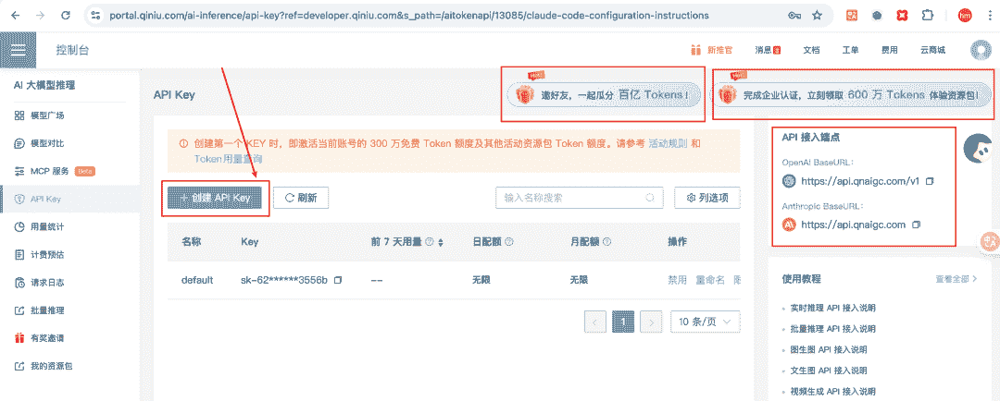

API接入端点同时支持了OpenAI API格式，和Anthropic API格式（这点还挺赞的）

发现还有Token可以领，额度看起来还不少。

那就顺便放一个我的邀请链接（你可以获得1000万Tokens，我也能得到500万Tokens，双赢～）：

https://s.qiniu.com/nyiAZz

这篇内容 花了我不少时间和心血， 我觉得还是很有价值的。

如果觉得对你有帮助，请顺手三连支持一下吧（这对我是莫大的鼓励）。

点击关注下方账号，你将感受到一个朋克的灵魂，且每篇文章都有惊喜。

能看到这里的都是凤毛麟角的存在！

如果想第一时间收到推送，也可以给我个星标⭐

**谢谢你耐心看完我的文章~**

---

# 📱交流合作

持续关注并更新skills 的相关资讯动态，**研****究报告，商业落地，常见问题，永久免费在线查看。已建立社群聊聊 skills 发展、应**用、对接及合作，邀请嘉宾讲课，没进群的可以扫码加入，群满可加大国🛰️ ID：zhangyuguo94s（备注：skills），已经在社群内的无需重复加入，开源知识库及社群学习全部为公开免费分享。

> **特别说明：**不要申请编辑和复制文档，有需求请进群加🛰️沟通。


**🛰️学习交流群**


**飞书学习交流群**


好友（ID：zhangyuguo94s）

**扫码交流、进群、合作**