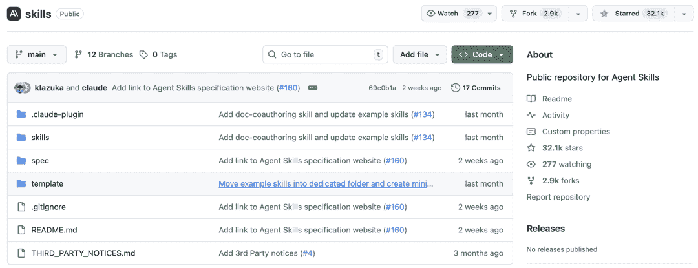
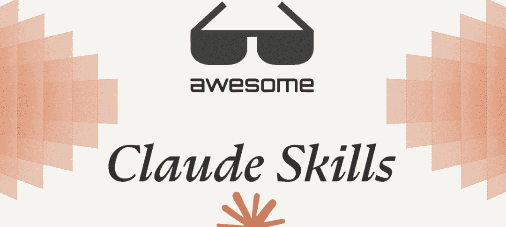
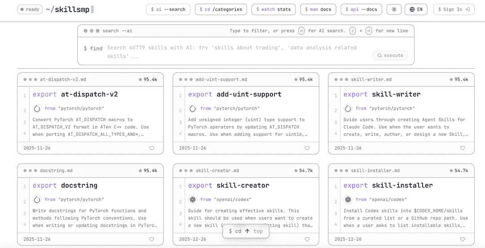
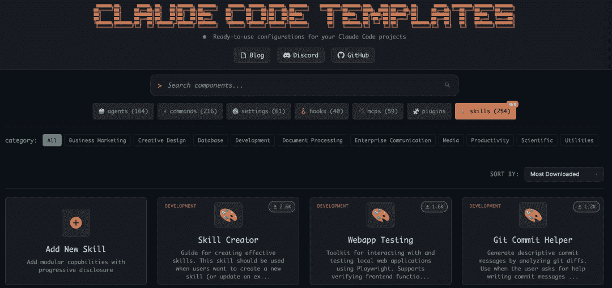
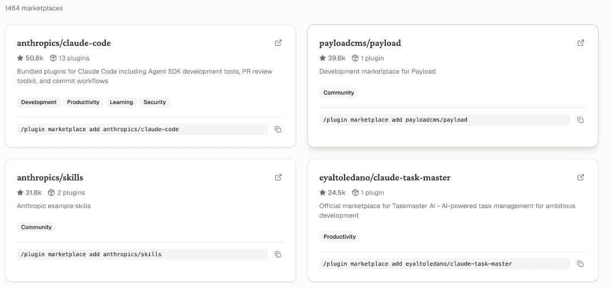

# 3.2 万人收藏的 Claude Skills，才是 AI 这条路上最值得研究的一套范式！

> 来源：[https://yunyinghui.feishu.cn/docx/TZHAd0rNxoRGacxwMPrcERMznSb](https://yunyinghui.feishu.cn/docx/TZHAd0rNxoRGacxwMPrcERMznSb)

> **公众号：**开源星探

> **发文时间：**2016 年 1 月 4 日

> **推荐理由：**这篇文章强调，Claude Skills 是提升 AI 应用效率的关键工具，适合开发者、办公自动化和创意工作者直接学习或复用。

最近 AI 圈子里什么最火？除了各种 **AI 模型的应**用，讨论热度最高的绝对是 Skills 。

它来源 Anthropic（Claude）官方发布的一个开源项目，一份 AI 技能指南。

很多人还在琢磨怎么写好一句提示词（Prompt）的时候，高阶玩家已经开始构建 Skills（技能）了。

**说白了，Skills 就是一套你写给 Claude 的**“说明书”和“SOP（标准作业程序）”。

把你工作中反复执行、有固定流程的任务，拆成 AI 能理解、能稳定复用、能自动执行的一套流程。

这不仅仅是玩法的升级，更是 AI 应用逻辑的一次质变。

今天这篇内容，把压箱底的 Claude Skills 资源图谱一次性分享给大家，特别是那个被称为“官方泄题”的神级仓库。

#### **神级 Skills 仓库**

如果只精读一个仓库，一定是它，Anthropic 官方 Skills 仓库：

https://github.com/anthropics/skills

收藏数已经突破 3.2 万人次了，真的是官方出品，必是精品！

**它**是 Anthropic 把 Claude 线上真正在跑的生产级能力，原封不动地拆解开来，摊在桌面上给你看。

你在 Claude.ai 网页版里用的那些丝滑功能 —— 比如“帮我开发一个 Web 应用”、“分析这个 PDF 文档”、“写一个贪吃蛇游戏并预览” ，它们背后的逻辑代码，都在这个仓库里！

#### **这个官方库到底牛在哪？**

① 办公自动化四大件（Office Suite）

官方展示了如何让 Claude 完美操控 Word/PDF/PPT/Excel。

创建、编辑、分析、重写、格式控制、边界处理等，每一步都写得极细，包括 Prompt 结构、参数含义、容错策略等。

你一眼就能看出来，这是给真实业务用的，不是给演示用的。

② 开发者工具箱（Developer Tools）

包含大量面向工程的 Skills：

+   • MCP Server

+   • Web 应用测试

+   • Artifacts 构建

+   • 自动化验证流程

这些 Skills 不是展示 AI 能写代码，而是让 AI 真正参与工程流程。

③ 创意类 Skill（Creative）

比如算法艺术、Canvas 设计、主题生成工厂等。

重点不在「好不好看」，而在于：

+   • 设计思路是否可复用

+   • 输入如何约束

+   • 输出如何稳定

这才是创意型 Skill 能规模化的关键。

总结一下： 这个库本质上是官方在教你，“怎么像我们一样开发 AI 应用”。

#### 除了官方，还有哪些 Skills 项目值得看？

再给大家分享 3 款比较高产的开源 Skill 精选仓库。

项目名称都一样： Awesome-Claude-Skills ，都系统性地整理了各种标准化的 "LLM Skills" 工作流。

涵盖了文档处理、开发工具、数据分析、内容创作、生产力工具等各大类别的实用技能。

> • https://github.com/ComposioHQ/awesome-claude-skills

> • https://github.com/VoltAgent/awesome-claude-skills

> • https://github.com/BehiSecc/awesome-claude-skills

可以系统性扫一遍，找灵感、找模式。

#### **Skill 聚合站**

如果你不想看代码，只想“拿来主义”，直接复制粘贴好用的 Skills，那么下面这三个网站就是你的 App Store。

这些站点已经把全网高手的 Skill 集合好了。

① https://skillsmp.com

② https://aitmpl.com/skills

③ https://claudemarketplaces.com

特点就是内容多、更新快、有分类、有搜索。

直接拿来用，比自己造轮子快得多。非常适合做 Skills 选型和二次改造。

#### **写在最后**

Claude Skills 的爆发，标志着我们从提示词工程迈向了流程工程。

哪怕是之前说的 Vibe Coding 的尽头，其实也是 Skills。

未来真正有价值的，不是谁的 Prompt 写得最花、谁一次能生成最多内容。

而是谁最懂业务流程、谁能把经验沉淀成 SOP、谁能把 SOP 交给 AI 稳定执行。

而 Claude Skills，正是这条路上最值得研究的一套范式。

GitHub:

> https://github.com/anthropics/skills

> https://github.com/ComposioHQ/awesome-claude-skills

> https://github.com/VoltAgent/awesome-claude-skills

> https://github.com/BehiSecc/awesome-claude-skills

---

# 📱交流合作

持续关注并更新skills 的相关资讯动态，**研****究报告，商业落地，常见问题，永久免费在线查看。已建立社群聊聊 skills 发展、应**用、对接及合作，邀请嘉宾讲课，没进群的可以扫码加入，群满可加大国微信 ID：zhangyuguo94s（备注：skills），已经在社群内的无需重复加入，开源知识库及社群学习全部为公开免费分享。

> **特别说明：**不要申请编辑和复制文档，有需求请进群加微信沟通。

**微信学习交流群**

**飞书学习交流群**

好友（ID：zhangyuguo94s）

**扫码交流、进群、合作**