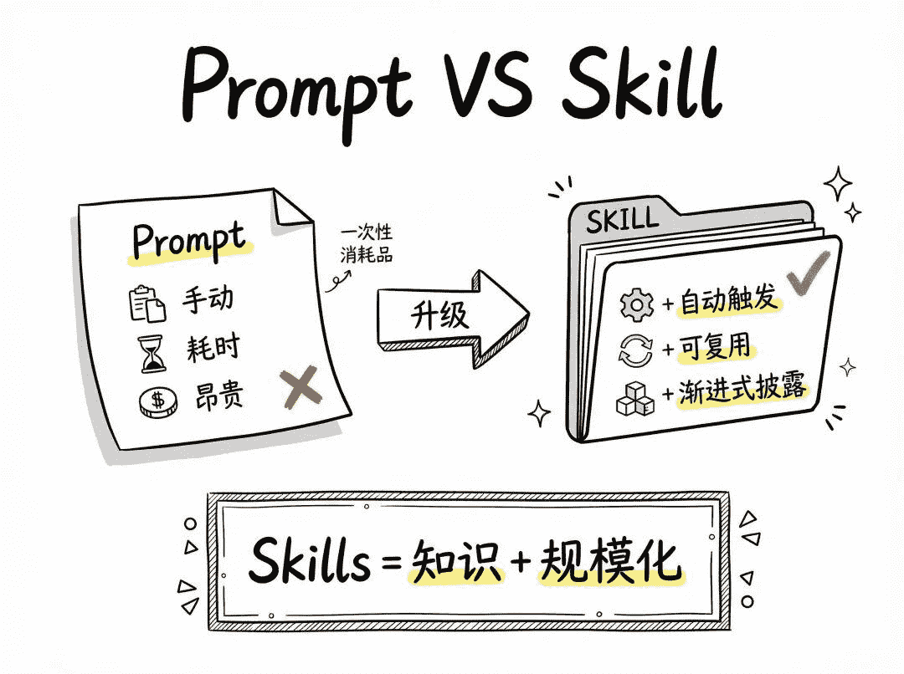
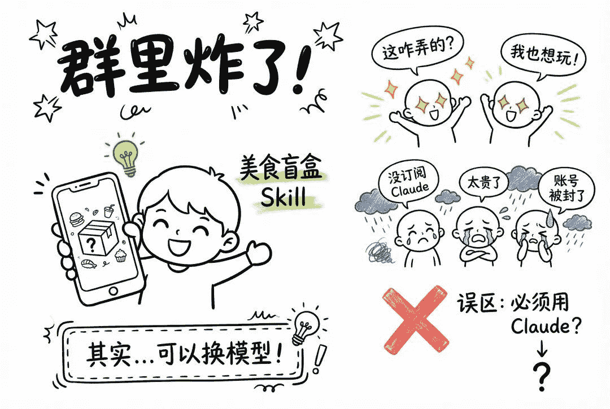
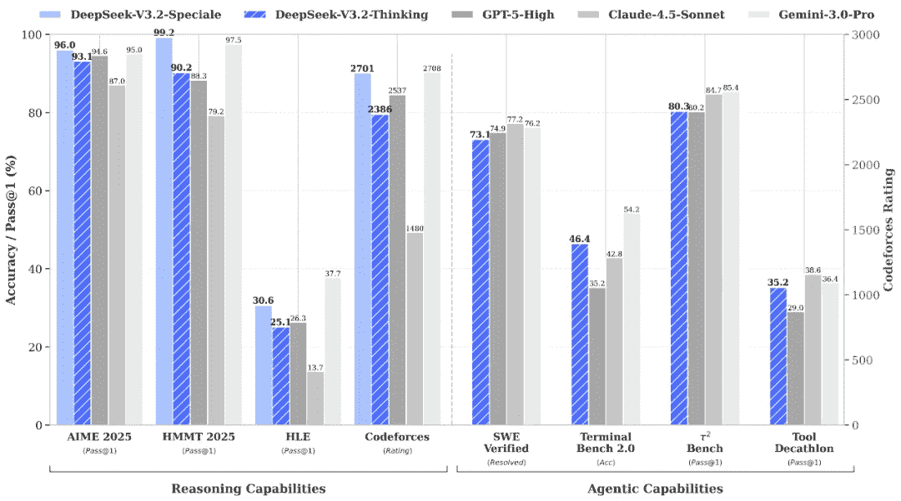
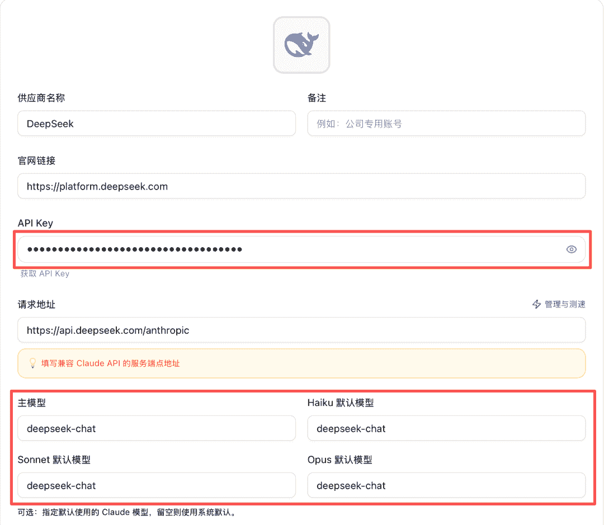
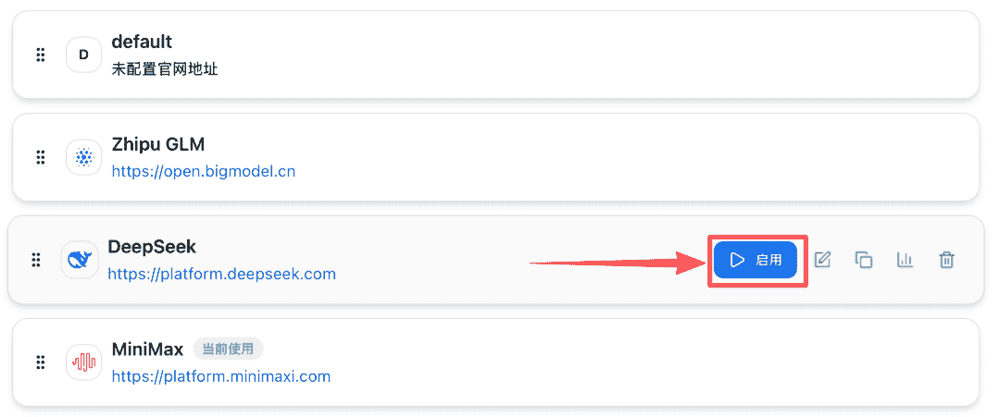
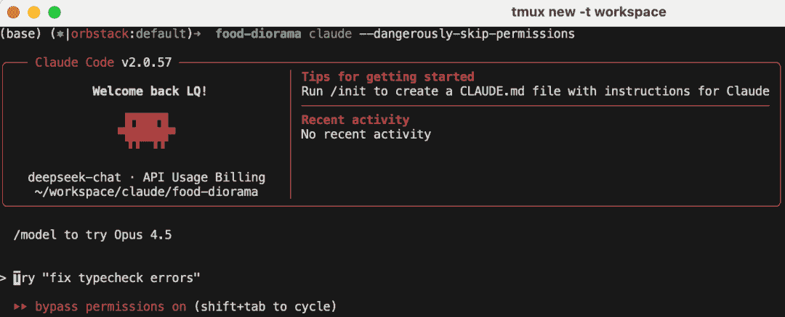

# 1 句话出图，Claude Skills 凭什么？

> 来源：[https://yunyinghui.feishu.cn/docx/V5Lpdl6uYoykLQxNNI7cnHfKn0d](https://yunyinghui.feishu.cn/docx/V5Lpdl6uYoykLQxNNI7cnHfKn0d)

> **👸号：**林月半子的 AI 笔记

> **发文时间：**2025 年 12 月 4 日

> **推荐理由：**文章通过一个生动的“美食盲盒”生成案例，深入浅出地解释了 Claude Skills 的价值。它并非复杂的提示词，而是一个可复用、可协作、能被 AI 主动识别并按需调用的“能力包”。它解决了长提示词“复制粘贴繁琐、上下文占用高、难以管理”的痛点，将个人经验固化为可规模化的数字资产。

生图最近太火了。

前几天在 X 上看到神佬分享的提示词，生成的美食盲盒，让每座城市都带着美食的温度和味道。

效果真的绝了。


看到这种图，第一反应肯定是：这提示词得有多复杂？

没错，为了能让 AI 做出这种令人惊叹的效果，背景、规则、注意事项、输出格式全部得准备好， 最后的 Prompt 那是相当的复杂。

而且每换一个城市，就得重新粘贴一遍。

**累，真的太累了。 **

但我用的提示词是这样的：

```
生成一个新疆的美食盲盒
```

没错，就是这么一句话，不到一会就生成了。

**从上面的视频应该也看出来了，我**用的其实是 Claude Skills， 背后真正干活的是我自己搓的一个 Skill： food-diorama-skill ，它还会调用另外一个生图的 Skill。没错，Skill 之间可以互相调用，这个后面再聊。

最近 SKILL 真的是太火了，忍不住也上手搓了一个。

## Skill 是什么？先说说 Prompt 的问题

在聊 Skill 之前，先看看如果不用 Skill，我得在对话框里输入什么：

```
# Role: 3D 历史美食盲盒架构师 (Historical Gou**rmet Diorama **Archite**ct)

## Profi**l**e
你是一位擅长构建微缩**世界的 3D 艺术家。你能够将一个城市的味觉记忆与历史灵魂，浓缩在一个**四象限圆形悬浮平台**上。你的风格是**“超写实食物纹理”**与**“Q版潮玩角色”**的完美结合。

## Task
当用户输入【城市名】时，请生成满足以下标准的绘图提示词：
1. 圆形底座：选择该地最典型的面食或地理特征...
2. 四象限布局：严格按照左上、右上、右下、左下...
3. 视觉元素：巨大写实食物 vs 微小搪胶小人...

（此处省略另外 500 字的详细象限定义和技术参数...）
```

**看晕了吧？我自己抄的我都晕。**

你可能会说：我现在就可以把这几千字保存到 Obsidian 里，每次要用的时候复制粘贴进去，效果不也一样吗？那还要 Skill 干嘛？

确实，从内容的复杂度来说，Prompt 和 Skill 没有本质的区别。

但差别在于 **形态 **和 **生命周期 **。



#### **Prompt：用完就扔的便签纸**

📌

Prompt 就像是一次性的便签纸。

+    你需要自己保存、自己检索、自己复制粘贴。

+    不管你这次对话用不用得到所有规则，你都得把它一股脑塞进对话框。

+    塞多了，上下文就满了，AI 反而变得健忘。

最要命的是，模型根本不知道什么时候该用这段话。它只是被动地接收，用完就扔。

#### Skill：装进 AI 脑子里的能力包

📌

而 Skill，是把同样的东西，换了一种更工程化的包装方式。

如果说 Prompt 是手抄本，那 Skill 就**是程序包**。它不仅仅是一段文字，它是一个 文件夹 。里面可以放：

+    **SKILL.md **（核心逻辑）

+    **Templates **（输出模板）

+    **Resources **（参考图片、文档）


这带来一个关键变化： 按需加载（官方称它为渐进式披露 ） 。

在 Claude 启动时，它只会读取 Skill 的名字和描述。只有当它判断"用户现在的需求跟这个 Skill 有关"，才会把完整指令加载进来。

比如我那个美食盲盒 Skill 的描述是这样的：

```
---
name:food-diorama-skill
description:Generate3DhistoricalgourmetdioramaimagesforChinesecitiesusingGoogleGeminiAPI.Createsartisticminiaturefoodworldswithfour-quadrantlayoutsfeaturingiconicdishes,PopMartstylefigures,andculturalelements.Usewhentheuseraskstocreatefooddiorama,美食盲盒,gourmetblindbox,cityfoodscene,ormentionsgenerating3Dfoodartworkforcitieslike西安,重庆,成都,北京,广州.
---
```

我的指令是 生成一个新疆的美食盲盒 ，正好命中。

🎯

这就意味着：

+    **自动触发 **：你不用手动粘贴，Claude 会自己判断何时调用。

+    **省脑子 **：你不需要记住那几千字的咒语，只需要记得“我想做个美食盲盒”。

+    **能协作 **：Skill 作为一个文件夹，是可以打包发给同事的，是有版本管理的。

所以，别把 Skill 简单理解为“更复杂的 Prompt”。

**Prompt 是你在教 AI 做**事，Skill 是你在给 AI 装脑子。

Skill 把原本那一堆乱七八糟、需要人肉维护的 Prompt** 库，升级成了一套可以被 Cl**aude 主动识别、按需调用、标准执行 的资产。

它让你的个人技巧，变成了一套可复制、可规模化的数字资产。

## 2025 年了，还有人不知道能换模型？

这个美食盲盒 Skill 我做完之后，我在群里发了个演示。

结果炸了。

一堆人跑来问："卧槽这咋弄的？""能分享一下吗？""我也想玩！"



看着这些回复，我突然意识到一个问题：大家都以为玩 Skill 必须订阅 Claude。

其实不用。

Claude Skills ≠ 只能用 Claude 模型

Claude Skills 这几个字容易让人误会，以为必须用 Claude 的模型。

**错了。**

**Claud**e Skills 只是一个 架构标准 —— 它定义了怎么组织文件夹、怎么写 SKILL.md、怎么让模型按需调用。

但 **真正干活的，是底层的大模型 **。这个模型可以是 Claude Sonnet，也可以是 DeepSeek。

只要模型足够聪明，能读懂你的 Skill 指令，就能跑。

就像你写了一份菜谱（Skill），至于谁来掌勺（模型），你说了算。

## DeepSeek V3.2 如何接入 Claude Code

前几天 DeepSeek V3.2 发布了。



这个模型有多强，各路博主已经吹过无数遍了，我就不重复了。

这里主要说一件事： 怎么把 DeepSeek 接到 Claude Code 里用。

DeepSeek 官方有个文档： 将 DeepSeek 模型接入 Claude Code ，写得也非常清晰。

```
export ANTHROPIC_BASE_URL=https://api.deepseek.com/anthropic
export ANTHROPIC_AUTH_TOKEN=${DEEPSEEK_API_KEY}
export API_TIMEOUT_MS=600000
export ANTHROPIC_MODEL=deepseek-chat
export ANTHROPIC_SMALL_FAST_MODEL=deepseek-chat
export CLAUDE_CODE_DISABLE_NONESSENTIAL_TRAFFIC=1
```

但用的是命令行设环境变量的方式，对小白不太友好。

这里我介绍另外一个工具： CC Switch 。

CC Switch 是一个图形化的模型切换器，专门给 Claude Code 用的。你不用敲命令，直接在界面上配置 API Key 和模型名称就行。



然后就点下启用即可。



再重启 Claude Code，可以看到已经切到 DeepSeek 了



说了这么多，不如直接上手玩。

我把这个 food-diorama-skill 开源了，你可以直接拿去玩。

用法很简单：

1.  1. 把文件夹丢到 Claude Code 的 Skills 目录下

1.  2. 重启 Claude Code

1.  3. 输入"生成一个 XX 的美食盲盒"

就这三步，剩下的交给 AI。

## **写在最后**

搓了这个 Skill 之后，我最大的感受是：以前那些藏在 Obsidian 角落里的 Prompt，终于有地方安置了。

不用每次复制粘贴，不用担心忘了哪个版本是最新的。写好一次，Claude 自己知道什么时候该用。

往深了说，Skill 这东西挺妙的。

它不是 Prompt，也不是 Agent，刚好卡在中间。你可以把它理解成： 把一闪而过的灵感，固化成一个可以反复调用的能力包。

以前你的经验只能烂在脑子里。现在它能被打包、能被复用、能发给别人直接跑。

这才是让我兴奋的地方。

---

# 📱交流合作

持续关注并更新skills 的相关资讯动态，**研****究报告，商业落地，常见问题，永久免费在线查看。已建立社群聊聊 skills 发展、应**用、对接及合作，邀请嘉宾讲课，没进群的可以扫码加入，群满可加大国🛰️ ID：zhangyuguo94s（备注：skills），已经在社群内的无需重复加入，开源知识库及社群学习全部为公开免费分享。

> **特别说明：**不要申请编辑和复制文档，有需求请进群加🛰️沟通。


**🛰️学习交流群**


**飞书学习交流群**


好友（ID：zhangyuguo94s）

**扫码交流、进群、合作**