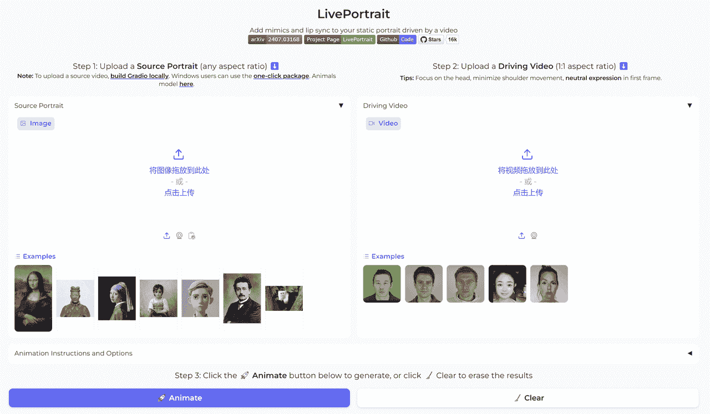
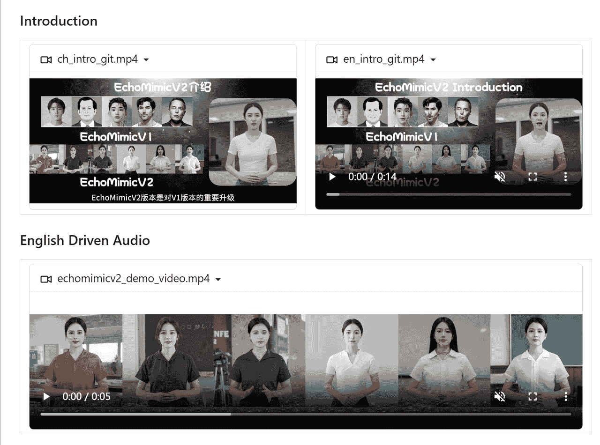
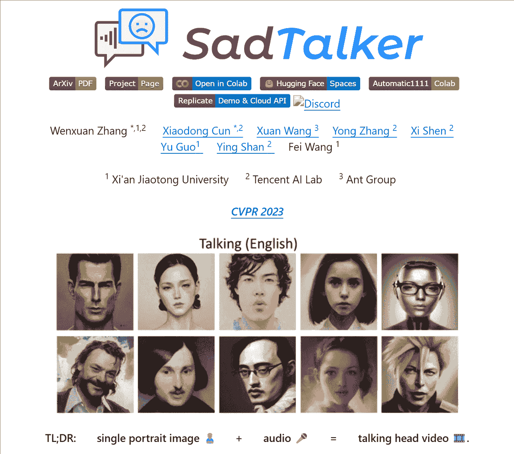
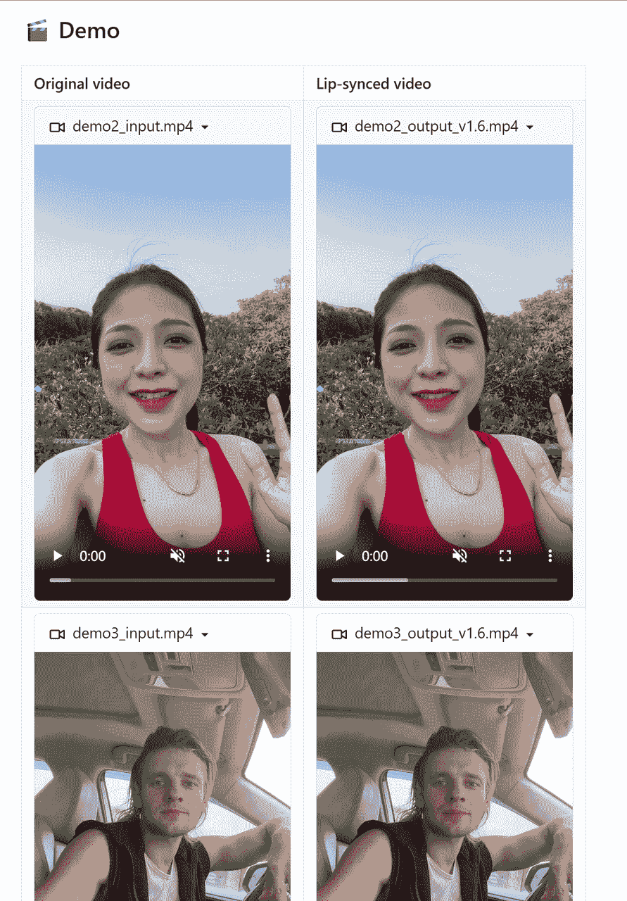
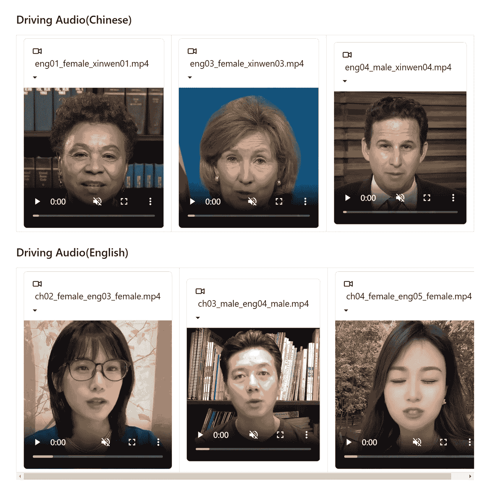
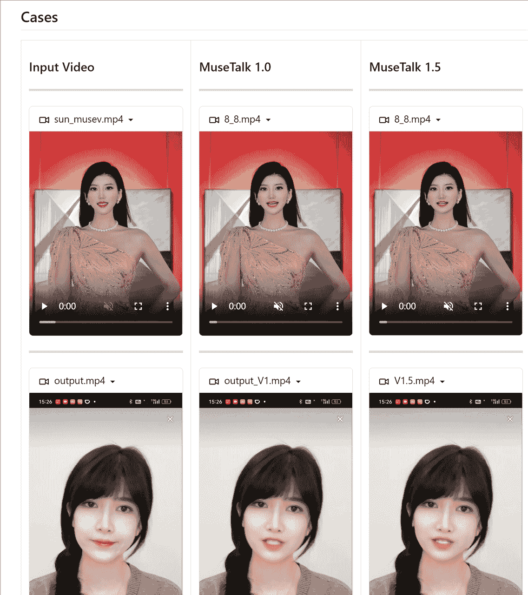
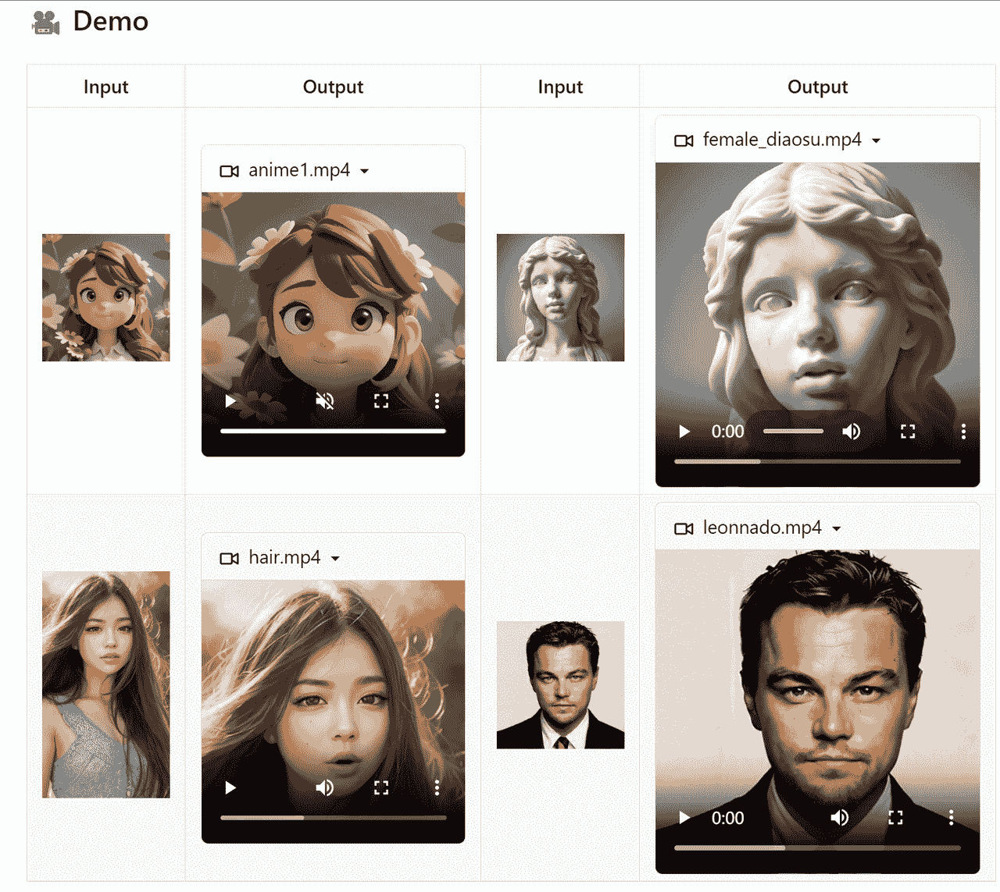
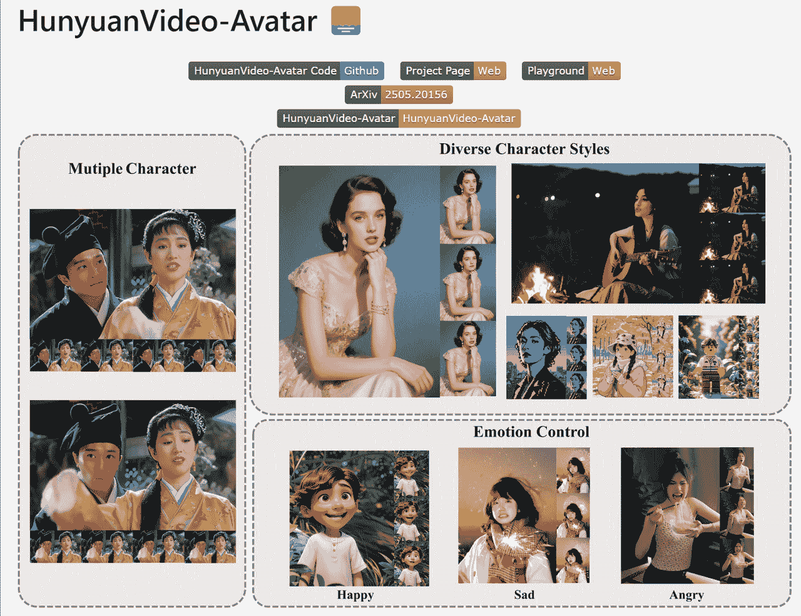
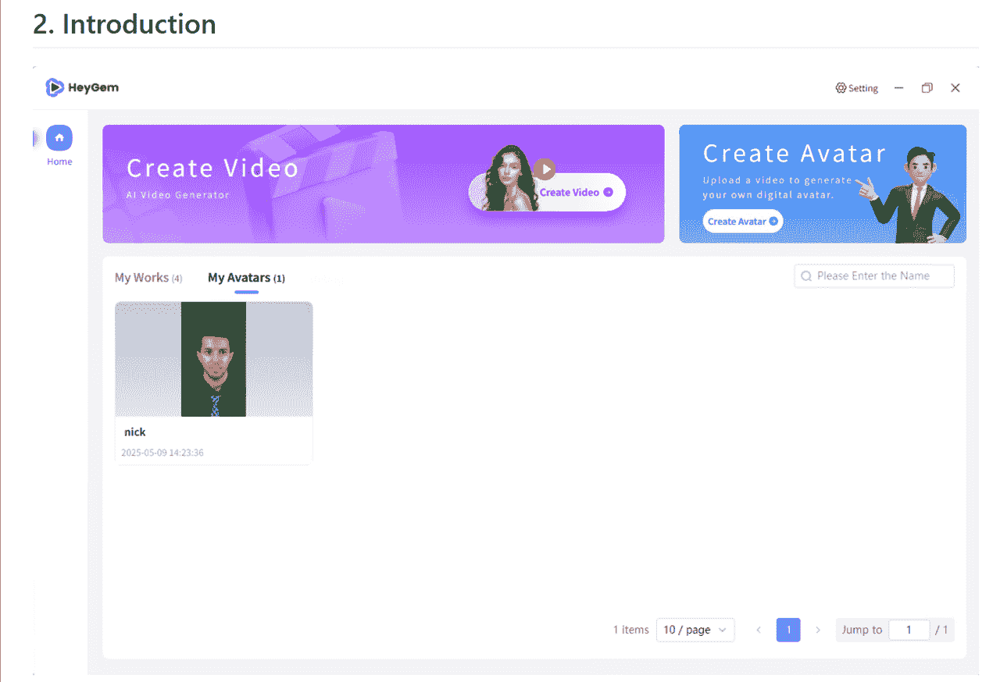
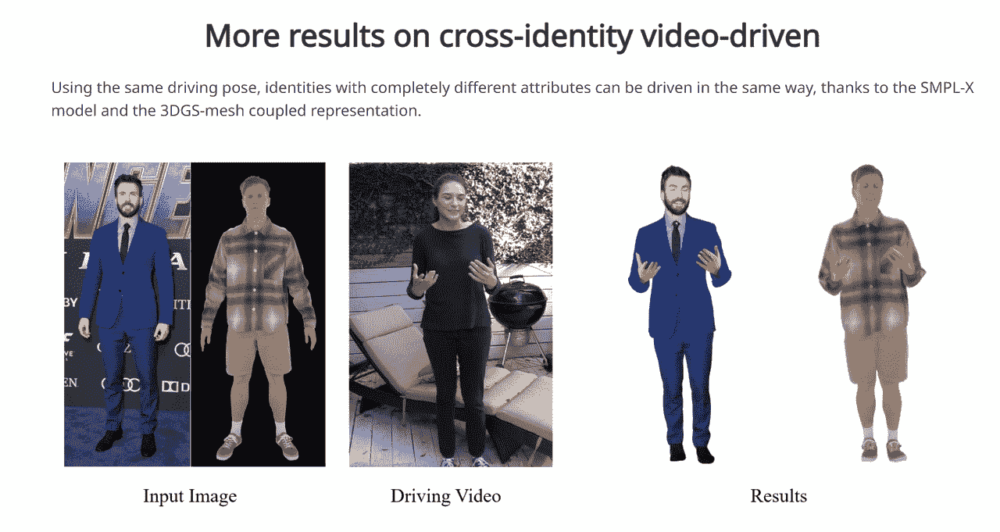

# AI 数字人开源项目大全

> 来源：[https://yunyinghui.feishu.cn/docx/YBMtdiOE3oGoAsxQDjxcpT8anKf](https://yunyinghui.feishu.cn/docx/YBMtdiOE3oGoAsxQDjxcpT8anKf)
> 适用人群：学习 AI 数字人开源项目的人
> 首发时间：2025 年 07 月 6 日
> 更新时间：2025 年 07 月 7 日
> 内容出品方：[Mix AI Lab](https://yunyinghui.feishu.cn/wiki/WhelwZnxQi55mpkOzatc3Xran5b?from=from_copylink)
> 内容出品人：
> 使用建议：在电脑端学习，体验将更加丰富。若想快速定位精确内容，你可以利用快捷键 Ctrl+F（Windows 用户）或 Command+F（Mac 用户）搜索关键词或短语，迅速找到你需要的信息。同时，你也可以直接点击学习导航的相关文字，便可一键直达学习板块。
> 持续更新数字人开源项目，永久免费在线查看，欢迎收藏转发支持，文末有惊喜，大国出品，必属精品。
> 🎯全网最接地气 AI 知识库：[「AI 实验室」知识库（AI 绘画、AI 写作、AI 视频等应用技能）](https://yunyinghui.feishu.cn/wiki/space/7340161844864598017?ccm_open_type=lark_wiki_spaceLink&open_tab_from=wiki_home)

## 前言

在数字人技术爆发式发展的当下，开源生态正成为推动行业创新的核心力量。无论是技术开发者、企业选型者，还是对 AI 数字人充满好奇的初学者，都需要一份系统、实用且兼具深度的指南，帮助快速穿越技术迷雾，找到最适合的落地路径。这份《AI数字人开源项目大全》正是为解决这一需求而生 —— 它不仅是一份技术文档，更是一本兼顾「选型参考」！无论你是想开发个性化虚拟助手，还是探索直播电商新场景，或是单纯好奇数字人如何动起来，都能从中找到答案。现在，就让我们从梳理数字人开源项目开始，解锁 AI 数字人的无限可能。

### 谁该读这份文档？

+ 技术开发者：快速定位高性价比方案，避免重复造轮子；
+ 企业 CTO / 产品经理：基于优劣势分析做技术选型，评估商用落地成本；
+ AI 爱好者：零基础入门指南，手把手实现第一个数字人作品；
+ 科研人员：追踪前沿项目（如 `AnimateAnyone`），把握技术演进脉络。

## 一、数字人开源项目汇总

### 1. 项目名称：`LivePortrait`

+ 开发者：快手（KwaiVGl）
+ 项目简介：视频驱动图片进行五官动画生成，身体无法运动，支持猫狗等动物形象。
+ 核心亮点：可对动物形象进行五官动画驱动，在非人类数字人场景中表现独特。
+ 技术优势：专注于五官动态捕捉，对动物形象的适配性强。
+ GitHub 项目地址：https://github.com/KwaiVGI/LivePortrait
+ 项目主页：https://liveportrait.github.io
+ 在线体验：https://huggingface.co/spaces
+ 使用建议：适合需要动物数字人、仅需五官动态的场景（如宠物虚拟互动）。

### 2. 项目名称：`echomimic` & `echomimic_v2`

+ 开发者：达摩院（antgroup）
+ 项目简介：声音驱动图片讲话，V2 版本支持头部和身体动作，肢体动作偏向讲解播报类场景。
+ 核心亮点：V2 版本效果提升明显，头部和身体动作自然，适配专业讲解场景。`EchoMimic V2` 不仅能够让虚拟形象开口说话，并且实现口型同步，还能添加头部和身体动作，进一步增强数字形象的表达力，首次实现身体动作口型全同步。
+ 技术优势：声音驱动精度高，肢体动作设计贴合播报需求，实用性强。
+ 开源地址：
https://github.com/antgroup/echomimic
https://github.com/antgroup/echomimic_v2
+ 在线 Demo：https://huggingface.co/spaces/fffiloni/echomimic-v2
+ 使用建议：优先选择 V2 版本，适合企业宣讲、知识科普等讲解类场景。

### 3. 项目名称：`SadTalker`

+ 开发者：OpenTalker
+ 项目简介：声音驱动图片生成讲话动画，demo 效果较 `echomimic` 差，已 2 年未更新。
+ 核心亮点：早期开源的声音驱动项目，基础功能完整。
+ 技术优势：开源时间早，社区有一定使用案例；劣势是长期未更新，效果落后。
+ 开源地址：https://github.com/OpenTalker/SadTalker
+ 使用建议：仅推荐用于简单测试或历史项目兼容，不建议用于生产环境。

### 4. 项目名称：`LatentSync`

+ 开发者：字节跳动
+ 项目简介：音频驱动视频实现对口型效果，近期有更新维护。
+ 核心亮点：更新及时，对口型同步性保持较好，适配视频类数字人场景。
+ 技术优势：依托字节技术积累，音频与视频的同步精度高，维护活跃。
+ 开源地址：https://github.com/bytedance/LatentSync
+ 使用建议：适合需要视频数字人对口型（如虚拟主播）的场景，优先考虑。

### 5. 项目名称：`Joy Gen`

+ 开发者：JOY-MM
+ 项目简介：声音驱动图片讲话，5 个月前上传，效果表现较好。
+ 核心亮点：项目较新，融合近期技术，声音驱动图片的动态效果自然。
+ 技术优势：新功能适配性强，效果优于部分旧项目。
+ 开源地址：https://github.com/JOY-MM/JoyGen
+ 使用建议：适合需要轻量化声音驱动图片（如虚拟客服头像）的场景。

### 6. 项目名称：`MuseTalk`

+ 开发者：TMElyralab
+ 项目简介：音频驱动视频对口型，2 个月前更新，维护频率高。
+ 核心亮点：更新频繁（2 个月前），对口型效果稳定，功能迭代及时。
+ 技术优势：音频与视频的同步逻辑优化较好，适合长期使用。
+ 开源地址：https://github.com/TMElyralab/MuseTalk
+ 使用建议：适合对时效性要求高的视频数字人场景（如实时直播对口型）。

### 7. 项目名称：`Wav2Lip`

+ 开发者：未明确（开源社区维护）
+ 项目简介：音频驱动视频对口型，提供商用接口。
+ 核心亮点：支持商业化使用，接口文档完善（https://docs.sync.so/quickstart#python）。
+ 技术优势：具备商用合规性，对口型效果成熟。
+ 开源地址：https://github.com/Rudrabha/Wav2Lip
+ 使用建议：适合企业级商用场景（如虚拟偶像直播、品牌数字人），可直接对接商用接口。

### 8. 项目名称：`Sonic`

+ 开发者：腾讯+浙大
+ 项目简介：一张静态照片 + 一段音频就能让画面中的人物“活过来”，自然地开口说话。
+ 核心亮点：腾讯与浙大合作研发，文档维护及时，降低使用门槛。
+ 技术优势：
1. 技术背景强：文档清晰，适合新手入门。
2. 分层对齐框架：`Sonic` 将动画分解为唇部同步、表情渲染、头部运动三层，逐级优化细节，使动作更自然流畅，告别机械感。
3. 跨身份泛化能力：无论是真人、动漫角色，还是不同角度的照片，`Sonic` 都能精准适配，生成高度契合的动画效果。
4. 长视频稳定性：传统工具在生成长视频时容易出现画面扭曲，而 `Sonic` 通过动态锚点技术，确保长时间生成的画面稳定无伪影。
5. 开源易用：项目已集成到 `ComfyUI`，开发者可快速上手，社区还提供了丰富的案例和教程。
+ 开源地址：https://github.com/jixiaozhong/Sonic
+ 使用建议：适合团队开发或新手学习，需声音驱动图片的场景（如虚拟助手头像）。

### 9. 项目名称：`MimicTalk`

+ 开发者：字节+浙大
+ 项目简介：声音驱动相关功能，8 个月未更新。
+ 核心亮点：字节与浙大技术结合，基础功能完整。
+ 技术优势：早期技术积累扎实；劣势是长期未更新，可能存在功能滞后。
+ 开源地址：https://github.com/yerfor/MimicTalk
+ 使用建议：仅推荐用于历史项目兼容，不建议新场景采用。

### 10. 项目名称：`Joy Hallo`

+ 开发者：京东
+ 项目简介：面向医疗咨询的数字人，7 个月未更新。
+ 核心亮点：专注医疗咨询垂直场景，功能适配医疗对话需求。
+ 技术优势：垂直领域针对性强；劣势是更新停滞，可能无法适配最新医疗场景。
+ 开源地址：https://github.com/jdh-algo/JoyHallo
+ 使用建议：优势是适配医疗咨询场景；劣势是 7 个月未更新，医疗场景迭代快，可能已过时。适合医疗行业简单咨询场景（如基础问诊引导），需注意功能局限性。

### 11. 项目名称：`hallo` & `hallo3`

+ 开发者：复旦+百度
+ 项目简介：5 个月前上传，结合 `cogvidex` 等模型，提供训练方法，demo 效果好（动态背景+人物动作自然），但训练成本高。
+ 核心亮点：动态效果出色，背景和人物动作自然，支持自定义训练。
+ 技术优势：模型组合能力强，动态生成效果领先；劣势是训练成本高（需算力支持）。
+ 开源地址：https://github.com/fudan-generativevision/hallo；https://github.com/fudan-generative-vision/hallo3
+ 使用建议：适合对效果要求高、有算力资源的场景（如影视级虚拟人动画）。

### 12. 项目名称：`fantasy-talking`

+ 开发者：阿里
+ 项目简介：结合 `wan` 模型，用户反馈效果优于 `latentsync1.5`。
+ 核心亮点：融合阿里 `wan` 模型，声音驱动的动态效果得到用户认可。
+ 技术优势：模型整合能力强，实际效果优于同类项目。
+ 开源地址：https://github.com/Fantasy-AMAP/fantasy-talking
+ 使用建议：适合需要高质量声音驱动效果的场景（如品牌虚拟代言人）。

### 13. 项目名称：`HunyuanVideo-Avatar`

+ 开发者：腾讯（Tencent-Hunyuan）
+ 项目简介：音频驱动图像，支持全身动作，demo 效果自然，官网有免费试用，但生成速度慢，无法实时聊天。
+ 核心亮点：全身动作自然，依托腾讯 `hunyuan` 视频模型，效果接近真实人物。
+ 技术优势：全身动态捕捉精度高；劣势是生成速度慢，不支持实时交互。
+ 开源地址：https://github.com/Tencent-Hunyuan/HunyuanVideo-Avatar
+ 使用建议：适合非实时场景（如预录制虚拟人视频、宣传片）。

### 14. 项目名称：`Duix.mobile`（含 `heygem`）

+ 开发者：硅基智能
+ 项目简介：实时数字人聊天，开源部分为固定数字人，自定义训练代码未开源，官网提供自定义 API。
+ 核心亮点：支持实时聊天，提供自定义 API（可扩展功能）。
+ 技术优势：实时性强；劣势是自定义训练代码未开源，灵活性受限。
+ 开源地址：https://github.com/duixcom/Duix.mobile
+ 使用建议：适合需要快速部署实时聊天的场景（如客服机器人），可通过 API 扩展功能。

### 15. 项目名称：`videoretalking`

+ 开发者：腾讯
+ 项目简介：2023 年开源，音频驱动视频对口型，2 年未更新。
+ 核心亮点：腾讯早期开源项目，基础对口型功能完善。
+ 技术优势：腾讯技术基础；劣势是长期未更新，效果可能落后。
+ 开源地址：https://github.com/OpenTalker/videoretalking
+ 使用建议：适合简单测试或历史项目维护，不建议新场景采用。

### 16. 项目名称：`Ultralight Digital-Human`

+ 开发者：个人开发者（anliyuan）
+ 项目简介：最近更新，提供训练自定义数字人的代码，轻量级，可在手机上运行。
+ 核心亮点：轻量化设计，支持手机端运行，允许用户训练自己的数字人。
+ 技术优势：适配移动设备，部署门槛低，自定义能力强。
+ 开源地址：https://github.com/anliyuan/Ultralight Digital-Human
+ 使用建议：适合移动端场景（如手机端虚拟助手），或个人开发者快速搭建自定义数字人。

### 17. 项目名称：`LiveTalking`

+ 开发者：个人开发者（lipku）
+ 项目简介：实时数字人，集成 `MuseTalk`（项目 6）、`Wav2Lip`（项目 7）等工具。
+ 核心亮点：实时性强，整合多个优秀项目功能，一站式实现复杂交互。
+ 技术优势：集成能力强，功能全面，支持实时聊天+对口型。
+ 开源地址：https://github.com/lipku/LiveTalking
+ 使用建议：适合需要实时交互的场景（如虚拟主播实时直播、在线客服）。

### 18. 项目名称：`TANGO`

+ 开发者：CyberAgentAlLab
+ 项目简介：8 个月前更新，音频驱动全身手势，专注于肢体动作生成。
+ 核心亮点：在全身手势驱动方面表现突出，音频与手势同步性好。
+ 技术优势：手势生成逻辑精细，适合强调肢体语言的场景。
+ 开源地址：https://github.com/CyberAgentAlLab/TANGO
+ 使用建议：适合需要丰富肢体动作的数字人场景（如虚拟讲师、舞蹈虚拟人）。

### 19. 项目名称：`VideoChat`

+ 开发者：Henry-23
+ 项目简介：集成 `MuseTalk`（对口型）和 TTS（文本转语音），组合方案全面。
+ 核心亮点：一站式整合“语音合成+对口型”功能，无需单独对接多个工具。
+ 技术优势：功能组合性强，降低开发成本。采用多模块级联的技术方案，使用语音识别（ASR）模块将用户输入的语音转为文本，然后将该文本输入大语言模型（LLM）模块生成相应的文本回复，文本转语音（TTS）模块会根据这部分文本内容进行语音合成，最后使用该语音驱动说话人生成（THG）模块，得到唇形同步的数字人说话视频。
+ 开源地址：https://github.com/Henry-23/VideoChat
+ 使用建议：适合需要完整“语音-口型”联动的场景（如虚拟人视频通话）。在阿里巴巴 `ModelScope` 魔搭社区上线的开源数字人实时对话 demo，无需预训练即可使用自定义的数字人形象进行实时对话，支持选择不同的数字人形象和音色，对话首包延迟可低至 3s。

### 20. 项目名称：`X-Portrait`

+ 开发者：字节跳动
+ 项目简介：11 个月前更新，Stars 数少，文档信息少。
+ 核心亮点：字节跳动技术背景，具备潜在技术优势。
+ 技术优势：字节底层技术支持；劣势是文档少、社区关注度低（调试难度大）。
+ 开源地址：https://github.com/bytedance/X-Portrait
+ 使用建议：适合有技术能力的团队研究使用，新手谨慎选择。

### 21. 项目名称：`AnimateAnyone`

+ 开发者：通义千问团队
+ 项目简介：停留在论文阶段，无开源代码，评论区讨论活跃。

## 21.项目名称：AnimateAnyone

+ **核心亮点**：通义千问团队研发，理念先进（论文阶段）。

+ **技术优势**：暂无实际代码；劣势是无法实际使用，仅可参考论文思路。

+ **开源地址**：`https://github.com/HumanAIGC/AnimateAnyone/issues`

+ **使用建议**：适合研究人员参考技术思路，不适合实际开发。

## 22.项目名称：HeyGem

+ **简介**：由 `duix.com` 团队打造的开源 AI 项目，是一款专为 Windows 系统设计的完全离线视频合成工具，可以精准克隆外貌和声音，将形象数字化，通过文字和语音驱动虚拟化身来创建视频。

+ **核心亮点**：成本低，通过自研的轻量化模型架构，将数字人制作成本压缩至传统方案的千分之一；超现实拟真，基于真实人物的高清视频数据训练，生成的数字人具备细腻的面部表情与肢体动作，能精准还原语音语调与微表情；多模态输入，支持文本驱动、图像定制、声音克隆。

+ **技术优势**：零门槛部署，开源代码+轻量级模型，无需专业硬件即可本地化运行；动态交互支持，支持实时语音交互与动作捕捉，可嵌入直播、客服等场景；跨平台兼容，生成内容适配短视频、虚拟直播、在线教育等多场景需求。

+ **开源地址**：`https://github.com/duixcom/duix.heygem`

## 23.项目名称：Genhuman

+ **简介**：由 xhadmin 团队开源的数字人项目，所有代码包括前端、后端以及用户端都是开源的。

+ **功能**：具有用户管理、应用管理、创作管理、创作配置、营销管理、平台管理、系统管理、权限管理等功能。

+ **开源地址**：`https://github.com/xhadmincn/genhuman`

## 24.项目名称：MNN-TaoAvatar

+ **简介**：由阿里巴巴淘宝 meta 技术团队研发的 3D 真人数字人技术，能在手机或 XR 设备上实现 3D 数字人的实时渲染以及 AI 对话的强大功能，为用户带来逼真的虚拟交互体验。

+ **技术优势**：基于先进的 3D 高斯泼溅技术，提供了一套全身互动式的真人数字人解决方案，通过多视角视频的输入，可以迅速生成具有高逼真度的数字人形象，能精准捕捉细腻的面部表情和手势动作，还能清晰呈现衣物细微的褶皱以及头发的自然摆动；端侧实时对话和端侧实时渲染，能在仅一部手机上即可运行算法模型以及 3D 模型。

+ **开源地址**：`https://github.com/alibaba/mnn/blob/master/apps/android/mnntaoavatar/readme_cn.md`

## 25.项目名称：Linly Talker

+ **开发者：**未明确提及

+ **项目简介：**基于 `Gradio` 的数字人对话项目，集成了多个模型，具备多种对话模式和交互方式。

+ **核心亮点：**功能丰富，涵盖多种对话与交互形式。

+ **技术优势：**集成多个模型，能实现多样化的对话及交互功能。

+ **项目链接：**`https://www.modelscope.cn/studios/AI-ModelScope/video_chat`

+ **创空间体验地址：**`https://www.modelscope.cn/studios/AI-ModelScope/video_chat`

+ **代码仓库：**`https://github.com/Henry-23/VideoChat`

+ **劣势：**在实时交互方面存在不足，无法支持实时对话，也不能进行流式输出。

+ **使用建议：**适用于对实时性要求不高的场景，如离线问答、非即时性的对话交互等；不适合实时直播互动等需要即时响应的场景。

## 26. 项目名称：HeyGem.ai

+ **开发者：**硅基智能

+ **项目简介：**高精度数字人模型，支持通过 1 秒视频或单张照片克隆形象与声纹，30 秒可完成建模，60 秒生成 4K 视频，在复杂光影或遮挡场景下也能实现 100%口型匹配。

+ **核心亮点：**克隆能力强大，建模和视频生成速度快，口型匹配精度高，支持 4K 视频生成。

+ **技术优势：**高精度克隆技术，快速的建模与视频生成效率，对复杂场景的适应性较好。

+ **开源地址：**`https://github.com/duixcom/Duix.Heygem`

+ **劣势：**对硬件配置要求较高，最低需要 NVIDIA 1080Ti 显卡，推荐使用 RTX 4070 + 32GB 内存，增加了使用成本和技术门槛。

+ **使用建议：**适合虚拟主播、企业宣传片制作以及多语言视频生成等场景；但需具备相应的硬件配置，硬件条件不足的用户谨慎选择。

## 27. 项目名称：OneShotOneTalk

+ **开发者：**中国科学技术大学等机构的研究团队开发

+ **项目简介：**采用单张图像生成全身动态数字人的技术，结合 3D 高斯点云与 SMPL - X 模型，可展现 200 +种微表情，在虚拟主持、AI 客服等领域有独特应用价值。

+ **核心亮点：**仅需单张图像即可生成全身动态数字人，能展现丰富的微表情。

+ **技术优势：**运用 3D 高斯点云与 SMPL - X 模型，实现了从单张图像到全身动态数字人的生成，微表情表现出色。

+ **开源地址：**`https://ustc3dv.github.io/OneShotOneTalk/`

+ **劣势：**实际应用中可能在模型生成速度、对复杂场景的适应性等方面存在潜在问题。

+ **使用建议：**适用于虚拟主持、AI 客服等需要生动、真实交互体验的场景；在使用过程中可关注其生成速度和对复杂场景的适应情况，以便及时调整应用方式。

# 二、开源项目优劣势分析

## 大厂/机构背景项目（稳定性较强）

+ **快手 LivePortrait**：优势是支持动物形象，视频驱动五官动画；劣势是身体无法动，适用场景有限。

+ 达摩院 echomimic 系列：优势是声音驱动效果好，v2 扩展头部和身体动作（适配播报场景）；劣势是肢体动作偏向固定场景，灵活性不足。

+ 字节跳动 LatentSync/X-Portrait：LatentSync 优势是近期更新、对口型精准；X-Portrait 劣势是文档少、关注度低。

+ 腾讯 HunyuanVideo-Avatar：优势是支持全身动作、demo 效果自然（两周前更新，较新）；劣势是生成速度慢，无法实时交互。

+ 阿里 fantasy-talking：优势是用户评价优于同类项目（如 latentsync1.5）；劣势是依赖 wan 模型，功能单一。

## 高校合作项目（技术扎实但维护可能滞后）

+ **腾讯+浙大 Sonic**：优势是近期更新文档，技术背景可靠；劣势是功能描述较简单，效果细节未明确。

+ **字节+浙大 MimicTalk**：优势是大厂+高校技术结合；劣势是 8 个月未更新，可能存在兼容性问题。

+ **复旦+百度 hallo 系列**：优势是 demo 效果好（动态背景+人物动作），提供训练方法；劣势是训练成本高，对硬件要求高。

## 个人/小团队项目（灵活但稳定性待验证）

+ **Joy Gen**：优势是 5 个月前上传（较新），声音驱动效果好；劣势是项目成熟度待验证，可能存在 bug。

+ Ultralight Digital-Human：优势是轻量级（可在手机运行），支持自定义数字人训练；劣势是个人开发，资源有限，功能深度可能不足。

+ **LiveTalking**：优势是实时性强（集成多个项目）；劣势是依赖第三方项目，兼容性和稳定性可能受影响。

## **功能单一但专注的项目**

+ MuseTalk/Wav2Lip：优势是对口型功能成熟（MuseTalk2 个月前更新，Wav2Lip 有商用接口）；劣势是仅支持对口型，无肢体动作。

+ CyberAgentAlLab TANGO：优势是音频驱动全身手势，功能独特；劣势是 8 个月未更新，可能落后于最新技术。

## **老旧/停滞项目**

+ **SadTalker**：优势是早期开源项目，有一定用户基础；劣势是 2 年未更新，效果落后于新项目。

## **特殊项目**

+ **AnimateAnyone**：优势是通义千问团队背景（技术潜力大）；劣势是无开源代码，仅停留在论文阶段，无法实际使用。

# 三、开源项目使用建议

## **按场景选择**

+ **实时聊天场景**：优先选 LiveTalking（个人开发，实时集成）、`Duix.mobile`（硅基智能，支持实时聊天，官网有 API）。

+ **播报/讲解场景**：选达摩院 echomimic v2（头部+身体动作适配）、腾讯 HunyuanVideo-Avatar（全身动作自然）。

+ **动物数字人场景**：仅快手 LivePortrait 支持，可直接选用。

+ **移动端/轻量需求**：选 Ultralight Digital-Human（手机运行，轻量级）。

+ **商用场景**：选 Wav2Lip（有商用接口，稳定性高）、腾讯 HunyuanVideo-Avatar（大厂背书，效果好）。

## **按功能需求选择**

+ **仅需对口型**：MuseTalk（2 个月前更新，最新）、Wav2Lip（有商用接口）。

+ **需要全身动作**：TANGO（音频驱动手势）、HunyuanVideo-Avatar（全身动作）、echomimic v2（头部+身体）。

+ **自定义训练需求**：hallo 系列（提供训练方法）、Ultralight Digital-Human（支持训练自己的数字人）。

> **避坑提示：**

+ 避免选择久未更新的项目（如 SadTalker，2 年未更；MimicTalk，8 个月未更），可能存在兼容性问题。

+ AnimateAnyone 无开源代码，仅适合研究参考，不适合实际开发使用。

+ 训练成本高的项目（如 hallo 系列），需评估硬件资源后再选用。

> 选择时需结合自身场景（实时性、动作范围、设备条件）和项目维护状态（更新频率、文档完整性），优先考虑近期更新、功能匹配且背景可靠的项目。

> **数字人 “三大模块”**：

+ **形象生成：**2D（图片 / 视频驱动）或 3D（模型建模）；

+ **驱动方式：**音频驱动（口型同步）、文本驱动（TTS 转语音后驱动）、动作捕捉（摄像头 / 传感器实时驱动）；

+ **交互逻辑：**是否支持对话（需集成 LLM）、是否实时响应。

# 学习与合作交流

1.持续关注并更新 AI 的**相关资讯动态，研究报告，赚钱案例**，常见问题，永久免费在线查看，无收费内容，目标是成为最大的免费 AI 学习社群。

2.已建立社群聊聊 **AI** 发展及应用，**没进群的可以扫码加入，群满可加 AI 研究爱好者大国🛰️ ID：zyg90s（备注：AI），已经在社群内的无需重复加入，开源知识库及社群学习全部为公开免费分享。

3.**关于文档负责人大国**：高帆文化 CEO，曾就职于教培大厂，目前创业，主攻研究 AI 落地应用、企业流量增长及达人 IP 孵化。

**5000 人飞书学习交流群**

**飞书学习交流群**

🛰️好友（ID：zhangyuguo94s）

**扫码加🛰️入🛰️群**

欢迎扫码了解更多 AI 数字人案例

**觉得有用欢迎留个赞**
