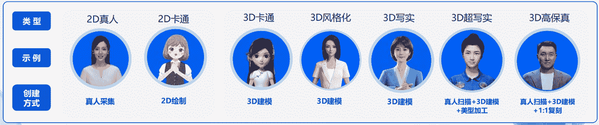

# AI 数字人直播避坑手册

> 来源：`https://yunyinghui.feishu.cn/docx/BBm8drmEmozLwaxdzkVceXMtntb`
>
> 首发时间：2025 年 7 月 24 日
>
> 更新时间：2025 年 7 月 24 日
>
> **内容出品方：**`https://yunyinghui.feishu.cn/wiki/WhelwZnxQi55mpkOzatc3Xran5b?from=from_copylink`
>
> **使用建议：**如果需要快速定位到精确内容，可以使用快捷键 `Ctrl +F`/`Command +F` 的形式，搜索关键字/词，查找你想要的内容。
>
> 为 AI 实验室社区小伙伴持续更新数字人直播的基本介绍，赛道选择，玩法流派，实战打法，避坑指南等全套学习内容，本手册主要是基于抖音和视频号平台，其他平台规则不同，玩法不同。

---

## 前言

AI 数字人直播，这个词汇在近几年以燎原之势席卷了整个互联网圈层，被描绘成一个近乎完美的商业解决方案：一个 7x24 小时不知疲倦、情绪稳定、形象完美的金牌主播，以极低的边际成本，像一台“永动印钞机”一样，为业务带来源源不断的流量和收益。

这描述是如此诱人，以至于成千上万的玩家，从个人创业者到大型企业，都怀揣着对“躺赚”模式的憧憬，前赴后继地涌入这个赛道。然而，理想的丰满映衬出现实的骨感，大国看到的是，更多的入局者在投入了数万乃至数十万的软件费、定制费和推广费后，换来的却是直播间寥寥无几的观众、平台冰冷的“违规警告”，甚至是永久封禁的“账号墓碑”，他们的“印钞机”梦想，最终变成了一台高速运转的“碎钞机”。

**核心症结何在？**

**答案在于一个普遍的、致命的误解：大多数人将 AI 数字人直播等同于“无人值守”，将技术等同于“捷径”，将“自动化”等同于“一劳永逸”。他们只看到了 AI 数字人的“形”（一个会动的虚拟形象），却完全忽略了直播的“魂”（实时互动、内容价值与情感连接）。**

本手册的使命，正是要彻底击碎这种幻想，为大家构建一个坚实、合规且高效的认知框架。我们将从 AI 数字人直播的本质构成开始，层层深入，剖析抖音与视频号两大平台的底层逻辑与审核红线；我们将摒弃华而不实的噱头，为您呈现经过实战检验的、可落地的玩法流派；我们还将汇总那些让无数“小白”踩坑的常见问题，并给出终极解决方案。

请相信，AI 数字人绝不是洪水猛兽，也不是万能钥匙。它是一把锋利的“双刃剑”。本手册将教会您如何握紧剑柄，而不是被剑刃所伤，让这把剑真正成为您披荆斩棘、开疆拓土的利器。

## 第一章：解读 AI 数字人直播的“四层核心”

在谈论任何“避坑”技巧之前，我们必须像解剖一台精密仪器一样，彻底理解 AI 数字人直播的内在构造，市面上五花八门的概念，最终都可以归结为以下四个核心层面，它们共同决定了一个数字人直播间的成败。

### 1.1 “形”——视觉层

这是用户进入直播间第一眼看到的东西，是直播间的“门面”和“颜值担当”。

**技术分类：**

+ **2D 数字人：** 基于静态图片或插画，通过软件让其实现眨眼、张嘴等简单动作。成本极低，但动态效果差，“纸片人”感强，极易被平台判定为低质内容。（高风险区）

+ **3D 数字人：** 通过 3D 建模创建的立体形象，可以实现更丰富的表情和肢体动作。根据精细度又分为：

+ **模板化 3D：** 软件内置的通用模型，千人一面，缺乏品牌辨识度。

+ **半定制 3D：** 在模板基础上进行捏脸、换装等修改，有一定个性。

+ **超写实/IP 化全定制 3D：** 根据真人形象或专门设计的 IP 进行高精度建模，效果最好，成本也最高。

**视觉避坑指南：**

1. **拒绝“恐怖谷效应”：** 一个似人非人的、表情僵硬的超写实数字人，比一个精致的卡通形象更让观众感到不适。选择形象时，宁要一个和谐的“假人”，不要一个怪异的“真人”。

1. **品质决定第一印象：** 粗糙的建模、锯齿状的边缘、不自然的贴图都会立刻拉低直播间的档次，劝退对品质有要求的用户。

1. **品牌调性统一：** 卖母婴产品的，用一个亲切可爱的卡通形象；卖科技产品的，用一个干练简约的写实形象，形象必须服务于品牌定位。

### 1.2 “声”——听觉层

声音是传递信息和情感的关键载体，是决定直播间“亲和力”的核心。

**技术分类：**

+ **TTS（Text-to-Speech）：** 纯文本转语音。这是最基础的方案，声音机械、无情感、多音字易读错，是“无人感”的重灾区。（极高风险区）

+ **AI 声音克隆：** 采集少量真人录音（通常为 10-30 分钟），通过 AI 模型训练，生成一个与该真人音色、语调高度相似的“数字声音”。这是目前兼顾成本与效果的主流选择。

+ **真人实时配音：** 后台运营人员通过麦克风实时说话，驱动数字人对口型。这是效果最好、互动性最强、最合规的方式，但对配音员的要求较高。

**听觉避坑指南：**

1. **彻底告别通用 TTS：** 如果你的预算只够用通用 TTS，那么请暂时放弃数字人直播。一个冰冷的声音是对用户耐心的巨大考验，也是在向平台算法大喊：“我就是无人直播！”

1. **声音克隆的精髓在于“情感”：** 在录制用于克隆的干稿时，录音者必须投入情感，用不同的语气（如疑问、强调、兴奋、沉稳）来朗读，这样克隆出的声音才会有“灵魂”。

1. **音画同步：** 声音和口型必须高度同步。延迟或错位会严重破坏沉浸感，让直播显得非常“山寨”。

### 1.3 “魂”——驱动与交互层

这是数字人直播的“大脑”和“神经系统”，是区分“木偶”与“生命”的本质所在，也是平台审核的核心焦点。

**驱动模式：**

+ **AI 纯驱动（脚本式/关键词式）：**

+ **脚本驱动：** 数字人严格按照预设的文稿顺序循环播报。本质是动态 PPT，毫无互动性。（必死无疑）

+ **关键词驱动：** AI 识别评论区的关键词，然后从知识库中匹配预设好的答案进行回复。这是市面上很多“AI 客服”的逻辑。在直播场景下，由于延迟、识别不准、无法理解上下文等问题，互动体验极差，很容易被识破。（高风险）

+ **真人驱动（人机结合）：**

+ **键盘驱动：** 后台运营官通过打字或点击快捷键，实时生成文本，由数字人用克隆声音念出，这是实现“精准互动”的基础。

+ **音频/面部驱动：** 后台运营官通过麦克风和摄像头，实时捕捉自己的声音、表情、头部姿态，同步驱动前台的数字人。这是目前最能模拟“真人感”的顶级方案。

**“灵魂”避坑指南：**

1. **“伪互动”自欺欺人：** 不要指望简单的关键词回复能骗过算法和用户。平台考核的是“有效互动率”，即你的回复是否真正解决了用户的问题，是否引发了后续的讨论。机械的“欢迎宝宝”、“感谢关注”在算法眼中价值极低。

1. **互动的核心是“人”：** 无论技术多先进，现阶段的 AI 都无法完全替代人来进行有深度、有情感、有策略的沟通。必须保证直播后台有一个清醒、专注、反应迅速的真人运营官。这个人，才是你数字人直播间的真正灵魂。

1. **延迟是天敌：** 从用户评论到数字人做出反应，整个链路的延迟必须控制在 2-3 秒以内。过长的延迟会造成对话断裂，让互动无法进行。

### 1.4 “骨”——内容与策略层

如果说“形、声、魂”是骨骼、血肉和神经，那么“内容”就是支撑这一切的“骨架”。没有优质的内容，再华丽的数字人也只是一个空洞的躯壳。

**内容构成：**

+ **直播脚本（话术）：** 不仅仅是产品介绍，更应包括开场破冰、福利设计、互动游戏、品牌故事、知识科普、逼单转化、下播预告等完整流程。

+ **产品/服务矩阵：** 引流品、利润品、福利品如何组合搭配。

+ **互动策略：** 何时抛出问题？何时进行抽奖？如何引导用户评论特定内容？

+ **视觉素材：** 配合讲解的贴片、背景、产品展示视频等。

**内容避坑指南：**

1. **拒绝成为“念稿机器”：** 即便是真人驱动，如果内容本身乏味枯燥，从头到尾只在念产品说明书，用户一样会流失。内容必须有价值、有趣味、有节奏。

1. **价值前置，营销后置：** 先通过提供有用的信息（如行业知识、使用技巧、避坑指南）建立信任，再进行产品推荐。这在抖音和视频号同样适用。

1. **动态脚本，而非静态脚本：** 优秀的运营官会根据直播间的实时数据（如在线人数、互动率、转化率）和用户反馈，动态调整话术的重点和节奏，而不是死板地执行一个脚本。

请牢记这个公式：一个成功的 AI 数字人直播间 = 适配品牌的“形” + 富有情感的“声” + 真人主导的“魂” + 价值驱动的“骨”。平台打击的从来不是数字人技术，而是“无人、无互动、无价值、类录播”的低劣直播行为。我们的核心战略思想，必须从追求“完全无人”的幻想，转变为追求“极致高效的人机协同”。

## 第二章：平台规则深度解读

这是本手册的“保命”章节，无视规则，一切技术和玩法都将归零。我们将深入到两大平台的算法中，告诉你它们喜欢什么，憎恶什么。

### 2.1 抖音：算法严苛

抖音拥有国内最成熟、最灵敏的直播风控系统。其算法像一个经验丰富的“老警察”，通过无数细微的线索来判断你的直播间是否“有鬼”。

**【抖音算法的核心裁决逻辑】**

抖音算法通过实时分析直播间的“多维数据流”来给你的直播间打分，这个分数直接决定了你的流量推荐。低分直播间将面临“黄牌警告 → 短时限流/断流 → 长期进入低流量池 → 封禁直播权限/账号”的阶梯式“死亡螺旋”。

【抖音数字人直播的“十大原罪”（必死雷区详解）】

1. **【挂机罪：空洞的在场】**

**罪行表现：** 长时间（通常超过 60 秒）对评论区滚动的用户问题、打招呼、提问置若罔闻；直播画面长时间无任何变化。

**算法窥探原理：** 系统会计算“评论/弹幕数”与“主播有效回应数”之间的比率，即“互动响应率”。同时，通过图像识别技术分析连续帧之间的变化率，变化率过低即判定为静止画面。

**终极规避策略：** “真人互动岗”是标配，不是选配！

+ **基础版：** 运营官使用快捷键对用户的点赞、关注、进入直播间进行及时的“口头”欢迎。

+ **进阶版：** 运营官筛选出有价值的用户问题，手动输入系统，让数字人进行精准回答。

+ **顶配版：** “人机共驾”，真人实时语音回复，实现零延迟情感互动。

1. **【呆板罪：规律的僵尸】**

**罪行表现：** 数字人只有一套或几套固定的、有规律的循环动作（如每 10 秒挥一次手）；表情单一，万年不变的“微笑唇”。

**算法窥探原理：** 模式识别算法。当系统检测到你的动作序列在 `N` 个周期内高度重复，就会打上“类录播”或“低质动态”的标签。

**终极规避策略：** **创造“无序的有序”**。

+ **丰富动作库：** 准备至少 20 个以上的动作（讲解、指点、思考、摊手等），由运营官根据讲解内容手动、无规律地触发。

+ **场景切换大法：** 准备 3-5 个不同的虚拟背景或机位（如远景、近景、产品特写），每 3-5 分钟手动切换一次，打破画面规律性。

+ **真人驱动：** 这是最根本的解决方案，真人的不规律性是 AI 难以模仿的。

1. **【复读罪：伪装的录播】**

**罪行表现：** 循环播放一段或几段录制好的音频/视频话术。

**算法窥探原理：** 这是最容易被抓的。平台的“音纹识别”和“视频指纹”技术，可以轻易地将你的直播内容与数据库中的已知录播素材进行比对，一旦匹配，立即处罚。

**终极规避策略：** **绝对禁止！** 这是自杀行为。直播的生命在于“实时”，任何试图用录播替代实时的行为都是对平台生态的直接挑衅。

1. **【机械罪：冰冷的声线】**

**罪行表现：** 使用通用 TTS 合成音，语调平直，无情感起伏。

**算法窥探原理：** 音频分析算法会检测音频的“韵律特征”。真人说话有自然的停顿、重音、语调变化，而标准 TTS 的波形图则相对平滑和规律。

**终极规避策略：** **投资声音！**

+ **首选：** 真人实时配音。

+ **次选：** 使用高质量的声音克隆服务，并提供富有情感的录音干稿。

+ **底线：** 至少使用支持“情感合成”（如高兴、严肃）的高级 TTS，并在文本中插入适当的停顿词（如“嗯”、“这个嘛”），模拟真人感。

1. **【空洞罪：无价值的叫卖】**

**罪行表现：** 直播间内容 90%以上都是“上链接”、“快去拍”、“买买买”，缺乏对产品价值的深度解读和对用户有用的信息。

**算法窥探原理：** 考核“用户平均停留时长”、“5 秒完播率”、“转粉率”等指标。低价值内容无法留住非强需求用户，导致这些数据极差，系统便会判定为“营销号”，降低推荐权重。

**终极规避策略：** **成为“专家”，而非“销售”**。遵循**“IFE”原则**：Informative（**信**息性）、Funny（趣味性）、Educational（教育性）。卖口红，先教三分钟“黄皮如何选色”；卖理财课，先讲一刻钟“普通人常见的理财误区”。

1. **【虚假罪：人设的伪造】**

**罪行表现：** 封面、标题、简介中宣传是“某某创始人/专家数字分身”，但直播内容空洞，一问三不知，与其身份完全不符。

**算法窥探原理：** 虽然算法难以直接判断身份真伪，但会通过用户的负面反馈（如举报、差评、低互动）来识别。一个“名不副实”的专家号，用户会用脚投票。

**终极规避策略：** **人设一致性**。如果要打造专家 IP，后台运营官或知识库必须具备相应的专业水平，能够回答上来该领域的垂类问题。

1. **【侵权罪：无授权的挪用】**

**罪行表现：** 未经授权使用明星、动漫 IP 形象；直播背景音乐、播放的视频片段有版权。

**算法窥探原理：** 平台的版权检测系统越来越完善，权利方也越来越积极地进行维权投诉。

**终极规避策略：** **版权自查**。确保数字人形象、声音、所有直播素材（音乐、图片、视频）均为原创或已获得合法商用授权。

1. **【诱导罪：灰产的伎俩】**

**罪行表现：** 用夸张福利（如送 iPhone）诱导用户进行刷屏、分享、关注等对直播间数据无真实意义的行为。

**算法窥探原理：** 监测评论区内容的“信息熵”。大量无意义的重复内容（如“888”、“我要福利”）会导致信息熵急剧下降，被判定为“水军”或“恶意营销”。

**终极规避策略：** **用价值换互动**。将福利与有意义的互动结合，如“评论区回答对今天知识点的朋友，抽一位送出礼品”。

1. **【遮挡罪：画面的违规】**

**罪行表现：** 直播画面被大面积的二维码、文字、贴图遮挡；数字人形象长时间遮挡产品关键信息。

**算法窥探原理：** 图像识别技术会检测画面的主要元素，当非主体内容的遮挡物面积超过一定阈值，或长时间遮挡商品，会判定为“违规引流”或“影响用户体验”。

**终极规避策略：** **保持画面干净清爽**。引流信息在特定环节（如福袋、口播）短暂展示即可。

1. **【低俗罪：内容的越界】**

**罪行表现：** 数字人形象衣着暴露，或话术内容涉及软色情、暴力、宣扬不良价值观等。

**算法窥探原理：** AI 内容审核+人工巡查。这是平台最高级别的红线。

**终极规避策略：** **坚守正向价值观**。数字人不是法外之身，所有适用于真人主播的内容规范，对数字人同样有效，甚至更严。

### 2.2 视频号：社交驱动

视频号背靠🛰️这棵大树，其底层逻辑与抖音有显著不同。它更强调“社交推荐”和“信任关系”。因此，它对数字人直播的包容度目前略高于抖音，但其“坑”也更具隐蔽性。

**【视频号的核心裁决逻辑】**

视频号的公域推荐相对克制，流量的爆发更依赖于用户在朋友圈、社群的分享。因此，算法更看重“分享率”、“私域反哺率（从社群/👸号进入直播间的人数）”以及“长线信任指标（如复看率、加企微率）”。

【视频号数字人直播的“五大暗坑”】

1. **【粗暴引流坑：破坏信任生态】**

**表现：** 从开播到结束，话术和画面始终围绕着“加我🛰️”、“扫码进群”，把直播间当成一个纯粹的引流工具。

**平台逻辑：** 🛰️生态的核心是“熟人/半熟人社交”，过度营销会破坏这种信任感，引起用户反感和举报。平台不希望直播功能变成一个“牛皮癣广告”的集散地。

**规避策略：** **“润物细无声”式引流**。将引流动作设计在价值交付之后。例如，直播分享了一小时的干货，结尾时说：“完整的 PPT 和更深度的交流，可以添加小助理的企业🛰️获取。”同时，善用直播间的“官方组件”（如企业🛰️、👸号名片）进行合规引导。

1. **【社交绑架坑：滥用分享机制】**

**表现：** 强制要求用户“分享到 3 个群截图领福利”，利用用户的社交关系进行病毒式传播。

**平台逻辑：** 这是典型的“诱导分享”，是🛰️长期以来严厉打击的行为。这种行为骚扰用户，透支其社交信用。

**规避策略：** **创造“自愿分享”的理由**。你的内容要足够好，让用户觉得“这个东西对我的朋友有用”，从而主动分享。福利可以作为催化剂，但不能是唯一的理由。话术应为：“如果大家觉得今天的分享有价值，欢迎把它推荐给需要的朋友。”

1. **【生态割裂坑：孤岛式直播】**

**表现：** 只在视频号上直播，完全不与👸号、社群、朋友圈进行联动。

**平台逻辑：** 视频号被设计为🛰️生态的“连接器”。一个健康的视频号直播，应该是“👸号预热引流 → 直播间互动成交 → 社群沉淀复购”的闭环。孤立的直播无法最大化利用🛰️的生态优势。

## 2.2 常见坑点与规避策略

+   **规避策略：** **打好“组合拳”**。直播前，👸号发文预告，社群发布海报；直播中，在社群实时互动，解答直播间来不及回复的问题；直播后，👸号发布复盘文章，社群内进行精华片段分享和售后服务。

1.  **【水土不服坑：错配用户调性】**

+   **表现：** 将抖音上那套“快节奏、强刺激、叫卖式”的玩法原封不动地搬到视频号。

+   **平台逻辑：** 视频号的用户年龄层更广，消费决策更偏理性，对深度、真诚、有信任感的内容接受度更高。过于浮夸的表演反而会引起反感。

+   **规避策略：** **调整内容节奏和风格**。放慢语速，增加知识性、故事性的内容比例，像一个朋友一样娓娓道来。数字人的形象和声音也应选择更沉稳、亲切的类型。

1.  【规则滞后幻觉坑：误判安全边界】

+   **表现：** 认为视频号目前管得松，就去尝试一些在抖音上早已被禁止的“擦边球”玩法。

+   **平台逻辑：** 视频号的商业化在加速，其规则体系也在快速完善和向抖音“看齐”。今天能钻的空子，明天可能就是被封禁的理由。

+   **规避策略：** **以终为始，坚持白帽**。不要抱有任何侥幸心理。从第一天起，就按照最严格、最合规的标准来运营。用做长线品牌的思维，去构建你的数字人直播事业。

## 2.3 抖音 vs 视频号：一张图看懂双平台差异

---

# 第三章：赛道选择

在战略层面决定成败的关键一步，选择一个“对”的行业，往往**比**后续的运营努力更重要。我可以告诉大家，并非所有行业都适合数字人直播。成功的关键在于，行业的商业模式、产品特性和用户决策路径，是否与数字人直播的核心优势高度契合。

数字人直播的核心优势是什么？

1.  7x24 小时在线（时间杠杆）： 永不疲倦，覆盖所有时间段的用户。

2.  **标准化输出（品质杠杆）：** 永远保持最佳状态，品牌形象 100%可控。

3.  **知识库驱动（效率杠杆）：** 能海量、精准地输出专业知识，解决重复性问题。

4.  **`IP` 资产化（资产杠杆）：** 打造永不塌房、永不离职的品牌私有 `IP`。

**基于这四大优势**，我将适合做数字人直播的行业和领域，划分为三个梯度：【黄金赛道】、【白银赛道】和【青铜赛道】。

---

## 第一梯度：【黄金赛道】天作之合，强烈推荐

这些行业的痛点与数字人的优势完美匹配，投入产出比最高，成功率也最大。

1.  **本地生活与专业服务**

+   **具体领域：** 法律咨询、财税规划、房产中介、装修设计、汽车销售、婚庆服务、招商加盟。

+   **适配度：** ⭐⭐⭐⭐⭐

+   **核心逻辑：** 这些行业是典型的“**高客单价、重决策、信息不对称**”领域。用户在付费前需要大量的专业信息来建立信任，且咨询的问题高度重复。

+   **痛点：** 获客成本极高；专业人士（律师、设计师、销售顾问）的时间宝贵，却被大量基础咨询占据；用户信任建立周期长。

+   **数字人解决方案：**

+   **24 小时价值前置：** 用“知识口播流”数字人，24 小时不间断地免费提供该领域的专业知识（如：如何避开装修合同的坑？离婚财产如何分割？）。这种“不求回报”的持续价值输出，是建立信任最快、成本最低的方式。

+   **线索筛选器：** 直播间成为一个“漏斗”，通过海量基础问答，筛选出真正有高意向、复杂需求的潜在客户，再通过`小风车`/私信引导给真人专家进行一对一跟进。极大提升了真人专家的工作效率。

+   **打造专业 `IP`：** 一个“某某法务数字人”、“某某设计院虚拟顾问”的形象，比一个冷冰冰的机构号更容易建立品牌认知和用户粘性。

+   **推荐玩法：** **知识口播流**

+   **成功关键：** **后台知识库的深度和专业度**。必须由行业真专家来构建和审核话术库。

2.  **教育培训与知识付费**

+   **具体领域：** `K12` 学科辅导、语言培训（英语、日语等）、考研/考公/考证、职业技能培训（编程、剪辑、财会）、兴趣爱好（书法、绘画、乐器）。

+   **适配度：** ⭐⭐⭐⭐⭐

+   **核心逻辑：** 教育的核心是**知识的传递和重复性练习**。

+   **痛点：** 名师资源稀缺且昂贵；学员问题集中且重复；答疑和督学需要耗费大量人力。

+   **数字人解决方案：**

+   **`AI` 助教/伴学官：** 在真人老师下播后，数字人可以 7x24 小时在线，带领学生复习核心知识点、进行单词/公式的循环记忆、解答常见问题。

+   **引流课“永动机”：** 将 9.9 元的引流体验课，用数字人来 7x24 小时不间断直播。用极低的成本，获取海量的潜在付费学员。

+   **个性化学习路径引导：** 通过与用户的互动，判断其学习水平和需求，并向其推荐合适的课程包。例如：“雅思 6 分和 7 分的同学，备考重点是完全不同的，我们先来看看 6 分段的同学主要应该攻克哪些……”

+   **推荐玩法：** 知识口播流 + 人机共驾流（正价课）

+   **成功关键：** **课程内容的体系化和颗粒度**。要将知识点拆解得足够细，方便数字人调用和组合。

---

## 第二梯度：【白银赛道】策略得当，大有可为

这些行业虽然也适合，但对策略和技术的要求更高，需要更精细化的运营。

1.  **标准化消费品**

+   **具体领域：** 美妆护肤、`3C` 数码、保健品、宠物用品、快消品（零食、饮料）。

+   **适配度：** ⭐⭐⭐⭐

+   **核心逻辑：** 这类产品虽然需要展示，但其核心卖点往往是成分、规格、功效、品牌故事等“信息点”，可以通过口播清晰传达。

+   **痛点：** 品牌自播需要大量主播，人力成本高且不稳定；难以保证 24 小时在线，错失夜间流量；品牌形象难以统一。

+   **数字人解决方案：**

+   **品牌形象代言人：** 打造一个完美契合品牌调性的超写实数字人（如“花皙子”案例），成为永恒的品牌面孔。

+   **“成分党”专家：** 让“中之人”由产品经理或研发人员担任，通过数字人形象，深度讲解产品成分、技术原理，建立专业信任，与纯娱乐型主播形成差异化。

+   **全时段覆盖：** 真人主播黄金时段直播，数字人在平播时段和深夜接力，用较低成本承接全天流量，不错过任何一个潜在客户。

+   **推荐玩法：** **人机共驾流**

+   **成功关键：** **数字人形象的品质**和**“中之人”的专业素养**。形象要精美，灵魂要有料。

2.  **信息资讯与媒体**

+   **具体领域：** 新闻快讯、财经播报、体育战报、天气预报、好物种草测评。

+   **适配度：** ⭐⭐⭐⭐

+   **核心逻辑：** 核心是**信息的快速、准确、无情绪传递**。

+   **痛点：** 新闻制作需要出镜、录制、剪辑，流程长；24 小时滚动播报需要多班倒，成本高。

+   **数字人解决方案：**

+   **`AI` 新闻主播：** 将写好的新闻稿或数据，通过 `API` 接口直接驱动数字人进行播报，实现 7x24 小时无人自动化新闻直播。

+   **垂直领域资讯站：** 打造一个 24 小时播报“币圈快讯”、“美股动态”或“电商资讯”的数字人频道，成为该领域信息的第一入口。

+   **推荐玩法：** **自动化口播流（`API/Script-Driven Automation`）**

+   **成功关键：** **信息源的可靠性和更新速度**。后端的内容生产和审核系统是核心。

3.  **心理咨询与情感陪伴（Mental Health & Companionship）**

+   **适配度：** ⭐⭐⭐✨ （3.5 星）

+   **核心逻辑：** 提供**情绪价值和初步疏导**。

+   **痛点：** 用户需求常在深夜爆发；专业咨询师费用高昂；很多人有“病耻感”，不愿对真人倾诉。

+   **数字人解决方案：**

+   **树洞/解忧杂货铺：** 打造一个温柔、耐心、善于倾听的数字人形象，24 小时在线陪伴，提供正念引导、基础心理学知识、讲舒缓的故事。

+   **隐私保护：** 用户更愿意对一个“非人”的形象倾诉，没有被评判的压力。

+   **专业引流：** 在提供基础情绪安抚后，明确告知用户数字人的局限性，并提供专业心理咨询师的预约通道。

+   **推荐玩法：** 知识口播流（需经心理学专家设计话术）

+   **成功关键：** **伦理边界和风险控制**。必须在直播间明确声明“本直播不替代专业心理治疗”，话术要极度严谨，避免给出不当建议。

---

## 第三梯度：【青铜赛道】挑战巨大，慎重入局

这些行业严重依赖真人体验和非标展示，数字人的局限性会被放大。

1.  **非标品服饰鞋帽**

+   **适配度：** ⭐⭐

+   **核心逻辑：** 用户决策严重依赖**上身效果、面料质感、动态垂坠感**。

+   **痛点：** 数字人无法真实展示衣服的材质、版型和上身效果。一件衣服在不同身材的人身上效果迥异。

+   可能的“绕行”玩法（不推荐主流使用）：

+   **`AI` 造型师/评论员：** 主画面播放真人模特试穿的视频录像，数字人作为“时尚评论员”在一旁讲解搭配技巧、设计亮点和面料知识。将数字人的功能从“展示”变为“解说”。

+   **虚拟试衣：** 这需要极其高阶的 `AR` 技术，目前成本和效果还远未达到大规模商用的水平。

2.  **餐饮美食与现场体验**

+   **适配度：** ⭐

+   **核心逻辑：** 核心卖点是**色、香、味、触**等感官体验。

+   **痛点：** 数字人无法“吃播”，无法传递食物的美味和现场的热闹氛围。你无法让一个数字人告诉你“这个烤肉滋滋冒油，外焦里嫩，入口即化”。

+   **可能的“绕行”玩法：**

+   **品牌故事讲述者：** 在餐厅的线下大屏播放，或作为线上“品牌文化宣传员”，讲述品牌历史、食材来源等，而非直接卖货。

+   **虚拟点餐员：** 在线上引导用户了解菜单、领取优惠券，然后到店核销。

### 如何判断你的行业是否适合？

> 请你问自己三个问题：

1.  我的核心卖点是“信息”还是“体验”？ 如果是前者（知识、数据、规格、方法论），则非常适合。如果是后者（手感、口味、上身效果），则非常不适合。

2.  我的客户是否有大量重复性的基础问题？ 如果是，数字人可以成为你最高效的“初级客服”和“销售助理”。

3.  我的业务是否受限于服务人员的时间和精力？ 如果是，数字人可以帮你打破这个瓶颈，实现 24 小时的“虚拟分身”运营。

> **最终**的忠告是：不要为了用数字人而用数字人。要从你的商业本质出发，把数字人看作是一个能放大你核心优势、解决你核心痛点的强大工具。用对了地方，它能让你事半功倍；用错了地方，则会事倍功半。

# 第四章：玩法流派

理解了规则，我们就可以在“安全区”内，选择最适合自己的战术打法。

## 3.1 自杀式玩法：纯 `AI` 读稿流（请直接跳过）

+   **配置：** 廉价 `2D` 数字人 + 通用 `TTS` + 固定话术脚本。

+   **操作：** 上传脚本，点击“开始直播”，然后去喝茶。

+   **结局：** 快则 3 分钟，慢则半小时，收到平台警告，然后限流或封禁。

+   **专家点评：** 这不是一种“玩法”，而是一种“测试平台封号速度”的行为艺术，任何向你推销这种模式的服务商，请立刻拉黑。

## 3.2 入门级玩法：知识口播流（低成本合规起步）

**这是目前中小型企业和个人创业者试水数字人直播的最佳入门选择。**

+   **核心逻辑：** 将直播间打造成一个垂直领域的“24 小时线上咨询台”或“知识讲堂”。

+   **适用行业：** 法律、财税、教育、房产、本地生活、心理咨询等需要建立专业信任的行业。

+   **配置清单：**

+   **形象：** 半定制 `3D` 数字人（稳重、专业）。

+   **声音：** 创始人或核心专家的声音克隆。

+   **内容：** 一个结构化的“行业知识库”（以 `FAQ` 形式整理）。

+   **灵魂：** **一名合格的后台运营官！**

+   **实战工作流（运营官手册）：**

1.  **开场（前 15 分钟）：** 控制数字人播报今日核心主题和直播间福利，进行流量预热。

2.  **互动响应（持续）：**

+   **眼睛：** 紧盯评论区，将有价值的用户提问复制下来。

+   **大脑：** 判断问题类型。是通用问题还是个性化问题？

+   **双手：**

+   对于通用问题，在知识库中找到对应答案，点击“播报”。

+   对于个性化问题，快速组织语言，手动输入，让数字人进行“一对一”解答。

+   使用快捷键对用户的点赞、关注进行口头感谢。

3.  **节奏控制：** 每讲解 10 分钟知识，穿插 1-2 分钟的产品/服务介绍和福利引导，张弛有度。

4.  **场景切换：** 根据讲解内容，手动切换虚拟背景（如：讲解案例时切换到案例展示背景）。

+   **风险与成本：** 风险较低，主要成本在于运营官的人力成本和软件年费。

## 3.3 主流级玩法：人机共驾流（效率与效果的完美平衡）

这是当前最受品牌方青睐，也是平台最鼓励的模式。它真正实现了“人”与`AI`的优势互补。

+   **核心逻辑：** 后台有真人主播（中之人），但 ta 无需出镜，只需通过设备将自己的声音、表情、动作实时同步给前台的完美数字人形象。

+   **适用行业：** 所有行业，尤其适合美妆、服饰、珠宝等对主播颜值、状态要求高的行业，以及希望规模化运营 `MCN` 机构。

+   **配置清单：**

+   **形象：** 高精度定制 `3D` 数字人。

+   **声音&驱动：** 真人主播 + 高品质麦克风 + 支持面部/音频驱动的数字人软件。

+   **辅助：** 一名副播/场控，负责上链接、发福袋、后台操作。

+   **颠覆性优势：**

1.  **告别颜值/状态焦虑：** 真人主播无需化妆，哪怕通宵熬夜，前台的数字人永远容光焕发。

2.  **`IP` 资产化、可复制：** 品牌可以打造一个永不离职、永不塌房的虚拟代言人。一个优秀的中之人可以同时“扮演”多个不同风格的数字人 `IP`。

3.  **互动天花板：** 实现与真人主播无异的、有情感、有温度、零延迟的实时互动，完美规避所有“无人感”风险。

+   **风险与成本：** 合规风险极低。成本主要在于更高阶的软件费用、定制形象费用以及“中之人”的培养和薪资。对“中之人”的口才、临场反应能力要求依然很高。

## 3.4 大师级玩法：品牌 `IP` 生态流（数字时代的品牌叙事）

这已超越“直播带货”的范畴，进入到品牌战略层面。

+   **核心逻辑：** 将数字人视为一个独立的、有世界观、有故事、有性格的明星 `IP` 来长期培养。直播只是其与粉丝互动的一个场景。

+   **适用对象：** 预算充足、有长远品牌规划的大企业。

+   **操作模式：**

1.  **`IP` 定义：** 聘请专业团队设计 `IP` 的形象、背景故事、性格、口头禅。

2.  **内容矩阵：** 为 `IP` 在全网（抖音、`B` 站、🧣、📕）开设账号，通过高质量的短视频、`CG` 动画、图文内容来丰满人设。

3.  **事件营销：** 让数字人发布虚拟单曲、参加虚拟时装周、与其他品牌进行跨界联动。

4.  **直播互动：** 直播内容更侧重于粉丝互动、人设展现，带货只是“顺便”或以联名款形式进行。

+   **专家点评：** 这是数字人应用的终极形态，是“品效合一”的至高境界。对普通玩家而言，可望而不可即，但其“内容为王、人格先行”的思路，值得所有玩法借鉴。

# 第五章：`AI` 数字人直播高级实战案例

## 案例一：知识口播 24 小时在线法律咨询

+   **案例名称：** 某律师行业数字人“普法官”

+   **所属行业：** 法律服务

+   **平台：** 抖音

+   **玩法流派：** 知识口播流（低成本合规起步的典范）

1.  **案例背景与痛点**

“某律师事务所”是一家主营婚姻家事、劳动纠纷的中型律师事务所。在采用数字人直播前，他们面临着传统法律行业共有的三大痛点：

+   **获客成本高昂：** 传统渠道（如搜索引擎竞价、线下广告）的线索成本极高，且转化率不稳定。

+   **信任建立周期长：** 法律服务是高客单价、重决策的消费，用户在付费前需要建立极强的信任感，而一个新用户从接触到信任，往往需要数周甚至数月的沟通。

+   **专业人力重复劳动：** 大量潜在客户咨询的问题高度同质化（如“离婚怎么分割财产？”“公司不交社保怎么办？”），这些基础问题占用了专业律师大量宝贵时间，而这些时间本可以用于处理更复杂的案件。

2.  **数字人直播间配置清单**

+   **形象（形）：** 选择了一款**半定制的 `3D` 写实数字人**，命名为“普法官”。形象设计为一位 40 岁左右、面容和善、眼神坚定的男性，身着得体的律师袍。这个形象旨在传递“专业、权威、值得信赖”的心理暗示。

+   **声音（声）：** 采用了**律所创始合伙人的声音克隆**。他们采集了创始人 20 分钟讲解常见法律问题的录音，由 `AI` 训练生成了音色沉稳、吐字清晰、略带磁性的“普法官”专属声音。这极大地增强了直播间的 `IP` 真实感和权威性。

+   **驱动与交互（魂）：** 后台真人运营官（键盘驱动）+ 核心知识库。

+   **灵魂人物：** 后台并非律师，而是一名经过严格培训的律所助理。这名助理对律所的核心业务和常见问题应对方案了如指掌。

+   **核心大脑：** 律所花费一周时间，将过去五年接待过的上万个咨询问题进行整理，归纳出超过 1000 个高频 `FAQ`，并由专业律师撰写了标准、严谨的回答文案，构建成一个强大的后台“知识库”。

+   **内容与策略（骨）：** 直播间定位为**“你的 7x24 小时免费法律顾问”**。内容上，严格遵循“价值前置”原则。

3.  **直播间运营工作流详解**

采用“三班倒”制度，每班一名律所助理，确保直播间 24 小时在线。以下是任意一个 8 小时班次内，后台运营官“小张”的典型工作流程：

+   **【0-15 分钟：开场与预热】**

+ 小张登录后台，启动直播。他首先通过快捷键，让“普法官”播报一段精心设计的开场白：“大家好，我是普法官，一个能 24 小时陪您聊法律的数字人。在观正法务直播间，不管您遇到的是婚姻、财产还是劳动问题，都可以打在评论区，我会尽力为您提供初步的法律指引。记得点亮灯牌，加入粉丝团，不错过每一场干货分享。”

+ 同时，他会手动设置好本时段的直播主题，例如“今晚 8-10 点，我们重点聊聊‘婚前协议’的那些事”。

+ 【15 分钟 - 7.5 小时：核心互动循环】

+ **监控与筛选：** 小张的双眼像雷达一样扫视着飞速滚动的评论区。

+ 看到用户“迷茫的小羊”问：“我老公婚前买的房，婚后加了我的名字，离婚怎么分？”

+ **大脑判断：** 这是一个非常典型的高频问题。

+ **双手操作：** 他在后台知识库的搜索框中输入“婚前房产 加名”，系统立刻弹出预设好的标准答案。他点击“播报”按钮。

+ **前台呈现：** “普法官”的口中，用创始人的声音清晰地播报出：“这位‘迷茫的小羊’朋友，您好。关于您的问题，根据《民法典》的规定，婚前个人财产在婚后加名，一般视为对另一方的赠与，除非有特殊约定，离婚时这部分房产通常会认定为夫妻共同财产进行分割。但具体分割比例，法院会考虑双方的出资情况、贡献大小等多种因素……”

+ **处理个性化问题：**

+ 用户“打工人 996”问：“我老板口头答应给我 `N+1`，但现在反悔了，录音有用吗？”

+ **大脑判断：** 这个问题相对个性化，但仍在助理的能力范围内。

+ **双手操作：** 小张快速在输入框中打字，组织成一段话术，点击发送。

+ **前台呈现：** “普法官”在回答完上一个问题后，无缝衔接：“感谢‘打工人 996’的提问。关于录音证据，在法律上是有效的，但需要满足几个条件：首先，录音不能是采取胁迫或侵犯他人隐私的方式获取的；其次，录音内容要清晰、完整，能够明确反映出对方的真实意图。建议您……”

+ **节奏控制与引导转化：**

+ 每回答 3-5 个问题，小张会点击一个“引导”快捷键。

+ **前台呈现：** “普法官”会说：“感谢大家的踊跃提问。如果您的案情比较复杂，三言两语说不清楚，或者需要委托我们进行文书撰写、案件代理，可以点击下方小风车，留下您的联系方式，我们的专业律师团队会在 24 小时内与您进行一对一的深度沟通。”

+ 【最后 15 分钟：下播预告】

+ 小张触发下播预告脚本，普法官会预告下一个时段的直播主题，并感谢所有观众，引导大家持续关注。

1. **成果与价值**

运营三个月后，取得了惊人的成果：

+ **获客成本锐减 80%：** 相比之前的竞价排名，通过直播间小风车留资的线索成本，降低了五分之四。

+ **转化率提升 50%：** 因为用户在留资前，已经通过“普法官”的专业解答建立了初步信任，所以后续律师跟进的成交率显著提高。

+ **品牌 IP 初步形成：** “普法官”在抖音积累了超过 20 万垂直粉丝，成为法律垂类小有名气的 IP，很多用户是“慕名而来”。

+ **人力效能最大化：** 专业律师被从重复的基础咨询中解放出来，可以专注于服务已签约客户，提升了服务质量和客户满意度。

1. **专家点评与可复制要点**

这个案例的成功，完美诠释了“知识口播流”的核心精髓：用 AI 的不知疲倦，承载人的专业知识，通过海量、免费的价值输出，构建信任漏斗，最终实现低成本、高效率的商业转化。

+ **可复制要点 1：** 成功的关键不在于数字人多酷炫，而在于后台知识库的深度和广度。

+ **可复制要点 2：** 声音 IP 化是点睛之笔。用创始人/核心专家的声音，能极大增强信任背书。

+ **可复制要点 3：** 后台运营官的培训至关重要。他们需要懂业务、反应快、打字快，是直播间的“隐形英雄”。

> 真实世界的“近亲”们（截至目前的观察）：
>
> 在法律、财税、心理咨询、教育培训、本地生活（如装修、房产中介）等重决策、重知识的行业，您通过上述方法，一定能找到大量正在使用类似“知识口播流”玩法的账号。

---

## 案例二：“人机共驾流”的品效合一

+ **案例名称：** 某护肤品牌数字代言人“初然”

+ **所属行业：** 美妆护肤

+ **平台：** 抖音、淘宝直播

+ **玩法流派：** 人机共驾流（效率与效果的完美平衡）

1. **案例背景与痛点**

某品牌是一个新兴的国潮美妆品牌，主打东方美学和草本成分。他们面临的挑战是：

+ **头部主播合作门槛高：** 李佳琦、疯狂小杨哥等头部主播的坑位费和佣金高昂，且档期难抢，对于成长型品牌是巨大的负担。

+ **中腰部主播不稳定性：** 自建或签约中腰部主播，存在主播离职带走粉丝、状态不稳定、人设与品牌绑定过深等风险。

+ **品牌形象统一性难：** 不同的合作主播有不同的风格，难以在消费者心中形成统一、高端的品牌形象。

1. **数字人直播间配置清单**

+ **形象（形）：** 耗资数十万，与顶级虚拟人团队合作，打造了一个电影级的超写实 3D 数字人“初然”。形象是一位具有古典东方韵味的少女，肤如凝脂，眉如远山，完美契合品牌调性。

+ **声音（声）：** **真人主播（中之人）实时语音输出**。

+ **驱动与交互（魂）：** **真人实时音频+面部捕捉驱动**。

+ **灵魂人物（中之人）：** 他们并没有选择传统意义上的美女主播，而是通过内部竞聘，选拔了一位产品研发部的资深配方师“阿雅”。阿雅相貌平平，但对产品了如指掌，口才极佳，且对美妆有狂热的热爱。

+ **硬件设备：** 为阿雅配备了专业的录音棚级麦克风、高清摄像头，以及支持实时动捕的数字人软件系统。

+ **内容与策略（骨）：** 定位为“最懂成分的闺蜜级美妆博主”。直播内容强调用料、成分、研发故事，走专业+情感路线。

1. **直播间运营工作流详解**

“初然”的直播通常在晚间黄金时段进行，由“阿雅”和一名场控配合完成。

+ **【准备阶段】** 阿雅无需化妆、打光，只需穿着舒适的便服，在安静的直播室里，戴上耳机，面对摄像头和麦克风坐下。场控则在旁边负责上架商品、设置福袋、配合投放等。

+ **【直播进行时】**

+ **无缝互动：** 用户评论：“这个粉底液适合油痘肌吗？” 阿雅看到后，几乎零延迟地通过麦克风回答。

+ **前台呈现：** 屏幕上，美轮美奂的“初然”立刻用阿雅充满激情和专业度的声音回答：“这位宝宝问到点子上了！当然适合！你看，我们这款粉底液里添加了浓度高达 2%的北美金缕梅精粹，它可是天然的毛孔调节剂，控油的同时还能舒缓痘痘引起的泛红。来，我们挤一点在手上看它的质地……”

+ **情感与表现力同步：** 当阿雅说到激动处，提高了音量，脸上露出惊喜的表情时，通过面部捕捉技术，“初然”的眉毛会微微上扬，眼睛会闪闪发光，嘴角会露出同样灿烂的笑容。这种情绪的实时同步，彻底打破了数字人的“假人感”，让观众感受到的是一个有灵魂的、鲜活的个体。

+ **产品讲解深度：** 因为中之人是配方师，她可以从普通主播无法企及的深度讲解产品。“市面上很多产品用的是普通烟酰胺，我们用的是经过 99%提纯的“3-吡啶甲酰胺”，分子更小，刺激性更低……” 这种硬核内容，迅速建立了品牌的专业壁垒。

1. **成果与价值**

+ **品牌资产私有化：** “初然”成为品牌下独一无二的、永不离职的品牌代言人。所有流量和粉丝沉淀在品牌自己的 IP 上，而非某个主播个人身上。

+ **ROI 大幅提升：** 虽然前期定制成本高，但省去了天价坑位费和高额佣金。运营一年下来，整体营销成本相较于与头部主播合作降低了 60%，而 GMV 持平甚至略有增长。

+ **人力成本可复制：** 花皙子后续又培养了两位风格不同的“中之人”，可以在不同时段、不同平台，用同一个“初然”的形象进行直播，实现了 IP 的规模化运营。

+ **品牌形象极大提升：** 超写实数字人的科技感和东方美学的结合，让花皙子的品牌形象在众多国货中脱颖而出，吸引了大量追求品质和个性的年轻消费者。

1. **专家点评与可复制要点**

该案例是“人机共驾流”的终极形态，它揭示了一个核心真相：数字人技术最大的价值，是实现“能力”与“形象”的解耦与重组。

+ **可复制要点 1：** “中之人”的选择标准要转变。不要再只看脸，而要寻找那些在某一领域有深度知识、极强口才和表现欲的“灵魂有趣者”。

+ **可复制要点 2：** 投资于驱动技术。面部和音频的实时捕捉，是实现“真人感”互动的关键，这笔钱不能省。

+ **可复制要点 3：** 数字人形象必须与品牌调性深度绑定，它不是一个孤立的技术工具，而是品牌视觉识别系统（VI）的延伸。

> 真实世界的“近亲”们（截至目前的观察）：
>
> 国内外许多一线大品牌都在尝试或已经成熟应用了“人机共驾流”。例如：

+ **美妆护肤行业：** 欧莱雅集团、花西子（真实品牌）等都曾推出或使用过虚拟形象进行直播或营销。

+ **服饰运动行业：** 安踏、李宁等国潮品牌在发布会或特定活动中也应用了数字人技术。

+ **3C 数码行业：** 小米、华为等在发布新品时，也常有虚拟形象的身影。

---

通过这两个截然不同但都极为成功的案例，我们可以看到，AI 数字人直播的成功路径是多元的。无论是选择低成本、重知识的“知识口播流”，还是高投入、重体验的人机共驾流，其内核始终未变：以“人”的智慧与情感为核心，以 AI 的技术与效率为杠杆，最终为用户提供超越传统直播的价值与体验。

# 第六章：开播自检清单

这份清单不止是“是/否”的简单勾选，它更像是一份包含“诊断标准”与“优化建议”的 SOP（标准作业程序），请在每次开播前、直播中、直播后严格对照执行，它将成为您直播事业最坚实的“安全护栏”。

核心目标：将因违规、低质、伪互动等原因导致的平台警告、限流、断播、封禁风险降至理论最低值。

使用说明：

+ **自检状态：** 请在对应栏内填写 ✅ （已完成/符合标准）、❌ （未完成/存在风险） 或 N/A （不适用）。

+ **备注/优化措施：** 对于标记为 ❌ 的项目，必须在此列写下具体的解决方案和责任人，并追踪完成。

---

## 第一部分：开播前筹备

这是规避封禁风险最关键的环节，占据 90%的重要性。基础不牢，地动山摇。

---

## 第二部分：直播中实时监控

开播后，你不是看客，而是飞行员，需要不断根据仪表盘数据调整姿态。

---

## 第三部分：直播后复盘优化

不复盘的直播，等于白播。每一场都是下一场成功的垫脚石。

---

> **最终结论：**

> 这份清单的核心思想是：**以终为始，将平台对“真人优质直播”的所有要求，拆解成数字人直播每一个环节的具体执行标准。** 它要求我们彻底抛弃“一键开播、坐等收钱”的幻想，用经营一个精密项目的态度，去对待每一次直播。

> 请将此清单打印出来，贴在您的运营团队最显眼的位置。当每一个检查项都成为团队成员的肌肉记忆时，您的 AI 数字人直播事业，才能真正驶入安全、高效、持续增长的快车道。

# 第七章：常见问题

本章将用最直接的 Q&A 形式，解答您在实际操作中最可能遇到的困惑。

## Q1：我严格按照要求做了，为什么直播间还是只有几个人？

A：避坑只是解决了“不被处罚”的底线问题，不等于“获得流量”的上限问题。流量来源是综合性的，请自查：

* 内容吸引力： 你的直播主题、话术脚本是否对目标用户有足够吸引力？

* 短视频预热： 开播前是否发布了高质量的预热短视频来引流？抖音直播 70%的流量来源于短视频。

* 付费投流： 是否配合使用了 `DOU+`/`千川`/`🛰️豆` 等付费工具，撬动初始流量？

* 账号权重： 你的账号本身是否是新号？权重是否过低？需要时间“养号”。

* 开播时段： 是否避开了竞争最激烈的时段？

## Q2：市面上的数字人软件/服务商五花八门，如何选择？

A： 这是一个关键决策。请从以下五个维度考察：

1. **驱动模式**： 是否支持“真人驱动”（音频/面部）？这是未来趋势。只支持读稿的，直接 PASS。

2. 模型质量： 提供的数字人模型是否精细、自然？要求看实际直播案例，不要只看宣传片。

3. 声音方案： 声音克隆的效果如何？是否支持接入真人语音？

4. 稳定性与延迟： 要求对方进行长时间（至少 1 小时）的直播演示，观察是否卡顿、掉线，互动延迟是否在可接受范围内。

5. 服务与迭代： 是否提供一对一的培训和售后？软件是否在持续更新以应对平台规则变化？

## Q3：24 小时不间断直播，真的可行吗？

A： 理论上可行，但对运营的要求极高，成本也并非想象中那么低。

* 合规前提： 必须是“真人轮班制”。例如，3 个运营官，每人 8 小时，确保任何时段后台都有真人进行有效互动。

* 内容策略： 不同班次必须切换不同的话术主题、背景和互动玩法，否则长时间的重复内容依然会被判定为低质。

* 成本核算： 3 个运营官的薪资+软件费用+电费，是否能被 24 小时直播带来的增量收益覆盖？对大多数项目而言，做一场高质量的黄金时段直播，比做一场低质量的 24 小时直播，ROI 要高得多。

## Q4：数字人直播的 ROI（投入产出比）到底怎么样？

A： 这是一个动态变量，取决于你的玩法和运营水平。

* **高 ROI 场景：**

* 用“知识口播流”替代了原本需要高薪聘请的专家坐班答疑。

* 用“人机共驾流”的 1 个中之人，运营了 3 个不同 IP 的直播间，实现了人力成本的规模化复用。

* 品牌通过数字人，降低了与真人主播合作的高额坑位费和不确定性。

* **低 ROI（亏本）场景：**

* 投入高昂的定制费用，但后台没有合格的运营官，导致直播效果差，被限流。

* 选择了错误的玩法，如用叫卖式直播去卖高客单价的咨询服务。

* 只看到技术，忽略了内容、投流、私域运营等一系列配套工作。

关于 AI 数字人直播的探索，其实才刚刚开始，我们必须清醒地认识到，AI 数字人不是要取代人，而是要“增强人”。它将人类运营者从繁琐、重复的执行工作中解放出来，让我们能将宝贵的精力投入到更具创造性的领域：战略思考、内容创意、情感共鸣、深度连接。

请将 AI 数字人视为最得力的“超级员工”，而每一个运营，作为运筹帷幄的“总指挥官”，才是决定这场战役胜负的关键。希望这本手册能成为大家在 AI 数字人直播征途中的“指南针”与“护身符”，助大家绕过暗礁险滩，稳健航行，最终抵达那片属于您的星辰大海。

---

# 数字人学习合作交流

1. 持续关注并更新 AI 的相关资讯动态，研究报告，赚钱案例，常见问题，永久免费在线查看，无收费内容，目标是成为最大的免费 AI 学习社群。

2. 已建立社群聊聊 AI 发展及应用，没进群的可以扫码加入，群满可加 AI 研究爱好者大国🛰️ ID：`zyg90s`（备注：AI），已经在社群内的无需重复加入，开源知识库及社群学习全部为公开免费分享。

3. **关于文档负责人大国**：高帆文化 CEO，曾就职于教培大厂，目前创业，主攻研究 AI 落地应用、企业流量增长及达人 IP 孵化。

**5000 人飞书学习交流群**

**飞书学习交流群**

🛰️好友（ID：`zhangyuguo94s`）

**扫码加🛰️入🛰️群**

欢迎扫码了解更多 AI 数字人案例

**觉得有用欢迎留个赞**
