# AI 电商工具精选

> 来源：`https://yunyinghui.feishu.cn/docx/U3vAde2OYoedJlxwEkRcr2Ann3e`
> **适用人群：****互联网学习电商工具人群**
> 首发时间：2024 年 6 月 13 日
> 更新时间：2025 年 5 月 16 日
> **内容出品人：**
> **使用建议：**如果需要快速定位到精确内容，可以使用快捷键 `Ctrl + F`/`Command + F` 的形式，搜索关键字/词，查找你想要的内容，PC 端查看学习效果更好。
> **特别说明：**飞书手册内容花了大量心思做构思和整理，请勿直接抄袭复制。
> 为 AI 实验室持续更新 AI 电商工具的学习工具等内容，欢迎收藏转发支持，文末有惊喜，大国出品，必属精品。

## 一、AI 电商设计

### 1）稿定 AI 设计

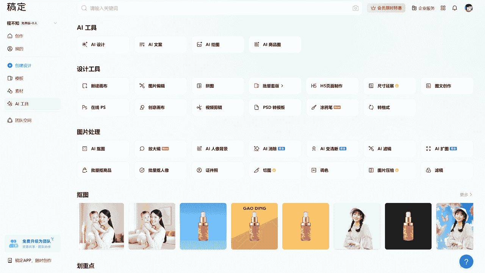

**工具介绍：**稿定 AI 是由稿定设计（厦门）科技有限公司开发的一站式 AI 设计平台，聚焦“AI+创意”场景，提供从文案生成到视觉设计的全链路自动化服务，是国内首个通过备案的 AI 设计工具

**工具能力：**

> **AI 创意生成**

+   智能设计：输入主题文字（如“母亲节促销”），自动生成大字封面、科普对比图、商品主图等设计稿，支持批量导出。

+   多模态绘图：通过文本描述或上传参考图生成插画、动漫头像等，支持“实景生成”“线稿上色”等 10+艺术风格。

> **图片智能处理**

+   精准编辑：AI 抠图（毛发级精度）、AI 消除（去除水印/杂物）、AI 扩图（无损放大至 4K 分辨率）。

+   场景优化：自动匹配商品图与背景（如雪地/森林场景），支持透明素材生成与证件照制作。

> **商业化工具链**

+   电商赋能：从商品图合成到详情页设计全流程支持

> **协作与生态**

+   云端协作：支持多人在线编辑与实时预览

**是否免费：**免费体验

**网络条件：**不需要特殊网络

**工具网站：**`https://www.gaoding.com/create-design?hmsr=aigc.cn-aigc.cn-gdai--gdaidetail-gdaidetail-bdqd&utm_source=aigc.cn`

### 2）羚珑

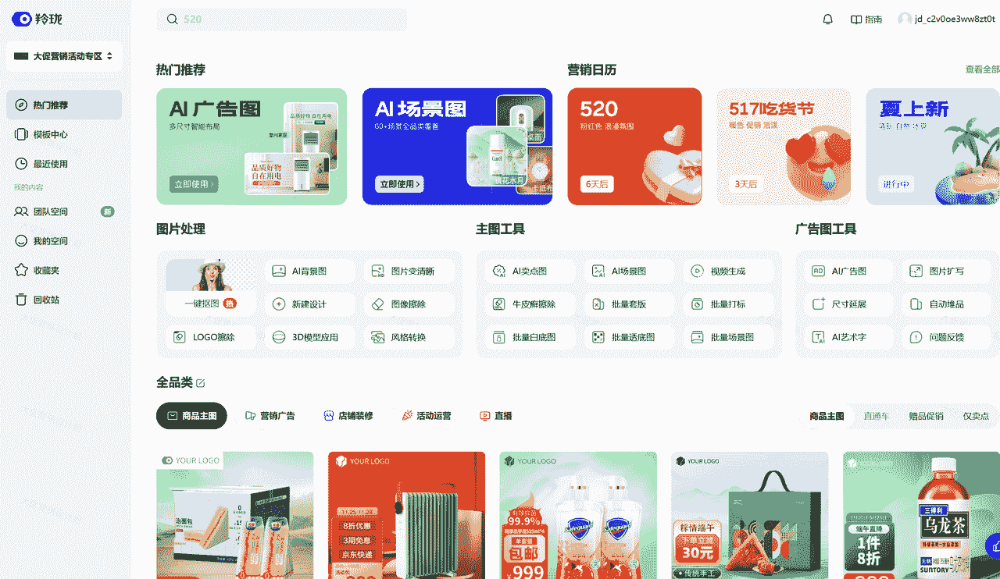

**工具介绍：**羚珑是京东零售集团用户体验设计部推出的一站式智能设计工具，定位于“泛零售领域商家的设计合作伙伴”，专注于电商营销、广告创意、店铺装修等场景的视觉设计需求。

**工具能力：**

> **核心设计功能**

+   智能抠图：一键去除复杂背景（毛发级精度），支持批量处理 20 张图片，提供普通/人像双模式。

+   模板化设计：提供电商主图、广告 Banner、直播贴片等 20 万+模板，支持智能配色与尺寸延展

+   视频生成：输入商品 SKU 或上传素材，自动生成带 3D 特效的短视频广告

> **垂直场景工具**

+   电商营销：批量生成商品主图、详情页设计，支持“智能腰带”文案自动排版与促销信息植入。

+   直播支持：提供直播间背景图、悬浮字幕模板，助力快速制作高转化率素材。

+   企业服务：企业用户可定制私有素材库，并通过“羚珑企业专区”实现设计流程标准化。

**是否免费：**免费体验

**网络条件：**不需要特殊网络

**工具网站：**`https://ling.jd.com/?autologin=0`

### 3）Pebblely 宝贝丽

**工具介绍：**Pebblely 宝贝丽是一款基于人工智能的电商专用视觉设计工具，专注于通过 AI 技术为中小型电商企业、创业者和设计师提供低成本、高效率的产品图片生成与优化服务。其核心目标是替代传统摄影流程，帮助用户快速生成符合营销需求的高质量视觉素材，覆盖电商平台、社交媒体等多渠道推广场景

**工具能力：**

> **智能场景生成**

+   主题库支持：提供 40+默认主题，一键生成不同风格的场景图，自动添加阴影、反射等专业效果。

+   自定义描述：通过自然语言输入生成个性化背景，支持否定提示排除不想要的元素。

> **图像处理与优化**

+   极速抠图：AI 自动移除复杂背景（如毛发级抠图精度），支持批量处理 20 张图片。

+   细节增强：16 倍无损放大、瑕疵修复（去除水印/杂物）及光影优化功能，提升图片专业度。

> **多平台适配与扩展**

+   尺寸调整：支持生成 2048×2048 分辨率图像，适配 Instagram、Facebook、淘宝等不同平台尺寸要求。

+   多媒体扩展：将单张图片转换为横幅广告、社交媒体故事、电子邮件封面等多样化素材

**工具网站：**`https://pebblely.com/`

### 4）堆友 AI 设计平台

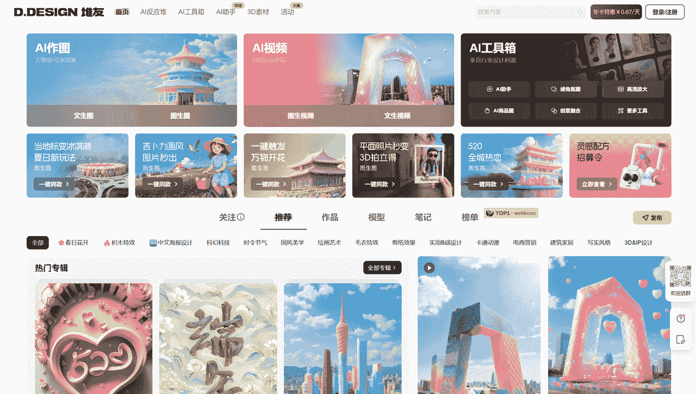

**工具介绍：**堆友 AI 设计平台是阿里巴巴集团旗下 Alibaba Design 团队打造的全成长周期设计师服务平台，定位于“设计师的好朋友”，以提升设计品质、效率、技能、成就和收入为核心价值

**工具能力：**

> **AI 创意生成与优化**

+   多模态生成：支持文生图、图生图、社区同款复刻，提供 200+风格模型（如国风手绘、电影质感摄影）和动态控制参数（如采样方法、随机种子）。

> **智能优化工具：**

+   顽兔抠图：1 秒完成毛发级抠图，支持批量处理 20 张图片。

+   高清放大：最高支持 16 倍无损放大，适配电商大图需求。

+   人脸修复：智能识别并优化人物面部细节。

> **电商设计：**

+   鹿班营销图：一键生成高点击率商品主图，自动渲染阴影与场景。

+   模特换肤：替换全球肤色模特，节省跨境电商拍摄成本 90%以上。

+   创意字体：输入文字描述即可生成艺术字（如枯木纹理、羽毛质感），支持 PNG 透明背景导出。

> **3D 设计与素材生态**

+   在线渲染器：实时调整 3D 素材角度、颜色、材质，支持导出高清渲染图。

+   素材库：提供数万款 3D 模型（如国风美学、科幻科技），可直接编辑或下载商用。

**是否免费：**免费体验

**网络条件：**不需要特殊网络

**工具网站：**`https://d.design/?from=aigccn`

### 5) Midjourney

**工具介绍：**Midjourney 是一款由 David Holz 团队于 2022 年 3 月推出的 AI 绘画工具，基于深度学习技术（如生成对抗网络和扩散模型），能够根据用户输入的文本描述快速生成高质量图像，涵盖写实、抽象、动漫等多种艺术风格，2025 年 5 月推出的 V7 模型 和 Omni-Reference（参照万物） 功能进一步提升了其核心竞争力

**工具优点：**

> **细节表现：**优化手部结构、表情和光影层次，生成分辨率达 8K 的图像，支持写实、超现实、动漫等风格。

> **智能生成：**新增 Draft Mode（草稿模式），生成速度提升 10 倍，适合快速测试灵感，后续可一键升级为高清图。

> **精准控制：**支持上传参考图（如角色、物体、风格），通过参数 `--ow`（0-1000）调节参考权重，实现风格迁移或细节保留

**是否免费：**付费订阅

**网络条件：**需要特殊网络

**体验网址：**`https://www.midjourney.com/home`

### 6) PHOTOG

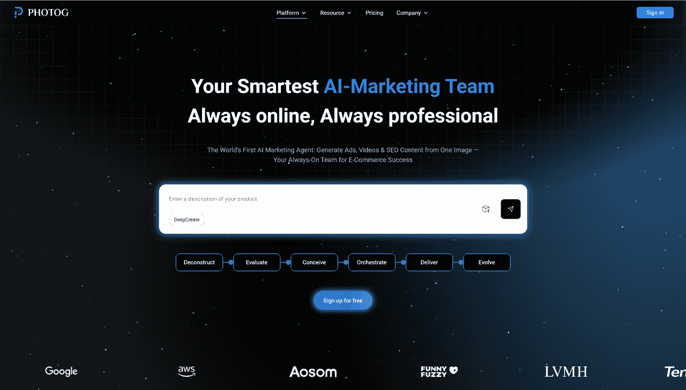

**工具介绍：**PhotoG 是一款由橙果视界（深圳）科技有限公司开发的 AI 电商视觉内容生成工具，定位为“电商界的 Midjourney”。其核心能力是通过生成式 AI 技术，将真实商品快速转化为高质量营销素材，覆盖家具、鞋服、珠宝等垂类领域。该工具由前谷歌 DeepMind 团队背景的 95 后团队主导开发，已获矩阵股份等上市公司投资，并整合了 A-T 扩散框架 等创新算法，强调“高可控性生成”与“超写实效果”

**工具优点：**

+   支持 图生图（单图/多视图输入）、文生图（自然语言描述）及 草图转 3D，生成带 PBR 材质的模型。

+   图像生产模式：提供自由模式（创意探索）和精确模式（参数化细节调整），支持局部重绘（`inpaint`）与商品库上传。

+   实时调整产品水平角、俯仰角、光照融合度等参数，确保商品与场景的无缝融合。

+   全屋设计智能体：用户上传空间图片后，AI 自动生成商品清单与场景效果图，支持家具、家电等全品类替换

**是否免费：**免费体验

**网络条件：**不需要特殊网络

**体验网址：**`https://photog.art/?utm_source=ai-bot.cn`

## 二、AI 脚本创作

### 1) ChatGPT

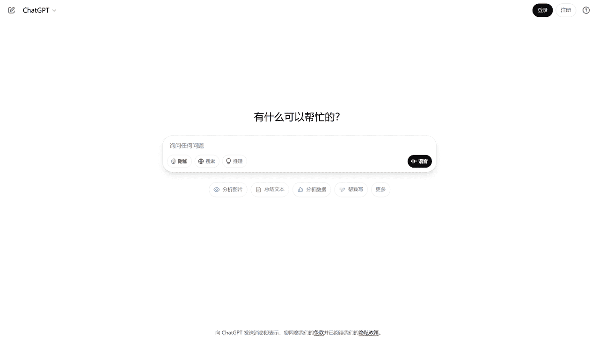

**工具介绍：**ChatGPT 是由 OpenAI 开发的生成式 AI 工具，基于 GPT-4O 模型，专注于通过自然语言交互实现 高效脚本创作，覆盖短视频、电影、电视剧、广告等类型。其核心定位为“创意协作助手”，用户可通过文本描述需求，AI 自动生成分镜、对话及场景描述，并提供实时优化建议，降低创作门槛

**工具优点：**

+   创意生成：输入主题关键词，生成多个故事框架与角色设定，支持调整剧情走向。

+   多模态输出：生成带场景描述、角色对话的完整脚本，支持导出为纯文本、`YAML` 或结构化表格。

+   多语言适配：支持中英文脚本生成，内置文化差异优化模块，适配跨境电商内容本地化需求。

+   动态调整：通过参数控制生成风格，调节对话随机性。

+   插件生态：兼容 Shopify、千帆大模型平台，实现脚本生成与电商场景、数据分析的深度结合。

+   支持 多轮上下文记忆，可基于前序对话持续优化角色关系与情节发展

**是否免费：**免费体验

**网络条件：**需要特殊网络

**体验网址：**`https://chatgpt.com/`

### 2）即创

**工具介绍：**即创是由字节跳动（抖音）推出的一站式 AI 智能创意生产与管理平台，基于自研的抖音云雀大模型，专为电商、短视频和直播内容创作设计。其核心定位为“零门槛创意工具”，覆盖商品推广、视频制作、直播策划等全流程内容生产，尤其适配抖音生态用户。主要服务对象包括短视频创作者、电商从业者、自媒体创业者和企业团队

**工具优点：**

+   智能成片：上传图片/视频片段，AI 自动完成剪辑、配音、字幕添加，支持数字人形象（20+风格可选）和预设动作模板，生成符合平台规则的成品视频。

+   AI 视频脚本：输入商品 ID、卖点等信息，生成分镜脚本和口播文案，适配抖音热门趋势。

+   商品卡工具：通过商品 ID 自动抓取主图，智能替换背景、添加营销边框，优化商品展示效果。

+   图文合成：从商品详情页提取信息，生成多品图集并匹配文案，降低制作成本。

+   AI 直播背景：生成虚拟绿幕背景图，适配家居、美妆等不同商品风格。

+   AI 直播脚本：基于优惠活动和营销节点生成口播话术，支持提词器实时播放

**是否免费：**免费体验

**网络条件：**不需要特殊网络

**体验网址：**`https://aic.oceanengine.com/workbench?bpId=1726741233553422`

### 3) Jasper

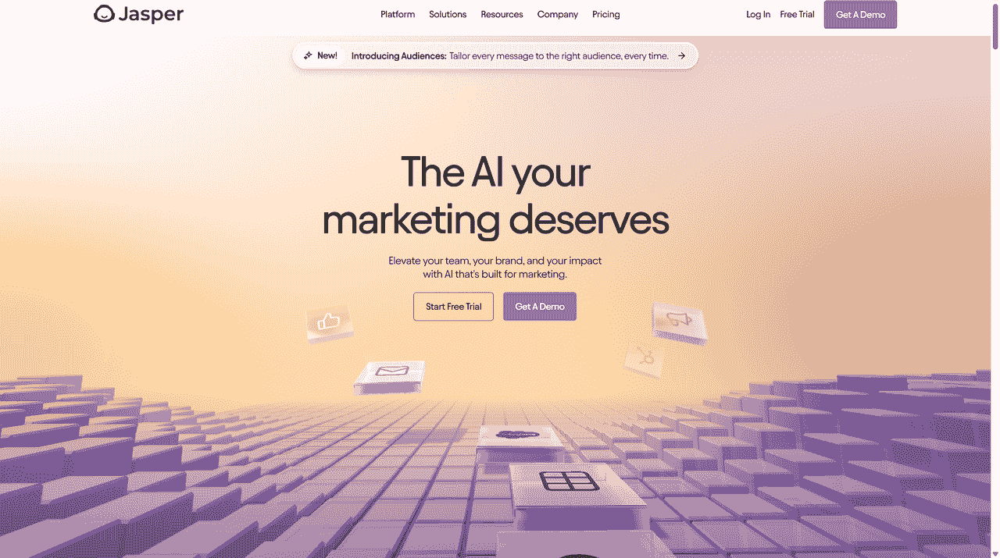

**工具介绍：**Jasper 是一款由 Jasper.ai 开发的人工智能内容生成工具，前身为 Conversion AI 和 Jarvis，定位为“多场景创意助手”，专注于帮助用户快速生成营销文案、博客文章、社交媒体内容、电商产品描述等。其核心基于 GPT-4 等大型语言模型，结合自研算法优化，支持 30+语言（包括中文、英语、日语等），并整合了 SEO 优化、品牌语音定制等功能，适用于自媒体、电商

**工具优点：**

+   多模板生成：提供 50+预设模板，涵盖博客大纲、广告文案、社交媒体标题等场景，支持一键生成符合平台规则的内容。

+   长文创作：通过“Boss Mode”模式，用户可输入指令，AI 实时生成并优化长篇文章，支持导出为 `PDF` 或 `Word` 格式。

+   用户可上传品牌文案样本，训练 AI 模仿特定语气与风格，确保内容与品牌调性一致。

+   集成 Surfer SEO，分析关键词密度并提供优化建议，提升搜索引擎排名

**是否免费：**免费体验

**网络条件：**需要特殊网络

**体验网址：**`https://www.jasper.ai/`

### 4）蜂鸟 AI

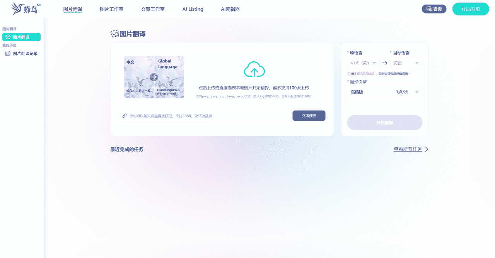

**工具介绍：**蜂鸟 AI 是由赶海科技推出的跨境电商 AI 营销工具，基于 AI 视觉模型与多模态技术，专注于为商家提供多语言内容生成、智能图片编辑和营销文案优化服务。其核心定位为“全链路内容创作助手”，覆盖跨境电商推广、社交媒体内容制作、电商 Listing 优化等场景，尤其适配亚马逊、阿里巴巴、京东等平台卖家

**工具优点：**

+   图文视频翻译：支持 20+语言一键翻译，自动调整排版适配目标市场语言习惯，适用于商品标签、说明书等内容本地化。

+   多模态适配：翻译后的图片可保留原图设计元素（如字体、颜色），避免手动调整成本。

+   智能商拍：普通商品图自动转换为专业模特展示图，支持模特换脸、自定义模特、场景裂变。

+   智能编辑工具：包含智能抠图、去水印、高清放大、背景替换等功能，5 秒内完成复杂编辑。

+   AI 文案生成：根据亚马逊搜索热词生成高转化率的 Listing 标题与卖点文案，支持多语言输出。

+   AI Listing 优化：结合爆款数据与类目搜索词，自动生成符合平台规则的图文 Listing，提升广告投放效果

**是否免费：**免费体验

**网络条件：**不需要特殊网络

**体验网址：**`https://fengniaoai.com/`

## 三、AI 智能选品

### 1）博远探航

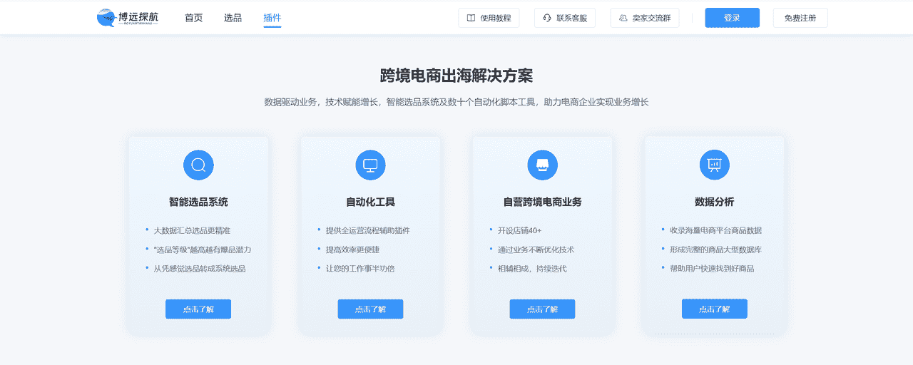

**工具介绍：**博远探航是一款专为跨境电商卖家设计的 AI 选品工具，由赶海科技旗下团队开发，主要服务于亚马逊、Temu 等平台商家。其核心定位为“数据驱动的智能选品助手”，通过实时抓取商品销量、价格波动、增长率等关键数据，帮助用户快速筛选潜力商品，优化选品策略，降低试错成本。截至 2025 年，该工具已累计处理超 2 亿条商品数据，覆盖服装、3C 电子、家居等主流类目

**工具优点：**

+   智能选品分析：输入商品关键词，AI 自动抓取 Temu 等平台商品数据，展示价格区间、总销量、日/周/月销增长率、销售额等维度，支持多关键词分割检索。

+   批量查询与导出：支持批量导入关键词或商品 ID，生成结构化表格，便于跨平台比价与库存管理。

+   选品等级评估：基于销量增长趋势与市场竞争度，将商品划分为不同潜力等级，辅助决策。

+   数据监控预警：实时追踪商品价格波动与库存变化，推送异常提醒。

+   竞品对标分析：提供竞品价格策略、营销活动及用户评价聚合，支持生成竞品对标报告

**是否免费：**免费体验

**网络条件：**不需要特殊网络

**体验网址：**`https://b.intemu.net/#/login`

### 2) Shulex VOC

**工具介绍：**Shulex VOC 是一款由前钉钉创始团队开发的 AI 驱动的跨境电商选品与消费者洞察工具，专注于通过 客户之声（Voice of Customer， VOC） 分析帮助卖家优化产品策略。其核心功能覆盖亚马逊、Shopify 等主流平台，集成 ChatGPT-4 与自研 AI 模型（如 DeepSeek-R1），可快速分析海量商品评论、消费者行为及市场趋势，助力卖家实现 选品优化、Listing 提升 和 客服效率升级

**工具优点：**

+   AI 评论分析：自动抓取亚马逊商品评论，生成 消费者画像、使用场景、产品优缺点 及 未满足需求 等六大维度报告，分析效率较人工提升 10 倍以上。

+   Listing 优化：基于消费者反馈与竞品数据，提供标题、五点描述的语法修正与本土化表达建议，支持 一键埋词 提升搜索排名。

+   市场趋势洞察：利用 STP 模型（细分市场定位）和 KANO 模型（需求优先级），识别蓝海赛道与高潜力商品，结合历史数据预测市场饱和度

+   AI 客服机器人：集成多语言客服系统，自动处理售前咨询、订单查询、售后纠纷

**是否免费：**免费体验

**网络条件：**不需要特殊网络

**体验网址：**`https://www.voc.ai/`

### 3) FindNiche

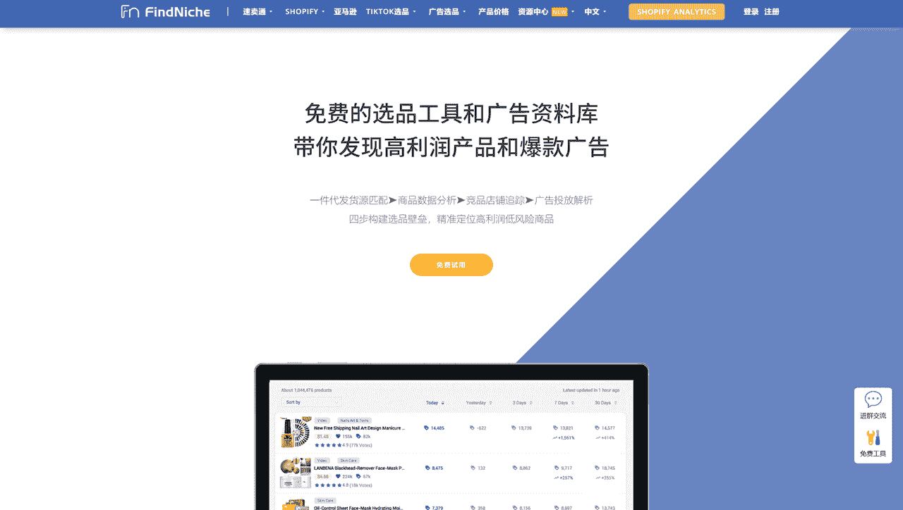

**工具介绍：**FindNiche 是一款专注于 跨境电商选品与市场分析 的工具，由大数据驱动，覆盖 速卖通、Shopify、亚马逊 等平台，专为无货源（Dropshipping）模式、独立站卖家及跨境推广从业者设计。其核心定位为“全链路选品助手”，通过实时抓取海量商品数据，帮助用户快速挖掘潜力爆款并验证市场机会。截至 2025 年，该工具已服务超 20 万用户，支持 多语言界面 和 跨平台数据整合，尤其适合中小卖家降低试错成本

**工具优点：**

+   `FindNiche` 的`NICHES`模块基于 AI 算法（结合历史销售数据、市场需求及竞争度）每日更新 20 个精选利基产品。这些产品标注为“高需求、高利润、低竞争”

+   AI 支持 400+种组合筛选条件（如订单增长量、目标国家、利润率），用户可自定义选品逻辑或使用系统推荐的 5 种初筛模板。

+   AI 通过历史数据预测商品未来 3-6 个月的市场趋势，对可能饱和的类目（如蓝牙耳机）推送预警，并建议调整选品策略

**是否免费：**免费试用

**网络条件：**不需要特殊网络

**体验网址：**`https://findniche.com/user/register`

## 4) THunt.AI

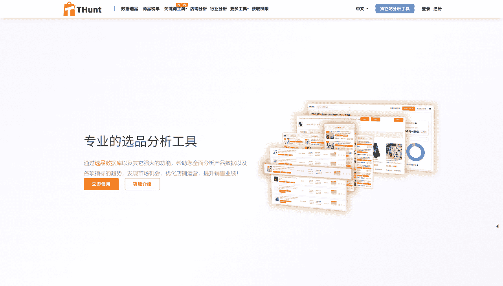

**工具介绍：**`THunt.AI` 是一款专业且免费的电商选品分析工具，专注于为跨境电商卖家提供数据驱动的选品决策支持，尤其适配 TEMU、速卖通、1688 等平台。其核心定位为“全链路选品助手”，通过整合多平台商品数据（涵盖 200 万+速卖通商品 和 每日更新的热销榜单），帮助用户发现高潜力爆款、优化供应链管理并提升销售业绩

**工具优点：**

> 分析商品销售数据（总销量、近 7 天/30 天销量）与价格趋势，识别高利润潜力商品。

> 支持批量导出商品数据，追踪商品生命周期变化。

> 提供热销榜、好评榜、新店热销榜，每日更新榜单数据，展示同类目爆款商品特征与竞争度评分。

> 通过商品图片一键搜索 1688、义乌购、速卖通 等 8 个平台的供货商信息，支持成本对比与供应链优化

> AI 算法辅助：结合销量增长趋势与市场饱和度预测

**是否免费：**免费体验

**网络条件：**不需要特殊网络

**体验网址：**`https://thunt.ai/cn`

## 5) Google Trends

**工具介绍：**`Google Trends` 是谷歌推出的免费数据分析工具，通过分析全球数十亿次搜索数据，展示关键词或话题在不同时间、地区的搜索热度变化趋势。其核心定位为“市场趋势洞察工具”，帮助用户了解公众兴趣、行业动态及季节性需求，广泛应用于跨境电商选品、内容营销、品牌监测等领域。

**工具优点：**

+   支持同时输入 2-5 个关键词（如品牌名、产品词），以可视化图表展示其搜索热度差异，帮助用户选择更具潜力的关键词或识别竞品动态。

+   数据源选择：按需筛选来自网页搜索、新闻、图片或 YouTube 的搜索数据。

+   提供与目标关键词相关的热门搜索词及飙升词，辅助内容创作与 SEO 优化。

+   通过“`Trending Now`”功能追踪全球或特定地区的实时热点，快速响应市场变化。

+   分析商品或服务的周期性需求，优化库存与营销节奏

**是否免费：**免费体验

**网络条件：**需要特殊网络

**体验网址：**`https://trends.google.com/`

## 6) 卖家精灵

**工具介绍：**卖家精灵是由成都云雅信息技术有限公司开发的 亚马逊卖家专属 SaaS 工具，基于大数据与 AI 技术，覆盖选品、市场分析、关键词优化、竞品监控等全链路运营场景。其核心定位为“精细化运营助手”，支持网页版与插件版协同使用，适配亚马逊、Shopify、OZON 等平台。

**工具优点：**

+   AI 选品预测：分析商品历史销量、评论增长趋势及市场饱和度，预测未来 3-6 个月的市场潜力

+   结合 `DeepSeek-R1` 算法，生成高潜力选品指令

+   反查竞品核心流量词，拓展长尾词库，支持一键埋词提升 `Listing` 搜索排名。

+   提供 `ABA` 数据选品，挖掘亚马逊官方搜索词库中的异动市场和飙升词

**是否免费：**免费体验

**网络条件：**不需要特殊网络

**体验网址：**`https://www.sellersprite.com/`

# 四、AI 营销

## 1）百度巧舱

工具介绍：巧舱是百度营销推出的 AI 驱动商家智能体平台，基于 `文心大模型` 开发，旨在通过 多轮对话交互 和 智能线索管理 帮助商家提升获客效率与转化率。其核心定位为“7 * 24 小时金牌业务员”，覆盖百度搜索、抖音企业号、🛰️客服等主流流量入口，支持商家快速搭建个性化智能客服系统。

**工具优点：**

+   通过 AI 智能体实时响应网民咨询，支持 自动过滤无效线索、澄清用户需求，提升线索有效率。

+   可同步接入 百度搜索广告、抖音企业私信、🛰️客服，实现跨平台统一管理。

+   提供卡券活动、服务预约、资料包下载等“营销钩子”，提升用户留联率

**是否免费：**免费体验

**网络条件：**不需要特殊网络

**体验网址：**`https://aiagent.baidu.com/mbot/index`

## 2）观星盘

**工具介绍：**观星盘是百度推出的 全链 AI 营销数据平台，基于百度 AI 技术及大数据能力（如 `文心大模型`、`AIA` 品牌资产数据等），为广告主提供从市场洞察、人群定向到效果优化的全链路营销服务。其核心定位为“AI 驱动的营销决策平台”，通过整合百度域内数据（搜索、信息流、地图等）、客户数据及第三方数据，深度解析用户行为与品牌特征，帮助广告主实现精准营销和资产沉淀

**工具优点：**

+   全域数据分析：整合百度搜索、信息流、贴吧等全场景数据，生成用户画像。

+   行业与品牌诊断：分析市场趋势、竞争格局、品牌搜索份额，预测市场潜力与用户决策偏好。

+   关键词洞察：挖掘高相关长尾词、竞品流量词，支持自然排名与广告排名优化。

+   智能圈选人群：支持自定义标签或使用系统推荐人群包，覆盖超 2000 万细分标签。

+   跨平台投放：分发人群包至百度搜索、信息流、开屏广告等渠道，支持实时竞价（`RTB`）与效果追踪。

+   再营销策略：追踪用户从曝光到转化的全链路行为，沉淀数据资产并优化二次触达

**是否免费：**免费体验

**网络条件：**不需要特殊网络

**体验网址：**`https://cdp.baidu.com/static/login`

## 3）巨量千川

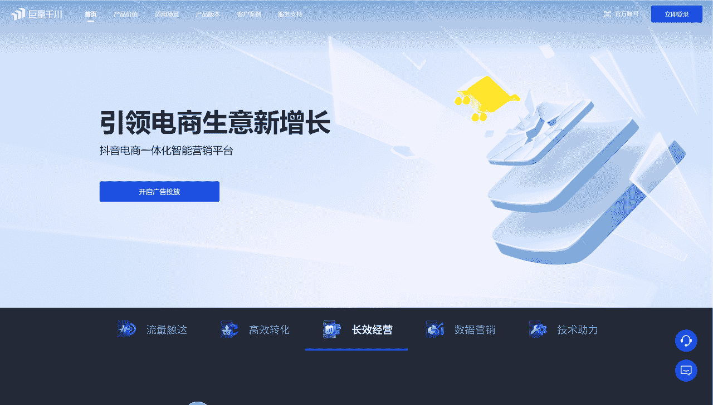

工具介绍：巨量千川是 抖音巨量引擎旗下的电商广告平台，主打抖音电商一体化营销，整合了 `DOU+`、鲁班、`Feed` 流等多种广告能力，覆盖短视频带货、直播推广、商品引流等场景。其核心定位为“电商全链路营销工具”，支持商家快速搭建广告投放计划并实现精准触达目标用户，尤其适用于新品发布、大促活动、爆款挖掘等场景

**工具优点：**

+   基于用户行为数据自动优化广告策略，支持自然流量与付费流量混合投放，提升转化率。

+   提供“极速版”与“专业版”双模式，极速版适合新手自动托管，专业版支持精细化定向。

+   支持直播推广（引流直播间、加热商品卡）、短视频带货（挂车视频投放）、品牌曝光（开屏广告）等。

+   实时监控广告效果（如点击率、`ROI`），提供投放归因分析（如流量下滑归因竞品促销）

**是否免费：**免费体验

**网络条件：**不需要特殊网络

**体验网址：**`https://www.shoppingads.cn/`

# 五、AI 智能客服

## 1）通义晓密

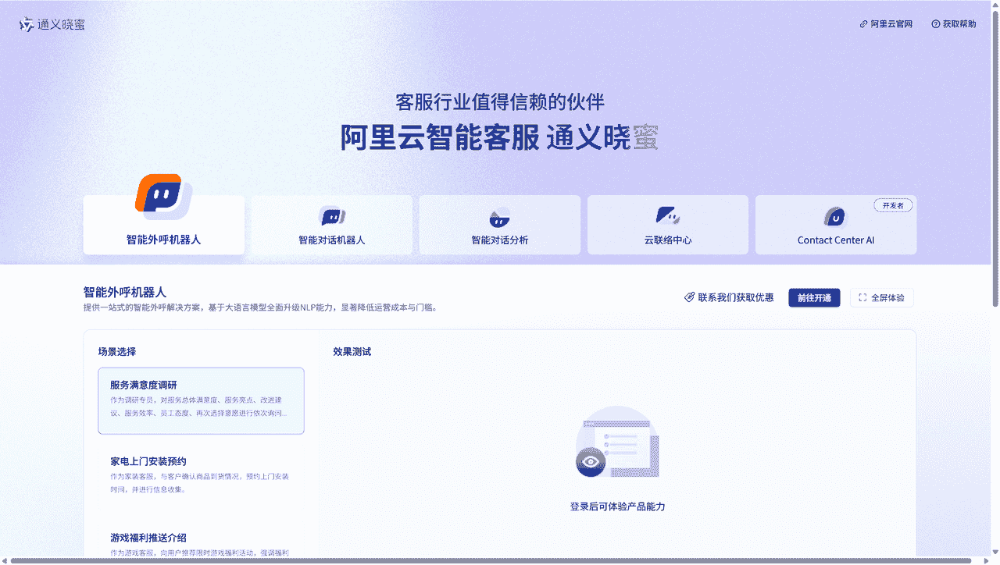

**工具介绍：**`通义晓蜜`是 阿里云推出的智能客服与对话分析平台，基于深度调优的对话大模型技术，专为营销服务类场景设计，提供全渠道联络中心与 AI 应用深度整合的解决方案。其核心定位为“企业服务智能化升级助手”，支持电话、IM、音视频等多模态交互，并集成智能外呼、数字人等能力，帮助企业提升客户满意度和服务效率

**工具优点：**

+   自动生成对话摘要、信息抽取（按指令组织关键字段）、质检分析（情绪识别、敏感词检测等）。

+   支持多指令模板（标题生成、关键词提取、维度检测）和多模型规格（`通义晓蜜-Turbo/Plus`）切换。

+   整合电话、IM、工单等渠道，支持数字人交互和智能坐席辅助，实现跨平台统一管理。

+   语音文件转文字后分析，目前限时免费，支持单人演讲、多人讨论等场景适配

**是否免费：**免费体验

**网络条件：**不需要特殊网络

**体验网址：**`https://tongyi.aliyun.com/xiaomi?spm=5176.21074180.J_7730063120.1.13561ba6IT0UkP`

## 2）华为云-AI 智能客服

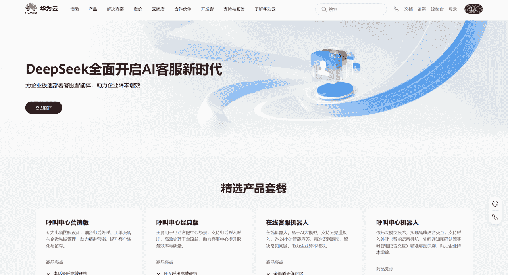

**工具介绍：**华为云 AI 智能客服是基于 华为云全栈 AI 能力（如 `盘古大模型`、`昇腾 AI 芯片`） 与 `DeepSeek` 大模型技术 深度整合的企业级智能客服解决方案。其核心定位为“全场景智能服务中枢”，覆盖售前咨询、售中服务、售后支持全链路，支持私有化部署、云端托管及混合云模式。截至 2025 年，已服务超 10 万家企业，覆盖电商、金融、医疗、制造等行业，尤其适用于需兼顾数据安全与智能化需求的中大型企业

**工具优点：**

+   基于 `盘古大模型` 与 `DeepSeek` 的联合优化，实现上下文语义精准解析，支持复杂场景下的多轮问答。

+   结合企业知识库（支持 `PDF`、视频、音频等多格式解析），自动生成行业定制化回复。

+   集成语音转写、数字人交互、视频客服等功能，支持电话、IM、邮件、工单系统全渠道统一管理。

+   智能质检与优化：通过情绪识别、敏感词检测、会话溯源分析，自动生成质检报告并优化话术策略

+   私有化部署与混合云适配：支持 `ModelArts` 平台一键部署，兼容 `昇腾 AI 芯片` 与 `鲲鹏` 处理器，保障数据本地化安全。

+   AI 辅助人工座席：实时推荐最优解决方案（如故障处理流程、促销话术）

**是否免费：**付费服务

**网络条件：**不需要特殊网络

**体验网址：**`https://www.huaweicloud.com/product/cbs.html`

## 3）网易七鱼智能客服

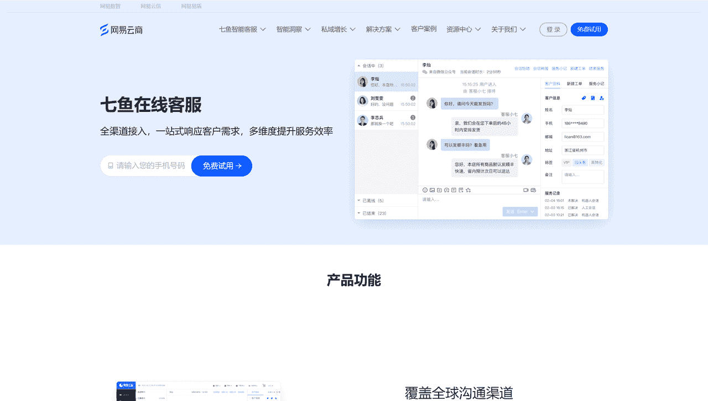

**工具介绍：**网易七鱼是 网易云商推出的全渠道智能客服 SaaS 平台，深度整合自然语言处理（`NLP`）、知识图谱及 AI 大模型技术，定位为“服务营销一体化解决方案”。其覆盖售前咨询、售后服务、客户运营全链路，支持 Web、App、🛰️、抖音等 30+渠道接入，并兼容企业🛰️、`CRM` 等系统

**工具优点：**

+   智能机器人：基于深度学习算法实现意图识别与情绪分析

+   统一工作台集成电话、IM、视频、工单等交互方式，支持跨平台消息同步与客户信息透传；

+   智能路由分配策略（按满意度、转化率、熟客优先级等）提升 30%客服效率。

+   数据分析与质检：实时数据大屏展示会话量、响应时长等 17 项指标，支持 `Echarts` 图表自定义；

+   AI 全量质检覆盖情绪检测、静音检测，准确率 95%+，违规话术自动标记。

+   支持 `1080P` 高清视频通话，内置内容安全审核与双向录制，适用于产品演示与纠纷处理；

+   跨部门工单流转（如技术问题转研发），支持邑件/`SMS` 提醒与数据导出

**是否免费：**免费体验

**网络条件：**不需要特殊网络

**体验网址：**`https://b.163.com/home/qiyu/onlinekefu`

## 4）百度智能外呼

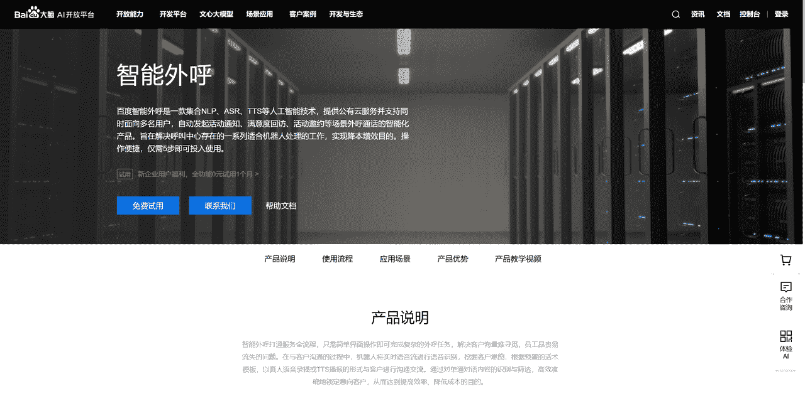

**工具介绍：**百度智能外呼是百度智能云客悦推出的 AI 驱动型智能呼叫平台，基于大模型技术（如 `DeepSeek-V3`、`文心大模型`）革新传统外呼服务，专注于营销触达、客户回访、信息通知等场景。该平台通过自然语言处理（`NLP`）、语音识别（`ASR`）和语音合成（`TTS`）技术，实现拟人化多轮对话与精准客户触达。

**工具优点：**

+   支持大模型驱动的多轮对话，灵活应对客户发散性提问，语义理解准确率达 98%。

+   提供 `TTS` 定制音色，复刻金牌销售员声音，`MOS` 评分达 4.8，实现无感延时通话。

+   支持 `Prompt` 模式（新手快速配置）与画布模式（高阶复杂逻辑设计），覆盖金融催收、电商订单查询等场景。

+   动态调整呼叫策略，过滤空号/停机号码，降低无效外呼成本

**是否免费：**免费体验

**网络条件：**不需要特殊网络

**体验网址：**`https://ai.baidu.com/tech/aiob`

# 六、AI 数字人

## 1) HeyGen

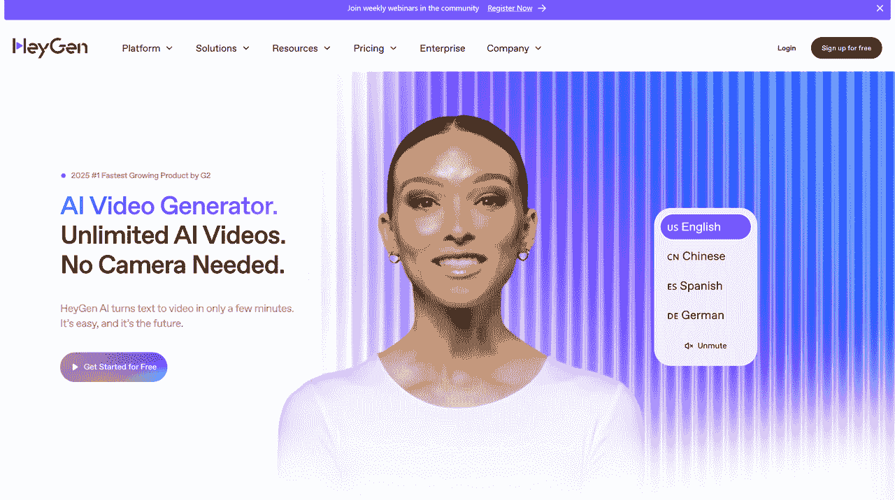

**工具介绍：**`HeyGen` 是一款基于 AI 技术的数字人视频创作平台，支持通过文本、图片或视频快速生成高质量的数字人视频。用户可自定义虚拟形象，或使用平台提供的 100+预制 AI 虚拟数字人，适用于广告、教育、企业宣传等多种场景

**工具优点：**

> 高质量数字人：精准克隆用户外貌和声音，支持口型同步、表情和肢体动作模拟。

> 多语言支持：提供 175+语音配音和翻译功能，适合全球化内容创作。

> 操作简单：无需专业视频制作技能，通过模板或上传素材即可快速生成视频

**是否免费：**免费体验

**网络条件：**需要特殊网络

**体验网址：**`https://www.heygen.com/`

## 2）禅镜

**工具介绍：**禅镜是蝉妈妈（蝉羽网络科技）旗下的一款 AI 数字人视频创作平台，专注于帮助用户快速生成高质量的数字人视频内容。它依托母公司在大数据分析与短视频营销领域的经验，特别适合电商从业者、自媒体创作者等群体，可用于口播视频、直播带货、广告宣传等场景

**工具优点：**

> 操作简单：无需专业视频制作技能，通过模板或上传素材即可快速生成视频

> 多风格数字人：提供 200+预制数字人形象（包括真人、卡通、3D 风格），支持自定义克隆真人形象

> AI 文案辅助：内置热点推荐和文案生成功能，提升视频爆款概率

**是否免费：**免费、付费都有

**网络条件：**不需要特殊网络

**体验网址：**`https://www.chanjing.cc/home/`

## 3) KreadoAI

**工具介绍：**`KreadoAI` 是由易点天下推出的 `AIGC` 数字营销视频创作平台，专注于利用人工智能技术简化视频内容创作流程。它支持通过文本、图片、`PPT` 或 `URL` 快速生成多语言数字人视频，适用于营销、教育、培训、医疗等多个领域。平台提供 700+种数字人形象和 1600+种语音选项，支持 140+种语言，并具备 AI 脚本生成、语音克隆、视频换脸等高级功能，帮助用户高效制作专业级视频内容

**工具优点：**

+   高效创作：1 分钟即可生成专业视频，支持批量生产，大幅提升效率。

+   多语言适配：覆盖 140+语言和 1600+种音色，适合全球化营销需求。

+   功能全面：集成 AI 脚本生成、语音克隆、智能抠图、视频换脸等工具，满足多样化需求。

**是否免费：**1 分钟内免费

**网络条件：**不需要特殊网络

**体验网址：**`https://www.kreadoai.com/zh?via=aibot`

## 4）飞影

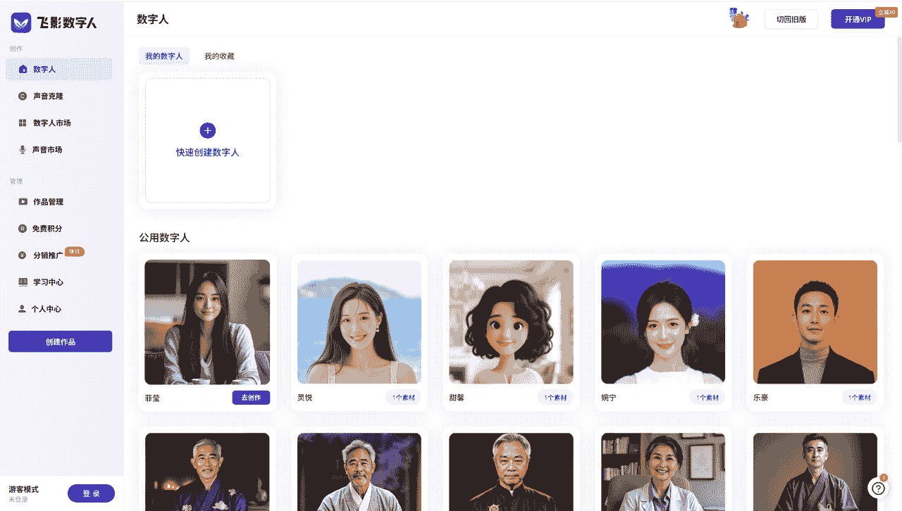

**工具介绍：**飞影是一款多功能 AI 数字人创作平台，由上海灵之宇技术开发，专注于数字人生成与虚拟偶像创作。它支持通过照片、视频或 AI 生成的方式快速创建数字人形象，并具备声音克隆、口型同步等功能，适用于电商直播、短视频制作、广告营销等场景。飞影提供丰富的数字人模板和 AI 工具，用户可轻松制作个性化视频内容，大幅提升创作效率

**工具优点：**

+   高效创作：5 秒克隆真人形象，30 秒复刻声音，快速生成逼真数字人视频。

+   多场景适配：支持跨境电商、自媒体、教育等领域，提供多样化的数字人模板和特效。

+   免费试用：注册即送 1000 积分，可免费生成带水印视频，适合新手体验

**是否免费：**基础功能免费

**网络条件：**不需要特殊网络

**体验网址：**`https://hifly.cc/`

# 七、AI 虚拟试衣

## 1) Kolors Virtual Try-On

**工具介绍：**`Kolors Virtual Try-On` 是由 快手可图团队 开发的 AI 虚拟试衣工具，基于自研的 `可图（Kolors）` 大模型 和深度学习技术，专注于解决线上购物试穿难题。该工具通过 计算机视觉 和 生成对抗网络（`GANs`） 实现衣物与用户身形的精准匹配，支持电商平台、社交媒体、时尚设计等多场景应用。用户仅需上传个人照片和服装图片，即可在 3 秒内生成逼真的试穿效果图，显著降低退货率并提升购物体验

**工具优点：**

> 通过身体姿势估计和服装分割算法，精准提取用户身形与衣物特征，保留服装的样式、颜色、图案等细节，避免传统试衣中的“头大身小”或变形问题。

> 支持多模态输入，包括真人照片、模特图及服装图片（`JPG/PNG` 格式），适用于服装、珠宝、假发等品类。

> 覆盖 电商平台（如抖音、H&M）、时尚杂志、社交媒体，商家可快速生成商品试穿图，用户可分享穿搭至社交平台。

**是否免费：**免费体验

**网络条件：**不需要特殊网络

**体验网址：**`https://www.kolorsvirtual.com/zh`

## 2) Visual Try-On

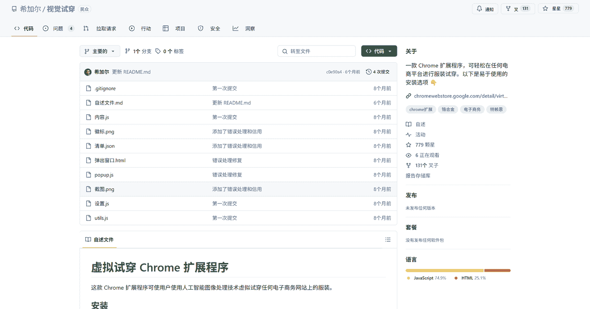

# 七、AI 试衣工具

**工具介绍：**Visual Try-On 是一款基于 AI 图像处理技术 的虚拟试衣工具，支持浏览器插件（Chrome 扩展）和在线体验两种形式。其核心功能是通过上传个人照片，在电商平台上模拟试穿衣物，解决网购退货率高的问题。工具整合了 OpenAI GPT-4（用于提取商品主图）、Kolors 图像模型（Hugging Face 平台）和 Cloudinary（图像存储）等技术，用户数据仅存储在浏览器缓存中，保障隐私安全

**工具优点：**

> **多场景适配：**
>
> + 支持任何电商网站的商品页面试穿，如 H&M、抖音等，覆盖服装、珠宝、假发等品类。
> + 上传一次照片即可在不同网站重复使用，提升效率。

> **AI 图像处理：**
>
> + 服装分割与姿态估计：通过深度学习算法精准匹配衣物与用户身形。
> + 图像融合技术：结合 OpenCV 实现自然试穿效果，减少服装变形。

> **隐私保护：**
>
> + 数据仅通过 Hugging Face 服务器处理，不传输至第三方

**是否免费：**免费体验

**网络条件：**需要特殊网络

**体验网址：**`https://virtual-try-on.org/zh`

# 八、AI 供应链工具

## 1) 1688AIBUY

**工具介绍：**1688AIBUY 是 阿里巴巴旗下 B2B 电商平台 1688 推出的 AI 集成化经营工具，基于阿里云大模型（如通义千问、DeepSeek）与行业知识库深度结合，定位为“全链路智能经营解决方案”。该工具通过 AI 技术重构传统 B2B 交易场景，覆盖选品、开单、营销、客户管理等环节，支持商家实现从商品上架到订单履约的智能化运营

**工具优点：**

+ 智能开单与合同处理：支持上传报价单或合同，AI 自动识别金额、数量、收货地址等信息，一键生成合约订单，判责依据清晰（合同条款优先），服务费单 SKU 封顶 18 元。

+ 支持工业品/找工厂商家定制化开单，合约订单计入店铺交易额与信用评级。

+ AI 数字员工：四大角色覆盖全场景：生意店长（经营决策）、商品专员（标题优化/属性填写）、客户专员（智能接待/工单处理）、推广专员（活动报名/竞品分析）。

+ 智能推荐与内容生成：基于“星河”AIGC 平台，一键生成商品主图、营销文案，支持平铺图转 AI 模特试穿效果，素材生产周期从 3 天缩短至 5 分钟。

+ 供应链优化：集成智能选品与库存预测，支持跨境业务本地化适配（如欧美市场商品参数匹配）。

**是否免费：**免费体验

**网络条件：**不需要特殊网络

**体验网址：**`https://www.aitoolnet.com/zh/1688-aibuy`

# 九、AI 智能剪辑

## 1) iCut

**工具介绍：**iCut 直剪是极睿科技（Infimind）推出的 AI 直播切片工具，专注于电商直播场景的智能内容萃取与分发。该工具通过自研的 ECGPT 和 FashionCLIP 垂直大模型，结合计算机视觉与语义分析技术，实时抓取直播中的商品卖点片段，自动生成 15 秒带货短视频，帮助商家实现“直播即切片”的自动化内容生产

**工具优点：**

+ 实时切片生成：基于语义识别与视觉分析，自动截取直播中商品讲解、促销信息、用户互动等高转化率片段，支持生成横版/竖版适配抖音、淘宝等平台的短视频。

+ 引入 Flux-Fill 重绘算法，智能去除水印、贴片等干扰元素，画面精度达 1080P。

+ 多平台分发：支持一键同步至淘宝、抖音、📕等主流电商及社交平台，自动适配各平台视频规格。

+ 数据驱动优化：实时分析视频点击率、转化率等指标，推荐最佳发布时间与标签组合

**是否免费：**免费体验

**网络条件：**不需要特殊网络

**体验网址：**`https://www.infimind.com/product/iCut`

## 2）度加创作工具

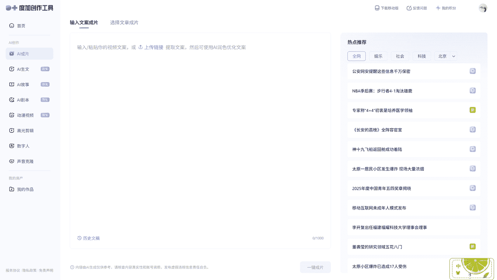

**工具介绍：**度加创作工具是百度推出的 AI 视频混剪平台，基于百度飞桨（PaddlePaddle）和文心大模型技术开发，主打“AI 成片”功能，支持文字/图文一键生成视频，并集成数字人播报、智能字幕、多语言配音（中英文为主）等能力。用户可通过输入文案或导入百家号图文链接，自动匹配素材库中的视频/图片资源（含视觉中国授权内容），快速生成横竖版适配的短视频，适用于自媒体、电商带货、新闻资讯等场景。

> **工具优点：**度加的核心优势在于高效低门槛，AI 成片功能可在 1 分钟内完成从文案到视频的全流程，支持批量生成（每日免费额度 10 条）。其智能匹配系统能自动关联文案与素材，并允许自定义字幕、音色（含音色克隆）、背景音乐及数字人形象。

**是否免费：**免费体验

**网络条件：**不需要特殊网络

**体验网址：**`https://aigc.baidu.com/make`

## 3）剪映

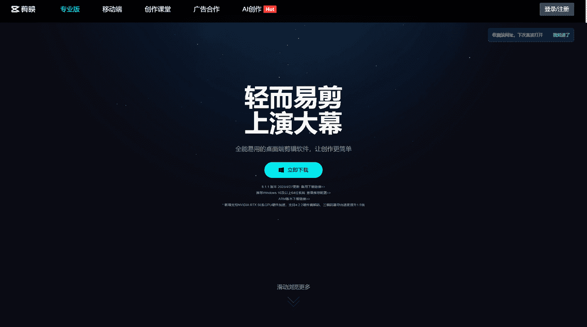

**工具介绍：**

作为抖音官方推荐的剪辑工具，它集成了 AI 智能字幕、语音转文字、智能抠图、曲线变速等先进功能，并提供海量音乐曲库（含抖音热门歌曲）和特效素材。2025 年最新版本支持 4K 分辨率编辑、多轨道剪辑及数字人播报功能，适用于短视频创作、电商带货、教育培训等场景

**工具优点：**

+ 低门槛高效剪辑：AI 自动生成字幕、智能踩点配乐，新手也能快速制作专业视频

+ 全平台协同：云空间同步草稿和素材，实现手机、电脑多端无缝衔接

+ 丰富素材库：内置百万级版权贴纸、滤镜、转场特效，支持一键套用热门模板

**是否免费：**免费体验

**网络条件：**不需要特殊网络

**体验网址：**`https://www.capcut.cn/`

## 4）模力视频

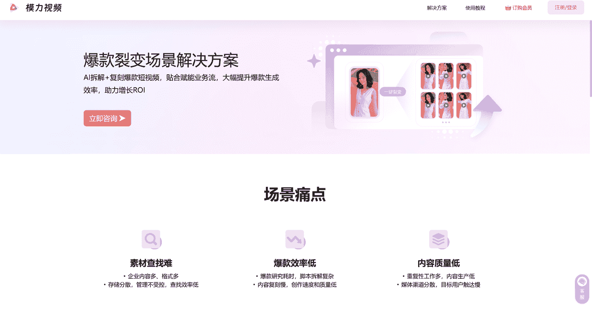

**工具介绍：**模力视频（Mooliv）是由杭州视杏科技研发的全链路 AI 视频创作运营平台，专注于电商、企业宣传、新媒体运营等场景的智能化视频生产。该工具通过 AI 技术实现从脚本生成、素材匹配到批量剪辑的全流程自动化，支持横版/竖版视频适配抖音、淘宝等主流平台，显著降低创作门槛

**工具优点：**

+ 智能剪辑与批量生成：基于 AI 算法自动生成视频分镜脚本，支持上传图片/视频后一键生成带货短视频，单日可批量生产 300+条视频。

+ 提供“裂变神器”功能，一条视频可裂变为 20 条差异化内容，支持抽帧、翻转、镜头变换等操作。

+ AI 素材优化：智能抠图、字幕擦除、背景替换功能，解决素材处理难题，素材复用率提升 90%。

+ 集成“星河”AIGC 平台，支持生成多语言字幕、AI 配音（含方言/情感化音色）。

+ 直播与电商场景适配：直播切片功能可自动截取商品讲解片段，生成 15 秒短视频并同步至多平台

**是否免费：**免费体验

**网络条件：**不需要特殊网络

**体验网址：**`https://www.mooliv.com/`
