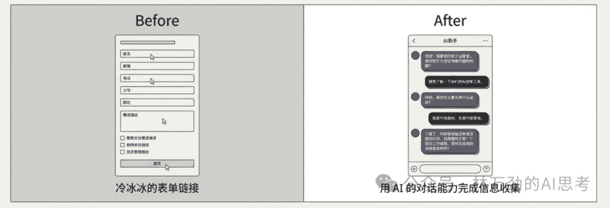
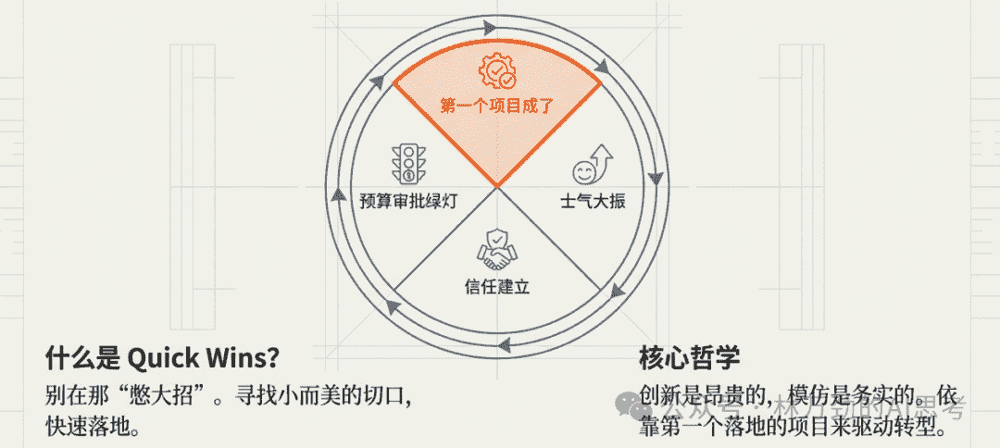
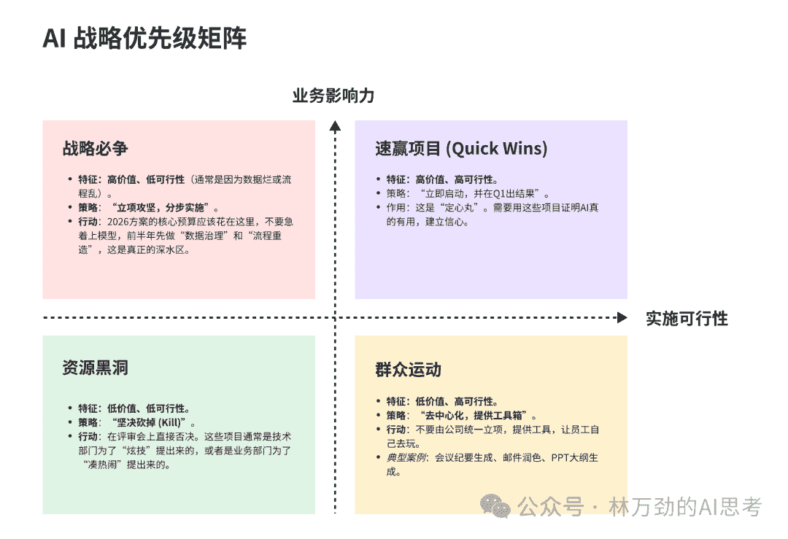
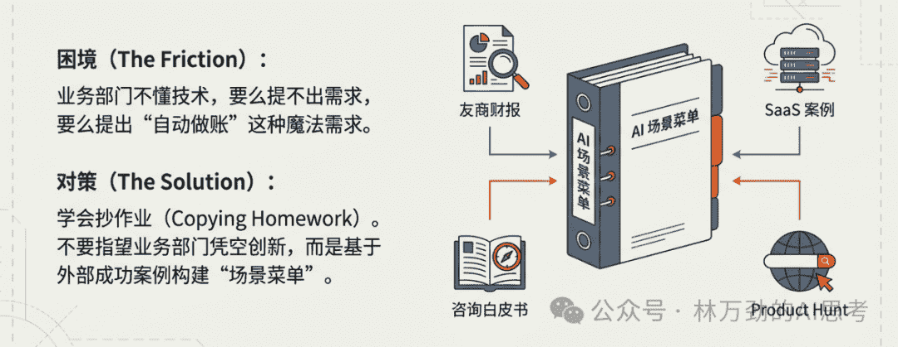
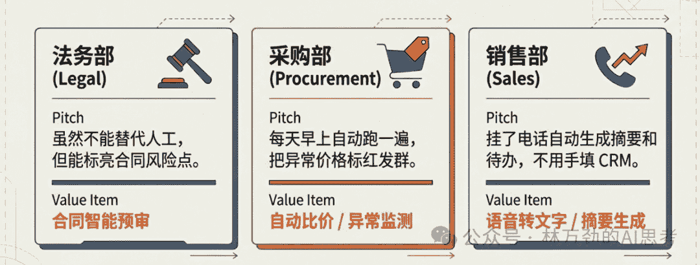
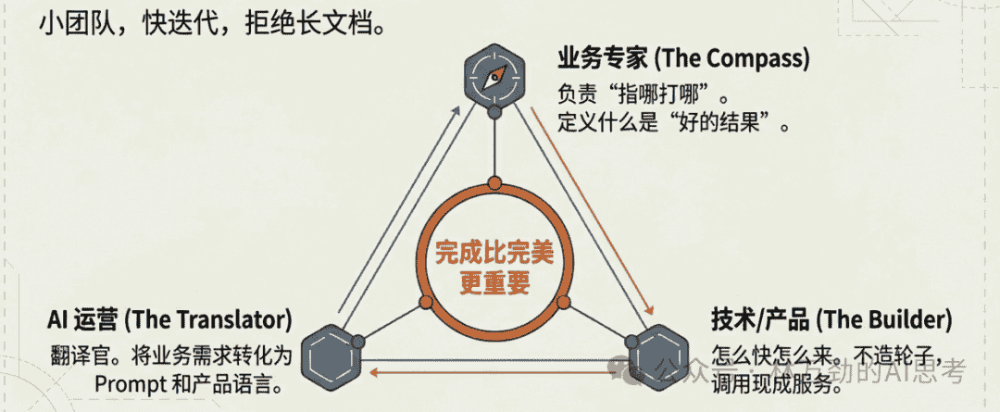
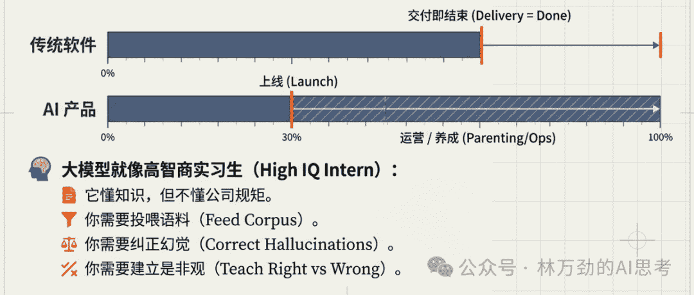
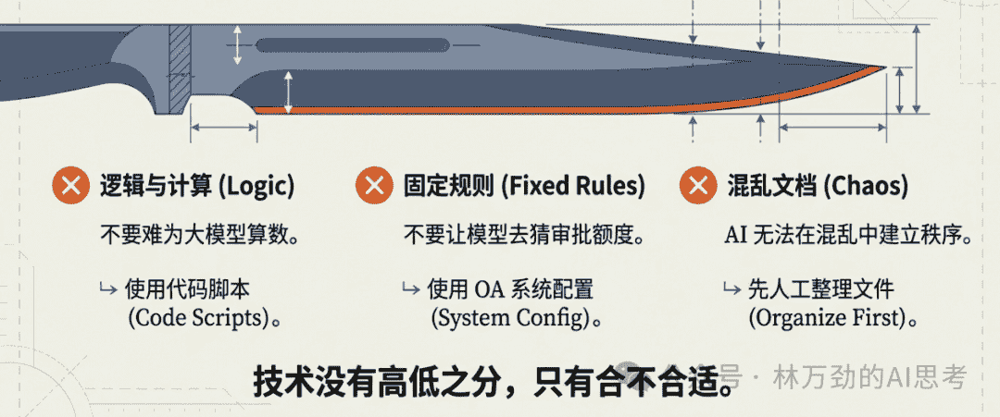
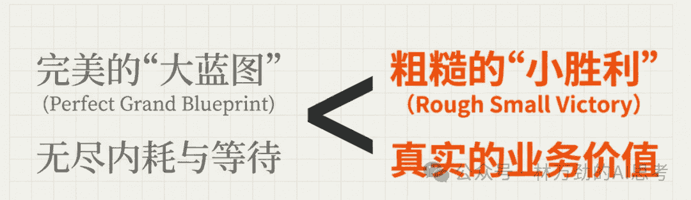

# 关于企业落地 AI 的思考：切忌憋大招

> 来源：[https://yunyinghui.feishu.cn/docx/V7iKdTCiDoi5BqxMGY0cMIVGngf](https://yunyinghui.feishu.cn/docx/V7iKdTCiDoi5BqxMGY0cMIVGngf)

---

> **原创公众号：**林万劲的 AI 思考

> **发文时间：**2026-01-28 19:10:46

> **收录开源AI知识库：**[万象 AI 实验室](https://yunyinghui.feishu.cn/wiki/WhelwZnxQi55mpkOzatc3Xran5b?from=from_copylink)

很幸运，在刚结束的 AI 效率先锋大赛上拿了个一等奖。

去北京之前还在西安，这段时间确实飞得有点频繁，这也是公众号上周没更新的原因。

其实这次拿奖的项目场景特别小，名字**叫“影子运营官”。 核心逻辑就**一件事： 用 AI 大模型去“表单化”。

以前我们做信息收集、反馈调研，总是丢过去一个冷冰冰的表单链接，这个项目就是把“填表单”变成了“聊天”，用 AI 的对话能力去完成结构化信息的收集。

虽然这只是一个小小的场景实践，但现场大家的反馈却意外的热烈。

这也让我意识到： **平时工作中，那些让自己或者身边人真切觉得“别扭”、**“麻烦”的地方，往往藏着大家共同的困扰。

只要敏锐捕捉到这些真实需求，哪怕切口再小，也是有价值的解决方向。

在北京领完奖后，领导就找我聊了聊关于“AI 办公室”的事。

**他问了一句：“咱们想让组织 AI 化**，你觉得可以先做什么，第一步该怎么走？”

当时我顿了一下，只说我可以先看看场景。

说实话，要是在几年前，我肯定张口就来：“放心，给我两周，我把各部门的痛点全盘一遍，弄个百大场景清单出来。”

但这次，我把这想法收回去了。

因为我意识到，不能再用以往那种“地毯式搜索”的逻辑了，看起来很周全，实际上最容易掉坑里。

面对全公司几十个部门、上百个流程，个人力量太有限，试图面面俱到，最后只会在细枝末节里空转。 更残酷的是，还没等我们把那张宏大的蓝图画完，老板的热情可能已经凉了。

我想这也不是领导想要的答案。

回来深圳我想了很久，把那个宏大的计划推翻了。

企业 AI 转型的成败，往往不取决于你摸底摸得有多透，而取决于第一个真正落地的项目是什么。

在大家都在观望、信任账户余额不足的起步阶段，我们最怕的就是“贪大求全”，业务部门在观望，老板在算账。

如果第一个项目成了，士气大振，信任建立，后面的预算审批绿灯会一路亮到底； 但如果败了，或者拖了半年没动静，那这第一口“气”也就散了。

与其在那憋大招，不如先找一个小而美的开局。 行话叫 **Quick Wins**，但我更愿意称之为 “看得见的小胜利” 。

关于怎么找到这个“点”，分享四点我的思考，希望能给大家一点启发。

# **01 别想着把大海煮沸**

大公司的沟通成本，有时候比技术成本还要高。

试着把心态从“保姆”切换成“园丁”。不要试图浇灌每一寸土地，先看哪里的土质最好。

我自己用来拉齐认知的一个有效工具，是画一个简单的“评估矩阵”。 只看两件事：

**业务价值： **是高频刚需？还是伪需求？

**实施可行性： **数据在线了吗？流程标准化了吗？

只有落在“高价值 x 高可行性”象限的需求，才是 Quick Wins。 其他的，先放一放。

在这个阶段，可以给自己定两条底线：

**不做“为了做而做”的事： **无法证明流程重组、效率提升的，一票否决。

**不做“成本中心”： **AI 是资源释放器。实施部门必须承诺效率指标达成后的 HC 释放或转岗。

# 02 别问想吃什么，递个菜单过去

机制定好了，你会面临第二个尴尬：业务部门根本不提报。 或者提上来的需求全是：“能不能帮我自动做账？”、“能不能帮我招人？”这种大而无当的许愿。

有时候我们会觉得业务部门“没想法”。

其实换位思考一下，对于不熟悉技术的朋友来说，AI 这东西确实挺抽象的。要么觉得它神乎其神（被各种‘颠覆世界’的标题吓到了），要么用过几次觉得它经常胡说八道。

解决办法只有这五个字：学会抄作业。Quick Wins 的捷径，就是复用别人已经验证过的成功。

**不要指望业务方能无中生有地构思**场景， 创新是昂贵的，模仿是务实的。 我们要做的，是站在巨人的肩膀上，整理一份按职能切分的“部门 AI 场景方案库”。

这份“菜单”从哪来？ 从友商的财报里、从 SaaS 供应商的案例里、从咨询公司的白皮书里，甚至从国外的 Product Hunt 上来。

不用非得从零创新，看看外面已经跑通的例子，整理成一份“菜单”，拿着去聊：

**跟法务聊： **“最近看到个挺有意思的工具，能帮咱们预审合同。虽然不能完全替代人工，但它能把风险点标亮，大概能省个几分钟。这是个简单的演示，您要不试试手感？”

**跟采购聊： **“每天早上比价填表确实挺枯燥的。要不试试让程序每天早上自动跑一遍，把异常的价格标红发群里，大家只管做决策就好？”

**跟销售聊： **“填 CRM 系统确实挺费神的。现在的语音转文字技术还行，挂了电话自动生成个摘要待办，可能比手填要顺手一点。”

拿着具体的“卷子”去沟通，大家就容易知道该怎么填空了。

稍微利用一点点大家的“好奇心”——看到别的部门开始尝鲜了，大家自然也愿意试一试。

# **03 落地：组建“速赢小队”**

落地的关键，在于那个“小”字。

尽量别搞太大阵仗，也别写那种按月计算的文档。现在的技术迭代速度，大家都有体感，可能过两个月模型能力又变了。

找两三个靠谱的伙伴，组个 **灵活的小组 **：

**一位业务专家 **：他负责“指哪打哪”。他要明确验收标准，如果 AI 跑偏了，他要第一时间喊停。他不需要懂技术，但他必须懂“什么是好的结果”。

一位懂 AI 的翻译官（AI 运营） ：负责把业务的需求具象化，转化为 AI 产品的语言。

一位动手能力强的 AI 产品/技术 ：怎么快怎么来，能调用现成的服务就别自己从头造轮子。

哪怕简陋一点，先跑起来。 **完成，真的比完美更重要。**

# **04 做好“带孩子”的心理准备**

这点是给我们自己打的预防针。

做 AI 产品运营，得有个心理准备： 上线那天，产品其实只完成了 30%， 剩下的 70%，全是靠日复一日的“运营”磨出来的。

传统软件上线是交付，AI 产品上线是养成。

别指望模型一上来就懂咱们业务的“黑话”，它就像个刚入职的高学历实习生，脑子聪明，但不懂规矩。

你需要把业务的语料喂给它，把错误的回答纠正过来，手把手教它什么是“对”，什么是“错”。

这个过程很枯燥，但只有熬过这个“磨合期”，它才能真正成为你的左膀右臂。

# **05 好钢用在刀刃上**

最后泼一盆冷水，这也是我在实战中踩坑最多的地方，也是能不能守住“专业底线”的关键。

虽然我们是做 AI 的，但得承认： 大部分业务需求，不一定得是用上大模型。

**一个成熟的产**品人，不仅要会用 AI，更要懂得什么时候 不用 AI 。

面对五花八门的需求，保持一点专业上的冷静：

写在最后：

如果现在有同行问我企业 AI 落**地最大的坑是什么，我会毫**不犹豫地回答： 千万别做“地毯式搜索”。

作为执行者，我们总有一种“逻辑洁癖”，觉得不把全公司的场景摸透了、把大图画圆了，就不敢动手，但在 AI 这个领域，“想清楚再做”往往等于“永远不做”。

“地毯式搜索”换来的，往往不是精准的地图，而是无尽的内耗和等待，别怕不够宏大。

在这个不确定的探索期，哪怕是一个粗糙的、但真实在跑的“小胜利”，也比一张完美的“大蓝图”更有力量。

---

我是林万劲，一名深耕一线的 AI 产品运营。 我不卖焦虑，只谈实战。 如果你也对 AI 落地思考感兴趣，欢迎关注我的公众号：

林万劲的 AI 思考