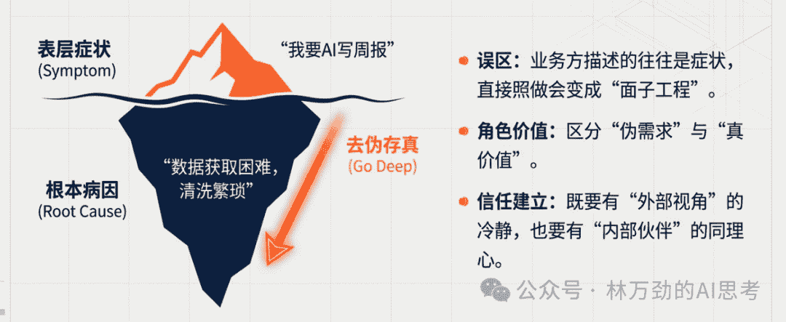
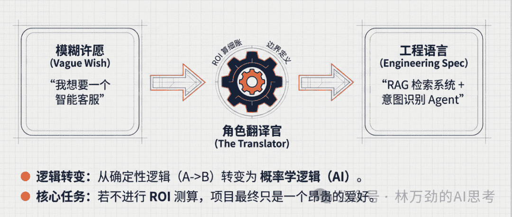
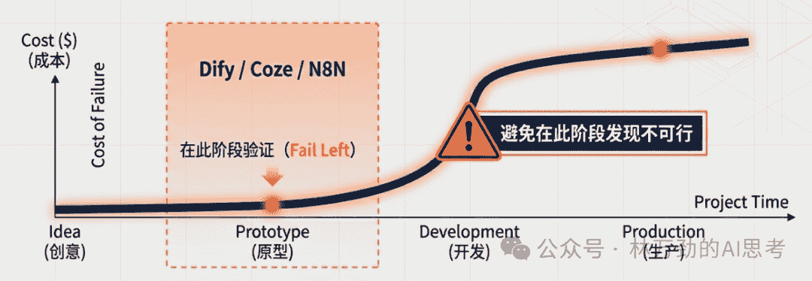
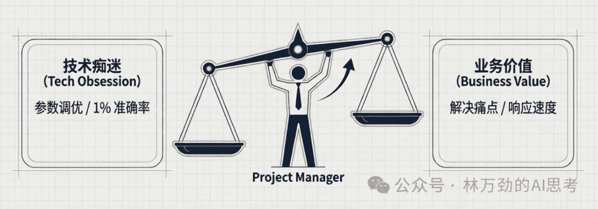
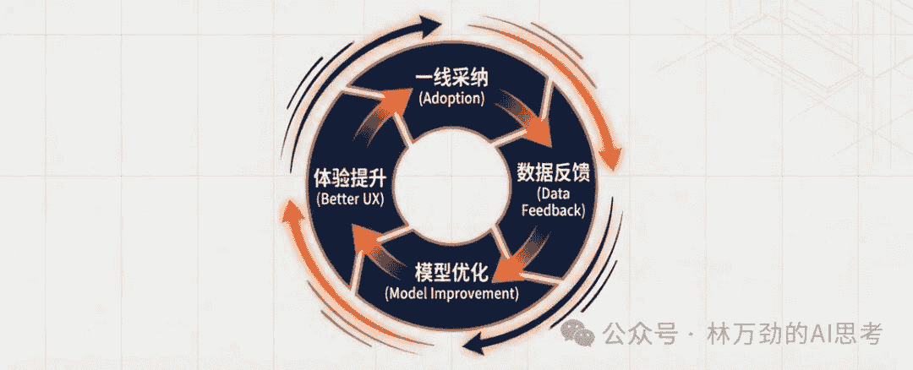
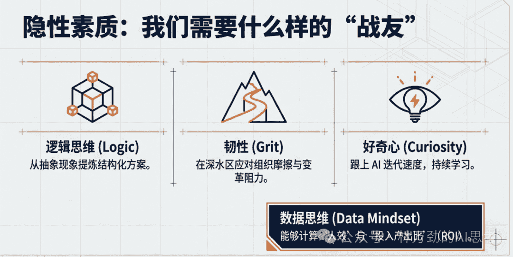

# 领导说要“复制”一个我：2026 年，企业 AI 落地到底需要什么人？

> 来源：[https://yunyinghui.feishu.cn/docx/QT5ldgOlwofhxaxV1ndcRTssnJf](https://yunyinghui.feishu.cn/docx/QT5ldgOlwofhxaxV1ndcRTssnJf)

> **原创公众号：**林万劲的 AI 思考

> **发文时间：**2026-02-09 19:00:47

> **收录开源AI知识库：**[万象 AI 实验室](https://yunyinghui.feishu.cn/wiki/WhelwZnxQi55mpkOzatc3Xran5b?from=from_copylink)

# **写在前面**

> 这篇文章，源于一次让我颇感“忐忑”也是一次不得不进行的自我解剖。

> 2026 年，公司正式成立 AI 管理办公室，统筹组织 AI 场景的孵化。这是一个标志性的节点，意味着我们从单点的技术尝鲜，转向了系统性的数智化深耕。

> 上周，我们开了第一次关于组织架构与落地方向的沟通会，领导提出要“复制”一个我。

> 必须坦诚地说，这并非因为我个人有多不可替代，更非为了炫耀特权。恰恰相反，这折射出一个尴尬的行业现状： 在“企业 AI 落地”这个细分且深水的方向上，市场缺乏具象的人才参照物。 当企业试图将大模型的能力真正“缝合”进复杂的业务流时，却发现中间存在巨大的人才真空。

回看我的职业履历，很难给我下一个**定义——是产品？是运营？还**是项目经理？ 这也让人难以对我进行归类 ——究竟该划入产研体系，还是业务体系？

从担任智能客服训练师，在海量工单中寻找自动化的空间，理解“数据标注”背后的人性；

到成为智能+流程的中台负责人，在复杂的供需匹配中打磨流程，学会用系统思维和项目方法论解决场景问题；

再到现在深耕供应链中心，致力于 AI 场景落地，试图让 LLM 理解一个设备健康度诊断流程的逻辑。

正是这些看似不相关的经历，拼凑出了应对 AI 落地复杂性的能力版图。

**因为 AI 落地从来就不是单纯**的技术问题，而是一个融合了 业务理解、技术变现和组织变革 的复杂系统工程。

所以，这篇文章不是为了自我标榜，而是希望通过复盘**，剥离出那**些在深水区摸爬滚打后总结出的 底层能力 。

**如果你也在组建 AI 团队，或者正为“招不到合适的人”发愁，这篇关于“岗位画像”的深度**分析，或许能帮你少走弯路，看清 2026 年企业落地 AI 到底需要什么样的人。

# 01 一次沟通中的定岗：再招一个林万劲

2026 年，大模型的喧嚣褪去，企业 AI 战略进入“算细账”的深水区；

早期的“玩票”结束，企业开始关注 AI 投入的真实产出，AI 办公室的成立，正是为了解决“如何规模化复制成功案例”的问题。

这是我们第一次沟通组织架构和落地方向，会上，领导问我：“万劲，面向全公司做孵化，你需要几个人？”

我认为在 AI 时代，人海战术不仅失效，甚至可能成为负担。传统的“产品+开发+测试”流水线模式，在应对灵活多变的 AI 场景时显得过于笨重。于是我回答：“再给 1-2 个和我一样能独立孵化 AI 场景的 HC 吧”。

我理解的 AI 办公室需要的是单兵作战的特种兵，不是按部就班的步兵团，需要追求速赢。

领导回答得很干脆：“行，那就照着你的画像，再招一个林万劲。”

会后，为了搞清楚我要招什么的人，我试图将隐性经验显性化（ 事实上，我一直没有对自己有过明确的画像，一路就这么过来了，这是值得反思的地方）

最终画出了一份看起来有些“苛刻”的 JD 画像（JD 具体内容，在文章最后给出）

JD 画像明确后，HR 找到我说，我们来一起对齐下工作职责和画像的要求吧：

“**会议中中，HR 第一个问题是：万劲，这份 JD，既要做流程**设计，又要懂 AI 技术边界，还要有项目思维， 这看起来有点杂，是要招 AI 产品经理么。如果要精准匹配，我们该侧重业务流程设计，还是技术落地？ ”

这是一个切中要害的问题，传统的岗位标签在 AI 时代失效了。

我的回答是： “这确实是一个‘大杂烩’，或许可以从我的工作内容开始理解。

这些看似矛盾的要求，确实是被真实业务场景验证出来的必备技能；

在 AI 落地一线，单一技能的专家往往束手无策：纯业务不懂技术边界，纯技术不懂业务痛点。我们需要的是能打通全链路的‘特种兵’，一个能独自闭环的‘超级个体’。”

# 02 为什么必须是“流程设计师”？

关于“定位”，我们首先讨论的是：“为什么强调要像咨询顾问一样去诊断流程？业务自己提的需求不行吗？他们不是最懂业务的人吗？”

> 这揭示了流程中最大的痛点：往往不是产研不会开发，而是‘业务不会提需求’。

> 根据以往经验，业务方很难提出清晰的 AI 需求，导致产研资源只能看到明面上那些显而易见的浅层需求。

> 我们的核心价值在于 前置介入 ：通过深度场景挖掘与立项价值诊断，将含糊的需求转化为清晰的战略落地路径。 确保每一发子弹都“弹无虚发”，这比我们自己去写代码更有战略价值。

这就引出了 AI 落地的 **第一阶段：业务诊断， **核心逻辑只有一个： 不要手里拿着锤子（AI），看什么都像钉子。

**去伪存真： **业务方提出的需求往往是“症状”而非“病因”。

**建立信任： **信任与共识是 AI 落地的基石。

不做这一步，我们就会陷入技术自嗨，产出一堆没人用的“垃圾代码”。

# 03 为什么又必须是“AI 产品经理”？

紧接着，我们探讨了“技术边界：“既然公司有强大的产研团队，为什么这个岗位还需要具备 Dify/Coze 这类工具的 实践操作能力？”

这对应了 AI 落地的 **第二阶段：需求定义 **和 **第三阶段：可行性验证 。**

传统软件开发逻辑是确定的（A 点击跳转 B），但在 AI 时代，逻辑变了： AI 是“概率学”，而非“确定性逻辑”。

合格的 AI 落地负责人，必须承担“角色翻译官”和“边界探索者”的职责：

**需求定义（翻译官）： **业务不懂大模型能做什么（以为是万能许愿池），技术不懂业务细节（不知坑在哪里）。

**可行性验证（探知边界）： **在申请研发资源前，你能不能自己用 Dify/扣子 搓一个 Demo？或者用 Google Gemini 先跑一遍数据清洗？

**不然，项目很可能在投入几十人月后，才发现模型在特定场景下准确**率无法达标，直接烂尾。（即：可行性验证）

# 04 为什么最好还要懂“项目管理”？

**最后，我们聊到了**最隐性也最关键的能力维度—— “组织影响力” 。

这涵盖了 **第四阶段：产研协同 **和 **第五阶段：价值闭环 **。

HR 敏锐地指出：“JD 里关于 ROI 测算和跨部门协同的要求，听起来更像是一个‘操盘手’，是站在业务对立面的”

**没错，这确实**是 AI 落地中最艰难的部分： 变革管理， 你拿着 AI 冲进业务部门，如果处理不好，在他们眼里你就是来“优化”他们（裁员）的敌人。

**产研协同（把控方向）： **别让技术为了炫技而开发，要为解决问题而开发。

**价值闭环（员工赋能）： **上线不是结束，只是开始。

避免，系统上线第一周有人用，第二周没人用，最终沦为“空中楼阁”。

# **写在最后：寻找那个“桥梁”**

复盘完这份 JD，我清晰地看到了那个“桥梁型人才”的模样，具象化出来，就是一个精通 AI 落地五阶段全流程的人。

这张岗位画像揭示了一个真理： 企业 AI 产品经理（或 AI 运营）的核心能力模型 ，是由这五个环节环环相扣组成的：

**懂业务（阶段 1）： **能和业务方聊在一块，挖出真痛点，不被表象迷惑。

**懂转化（阶段 2）： **能把痛点变成 BRD 和 ROI 分析，算清账。

**懂技术边界（阶段 3）： **知道 AI 能做什么，不能做什么，不画大饼，能动手验证。

**懂项目管理（阶段 4）： **能联动产研团队，确保交付物符合预期，不跑偏。

**懂运营（阶段 5）： **能把产品推销出去，让一线员工爱用，让数据转起来。

2026 年，我们寻找的不仅仅是一个“高级 AI 产品运营”，而是一个能在这个不确定性的技术变革期，带着企业“过河”的人。

如果你也具备这样的“缝合”能力，请相信**，属于你的时代才刚刚开始。因为在未来， “如何用好 A**I”比“开发 AI”更具商业价值，而能连接这两个世界的人，将是企业最核心的资产。

你觉得企业 AI 落地最缺的是什么能力？欢迎在评论区留言交流。

**【硬广时间】**

如果你看完这篇文章，不仅没被这些“奇葩”要求劝退，反而觉得“这不就是我吗？” 或者你觉得“虽然我现在还不是，但我很想成为这样的人”。

那么，请不要犹豫。 我们正在寻找你这样“复合型”的战友，一起在 AI 落地的无人区里蹚出一条路**。别担心简历不够完美，我们更看重你的**“野路子”实战经验和对 AI 的真实体感。 有兴趣的可以后台私聊我，发简历，或者只是聊聊你对 AI 落地的看法，都欢迎。

**期待那个“看过很多钉子”的你。**

**JD 如下：**

职位名称：AI 解决方案专家（组织 AI 项目落地方向）

**所属部门： **AI 办公室 **汇报对象： **AI 办公室负责人

**【岗位职责】**

**业务流程诊断与场景规划**

**流程优化： **深入业务一线（包括但不限于供应链、销售、客户成功部门），通过专业的业务调研方法，识别现有作业流程中的低效环节、冗余节点及关键瓶颈；

**场景挖掘： **基于对业务逻辑的深刻理解，筛选并评估具备高价值的 AI 应用场景，制定项目优先级策略，确保研发资源集中投入于高产出的核心项目，避免低效能的数字化建设；

**需求分析与产品定义**

**深度需求分析： **主导需求调研工作，通过结构化的访谈与引导，将模糊的业务诉求转化为具体的、可执行的解决方案，有效识别并剔除伪需求。

**标准化文档输出： **负责撰写高质量的业务需求文档（BRD）及验证产品需求文档（PRD）。明确界定产品功能边界、数据流转逻辑及交互规范，确保产研团队对需求理解的一致性与准确性。

**项目管理与效能评估 （ROI）**

**投入产出比测算： **建立严格的项目立项评估机制，在项目启动前，输出项目可行性报告（涵盖人力工时、外包成本、边际成本与预期提效收益）；

**全生命周期管理： **履行项目经理职责，制定详细的项目排期，协调跨部门资源，监控项目进度与质量，建立动态评估机制，对于过程指标偏离预期或 ROI 不达标的项目，进行及时的干预或止损决策。

**技术可行性与边界管理**

**技术边界把控： **充分理解主流大模型技术（如 GPT-4/5， Claude 3.5， Gemini 等）的能力范畴与局限性；

**预期管理： **基于技术现实，向业务部门提供客观、可落地的解决方案建议，有效管理业务预期，规避因技术理解偏差导致的项目交付风险。

**【任职资格】**

**专业背景与经验（硬性要求）**

**工作年限： **3-5 年及以上相关工作经验。

**核心背景： **必须具备 B 端产品经理或企业数字化咨询背景。具备扎实的文档撰写能力，能够独立输出符合行业标准的 BRD 文档；

**项目经验： **必须拥有主导 0-1 搭建生产级 AI Agent 或复杂企业级业务系统的完整落地案例。

**数据思维： **具备优秀的数据分析与财务测算能力，能够熟练进行人效分析、成本拆解及外包费率计算。

**通用素质**

**逻辑思维： **具备卓越的抽象思维能力，能够从复杂的业务现象中提炼核心逻辑，构建结构化的解决方案；

**沟通与协作： **具备出色的跨部门协作能力与抗压能力，能够有效处理多方利益关系，具备成熟的向上管理与横向协同技巧；

**学习能力： **保持对 AI 前沿技术的持续关注，并具备将其转化为具体业务应用语言的能力。

**加分项**

持有 PMP（项目管理专业人士）或其他相关项目管理认证；

熟悉主流低代码/工作流编排平台（如 Dify， Coze， N8N 等），或具备基础的 Python 代码阅读能力；

具有大型传统企业数字化转型或业务流程重组（BPR）项目经验。