# 360周鸿祎：企业如何拥抱 AI

> 来源：[https://yunyinghui.feishu.cn/docx/L3Erdl166orOJpx9PqoclSe5nGZ](https://yunyinghui.feishu.cn/docx/L3Erdl166orOJpx9PqoclSe5nGZ)

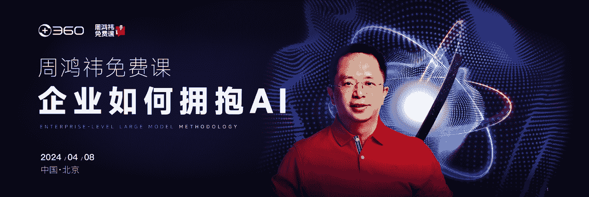

**说明**[玩赚 AI 实验室](https://yunyinghui.feishu.cn/wiki/WhelwZnxQi55mpkOzatc3Xran5b?from=from_copylink)**本文系周**鸿祎免费课 AI 系列课程第二讲实录 ，由360联合万象AI实验室宣发，供大家参考学习，收录 知识库。

大家好，今天有很多新老朋友汇聚一堂。上一次我们的课更多讲的是对于 AI 发展趋势的判断。最近很多企业都在问，AI 这东西挺好的，但是我究竟该怎么拥抱它？今天就从我们这一年的实践，内部一些成功的例子，一些失败的教训，跟大家分享一下。所以今天的主题是讲企业如何拥抱 AI。

# 企业拥抱 AI，就要建立 AI 认知，建立 AI 信仰

** **

企业如何拥抱 AI，还是先有个前提，就是要建立 AI 认知。

说白了很简单，就是你认不认同 AI 这件事。所以我总结了一个“AI 信仰”。我觉得对于新东西，对 AI，我们还是要建立一个基本的认知和信仰，要不然我们的前提就不存在了。

我总结了 6 句话，大家可以自我验证一下。

### 1、**相不相信大模型是真智能**

扪心自问，你是不是相信大模型是真智能？这个行业里有真 AI 专家、假 AI 专家，有时候拿试金石也能验出来。比如 Sora 刚出来时候很惊艳，大家都看了 Sora 做的视频吗？有句话 I cannot create what I don't und**e**rstand。我不能理解的，我就不能创造，不能创造他没有见过的东西。但是有一些假 AI 专家就为了哗众取宠，贬低说 Sora 就是个产品，Sora 很简单。这么简单，怎么这么长时间我也没见谁做出来一个。所以围绕着 Sora 和 GPT 的争论，到今天都还有。它到底是不是真智能？每次我在用大模型的时候，我越用越有一种敬畏心理，虽然我努力说服自己，这玩意儿就是个机器，但是你在给它输不同的词汇的时候，它确实反应是不一样的。所以相不相信大模型是真智能？我觉得这是认知的基础。

### 2、**相不相信 AGI 正在加速到来**

AGI 就是通用人工智能，相不相信它正在来到？有一次我口误被逮住了，我说差距还有一年，我后来改口改成两三年，现在马斯克说三五年。但是你要知道 OpenAI 这批人之所以能够搞？为什么领先全世界，在美国也是遥遥领先一枝独秀？为什么能把 Google 发明但自己没怎么认真用的 Transformer 模型用到极致？所有的方法论都不再讲了，最重要的是他们有一个信仰，他们坚定地相信，只要我加数据、加算力、加模型尺寸、加模型参数、加模型乘数，我一定能得到 AGI。

包括现在自动驾**驶，这两天大家知道马斯克在美国发了 FSD **的新版本，然后特斯拉的自动驾驶有了很大的提升。可以告诉大家一个秘密，前两年的自动驾驶全是用规则来写规则，你写 1 万条规则，你的车都会碰到第一万零一条你没遇见过的情况。所以现在世界流行的自动驾驶都在拿 Transformer 做训练，他们所谓叫“端到端”，就是一个黑话，就是全部用数据来训练，他们就相信只要数据足够多，给的场景足够丰富，机器自然会产生智能，自然会产生判断。所以 OpenAI 这批人，他们最近跟微软要花 1000 亿美金搞一个更大的超级计算中心，实际上就是他们坚信 AGI 一定会来。最近人工智能每天都有新成果，这种度日如年的进展，所以你要相信 AGI 正在加速来到。人工智能如果不能达到 AGI，那就认为人工智能很多工作还是做不了。如果能达到 AGI，就意味着它在相当程度上可以跟人的智能和能力相匹敌。

### 3、**相不相信大模型是一场工业革命**

尽管每个技术出来都说自己是革命，比如 VR、WEB3、比特币、区块链，每个人都号称自己要掀起一场革命，但是事实证明很多东西有的是技术创新，有的是产品体验创新，有的是商业模式创新。只有大模型是一场真正的工业革命。

### 4、相不相信大模型将重塑所有产品和业务

最近美国的 VC 轮着出各种报告，木头姐、红杉、A46Z，你看，在美国 VC 心目中，他们把这已经看成了是 1995 年的互联网，1982 年的个人电脑。所以工业革命意味着什么？就是大模型将重塑所有的产品和业务。

** **

### 5、相不相信不拥抱 AI 的公司会被淘汰

为什么今天我选择来做 AI 的科普？因为 AI 已经不是一个科技话题，AI 今天是一个社会话题。

上至各国的领导人，下至企业里、工厂里打螺丝的工人，大家可能都关心说人工智能这玩意出来了，对我们每个人到底有什么样的影响？因为我们看到的科幻小说太多了，看到科幻电影也比较多，所以我觉得对我们企业家来讲，你的业务是不是值得用 AI 重做一遍，或者用 AI 加持一遍？那关于 AI 是不是会带来大规模失业问题，我一直是持一个比较乐观的态度，但是我认为不用 AI 的公司会被用 AI 的公司淘汰。虽然我们的业务今天不用 AI 什么事都没有，但你只要闭上眼睛想一想，如果你的对手、你的同行、你的友商用 AI 降本增效了，比如说别人都用文生图来做海报、做宣传物料，用自动抠图一下提升了很多的生产力，你的对手 200 个工程师全都用上这个大模型辅助编程代码，正确率提高了 20%，那你会怎么想？

### 6、相不相信不拥抱 AI 的员工会被淘汰

**我一**直坚信大模型对于每个人来讲，是人类有史以来发明的最好的一个生产力工具，可以提升我们个人的能力。所以一般情况下我认为有了大模型并不意味着你会失业，因为你提高了工作效率，甚至解锁了你很多过去不具备的能力。

比如说我们每个人都有很多创意，但是你未必能画出美好的图画，你未必能拍出很好的视频，甚至最近有个 Suno 可以让你作曲，你给个歌词，它能给你作出一首听起来还蛮像样的歌。昨天晚上我还在跟央视几个视频编辑在谈，有没有可能通过对字幕来进行剪辑，就是我把哪个字幕的字剪掉了，这一段对应的视频就自动去掉了。我把哪一段话在文本编辑器里从后面提到中间，视频就自动跟着变了。如果是这样的话，每个会编辑、会用 word 的人就都会剪辑视频了，那是不是能提高大家的工作效率？所以那些不拥抱 AI 的员工会被淘汰。

# 2024 年 AI 产业发展的十六个趋势

** **

在风马牛那个晚会上，后来因为出了场闹剧，大家注意力都被转移了。大家都在讨论我面对这个挑衅如何镇定应对，那个真不算。我的看家本事是在前面花了 40 分钟做了场脱口秀，讲 AI 发展的 10 个趋势。风马牛讲完不到两个月，我数了一下，它有六七个、七八个趋势都已经初步被验证。然后有人问我说往后怎么办呢？所以我又加了 6 个趋势，大家可以仔细看一下。

> 一、开源大模型爆发，大模型未来将无处不在

> 二、未来大国间 AGI 竞争的关键是“云端超级大模型”，规模越做越大

> 三、大模型同时越做越小，搭载于智能终端

> 四、企业级大模型市场崛起，企业会同时拥有多个垂直大模型

> 五、多模态成为大模型的关键能力

> 六、文生图、文生视频等 AIGC 功能突破性增长

> 七、ToC 继续涌现杀手级应用

> 八、知识工程成为大模型落地的决定性要素

> 九、AI Agent 激发大模型潜能成为超级生产力工具

> 十、人形机器人产业发展获得十倍加速

> 十一、大模型认知能力不断提升，自动驾驶迎来革命性变化

> 十二、大模型帮助生物科学等基础科学研究突破瓶颈

> 十三、AI 安全变得前所未有重要

> 十四、芯片性能每年翻 10 倍，6 年将提升 100 万倍，算力规模每半年翻 1 倍

> 十五、能源成为 AI 甚至人类文明发展瓶颈，唯一破解方法是解决可控核聚变

> 十六、大模型和硬件结合会带来新产业革命

**当开源大模型爆发，大模型无处不在。**未来 AGI 竞争的关键是云端超级大模型，最近美国的巨头都在进军这个领域。大模型现在越做越小，一加推出手机，这两天斯坦福推了一个叫章鱼的大模型，可以跑在手机上。杨元庆这两天是不是在推 AIPC。

我们今天的重点是讲企业大模型市场崛起。因为现在通用大模型也遇到瓶颈。算力可能遇到点瓶颈，英伟达挣的盆满钵满，算力的背后是能源。但我今天还发了一个短视频，他们碰到知识不够的问题了。因为人工智能也在超越人类，之前还在跟人类学习，人类原来也没有意识把很多知识沉**淀下来。所以他们现在发展到什么程度呢**？像他们最近发现，百度贴吧里的“弱智吧”原来是特别好的学习知识的地方。这个“弱智吧”名字没起好，其实里边一点都不弱智，里边的问题都挺难回答的。我去看了看，好多问题我都回答不出来。比如说明明是睡觉，为什么要去酒店？明明是喝酒，为什么要去夜店？睡觉应该去夜店睡觉，喝酒才去酒店喝酒对吧？所以不要看互联网上满是数据，数据不等于信息，信息不等于知识，知识不等于智慧。所以训大模型就需要把饱含人类智慧的高含量的知识训进去。

OpenAI 在 2021 年据说已经把能找到的人类的知识文本都用完了，因为人类一共就写了 1 亿本书，那么多杂志期刊论文，只要数字化都可以穷尽。最后想了个方法，他们把 YouTube 上的视频下载了 100 万个小时，这原来我也预言过，就是用视频来做学习，他把里边的音轨导出来，把音轨转成文字，用这个文字来做对 GPT 做训练。所以这个让我们中国人工智能发展又看到了新的机会。因为过去老有人自我讽刺，老有人妄自菲薄，看不起我们国内的这些从业者，说世界上搞人工智能，他们在搞智能，我们在搞人工。但这个段子到今天有了正解，没有人工哪来的智能啊？我们将来发挥我们人口红利，培养很多的人工智能训练师，我们大量的产生像百度“弱智吧”这样的内容，这样可以给我们的人工智能做更好的训练。百度“弱智吧”里边充满了双关语，充满了深刻的逻辑和各种各样的梗，它对大模型提高逻辑能力、提升回答技能能力是非常显著的。

多模态的发展，文生图的发展，ToC 会继续涌现杀手级应用。知识工程成为大模型落地的决定性要素。无论做通用大模型还是做专有大模型，知识成为决定性，没有知识的大模型就是个傻子。

Agent 架构，最近吴恩达——著名的人工智能世界级科学家，讲了好几次 Agent 的课。他反复讲到 Agent 架构对大模型至关重要，这是我今天一个讲课的重点。

还有人形具身智能机器人产业获得十倍速的发展。Figure AI 跟 GPT 合作做的机器人进步很快，最近斯坦福那个机械臂当它操作不对的时候，能听懂人的指令。比如说把一个海绵塞到口袋里，海绵掉在地上，然后人就说把口袋撑大一点，那它就能够照着人的指令完成这个任务。

还有大模型认知能力不断提升，自动驾驶迎来革命性变化。这话音没落，特斯拉已经在自动驾驶上，至少暂时从电车的这个层次跳出来了。最近马斯克宣布要做自动出租车车队。

**第 12 个，大模型帮助生物**学科基础科学研究突破瓶颈。第 13 个，AI 安全变得前所未有的重要，这是今天我们的一个重点。第 14 个，芯片的性能每年翻 10 倍，大家只需要 6 年就能翻 100 万倍。黄仁勋说，未来他准备把英伟达的算力提升 100 万倍。大家觉得 100 万倍很不可思议，其实它是个指数运算，只要每年提高 10 倍，在 6 年就能够到 100 万倍，并不需要很漫长。算力需要的规模我这瞎说了一下，欢迎大家提供更准确的数据。我觉得每半年可能翻一倍，我希望测一下我们 AI 行业有没有摩尔定律。

第 15 个，能源成为最大的瓶颈，我这里面写的唯一破解方法是解决可控核聚变，这话现在显然说错了，因为前两天我到青海大厦开会，青海的领导提出了一个绿色算力的概念，说他们准备拿出 10 万平方公里全部铺满光伏板，然后他们还有风电，这些电也用不到，那大部分电发布到内地来，能不能就地消化？把中国很多算力中心建到青海本地的话，电就非常的便宜，没准这个问题就能解决。因为中国在再生能源方面是全球的供应链，这一点恰恰成为我们中国的优势。核聚变什么时候能出来现在还不知道。

最后一个趋势，这个趋势今天 CES 已经表现出来了，就是 AI 和智能硬件的结合。今天可能不讲，我们专门可以找一次探讨，所以这次 CES 上不带大模型功能的硬件都不好意思出街了。那未来什么样的智能硬件跟大模型最容易结合？所以我觉得大模型能够把原来的打着智能的概念全部给重新改写。比如今天说的智能手机，只能叫智能手机 1.0，乔布斯 2007 年推出 iPhone，到现在其实本质没变化，除了手机越来越薄，屏幕越来越大。但是如果手机能跑大模型了，大模型能在手机底层把手机的各种传感器、API 都控制起来，那么这就变成了智能手机 2.0。

同样原来**智能硬件有个叫 Aiot 的概念，就是 AII**oT，AI 加上智能，那也只能叫 1.0，因为它真的不智能。包括智能汽车，我认为也要升级到智能汽车 2.0。智能汽车只不过是把原来一个机械靠操控为主的，变成了电脑来控制，但是里面并不具备大模型，所以谁真正能让大模型上车，对硬件产生改造。包括我前段时间发视频，无人机跟人工智能结合，算成是大模型和硬件结合。这里边的创业机会、创业空间非常之大，因为很多硬件一旦加上大模型的能力就会真正实现升级。

> 我多给大家分享一句，现在的大模型可以在 4 个点给智能硬件增加不可思议的功能。

> 第一个，用大语言模型增加耳朵、增加嘴巴，就能听懂你说什么，能够跟你用语言做交流，这是第一个突破。

> 第二个是增加大视觉模型，也就是说以后所有的硬件都会带摄像头，其实你们家的扫地机器人已经快具备这些能力了，都带有麦克风，带有扬声器，都带有摄像头接上大视觉模型多模态能力，那么它就可以看懂发生什么，看懂自己处在一个什么环境。

> 第三个，大模型加上 Agent 架构，使你的智能硬件真正有了一个能够做推理、分析、分解任务的大脑。

> 第四个，是具身智能，但具身智能我们研究的不多，是指这些硬件能不能动起来。前三个改变对现在的很多硬件的体验来说，已经差异于过去十倍的体验了。这次小米也率人演示了小米 AI 大模型，把小爱同学做了升级。有了大模型之后，这个车就真的像有了灵魂一样，它能理解你说的每一句话。

这 16 个趋势信息量比较大，大家可以慢慢去琢磨，可以看看哪一条风口你能撞上，都会有巨大的机会。

# 大模型不是泡沫，将引领新工业革命

** **

> 「人工智能+」首次写入政府工作报告，打造新质生产力，企业必须拥抱 AI

两会专门把“人工智能+”写入了政府工作报告，“人工智能+”其实就是“大模型+”，因为人工智能落地的技**术**就是大模型。原来有个政策叫“互联网+”，实际上就是做产业互联网，所谓产业互联网就是用互联网的技术帮助传统产业转型升级。那今天“人工智能+”，国家的战略是什么呢？就是用人工智能帮助中国的传统产业，特别是制造业、现代工业转型升级，所以国家也提出来打造新质生产力。现在在座的各位都应该往这上面靠，都应该想办法变成新质生产力整个大风向中的一环。所以国家也认为人工智能是打造新质生产力的驱动引擎，所以企业必须拥抱 AI。

> 把大模型拉下神坛，才能掀起工业革命

我们看历次工业革命是怎么发生的？比如说超级电脑被发明的时候引发工业革命了吗？其实没有，超级电脑的用户太少，都是国家军队、气象局、地震局，后来是像玩具一样的个人电脑出现了。个人电脑虽然便宜、廉价、简单，但是每个企业都买得起，每个家庭都用得起，所以它进入了千家万户，进入了百行千业，所以才产生了工业革命。

互联网也一样，互联网的前身是什么？是美国国防部搞的一个实验项目，原来连接美国一些军工单位、大学研究中心，它并没有成为 Internet。什么时候成为 Internet？一个浏览器出现之后，所有的企业、所有的个人都上网了，把全世界连在一起，互联网才产生工业革命。

所以人工智能如果只是少数人用，它就不能叫工业革命。我的一个结论是，只有把大模型拉下神坛，才能掀起工业革命。

> 找到关键的问题才是解决问题的关键，如何把大模型拉下神坛？

什么是关键的问题？这句话你仔细琢磨琢磨还是挺有道理。解决大家拥抱 AI 的关键，是要找到关键的问题。这也是今天的一个重点。

# **企业拥抱 AI 的关键问题**

** **

我们在网上组织企业家问了很多问题，我把大家问题分了两个流派。

一路是观望派，比如说大模型技术很复杂，我们不是互联网大厂，搞得了吗？GPT3.5 都免费了，就薅点羊毛就挺好的。大模型现在还不完美，我们等等看，等到 GPT 5 出来再说。还有人言外之意，国内的大模型水平还没达到 GPT 4 的水平，等到达到的时候我们再用。还有说大模型不安全，是不是等 360 解决了安全问题以后再用？这个基本上是观望派。

但我觉得其实能当企业家的人，能当创业者的人，观望派很少，一般都是行动派。所以我也主张不用等到这个事情很完美了才去做。我的观点是有个草台班子总比没有要强，在干的过程中，我们的草台班子慢慢的就变得不那么草包了。

行动派的问题就问得很具体了，应该选择多大的模型？是模型越大越好吗？千亿模型能力很强，能不能把企业的所有问题都解决了？现在名词很乱，行业大模型、产业大模型、企业大模型、垂直大模型，这么多大模型该选哪一个？还有人问，有了大模型是不是就能弯道超车？原来企业里的财务系统、ERP 是不是都要淘汰？老周我没算力，买不到卡，也买不起卡，能不能搞大模型？还有人问没有程序员能搞大模型吗？今天我们来推理一下。

** **

### 1、2023 年百模大战，通用大模型越做越大，但适合普通企业吗？

2023** 年咱们老说百**模大战，我刚来之前看了一下数据，国外有个叫 Hugging Face，专门做模型托管的，就各种大模型、小模型、垂直模型、专业模型、通用模型，在 Hugging Face 上都能找到，而且都能玩起来。你知道 Hugging Face 有多少个大模型吗？59 万。Hugging Face 每秒钟都有人在上传大模型，所以可能很快就是百万大模型大战了。

** **

### 2、通用大模型动辄万亿参数规模，卷得动吗？

现在有一个趋势，你看 GPT5 号称要做到万亿参数，也有人猜测说 GPT6、GPT7 能做到多少不知道，但是英伟达自己推出那个 B200 号称说能训 100 万亿参数，也就是说如果训 1 万亿，花不着这么多算力，你用算力可以反推他们的参数肯定越做越大。但是我们问，这条路真的适合在座的各位吗？适合普通企业吗？如果按这游戏规则玩下去，我觉得中国互联网里边也没有几个大厂能玩下去。因为大家的卡是都不够啊。所以通用大模型现在基本上是万亿，可能 GPT4.5 或者 GPT 5 出来之后，万亿可能是一个基本底线，所以他们也有人出来讲，没有 10 万块卡就不要再加入通用大模型的竞争。

我还听过一个数字说，Meta 今年说要买 100 万块卡，微软至少要超过 100 万块卡，台积电的产能也就决定了可能一年也就能做几百万块卡。美国还有那么多企业要买，还不卖给我们。所以你想想，那如果按这个方向来卷，肯定是卷不动的。

### 3、拼算法、算力、数据、人才、安全、能源，拼得动吗？

所以大家拼的是什么？拼的是算法、算力，拼的是数据。数据现在真的是都不够用了。还有人才、安全。大家注意为什么最近 GPT5 一直迟迟没发布？有人就出来说 OpenAI 不行了，我觉得是睁着眼睛说瞎话，我觉得最大的一个可能性，现在随着 AGI 的能力越来越逼近，现在各国政府对安全的考虑越来越慎重，包括 Sora 也出来解释为什么迟迟没有放个人账号，他们在邀请红队测试。大家知道红队测试这个概念吗？在我们网络安全里就是邀请一帮黑客，邀请一帮破解专家，来对我的系统做各种破坏性的试验，找各种漏洞，我们称为叫红队攻击。因为西方是以红队为敌手，防守方称为蓝队。我们网络安全上我们也经常搞，我们的防守方称为叫红队，我们的攻击方称为叫蓝队，这跟西方这样是反过来的。所以他们现在最大的一个顾虑是安全。

当然拼数据、拼算力，最后就拼能源。我的观点是我们在座的普通企业家就不要去加入这个游戏了，这个游戏我们玩不起。

### 4、通用大模型 AGI 之路如何走通？举国之力，国家统筹、大企业合力

两会我写了一个提案，我们画成两条路，一条路是通向 AGI 的，叫超级通用大模型之路。这个不需要 100 家公司干，这个需要几家大家伙在国家统筹下把算力集中起来，把数据相互打通，以举国之力，一个国家有那么一个就很了不起了，这是我的观点，否则大家现在每家都有个几万张卡凑起来，全部加起来可能也就 100 万张。

美国最新的叫 BG 200，超级计算机，它把那个计算密度做到了极高，它训个万亿模型，比如说 3 个月就能出结果，一年能训 4 次，我们集群算力不够，那就靠耗时间，这算一年多结果没出来，你怎么去竞争呢？所以我觉得这是一条路，但这不是唯一之路。

### 5、通用大模型自己训？模型不贵，训练很贵，有钱买不到卡

我为啥主张创业者不要轻率闯这条路？我没有瞧不起创业者，如果你真的忽悠能力很强，有很强的现实扭曲力，融到了 10 亿美金以上的闲钱，而且投资人短期内不要求回购，投资人不要求托底是可以考虑的。我们国内很多 VC 现在投资都是要求有保底、有回购。这钱随便花，就像当年马斯克给了 OpenAI 几亿美金一样，这钱随便花，那我觉得你加入这个竞争是没问题的。

**否**则的话我们把企业级大模型和这条路分开。就企业级大模型一定是走另外一条，这是不同的战场，敌人都不一样，战斗力也不一样，需要的能力也不一样，所以两个战场的游戏规则不一样。有人就来问我，说我们自己也训个通用大模型，现在真的不贵，因为开源的千亿模型也有，像马斯克开源了他的 Grok，data break 开源了它的 1300 多亿的，马斯克的是 3410 亿的模型。那么训练很贵，训练这种模型的起价至少 1000 万吧，1000 万也就训练了一次两次，而且现在关键问题是你有钱，你真的确认你能买到卡吗？那我们再换条路。

### 6、图省钱，薅公有大模型羊毛行不行？

有的企业家很聪明，说咱们省钱，咱们薅公有大模型的羊毛行不行？就是我直接套壳借用几种 GPT。用它解决一些个人的问答问题是没问题的，但是这里面有两个问题。

### 7、公有大模型拥有的都是公开知识，没有行业深度，也不掌握企业专有知识。

通用大模型拥有公开知识，你们用一用就知道做通用办公、通用营销是没问题的。如果问到跟你的企业业务有关，跟你的行业有关的问题，就像一个咨询专家，完全不懂你企业内部的行业知识，不懂你企业内部知识，总是说一些通用的企业管理经营理论，它对你意义有多大呢？

** **

### 8、你愿意把企业的核心知识贡献出来，当行业雷锋吗？

大模型拥有的我们都叫亮知识或者明知识，就是互联网能找到的知识，大模型都能用。但是我们企业和在行业里我们是有很多自己积累的内部知识，你愿意贡献出去吗？

你怎么可能舍得把你积累了和做了 20 年积累的知识送到公有大模型，把它训进去教给它，然后这样你就为行业做雷锋了，整个行业因为你都得到了进步，这是对绝大多数企业家来说，这是不可想象的。

最近 GPT 说愿意用在云端帮你们定制模型，你真的能信吗？最近 Facebook 已经一个亿美金把所有的聊天记录都卖给了一家公司，你们知道吗？卖给了 Pinterest Ray，美国有一个美国版的贴吧，它最大的收入来自于它把贴吧的数据卖给这大模型公司播放，巴不得把你的数据尽可能上传，希望你去定制你的 GPT 的时候，把你很多数据、知识都给他，他现在正处在知识饥渴阶段，你的知识都给他了，他能不用吗？当然你现在要定制的话，那就是把你的核心知识贡献出来，那我觉得绝大多数，我也不愿意，我宁可训一个自己的专有大模型。

### 9、你愿意把数据和隐私开放给公有大模型，让企业裸奔吗？

这些公有大模型都是聊天机器人，你在跟他开会，跟他做很多沟通，把你的想法、一些原始素材给他，这样很多数据就暴露了。所以现在你看各家互联网公司都为什么有自己的编程大模型，而不会用公有的编程大模型？公有的编程大模型根本没有企业内部的代码的训练，它在企业内部根本是无法使用的。但一个大模型如果训练了企业内部的代码，有了内部的知识之后，这个大模型就一定要私有，才能变得放心。

### 10、公有大模型就是个聊天机器人，能和业务系统深度整合吗？

这我也跟大家唱唱反调，公有大模型为了让大家都好用它，最早是为了让 ToC 好用，它又想照顾 ToC，又想照顾 ToB，所以他就做了一个聊天机器人的界面。这聊天机器人又好用又难用。

好用是说你猛然一上手，会聊天就能用，这样就入门，很简单，但是你真想用、用深，你发现他对提示词的要求很高，而且提示词很不稳定，所以有人就说了，说 21 世纪大家都要变成提示词工程师。我原来也同意这个看法，但我现在持否定态度。我认为这就是 OpenAI 发展最大的瓶颈。因为搜索虽然功能有那么多不全面，但是搜索每个人用起来非常简单好用，但是大模型是会用的人觉得如获至宝，不太会写提示词的人用起来还不如搜索引擎呢。搜索引擎至少还能帮你找到一些资料，大模型有时候会胡说八道，所以提示词绝对不是最好的人机界面。

特别在企业里边，它如何跟你的业务系统深度整合？这又是一个矛盾。不整合，你用公有大模型，每天就相当于请了一个顾问，只能叨叨给你提建议，你还得把它说的话 copy 下来，再转到你内部去分发。但是你把一个公共大模型跟企业内部的 API 接起来，那你就被外部的大模型控制了，这个从安全上说不过去，所以公有大模型可以用做一个参照，但是真的放在企业内部，我觉得是不合适的。

# **THINK DIFFERENT——大模型发展并**非只有一条路，除了越做越大，还能越做越专

** **

这里我就举一个例子，叫 think different，这句话是谁的广告？苹果的。你再想想 ARM 是怎么打败 Intel 的，Intel 当年做 CPU 什么思路？越做越大，越做核越多，越做主频越高，越做温度越高，不是越做算力越强。那 ARM 跟那 AMD 跟着 Intel 后面竞争做 similar 的这种业务，所以一直就得不到太多的市场份额。现在 AMD 的市场 ARM 跟 Intel 在 X86 CPU 上还是比较小。ARM 走了另外一条什么路？ARM 必须锋芒。我走算力很小，但是功耗很低。我不进主流的桌面，不进主流的服务器，我就进一些边缘智能硬念产品或者手机，然后 ARM 就是曲线救国，这就是一个典型的 think different 的一个典型的思路。但是慢慢等 ARM 规模做起来了，今天 ARM 重新杀回了服务器市场，重新杀回了桌面，甚至现在很多 PC 端，包括你们用的苹果的 Mac 笔记本，那里边的 CPU 都已经不是 X86 了，都是 ARM 体系的，所以这就是另外一个思路，就我跟你就是不一样，反其道而行之，所以 think different 这个思想。

当然对于很多企业家来说，我觉得不仅在这个上面可以去体会一下在你面临竞争的时候，你是真的要跟你的竞争对手，跟你的同行做的都一模一样吗？还是说要反其道而行之？就像那天我自己很发愁，太想涨粉了，就去研究抖音的规则，按照他的规则我周鸿祎就不是我了。学会头 5 秒钟说一句很夸张的话，我这有挣钱的秘诀，你看到结尾啊。如果以后你看到那个周鸿祎在视频里，那他一定是数字人，不是我本人。因为我本人对着镜头，每次我要努力的装出这种样子来，真的很难。然后按照抖音的规则，我的视频太长了，每次都至少三五分钟，有的视频长达了 15 分钟。抖音讲究的是一分钟内解决战斗，后来我也想明白了，我真的做不到。为什么呢？你真的觉得一些人生的道理、企业基因的经验能在 30 秒、1 分钟讲完？它一定是情绪价值，没有真实的价值。按照 think different 这个思想，我继续坚持，我行我素，大家都做短视频，我就做长视频，没准过两天当短视频信息量下降、质量下降了，大家愿意看长视频的时候，大家可能愿意来看我的东西。所以 think different 也是让你显得与众不同。

所以按照这个思想大模型发展，我认为并非只有一条路，除了越做越大之外，还应该走一个叫越做越专的路。为了证明我这个想法，我们谈几个趋势。

## **大模型三大趋势**

### 1、做多个专家小模型混合的 MoE 架构

第一个 MOE 这个概念大家知道吗？就是 mix，就 mix of export。从一开始关于 GPT 4 就有传言说 GPT 4 看起来是一个千亿模型，实际上是 16 个专业模型组成的。那么伊隆马斯克公布了 Grok 里边就是一个 moe 加工，也就是说今年大模型在越做越大的时候，他们也面临一个挑战，为什么呢？因为你今天大模型如果是一个完整的大模型，它为什么比人脑功耗要高呢？你只想人脑里边，其实我认为是有多个大模型在联合工作的，虽然人脑在物理上是一个脑子装在脑壳里，但你想一想，人那大脑有运动中枢，有视觉中枢，有语言中枢，也有做这个文字的处理的，也有做记忆的，所以你问我 2 + 2 等于几？让我来讲一堂课，我调用大脑里面一定是不同的区域的工作，但是今天你让大模型给你写一篇 2 000 字的文章，和你问大模型 2 + 2 等于几？大模型消耗的算力、调动的运算量是一模一样的。所以现在大模型的算法 Hinton 发明的这个反向注意力这个机器深度学习这个算法本来就在一有意的在模仿大脑的工作原理。所以现在大模型也在做，把一个大型的架构拆成多个小规模的大模型，所以那么就反过来证明，就是说当你问大模型问题的时候，并不是它的 1 万亿参数同时在发挥作用，它可能从 16 个小模型中挑了两个小模型来激活来回答你的问题。那我也可以想象，现在这些技术秘密可能还没有被泄露出来，那将来一定会走专业化的路径，你同意吗？可能有。因为现在大模型我们在训练过程中发现一个很痛苦的情况，在座的诸位有没有训过大模型呢？你想让它提高点运算能力，你就准备了点奥数题去训它，结果发现它的历史能力或者外语能力就下降，你再改完就再给它灌输点物理或这个外语题，它的文学能力又下降，反正按下葫芦起了瓢。所以最后发现说每次学习的时候，就得把各种各样的知识均匀地弄一份。所以未来我们做垂直模型之后就可以避免这个毛病。比如我专门有个做计算的模型，如果你觉得我计算力比较弱，我就专攻这个模型，这个模型不会做翻译，我专门有个做翻译的模型，那我就可以把翻译做得很强。事实上我已经这么做了，一会我给大家汇报进去。

### 2、大模型终端化，上车上手机上 PC

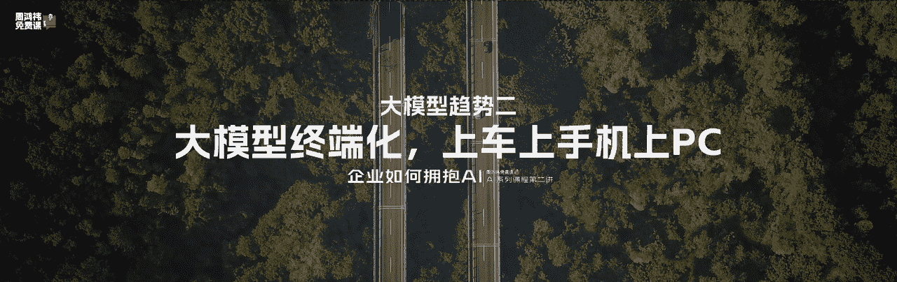

第二个，大模型做小的趋势已经出来了，就大模型终端化，刚才我已经说了，上车、上 PC、上手机，对吧？今年联想最近也是要拿 AI 来重塑 PC 产业，其实这个趋势也可以想象。有人就问我了，大模型在云端的话，现在的时延最好能做到 500 毫秒，那么做一些简单的问答在车里也许还能忍受，但是将来你让大模型在车里能控制你的车身、智能座舱，如果再跟你的自动驾驶再揉到一起，这个反应速度是不够的，这时候大模型必须要上车。大家就问联想的 AIPC 有什么用？我告诉你用处可大了。将来你家里如果有一个人形机器人，等你老了给你提供服务，这人形机器人怎么得有一个大模型驱动嘛，这个大模型应该放在云端还是放在你家呢？你大家想想，肯定不能放云端啊，一断电了这玩意就死了，被 hack 了怎么办？我遥控你们家的大模型，然后用你们家的机器人把你给消灭了。

还有一个他知道你所有的隐私，你在家里穿着小裤衩跑来跑去的时候，全被大模型看在眼里，这数据肯定不能传在云端啊。所以大模型上终端一定是一个趋势。

我跟大家预言，因为苹果有研发 CPU 的能力，因为它的 GPU 也很强，那么苹果一定它的大模型，它现在可能会暂时跟 Gemini 合作，现在会暂时和百度合作，但是苹果一旦自研的大模型出来之后，一定会跟手机深度整合的。因为手机今天是了解我们个人隐私最多的东西，手机都不是一个物件，手机是我们每个人新长出来一个新的器官。

### 3、**开源大模型爆发**

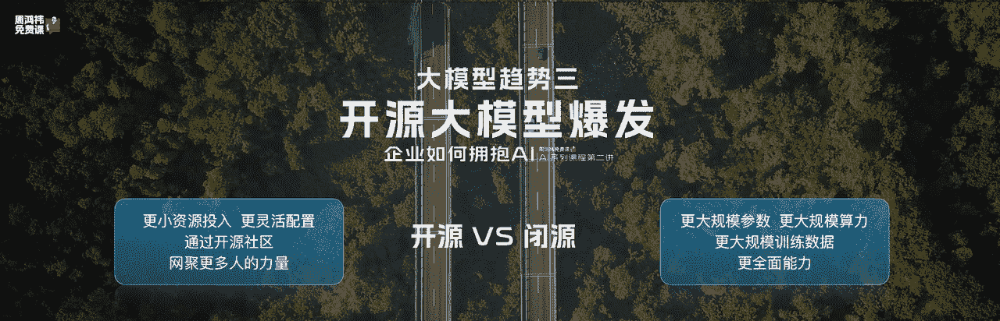

第三个趋势就是开源在爆发。有的人不相信开源的力量，但是你可以看一看，说最近开源的发展，虽然闭源你依靠一家公司 OpenAI 现在暂时领先，因为它比别人先发了 5 年嘛。但现在开源的速度，因为开源有了一个生态之后，开源的发展非常快，而且美国开源都不是一个单纯的开源，除了像背后都有很多大公司的支持。所以我举个例子，如果 OpenAI 把 GPT 免费了，它的目的实际上我认为是在想消灭搜索，是 Google 一年几百亿上千亿美金的一个生意。这具体的收入我没查，大家可以具体查，应该是在这个量级，那 Google 就会非常难受，但是那 Google 怎么反击呢？我说我要给 Google 支招， Google 的招数就是把 Gemini 给开源了，让美国每家公司都有一个不逊色于 GPT 4 的大模型可以用，而且可以免费用，减少人们用 GPT 4。所以当年你知道 Linux 没有 Linux 的开源，就没有互联网，这个话没说过错，但是你知道谁在背后支持 Linux？除了这些程序员之外，像 SCAN 公司，像 Oracle，还有像 IBM ，微软的老朋友、老友商都在拼命的给开源的 Linux 在贡献代码，贡献核心技术。

## 相信开源的力量，360 智脑开源 70 亿参数大模型，支持文本长度最长

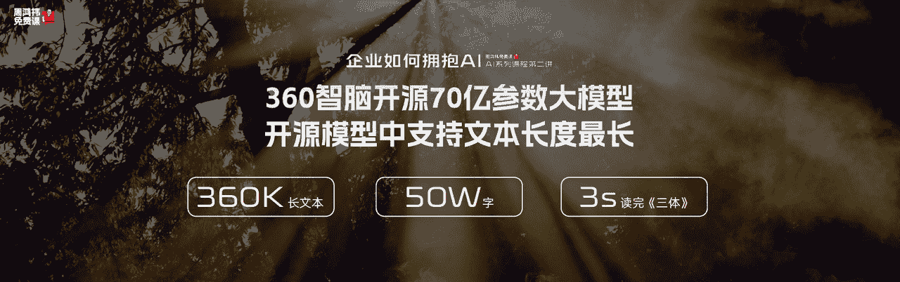

> **市场经济下的集中力量办大事，我为人**人，人人为我，不闭门造车，不重复发明轮子

所以我认为开源的最近的这个爆发，实际上给大家提供物质准备，因为你要做垂直大模型，你不可能走既用 GPT，GPT 也不可能 4 给你。那我们以前是依据开源来做我们自己的垂直大模型，我一直主张开源，我们讲我们有个体制优势，对吧？叫新型举国体制，就集中力量办大事，当年在中国研制两弹一星，在今年中国的军舰航母不断地下饺子一样下水啊，在我们各种科研成果上其实获得了很好的验证。但是咱们也不能小瞧美国人，西方在市场经济下它可能很难通过政府的力量把一些公司拉到一起。但是它通过一个开源社区，他把很多公司拉到一起，把很多自由程序员拉到一起，所以我认为他是市场经济下的集中力量办大事，形成了一种我为人人、人人为我的文化，而且最关键的它不闭门造车，不重复发明轮子。开源社区为什么这么发达？你贡献的一些想法和代码，那我在你的基础上受到了启发，我又贡献了一些知识，相当于他没有一个公司在主导，但是很多公司的成员都在参与完了，大家共享这个成果。所以伊隆马斯克很聪明，伊隆马斯克把 grok 开源，并不是说他是一个伟大的共产主义战士，你们把马斯克都给神化了，他显然干不过我们 AI，他也没有那么多人力，那怎么办？就把它开源了，就变成全世界的人可能都在帮我在改善。所以国内像李开复的那家公司叫什么？他写了个 Yi，我就感觉这不是侵犯我的名誉权了吗？哈哈，所以要谢李开复，他的产品用我的名字来命名，我不知为什么呢？为了要纪念我吗？然后 360 最近也做了一个开源，所以现在这前面 Meta 的开源，这个 XAI 的开源， Meta 开源到现在不到两年，所以开源现在跟闭源之间的距离应该说已经没有那么大了。

> 360 智脑开源 70 亿参数大模型，开源模型中支持文本长度最长

所以 360 智脑也我们开源了 70 亿参数的一个大模型，然后我的特点是支持中文的文本最长，因为前段大家在卷这个输入文本的长度，先是 20 万字 200K，后来到 100 万字，其实真的 100 万字你也用不了，而且开销特别大。这个也只能大家强努一把力，所以我们开源了 360K，相当于 36 万的长文本， 36 万的 token。差不多汉字相当于是 50 万字，所以我们也希望就大家不要在这卷了，把这个能力这个送给国内所有的垂直大模型。所以此处加点广告，大家可以理解。

## **企业大模型要走“越来越专”的路**

所以我们就能得出一个结论，企业大模型应该走越做越专的路，在企业里面找垂直的场景，做专业的技能。

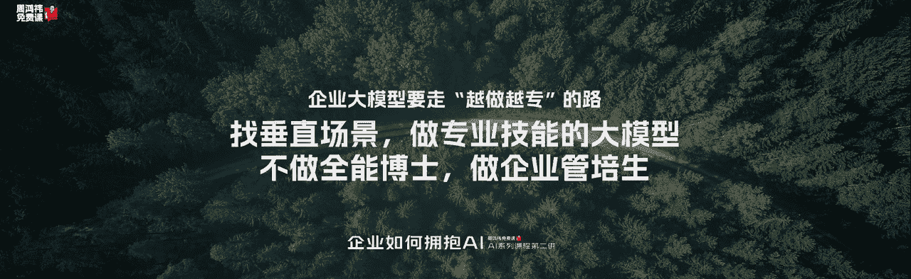

> **找垂直场景，做专业技能的大模型****，不做全能博士，做企业管培生**

记住我说两句话，就不要追求做全能博士，做一个企业管培生。今年通用 AGI、通用大模型好像在寻找培养一个爱因斯坦。这个我觉得这梦想很，我很佩服，但我们企业今天去找爱因斯坦来帮我们，我们可能找不到这个人，我们很多企业怎么干呢？我们就招一个大学本科毕业生，只要人还足够聪明，在专项技能在企业某个单项业务上进行训练，训练两年之后他是不是也能够在企业里面发挥重要作用？我每个企业家难道都要手底下弄一批牛顿，弄一批奥本海默才能干企业吗？其实我们靠是培养了很多普通人，在专项技能上得到进步，然后我们才企业才有了一个发展，所以这是我的今天的一个结论和一个建议，就是做专业找垂直场景，做专业技能的大模型。

> 没有软件既能管员工，又能管生产，还能管业务，企业内部一定是多个大模型组合工作

那么很多人这里边有一个误区，老以为说我这个企业，比如中国企业家，我就做一个大模型，就解决我所有的问题。注意这个想法是不现实的，因为目前大模型没有发展到 AGI，它还不是通用人工智能。大家记着， AGI 是通用人工智能时代，没有带到来。所以现在大模型只能在专项技能上发挥作用，如果你期望他什么都能做，这个**期望是不切实际的。今年 OpenAI 和通用大模型遇到的所有问题**，为什么它的是留存率比较低呢？就是因为他承诺我什么都能做，你去用的时候，有时候你的体验特别好，对吧？所以在企业内部，我们像我们很多人都懂 IT，我们这么多年，我们管员工的有 HR 软件，我们管客户里有 CRM 软件，我们管财务里有财务软件，你见过有一家软件商把所有这软件都做到一个软件里了吗？所以未来在企业内部不可能是只有一个大模型，大家记住我这句话，而是一定有多个大模型，每个大模型干不同的专业。大模型通过协作，通过组合来工作，这是未来。所以我们企业要不你就不整，要整企业内部绝对不止一个大模型。

> **不需要千亿万亿的参数，****百亿十亿就够用**，单机单卡就可以，从原子弹变成茶叶蛋

那么如果我们提出这样的要求，我们就发现我们所有的问题就得到了一个很满意的解答。我只要不追求这个大模型，又会写诗，又会翻译，还又能解数学题，还能够写营销文章，还能作画。我们过去通用大模型是给我们一个幻觉，觉得我大模型就该做这么多事，对吧？但实际上我们仔细的分析到，现在如果我们对大模型的要求放低，像我就降低对自己的期望，我就没有那么大压力。所以如果做一个垂直场景的专有技能的模型，不需要千亿万亿的参数，那个参数就浪费百亿，十亿的参数就够用。最近出现的一些新的大模型大概都是在几十亿到百亿这个参数，现在大家已经流行的是说看谁能用更小，用少的参数实现那些过去千亿模型才能实现的能力。所以说的夸张点，不需要 H800，不需要 H100，也不需要 A800，也不需要 A100。最极端上单机，单卡弄张消费机显卡 30903080 这 RTX 显卡就可以用。所以从这一点来说，把大模型从原子弹的地位上，在我们企业路线把它变成了茶叶蛋，就是人人都吃得起，那自然对算力的要求降到极低。

> **不需要投入几千万上亿资金，****百万、十万就可以****，中小企业都用得起**

注意大家模型的成本和复杂度是指数级的参数，小十倍可不意味着算力小十倍，算力和成本可能会小几百倍，所以不需要再投入几千万或者上亿的资金，百万甚至说几十万也别写十万，十万太低了，我们还要挣点钱吗？百万、几十万就可以，所以我认为中小企业都用得起，所以这是我们这大半年来实践的一个结论。

> **不需要面面俱到的能力，不****需要等 GPT5，GP**T3.5 级别就够用，现在就可以拥抱大模型

如果是我想象，如果雷军在，你说这个 PPT 讲到此处，这个画面一定是非常激动人心的。你看我们得了这么激动人心的结论，帮大家省了一个亿的钱。我们的话写得非常平淡，所以看花容易秀花难。所以这是第二个结论，其既然不需要面面俱到的能力，不要等 GPT5 或者赶上 GPT4 了，现在这些很多开源的小模型能力达到 3.5 的能力，国内的模型绝对都能达到 3.5 的能力，达到这个能力就够用，也就是说不用再等了，现在此时此刻你大模型就 ready 了，你就可以来参与这个工业革命，再等下去可能你就错过这班车了。

> 实践证明，百亿参数的场景大模型训得好，专业能力可以超越 GPT4

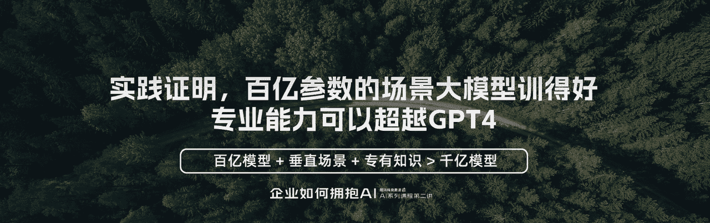

那我们下面会给一个实践的例子，用百亿参数的这种垂直场景大模型，如果训的好，我注意我这个话比较狡猾，在一个专垂直场景上，他的专业能力可以超越 GPT 4，我没有说全面能力，是让我们训的这种叫专业大模型，不具备全面能力。他可能写，有的时候写，比如说写某些文章不行，写诗不行的，解奥数题不行、算脑筋急转弯的问题不行，但是他就能够解决你的单项，它要成为一个单项冠军。

GPT 4 像什么？像一个十项全能冠军。你也知道，真正的十项全能的选手在每一项比赛里都不是冠军，他最后靠积分叠加起来，他的积分是最高，所以他拿了十样全能，而我们打造企业大模型，我们是要做专项冠军，所以那天百度讲，然后王小川就出来怼，因为好像李彦宏说他们超过 GPT 4 了，对吧？王小川就出来怼李彦宏，说李彦宏怎么就产生幻觉了呢？其实王小川阐述怼的不对，你要仔细听李总的讲话，他是有前提的。他说我们在写古典诗词这方面超过了 GPT 4。这个话是对的，所以我们讲你不要说你的企业模型超过了 GPT 4，你的企业模型在你企业里面干某一个专业技能的时候，我们认为它是可以超过 GPT 4 的，为什么呢？前提是有百亿的模型加上垂直的场景，加上专有的知识，还要加上你企业内部很多工具的加持，这都是有限定条件的，它就能超过一个对你企业啥都不了解，也没有你企业内部知识的千亿或者万亿模型。因为很简单，就算有一天通用的大模型到万亿，他学到的知识也是外面能找到的。那些众所周知的知识，他没有，你没有拿到你企业内部的很多数据和秘密，他永远不可能对这个企业的了解比你还了解。

## **案例：360 安全大模型**

** **

### **360 为什么要做安全大模型**

360 做了一个在安全领域的大模型。为什么要做安全大模型呢？一个原因是传统安全最大的问题是效率低下，缺乏运营，缺乏专家。虽然 360 用大数据分析解决了一部分问题，但 360 在发现这些攻击、解决攻击的时候也需要投入大量的人力物力。网络安全的本质是攻击者和防守者的竞争，所以我们要做一个安全大模型来代替我们的专家。这样的话，只要你有算力，可以配 n 个数字版的安全专家，为大家来提供自动发现攻击、分析攻击、阻拦攻击的服务。

另一个原因，我们要解决大模型本身的安全问题，也是大家用大模型会遇到的挑战。比如说过去 IT 系统很难被攻击，现在你只要跟大模型聊天，因为大模型具备人机对话能力，有的人 PUA 大模型，把企业大模型说得叛变，把老板们不愿意告诉大家的，比如工资单都给你打出来。这种例子不是没有。还有大模型的幻觉问题，在公网大家可以当个笑话来听，但在企业内部，比如在医疗、生产环节，大模型胡说八道、乱决策，装模作样给老板提建议，还伪造了很多证据，这是很可怕的事情，所以大模型本身的安全需要解决。

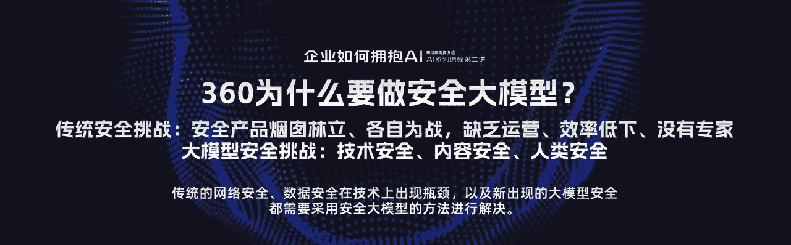

### 躬身入局、以模治模，用“模法”打败魔法

360 作为国内唯一又懂大模型又懂安全的双料厂商，我们要**解**决大模型的安全问题，必须亲自躬身入局。我的想法是以“模法”打败魔法，因为大模型越来越智能，它的安全问题肯定不是用传统安全的路子来解决，所以我们提出了以模制模的理念。我们打造一个专业的聪明的大模型，它没有别的能力，就用来盯着其他大模型，如果发现有不安全的因素输出，或者不轨的行为，对其他大模型的行为进行分析和监控。

目前这个大模型是个初级版本，只发展到 3.0。我们只依赖大模型本身的能力，就是说不依赖外部工具，不依赖微调，也就是没有作弊。现在有些大模型测试很容易作弊，你提前把考题头天晚上做一遍，第二天去考试怎么也能考个七八十分。我们就在恶意流量分析和恶意邮件检测效果方面，全面超越 GPT 4。再跟 360 积累了很多年的工具做结合，你让这个大模型写诗写不出来，奥数题也回答不了，它只干一件事——攻击事件的检测和发现。

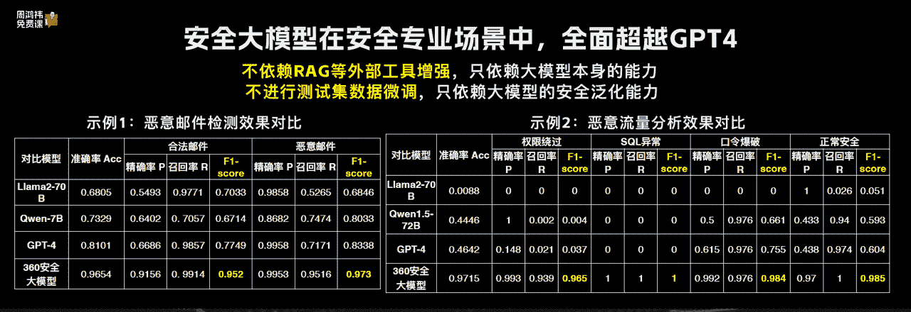

我们身体力行证明了这一点。所以大家可以想想，在你的企业内部，有什么场景可以用大模型来解决。我们怎么做的，算法加上好的知识，关键是好的知识。现在很多企业有大量数据，但有些数据是无用的知识，这种数据特别有害。我们曾经做过实验，把很多无用的数据训到大模型里，大模型立马就傻了。所以，必须要从数据中提炼出真正的实战知识，加上知识图谱，才能把它训练到大模型里去。

**3**60 安全大模型目前相当于年薪百万的高级安全专家的水平，对样本的漏洞分析效率、响应效率都做了很多提升。这是我们自己实验的一个例子，分享给大家。

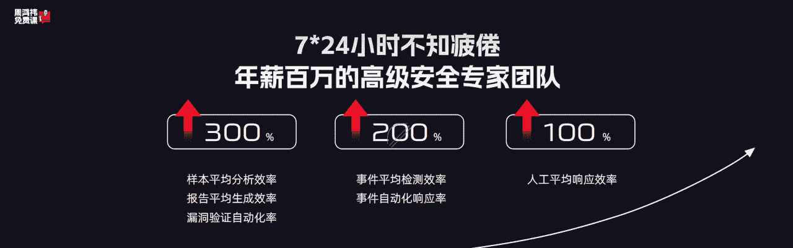

** **

# **企业大模型四大误区**

** **

我们总结了企业做大模型的 4 个误区：

### 1、**总想搞一个宏大的产业大模型**

宣传可以这么说，但实际上目前掌握的大模型能力，是不足以支持一个产业大模型的，比如建筑大模型、钢铁大模型，太大而化之了。大模型现在非常适合的是找到一个场景，在场景里解决一个专业问题。

### 2、总想用一个万能大模型解决所有企业问题

这个也不现实，企业将来在不同的场景，比如 HR、财务内部可能都会有一个大模型。比如面试有面试大模型，机器人自动面试，员工评估也有一个大模型。

### 3、还有认为有了大模型，原来的 IT 系统就淘汰了

这个观点最要不得。事实上，大模型仅仅是解决了一些过去软件不具备的推理和知识理解的能力，它缺很多手和脚，需要通过跟你原来的业务系统连接在一起，协同工作，才能让大模型在企业内发挥作用。所以原来的数字化搞得越好，IT 系统越发达，大模型效果越好。而且大模型在企业落地，绝不是一个聊天机器人的形式，那是大模型发展早期的一个探索。

### 4、大模型就不用做数字化了，直接一步到位弯道超车

这个观点也是不对的。因为如果你的企业没有基本的 IT 系统、数字化系统，老板也不用网络，不用邮件，也没有内部的文档管理、办公 OA 系统，你就没有数据的积累，没有知识的沉淀，大模型就是巧妇难无米之炊，你想做大模型是不可能的。

# 2024 是场景之年，关键要结合业务找对“明星场景”

企业走垂直大模型之路，算法、算力、成本、能源都不再是问题，核心问题是“场**景”。我认为各位企业如何拥**抱大模型，卡脖子问题都解决了，剩下的道路方向也指明了，破局之道就在于如何找场景。

2024 年每个大模型都要找场景，OpenAI 也在找场景。2023 年大家都在秀肌肉，你方唱我登场，每个公司都在发布大模型，2024 年再这么玩，还有人去他的发布会吗？大家都审美疲劳了，都在问你的大模型是很牛，解决什么问题呢？所以一定要回到场景，结合业务，我提了一个概念叫明星场景。

对上、对下、对内、对外怎么说呢？对上，就是一个企业的领导和干部，他们有什么场景是可以改善的？比如说情报舆情、决策支持。对下，对员工有哪些工作可以用 AI 来减少或提效的。对内，是指内部的管理和运营流程，比如说我们内部的研发是不是可以用大模型来编程？我们内部的市场部，可以用文生视频、文生图来减少使用模特。对外，是说对外的产品功能、体验、服务流程能做什么样的改善？你按照这四个维度去，一定要找到一个对自己、对客户、对员工最有说服力的场景，我称为叫明星场景。

找对了场景之后，再来研发自己的专业大模型，大家理解这个路子了吧。先花 5 亿美金做个通用大模型，到处找场景去，这场景可难找了。所以在场景上我要说，第一切口要足够小，但是影响的面要广。先有场景，再根据场景来设计功能，再根据功能来训练专业的大模型。换句话说，大模型的专业训练是由场景决定的，而不是先去找一个通用的大模型，之后用大模型来找场景。

**举一个例子，新员工招聘。场景要找**得多细，你把企业要干的目标分解成很多阶段，比如搜集简历、编写职位**描述、制定招聘计划、确定招聘**需求、筛选简历、安排面试、数字人自动面试、结果评估，然后发录取通知书。也就是说对场景的选择要画得足够细，你不要笼统的说老周我要做一个 HR 大模型，我也不知道你到底要解决什么问题，是招聘问题，还是员工的关怀问题？如果是招聘，我就能把它分解得很细。这里再次证明我一个观点，就是做场景选择的时候靠外部力量解决不了，只有靠你自己，因为你自己对你的业务最了解。然后，画一个纵轴，把大模型目前比较成熟的能力列出来，形成一个表格看看。在每一个表格里去看，这个场景大模型能不能做，如果能做就打个勾，不能做就打个叉，你就筛选了一半。然后，还要看这个场景的容错度，有些场景是不怕出错的，比如我们做个会议记录，有录音作依据，大模型只是听写和润色，这没问题。但如果你在医疗行业，用大模型给人看病、给人开药，那这个场景的容错率就比较低。还有就是场景的数据准备度，说要干了，你有没有准备好相应的知识库。假设说，何伊凡要在中国企业家俱乐部做一个客服大模型，很多企业家问你各种各样的问题，但是发现历史上回答问题的资料都没有，数据没有积累、沉淀就不行。

我们曾经遇到一个航空业的客户，他想做一个设备维修大模型，谈的本来很兴奋，因为设备维修是一个挺复杂的事儿，很多老员工、老师傅拿着一个榔头敲敲，听听声音就知道毛病在哪。新来的学徒几年都不得要领，他们希望做一个维修大模型，这个设备有啥毛病？手机装上一个前端，用语音往模型里一输，然后大模型就给出一些维修的建议，还能给出参考图纸。想得很好，但是我们进企业一调研，发现根本没办法做。为什么呢？因为它的企业数字化系统不支持，所有的老员工、老师傅修完后，那张维修单潦潦草草写几个字“已经修理完毕”。啥原因不说，啥症状不说，怎么修不说，就这么多年没有积累下来数字化的知识和数据。这种就训练不出来。

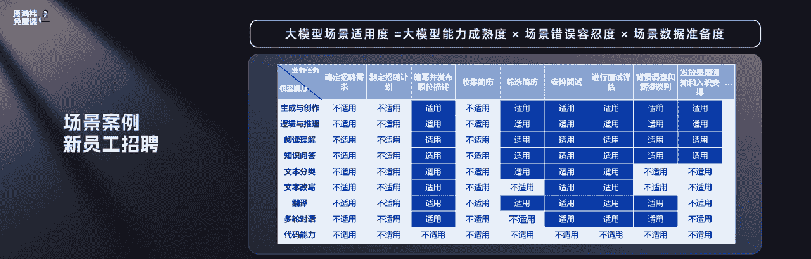

## **场景案例：360AI 浏览器**

我举一个案例，是 360AI 浏览器。我们在做这个场景之前，国内的大模型都犯了一个错误，包括我们去年发布的大模型，没有给客户去想一个具体的场景，而是给了一个通用的能力。360AI 浏览器就纠正了这一点，我不承诺你问我啥问题，都能回答得很好，事实上到今天为止没有一个大模型能做到。所以我们全场景来做这个产品，所有的产品都无法打动用户，因为它不能让用户在某个场景上有非常深刻的体验。所以我们就找明星场景，场景浓缩了，变成了帮你读书，帮你快速看视频。

举个简单的例子，能不能把我 3 小时的视频 3 分钟用 AI 读完，把重点总结出来，把逻辑脑图画出来，再用 3 分钟的时间快速了解我们这次讲话的要点。因为人们看文字速度还是快于一帧一帧的快进看视频。所以我们就找了这样几个场景，音频，我们开会、上课听讲的时候，大家带个手机录音，录下来之后回去能不能把音频快速的整理出来。发挥大模型的优点，它把要点、简介、重点提炼出来，而且还能够自动翻译。

还有一个痛点场景是我看很多英文论文，我英文不好也就 are you OK 的水平，但是我又不得不硬着头皮咬着牙去看，我就提了三个需求。第一，一篇很长的英文论文能不能翻译成中文？其实翻译成中文我也看不懂，因为太晦涩，所以能不能给我做个提炼？最近我提了要求，能不能把它的改写一下。按什么改写呢？用中学生作文的水平，把一篇很深奥的学术论文写成我能看懂的东西，这个功能马上就能实现。

本来你就在拿浏览器看视频、看网页、看 PDF 文档、看书，我原来一年能看 50 本到 80 本书。现在开始刷短视频之后，我一年一本书都看不了，因为我所有的业余时间，晚上的时间熬夜都用来看短视频了。但是总看短视频不看书，人还是会变傻的。所以为了保持一年至少看 100 本书的能力，我就要求给我找来 100 本电子书，让机器帮我阅读，之后给我做一些深刻的剖析摘要、逻辑分析，这样很多书我粗读一遍基本上也算凑合读过。AI 时代，看书的工具也要跟着变化。

我认为今年找对场景很重要，这个场景只**要**是痛点，是刚需，哪怕它的频度不那么高。但你能找对一个场景，让你人工智能的能力在这个场景里显得特别突出，形成良好的用户体验，就能形成正向的循环。

我也跟大家讲一个秘密，360AI 浏览器背后有 5 个场景模型。大家用起来为什么速度快？因为你若用一个千亿的模型，谁的速度也快不了，所以我们翻译是一个独立的百亿模型，我们的搜索阅读理解是一个单独的模型，我们的内容控制是一个单独的模型，我们的脑图是一个模型，所以把很多场景的功能做了单独分解。可以跟大家讲，翻译模型的能力接近 Deepl 的水平，远远超过了谷歌翻译和微软翻译。在单向能力上你把它调了最好。过去在一个通用模型上，你想把翻译能力调得很好，其他能力必然下降。

所以这个方法是我们自己验证的，**用多个专业模型进行协作，组合工作，**然后在合适的场景里把它的长处发挥到极致。

我下一步准备做什么的功能，看一本书，可以把这本书生成一个 PPT，或者生成一段视频；看一段视频，可以把它生成一段图文并茂的文章。你就只需要点，然后再润色就可以了你还是没有声音。还有就是朱啸虎和黑马投资的一个公司，他们选了一个场景，就是帮助很多企业做了一个 AI 的招聘官，他只干一件事，就是根据面试的人来问各种问题，相当于一个会议记录系统，面试官跟应聘者聊天，把对话用 AI 做一个评价和分析。它也不能叫 HR 大模型，它只是 HR 众多职能中的一个场景。

有一个软件 Remove Background，它就做一件事，一键抠图，很多人做电商图片用它就很方便，最近出来的 AI 公司都是选对场景，然后在这个场景用 AI 进行改造。都是在已有的某一个单点功能上做了改进，但这个改进带来了 10 倍的体验。

# 企业大模型**五大关键问题**

定义场景需要业务驱动，比如你和 360 合作，360 能帮你解决训练大模型工具问题，但是选择什么场景是由你的公司来决定的，是由你公司在业务一线的这些人来决定的。

## **关键问题 1：AI 科普**

大家有没有发现，AI 和云计算大数据不一样，它跟全体员工都有关系。我们公司上云，用大数据，绝大多数员工不需要关心这件事， AI 是一个需要全员做科普、普及的一个技术。所以我们认为大家在拥抱 AI 的时候，这不光是老板的事，在内部让你的全职员工都要使用 AI。如果大家都不用 AI，对 AI 有各种莫名其妙的恐惧、误解，甚至觉得用 AI 会导致我离职，会导致老板更加剥削我，那这个公司 AI 是搞不起来的。

## **关键问题 2：知识管理**

没有知识就没有办法训练大模型，没有知识就没办法做知识对齐。因为在企业内部知识对齐是件很重要的事，就保证大模型不会无中生有，不会杜撰或者产生幻觉，所以知识管理非常重要。

但是很多企业扪心自问，你内部有知识管理吗？内部的知识在哪里呢？大家去认认真真思考这个问题，我们现在做了很多失败例子，都是大家对需求场景找到了，发现没有知识。

还有很多企业有说我有大数据，但是注意大数据到信息、到知识、到洞察、到智慧，它是需要一层层提炼的，所以大数据如何从中提炼知识，这也是知识管理的一个挑战。大模型是把原来看起来没有用的数据能**够变成知识。我举个例子，很多公司都做过大数据中台，传统的大数据比较偏数计算型的数字，所以**原来的模型都是数学模型。其实我们很多企业有很多聊天记录、邮件记录，这些非结构化的数据原来很难被作为大数据做计算。但有了大模型之后，大模型能理解人类的语言和知识，这些非结构化的文本类信息，包括老板手写的备忘录、会议记录这些原来传统中不被认为是大数据的这些数据，都可以变成有效的知识。这是大模型时代给我们带来的一个好处。

很多企业，其实只有明知识，没有暗知识。我第一个提了暗知识的概念。什么叫明知识呢？就是你容易找到的公开知识，企业内部的手册等，互联网上可以搜索到的知识，这些都是明知识，大模型基本上都能找到。我们企业里边。但是你们想想企业暗知识多不多，它在企业内部，但它碎片化难以找到。比如说邮件文档、聊天记录、工作记录，还有很多知识在员工的脑子里，员工离职了就带走了一些知识。一个员工离职没有交接好，突然有一天有个 PPT 没有交接，在这个聊天记录里边，所以如何把这些暗知识搜集起来，是我们很多企业要考虑的。

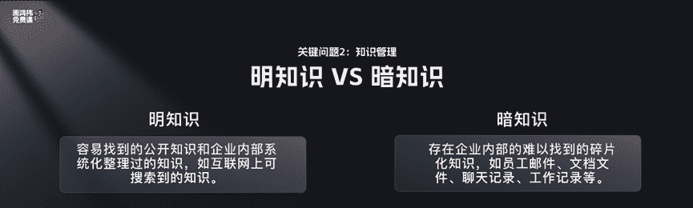

还有一种叫潜知识，比如说企业里面数据经过二次加工分析才能产生的新知识。比如说我们有一个医院有很多的化验报告，化验报告全是血红蛋白各种数字，这个进行加工之后才能变成知识。所以这种浅知识的利用也是很多企业要面临的问题。

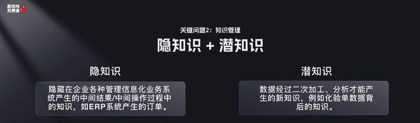

还有一个我们叫隐知识，就是我们企业有很 ERP、财务、HR 系统，每天这些管理业务系统的中间操作过程，比如中间的订单、中间的简历的筛选、中间的公司内部工单记录。这些过去都不认为是企业知识，但今天实际上我们发现它在企业训练专业大模型的时候，它们都变成企业很重要的知识。所以暗知识、隐知识、潜知识、外部知识，所以企业我觉得要考虑做企业大模型的两个基础设施，一个叫知识中枢，一个叫情报中枢。说白了一个是内部知识，一个是外部知识。所以垂直场景加上刚才说的专有知识，形成知识的闭环，并且能持续优化企业大模型。

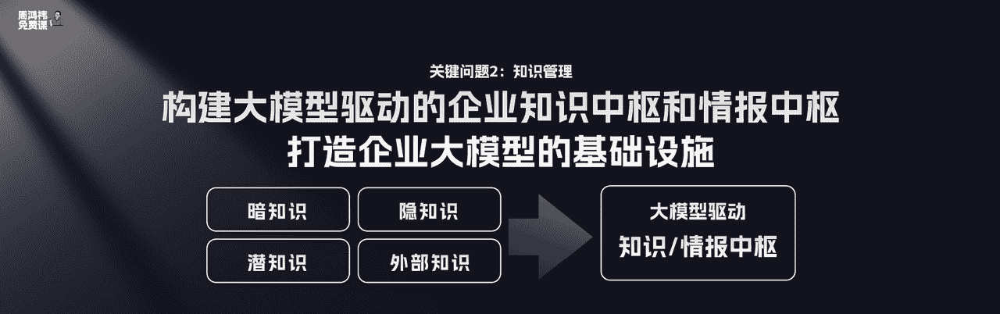

## **关键问题 3：AI 安全**

安全问题其实前面讲过了，我就简单讲一下，大家引入大模型之后，就是 AI 安全问题带来了麻烦，比你原来 IT 安全带来的麻烦要多，这是发展大模型的一个底线，因为我刚才讲的大模型会有幻觉，大模型会被人 PUA。另外大模型我们在企业内部，大模型可不是一个聊天机器人，它会和我们的内部的 API 结合在一起，所以安全会出来很多问题，那如何做到那大模型可靠、向善、可信、可控？所以 360 提供了一个安全大模型，就专门用来解决大模型安全问题。

这里边就把大模型的安全问题分了 6 层，传统的网络安全、数据安全、算力安全、算法安全、内容安全，最后一个问题暂时不用考虑，就是人类的安全问题，这个可能等到 AGI 出来以后再说吧。所以解决 AI 安全问题，要以模制模，所以 360 提供这个安全大模型来帮助你们解决大模型的安全问题。

** **

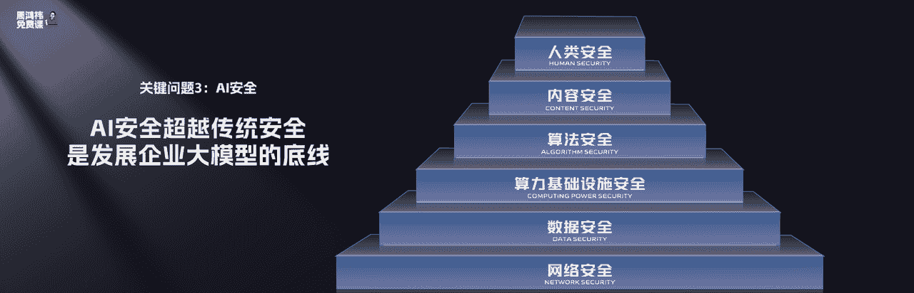

## **关键问题 4：模型打造**

> 企业大模型不是从 0 开始训练，是从千亿模型蒸馏出来的百亿模型

换句话说，它还是具备了千亿模型很多通识教育的基础，它怎么也是达到一个高中或者大专毕业生的水平找我们做训练。

> **吴恩达：“GPT3.5+Agent 优于 GP**T4”，Agent 框架能解决什么问题？

稍微讲点技术，吴恩达最近一个观点我非常赞同，“GPT3.5+Agent 优于 GPT4”。 你可以认为，现在做一个大模型，如果没有 Agent 架构，大模型将会一事无成，特别在企业内部。因为大模型的能力还有很多欠缺。Agent 架构恰恰能够在企业弥补大模型的很多不足。

> Agent 框架增强大模型 6 大能力

中文我们把 Agent 框架翻译成“智能体”。它能增强大模型的六大能力——交互增强、模型增强、规划增强、记忆增强、知识增强和工具增强。

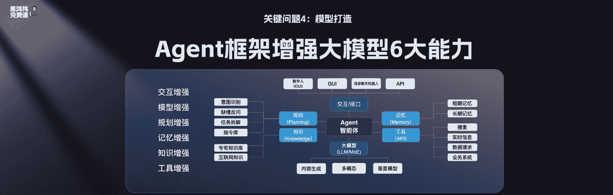

> Agent 框架解决“慢思考”问题

我简单**来**解释一下。它要模拟人脑，人脑的系统里面有两套系统，一套叫快思考，一套叫慢思考。快思考就是生物本能，慢思考就需要衡量。今天大模型快思考的能力已经超过人类了。大模型回答问题不一定对，但是大模型自己没法反悔，所以 Agent 架构里引入了一个框架。就是说我们可以用 Agent 框架来让大模型进行反思，对自己的答案进行检测，进行二次回答，所以大模型不是只调用一次就能出最好的结果。

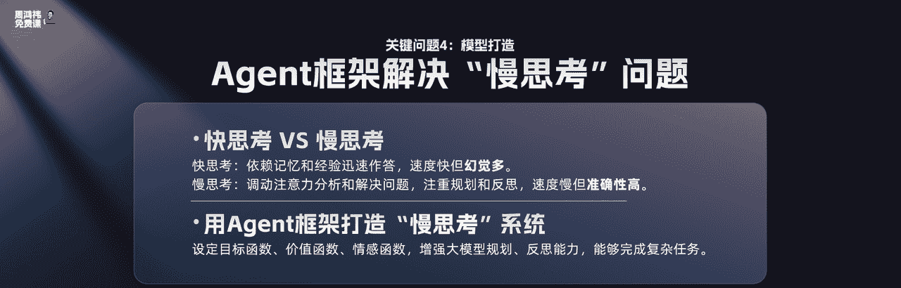

打个比方，你来跟问周鸿祎，要求说我马上回答，不许修改、不许出错，一气呵成，我也做不到。其实真要讨论一个问题，肯定是经过很多次，慢慢就能找到答案。这才是人脑真正的工作过程。所以 Agent 框架可以让 GPT3.5 多次工作。我上次举了一个例子，你找一个翻译专家，他也不会只翻译一遍，他会先粗粗翻译一遍，然后再进行润色修改，再来对照原文。那现在你给大模型说把这篇中文翻译成英文，凭什么就要求大模型一次就到位呢？如果你要求大模型做三次，我告诉你翻译的结果会比第一次好很多。所以在企业内部 Agent 架构非常重要。

> **RAG 知识增强，RAG 可为大模型提供知识**增强和知识对齐，提升事实准确性，降低幻觉

大模型会出错，要防止它出错，就要做知识对齐。这个知识对齐既包括内部知识，也包括外部知识。所以最近 360 推出来的 360AI 搜索，我用起来就很放心。他所有的答案都先在网上搜一遍，把网上搜到的东西做了理解，再来给我做答案。而不是无中生有瞎编。

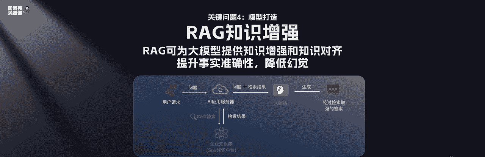

> Agent 框架解决“专家协同”问题

企业未来会有多个专业大模型，我们提出来一个 COE 的概念，多个专家模型扮演不同的角色，就类似人的大脑，有不同的语言中枢、规划中枢、判别中枢、记忆中枢一样来进行协作。

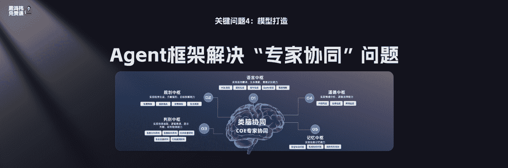

> Agent 框架解决“人机界面”问题，不要迷信 Prompt

在企业里边，如果你全是 prompt，这个企业用大模型一定会失败的。因为你的员工能力水平参差不齐。你想我们人跟人之间沟通还特别费力，你要求你的员工都是 prompt 专家，所以 prompt 这种界面，我们称叫 LUI。有人说会彻底否定掉 GUI 这个观点是不对的。大模型通过 Agent 框架会把你企业原来的 API 和常见的鼠标键盘界面连在一起，这种操作对员工可能是最简便的。

我们也在探索一个 CUI，就一个聊天室的数字人的界面，但从现在来看，它作为一个补充是可以的，因为你什么事都要跟通过语言方式来表达，在企业内部并不是最高效率的。

> Agent 框架解决“工具增强”问题

大模型的能力实际上是很弱的，很多事都干不了。比如你让它订餐、订票、查航班，它必须有很多工具向它开放。大模型才有了手跟脚，那除了外部的工具之后，在企业内部我们有很多系统，你能不开放吗？假设啥都不让我碰，什么数据库我都没有账号，那我只能给你夸夸其谈，但是如果我都能操纵这些东西，那我作为一个专业员工，我就能发挥作用。所以如果没有 Agent 框架，光有个大模型，在企业内部实际上啥活也干不了。

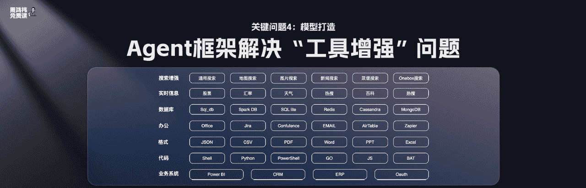

## **关键问题 5：业务融合**

企业大模型不是顾问，他不能只说不练，也不能取代原来的 IT 系统，它要和你原来的业务系统紧密耦合在一起，协同工作，所以这就需要一套工作流。

我举一个例子，比如你做了一 HR，面试只是一个单点功能，面试完了之后我怎么把面试结果发到公司 HR 系统里？我怎么通知 HR 这个人录用或者不录用。实际上这些功能都不是大模型在做，都需要一套工作流系统，把大模型 Agent 框架的能力跟企业原来的业务系统紧密的连在一起，实际上需要一个更大的 Agent 框架。所以我们讲企业做大模型不再是问题，第一知识管理的问题，第二大模型训练中 Agent 框架的问题，第三业务融合的问题。所以在企业里面打造大模型，并不像大家想象的那么简单。

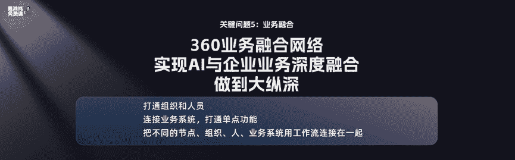

# **企业大模型四步走**

## **第一步：私有化部署通用大模型，第一解**决 AI 科普问题，第二满足一些通用需求

如果有能力的话，我们愿意给大家赠送免费的私有化部署一个通用大模型。私有化部署是为了解决隐私泄露和数据流失的问题，那这个大模型不需要做任何训练，就是一个千亿模型的一个缩小版，一个浓缩版，它解决什么？解决科普问题，就让你企业的员工在不泄露贵公司的数据和隐私的前提下，把这个大模型玩起来，让大家对大模型熟悉。

第二个满足一些通用的需求，比如说办公，这里面支持办公的通用需求、通用能力和营销的能力。这产品的细节我就不多说了，这个就跟 360 内部很早让自己员工对大模型有感觉。你的员工用三个月之后，相信我，你的员工都很聪明，他们对大模型的了解就很好了，他们就知道大模型的边界在哪，长处在哪，短处在哪。比如我们天津某新区做了个大模型的项目，就是这么干的，就是用了一个通用大模型，允许它在上面做定制。

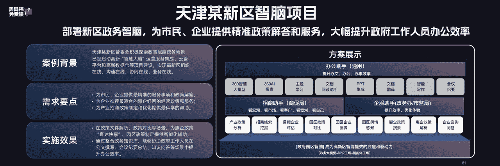

另外我们提供了 360AI 办公的一套会员服务，围绕着办公营销的需求做了很多的工具。我们现在做了工具就把它场景化，就是围绕一个场景解决一个问题。就是在内部通用大模型的基础之上，在内部提供一些通用的办公营销创作的能力。订阅模式，它是耗费算力的，但大家几乎每天一块钱。

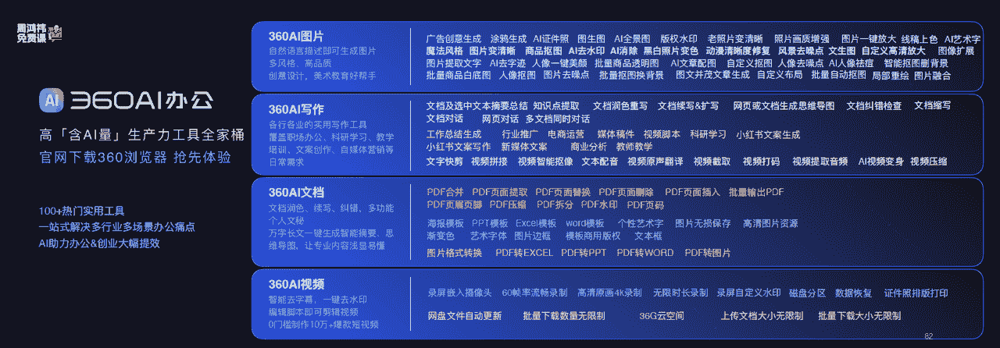

## 第二步：部署企业大模型三大基础设施

比较讲究的企业，如果真的想用大模型对自己业务来做改造，我觉得至少可以部署三大基础设施——知识大模型、情报大模型、安全大模型，把这三个支柱建立起来。情报大模型和知识大模型，解决你企业内部的决策、员工知识培训，重要的是把内部的知识，暗知识、浅知识、隐知识都收集起来。

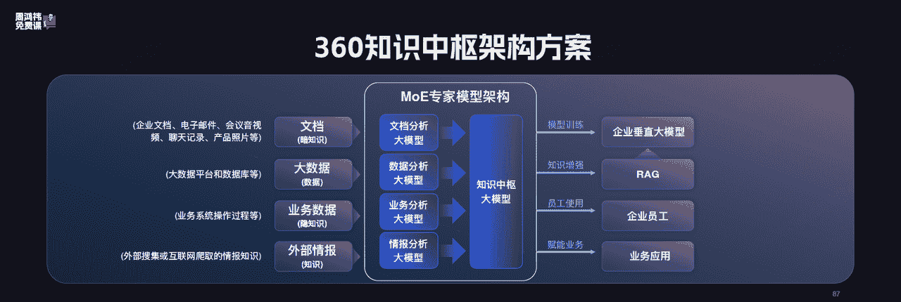

这是知识中枢的架构。今天觉得不在意的东西，比如企业文档，在人工智能时代都变成最有价值的训练语料。再比如电子邮件、会议音视频、产品照片、聊天记录，大数据平台和数据库里的数据业务系统操作过程，还有外部和互联网上搜集的各种外部知识和外部情报，通过分析之后建立起一个内部的知识中枢。举个案例，某大学电子图书馆智能化改造，我们就是做它的内部知识管理。

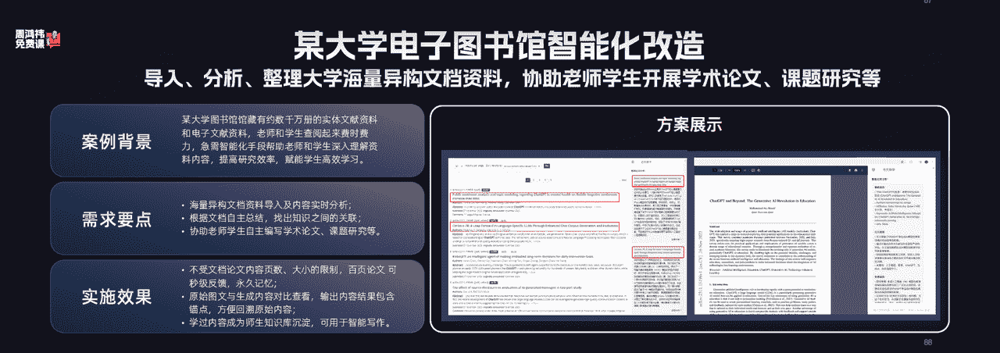

## **第三步：打造场景化大模型**

我们会给你免费提供一个基础大模型，这个基础大模型是从通用大模型里蒸馏出来的，然后数据工场、知识工场和模型工场是三套开发平台，数据是做数据的治理和标注，知识是从知识管理中间把相应的知识提取出来，既对它来进行知识对齐和知识训练。模型工场是用来用对这个模型进行部署和训练的，再加上 Agent 应用开发框架，训练出来自己的多个场景化的大模型。

这个天津某银行用这个方法我们为它做了一个私有大模型的定制，为它的这个金融需求，拿一个通用大模型训练了几个专用的大模型。

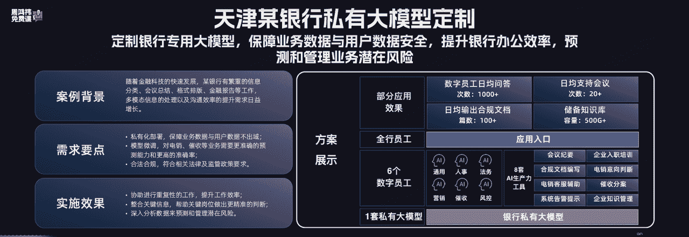

## 第四步：推动 AI 与数字化全面融合

最后一步是比较理想的情况，就是推动 AI 和你的数字化业务全面融合。我们列了一个武器库，你可以在里面去挑，可以在私有化通用大模型、办公大模型、营销大模型、定制数字人、AI 应用商店，包括 360AI 大会员，然后再往上可以选知识大模型、情报大模型、安全大模型，然后再往上是开发自己的大模型，和业务融合起来。

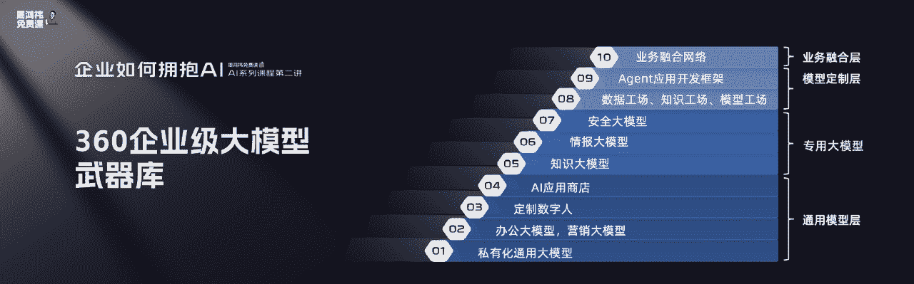

360AI 浏览器很快就会有手机版，现在手机上有 360AI 搜索。

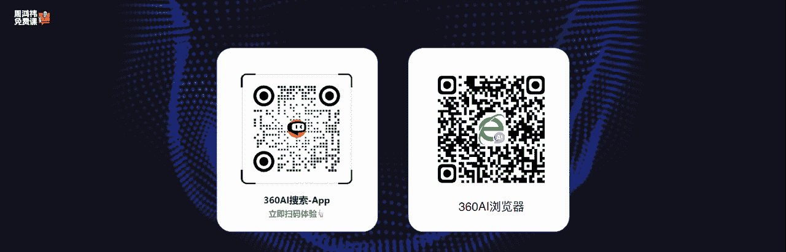

我们换了一种思路，去年我们是把大模型简单的拼接在我们的搜索结果的右侧，或者浏览器里。今天我们醒悟过来，就找到一个刚需和痛点的明星场景，用场景来引导模型，而不是用打造模型之后再寻找场景。

大家可以体会体验一下这两个场景。

**关注红衣大叔周鸿祎的**

**抖音号、视频号、小红书、B 站**

**随时关注后续直播课程内容！**

# **附录**

## **1、丧心病狂的“宠粉计划”**

过去大家跟我合影，一般我比较高冷，现在谁跟我合影我都愿意，但我就会问一句话，你是我的粉丝吗？对，所以是我的粉丝我就都可以合影，所以我做了一个丧心病狂的“宠粉计划”。

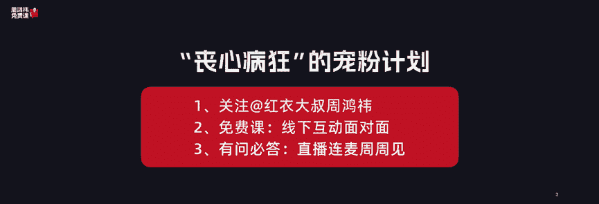

我最近这个粉丝涨的太慢了，别人一夜之间都涨 100 万，我一算这要一天能涨 100 万，一年能涨 3 个多亿，所以我就制定那个涨粉计划。然后我做了一件红衣服，红衣服背后印上了两个大的二维码，我觉得穿着它招摇过市是不是挺拉风的？而且有人看到二维码总是好奇，有人肯定忍不住拿着手机扫一下，发现说不是付款码，不是收款码，原来是关注成我的粉丝。

我有一个计划，落实 360，公司差不多有 1 万人，以后每周一或者每周二定成叫扫粉日，要求强制所有的员工都在穿这个红衣服，然后满大街的人挤地铁、挤公车，骑着共享单车招摇过市。可能就成为一种社会现象。大家就知道周鸿祎为了粉丝是多么不择手段。

有人要问了，粉丝只要是在抖音和视频号平台上，只要关注红衣大叔周鸿祎，那就成为我的粉丝，那么粉丝有什么好处呢？大家也可以提提建议，我也想不出我粉丝有什么好处。

如果咱们有机**会见面的，可以合影，合影、拥抱、握手都没问题。你跟我们雷总这种伟大的企业家握手拥抱、合影还得花 30 万，但是他送你一辆车。我跟他不太一样。第二个，我们的免费课逐渐以**后**每个**月都会有一次。但是我们每个月还有一次线下的见面会，我们会邀请一些粉丝到 360 大厦跟我面对面。另外最近我做了很多直播，去哪吒工厂探厂，谣传说我发脾气，其实我是很和颜悦色的说话。了解我的性格都知道，我发火不是那个样子。我最近大概也收敛了，因为好多人在攻击我，说我不务正业，我也想了想，我的直播逐渐就往两个方向收，第一个就是坚持把 AI 普及，把这种新技术、数字化技术的这种科普课讲下去。第二个就是对很多年轻人，包括企业家、中小企业组、创业者、职场的这个年轻人，如果有什么问题和困惑，我准备定期每周做一次直播，跟大家连麦，这个连麦是免费的，不需要打赏、不收费的，然后有问必答，我觉得我还是比较擅长回答一些企业在早期发展过程中在商业、产品、营销、竞争，包括融资、客户体验方面的问题。这样的话，成为我的粉丝肯定是优先连麦。那天我发了一个视频，就是我搭了一个草台班子，因为我觉得企业家应该学着做网红，我信奉一个我的游戏规则，一旦你觉得一个方向可以，你不要等到万事俱备只欠东风，什么条件都准备得很好的再去做，那时候往往已经晚了、来不及了。所以互联网我学到了一个规则，有的时候是不是先瞄准再开枪，而是先开枪再瞄准，所以我搭了一个草台班子，就等于把这个直播这个事就做起来了。

## 2、为什么说创业者/企业家都应该学会做网红？

我前一段时间讲，企业家都应该做网红，大家看到了很多人都有误解，但是也有很多人发现最聪明的企业家们都 get 到我的意思了，很多人到今天还纠缠于说，老周你是不是要直播带货呀？是准备卖面膜呢还是准备卖农产品呢？我就讲企业家，如果你自己没有主业了，带货当然是没问题的，但是我们企业家都有主业的，我们做网红的目的不是为了狭义的带货，不是为了去做电商，我觉得最重要的是在短视频直播的时代来到之后，实际上要重塑你的宣传体系，重塑你的市场部门，重塑你的跟老百姓的沟通方式和用户的这种直接亲密的接触。

这也是我想今天借这次直播跟我们企业家再次强调一下，最近几个例子，比如说最近某位企业家遭到了网暴，具体是谁大家去猜吧。过去你都知道是谁在骂你，你开发布会也行，你找媒体去解决问题也行，现在面对所有网上这种来势汹汹的舆情，他都不知道谁在骂，也不知道谁在操纵。传统的市场部、公关部面对的这种新的传播方式，面对的新的这种沟通方式就是束手无策。所以我的观点就是我们很多企业家现在把这个思维还停留在 ToB 的思维里，因为我们很多企业家原来是做 ToB 出身的。这次小米汽车的成功，大家都很佩服雷总，不仅产品做得好，营销更是大师级，我觉得都不是大师，是神一样的存在。

传统车厂的老板我也认识不少，大家都私下里好像很不服气，我就说没什么不服气的，我说你人家是互联网思维，ToC 思维，你们是 ToB 思维，过去的车厂需要跟消费者直接打交道吗？不需要，我的车是卖给经销商的，我跟经销商打交道就行了。然后经销商是给通过 4S 店再卖给用户的，用户想什么，用户对什么东西在意，都是通过报告调查表传上来的。你见过哪个车厂的老板跟开他车的用户直接沟通，所以这叫 ToB 的思维，在原来那个时代世界肯定是管用的。

这一次很多车圈媒体也觉得很不适应，因为车圈媒体讨论的车都是谈论什么底盘、动力、碰撞试验、空间大小、轴距。这次小米的成功当然因素很多，我也在逐渐学习，所以我也不能一一穷尽。我只能简单讲小米跟做小米手机，做粉丝经济时候用的做法是一样的，就是用户思维，所谓叫用户思维、消费者思维，就是说我表达什么东西，我想说什么不重要，重要的是消费者关心什么，消费者想听什么？比如说很多人可能你真跟消费者去谈很多车的技术，他听得懂吗？其他车厂原来跟车圈的媒体打交道也好，跟自己的经销商打交道也好。他们是 ToB 的思维，ToB 的思维说的是行话，也叫黑话，什么“热成型钢”，这名词我都记不住，所以它跟用户之间是割裂的。

另外大家注意到没有，现在人们的头脑都被短视频格式化了，这次小米在发布会之前，雷军一天最多也发到 2、3 条短视频，小米发布前的半年，雷军充分的利用短视频和直播的这种影响力，就成功了。雷军做小米手机的时候，那时候粉丝是在论坛里，在小米 MIUI 的社区里，这时候和用户的距离是完全不一样的。现在透过手机短视频和直播，每个客户都感觉企业家是隔着一个屏幕在跟他娓娓道来，直接对话，所以像蔚来的李斌也做了一场直播，就是我说的不装不端，放下身段，从老百姓的角度让每个车主感觉是平视的。

回过头来讲，我今天也给在座的企业家提一个醒，未来不管你做 ToB、ToC，你是不是都需要有影响力，你是不是都需要有一定的客户覆盖？因为今天跟过去不一样，过去 ToB 的客户看专业报纸，很多企业家看这个中国企业家杂志，ToC 用户就看电视、娱乐、卫视、城市晚报。这段时间我深刻的感觉到很多政府的领导，很多大企业的领导都是说，周鸿祎我在抖音上、微信里刷到你讲 AI 的视频。现在不分 ToB、 ToG、ToC，所有的受众作为一个个体他都在刷短视频。如果你作为一个企业家，你在短视频上面不能去建立自己的风格、自己的影响力、自己的沟通渠道，毫无疑问就咱们都不谈带货，你的企业未来的发展都很堪忧。

所以我毫不讳言的承认我是不会带货，但是我肯定要为自己的企业代言，要为我自己的产品代言。当然也有人说了，只做网红不做产品也是不对的，但是个人 IP 打造和产品 IP 打造实际上是**一**个双线并举的工作。如果有了很好的产品，又有很好的个人 IP，这两个结合起来，那就像我说的，那雷军这一次的短视频和演讲，为小米省了多少的广告费，可能都不止 10 个亿吧。所以我再次纠正一下，强调一下，就我觉得所有的企业家、创业者都要学会去做这种公众的表达，通过这种公众的表达，我就来建立你和客户的一种沟通能力。

我**还想简单的分享一个想法，就是很多人**就想**不明白，为什么同样的事情，小米**就说的比较清楚，为什么我们都没有说清楚？其实我原来研究过客户体验这件事。用户体验有两个要素，一个是超出用户的预期，就是用户想不到的事你给他做到了。比如说电池都差不多，600 度或 700 度的电能跑多少公里？这些大家都差不多，你在这上谈没有超出用户的预期。如果你去一个饭馆吃饭，吃完饭老板突然跑来说今天上菜晚了，给你送一瓶酒，它超出你的预期，你是不是特别高兴？第二个就是一定是用户可感知的，在这一点上我觉得小米也做得非常的漂亮，就是他把很多用户过去不知道的事情重新包装了一下，娓娓道来。

所以我有一个建议，你最好的试金石，最好的表达方式就是你去做短视频，如果你的短视频讲了一堆话，你觉得讲得很干货，觉得讲得水平很高，但是你的消费者，你的观众听不懂，然后数据量不行，数据是最能说明问题的，就证明你的表达方式应该做一些改变。