# 有赞 AI 研发全流程落地实践

> 来源：[https://yunyinghui.feishu.cn/docx/EHBqdohp6oYNEVxnsNKctrmOnsc](https://yunyinghui.feishu.cn/docx/EHBqdohp6oYNEVxnsNKctrmOnsc)

> **本文作者：**有赞，**来源👸号： ** 有赞 Coder

> **推荐理由：**这篇文章系统性地总结了有赞在 2025 年 AI 时代背景下，将人工智能技术全面融入其软件研发全流程的实践与思考。

# ** ****1. AI 时代的研发变革**

## ** ****1.1 AI 编程的火爆**

25 年可以说是 AI 应用的元年，在编程领域从最基础的代码补全到辅助编程，到 AI 工程师，再到 AI 开发团队，各种概念层出不穷。

编程工具迭代涌现，从老牌的 Github Copilot 到爆火的 Cursor，再到 Claude Code，和最新出的 Codex。

对应的用户规模也爆发增长，Github Copilot 用户超过 2000 万，Cursor 用户超过 230 万，Claude Code 在短短 3 个月用户增长 10 倍，Github Copilot 年度 ARR 超过 3 亿美元，而 Cursor 和 Claude Code 都超过了 5 亿美元。

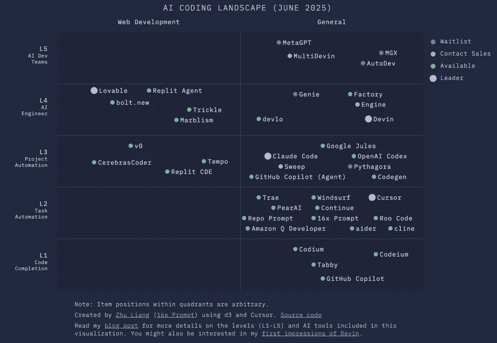

**随着编程工具的发展，编程门槛被大幅降低**， 氛围编程（Vide Coding）开始兴起，让更多非专业开发者专注创意和结果 。

在有赞内部有产品同学开始用代码交付交互式的 PRD，在一些创新型项目中这会成为第一版代码。

## ** ****1.2 AI 对企业研发的变革**

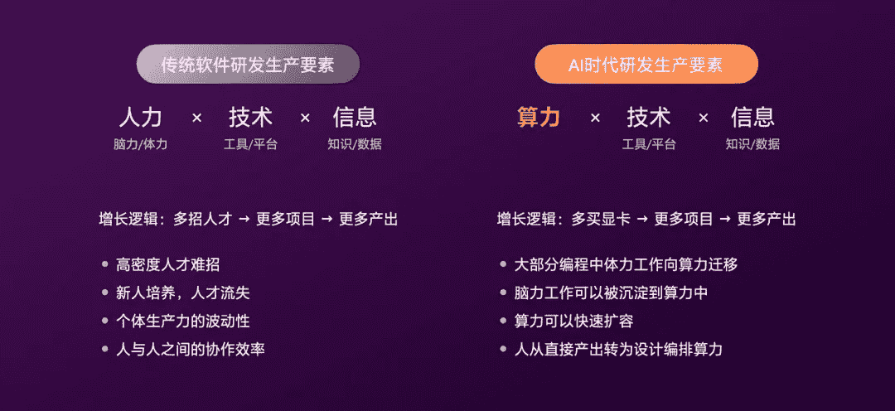

我们开始思考，AI 对企业研发意味着什么？

首先，传统软件研发生产要素，由人力、技术、信息组成，核心逻辑是多招人，就能多做项目，就有更多产出。 围绕人这个要素存在一系列问题：好人才难招、新人要培养、人才会流失、个体的动性、人的协作效率。

AI 时代人力开始向算力转移，增长逻辑编程多买显卡，获取更**多算力，就能**有更多产出。大部分**体力工作 向算**力迁移 ，部分脑力工作可 沉淀到算力中 ，算力能快速扩大。

最近看到一些新闻，硅谷的大厂一边裁员，一边争相购买显卡。

在这个过程中， 人从直接产出转为对算力的设计与编排。

“让子弹飞”是一部经典的电影，这里引用其中一张截图，模糊度恰到好处。

远看是火车即将超越马，近看是马在拉着火车，这很有意思。和我们目前落地 AI 有点相似，“朋友圈”看起来各种炫酷，实际落地需要大批人马参与。

但这就意味着火车不如马吗？

显然不是，我们都知道 最终火车一定会超越马，亦或，马拉火车的方式本身就错了 。

## ** ****1.3 有赞研发的 AI+**

出于对 AI 趋势的坚信，在有赞研发内部，我们有大量的 AI 探索与实践。

横跨研发的完整流程，包括需求、设计、编码、测试、上线的各个阶段。

所有这些实践可以，归纳为三类：AI Coding、AI Test、AI DevOps， 以及围绕 Agent 本身的研发与评测。

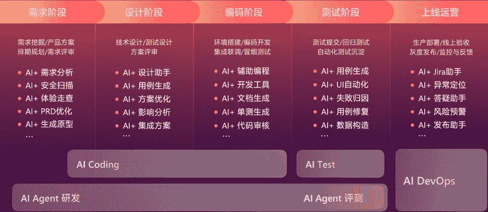

## ** ****1.4 AI 编程小案例**

在 AI 探索的初期我们遇到了两个很有意思的小故事。

### ** **1.4.1 一位产品的氛围编程之路

第一个故事是，我们的一位产品同学用氛围编程做**了一个简单的日常**需求，他给了一个反馈： 严重缺乏安全感 。

我们深入了解后发现来源于三点：

+   **心理不可接受 **：由于企业级工程规模大、系统复杂度高，系统/功能间依赖关系较深。非专业人员面对生产稳定性和大量线上用户压力时，心理负担急剧增加。本质是判断力缺失；

+   **效率不可持续 **：判断力缺失也导致效率不可持续，导致需要频繁的和开发者沟通，氛围编程变成了 AI 和开发者之间的传声筒。编程的耗时被极大的转换成了沟通确认的耗时，最终效率不升反降；

+   **质量不可信赖 **：虽然 AI 做对了效果，但是实现方案不合理，最后返工。现代企业级软件工程，除了完成需求外，还需考虑健壮性、可维护性、架构一致性等因素。AI 由于缺少上下文输入，这方面做得并不好；

### ** **1.4.2 一位开发带领的编程团队

第二个故事是，五月 Claude Code 发布后，我们看到一些开发者编程模式的变化，如图是一位同学的 Cli 工具：

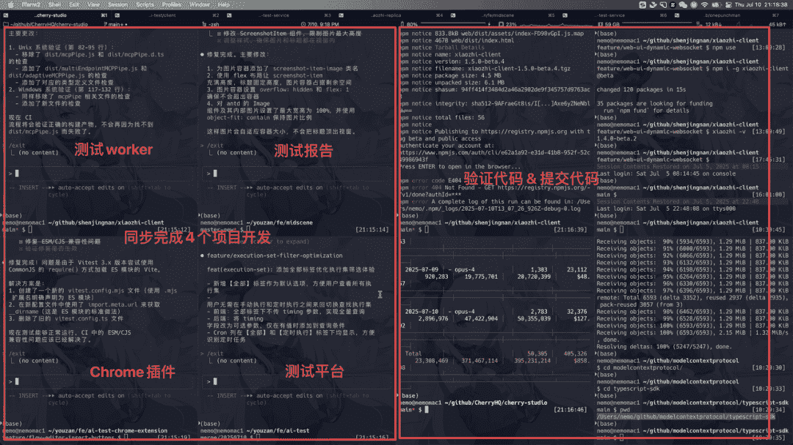

左侧是 4 个 Agent 分别在完成一个项目的 4 子需求，右侧是他在验证和提交代码。

这种模式类似一位技术 Leader 带领一个小团队做项目，由 Leader 负责任务拆分、方案设计、过程把控和代码 CR。

过去需要几个人的小组，现在一位开发者加上多个 AI Agent 就可以做到了。

这给了我们不少启发，我们开始思考如何把这种模式推广到更多项目中。

## ** ****1.5 企业级软件工程四大特点**

在经过了初步的观察和尝试后，我们总结了 AI Coding 落地需要解决的关键问题，归纳为四点：

+   **大规模 **：这对 LLM 的多仓库理解、上下文窗口提出了要求；

+   **高复杂 **：通常涉及多个业务系统、历史兼容等，需要解决 LLM 的注意力缺失问题、准召率低问题；

+   **多协作 **：一个项目往往涉及多职能、多部门的协作，不同团队间对 AI 的理解和应用有深浅，如何协同？以及，人在哪些环节以怎样的力度监督 AI？需要合理地规划 AI 落地的节奏以及人机协作模式；

+   **私有化 **：企业内部有大量分散在各处的信息，不透明、不标准，难以被 AI 检索，需要建设内部知识库、对接内部工具；

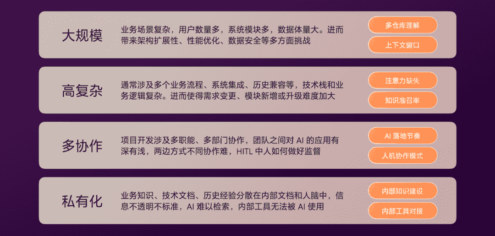

## ** ****1.6 AI 落地的三个阶段**

明确关键问题后，我们将 AI 落地划分为了三个阶段：

+   **AI 增强阶段 **：人主导 AI 辅助，此阶段重点聚焦用 AI 做单点提效；

+   **AI 驱动阶段 **：AI 主导人监督，此阶段 AI 有能力接管单一研发环节；

+   **AI 自主阶段 **：AI 自主人少量介入；

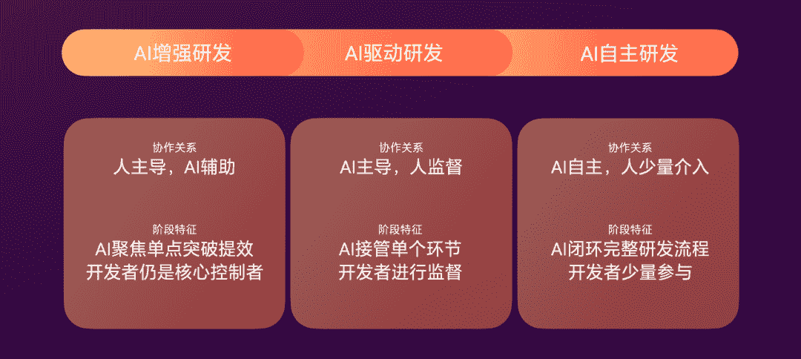

对于不同的场景应该匹配适合的阶段，过度追求 AI 适得其反，我们踩过不少坑， AI 的落地无法一蹴而就，需要循序渐进 。

目前我们的实践大量在 AI 增强阶段，有少量能到 AI 驱动阶段。

# ** **2. AI Coding：从个人助手到规模协同

## ** ****2.2 设计路线**

首先，是关于 AI Coding 的设计路线，我们有两个选择：以人为主 Agent 为辅、以 Agent 为主人监督。

我们观察了一些开发者的辅助编程模式，我们发现以人为主的模式存在一些问题：

+   **协作还是以人为中**心，相互沟通靠声音、工具调用靠手速， 信息传递效率低 ；

+   **个人经验内化不共**享，Agent 配置没有复用， 信息分布式存储 ；

+   另外，人的 **规模化需要时间 **；

因此，我们选择了第二条路线，其可以系统化解决以上三个问题，并且“天花板”更高。

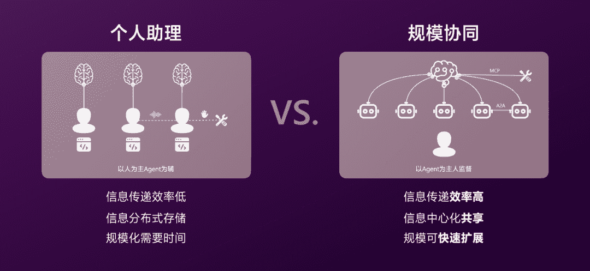

## ** ****2.3 构建框架**

明确了设计路线后，让我们开始构建 Coding Agent，这个过程类似从 0 到 1 搭建一个开发团队：

+   它们都需要有 **好用的工具 **，无论是硬件、软件还是技术选型；

+   它们都由 **专业的个体 **组成；

+   并且这些个体能 **高效协同 **完成复杂的任务；

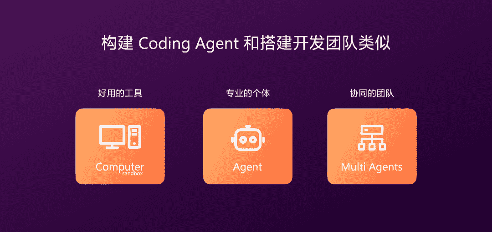

让我们先从设计一个专业的 Agent 开始！

## ** ****2.4 设计演进**

通用 AI Agent 和计算机很相似：

+   它们都有计算单元，一个是 CPU，一个是 LLM；

+   它们都有短期存储，一个是内存，一个是上下文；

+   它们都需要获取外部信息，一个通过网络，一个通过搜索工具；

+   它们也都可以多节点进行协同，完成复杂任务；

当我们把通用 AI Agent 细化到 Coding Agent，一些选型会更具体：

+   LLM 需要选用垂直的编程 LLM；

+   上下文需要引入企业的开发规范/约束；

+   长期存储需要对接企业内部知识库；

+   搜索工具聚焦在代码仓库的搜索和理解；

+   工具需要对接企业内部的工具链和平台；

+   协同系统的拆分应该以企业内部的协作流程或领域分工来拆分；

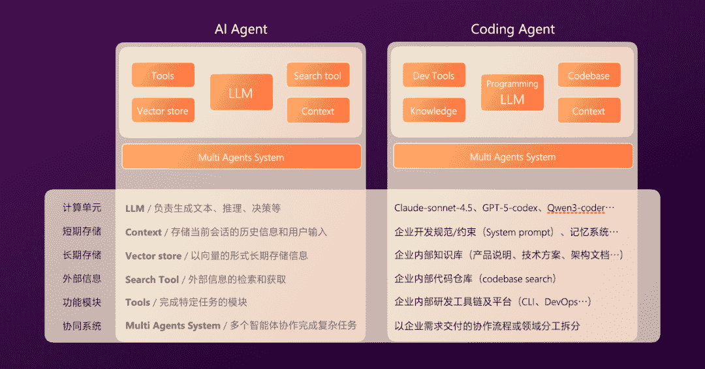

### ** ****2.4.1 选型与选择 **

在明确了核心模块后，需要先回答两个问题：方案的选型、自研的选择。

在 AI 时代行业解决方案百花齐放，无论是大模型还是配套的技术，且迭代速度极快，比如近期的 Gemini3（11 月 18 日）、Nano Banana Pro（11 月 20 日）。

**做的越多越容易陷入追赶的局面，最大程度的借助行**业能力，并将其与企业内部资源串联是关键 。

我们的 **核心策略是将通识的交给行业，集中资源**做私有部分，通过行业迭代来提升底层能力 。

### ** **2.4.2 Base Agent & System Prompt

明确策略之后，首先是基础模型的选择，在 25 年初时我们基本有共识，LLM 应该交给大厂，我们则专注于应用。

到了 5 月份我们发现 Agent 系统也有不错的行业实践，因此问题被延展成了 选择基础模型还是选择基础 Agent？ 也就是 Claude 还是 ClaudeCode？

围绕这个问题我们做了一些研究，发现 Claude Code 作为通用编程 Agent，在子 Agent 调度、MCP 集成、通用开发工具、上下文压缩方面已经做得不错了。

因此，我们选择了 Claude Code 作为基础 Agent 的底座，通过其强大的扩展能力，将其连接到我们内部的研发体系。

首先是系统提示词，这方面 Claude Code 已经做的不错了，我们仅做了少量扩展，总共不到 200 行，主要是一些内部的编程规范、特定约束。

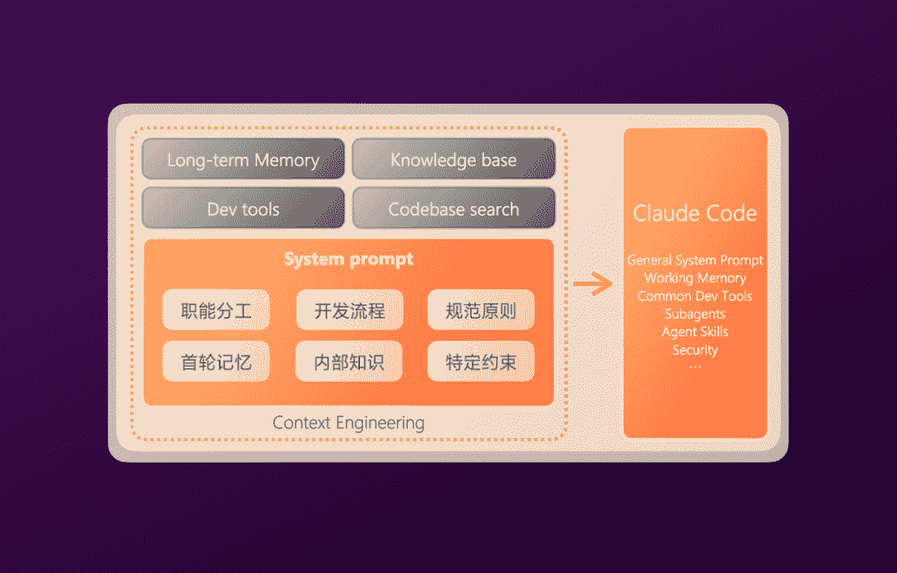

### ** **2.4.3 Dev Tools

接着是工具，和人一样，Agent 也需要开发工具。比如，当开发者让其参考历史需求，它需要能访问需求管理平台查看。又比如，它可以通过飞书文档创建一篇技术方案给开发者审阅。

**这些工具**散落在内部的各个系统、平台，有些在外部，我们通过 MCP 将这些工具集成到一起，交由 Agent 决策使用。

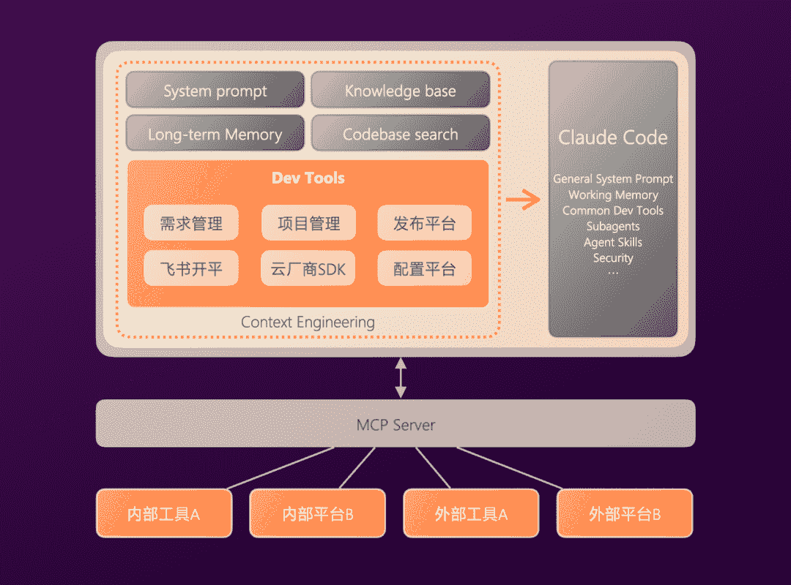

### ** **2.4.4 Codebase Search

有了工具后，接着是代码理解能力，这也是 Coding Agent 的关键能力之一。

我们将其分为了三层： **目标仓库定位 **、 **跨仓库依赖代码召回 **、 **工作区代码理解 **。目标仓库定位比较简单，我们用的是知识库 RAG 的方案。

**在代码理解上，业内常见的**方案**有： 向量索引检索（R**AG**） 、 抽象语法树（A**ST） 、 文本搜索（grep） 、 预生成文档（deepWiki） ，在实际应用中有不少组合的情况。

Cursor 选择的是 RAG 方案，好处是速度快，适合大的单体仓库，缺点是精度丢失（向量化），实时性不高。

Claude Code 则选择比较纯粹的文本搜索方案，和人很像，好处是精度高、实时性强，但性能会差一些。

在有赞对于跨仓库依赖代码，由于仓库数量庞大，采用的是 RAG 方案，同时更新频率没有 Cursor 这么高，我们基于 Git 的提交记录进行增了更新。对于工作区代码理解，由于基础 Agent 是 Claude Code，直接采用它的文本搜索。

另外， **代码安全也十分重要 **，无论是发送给向量嵌入模型还是大模型的代码片段，都通过安全扫描进行脱敏。

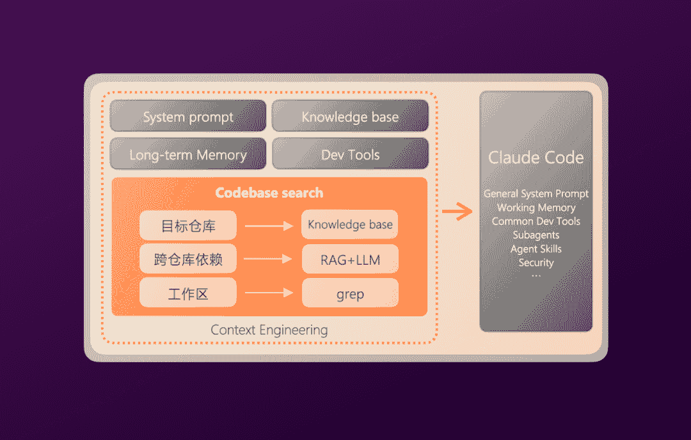

### ** **2.4.5 Knowledge Base

有了代码，接着是内部知识，和开发者一样 Agent 需要理解业务知识，比如产品模块有哪些、业务术语是什么意思。也需要理解专业知识，比如技术选型用了什么、编程规范是怎样的，以及工程现状。

这些额外的上下文可以让 Agent 的编码更符合预期，避免写出“与众不同”的代码。

**过往企业知识库建设有两大痛点，一是 信息孤岛（无法统一检索/**重复建设严重），二是内容老旧（因为缺少审核/运营机制，大量过期/错误内容） 。

为此，我们内部成立了专门做知识工程的团队，由他们推动知识透明和更新。他们围绕知识增长、内容质量、知识使用进行建设，为上层应用提供高质量的知识。

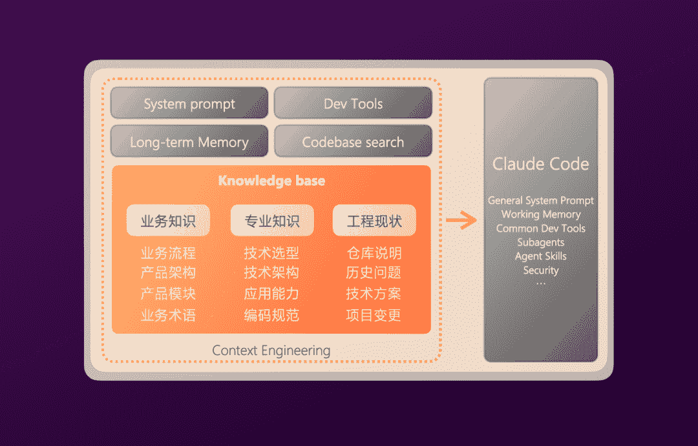

至**此，一个 MVP 版本的 C**oding Agent 完成了。我们拿去做了一些需求，发现效果并不好，原因是还 有大量经验在开发者的头脑中 。

### ** **2.4.6 Long-term Memory

为此，我们会 Agent 打造了基于长期记忆的学习系统。简单来说，就是将开发者和 Agent 的监督对话提取为长期记忆，后续遇到类似场景时进行召回使用，这也可以实现跨会话的复用。

这就如同一个经验丰富的老员工手把手带教实习生，整个过程分为：

+   **记忆提取 **，该阶段重点关注符合事实、保留细节、不归纳泛化。

+   **记忆储存 **，我们采用自然语言+标签的形式储存而非结构化，并且保留了原文引用。

+   **记忆合并 **，定期将类似记忆归纳合并。

+   **记忆检索 **，业内根据场景不同常见的有：向量数据库、知识图谱、分层存储，我们采用的是向量数据库。

+   **记忆遗忘 ****，随着记忆数量的增加，根据**时间和使用频次进行遗忘。对于高频使用的 记忆经过泛化后转化为知识 。

虽然设定了很多提取规则和后处理，但在实际应用中，通过 人工标注及修正的方式，可以较快加速记忆的可用性 。

我们在 AI Coding 做了测试，同类任务未接入记忆需要 5-10 轮对话修正，接入记忆后仅需 1-3 轮，有较大提升。

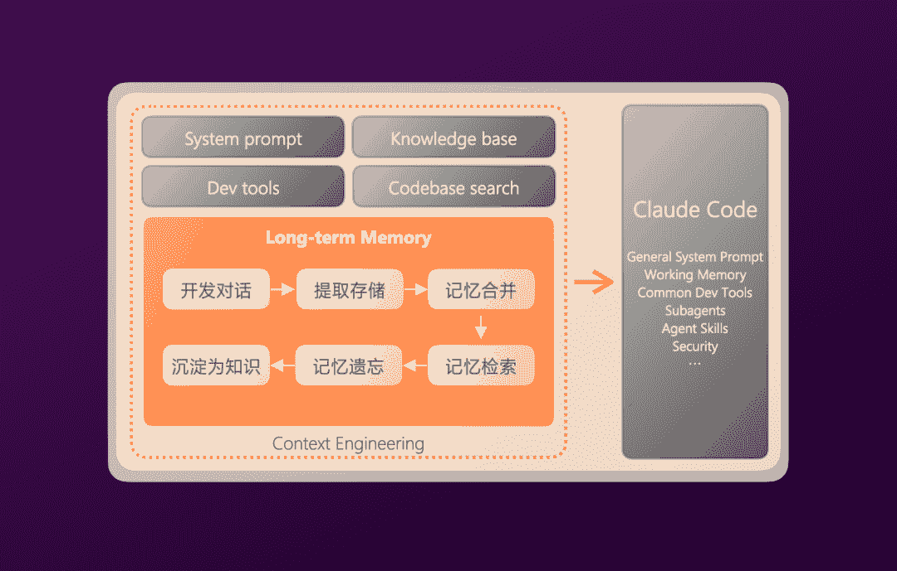

### ** **2.4.7 Cloud Sandbox

Agent 构建完成后，无论是运行、调用工具、拉取代码等等，都需要一个环境，如同为开发者配置一台电脑一样。

通过对本地辅助编程的观察，我们发现本地运行存在一些问题：复杂环境导致额外上下文、工程化适配问题、安全与监管难解决。

因此，我们选择了云端部署的方案，为每个 Agent 的 每次会话分配了独立且标准化的沙箱（Sandbox） ，其中包含了开发环境，以实现交付结果预览。

同时对会话及沙箱做了无状态化，实现水平扩容能力。我们将会话存储在共享存储中，当开发者开启或继续一个会话时，会动态分配随机沙箱，并从共享存储中恢复会话。

这一切都需要 通过统一网关，以解决安全和监管问题 。

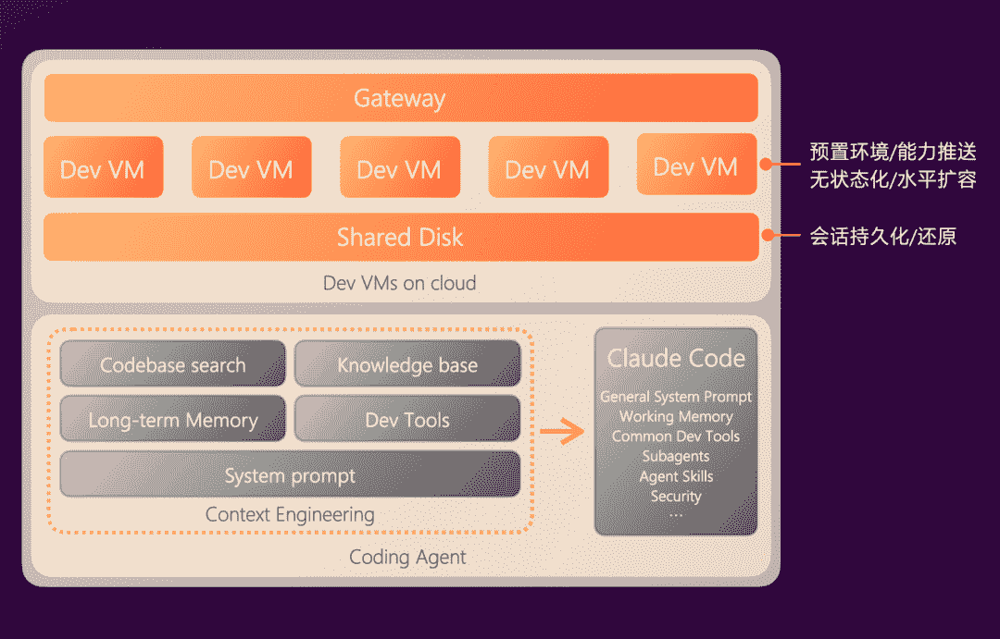

### ** **2.4.8 Multi Agents System

随着接入环节的增加，我们发现单一 Agent 面对个多环节，由于 LLM 上下文长度导致了遗忘、性能等问题。

**为此，我们引入了**多 Agent 系统，将这些 复杂度分而治之 。

+   在 **Agent 的编排 **上有 Workflow 和 Agentic 两种方式。由于企业级工程对稳定性、观测性的要求较高，我们采用 Workflow 串联多个 Agent。在部分 Agent 内部通过 ReAct 模式发挥 LLM 的自规划能力。

+   在 **Agent 的拆分 **上有流程拆分和领域拆分两种方式。我们都做了尝试，从落地情况看按流程拆分基本可以解决大部分问题。

**同时，我们为每个 **Agent 做了 差异化的基模选择 ，主要根据 Agent 的任务特点、LLM 的优劣势以及成本。

+   需求解析和仓库定位较简单用 GTP-4o；

+   代码定位用向量嵌入模型 voyage-code-3 并配合 deepseek-v3 做一些后处理；

+   方案和编码则用 Claude-sonnet-4.5，其中记忆用 GTP-5 效果出色；

+   代码审查则用 Gemini 2.5 它的上下文窗口较大，可以把更多代码片段给到 LLM；

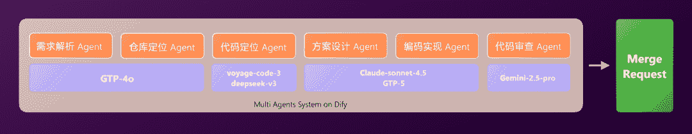

### ** **2.4.9 人工监督（HITL）

整个 Agent 系统的运行离不开 人工监督（Human in the loop） ，我们面向开发者、管理者分别设计了两套监督系统。

+   面向开发者的监督系统主要基于飞书 IM，它是一个天然的对话流，同时结合飞书文档、GitLab。开发者可以在 Agent 的每个阶段对产物进行审核，包括：需求清单、技术方案、改动代码、实际效果等，并通过多轮对话进行修正；

+   面向控制者的监督系统主要基于多维表格及其仪表盘，管理者对每个需求的情况一目了然，包括：交付率、对话轮次、Token 消耗、对话明细等；

其中，对话明细可以转化为评测集，用于后续 Agent 的评测。

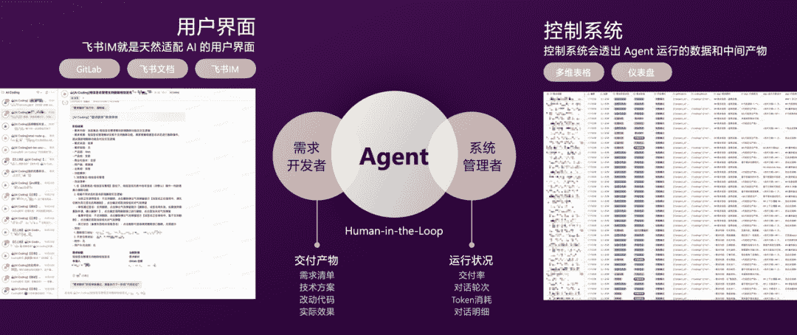

### ** ****2.4.10 对接发布系统 **

最后，我们通过部署发布 Agent，打通了发布系统。如图所示，通过对话就可以很方便的部署到预发，或发布至生产：

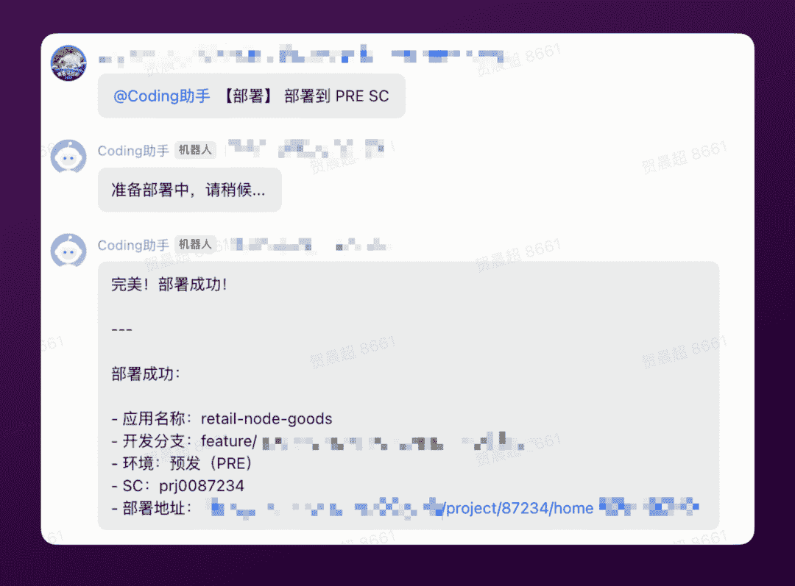

## ** ****2.5 产品形态**

这就是我们最终的产品形态，已经交付了不少需求。当然实际落地中，这种人机交互模式也有局限性，因此我们正在开发 Web 端，类似 manus 的效果。

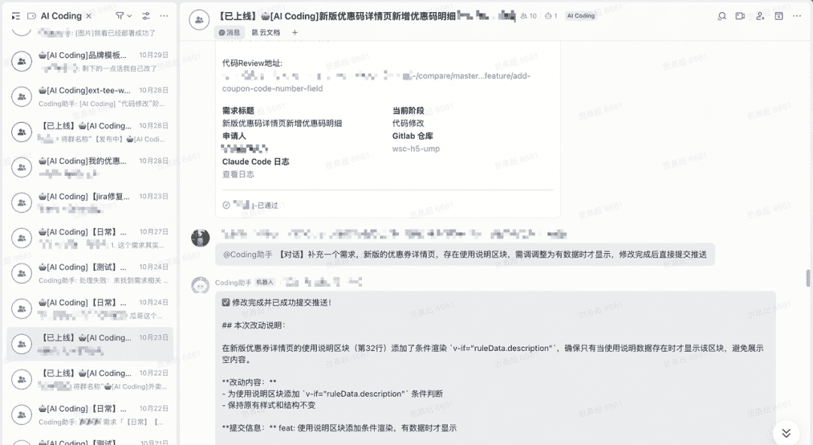

## ** ****2.6 需求选择与落地**

**在 AI Coding 落**地的需求选择上，我们分了三个维度： 多职能、多仓库、需求规模 ，和新人一样在 Agent 能力还不够时，先从单职能单仓库的日常需求开始。通过 做小需求验证 Agent 并积累数据 ，同时小需求因优先级不高而积累，用 AI 来做具有提效价值。

在我们将 AI Coding 推广到兄弟团队时，发现大家对 AI 期望很高，大家会给它做非常有挑战的需求，我们需要理解 AI 不是万能的，人做不了的它也是 。

目前我们的 AI Coding 已经可以实现单职能多仓库的日常需求，已交付近百个需求。综合提效 30%，包括人工监督的耗时，单个需求 Token 费用不到 100 人民币。

接下来我们会重点向多职能多仓库、项目级需求两个方向迭代。

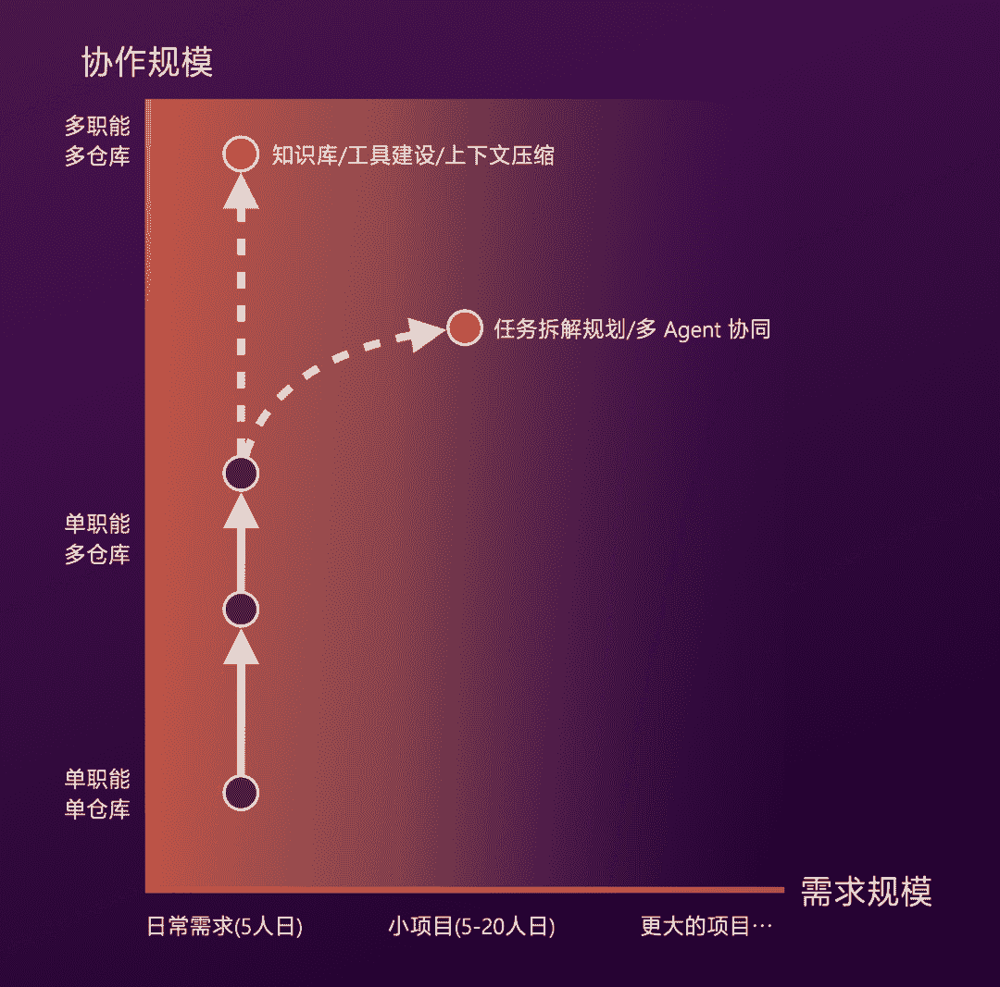

## ** ****2.7 实践案例**

### ** ****2.7.1 翻译型事务 **

在落地过程中，我们也发现了一些特别适合 AI 做的共性需求。

第一类我们称之为：翻译型任务。 已经有明确方案且较为简单的任务，AI 可以快速完成，且质量还不错。比如：技术债务治理。

有一个基础库升级的案例，涉及基础库、业务库和 23 个业务应用的升级，原本需要超过 50 人日，通过 AI 几十分钟就好了。

### ** ****2.7.2 降低开发门槛 **

第二类是跨域编程，我们工作中经常会需要跨团队、跨领域支援，过往人的学习和熟悉过程会有额外的时间。通过 AI Coding 我们的开发者进行了不少的跨域编程，这部分时间几乎被抹平。

### ** ****2.7.3 小插曲：移动编程 **

另外有个比较有意思的小插曲分享一下：

相信程序员都有共鸣，随身携带电脑是大家的痛点之一。在我们落地 AI Coding 的过程中发生了另外一个小案例，有个开发同学出去聚餐没带电脑，这时候来了个 Bug：

+   他掏出手机打开飞书用聊天唤起了一个 Agent

+   把 Jira 和说明丢过去

+   让 Agent 先改着，就先吃饭了

+   过了几分钟 Agent 改完了

+   他看了没问题就让 Agent 发布了

这虽然只是很小很小很小的案例，但确实让我们看到了 AI 正在慢慢改变我们的编程方式。

## ** ****2.8 完整架构**

以上，就是我们在 AI Coding 方面的实践：

+   首先，我们做了好用的工具，也就是云端 Sandbox；

+   其次，基于上下文工程，我们打造了专业的 Agent 个体；

+   最后，通过 MAS 让他们协同工作；

+   另外我们也做了人机交互界面，让人可以监督 Agent；

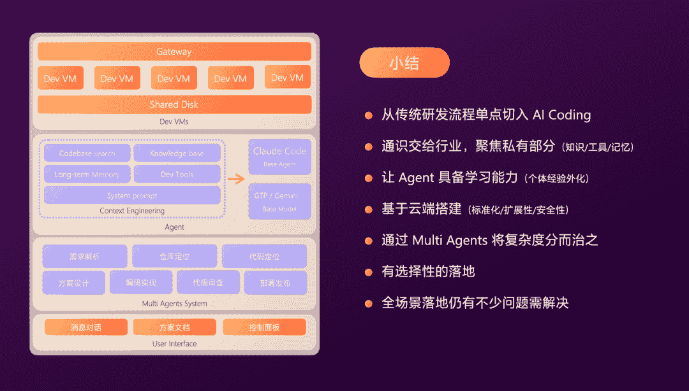

# ** **3. AI Test：从自动化到智能化

## ** ****3.1 传统测试的局限**

在开始之前，先简单回顾下传统测试的挑战：技术栈多样**化、设备终端碎片化、工**程规模增大，因此 对测试效率提出了要求 。

自动化测试被引入，提升了一些效率，但有一些局限：编写有门槛、维护成本高、难扩展复用、失败排查困难。

## ** ****3.2 AI 时代的新挑战**

**在 AI 时代，随着编码效率**提升， 对测试效率提出了更高的要求 。同时由于 AI 生成代码不确定，影响面和风险更大，对测试带来了新挑战。

同样 AI 也对测试带来了新的可能：

+   在测试设计阶段，能做 AI 用例生成、AI 用例优化、AI 用例选择（精准测试）等；

+   在测试执行阶段，能做 AI 数据构造、AI 驱动执行、AI 增强录制、AI 无参考测试等；

+   在评估优化阶段，能做 AI 失败归因、AI 用例修复、AI 分析报告等；

我们在这方面踩了不少坑，也有些在部分场景落地了。

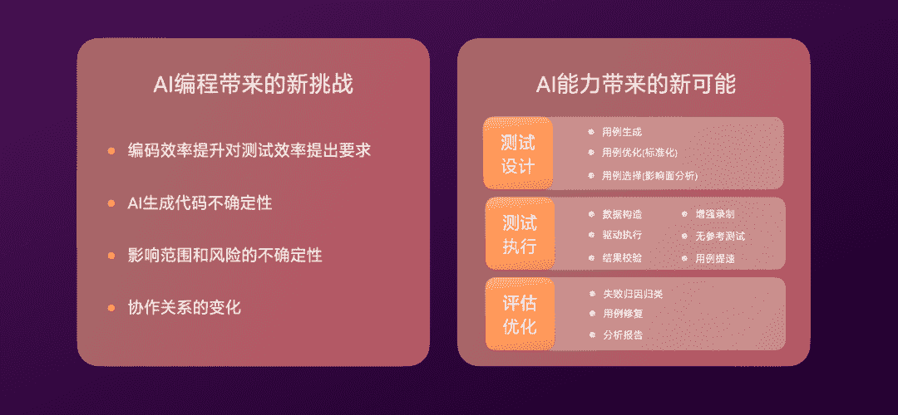

## ** ****3.3 AI 用例标准化**

首先是，AI 用例标准化，在我们开始 结合 AI 和测试时，碰到的第一个问题就是：用例 。

过往历史用例缺乏维护，质量参差不齐，如左图各种隐式步骤、断言缺失。另外用例还分散在各个平台，比如文本和自动化用例互不相通。

这就导致了 GIGO（Garbage in， Garbage out）的现象 ，你给 LLM 的输入质量低，它的输出质量也低，幻觉严重。

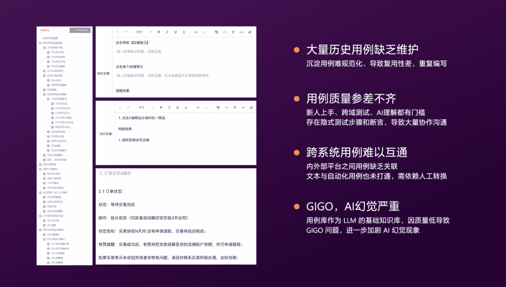

于**是，我们开始思**考如何解决**用例的问题，我们发现 **LLM 本身有强大的自然语言理解能力。这让传统文本用例和自动化用例的融合成为可能，也就是 自然语言用例 ，让用例 兼具语意性和可执行性 。

我们探索了两个方向：AI 存量用例优化、AI 增量用例生成。

首先是存量用例优化，根据已有的测试目标和测试步骤由 LLM 生成更规范的用例名、标签等，同时逐步优化用例步骤、补充断言。

其次对于增量的用例，我们结合业务知识库，并参考现有用例进行生成。

所有的这些 自然语言用例放在一起，它们本身就是一个高质量的测试知识库 。

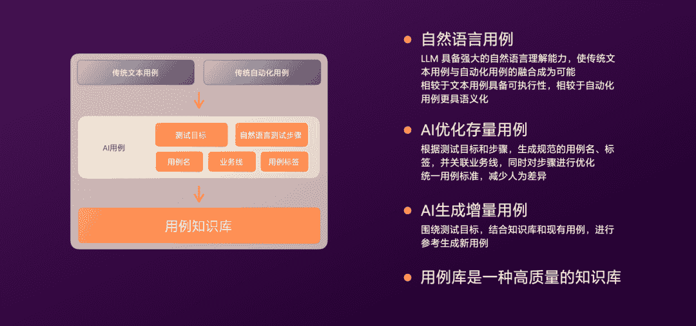

一个新的用例生成过程分为三步：

+   填写基本信息：测试目标、开启 AI 规划；

+   选择参考用例：从历史用例库选择供 LLM 参考；

+   用例生成：LLM 会生成用例的基础信息，以及完整的测试步骤，这里的步骤是自然语言，一目了然，且可被执行；

目前，用例生成的准确度和覆盖场景还有很大空间，仍处于探索阶段。

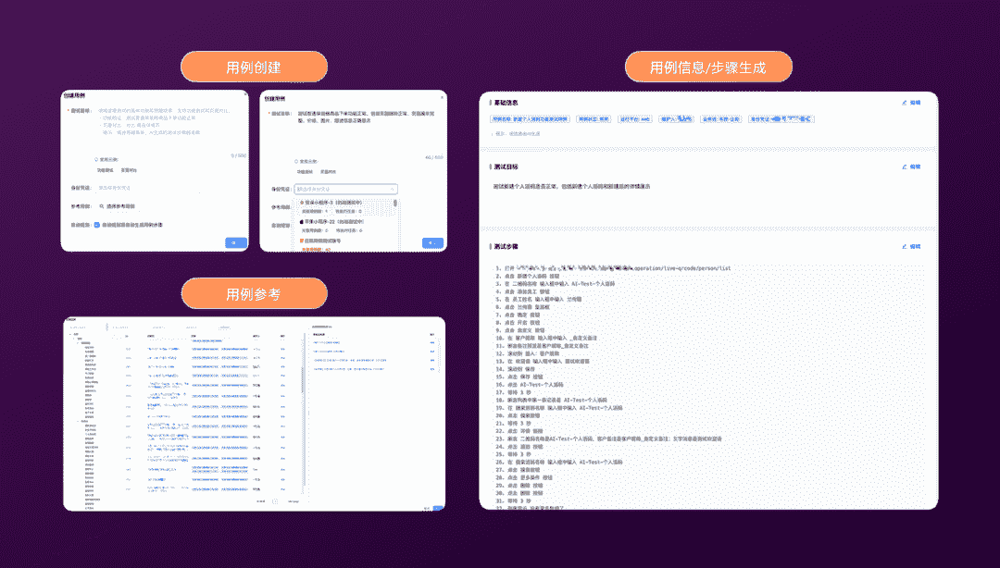

## ** ****3.4 AI 增强录制**

我们还有不少用例是录制的，因此我们做了 AI 增强录制，下面看一段视频：

关闭

**观看更多**

更多

退出全屏

切换到横屏模式

[🎦 点击观看视频](https://mpvideo.qpic.cn/0bc3nqafaaaa6aap2qrgy5uva3gdkbwaauaa.f10002.mp4?dis_k=a476c58737de211798a2f5661c5c7d84&dis_t=1767332858&play_scene=10120&auth_info=a4uonZ53BkMYpvWN5FBJaW46TUA4PUFrNz4ebTNAaB9RITVGWBR3eWQOMUdBaFJ8PjQbGTM3WVRKa1A1bhYxBFY/Pw==&auth_key=740c6cd3421c3d300dcd06a11dff3313&vid=wxv_4270644050866208784&format_id=10002&support_redirect=0&mmversion=false)

视频详情

视频中人在操作的同时，会先录制图片加坐标，交给多模态 LLM 去分析，生成自然语言的步骤。

可以看到这个过程是并行的，不影响人工操作，一次生成大约 5 秒左右。

录制完成后，回放执行也非常顺畅，AI 可以较快的执行几乎和人操作一样。

我们是怎么做的？

首先先简单回顾下传统录制的局限：定位不精确、录制步骤冗余、需要人工校准、维护成本高。如下图：

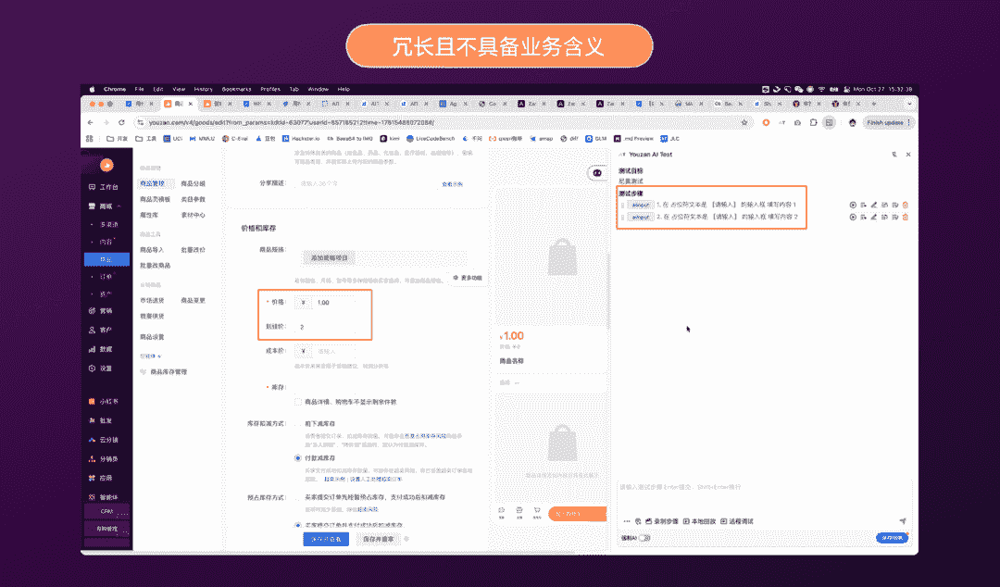

通过 AI 增强后，测试步骤可以精确识别用户的意图：输入价格 1、输入划线价 2，且较为精炼：

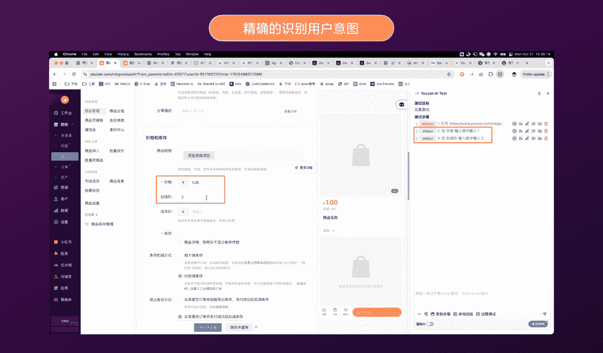

整个增强过程大致分为几步：

+   **DOM+截图输入 **：首先是捕捉用户的操作，将完整 DOM 和截图丢给多模态 LLM，目前通用多模态 LLM 已经比较强大了，我们第一版就能做到 70% 准确率。即使不提供 DOM，LLM 也可仅依赖截图识别，从而支持跨平台录制。但这个方案的 Token 消耗是巨大的，且上下文太长会带来一些幻觉导致不稳定；

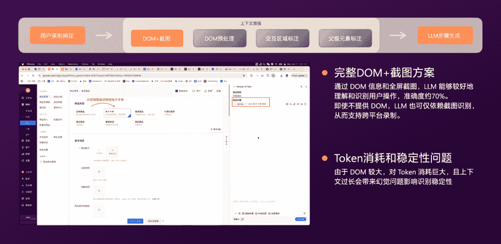

+   **DOM 预处理： **通过对 **DOM 进行裁切 **，降低噪音和 Token 消耗，同时标注重要内容提升大模型注意力。另外一些敏感的信息和代码也会被过滤。做完这些后我们的上下文能裁切大约 99%；

+   **交互区域标注 **：接**着我们把 70**% 准确率进一步提升，遇到了一些问题。在用户操作无交互表现的情况下，LLM 无法很好的理解，如左图，这里点击“…”没有交互状态变化，LLM 只理解到“点击空白区域”。我们通过增加 交互区域标注 来解决，这让 LLM 可以准确理解用户交互的区域，效果如右图，LLM 可以理解到“点击更多按钮”；

+   **父级元素标注 **：虽**然增加了交互标**注，但在一些复杂业务，元素之间是有关联的。如左图，“？”的图标，LLM 可以理解到是“帮助”，但它并不理解是“退款资金状态的帮助”，如果一个页面中有多个类似图标就不准确了。为此，我们增加了 父级元素标注 ，把交互区域前后的父级 DOM 元素一起给到 LLM，让其理解更多上下文关系。如右图，增加后 LLM 可以理解到“点击退款资金状态的帮助”；

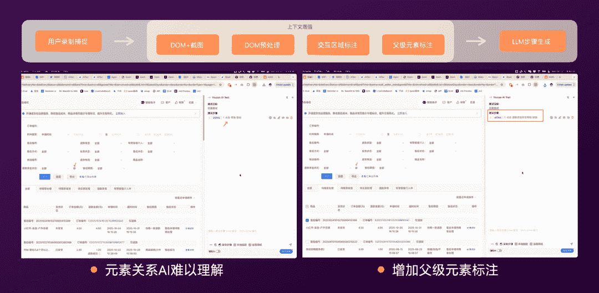

做完这些后，我们的准确率可以做到 89%，**单次增强的耗时在 5-**10 秒之间，这 得益于模型能力的提升 ，从 Qwen2.5-VL 的 20 秒到 GTP-4o 的 10 秒以内。

目前这套方案是跨全平台的，包括 Web、Pad、桌面等设备，Android、iOS、鸿蒙等系统，以及各类小程序。

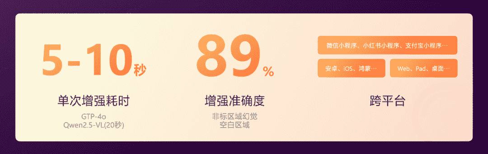

## ** ****3.5 AI 用例执行**

有了用例之后，接下来是用例的执行。目前我们的用例执行都会统一注册到任务中心，由其下发到两大集群，分别执行浏览器任务、App 任务（包括小程序）。

**AI 在执行**方面有天然的**优势， 跨平**台支持 ，具备一定 自适应能力 ，比如一些设备有像素抖动的情况，LLM 可以识别提升用例稳定性。

目前我们的用例执行量超过每天 10 万次，任务成功率 96%。

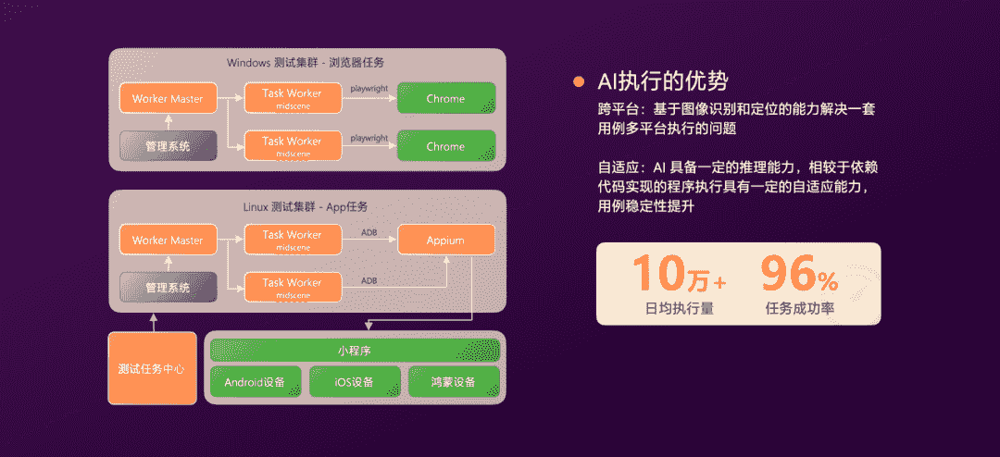

当然，这个过程中也遇到了一些问题：模型执行速度慢、模型幻觉问题、模型识别精度问题。

+   **解决“模型执行速度慢” ****：我们先做**了**基于图像和 Pr**ompt 的 识别缓存 。但未命中缓存时 AI 指令的秒级，和程序指令的百毫秒级差距依旧很大。因此我们做了 AI 提速，用例解析后首先程序执行，失败时 AI 兜底执行 ，执行成功后由 AI 进行自愈，提取成功的信息更新程序脚本；

+   **解决“模型幻觉问题” **：幻觉问题不是太大，通过 LLM 二次优化步骤 Prompt，同时采用更准确的 AI 指令（如 Midscene 中用 AI Input 替代 AI Action）基本可以解决；

+   **解决“模型识别精确问题” **：看下图中右上角的图，红框是 Qwen-vl-max，绿框是 UI-TARS-1.5，它们对于小元素的识别精度差异很大。从我们时间来看 Qwen-vl-max 对小图标识别能力较差，开启 deepThink 有所改善。UI-TARS-1.5 具备较强的探索能力，它们在断言方面都不如 GTP-4o。我们也从元素定位、元素断言、内容提取、任务规划方面，测试了 5 个主流端， UI-TARS-1.5 在元素定位精度和移动端表现较好 ，也是我们目前的选型；

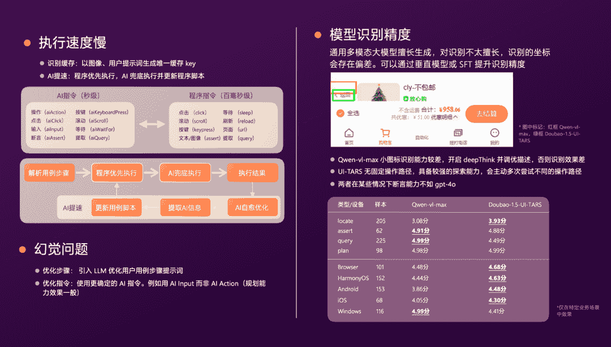

## ** ****3.6 AI 无参考测试**

做了 AI 执行后，我们开始思考 LLM 本身具备常识，也知道企业内部知识，是否可以做 AI 无参考测试？

我们做了探索，首先要做无参考测试， 对模型精度要求较高，通用的多模态 LLM 较难满足 。

因此，我们引入了 **监督微调（SFT LoRA） **，主要让 LLM：具备更细化的任务定义、明确输出格式便于工程化对接、注入内部知识和评判标准。

我们的算法团队做了不少建设，让业务团队可以聚焦在微调数据集。一条微调数据包括：Instruction、Input、Output，下图是一个最简单的案例：

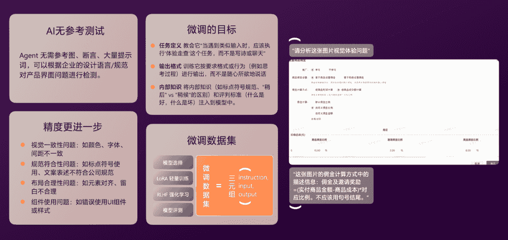

当**然这条微调**数据**并不好，它的** Output 缺少了很多内容， 比如：作答风格、结构化输出、内部知识、分析的过程和原因。我们从 指令微调 、 思维链微调 两部分对这条数据进行优化，如下图：

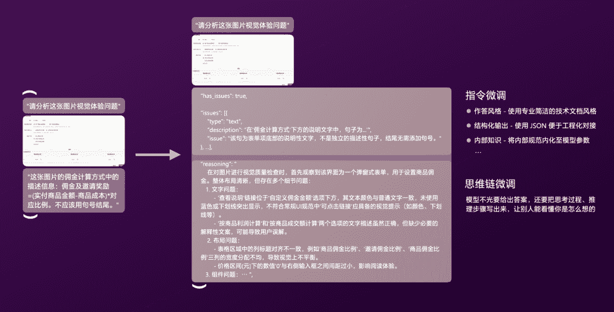

**定义了数据结构，接着是如**何生成大量的微调数据，一般需要 训练集、验证集和测试集 ，前两者用于训练过程，后者用于最后的评估。

整个数据集包括正样本、负样本和混合样本，一般比例为 1:3，避免模型过度偏向“总是发现问题”。

数据集通过 LLM 合成，首先通过脚本抓取线上的原始样本（正样本），然后通过程序合成多个负样本。

结合样本图片和特定的 Prompt 用 LLM 来生成 Output，Prompt 中包括我们的内部知识、预期输出结构、作答风格。

目前我们的垂直模型正在微调中。

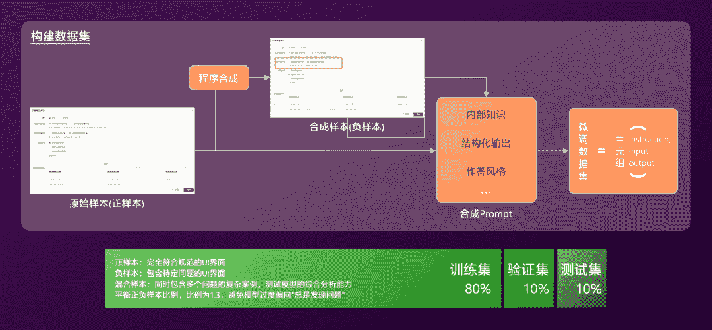

## ** ****3.7 AI 归因归类**

当用例执行完成后，我们需要对失败用例进行分析，过往需要人工分析效率较低，100 条失败需要 15 分钟。

我们通过 AI 来提速这个过程，首先由 LLM 将单个失败总结核心原因，然后将类似原因的分组归类。

如右下图，一共 85 条失败用例，被快速归为了 3 组，且标明了核心原因。

人工可以非常快速的进行分析，100 条仅需 1 分钟。

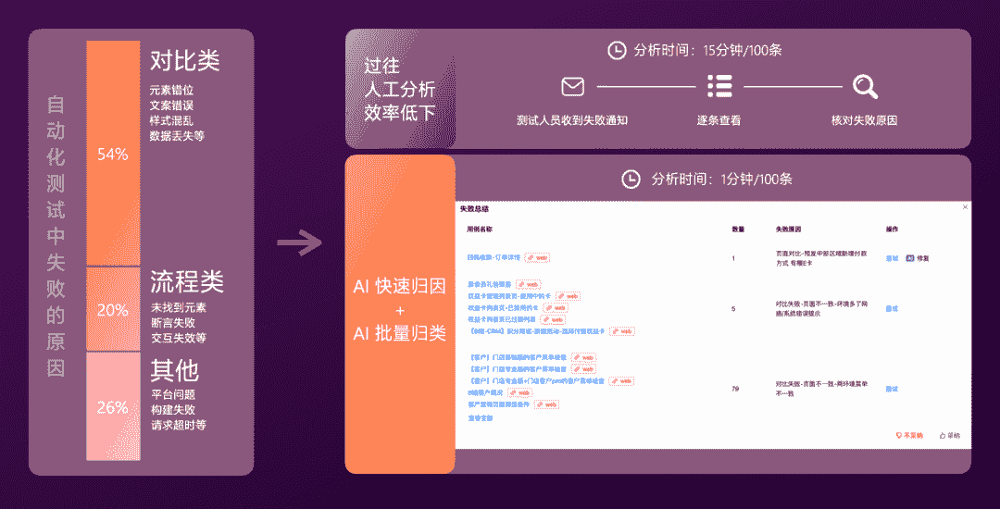

**整个归因归类**过程，首先是对用例执行报告进行 程序预处理。

程序主要将失败图片进行切片、步骤进行拆分。前者解决多模态 LLM 在大图下的幻觉及不稳定性，后者解决性能问题。

**接着切片交**给图片归因 Agent、步骤归因 Agent，进行 并发分析。

再由总结 Agent 对原因进行合并总结，最后归类 Agent 对原因类似用例进行分组。

目前我们线上用例已 100% 覆盖 AI 归因归类，归因准确率为 85%。

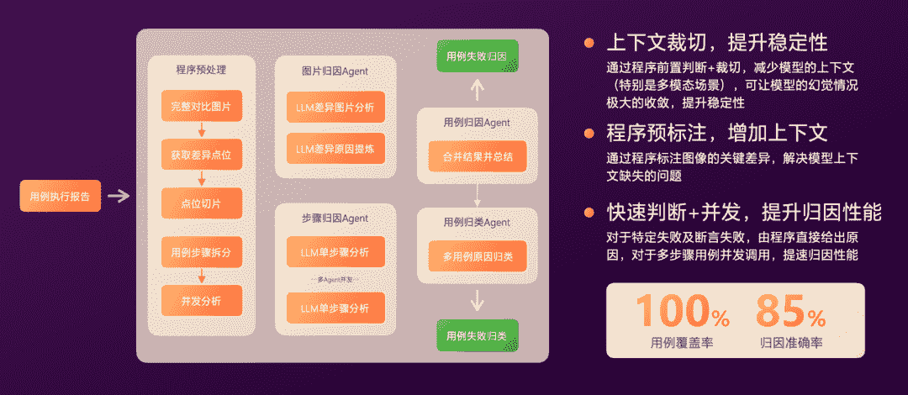

## ** ****3.8 AI 用例修复**

做了 AI 归因归类后，我们发现既然原因都知道了，何不让 LLM 自己修复？

因此，我们正在探索了 AI 用例修复，目前主要针对像素差异率波动、非核心元素变化的场景实现了修复。

如下图，AI 会对可修复场景进行建议，人工确认无误可一键修复。目前修复准确率 60%。

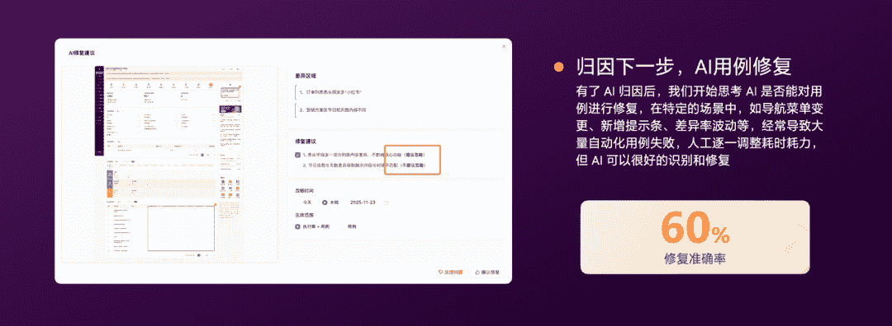

## ** **3.9 与 AI Coding 结合

以上就是我们在 AI Test 方向的实践，后续我们计划串联 AI Coding 和 AI Test。由 Coding Agent 生成测试目标，交由 Test Agent 对用例进行召回和生成，并完成后续的自动化测试工作。

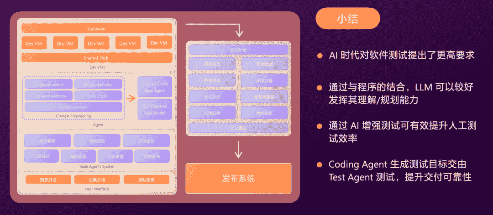

# ** **4. Agent 评测：从炫酷飞起到生产落地

在 AI Coding 和 AI Test 中我们构建了大量的 Agent，需要一套 Agent 评测体系对它们进行评估反馈。

## ** ****4.1 为什么需要评测**

先看一张大家都很熟悉的图，我们看别人的 Agent 时都会觉得好炫酷跃跃欲试，然后自己也开始手搓 Agent。

做完后在开发环境或者小范围测试中表现也不错。

发布到生产后，各种奇奇怪怪的情况，用户提问的思路无法捉摸，最后还是要转人工。

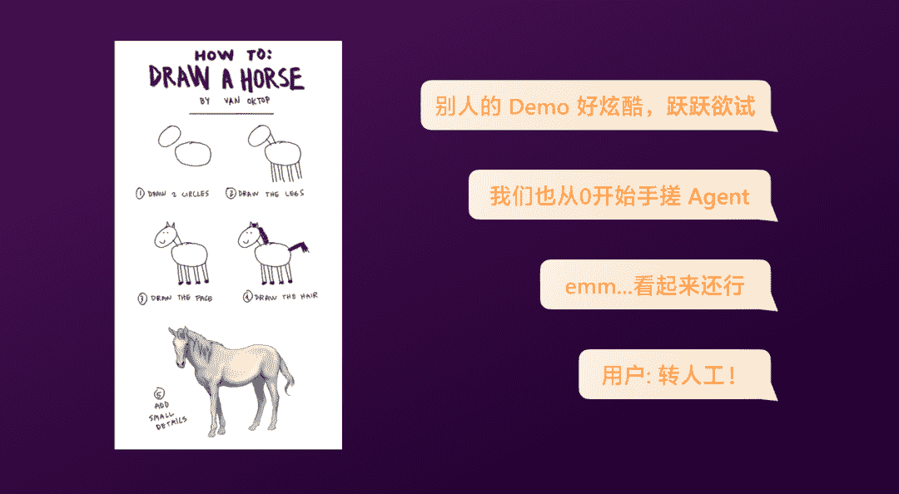

我们需要知道，Agent 和传统软件不同，没办法列举完整的用例来保障效果。

软件测试目标固定、标准化、可复现，而 Agent 评测具有不确定性、开放性（比如用户提问）、多样化（比如模型回答）。

发布标准上，传统软件主要看功能点完成度，测试通过与否。 Agent 则需要用评测集进行多维度的指标评估。

Agent 开发完并不意味着达到生产发布标准，应该用评测指标作为依据。

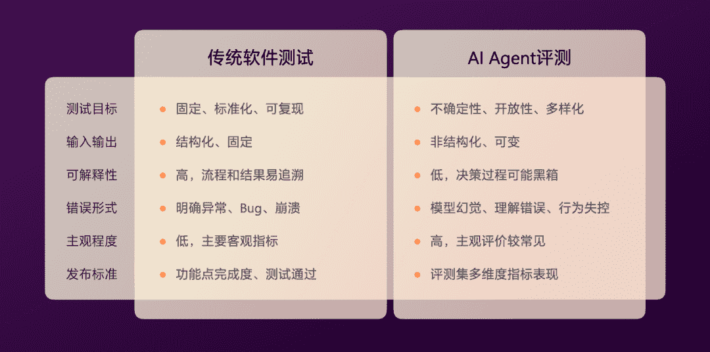

## ** ****4.2 评测集**

开始 Agent 评测，首先需要准备评测集， 评测集的类型有：有参考、无参考、参考资料三种。

接着是评测集的构造，常见的方法有：人工标注、LLM 泛化、线上采样。

一个全新的 Agent 没有线上采样数据，我们可以通过人工标注 50-100 条的种子集，然后让 LLM 进行泛化。

评测集根据场景不同，也可以划分为：种子集、Badcase 集（一般来源于用户反馈）、扩展集、对抗集、场景集（一般由业务场景决定）。

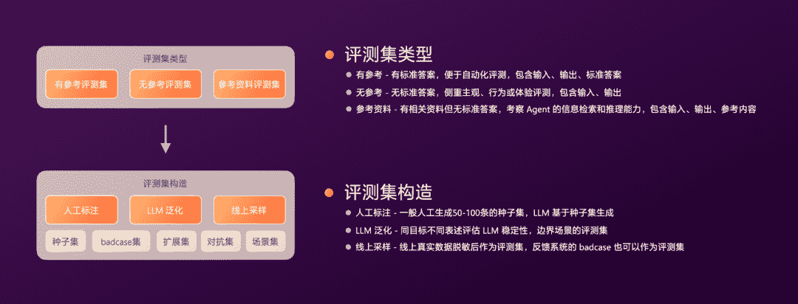

## ** ****4.3 评测器**

有了评测集之后是评测器，评测可以分为两种：人工评测、自动化评测。新的 Agent 初期由于评测标准不确定，可结合人工评测， 随着调用增加，将人工评测维度沉淀为自动化评测 。相较于人工，自动化评判尺度统一、主观偏差少。

自动化评测器包括： 托管（平台自带的评测器，可以快速启动评测项目）、 自定义（自行根据业务编写 Prompt 的裁判模型）、外部（由外部平台/服务提供）。自动化评测器可以由 LLM 作为裁判，可以是特定的算法验证（如 BLEU、CLIPScore 等），也可以是业务逻辑验证。

评测器设计一般包括：评估步骤、打分标准、推理指令、少样本提示（正例/反例）、边界案例、基于业务的判断要点（如合规、医疗等场景）。评测打分用 0-5 分制 归一，可以兼顾可解释性和区分度，让不同评测维度可以横向对比 。另外，为裁判模型 添加 CoT 可以提升可解释性 、一致性，便于后续人工分析和优化。

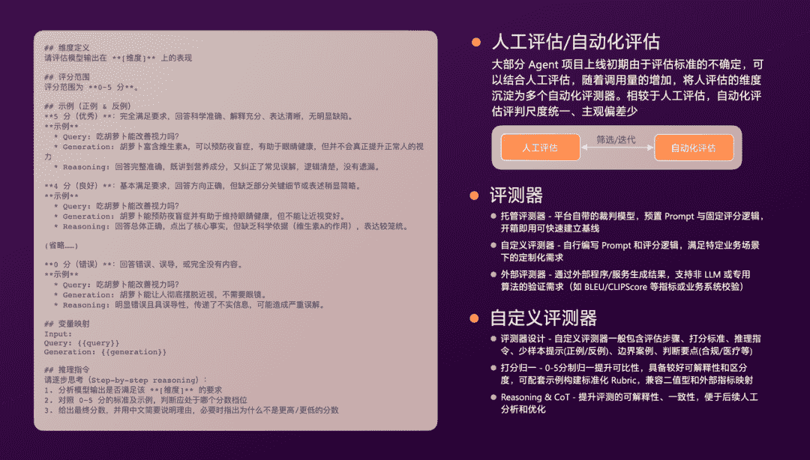

## ** ****4.4 评测指标**

接着是评测指标的设定，首先需要先明确评测主体，可以是：基础模型、提示词版本、工具版本、召回的记忆等。

围绕主题设定评测指标，通常有四类：效果指标、技术指标、用户指标、业务指标。

另外 **裁判模型自身需要有评测指标 **：

+   人工一致性， 衡量模型评分与人工标注结果的一致程度；

+   评分方差，衡量模型打分的稳定性；

+   异常打分率；

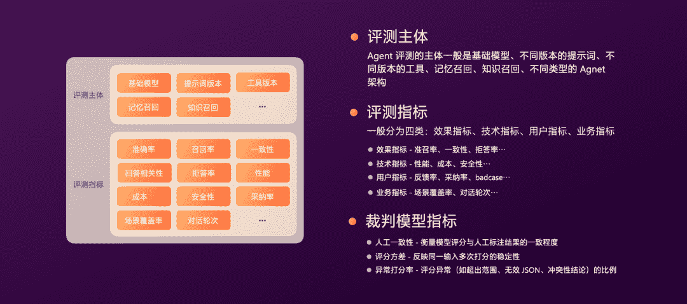

## ** ****4.5 反馈系统**

**除了人工评测、自动化评测**外，生产中 用户真实的反馈至关重要 。能够帮助我们发现 Agnet 在实际应用中遇到的各种边界场景和潜在问题。

一般有两种方式：

+   **显示反馈 **：需要用户明确操作（点赞/点踩）反馈，意图明确但反馈率较低；

+   **隐式反馈 **：是用户使用流程中的行为数据，被采集并解释为反馈，可以获得较高反馈率，比如 AIGC 生成多张图片时，用户选用其中一张图；

对于反馈率低的问题， 通过预设标签来减少用户行动成本，通过预设高评分来增加用户反馈意愿 （人们更倾向吐槽而非夸赞）。

## ** ****4.6 评测体系**

以上这些组合在一起构成了我们完整的评测体系。

+   **项目启动 **：由专门的评测人员和项目组成员，共同设定评测维度、创建评测器、建立种子集、泛化评测集，基于评测不断迭代/验证/反馈 Agent；

+   **开发过程 **：在 Agent 迭代过程中，通过评测集和评测器进行线下实验；

+   **生产环境 **： Agent 会产生日志和反馈，日志会通过评测器进行线上评测，Trace 可采样沉淀到评测集，另外反馈的 Badcase 也会沉淀到评测集；

所有 Agent 发布前都需要经过评测验证 。

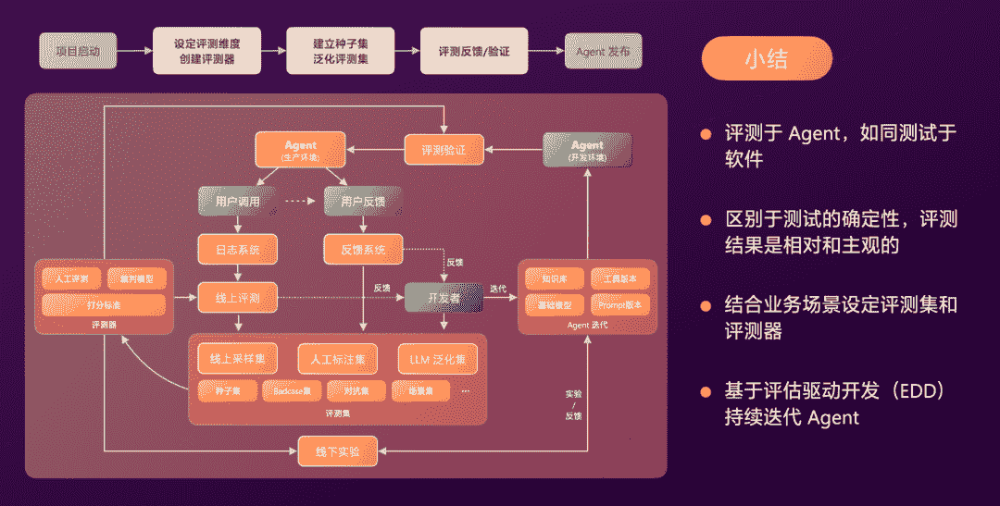

# ** ****5. AI 落地的一些经验**

## ** ****5.1 AI 与程序的结合**

首先是 AI 与程序，常见构建 Agent 的模块包括：程序计算节点、单一 LLM 节点、Workflow、Agentic。

可能有些人会觉得，Agentic 比 Workflow 好，Workflow 比单一 LLM 节点好，单一 LLM 节点比程序好。从我们实践来看，这四者之间 没有绝对的优劣，通常需要根据业务场景进行多选和组合 ，其取决于场景对确定性、稳定性、创造性、自主性的侧重。

另外，程序和 LLM 也并非替代关系，LLM 更适合理解、规划、生成类任务，程序更适合确定性、稳定性、高性能任务。通过 程序规避 LLM 的弱项是必要的，避免过度追求 AI 含量

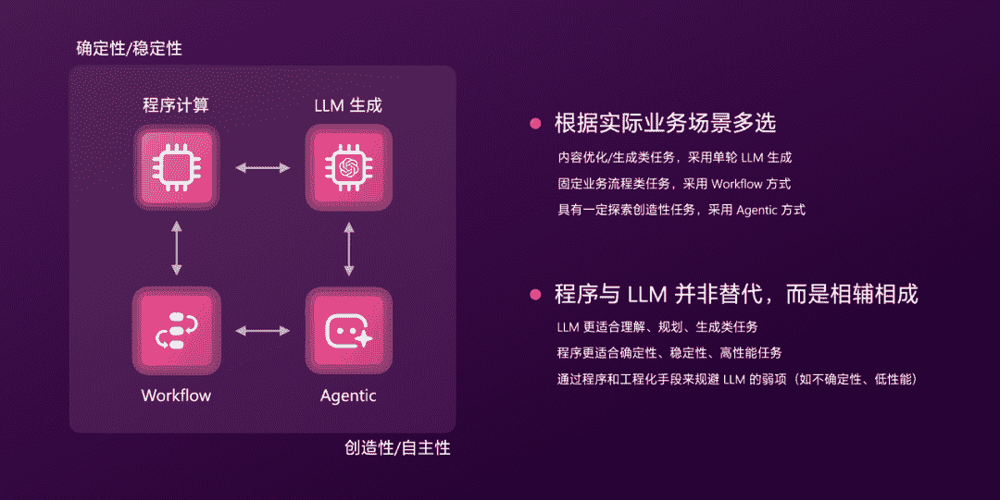

## ** ****5.2 AI 与人的陷阱**

接着是，AI 与人，需要警惕两个陷阱：

+   在落地 AI Coding 的过程中，出现开发者对 LLM 生成代码的依赖，甚至出现不作判断直接提交的情况。 保持开发团队的主观判断力非常必要 。另外分场景追求 AI 生码，比如核心业务逻辑人写，非核心交由 AI 写；

+   在落地 AI Agent 的过程中，需要人工监督，应该 警惕人工监督大于迭代 Agent 的情况，将监督数据用于 Agent 迭代；

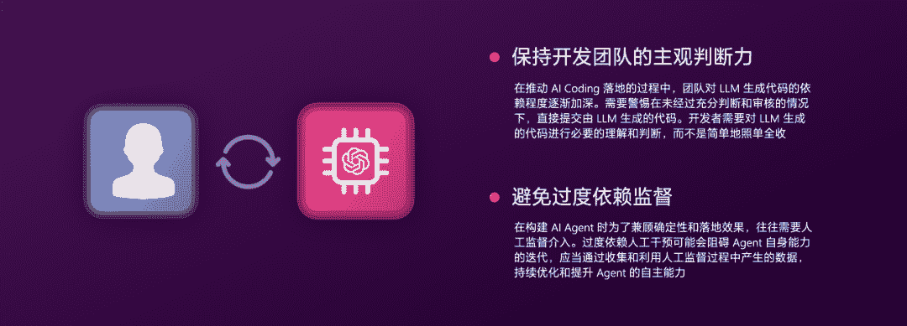

## ** ****5.3 AI 落地经验**

最后总结下 AI 落地的关键经验：

+   区分创造性和执行性工作， 现阶段 LLM 可以较好的完成执行性工作 ，这类场景较为合适；

+   落地从传统研发流程切入，寻求 **快速出 MVP 进行单点突破；**

+   **现阶段 AI 仍需**大量人参与，过程中 充分考虑人机协作 ，比如人机交互（人好用）、知识外化（人转化）、责任归属（人敢用）；

+   **同步建设私有化的 AI 基建，** 将行业能力与企业内部能力串联；

+   Agent 的迭代不能先方案再开发，应该 基于测试集和上下文工程快速试错；

+   最后在不同的场景 **分阶段落地 **，不要一蹴而就；

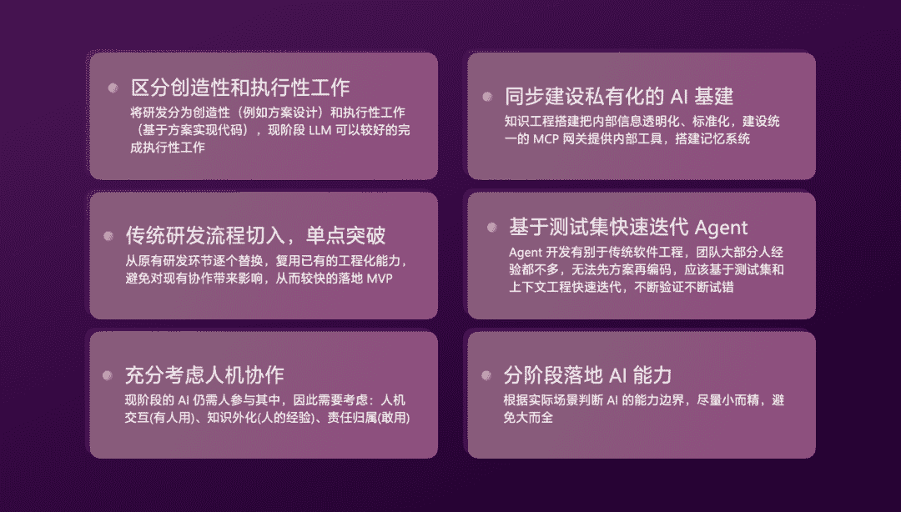

# ** ****6. AI 实践全景**

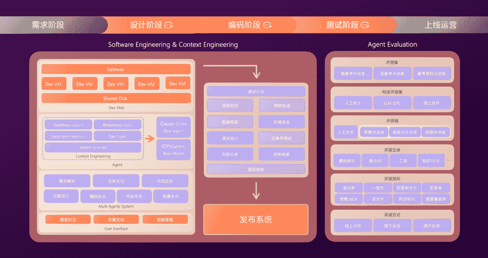

以上是我们在研发全流程落地 AI 的实践：

+   我们 **通**过软件工程（Software Engineering）和上下文工程（Context Engineering），将程序与 LLM 结合 ；

+   围绕研发的设计、编码、测试阶段落地 AI 能力；

+   过程中建设了 Agent 评测体系，不断反馈，持续迭代；