# AI 企业招聘相关信息汇总

> 来源：[https://yunyinghui.feishu.cn/docx/FssldcZHJo8MEKxWZs0cfxvJnGf](https://yunyinghui.feishu.cn/docx/FssldcZHJo8MEKxWZs0cfxvJnGf)
> 适用人群：关注 AI 企业招聘的伙伴
> **持续更新** AI 企业招聘 相关的信息，涉及 AI 产品，运营，品牌，增长，技术等岗位，永久免费在线 查看，欢迎收藏转发支持，提供相关岗位。
> **特别说明：**本文档所有人可以编辑，所有人可编辑，所有人可编辑，欢迎大家发布自己的招聘信息或者求职信息！
> **友情提示：**其他人的招聘信息不要乱动，只管编辑自己的就行了，谢谢配合！
> **招聘社群直达：**[AI 企业招聘相关信息](https://yunyinghui.feishu.cn/wiki/AUqOwhPn8i89BgkBpHocruXunBL?open_in_browser=true#share-RGSEd338Po9OCUxrZ6ecKJlGnhg)

# 2026 年 2 月

## Deepseek

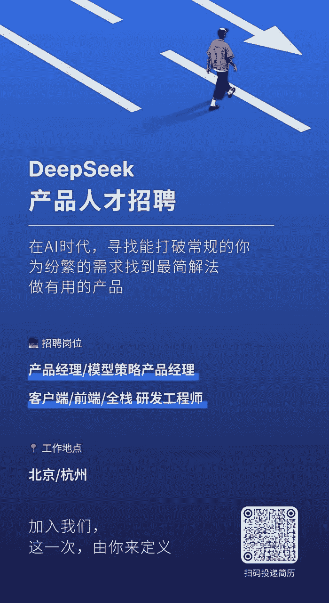

# 2025 年 10 月

## 南京网眼

> 🎬 AIGC 短剧导演
> **【工作地点】**江苏南京
> **【岗位职责】**
> 1. **分镜统筹创作**：主导 AIGC 短剧从筹备到成片的全流程，重点负责分镜设计、镜头语言与视觉节奏，精准把控叙事逻辑与视觉美学。
> 1. **视觉叙事设计**：结合用户偏好与短剧趋势，运用镜头语言强化剧情表现力，提升竖屏观看的沉浸感与节奏张力。
> 1. **画面与节奏监制**：审核 AI 生成素材与剪辑成片，指导影像节奏、构图与视觉风格，确保整体视听效果统一且高质量。
> 1. **跨部门协同**：与编剧及剪辑团队紧密协作，推进项目高效落地，对成片内容与交付结果负责。
> **【岗位要求】**
> 1. **学历背景**：影视导演、动画、编导等相关专业本科及以上学历。
> 1. **专业能力**：
> + 精通分镜绘制与镜头语言设计，具备扎实的动画镜头构图功底；
> + 熟悉 AI 视觉生成工具（如 MidJourney、Runway 等），能将 AI 视觉逻辑融入内容创作；
> + 具备较强的节奏感与视觉叙事能力。
> 1. **项目执行力**：具备流程规划、团队协同及质量监控能力，能高效推进项目落地。
> 1. **创作特质**：热爱影像创作，关注 AIGC 与短剧发展趋势，追求作品的视觉创新与叙事突破。
> 【邮件投递】enoch876@163.com 标题中注明「应聘+职位+姓名」

## 字节扣子

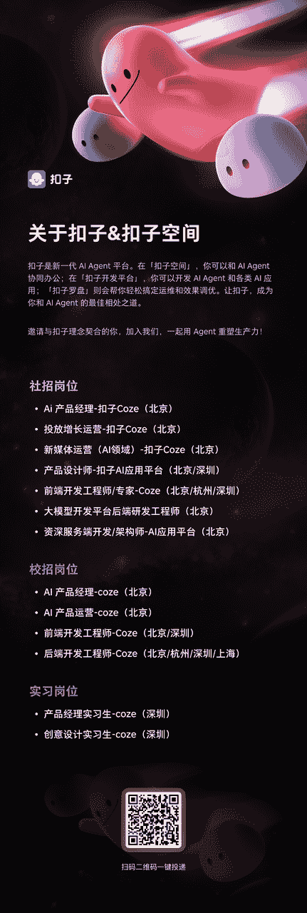

# 2025 年 9 月

## 科大讯飞

> AI 产品经理（创新孵化方向）
> **【工作地点】**安徽合肥
> **【岗位职责】**
> 1、负责公司大模型相关产品的规划、设计及全生命周期管理，推动产品从 0 到 1 的创新孵化。
> 2、深入理解大模型技术及行业趋势，挖掘用户需求，制定差异化的产品策略和落地路径。高效协同算法、工程、设计等团队，确保技术成果转化为用户价值。
> 3、具备市场与竞品分析能力，主导创新场景项目的探索，包括场景验证、商业模式设计及资源协调，推动战略级产品落地。
> 4、监控产品数据表现，持续优化用户体验和商业化效果，对产品的用户增长和营收目标负责。
> **【岗位要求】**
> 1. 本科及以上学历，人工智能、计算机、数学、统计学、心理学等相关专业优先。
> 2. 3 年以上 AI 产品经理工作经验，有 AI/大模型/智能体产品相关经验，有从 0-1 进行产品创新孵化经验。
> 3. 深入理解大模型技术原理及应用场景（如 NLP、多模态、Agent 框架等），能高效与技术团队沟通。
> 4. 具备良好的市场思维，可独立完成价值场景发掘，主导产品及市场验证。
> 5. 逻辑清晰，数据敏感，具备优秀的用户需求分析、产品设计和项目管理能力，团队合作意识强。
> 6. 对 AI 行业有强烈兴趣，学习能力强，能快速适应技术变革。
> **【邮件投递】**dcwang7@iflyted.com 标题中注明「应聘+职位+姓名」

# 2025 年 8 月

## 微众银行

> 深圳头部互联网银行招聘 AI 产品运营日常实习生
> 【岗位职责】
> 1、协助产品运营的基础工作，包括用户调研、需求分析、需求文档撰写、需求管理、数据分析等；
> 2、市场调研、竞品分析、各类新兴平台 App 的玩法体验，并形成调研报告；
> 3、导师安排的其他产品、运营相关工作。
> 【岗位要求】
> 1、具备优秀的逻辑思维能力、数据分析能力和沟通能力；
> 2、有较强的学习能力，团队协作能力强，有产品经验加分；
> 3、有较好的文字能力，对 AI 技术运用有基础认知且对 AI 感兴趣；
> 4、积极主动，聪明热情、善于沟通，对新兴事物有好奇心；
> 【工作地】深圳前海
> 【到岗工作】8 月到岗，一周工作至少 4 天。
> 【邮件投递】mingyangma@webank.com

# 2025 年 6 月

## Flowith

> Flowith 上海办公室招募工程师！请大家多多推荐，团队有充裕的💰，氛围极佳的工作氛围，最卓越且真诚的队友，以及无限量的 Agents。 推荐成功入职会送出 iPhone 16 Pro，可以让申请人投递到招聘官网带上你的名字：`https://apply.workable.com/flowith/`

# 2025 年 5 月

## Lovart

[加入 Lovart，成为智能视觉创作的「造梦师」！](https://liblibai.feishu.cn/wiki/VhKOwrkqSiqVCrk4FxPclHiAnoc)

## 小宇宙/即刻

> 海外 KOL 投放（AI 产品）
> 工作地点：上海市杨浦区创智天地
> **岗位职责**
> 策划并执行欧美 YouTube&TikTok&INS KOL 推广
> 同时也可以尝试信息流投放
> 对项目的投放 ROI 负责
> **任职要求**
> 具备一年以上的 YouTube&TikTok&INS KOL 投放经验
> 对 AI 产品有了解和热情
> **投递须知**
> 请发送个人简历到 lijianmin@iftech.io，标题中注明「应聘+职位+姓名」
> 建议随信附上你的即刻/小宇宙用户名或其他可以让我们更多了解你的信息

## 魔珐科技

魔珐科技成立于 2018 年，是一家以三维计算机图形学和 AIGC 技术为核心的 3D 虚拟人科技公司。魔珐科技打造了端对端的超写实 3D 虚拟人工业化产线，并在此基础上建立了“3D 虚拟人 AIGC 平台--星云平台”，自研了 3D 虚拟人 AIGC 消费级产品矩阵，致力于为各行各业提供高质量、高效率、低门槛、规模化的超写实 3D 虚拟人技术，产品和服务。魔珐科技已完成了数亿美金融资，其中，C 轮融资达 1.1 亿美金，由软银愿景和某知名战略投资机构领投。

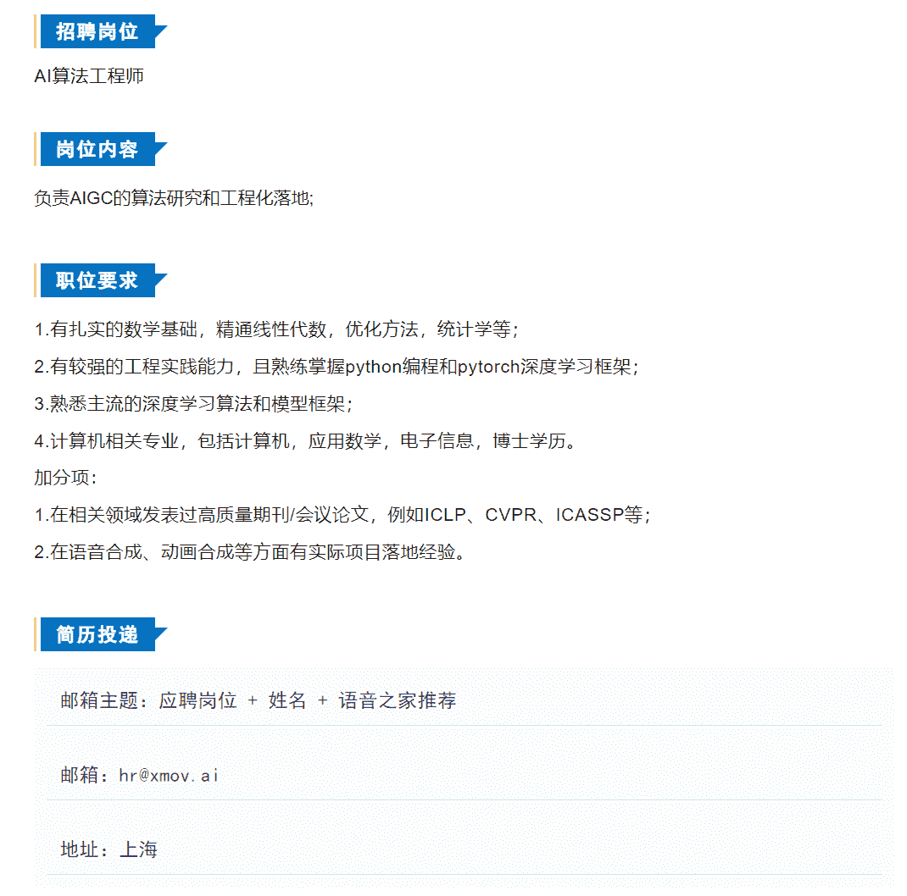

## 有赞科技

> [【AI人才专项】2025Q2 AI Native 产研需求](https://qima.feishu.cn/wiki/Eq6pw0W62ikRO4ke7iycXx43nPc?renamingWikiNode=true)

## 小黄人科技

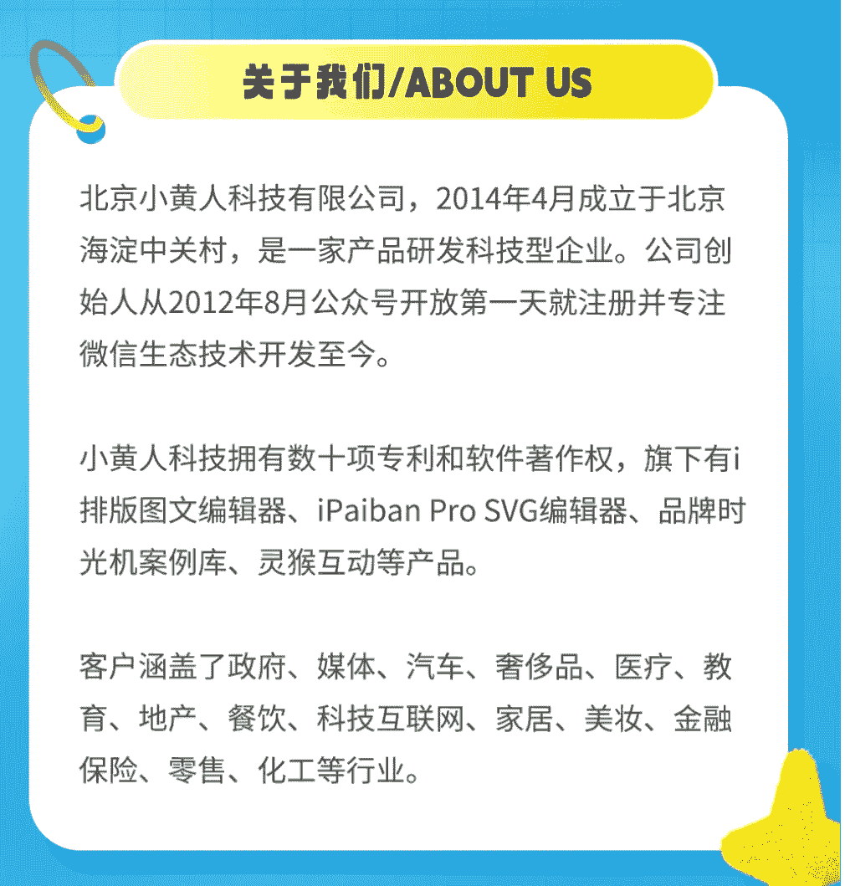

招人！AI 方向，9 个岗位，8-30K，实习生暑期实习快来

# 2025 年 4 月

## 阿里巴巴

**通义实验室 AI 搜索团队**致力于 AI 搜索、RAG、Agent System 等方向的基础研究。近年来，团队在各大 AI 会议上发表了 50+篇论文，并在 MTEB、MS MARCO 等多项业界评测榜单中名列前茅！团队开源的多模态 Embedding、ReRank -> GTE、GME 系列模型在开源社区累计下载量破亿，服务超百万开发者！

> **算法专家**
> **坐标：北京/杭州**
> 方向：RAG/AI 搜索性质：社招
> **岗位职责**
> 1. 参与推进搜索、RAG 核心模块的研发与优化，包括但不限于文本和多模态 Embedding、ReRank 模型等。持续提升模型效果，确保业界领先水平；
> 2. 针对下游应用场景（如问答系统、智能客服、多模态 Memory 系统），优化搜索/RAG/AI Agent 的整体框架链路。推动端到端效果和性能优化，提升整体框架的准确率、执行效率、可扩展性；
> 3. 协同产品、工程团队，推动搜索/RAG/AI Agent 系统的业务落地。支持关键项目的研发和交付。
> **岗位要求**
> 1. 计算机、数学、人工智能等相关专业硕士及以上学历；
> 2. 熟练掌握 Java/C++/Python 中的一门语言，有扎实的数据结构和算法基础；
> 3. 对搜索技术/nlp 技术/大模型技术有系统理解和实践。熟悉 NLP、IR、多模态学习等领域相关技术。在 Query 理解、文本/多模态 Embedding、ReRank 模型、向量检索等方向有深入研究或实践经验；
> 4. 有实际参与大规模搜索系统、问答系统、RAG 或 AI Agent 开发的经验。能够解决复杂场景下的技术难题；
> 5. 出色的逻辑思维能力和问题解决能力。良好的沟通与协作能力，能够在跨团队环境中高效工作。对技术创新充满热情，愿意接受挑战并不断学习。
> **投递方式**
> 📪 d**i**ngkun.ldk@alibaba-inc.com∂
> **邮件标题注明：**姓名-岗位名称-AI 求职

## 美团

美团 AI 招聘 | 开启 AI Native Agent 新纪元！

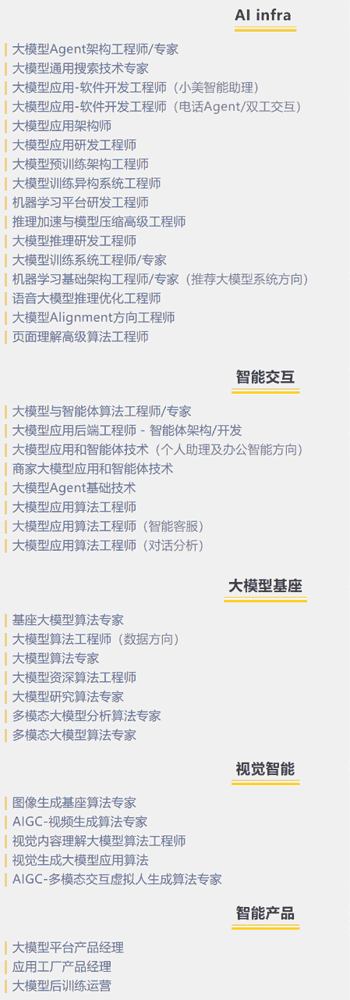

## 水滴

简历也可通过邮箱投递 👉️ningchenyi@shuidi-inc.com

[水滴公司-社招 AI 相关岗位](https://wdh.jobs.feishu.cn/s/cc1giRJtwIY)

### AI 大模型产品经理

> **职位描述**
> 1、基于公司战略，负责保险领域 AI 大模型产品的规划、设计与迭代，推动产品从 0 到 1 及规模化落地；深入理解保险行业业务场景，与业务团队、客户及研发团队紧密合作，挖掘核心需求，制定 AI 产品解决方案
> 2、跟踪保险行业 AI 应用的发展趋势，分析竞品动态，制定差异化竞争策略
> 3、负责保险领域大模型应用开发，推动大模型在 AI 技术方向的应用落地：与算法工程师、工程团队合作，对模型准确率、端到端效果以及应用业务指标负责；通过分析和挖掘业务数据，提炼有价值的信息，结合产品需求进行深入分析和探索，为大模型产品优化和决策提供数据支持
> 4、对接算法工程师、标注团队、工程开发团队，负责产品开发进度、资源协调和风险管理，制定项目计划和进度安排，确保产品按时高质量交付，并推动产品在实际业务场景中的应用和优化
> **职位要求**
> 1、本科及以上学历，211 及以上高校毕业优先
> 2、3 年以上产品工作经验，具备大模型、NLP、知识图谱等相关产品经验，有保险行业背景或相关项目经验者优先
> 3、熟悉主流 AI 技术，包括但不限于大模型、RAG、多模态 AI、强化学习等，具备将技术能力转化为可落地产品的能力
> 4、具备扎实的数据分析能力，熟练使用常见数据分析工具和平台，理解大模型的训练方式、微调策略，能与算法团队有效沟通
> 5、具备较强的产品规划、需求分析、项目管理和跨团队沟通能力，能够推动产品从概念到落地的全流程
> 6、对 AI 行业发展趋势保持敏感度，具备较强的创新意识和学习能力

[水滴公司-校招 AI 相关岗位](https://wdh.jobs.feishu.cn/s/K3KIvxGE_3c)

### 校招-AI 产品经理

> **职位描述**
> 1、负责 AI 产品的规划与设计，包括但不限于市场调研、需求分析、功能设计、流程梳理等，确保产品能够满足用户需求并具备市场竞争力；
> 2、对国内外 AI 市场动态、行业趋势、竞争对手产品进行深入研究和分析，定期输出研究报告，为产品的战略规划和功能迭代提供决策依据；
> 3、基于对公司业务的理解和对 AI 技术的把握，主导 AI 应用产品的研发，协调技术、设计、测试等团队资源，确保项目的顺利推进和产品的高质量交付；
> 4、制定产品上线后的运营策略和迭代计划，通过数据分析、用户反馈等方式持续优化产品性能、用户体验和功能模块，提升产品的用户满意度。
> **职位要求**
> 1、硕士及以上学历，计算机科学、人工智能、软件工程、信息技术等相关专业优先考虑；
> 2、深入了解国内外主流 AI 产品，能够对其功能特点、应用场景、用户体验、商业模式等方面进行深入剖析和评价；
> 3、具备扎实的 AI 原理知识，熟悉常见的机器学习算法（如监督学习、无监督学习、强化学习等）以及 AI 模型训练和优化的基本方法，能够与技术团队进行有效的技术沟通和协作；
> 4、 至少有 1 年以上 AI 产品实习经验，其中至少有 1 款完整的 AI 应用产品的产品经理经验，能够独立负责产品的全生命周期管理，从需求调研到产品上线及后续的运营优化；
> 5、具备出色的沟通协调能力和团队合作精神，能够与不同背景和专业的团队成员进行有效沟通和协作，推动项目进展；
> 6、有强烈的责任心和执行力，能够在复杂项目环境下保持高效的工作状态，确保项目按时交付；
> 7、对 AI 行业充满热情，具有敏锐的市场洞察力和创新能力，能够快速捕捉市场趋势和用户需求，提出有创意的产品解决方案。

# 2025 年 3 月

## 智谱华章（北京-五道口）

> [智谱AI-在招岗位](https://zhipu-ai.feishu.cn/wiki/E4rqwzWPKiDVfuktWqucJMuNnlc)

# 2025 年 2 月

## 美篇（北京-海淀黄庄）

> **AI 产品负责人（出海业务）**
> 【岗位职责】
> 1、负责出海工具产品从 0 到 1 的规划与落地，制定产品战略和发展方向
> 2、结合 AI 技术，挖掘用户需求，优化产品功能，提升产品竞争力
> 3、主导产品的需求分析、设计、开发、测试、上线等全流程管理
> 4、研究海外市场动态和竞争对手情况，为产品优化提供决策依据
> 5、负责产品的海外推广策略制定，与市场团队共同推动产品增长
> 6、建立并维护良好的海外合作伙伴关系，拓展产品的海外市场渠道
> 【岗位要求】
> 1、3 年以上工具产品经理工作经验，有成功的工具产品案例
> 2、具备至少 1 个 AI 项目经验，熟悉 AI 技术在产品中的应用
> 3、主导过出海项目从 0 到 1 的全过程，有成功出海产品经验优先
> 4、具备敏锐的市场洞察力和用户需求分析能力，能把握海外市场趋势
> 5、熟练掌握产品管理工具和方法，有良好的项目管理和沟通协调能力。
> 6、具备数据分析能力，能通过数据驱动产品优化和决策。
> 7、有较强的抗压能力和创新精神，适应快速变化的海外市场环境。
> **嵌入式工程师（AI 玩具）**
> 【岗位职责】
> 1.负责基于 arm linux 的嵌入式系统架构设计，确保系统设计合理高效；
> 2.负责基于 C 语言、python 的 Linux 软件开发，以及相关算法的集成和优化；
> 3.负责摄像头、麦克风、显示屏、舵机等相关硬件外设的驱动、数据采样和控制；
> 4.负责软件开发文档的撰写，指导或协助测试团队进行软件功能的测试；
> 5.负责嵌入式系统的移植及开发，包括 u-boot、kernel 移植、文件系统定制、OTA 等工作。
> 【任职要求】
> 1.本科以上学历，计算机、通信、电子等相关专业；
> 2.5 年以上嵌入式软件开发经验；
> 3.熟悉全志、MTK、RK 任意一种平台，有相关 SDK 的开发及移植经验；
> 4.精通 C 语言、熟悉嵌入式 Linux 操作系统、GCC/Make 等工具、python/shell 脚本；
> 5.具有一定的 SOC（多 Arm 核、FPGA 之间通信，内存共享，驱动开发）软硬件联调经验。
> **算法工程师（AI 玩具）**
> 【岗位职责】
> 1. 参与项目需求的讨论和评审，提出合理的技术方案和解决方案。
> 1. 负责 AI 产品方案的落地和部署上线，并跟进产品 PMF
> 1. 持续关注大模型和后端技术的发展和趋 8 势，并能够应用到项目中
> 【任职要求】
> 1. 有极佳的工程实现能力，精通 Go、Python 等编程语言；
> 1. 精通数据结构和常用算法，熟练掌握各种编译、调试、性能分析工具；
> 1. 熟悉 RTC、Socket 通信技术，具备相关网络编程经验
> 1. 对 AI 对话产品有了解或者认识，理解 AI 大模型原理和使用（prompt 工程、RAG、function call 等）
> 1. 参与过音视频通话场景产品研发
> 1. 有机器学习模型工程性能优化实践经验优先
> 1. 独立负责过服务工程的构建和开发（监控、日志、配置、代码、docker 等）优先
> 1. 勤于动手，善于动脑，乐于挑战的同学优先。
> **投递方式：**
> xumeiping@lanjingren.com
> **邮件标题和简历标明：**姓名-岗位名称

## 钉钉团队

## 快手可灵 AI 团队

> **公司/单位：**快手
> **工作地点：**北京/深圳 岗位：一、视频生成算法工程师 岗位要求
> 1. 计算机和数学相关专业，硕士及以上学历，1 年及以上相关工作经验；
> 1. 对 VAE、扩散/AR 模型、多模态等技术有深度理解，有高质量技术成果；

1. 有视频/图像/3D/动作/全模态生成方向的项目经验，并有突出贡献；
1. 动手能力强，有技术追求，自驱力好，善于表达沟通和协同合作。

## 二、多模态算法工程师

### 岗位要求

1. 计算机和数学相关专业，硕士及以上学历，2 年及以上相关工作经验；
1. 具备较强的技术创新能力。有高质量论文发表、开源项目贡献、竞赛获奖经历者优先；
1. 具备较强的开发与调试能力。熟悉模型性能优化者优先，有复杂系统开发经验者优先；
1. 具备良好的沟通能力，乐于学习与分享，能够与团队高效协作解决问题。

### 投递方式

zhangluowa@kuaishou.com

**邮件标题和简历标明：**姓名-岗位名称

## 亚太人工智能学会

### AI 产品经理（薪资面议）

**工作地点：**杭州

**工作类型：**全职/实习

**关于产品：**我们的产品致力于帮助中小企业（SME）和非技术人员轻松训练多模态大模型。我们的平台提供自动化多模态模型训练解决方案，降低了企业在 AI 方面的成本和技术门槛，使先进的 AI 技术对所有人都变得触手可及。我们现正寻找一位 AI 产品经理加入我们的团队，帮助实现我们的创新产品。

### 职位描述

作为 AI 产品经理，您将参与产品设计和开发过程，确保我们的解决方案满足用户需求。您将与开发团队、数据科学家和业务团队紧密合作，共同制定并执行 AI 产品的路线图。您的目标是将前沿的 AI 技术与实际应用结合起来，推动平台的成功。

### 主要职责

- 领导新 AI 功能和解决方案的产品设计与开发过程。
- 与跨职能团队（包括工程师、数据科学家和 UX/UI 设计师）合作，共同打造创新的 AI 产品。
- 定义产品需求、用户故事和技术规格，指导产品开发。
- 进行市场和用户调研，了解客户需求，识别产品改进的机会。
- 确保产品符合 Vision2Mind 的战略目标和未来多模态模型训练的愿景。
- 管理产品生命周期，从构想到发布，确保按时交付且符合高质量标准。
- 优先考虑并管理功能待办事项清单，平衡技术限制与业务目标。
- 与客户和利益相关者合作，收集反馈，迭代产品设计，确保产品与市场的契合度。

### 任职资格

- 计算机科学、工程学或相关领域的学士学位，硕士学位优先。
- 3 年以上产品管理经验，特别是在 AI 或机器学习产品方面。
- 深刻理解 AI 技术，尤其是多模态模型、自然语言处理、计算机视觉或强化学习等领域。
- 有与跨职能团队合作交付复杂 AI 驱动产品的经验。
- 优秀的沟通和人际交往能力，能够有效地与技术和非技术利益相关者合作。
- 有成功推出 AI 产品的记录，并能在快节奏的环境中进行管理。
- 强大的分析和解决问题能力，能够用数据驱动的方式做决策。

### 优先考虑的条件

- 在 AI SaaS 领域或为机器学习模型训练平台工作经验者优先。
- 有敏捷开发方法论和产品开发生命周期经验者优先。

### 为什么选择我们？

- 在一个创新且充满活力的环境中工作。
- 有机会在 AI 和多模态模型训练的未来发展中发挥重大影响。
- 竞争力的薪资和福利待遇。
- 具有合作性和包容性的公司文化，您的声音将受到重视。

### 联系方式

感兴趣的候选人请发送以下内容至邮箱 davidchiu@vision2mind.com，邮件标题注明【AI 产品经理+姓名】：

1. 简历
1. 个人简介

# 2024 年 10 月

## 「智法数科」

### 关于我们

「智法数科」是一家专注于法律科技服务的互联网科技初创公司，我们致力于开发通过人工智能技术，为法律科技服务场景提供创新应用，旨在为法律专业人士和企业提供高效、智能的法律解决方案，以提升法律服务的质量和效率。我们的愿景是通过技术创新，推动法律服务行业的现代化进程，让法律服务变得更加普及和便捷。

公司的创始团队由来自香港理工大学法律金融领域的顶尖学者和国内 TOP 互联网企业的资深商业产品专家组成。不仅在学术上有着丰富的研究成果，也在商业实践上有着成功的案例和经验。在技术合作方面「智法数科」与国内顶尖 AI 基座大模型企业建立了独家合作关系，共同开发垂直法律科技领域的 AI 大模型。

### 产品经理

#### 职位职责

- 负责大模型在 ToB 法律服务各业务场景和功能模块的能力接入和效果验证，应用层 AI 产品的策略和规划
- 从用户视角定义产品体验，了解洞察客户痛点，深入调研、抽象用户需求，分析数据，并细化到对模型训练数据的理想态定义和标准制定，全流程参与模型训练和和算法探索实验，确保产品开发的技术可行性
- 以客户成功为目标，开展产品设计和演进工作，协调设计、算法、研发团队推进产品在 B 端客户侧的落地实现
- 搭建产品的数据监控体系，并结合模型评测、用户调研、线上数据反馈等，业务诉求、评测等，不断完善对模型理想态的认知，并制定相应的迭代策略，持续优化产品体验，扩展 AI 产品的应用细分功能模块，提高产品竞争力

#### 职位要求

- 本科及以上学历，3 年及以上算法类或 ToB 产品经验，熟悉 AI 相关产品和应用场景，能独立完成重点项目立项、跟进、上线、迭代
- 有法律 ToB 垂直领域的项目开发经验，或平台 AI 应用类产品经验、或大模型落地等开发经验者优先
- 具备清晰的业务逻辑，良好的需求洞察力和逻辑分析能力、产品策略判断能力以及跨团队协作能力
- 富有创业精神，勇于创新，良好的的学习能力，对 AIGC、模型技术与应用有敏锐的洞察力，系统化地思考模式，持续保持关注行业最新动态，为产品创新提供思路

#### 薪酬待遇

- 40-45 万/年 + 年终现金 bonus（*如果有高优才签证，可选择走香港地区雇佣发薪方式）

#### 投递方式

投递地址：1036461928@qq.com 或 添加🛰️「eveyang2480」

### 产品设计

#### 职位职责

- 完成 ToB 法律服务场景的 AI 多终端应用层产品的 UI、UX、视觉品牌产品设计等工作，包括从设计策略到设计执行的全流程，能够快速理解业务需求，以全局设计思维制定业务的设计目标与对应的设计解决方案，对设计结果负责
- 项目推进中与多职能团队配合，和产品经理合作参与用户调研，理解用户需求，并持续推动设计优化；和研发工程师合作，把控线上产品体验品质，提升产品质感
- 关注产品数据变化以及用户反馈，研究目标用户需求，体验诉求与审美倾向，持续推进产品体验的迭代优化
- 深入理解业务，完成对设计规范组件的制定、维护更新和落地实施，实现产品在用户体验上的一致性

#### 职位要求

- 设计相关学科背景，本科及以上学历；3 年以上 ToB 商业产品设计经验沉淀，有大模型应用或 AI 产品设计经验者优先
- 精通 Figma 、Sketch、Photoshop、Illustrator 等设计软件，熟悉 Web、iOS、Android 等多端设计原则和规范
- 全链路的体验设计能力，具备良好的业务理解力和产品思维能力，能结合业务和设计全局考虑项目规划，能独立操作 B 端产品设计系统的搭建项目的实施和运作，跟进项目维护等工作
- 优秀的视觉表现力，重视细节和设计严谨度，思维逻辑清晰，具备一定的工程化思维/结构化思维，较高的用户体验意识，前瞻的审美判断力
- 了解 AI 大模型，注重创新/创意，对前沿设计探索感兴趣，并推动产品体验创新

#### 薪酬待遇

- 30-35 万/年 + 年终现金 bonus（*如果有高优才签证，可选择走香港地区雇佣发薪方式）

#### 投递方式

投递地址：1036461928@qq.com 或 添加🛰️「eveyang2480」

# 2024 年 9 月

## 米哈游

### AI 产品经理

#### 工作职责

1. 负责 AI 产品模块设计、商业化设计调优相关的工作；
1. AI 产品数据自动化系统设计。

#### 任职要求

1. 3 年以上产品经验；
1. 有 AI 相关产品或人机交互类产品经验者优先，熟悉 AI 数据处理与系统流程者优先；
1. 有从零到一产品经验优先，有海外产品经验更佳；
1. 对 PUGC、UGC 工作流熟悉者优先。

投递链接：https://jobs.mihoyo.com?isRecommendation=true&recommendationCode=NTAJ4nL#/position/5185

### AI 产品运营

#### 工作职责

1. 负责 AI 产品的线上版本运营工作；
1. 负责产品上线的全流程跟进，协调保障产品内容按时按质按量发布上线；
1. 基于数据分析，业务需求，用户反馈与产研团队构建自动化流程，持续提升产品能力。

#### 任职要求

1. 3 年以上产品运营经验；
1. 有 AI 相关产品或人机交互类产品经验者优先，熟悉 AI 数据处理与系统流程者优先；
1. 有从零到一产品经验优先，有海外产品经验更佳；
1. 对 PUGC、UGC 工作流熟悉者优先。

投递链接：https://jobs.mihoyo.com?isRecommendation=true&recommendationCode=NTAJ4nL#/position/5186

# 2024 年 7 月

## 苏商银行

苏商银行是江苏首家数字银行，定位于“科技驱动的 020 银行”，国家高新技术企业。

2022 年，苏商银行被评为“全球 20 家新锐银行”，并在 2023 年度“全球纯数字银行”中排名第六。该行具有足额五险一金、补充医疗保险、年度体检、季度生日会、节假日福利、生育关怀、福利食堂、各类特色俱乐部等多元福利，等你来一站式 GET！

### 一、六大核心业务

微商金融、产业链金融、科创金融、支付金融、消费金融、财富管理

### 二、招聘岗位

- 大模型专家
- AI 算法专家
- 高级大数据平台研发工程师

### 工作地点

南京 CBD 金融城

银行业金融科技社群，有兴趣的朋友请添加群主：yktworld

备注：公司+姓名+职务+银行入群。仅限银行科技工作人员。

## 360 集团

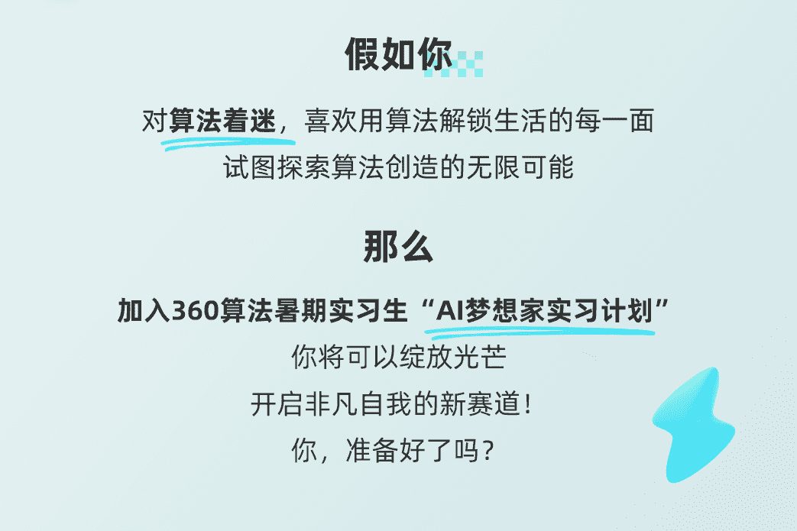
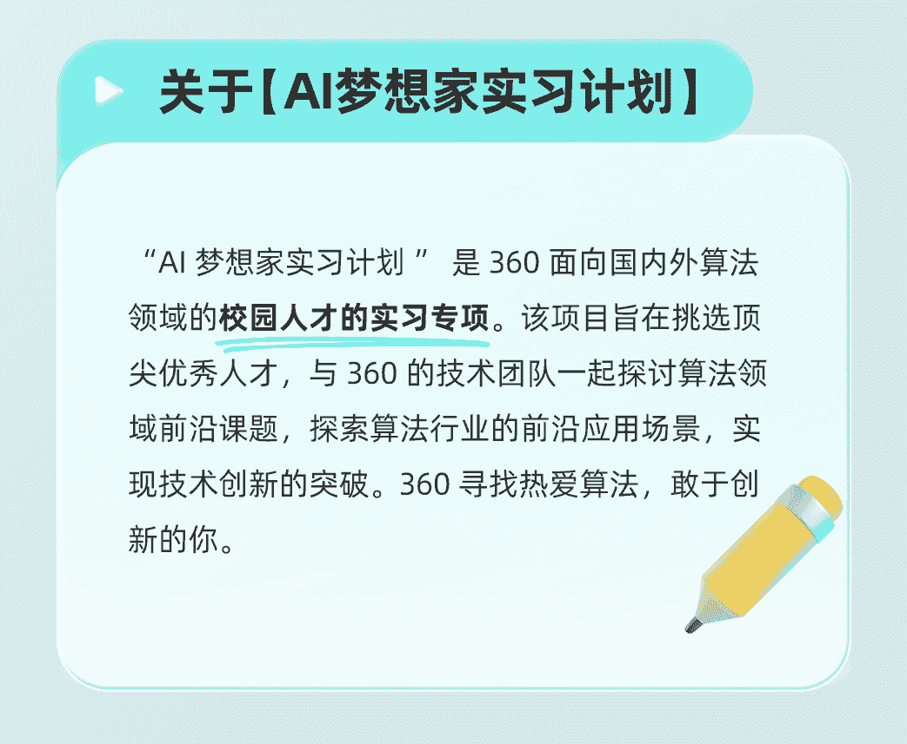
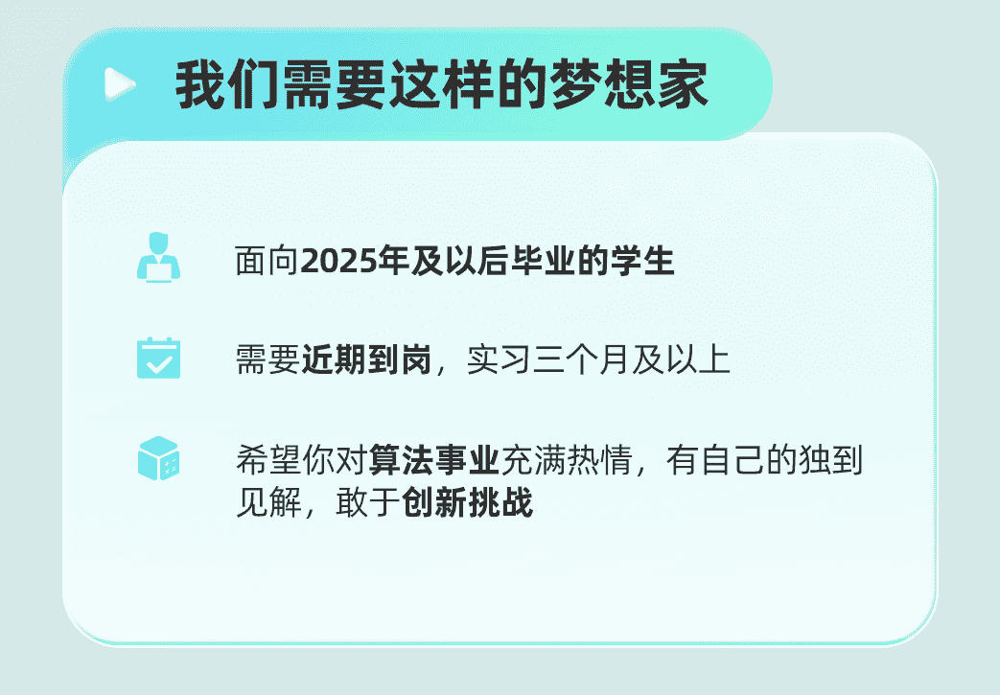
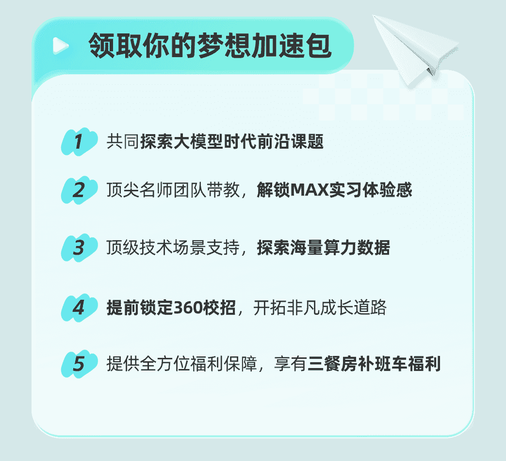
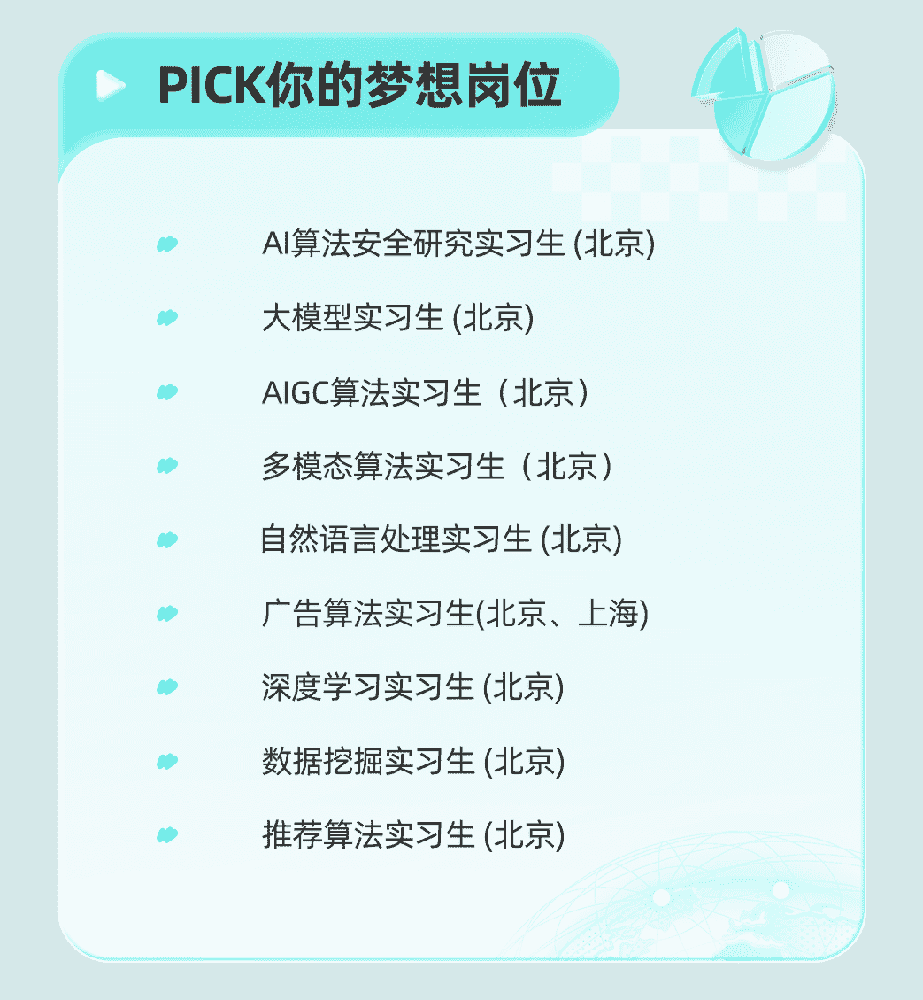

# 2024 年 5 月

## 广州日报

广东广州日报传媒股份有限公司（简称“粤传媒”）是首家获得中宣部和国家新闻出版总署批准并在深圳证券交易所上市的报业传媒公司、广州市唯一国有控股文化传媒类上市企业，也是广州市第一家上市的文化企业。

### 岗位职责和任职要求

#### （一）AIGC 技术负责人

##### 岗位职责

1. 根据公司业务发展需要，统筹 AIGC 产品整体发展路线、技术架构，解决 AIGC 技术难点；设计 AIGC 产品路线图，组织开展产品原型设计和概念验证工作；
1. 熟悉国内外大模型技术框架，对市场存在 AIGC 的方案评估、选型与集成，为公司业务应用提供有效解决方案；
1. 推进 AIGC 产品商业化，分析市场反馈与用户数据，不断优化产品性能和用户体验，提升产品的市场占有率和盈利能力；
1. 管理 AIGC 团队，制定并优化研发流程，提升团队技术水平和项目执行力；
1. 负责与团队沟通、协作，确保产品、项目按照计划完成。

##### 任职要求

1. 本科及以上学历，人工智能、计算机、信息技术相关专业，扎实的编程技术；
1. 熟悉机器学习和深度学习的相关算法和模型；
1. 对文生图、图生图的原理有一定的认知，包括不限于：扩散模型、潜在扩散模型、对抗神经网络等；
1. 熟悉常见 AI 生成模型框架，至少熟悉一种国内外的 AIGC 模型技术，并能够应用此技术训练 Lora、SDXL Turbo 等模型；
1. 曾成功参与或主导过 AI 或 AIGC 相关产品的研发和商业化过程优先考虑；具备丰富的市场洞察能力和实战经验；
1. 对技术研究与探索有非常强的兴趣，有非常强的自学能力，务实且有责任心，高度投入工作；
1. 有媒体、财经、教育等至少一个行业的 AIGC 实践经历者优先考虑。

#### （二）AIGC 应用工程师

##### 岗位职责

1. 至少熟悉一种 AIGC 大模型框架和产品（包括但不限于国内外大模型产品：清华智谱、百度大模型、Stable Diffusion，Midjourney，ChatGPT）解决内容生成问题；
1. 负责大模型和语音算法适配与应用落地，包含但不限于 ASR、TTS、LLM、Langchain、Agent 等技术应用；
1. 负责 AIGC 模型相关训练优化算法研究和落地，包括模型设计，数据分析，数据标注与训练，模型落地等；
1. 负责文本生成、文本摘要、实体命名等自然语言处理算法的研发和调优；
1. 负责设计和开发相关方法以增强大语言模型（LLM）在垂类场景的适用能力并落地；
1. 负责将语音助手和大语言模型整合到不同应用和平台，确保系统与其他组件的良好协同工作。

##### 任职要求

1. 本科及以上学历，计算机相关专业；
1. 1 年以上 AutoML、模型优化或 AI 相关工作经验；
1. 有 AIGC 模型训练优化/推理优化落地经验者优先；
1. 具备 NLP 大模型训练经验者优先，熟悉并使用过 chatgpt，chatglm，chatrwkv，llama，claude 等主流大模型；
1. 熟练使用 Java/Python，熟悉 Linux 开发环境和 shell，熟悉主流深度学习工具 Pytorch、Tensorflow；
1. 有 AutoML 或 AIGC 方向顶会论文者优先；在计算机视觉顶会或期刊上发表过论文者优先；在计算机视觉知名竞赛取得优异名次者优先；有高质量 Github 项目经验者优先；
1. 具有较强的英文文献阅读及调研能力者优先。

### 联系人及简历投递方式

1. 联系人：粤传媒人力资源部 刘小姐 电话：020-88630032
1. 简历投递方式：请投递简历至 hr@gdgzrb.com 或登录前程无忧、智联招聘投递简历。

## 科大讯飞

科大讯飞股份有限公司成立于 1999 年，是一家专业从事智能语音及语言技术、人工智能技术研究，软件及芯片产品开发，语音信息服务及电子政务系统集成的国家级骨干软件上市企业。从语音技术到更广维度的认知智能，科大讯飞实现了一次次的突破和超越。在语音合成、语音识别、机器翻译、智能阅卷、语义理解等人工智能核心技术方面有代差级优势。2017 年 11 月，科大讯飞成为第一批四大国家人工智能开放创新平台之一。2017 年 11 月，科大讯飞和清华大学联合研发的“智医助理”机器人取得了 456 分的成绩，是全球第一个通过国家医师资格考试测试的机器人。2024 年 12 月科大讯飞发布讯飞星火认知大模型 3.0，全面对标 chatGPT，是科大讯飞推出的新一代认知智能大模型，拥有跨领域的知识和语言理解能力，能够基于自然对话方式理解与执行任务。整体布局为“1+N”体系。其中，“1”是指通用认知智能大模型；“N”就是大模型在医疗、教育、汽车、人机交互等各个领域的落地。

### 岗位详情

#### AI 算法工程师（校招&社招）

**薪资待遇：**面聊

**工作职责：**

1. 结合“AI+医疗”场景，从事大模型、篇章级语义理解、关键信息提取、知识挖掘、信息检索、知识推理等自然语言处理核心算法研究与开发。

# 科大讯飞 (iFLYTEK)

## 岗位职责

1. 从事自然语言处理相关服务级产品和系统的设计、研发及性能、效果优化，包括知识图谱、智能推荐、智能问诊、临床决策等智医助理产品。

## 任职要求

1. 重点本科及以上学历，计算机、信号处理、数学、软件工程、电子与通信等相关专业，英语四级以上。
2. 熟练使用 C/C++或 Java，熟悉数据结构及常见算法，熟悉 shell/python 等至少一门脚本语言，有一定的代码研发经历。
3. 有强烈的上进心和责任感，能主动积极地面对工作，团队协作及沟通能力佳。

## 优先条件

1. 有 1 年以上机器学习、深度学习、NLP 顶会发表论文等相关研发经验者。
2. 有大模型研究及实际系统开发经验者。

## 联系方式

- 简历投递邮箱：jingwang81@iflytek.com（邮件标题为：姓名+学校+大模型算法研发。）
- 联系人：王师姐 15652191257
- 工作地点：北京、合肥、广东、香港

# 微软亚洲研究院

## Excel AI 算法实习生

Data Analytics Research 是 DKI（Data，Knowledge & Intelligence）Group 下专注于数据分析的研究团队，深度参与了 Microsoft 多个产品（如 Excel，Forms，Bing，Azure，Viva，Power BI 等）中数据分析和智能的研发工作，深刻改变了亿万用户探寻、分析和理解各领域数据的方式，并在数据挖掘、人工智能、机器学习、自然语言处理、人机交互、软件工程等领域常年发表具有影响力的工作。DKI 组于 2023 年从 MSRA（微软亚洲研究院）加入产品部门推进 AI 变革，Data Analytics Research 现为 Excel Research 的一部分，和跨全球的团队成员们一起解决最前沿的实际问题并应用最新的 AI 技术。

### 坐标：北京

### 类型：全职实习生

### 岗位职责

1. 参与表格结构识别核心算法的设计和搭建，包括：
   - 大语言模型在表格结构识别任务上的优化
   - 表格结构分类机器学习算法开发
2. 表格理解与表格生成任务的数据处理、模型训练与部署；
3. 进行表格结构和 LLM 相关前沿研究与论文撰写，方向包括：
   - 基于大语言模型的表格数据分析与结构识别
   - 优化大语言模型对结构化和半结构化数据的理解、推理和生成能力

### 岗位要求

1. 能获得学校导师许可，并保证至少 6 个月的全职 onsite 实习，实习期间需为在校生；
2. 编程/算法/动手能力强，思维活跃，勤奋踏实，具备快速学习能力；
3. 熟练掌握常见深度学习和机器学习框架，对大型基础模型（如 OpenAI、Mistral、Phi 系列模型）有基础了解和使用经验；
4. 具备 NLP，tabular tasks，code generation，SFT，RLHF 等相关经验者优先；
5. 有大规模并行数据处理/大型基础模型研发、会议论文撰写投稿经验者优先。

### 在这里，你可以

1. 使用最新的大型语言模型；
2. 亲身体验微软产品的开发过程；
3. 学习大型模型在结构化数据上的应用方法。

### 投递方式

📪 xiaojunma@microsoft.com

**邮件标题和简历标明：**姓名-Excel 算法实习生

# 昆仑天工

## AIGC 算法研究员/实习生

昆仑天工是昆仑万维科技股份有限公司下属的子板块。昆仑万维深耕海外市场十余载，业务覆盖 AGI 与 AIGC、信息分发、社交娱乐、游戏及投资等多个领域，并于 2015 年登录科创版，旗下包括 AGI 与 AIGC、海外信息分发与元宇宙、科技股权投资等三大业务板块，业务和子公司已先后拓展至美国、俄罗斯、日本、韩国、印度，以及欧洲、非洲、东南亚等地的其他国家。

### 坐标：北京

### 性质：实习/春招

### 岗位简介

1. 利用前沿计算机视觉、计算机图形学算法，研究数字人或多模态相关的课题；
2. 深度参与数字人项目的数据收集、算法研发、性能优化与业务落地等环节。

### 岗位要求

1. 较强的算法实现能力，熟悉深度学习平台如 tensorflow，pytorch 等；
2. 熟练掌握 CV、NLP、语音基础理论和算法，在一个或多个领域能够独立开展研发工作，有落地经验优先；
3. 有发表过相关顶级会议或期刊或者参与过知名开源项目的同学优先；
4. 实习时间大于三个月以上优先。

### 投递方式

📪 zhihang.li@kunlun-inc.com

**邮件标题和简历标明：**姓名-岗位名称-AI 求职

# 快手

## 大模型-生成式 AI 算法招聘

### 工作内容

1. 从事生成式 AI 算法探索和落地，方向包括但不限于图像/视频/3D/动作的生成。

### 任职要求

1. 本科及以上学历，计算机/数学/信息相关专业；
2. 算法基础扎实，熟悉 GAN/VAE/Diffusion Models 等生成式 AI 模型；
3. 自驱力强，热爱 AI 技术，有较好的学习能力和动手能力。

### 加分项

1. 在 CV/CG/ML 领域顶会或期刊有论文发表；
2. 实际参与过 AIGC/大模型相关的项目研发；
3. 在 ACM ICPC 等编程比赛中有获奖经历。

### base：北京

### 联系方式

xusuyu@kuaishou.com

# 有道爱翻译

有道爱翻译，有道旗下英语学习平台，英语爱好者的快乐老家。

## 招聘 AI 话术实习生

### 岗位职责

1. 负责协助公司 AI 话术的巡检、调优工作；
2. 负责协助公司 AI 话术所需资料的调研、翻译、录制等工作；
3. 负责协助公司 AI 话术意图库的建设工作。

### 岗位要求

1. 有智能语音产品相关实习经验优先。
2. 本科及以上学历，英语及小语种（泰语、西班牙语、印尼语等）、金融、营销等相关专业优先。
3. 有较强的沟通、表达、应变及抗压能力，良好的心理素质及优秀的团队合作能力，执行力强。
4. 任一外语可以作为工作语言（英文及小语种优先，需要能够熟练的听、说、读、写），熟练掌握 Microsoft Office 等办公软件。

base 成都，投递方式：[投递](https://www.zhipin.com/job_detail/378569619eb09add1HBy2N-4EVtX.html?lid=1c0vOm1aXsC.search.35&securityId=u957NK7EleEyf-z1LNhtAgfMK7TU_9csTp7X8egRt0ZcKQybKBaUyA-TJslN0m0b_l2PTXwg7bqpQmlTj3gdGxPD2cGc946g-oHLkQ6zTk1RDyUPIH8~&sessionId=)

# 灵犀智宇

灵犀智宇 ——全域电商 AI 应用&智能营销平台，为全球中小电商企业提供基于大模型的自动营销智能体、智能营销解决方案。灵犀智宇的服务领域涵盖国内公/私域电商、跨境电商的运营、营销全链条，加速中小企业的运营/营销自动化、智能化，让每个中小企业都拥有顶级“营销专家”！

## 招聘职位

- 产品：AI 产品经理（广告投放、智能营销方向）、UX 设计师
- 研发：前端、后端开发工程师，NLP/图像算法工程师
- 运营：资深抖音投手、电商运营、短视频运营
- 营销：短视频编导、摄影、主播（科技方向）、视觉设计师
- 经营：财务经理、行政、人事

### 我们希望你

- 热爱 AI，关注大模型及 AGI 相关领域进展，有一定的技术理解能力。
- 1-3 年的相关经验；也欢迎有趣的新手。
- 不拘泥传统、有好奇心、肯钻研。
- 基础技能自己搞定，心里有数。

### 你能获得什么

- 深入接触 AI+电商应用实践，个人 Idea 的 AI 产品化实现。
- 国内+海外 应用开发、发行实践。
- 自由、不内耗的团队工作氛围，且不 996。
- 有一帮热爱科技与 AGI 的 Geeker 同事。

base 深圳

简历请发送到 aibot@starneural.com

邮件标题为：姓名+灵犀智宇 【岗位名称】应聘

# 新榜

新榜作为数据驱动的互联网内容科技公司，新榜提供新媒体内容营销和企业服务系列产品，助力中国企业数字化内容资产获取与管理，服务于内容产业，以内容服务产业。

## 内容编辑（AI 条线）

工作内容：专注 AIGC 方向的行业研究与观察报道，负责原创文章的选题策划写作。参与内容发布运营等相关工作。

工作要求：对 AI 领域有持续关注和研究热情，熟悉 AI 相关产品与玩法，最好懂点技术。流畅的沟通表达能力，较好的文字功底，能够独立准确地完成创作，有网感；真诚靠谱，不拖延，具备基本的自驱力、执行力、好奇心。有 AIGC 相关经验/资源优先；有作品优先；英语编译能力优秀更佳。

工作地点上海徐汇区，工资面议。

有意者请投递简历至主编邮箱：zhangjie@newrank.cn，也欢迎联络沟通投稿。

# 清华大学 I-AIIG

清华大学人工智能国际治理研究院（Institute for AI International Governance，Tsinghua University，THU I-AIIG）是 2020 年 4 月由清华大学成立的校级科研机构。依托清华大学在人工智能与国际治理方面的已有积累和跨学科优势，研究院面向人工智能国际治理重大理论问题及政策需求开展研究，致力于提升清华在该领域的全球学术影响力和政策引领作用，为中国积极参与人工智能国际治理提供智力支撑。

## 科研助理实习岗（AI 产业方向）

### 项目方向

#### 01 项目方向一

自动配送车产业创新生态治理及人机协同配送机制研究。

#### 02 项目方向二

AI 产业化（AI 大模型/生成式 AI 产业创新生态及其治理）与产业 AI 化（AI 大模型赋能传统产业转型升级）。

#### 03 项目方向三

智能制造企业劳动力生态以及人机关系治理。

### 请在简历中备注

最感兴趣的项目方向及调剂意愿

### 岗位职责

- 协助完成 AI 产业治理相关课题研究工作。
- 参与合作或协助完成 AI 产业治理相关的学术论文、政策专报及研究报告。
- 收集整理 AI 产业治理的最新动态资料。例如，围绕国内外主流新闻媒体、社交平台、智库平台、学术平台等，收集整理关于 AI 大模型/生成式 AI、自动配送车、智能制造等产业发展及政策动向的最新动态资料。
- 协助完成研究院的其他日常工作。

### 任职要求

1. 国内外高校的硕、博研究生在读（在京线下实习优先，特别优秀者可远程办公）。
2. 人工智能、机器人等 AI 技术相关专业或经济管理等人文社科类专业优先，特别优秀者不限专业。
3. 对 AI 大模型/生成式 AI、自动配送车、智能制造等相关产业领域有一定认识和浓厚的兴趣，或者具备相关的学术学习背景或课题参与经历。
4. 具备一定的科研学术基础或具有浓厚的科研兴趣和学习意愿，如有发表论文、参与课题、政策专报等科研经历者更佳。
5. 具备优秀的中英文读写能力，具有较强的信息搜集与文献资料整理能力。
6. 有强烈的责任感且踏实靠谱，工作严谨细致，能够高效完成工作任务。
7. 具有较强的积极能动性和任务执行能力，具备良好的沟通能力和团队协作意识。
8. 需要保障一定的专职科研时间投入，要求至少连续实习三个月及以上，每周保证至少工作三天，且长期实习者更佳。请在简历中备注参与实习的预计起止时间段及每周可工作天数。

### 福利待遇

1. 高端的科研学术平台，与国内外知名学者近距离接触的机会，并可参与 AI 产业治理领域的重要前沿课题。
2. 能力考核达标且有兴趣的同学，将有机会参与高质量学术论文、政策专报等合作撰写，并可视参与贡献提供合作署名机会。
3. 清华园内工作实习的机会，并有机会参加研究院举办的讲座、学术研讨、国际会议等各类学术活动，参与 AI 产业前沿实践调研与交流，获得研究院研究人员的专业指导。
4. 跟进最前沿的研究动态和科研成果，帮你发掘学术兴趣，找准研究方向。
5. 在实践中锻炼中英文写作能力，在团队合作中培养协作能力，在多彩研究中提升科研能力。
6. 给予实习补助，按照学校、学院关于勤工俭学的相关标准发放补贴。
7. 表现优异的实习生还将获得研究院的实习证明，增加未来升学和职场个人竞争力。

### 工作地点

清华大学人工智能国际治理研究院（清华大学校内，特别优秀者可远程办公）

### 投递方式

感兴趣的同学请发送简历到：i-aiig@mail.tsinghua.edu.cn

邮件标题请注明【AI 产业实习生+姓名+电话+学校】。如果你有学术论文、研究报告、政策专报等科研成果代表作，也请随申请邮件一并附上。研究院将进行严格的初筛后，确定面试名单，约定面试形式、时间和地点。谢绝其他联系方式。

# 拓银科技

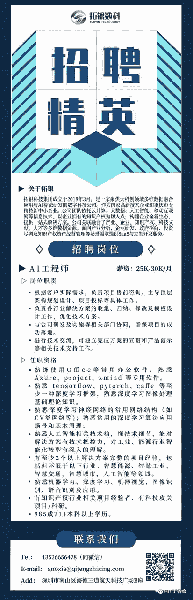

# 商汤

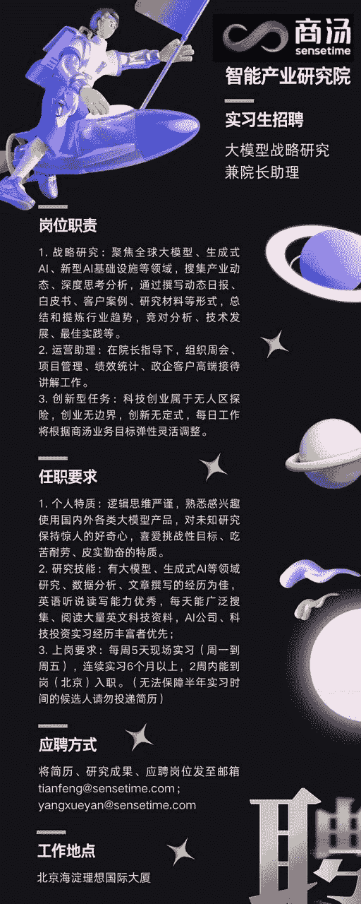

# 极佳科技

极佳科技是国内通用视觉智能方向最领先的团队之一，核心团队发表视觉和人工智能方向顶级论文 200 余篇，多次获得全球最具影响力的人工智能比赛冠军，发表多个具有世界影响力的人工智能技术成果，并拥有丰富的人工智能大规模产业落地经验。极佳科技目前已经打造 10-60 亿不同参数级别通用视觉生成模型，并已经在多个应用场景实现落地和产生规模化营收，同时相关技术和成果得到国家专项课题认可和重点支持。

## 生成式 AI 算法实习生招聘

Base 地：北京/上海

### 职位描述

1. 参与 AIGC 相关算法研究和落地，包括但不限于视频生成、世界模型、自动驾驶、机器人方向等研发和落地工作；
2. 前沿技术跟进研究，支持公司业务场景模型的研发与效果持续优化。

### 岗位要求

1. 硕士或者博士在读，每周可以实习四天及以上优先；
2. 有两年以上在深度学习、计算机视觉、视频生成的经验，对 GAN/预训练/Diffusion/CLIP 等算法有实践经验者优先；
3. 掌握计算机视觉和图像处理基本算法、常用深度学习算法，并在如下一个或多个相关方向有深入研究：LLM、GAN、扩散模型、图像生成、多模态生成等；具备扎实的编程功底，熟悉 Pytorch 等主流深度学习框架，熟练使用 C++/Python 等至少一种编程语言，熟悉 Linux 开发环境；有良好的学习能力和创新思维，能够与团队良好合作和沟通，工作积极主动，自驱力强；在计算机视觉（CVPR，ICCV，ECCV）和机器学习（NeurIPS，ICML，AAAI）等相关会议发表论文者优先。

### 联系邮箱

zheng.zhu@gigaai.cc

邮箱主题/简历命名格式：极佳实习申请+姓名+CVer 推荐

# 中国信息通信研究院

中国信通院人工智能研究所是中国信通院下设的人工智能专业研究机构，主要职责包括：承担人工智能相关发展战略、产业规划、行业应用、技术标准、安全治理等的研究；承担人工智能决策支撑、新技术试验验证、检验检测等工作；承担相关国家重大科技和产业化项目，提供相关咨询服务；开展相关国际交流合作；牵头运营中国人工智能产业发展联盟。

## 招聘计划

对象：面向社会招聘硕士及以上学历人员

专业：人工智能、计算机、通信、电子、经济学、统计学等相关专业背景

人数：20+

单位地址：北京市海淀区学院路

🛰️扫码查看招聘岗位

黄老师 huangxinxuan@caict.ac.cn

顾老师 gutianyao@caict.ac.cn

# 跨越星空

## 算法实习生（日薪 200-350）

### 公司简介

跨越星空成立于 2021 年 9 月，目前已完成数千万元天使轮融资，投资方包括盈动资本、GGV、奇绩创坛等一线投资机构。

### 岗位职责

1. 开源工作搭建：深入探究行业技术演进方向，持续追踪学术成果，结合行业痛点，从 0 到 1 搭建开源工作
2. 论文撰写：持续探索跟踪 AI Agent 方向学术成果，不断优化开源工作成果，将其转化为行业顶尖论文
3. 功能优化：基于深入的技术与业务分析，为核心功能提供新技术方案

### 岗位要求

1. 985、211 大学（或海外名校）在读大二及以上学生，在自然语言处理或相关领域具有扎实的理论基础和实践经验优先；
2. 感兴趣并有自驱力了解大语言模型、多模态模型、agent 领域的最新技术；
3. 快速学习能力强，有强烈的好奇心、同理心和沟通能力；
4. 对大语言模型的使用有深入理解和有语言模型训练或微调经验的优先；
5. 工作地点：杭州

### 你将获得

1. 顶尖项目经历加持：深入探索 AI Agent 前沿方向，将直接参与开源项目的搭建和撰写顶级会议文章

1. 自身能力的高速提升：成长曲线陡峭，深入前沿 AI 技术的研究和落地应用

1. 良好的团队氛围：可以直接与来自佐治亚理工、浙大、谷歌、Magic Leap、阿里等经验丰富的同事们并肩共事，共同成长

> 简历投递：yifei@stellarrover.com
> 邮件标题：姓名-学校-到岗时间-持续 X 月
> P.S. 如有自运营技术博客可附上

## 万象 AI 实验室

> 万象 AI 实验室是头部 AI 学习社区，覆盖超 50 万读者，私域有 5 万用户。旗下👸号及视频号账号运营，用视频来报道 AI 行业的动态与玩法，负责相关选题策划与内容制作。

> **岗位：AI 👸号内容编辑**

> **任职要求：**

1. 对 AI 非常感兴趣，日常对 AI 有关注和研究
1. 有基本的视频制作能力，熟悉镜头语言，有网感
1. 良好的沟通能力，真诚，靠谱，敢想敢做，有执行力

> **工作内容：**

1. 专注研究 AI，负责原创文章的选题策划写作
1. 协助完成内容发布运营等其他工作

> **任职要求：**

1. 对 AI 非常感兴趣，日常对 AI 有关注和研究
1. 优秀的文字功底，逻辑清晰，能独立准确地完成创作
1. 良好的沟通表达能力，思考与共情能力
1. 真诚，靠谱，不拖延，有执行力
1. 有作品者优先，具备优秀英语能力、视频剪辑能力等优先

> 工作地点杭州临平，工资 8-10k
> 联系人大国：`zyg90s`，备注：求职，通过后请发简历。

## 海豚 AI 学

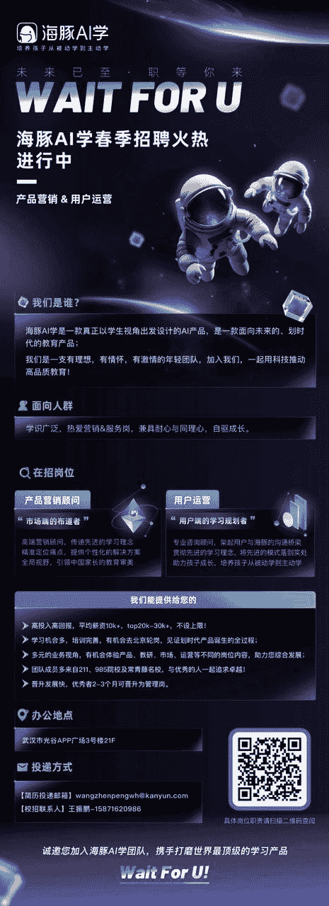

## 腾讯 AI Lab

> **腾讯 AI Lab** 是腾讯的企业级 AI 实验室，于 2016 年 4 月在深圳成立，团队由 100 余位来自世界知名院校的科学家，以及 300 多位经验丰富的应用工程师组成，并与世界顶级院校与机构合作，共同打造产学研用一体的 AI 生态。借助腾讯丰富应用场景、大数据、计算力及一流人才方面的长期积累，AI Lab 立足未来，开放合作，致力于不断提升 AI 的理解、决策与创造力，向“Make AI Everywhere”的愿景迈步。

> 3D 人体动作感知和生成方向实习生坐标：深圳

> **岗位描述**

1. 负责 3D 人体动作感知和生成方向的相关算法的研究与实现；
1. 协助算法工程化和产品落地；
1. 表现优秀者提供转正机会。

> **岗位要求**

1. 熟悉 `Pyotrch` 等深度学习算法和开发工具；
1. 了解人体动作表示、驱动和渲染等技术；
1. 熟悉 `SMPL`、`SMPLX`、`MANO` 等人体参数化模型；
1. 能全职实习 6 个月以上者，工作地点为深圳。

> **加分项**

1. 有视频 3D 动作捕捉、3D 人体动作生成、动作重定向、人体动作先验、生成模型和大模型预训练等方向的相关研究或项目经验；
1. 曾在顶级会议（如 CVPR、ICCV、ECCV、NIPS、SIGGRAPH、ICLR 等）发表过文章；
1. 具备影响力的开源项目、计算机编程比赛经验。

> **投递方式**
> 📪 shaolihuang@tencent.com
> **邮件标题和简历标明：**姓名-岗位名称-AI 求职

## 作业帮

> 作业帮 AI 教育产品经理实习生

> **【岗位职责】**

> 1. 负责 AI 模型优化后的效果标注 & 数据分析，与研发对接，不断提升 AI 模型效果质量；
> 1. 负责 C 端 AI 产品的功能及策略的优化迭代，推动业务核心数据增长；
> 1. 日常与研发沟通需求，参与需求评审，保证项目顺利上线

> **【岗位要求】**

> 1. 统招本科及以上，2024 届、2025 届优先；
> 1. 来公司实地办公，不接受远程实习；
> 1. 有互联网相关的实习经验相关经验；对 `chatgpt`、文心一言等 AI 应用有实际使用经验；
> 1. 踏实细心、有责任感、交代的事情有结果有回应。有自驱力，能主动解决问题。学习能力强

> 工作地点：北京市海淀区中关村软件园东软大厦
> 投递邮箱：luohuiyu@zuoyebang.com

## 灵犀大语言模型

> 2023 年，大模型如雨后春笋般爆发，58 同城 TEG-AI Lab 作为 AI 平台部门，紧跟大语言模型技术发展步伐，打造了大语言模型平台，支持大语言模型训练和推理部署，并基于大语言模型平台构建了 58 同城生活服务领域（房产、招聘、汽车、黄页）垂类大模型灵犀大语言模型（`ChatLing`），支撑了业务方大模型应用的探索落地。灵犀大语言模型在公开评测集和实际应用场景下，效果均优于开源通用大语言模型以及商用通用大语言模型。

> 岗位名称：AI 产品经理
> 工作地点：北京市朝阳区酒仙桥北路甲 10 号院电子城·IT 产业园 58 同城总部

> **【工作任务】**

> 负责 AI 智能对话平台、AI 智能体平台、大语言模型平台中的产品设计，和 AI 技术人员一起落地大模型 AI 应用。把握行业发展趋势，独立完成产品调研、设计和落地，与数据标注/运营团队合作，负责效果评测分析，通过数据效果分析指导产品不断优化，提升用户体验。

> **【岗位要求】**

> 1. 具备 AI 领域（NLP、对话等）相关产品设计经验。
> 1. 熟悉 AI 项目评价机制，熟悉 NLP 如文本分类、文本抽取等基础技术逻辑。
> 1. 热爱互联网行业，了解行业产品发展动态。
> 1. 高效执行力，沟通表达优秀，善于团队协作。

> 部门还招聘大模型算法、NLP 应用算法、语音算法、后端工程师
> 联系人：zhankunlin@58.com

## FancyTech

> **已暂停**

> FancyTech 成立于 2020 年，致力于通过自主研发的 AIGC 技术在商业领域实现更广泛的商业价值。中国+新加坡两地注册，业务覆盖中国、韩国、东南亚、美国、德语区国家。

> 作为国内 AIGC 商业领域的先行者和重要推动者，我们始终追求技术创新和商业落地的双轨策略，利用业界领先的自研视频行业模型 - `Deep Video`，在消费场景中落地 AIGC 解决方案。我们为大量行业客户提供高效稳定的 AIGC 解决方案，实现成本降低和效率提升。

> 岗位 1：AIGC 产品经理（社招）

> Base 杭州，20-40k，13 薪，简历投递：yelongjie@fancy.tech

> **【工作内容描述】**

> + 负责 AIGC 短视频内容领域的市场调研、竞品分析、用户分析等，进行产品规划和产品创新；
> + 负责公司各业务线的产品功能设计、业务流程设计，制定产品的迭代计划；
> + 整合公司各方资源，推进产品项目落地，对产品的质量和用户体验持续改进，对产品的全生命周期负责；

> **【任职要求】**

> + 本科及以上学历，3 年以上工作经验，有电商、短视频相关产品经验
> + 有 `B` 端和 AI 产品经验，曾经独立负责过一个产品或者一个大型产品的核心模块
> + 有较强的业务和产品抽象能力，能够对复杂问题进行拆解，梳理出核心业务流
> + 创新意识强，有创业热情，看好短视频赛道的未来

> **岗位 2：NLP 算法工程师**

## Gnomic

> **AI 产品经理（社招）- [Gnomic.cn](http://gnomic.cn)**

> Base 南京，薪资面议，简历投递：

> Gnomic 平台隶属于江苏汇智智能公司，成立于 2023 年，目前平台累计用户约 100 万，致力于让“AI 力量成为每个人的天赋”，专注于利用人工智能赋能个人与企业。

> **工作内容：**

1. 负责 AI 产品的 B 端和 C 端的核心产品规划、产品设计。
1. 负责梳理业务需求，调研行业发展趋势，制定切实可行的 AI 产品策略。
1. 负责技术团队 AI 产品的运营、用户体验和反馈分析，持续优化产品力。
1. 深入了解 AI 业务场景、用户需求和痛点，促进业务创新，产品落地。
1. 对接和推进组织内部其他相关团队，对 AI 人工智能的应用推进业务优化。
1. 持续学习前沿的 AI 大模型领域的新技术，研究 AI 竞品情况探索 AI 业务应用新领域。

> **岗位要求：**

1. 统招本科以上学历，计算机、人工智能等相关专业优先。
1. 有 AI 产品设计和产品迭代能力，有 to C/to B 电商产品的经验优先。
1. 具备扎实产品设计能力，能够深入了解用户需求和痛点，制定切实可行的产品策略，提升用户体验和满意度。
1. 具备良好的团队沟通和团队协作能力，与技术紧密作，完成 AI 产品开发和推广落地。
1. 具有创新意识，能够推动团队不断创新，探索 AI 业务的应用场景。
1. 具备强自驱学习力和抗压能力，逻辑强，能适应快速发展和变化的环境。

## Monica

> **AI 产品运营（社招）- [Monica.im](http://Monica.im)**

> Monica 成立于 2022 年，是一款面向海外 C 端用户市场的 AI 效率工具，拥有数百万注册用户，产品上线 3 个月盈亏平衡，目前处于高速增长期。当前已完成由真格基金领投的 2 轮数千万融资、估值数亿。

> **工作内容：**

1. 负责海外 AI 效率工具用户教育、内容营销，策划产出引人入胜的内容，吸引和教育目标受众；
1. 洞察市场动态和人群趋势，发掘各种增长黑客玩法，协同其它部门配合创意与落地工作；
1. 深入调研用户需求、`GPT` 典型场景用例，使用内部工具完成 `Agent` 搭建；

> **岗位要求：**

1. 1 年及以上工作经验：有产品运营、内容营销、或个人账号内容创作经验；
1. 熟悉各类前沿 AI 产品：有好奇心、有 `GPT` 助手使用/搭建经验；
1. 了解如何与用户沟通及传递信息：英语听说读写、沟通表达能力强，同理心强；
1. 网感好、文案能力强、有创意，执行能力强、富有团队协作精神；
1. 熟悉欧美国家主流文化趋势与用户需求是加分项。

> Base 北京，薪资面议
> 投递方式：添加🛰️ `haoo213`

# 2024 年 4 月

## 自由量级

+ Base：上海、北京。简历投递：

+ 岗位名称 1：语音合成（`TTS`）算法工程师

> 岗位职责：

1. 负责语音合成算法设计、开发、以及实际应用场景的调优
1. 负责语音合成（`TTS`）、语音转换（`VC`）等音频生成算法的实现和业务落地
1. 负责语音合成算法的产品化落地以及根据实际落地场景的调优
1. 结合未来业务规划，预研前沿语音合成技术。

> 任职要求：

> 1. 硕士及以上学历，语音、信号、计算机等相关专业，有 5 年或 5 年以上的语音算法领域的专业学习或相关工作经验
> 1. 深刻理解 `TTS` 原理，研究 `TTS` 3 年以上，且使用过开源架构声学模型 `Tacotron` 和合成器 `WaveGlow`、`WaveRNN`、`HifiGAN` 等
> 1. 熟悉 `Linux`/`Python`/`C++`，至少熟练使用一种深度学习训练框架，如 `Tensorflow`、`Pytorch` 等。
> 1. 深刻理解语音合成原理，`Singing Voice Sythesis`、`Voice Conversion`、`Expressive TTS` 经验者优先。
> 1. 有良好的团队协作能力和工程能力，能够拥抱变化并快速学习

> 加分项：

> - 参与过语音合成技术研发和实际项目落地优先，有语音合成系统或核心模块开发经验者优先
> - 语音方向有发表过论文

+ 岗位名称 2：歌声合成（`SVS`）算法工程师

> 岗位职责：

> 1. 设计音乐合成算法，包括深度学习和传统音频处理技术。
> 1. 实现音乐生成和风格迁移功能。
> 1. 优化音频处理流程，提升音乐合成质量。
> 1. 与团队合作，将算法集成到产品中。

> 任职要求：

> 1. 计算机科学、电子工程或音乐技术相关领域的硕士学位。
> 1. 三年以上音乐合成或音频处理经验。
> 1. 熟练掌握 `Python` 或 `C++`。
> 1. 熟悉 `TensorFlow` 或 `PyTorch` 等机器学习框架。
> 1. 了解音乐理论并能应用于算法开发。

> 加分项：

> 1. 有端到端音乐生成算法经验。
> 1. 发表过相关研究论文。
> 1. 实际产品开发经验。

+ **公司介绍**

> 我们是由一群世界级研究人员、顶尖开发人员和领先的产品经理创立的初创公司，致力于实现人工智能（`AGI`）的普及化应用。

> **高管&创世团队成员背景：**

> 核心成员有 `Research` 权威排名最高的中国计算机科学家、阿里巴巴 `AliceMind` 大模型团队负责人、`iDST` 创始员工等，以及知名对冲基金机构创始人、投资人、创业家、`IT` 行业杰出企业家。

> **核心产品定位：**

> 大模型，全栈 `AGI` 能力等商业化

> **我们为您提供：**

1. 超硬核的技术实力，顶尖的工作伙伴；
1. 技术驱动的工程师文化：沟通无“大小”，实事求是，尊重开放；让极客氛围成为自然，技术驱动，用技术引领新一代商业革命；
1. 创业公司不设限的工作边界，勇于创新，追求卓越，结果为先

## 乐我无限

[乐我无限-外部推荐职位list](https://liveme.feishu.cn/docx/O6TpdMezHoWghpxch7EcOCWnn1a)

## PPIO

### 公司介绍

+ PPIO 边缘云于 2018 年成立，由 PPTV 创始人姚欣和首席架构师王闻宇联合创立，秉承“汇聚全球计算资源”的使命，在网络边缘侧基础设施上建构边缘云计算服务。

+ 作为中国领先的独立边缘云服务提供商，PPIO 边缘云在全国 30 多个省，超过 1000 多个县市及区域，为客户提供符合低时延、高带宽、海量数据分布处理需求的边缘云计算服务和解决方案。PPIO 边缘云是云计算能力由中心云向边缘侧的下沉，同时架构上基于边缘云原生技术，可实现与传统中心云的兼容协同，已成为多家互联网巨头、一线云计算服务商、独角兽级创业公司，在边缘云服务领域的主要合作伙伴。

+ 派欧算力云，是派欧云推出 `GPU` 弹性算力产品，提供丰富的 `GPU` 型号、极致的性能优化和广泛的算力供给，为新一代生成式 AI、云渲染、机器学习和加速计算等场景提供给高性价比的算力服务

### 岗位信息

#### 推理加速工程师（base 上海，40-60k）

+ 工作职责

1. 负责开发和优化大模型推理框架，通过编译优化、算子融合、高效 `CUDA` 算子开发等高性能优化技术提升引擎的推理效率
1. 负责大语言模型（`LLM`）的推理优化算法的前沿研究和落地，包括大模型蒸馏、稀疏、量化、`MoE` 等热门技术，并通过与推理框架的集成实现在低端硬件上部署大模型推理服务，降低推理成本
1. 结合公司业务，分析大模型推理的性能瓶颈，制定全链路的优化方案，指导工程落地，为业务场景提供可靠的算法能力输出。

+ 岗位要求

1. 本科及以上学历，计算机、人工智能、数学等相关专业，具有 3 年以上 `NLP` 相关经验，有大语言模型（`LLM`）、智能问答、内容生成领域相关经验优先
1. 熟悉 `Linux` 操作系统，掌握 `PyTorch`、`TensorFlow` 等深度学习框架，掌握 `Python` 或者 `C++` 编程语言
1. 具备 `CUDA` 编程能力和开发经验，熟悉至少一种基础算法库，如 `cuBLAS`、`cuDNN`、`cutlass` 等
1. 熟悉 `AIGC` 领域前沿技术，掌握 `Transformer` 架构、`RLHF` 等技术原理，熟悉 `vLLM`、`TGI`、`TensorRT` 等主流推理框架，并具有相关的推理优化经验
1. 具有 `Pytorch` 或 `TensorFlow` 的开发经验，熟悉各类深度学习网络和算子的底层实现细节，有模型训练或推理的调试调优的实操经验，并掌握相关的优化方法
1. 加分项：有 `AutoML` 或 `AIGC` 方向顶会论文者优先，在知名竞赛中取得优异名次者优先，有高质量 `Github` 项目经验者优先。

+ 简历投递方式：邮箱直达 ash@pplabs.org，更多职位信息可参考：「PPIO 招聘」2024 年 PPIO 招聘信息-BOSS 直聘

## 北京某云计算

> **北京某云计算有限公司招聘 AI 大模型解决方案顾问**（base：北京，薪资：30K-50K）

> **岗位名称：AI 大模型解决方案顾问**（base：北京，薪资：30K-50K）

> **职位描述：**

> 作为 AI 大模型解决文案顾问，您将是我们团队中不可或缺的一员，负责深度挖掘客户需求，设计并优化 AI 大模型应用方案，推动项目从需求到实施的完整流程，并持续为客户提供技术支持和优化建议。您将成为连接技术与业务的关键桥梁，为公司的业务发展注入强大的 AI 动力！

> **主要职责：**

1. 需求分析与挖掘：主动与客户沟通，深入了解客户的业务痛点、需求和目标，识别潜在的 AI 大模型应用场景，并提供初步的解决方案建议。
1. 方案设计与优化：结合最新的 AI 技术趋势和大模型理论，为客户量身定制高效、稳定的 AI 大模型应用方案。考虑数据处理、模型训练、部署和性能优化等多个方面，确保方案能够满足客户的业务需求。
1. 项目实施与管理：领导项目团队，负责从项目启动到交付的全过程管理。包括制定项目计划、协调资源、监控进度、确保项目质量，并及时处理项目过程中出现的问题。
1. 技术支持与优化：在项目交付后，提供持续的技术支持和维护服务，根据客户的反馈和实际需求，对 AI 大模型解决方案进行迭代和优化，确保客户能够长期受益。
1. 知识分享与团队建设：参与团队内部的技术分享和知识沉淀活动，提升团队整体的技术水平和战斗力。同时，协助团队建立和维护良好的客户关系，为公司的业务发展贡献力量。

> **任职要求：**

1. 教育背景：计算机、数学、物理或相关领域的本科及以上学历，具备扎实的理论基础和实践经验。
1. 工作经验：2 年以上 AI 领域的从业经验，熟悉深度学习、自然语言处理、计算机视觉等 AI 核心技术，有成功的 AI 大模型应用案例或项目经验。

1. 技能与知识：精通至少一种主流深度学习框架（如 `TensorFlow`、`PyTorch` 等）；了解云计算和分布式计算技术，能够处理大规模数据和模型训练任务；

1. 沟通能力与团队协作：具备优秀的沟通和表达能力，能够清晰地向客户传达技术方案和优势；同时，能够与团队成员紧密合作，共同推动项目的成功实施。

5. 学习能力与创新意识：具备强烈的学习欲望和创新意识，能够持续关注 AI 技术的发展趋势，并积极探索新的应用场景和解决方案。

简历投递方式：

联系人：崔先生 15810991897

## 中兴通讯

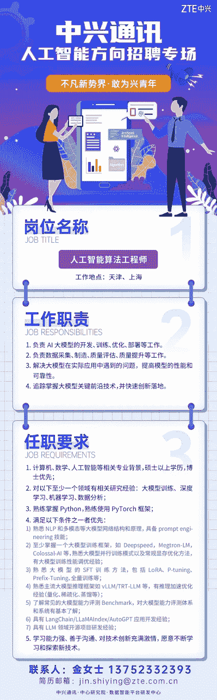

## 微软小冰

### 微软小冰团队招销售总监

欢迎推荐或自荐简历至：365583570@qq.com，

邮件标题格式：【小冰】姓名+职业履历优势+🛰️号

微软小冰公司是一家全球领先的人工智能高新技术企业，其发展受到了微软前全球执行副总裁陆奇和沈向洋的重要影响和支持，后由微软（亚洲）互联网工程院人工智能小冰团队分拆而成。该公司成立于 2020 年，继承了微软在人工智能领域的深厚积累，并且在全球范围内开展业务活动，技术产品覆盖中国、日本及印度尼西亚等多个国家。

### 销售总监（工作地点：广州）

#### 工作职责

负责人工智能新赛道业务，小冰-人工智能&数字人产品的售卖的直销团队

1. 销售管理：搭建直销团队，招聘新人、销售培养、客户陪访、业绩跟进、问题答疑、拓客创新等。

2. 团队赋能：为销售团队提供产品、销售，销售管理及团队文化等培训。

3. 信息同步：准确理解并传达公司的相关政策，定期收集客户反馈并及时同步，加快业务发展。

4. 从数据中发现问题，持续优化策略和计划。

5. 带领销售团队完成业务目标，业绩达成。

#### 任职资格

1. 3 年以上销售软件和管理经验，以及至少 2 年以上直销管理经验，微盟、有赞、飞书等渠道资源与经验优先；

2. 出色的人际沟通能力，极强的目标导向；

3. 超强的执行力、抗压能力和自我管理能力；

4. 有赚钱欲望，明确的结果导向；

5. 具有数字人、短视频、直播业务、SaaS、互联网相关从业经验者优先立即沟通。vfd

## 心跃智能

### 心理 AI 项目招聘 实习前端、运营操盘手兼职/合伙人

**工作地点：广州番禺/线上**

我们是心跃智能，23 年初创 AI 心理科技公司，为心理咨询师提供 AI 提效工具，产品已上线，现在在疯狂迭代中，产品已验证 MVP。目前产品有多端，变现手段多样，线下资源丰富，拥有丰富的咨询师资源和活动举办资源。

### 运营操盘手（可兼职/可合伙）

#### 岗位要求

1. 懂一点心理赛道，知道心理咨询师是干什么的

1. 有过成功操盘过📕、抖音、视频号的任意板块经验，具备可复制性

1. 收集相关赛道热点，推动产品增长

#### 角色要求

你觉得你行，你就大胆投

### 前端实习生（实习）

#### 岗位要求

1. 热爱 AI，用过各种 AIGC 应用，看到新的爆款产品，就会第一时间玩一玩

1. 具备 `Vue 3` 的开发技能，能够参与开发响应式的移动和 Web 应用程序。

1. 熟悉 `Vue.js` 框架，尤其是最新的 `Vue 3` 版本。

1. 对 `uni-app` 有一定了解或有相关开发经验。

1. 对 AI 技术有浓厚兴趣，愿意在项目中实际应用这些知识。

1. 良好的问题解决能力，能够在快节奏的环境中快速学习和适应。

#### 角色要求

1. 你觉得你行，你就大胆投

1. 在校大学生

联系方式：741998660@qq.com

## 字节跳动-剪映 CapCut

### 团队介绍

**剪映** 旨在为用户打造轻而易剪的视频剪辑工具，上线一年 MAU 实现 0 到亿的突破，成为移动剪辑领域的 NO.1。

此外，剪映也发布了电脑端专业版，形成覆盖移动端、Pad 端、电脑端、web 端的多端产品矩阵。

截至目前，剪映模板创作人规模已超过 10w，未来将继续从工具、变现机会为创作者提供服务，打造视频创作者的综合服务平台。

`CapCut` 是一款面向**海外**用户的视频编辑工具，具备全面的剪辑功能，有多样的转场、效果和视频模板，以及丰富的曲库资源。`CapCut` 于 2020 年 4 月冷启，用不到一年的时间在巴西、美国、印尼、日本、韩国等多个国家落地，于同年 12 月在巴西、印尼、德国的谷歌应用商店拿下了最佳娱乐应用奖（Best for Fun）。让创作更简单、更精彩是 `CapCut` 的产品使命，为了更好地服务用户多样化的视频创作需求，`CapCut` 在今年正式推出网页版&PC 端产品。截至今日，`CapCut` 全球月活已破亿，长期位居多国应用商店下载榜单前列。

### 资深 AI 产品体验设计专家-剪映 CapCut

**地点：北京/深圳**

职位描述

1. 负责 AI 产品全链路体验设计，包括完整项目从设计体验策略到 UX/UI 的关键设计方案的产出；

2. 负责整体产品的体验和视觉提升/迭代优化，从用户出发提出解决方案和创新设计并落地；

3. 承担一定团队管理和培养工作，注重方法和策略。

职位要求

1. 熟悉互联网产品设计，关注用户为用户而设计；

2. 全链路式的产品设计能力 （UX/UI 可有侧重） ；

3. 了解 AI 大模型，注重创新/创意，较高的用户体验意识，前瞻的审美判断力；

4. 熟悉工具/社交类产品，有互联网产品品牌设计经验和团队管理经验者优先；

5. 有强烈的 Owner 意识，积极主动、团队合作，沟通协调能力强，并具有高度责任感。

投递地址：[字节跳动-内部推荐](https://people.bytedance.net/hire/referral/position?job_post_id=7358018677357054235)

### AI 视频工具产品经理-剪映 CapCut

**地点：北京/深圳**

职位描述

1. 研究海外优质视频创作者的创作流程并发掘剪辑痛点，制定出完整的产品解决方案并且通过智能化手段大幅减低操作成本；

2. 探索在 AI 大模型的帮助下内容生产门槛将大幅降低的可能方向，并将其落地为产品能力，让更多有想法的人加速成长为优质创作者；

3. 对用户体验和工具使用规模负责，与 AI 算法运营、算法工程师、NLP、视觉、图像特效、设计、增长、市场等不同团队协作，推进功能上线与迭代。

职位要求

1. 3 年及以上工作经验，有影像类工具产品经验，对海外主流社媒平台的视频生态熟悉，视频创作者优先；

2. 用户 sense 强，热爱研究前沿技术，对 AIGC 等方向有经验和持续的行业发展研究；

3. 逻辑清晰，数据敏感，结果导向；沟通表达流畅，英语可作为工作语言。

投递地址：[字节跳动-内部推荐](https://people.bytedance.net/hire/referral/position?job_post_id=7254395252042434873)

加入我们，一起激发创作灵感，打造无限可能！

## 字节跳动-剪映 CapCut/抖音搜索

### 大模型算法工程师-AI Coding

base：北京/上海/深圳/（杭州视情况考虑）

#### 职位描述

1. 负责研发提效场景所需要的大模型能力的研发和应用，研究高质量数据的挖掘和合成、大模型的对齐效率、`Agent` 的设计&端到端训练等等，不断思考和跟进 AI 的最新进展对我们的价值，探索下一代的研发模式；

2. 高质量数据挖掘清洗使用，数据自动、半自动合成方案研究探索，设计针对代码场景的原子任务、全链路任务的评测方法；

3. 研究 `LLM`/`VLM` 训练与优化技术，包括微调、强化学习（`RLHF`）、知识蒸馏等，提高大模型在代码场景下的能力；

4. 尝试落地到各种应用场景，比如：`IDE` 代码补全、代码能力 QA、场景化 `Agent`、代码自动修复、漏洞检测等等；

5. 持续跟踪 `LLM`/`VLM` 领域的最新技术动态，并将其应用于实际业务场景中，推动技术落地。

#### 职位要求

1. 优秀的代码能力、数据结构和基础算法功底，熟练掌握至少一门语言，ACM/ICPC、NOI/IOI、Top Coder、Kaggle 等比赛获奖者优先；

2. 熟悉 `NLP`、`CV`、`ML` 等相关的技术，深入理解大模型或图片视频生成等相关技术栈（如 `RLHF`、`SFT`、`Dit`/`Vit`/`Transformer`、`Stable Diffusion` 等）；

3. 在大模型领域，主导过有影响力的项目或论文者优先；在 ACL/EMNLP/ECCV/CVPR 等顶会发表论文者优先；

4. 有代码基座经验，有强化学习结合大模型落地经验，有 `Multi-Agent`、`Tool-Use` 等有相关经验优先；

5. 出色的问题分析和解决能力，有自主探索解决方案的能力；

6. 良好的沟通协作能力，能和团队一起探索新技术，推动技术进步。

# AI 招聘求职群

找 AI 相关工作，招募 AI 相关人才，欢迎进群交流！

**AI 人才招聘求职，欢迎进群**

🛰️好友（ID：zhangyuguo94s）

**扫码加🛰️入🛰️群**
