# 大厂 AI 产品内参（国内版）

> 来源：[https://yunyinghui.feishu.cn/docx/Zw6LdXOiroa8GNxXhwScVS62npy](https://yunyinghui.feishu.cn/docx/Zw6LdXOiroa8GNxXhwScVS62npy)

> **适用人群：****关注国内大厂 AI 产品人群**

> 首发时间：2024 年 3 月 6 日

> 更新时间：2024 年 3 月 11 日

> **内容出品人：**** **

> **使用建议：**如果需要快速定位到精确内容，可以使用快捷键 Ctrl +F/Command +F 的形式，搜索关键字/词，查找你想要的内容。

> **持续更新****国内各个大厂的 AI 产品****相关的动态和调研，让用户了解大厂产品，为产品****经理及创业者提供思路，永久免费****在线查看，欢迎收藏转**发支持，文末有惊喜，大国出品，必属精品。

> 🎯全**网最接地气AI知识库： **[Mix AI Lab](https://yunyinghui.feishu.cn/wiki/WhelwZnxQi55mpkOzatc3Xran5b?from=from_copylink)AI绘画、AI写作、AI视频等应用技能）

# 更新内容

| # 导 航 目 录 |  |  |  |  |
| --- | --- | --- | --- | --- |
| [**阿里**](https://yunyinghui.feishu.cn/wiki/Rftswm8OVitgYSkJyMFcchPInGd#part-HZh1d5aGpo3w4wxiG0Bc820SnNe) | [**百度**](https://yunyinghui.feishu.cn/wiki/Rftswm8OVitgYSkJyMFcchPInGd#part-XFHMdgxQEoa8WTxHlsYcrCivnKb) | [**字节**](https://yunyinghui.feishu.cn/wiki/Rftswm8OVitgYSkJyMFcchPInGd#part-AlBadvTeao5fsDxrcZxc2O8qnBx) | [**腾讯**](https://yunyinghui.feishu.cn/wiki/Rftswm8OVitgYSkJyMFcchPInGd#part-XvgSdbllyore9ZxfocWcZ6rtnQd) | [**华为**](https://yunyinghui.feishu.cn/wiki/Rftswm8OVitgYSkJyMFcchPInGd#part-ODWdd2yApoB3drxuoKZcD3KSngK) |
| [**📕**](https://yunyinghui.feishu.cn/wiki/Rftswm8OVitgYSkJyMFcchPInGd#part-IQRod7uOgo08VEx35mHcLnZsnuh) | [**美图秀秀**](https://yunyinghui.feishu.cn/wiki/Rftswm8OVitgYSkJyMFcchPInGd#part-JiSndx1lXoHsCNxt0PucutRrnNf) | [**科大讯飞**](https://yunyinghui.feishu.cn/wiki/Rftswm8OVitgYSkJyMFcchPInGd#part-A90CdBYMKoua7cxu6qhcIFBMndc) | [**网易**](https://yunyinghui.feishu.cn/wiki/Rftswm8OVitgYSkJyMFcchPInGd#part-S45Udic7zoqwWmxthMMckgfznUh) | [**360**](https://yunyinghui.feishu.cn/wiki/Rftswm8OVitgYSkJyMFcchPInGd#part-YWgzddvDYoqGjsxZKMccxYO9nSc) |
| [**金山**](https://yunyinghui.feishu.cn/wiki/Rftswm8OVitgYSkJyMFcchPInGd#part-QCiSdFb3VoGpUOxOJkwcRIklnpf) | [**美团**](https://yunyinghui.feishu.cn/wiki/Rftswm8OVitgYSkJyMFcchPInGd#part-TVTJdqhv9ohHtLxmQ8ncBZTDnng) | [**快手**](https://yunyinghui.feishu.cn/wiki/Rftswm8OVitgYSkJyMFcchPInGd#part-PftQdge0coDdD0x6thtcDgFmnEh) |  |  |

# 一、阿里

## 2024 年 3 月

### 1）绘蛙

**上线时间：**绘蛙已对部分淘宝商家开放邀请测试

**产品介绍：**绘蛙是阿里巴巴开发的 AI 电商产品，旨在帮助淘宝、天猫商家提升营销文案生成效率和 AI 模特训练质量。

**主要作用：**优化电商营销，提高用户体验，加快产品推广。

**面向人群：**淘宝、天猫商家和电商运营人员。

**体验地址：**https://www.ihuiwa.com/

### 2) EMO

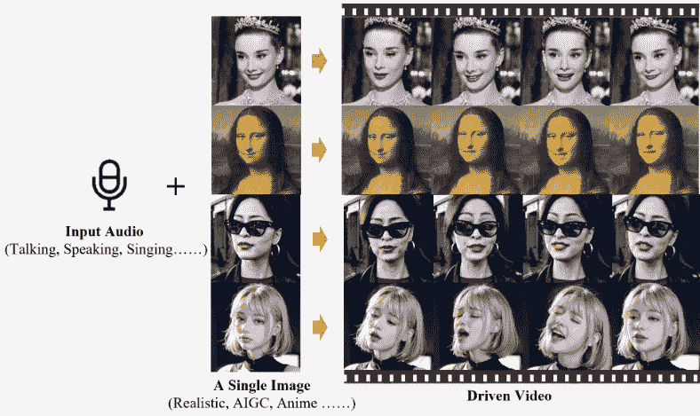

**上线时间：**2024 年 3 月

**产品介绍：**能够通过单一参考图像和音频输入，例如说话和唱歌，生成具有丰富表情和各种头部姿势的 AI 视频。视频最终长度，取决于输入音频的长度。

**主要作用：**图像与音频生成视频。

**面向人群：**内容生产者

**体验地址：**

论文地址：https://arxiv.org/pdf/2402.17485.pdf

项目主页：https://humanaigc.github.io/emote-portrait-alive/

GitHub 地址：https://github.com/HumanAIGC/EMO

## 2024 年 1 月

### 1) **DreamTalk**

**上线时间：2024 年 1 月**

**产品介绍：**DreamTalk 是一个由清华大学、阿里巴巴和华中科大共同开发的基于扩散模型的框架，可以让人物头像说话、唱歌并保持嘴唇的同步和模仿表情变化。

**主要作用：**人物头像生成视频

**面向人群：**内容生产者

**体验地址：**

项目主页：https://dreamtalk-project.github.io/

论文地址：https://arxiv.org/pdf/2312.09767.pdf

Github 地址：https://github.com/ali-vilab/dreamtalk

### 2) **Motionshop**

**上线时间：**2024 年 1 月

**产品介绍：**阿里通义实验室发布了用 3D 模型替换视频角色的框架 Motionshop。用户上传一段视频，AI 自动识别视频中的运动主体人物，并一键替换成 3D 角色模型，同时不改变视频中的其他场景和人物。

**主要作用：**使用 3D 模型替换视频角色

**面向人群：**内容生产者

**体验地址：**

项目主页：https://aigc3d.github.io/motionshop/

魔塔社区：https://www.modelscope.cn/studios/Damo_XR_Lab/motionshop/summary

## 2023 年 12 月

### 1) **DreaMoving**

**上线时间：**2023 年 12 月

**产品介绍：**阿里推出的 DreaMoving，是基于扩散模型（Diffusion Model），专注于高质量的定制化人类视频生成，能够生成栩栩如生的动作和场景，让目标身份在视频中自由移动或跳舞。

**主要作用：**图片生成跳舞视频

**面向人群：**内容生产者

**体验地址：**

项目地址：https://dreamoving.github.io/dreamoving/

Github 地址：https://github.com/dreamoving/dreamoving-project

论文地址：https://arxiv.org/pdf/2312.05107.pdf

## 2023 年 11 月

### **1) I2VGen-XL**

**上线时间：**2023 年 11 月 12 日

**产品介绍：**阿里达摩院发布了 I2VGen-XL 视频生成模型。用户只需上传一张图片，不到 2 分钟即可生成一段分辨率为 1280*720 的高清视频。

**主要作用：**照片生成视频

**面向人群：**内容创作者

**体验地址：**

项目地址：https://i2vgen-xl.github.io

**论文地址：**https://arxiv.org/abs/2311.04145

Github 地址：https://github.com/damo-vilab/i2vgen-xl

### 2) **AnimateAnyone**

**上线时间：**2023 年 11 月 29 日

**产品介绍：**阿里开源图像到视频角色动画合成的框架 Animate Anyone，去年年底大火的“全民舞王”就是基于此。

**主要作用：**图像生成视频

**面向人群：**内容生产者

**体验地址：**

论文链接：https://arxiv.org/pdf/2311.17117.pdf

项目地址：https://humanaigc.github.io/animate-anyone/

Demo:https://huggingface.co/spaces/xunsong/Moore-AnimateAnyone

## 2023 年 6 月

### 妙鸭相机

**上线时间：** 6 月 30 日开始邀请制内测，7 月 17 日正式上线

**产品介绍：**用户只要上传 21 张包含人脸的照片，就能生成一个专属的数字分身，并有各种风格的写真模板可供选择。很多网友称，妙鸭相机“秒杀”了海马体、天真蓝等实体写真品牌。

**主要作用：**AI 写真

**面向人群：**大众用户

**体验地址：**🛰️小程序搜索妙鸭相机

## 2023 年 4 月

### 1）通义千问

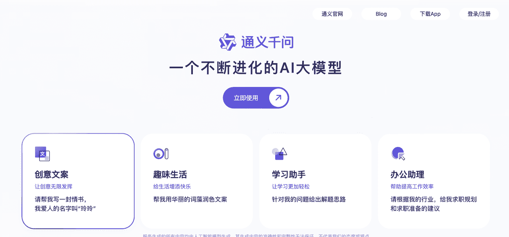

**上线时间：**2023 年 4 月

**产品介绍：**通义千问是一个能够理解和生成人类语言的 AI 大模型，作为阿里云通义官网的核心产品，提供智能助手功能。

**主要作用：**帮助用户解决生活和工作中的问题，提供智能问答服务。

**面向人群：**广泛用户群体，特别是需要快速获取信息和解决方案的用户。

**体验地址：**https://tongyi.aliyun.com/qianwen/

# 二、百度

## 2023 年 8 月

### 1）超会写

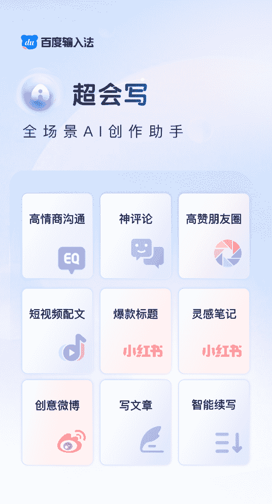

**上线时间：**2023 年 8 月 31 日

**产品介绍：**百度输入法推出基于文心大模型的创作助手“超会写”，可以为用户提供场景化的高质量文本创作服务。用户只需在“超会写”界面输入需求，AI 助手就会提供几个符合条件的文本供选择。例如高情商沟通、神评论、改写文案、短视频配文、📕爆款标题、创意🧣等。

**主要作用：**AI 写作工具

**面向人群：**内容创作者

**体验地址：**百度输入法内置功能

### 2）云一朵

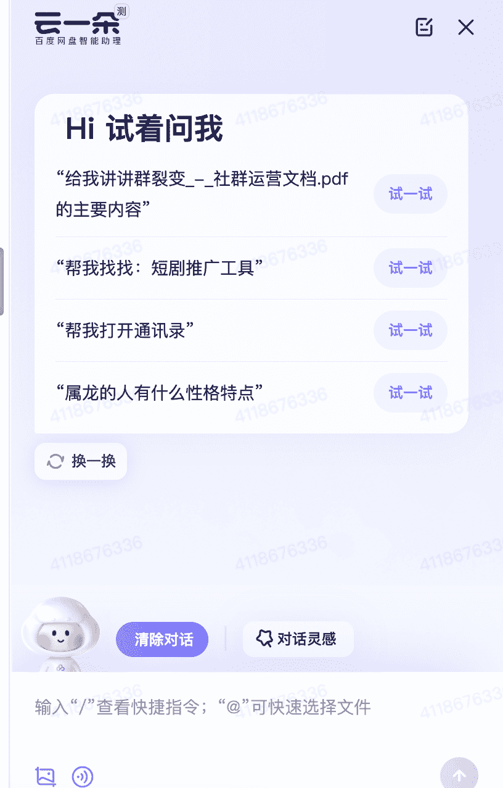

**上线时间：**2023 年 8 月 10 日

**产品介绍：**百度网盘推出的基于文心大模型的网盘智能助理。

**主要作用：**AI 内容整理工具

**面向人群：**百度网盘用户

**体验地址：**百度网盘内置功能

## 2023 年 3 月

### 1）文心一言

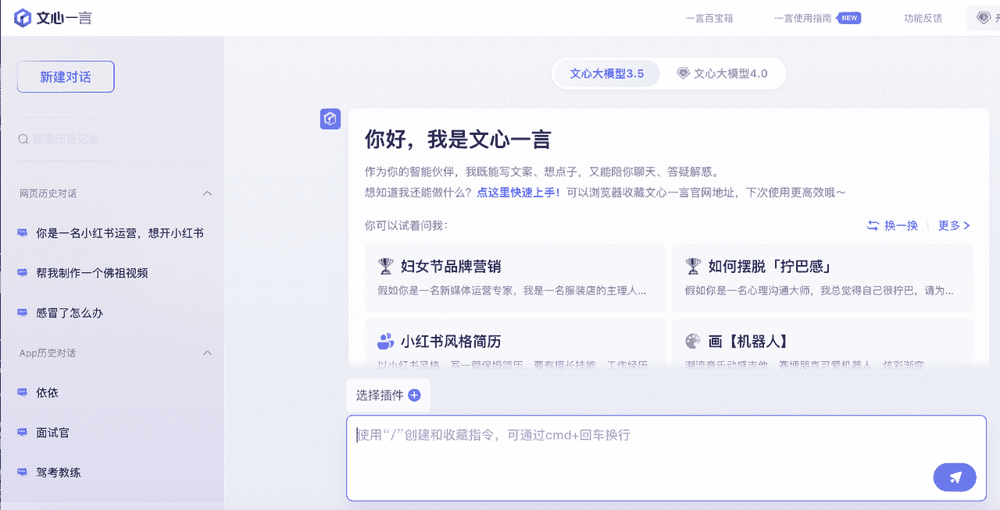

**上线时间：**2023 年 3 月

**产品介绍：**百度全新一代知识增强大语言模型，文心大模型家族的新成员，能够与人对话互动、回答问题、协助创作，高效便捷地帮助人们获取信息、知识和灵感。

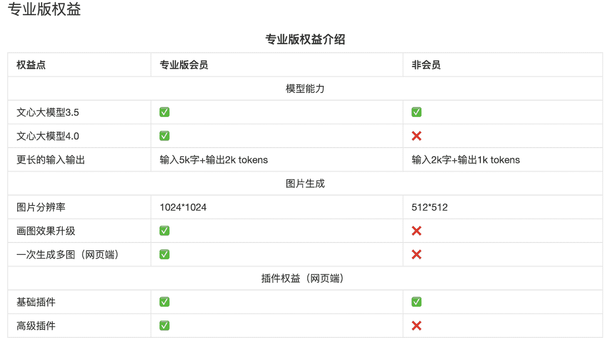

**主要作用：**通用 AI 对话大模型

**面向人群：**大众用户

**体验地址：**https://yiyan.baidu.com/

### 2）文心一格

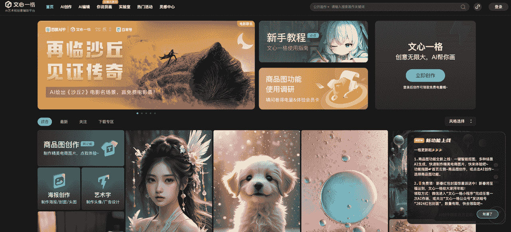

**产品介绍：**文心一格是百度推出的 AI 艺术创作平台，能根据文字描述生成艺术画作。

**主要作用：**简化艺术创作过程，提供个性化画作生成。

**面向人群**：艺术家、设计师、创意工作者及艺术爱好者。

**体验地址：**https://yige.baidu.com/

## 2023 年 2 月

### 1）度咔剪辑

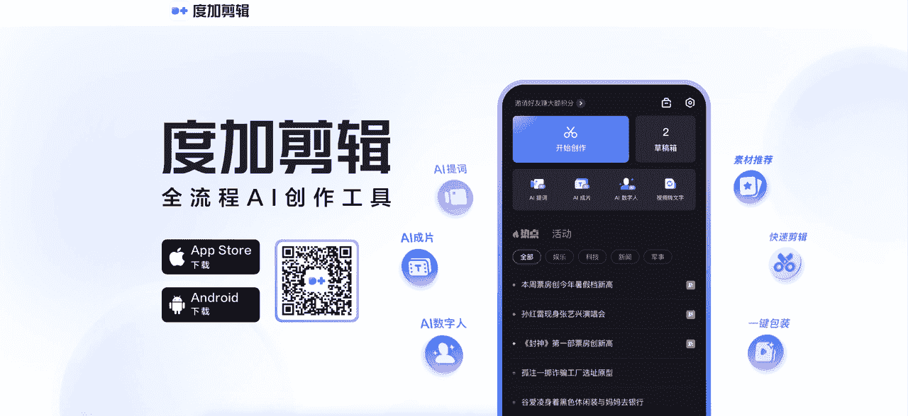

**产品介绍：**度加剪辑，百度出品，专为知识创作者打造的视频编辑工具。

**主要作用：**简化视频剪辑流程，提升内容创作效率。

**面向人群：**适合自媒体创作者。

**体验地址：**https://ducut.baidu.com/

### 2）AI 歌词生成

产品介绍：百度文心·歌词生成器，AI 工具，10 秒生成个性化歌词。

主要作用：快速创作，适应多样主题和情感。

面向人群：音乐创作者、词曲作者及歌词爱好者

体验地址：https://wenxin.baidu.com/wenxin/pc/lyrics

### 3）小侃星球

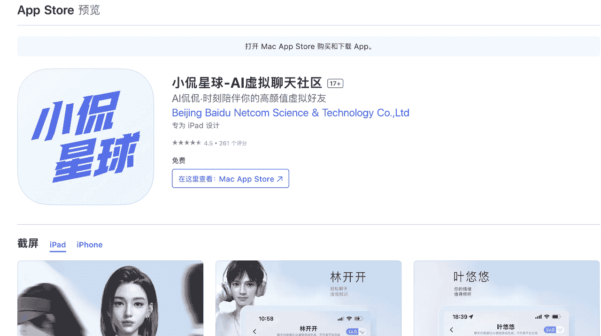

**产品介绍：**百度出品的 AI 虚拟聊天社区。

**主要作用：**AI 虚拟社交。

**面向人群：**C 端用户

**体验地址：**IOS 及安卓商城

## 2021 年 9 月

### Al 造字

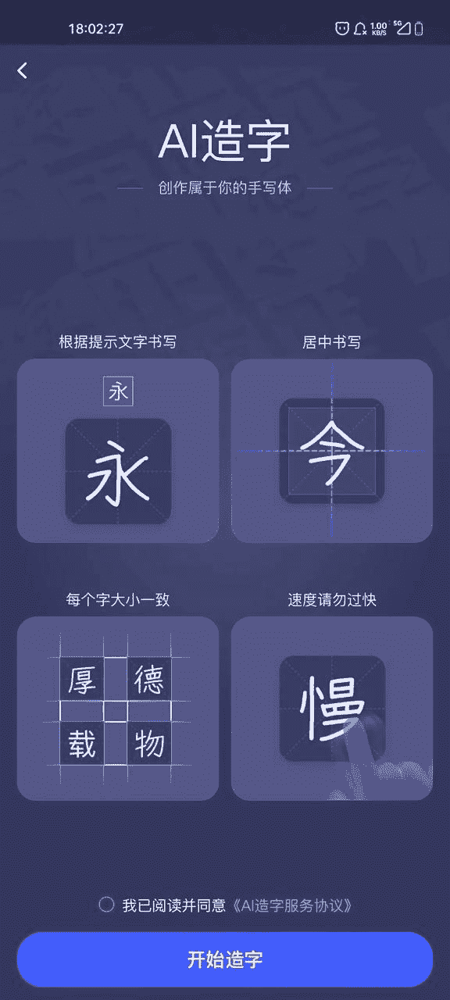

**产品介绍：**百度输入法 AI 造字，用户手写转化为个性化字体。

**主要作用：**个性化输入，增添文字输入趣味。

**面向人群：**追求个性化手写风格的用户。

**体验地址：**需要下载百度输入法 APP，并将其设为默认键盘

# 三、字节

## 2024 年 2 月

### 1) **Dreamina**

**上线时间：**2024 年 2 月

**产品介绍：****Drea**mina 是剪映旗下**的一个 **AI 创作平台，目前支持「图片生成」功能，也即将上线「视频生成」功能。在图片生成功能方面，Dreamina 平台提供了立即生成的功能。只需用简单的文案，用户就能够在短时间内生成精彩的图片。这种便捷的创作方式，让更多人能够参与到美图的创作中来，无需复杂的操作和专业的技能，即可享受创作的乐趣。

**主要作用：**AI 内容创作平台

**面向人群：**C 端内容创作者

**体验地址：**https://www.capcut.cn/ai-tool/platform

### 2）扣子

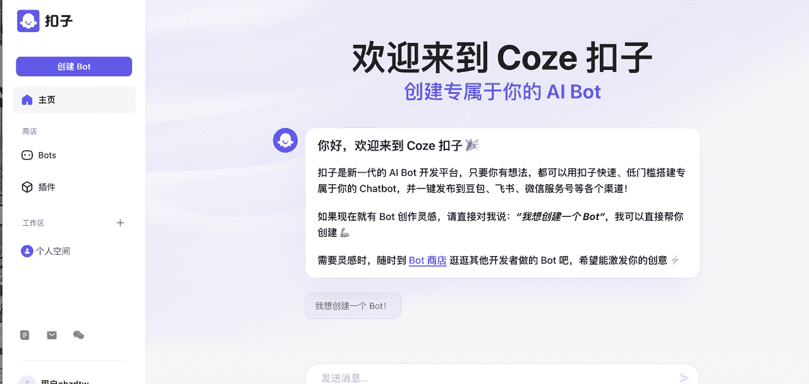

**上线时间：**2024 年 2 月

**产品介绍：**扣子是字节跳动直接叫板 GPTs 推出的 AI Bot 创建平台，开放使用和创建权限，而扣子则主要面向国内用户。

**主要作用：**可以创建自己的 Chatbot，官方还提供了 Bots 商店和插件。

**面向人群：**国内用户为主。

**体验地址：**https://www.coze.cn/

### 3) Coze

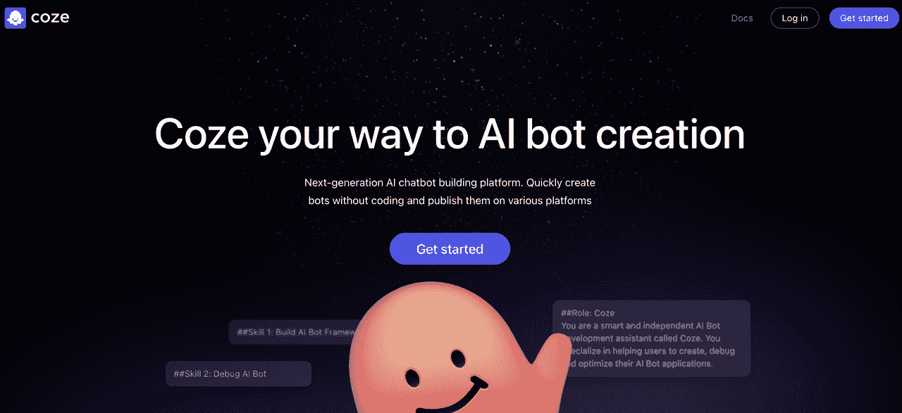

**上线时间：**2024 年 2 月

**产品介绍：**Coze 是字节跳动直接叫板 GPTs 推出的 AI Bot 创建平台，开放使用和创建权限，Coze 面向海外用户，而扣子则主要面向国内用户。

**主要作用：**可以创建自己的 Chatbot，官方还提供了 Bots 商店和插件。

**面向人群：**国外用户为主。

**体验地址：**https://www.coze.com/

## 2023 年 12 月

### 1) **BagelBell**

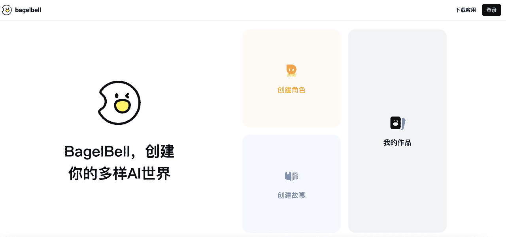

**上线时间：**2023 年 12 月

**产品介绍：****是一个 AI 剧情互动平台****，**BagelBel 为用户提供了一个充满活力和创造力的虚拟世界，让用户可以在这个世界中探索故事、创作角色，并与 AI 角色进行互动。这种独特的体验不仅可以让用户享受到故事带来的乐趣，还可以激发用户的创造力和想象力。

**主要作用：**剧情内容生成

**面向人群：**C 端内容创作者

**体验地址：** https://www.anybagel.com/

另外 App Store 和 Google Play 均可下载客户端。

## 2023 年 9 月

### 1) **ChitChop**

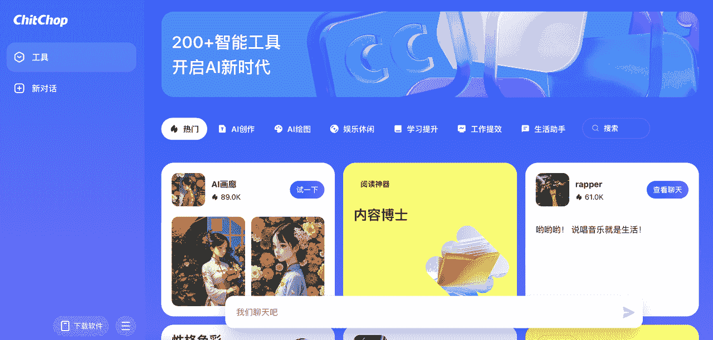

**上线时间：**2023 年 9 月

**产品介绍：**ChitChop 是字节跳动 面向海外市场推出的 AI 工具平台，在海外 Google Play 和 App Store，均可下载 ChitChop，网页版也已经上线。根据应用商店上显示，ChitChop 由 POLIGON 开发和运营。ChitChop 宣称可以为用户提供多达 200 多个智能机器人服务，因为 6 大场景中每个场景包含 10 多个人工智能工具。

**主要作用：**一个私人 AI 助理，包括 AI 创作、AI 绘画、娱乐、AI 学习、工作、生活等 6 大使用场景。

**适用人群：**海外 C 端用户

**体验地址：**https://www.chitchop.com/tool

### **2）小悟空**

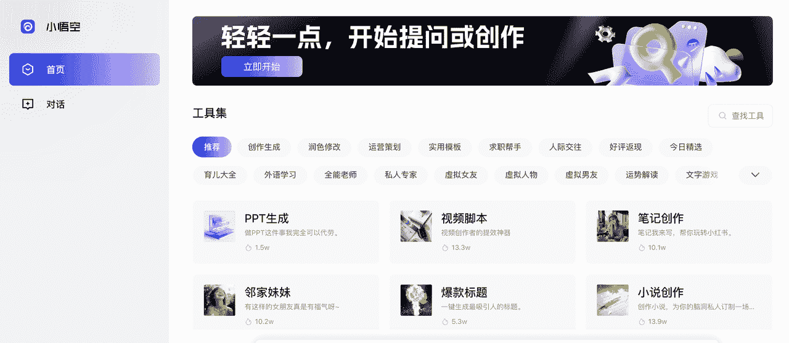

**上线时间：**2023 年 9 月

**产品介绍：**小悟空提供 iOS、安卓和网页多个版本，主要面向中国市场。根据点点数据，小悟空（iOS）在过去一年累计获得了 74 万次下载，下载主要集中在 2023 年 10 月和 11 月。

**主要作用：**核心功能与字节跳动先前推出的“豆包 A 聊天机器人”类似。但与豆包相比，小悟空提供了更多即开即用的预设工具，支持智能对话和多种内容创作功能。

**面向人群：**国内 C 端用户。

**体验地址：**https://wukong.com/chat

## 2023 年 8 月

### **1）豆包**

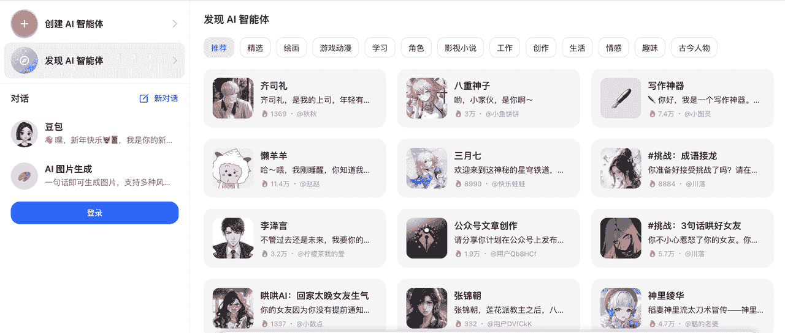

**上线时间：**2023 年 8 月

**产品介绍：**豆包由字节跳动推出的首个 **AI 对话大模型**，具有强大的语音识别和自然语言处理能力，能够理解用户的意图和需求，提供个性化的服务和建议。它支持多种语言交互，并且可以同时处理多个任务。是一款非常实用的个人智能助手软件，对日常生活和工作都有很大的帮助。

**主要作用：**AI 对话工具

**面向人群：**国内 C 端用户为主

**体验地址：**https://www.doubao.com/

豆包 App 可在官网进行下载，也可以在手机应用市场进行下载。

豆包 App 无需注册，支持抖音平台直接授权登陆。目前全部功能都是可以免费使用的，无限制。

### 2) CICI

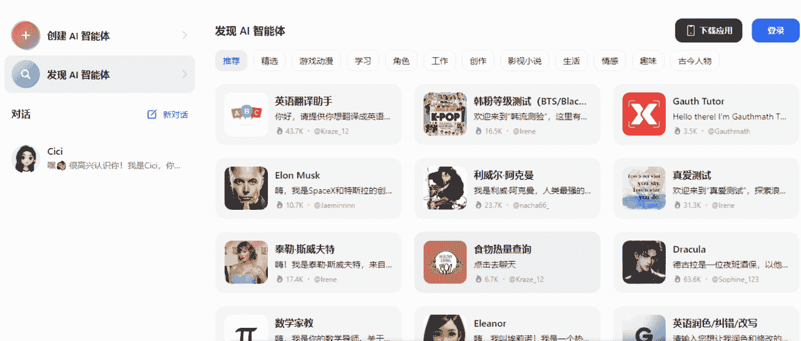

**上线时间：**2023 年 8 月

**产品介绍：**字节跳动已经在海外市场推出了 AI 聊天 APP Cici。这款产品在海外多个国家和地区上线，覆盖了除美国和欧洲等成熟市场外的几乎所有区域市场，包括日韩、中东、东南亚、非洲和南美等地的必去出海市场。

**主要作用：**AI 对话工具

**面向人群：**国外 C 端用户为主

**体验地址：**https://www.ciciai.com/chat/

---

# 四、腾讯

## 2023 年 9 月

### 混元大模型

**上线时间：**2023 年 9 月

**产品介绍：**混元大模型为腾讯自研的通用大语言模型，超千亿的参数规模、超 2 万亿 tokens 的预训练语料。

**主要作用：**AI 对话工具

**面向人群：**国内 C 端用户为主

**体验地址：**https://hunyuan.tencent.com/

🛰️小助手：腾讯混元助手

## 2023 年 3 月

### ARC 实验室

**上线时间：**2023 年 3 月

**产品介绍：**腾讯 ARC 官网是一个免费的 AI 实验项目，提供人像修复、人像抠图和动漫增强三项功能。使用这些工具可以帮助您处理糊了的照片、抠出人像、增强动漫照片的线条感等。

**主要作用：**免费的图片修复功能，包含老照片修复功能

**面向人群：**图片工具用户

**体验地址：****h**ttps://arc.tencent.com/zh/ai-demos/faceRestoration?from=ipkd.cn

## 2022 年 4 月

### Effidit

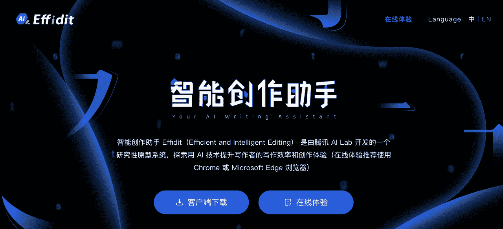

**上线时间：**2022 年 4 月

**产品介绍：**由腾讯 AI Lab 开发的一个研究性原型系统，探索用 AI 技术提升写作者的写作效率和创作体验。腾讯 AI Lab 研发的智能创作助手支持通用版和学术版两个版本，智能创作助手提供智能纠错、文本补全、文本改写、文本扩写、词语推荐、句子推荐与生成等功能，帮助您轻松完成中英文写作，提高写作效率。

**主要作用：**AI 写作工具

**面向人群：**内容创作者

**体验地址：**https://effidit.qq.com/

# 五、华为

## 2023 年 7 月

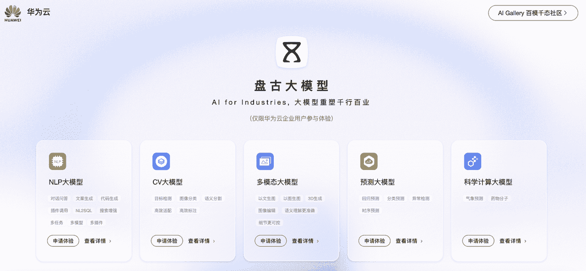

**上线时间：**2023 年 3 月

**产品介绍：**盘古系列 AI 大模型，包括 NLP 大模型、CV 大模型、科学计算大模型。

**主要作用：**提供 B 端企业 AI 应用做支持。

**面向人群： **B 端用户

**体验地址：**https://pangu.huaweicloud.com/

# 六、📕

## 2023 年 9 月

### 达芬奇

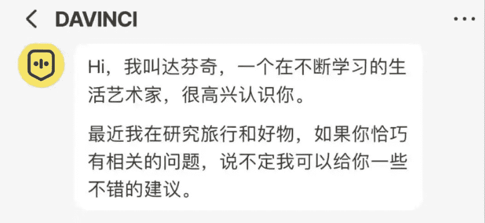

**上线时间：**内测时间 2023 年 9 月

**产品介绍：**为用户提供智能问答和个性化服务。它基于 Meta 旗下的 LLAMA 大模型进行训练，涵盖了旅游攻略、美食攻略、地理和文化常识、生活技巧、个人成长和心理建议，以及活动推荐等多个方面。通过与"达芬奇"的互动，用户可以获得准确、有用的信息和建议，节省时间和精力，提升生活质量和幸福感。

**主要作用：**为📕内部用户提供智能问答服务

**面向人群：**📕用户

**体验地址**：

## 2023 年 8 月

### TrikAI

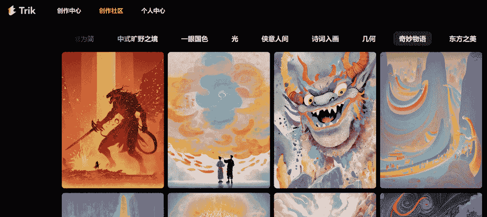

**上线时间：**2023 年 8 月

**产品介绍：**📕内测的 Midjourney 中文版，专著于“国风”小模型，体验下来是为数不多的适合普通用户使用的免费 AI 图片创作工具。

**主要作用：**AI 绘画工具

**面向人群：**AI 绘画爱好者

**体验地址：**https://www.trikai.com/

# 七、美图秀秀

## 2023 年 6 月

### 1) WHEE

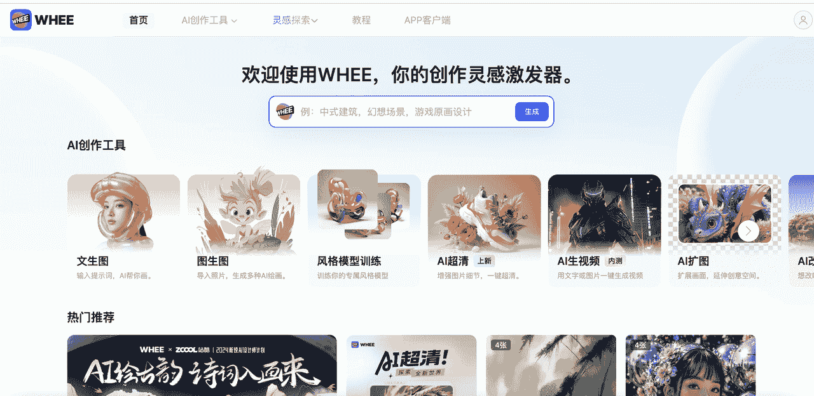

**上线时间：**2023 年 6 月 19 日

**产品介绍：**视觉创作的灵感激发器，可以帮助寻找创作灵感。

**主要作用：**AI 视觉创作

**面向人群：**AI 内容创作者

**体验地址：**https://www.whee.com/

### 2）开拍

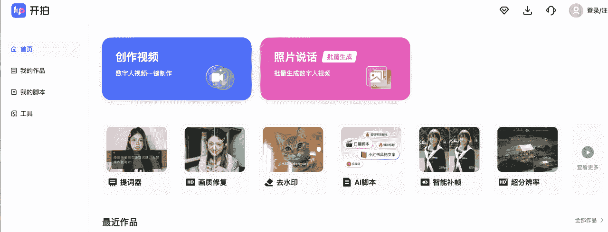

**上线时间：**2023 年 6 月 19 日

**产品介绍：**开拍是一款针对视频创作者的工具，能实现文案创作、提词器等操作，还能直接录制 AI 美颜的高清视频、辅助剪辑，大大的降低了视频创作的门槛和流程，一个人也能轻松做视频了。

**主要作用：**视频创作

**面向人群：**AI 内容创作者

**体验地址：****h**ttps://www.kaipai.com/home，App 应用商店搜索开拍

### 3) Winkstudio

**上线时间：**2023 年 6 月 19 日

产品介绍：这是一款桌面端 AI 视频编辑工具。

**主要作用：**视频创作

**面向人群：**AI 内容创作者

**体验地址：**https://wink.meitu.com/

### 4）美图设计室

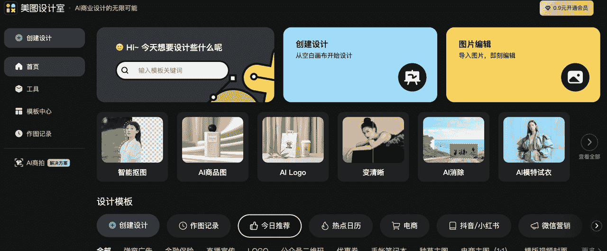

**上线时间：**2023 年 6 月 19 日

产品介绍：这是一款 AI 商业设计工具

**主要作用：图片设计创作**

**面向人群：**AI 内容创作者

**体验地址：**https://www.x-design.com/

### **5) Dream Avatar**

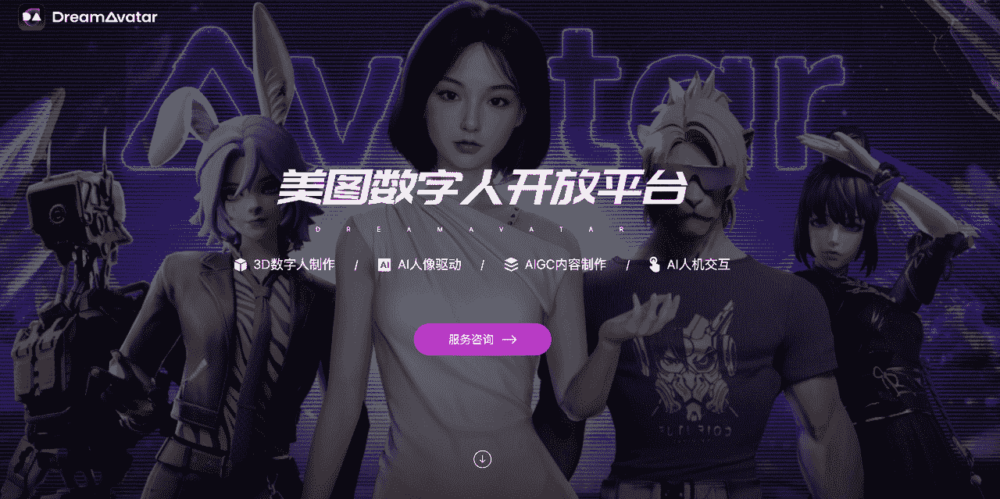

**上线时间：**2023 年 6 月 19 日

**产品介绍：**这是一款 AI 数字人工具

**主要作用：**AI 视频工具

**面向人群：**AI 内容创作者

**体验地址：**https://www.dreamavatar.com/

### 6）奇想智能

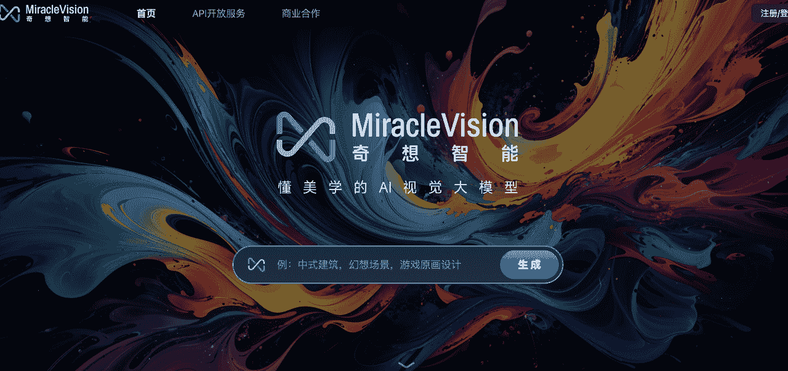

**上线时间：**2023 年 6 月 19 日

**产品介绍：**这是一款美学视觉大模型，提供各种视觉效果和美化功能。

**主要作用：**基础大模型

**面向人群：**AI 内容生产者或者企业

**体验地址：**https://www.dreamavatar.com/

### 7）美图 AI 助手 RoboNeo

**上线时间：**2023 年 6 月 19 日

**产品介绍：**RoboNeo 是美图家族的新成员，其头部设计采用 360 度环绕屏幕的设定，屏幕形状结合了美图“MT”logo 元素，造型是 AI 机器人与牛的结合体，包含了“AI 大牛”的寓意。

**主要作用：**AI 对话工具

**面向人群：**AI 内容生产者

**体验地址：**暂无

# 八、科大讯飞

## 2024 年 1 月

### 1）**星火语音大模型 **

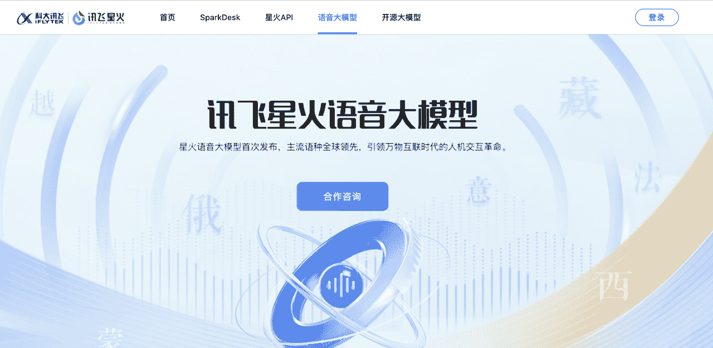

**产品介绍：**星火语音大模型，科大讯飞推出的 AI 语音技术，首批 37 个主流语种效果超越 OpenAI Whisper V3，提供超拟人语音合成，支持多语种自动识别和增强式翻译。

**主要作用：**提升跨语言沟通效率，优化智能硬件产品如翻译机的交互体验，推动人机交互变革。

**面向人群：**适用于需要高效、精准语音识别与合成的行业，如客服、汽车、机器人等。

**体验地址：**https://xinghuo.xfyun.cn/speechllm/?ref=aihub.cn

## 2023 年 12 月

### 星火内容运营大师

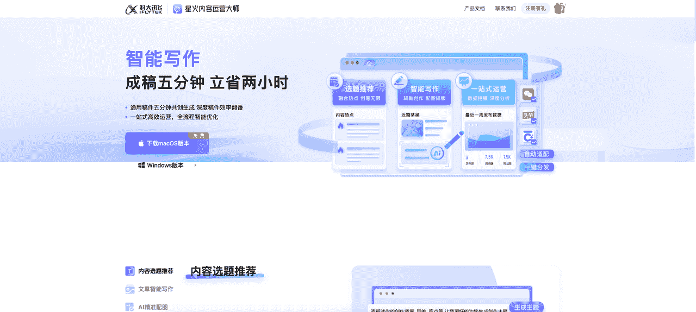

**上线时间：**2023 年 12 月 7 日

**产品介绍：**科大星火内容运营大师，一站式 AIGC 内容运营平台，提供内容选题推荐、文章智能写作、AI 精准配图等全流程智能优化服务。

**主要作用：**帮助用户快速生成个性化文章，提高内容创作效率，实现多平台一键分发，优化账号运营。

**面向人群：**自媒体创作者、媒体记者、文案策划人员、创作爱好者等，尤其适合需要高效内容创作和运营的用户。

**体验地址：**https://turbodesk.xfyun.cn/home?channelid=gj81

## 2023 年 11 月

### 讯飞智文

**上线时间：**2023 年 11 月

**产品介绍：**科大讯飞智文，一款基于 AI 的文档创作平台，利用星火认知大模型处理多种内容格式，支持一键生成 PPT。

**主要作用：**快速将文本内容转化为 PPT 文档，提供 AI 改写、内容提炼、主题创建等功能，支持多语言输入，简化 PPT 制作过程。

**面向人群：**适合需要高效制作 PPT 的用户，如教育工作者、企业员工、内容创作者等。

**体验地址：**https://zhiwen.xfyun.cn/

## 2023 年 8 月

### 1）星火大模型

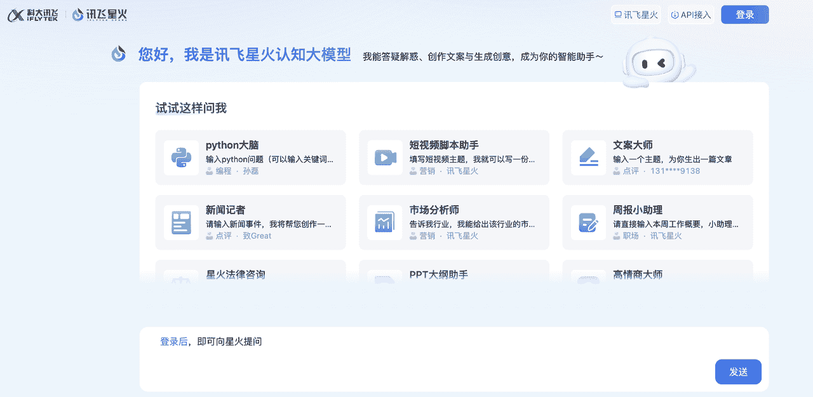

产品介绍：讯飞星火认知大模型，科大讯飞的 AI 语言模型，具备数学、中文理解、代码编写等能力。

主要作用：提供跨领域知识理解，支持多模交互、视觉问答、多模生成等，适用于多种场景。

面向人群：适用于普通大众

体验地址：https://xinghuo.xfyun.cn/

### 2）**星火开源 -13B**

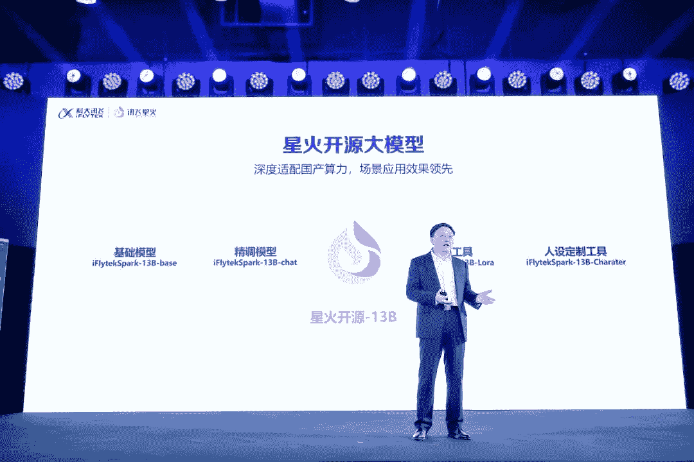

**产品介绍：**星火开源 -13B（iFlytekSpark-13B），科大讯飞发布的全栈国产化开源大模型，拥有 130 亿参数，具备通用任务处理能力和生产力功能，如聊天、问答、文本提取、分类、数据分析和代码生成等。

**主要作用：**提供强大的 AI 能力，支持企业和学术研究训练专用大模型，优化学习辅助、数学、推理等领域的应用。

**面向人群：**适合需要进行 AI 模型训练和应用开发的企业和研究机构。

**体验地址：**https://gitee.com/iflytekopensource/iFlytekSpark-13B

### 3）讯飞写作

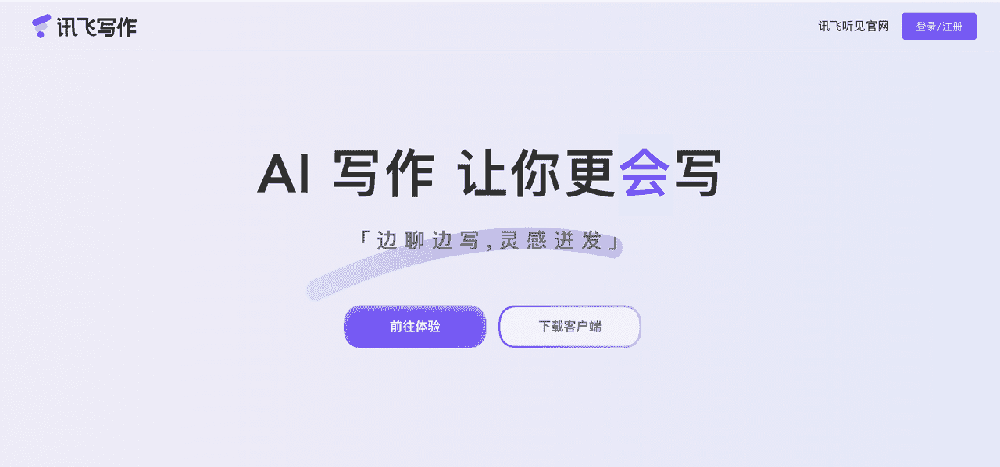

**上线时间：**2023 年 8 月

**产品介绍：**实现 AI 对话写作，AI 模板写作，AI 润色等功能

**主要作用：**AI 写作工具

**面向人群：**内容创作者

**体验地址：**https://huixie.iflyrec.com/welcome

## 2021 年 5 月

### AI 录音笔

**上线时间：**2021 年 5 月 27 日

**产品介绍：**科大讯飞智能录音笔，一款集实时录音、AI 转写、翻译于一体的便携设备，适用于科研、商务等专业场景。

**主要作用：**提供高质量的录音体验，支持多种录音模式，实现远程控制和定时录音，通过 WiFi 快速传输文件，具备高准确率的多语种实时转写和翻译功能。

**面向人群：**科研工作者、新媒体人、商务办公人士等需要高效记录和处理语音信息的用户。

**体验地址：**https://www.iflyjz.com/

## 2019 年 5 月

### 科大讯飞 AI 学习机

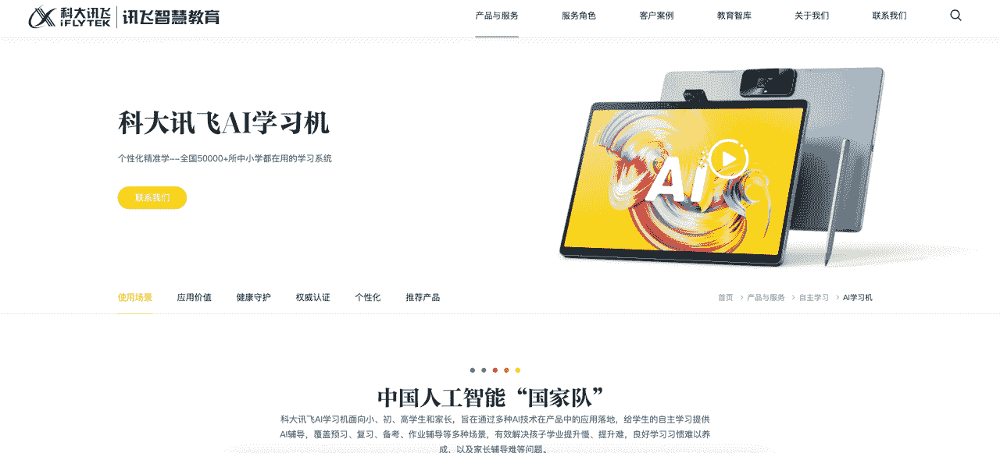

**上线时间：**2023 年 5 月 21 日

**产品介绍：**科大讯飞 AI 学习机，专为 3-18 岁学生设计，集成多种 AI 技术，提供个性化学习辅导，覆盖预习、复习、作业辅导等场景。

**主要作用：**通过 AI 同步精准学习、听说读写训练、个性化学习计划等，提升学习效率，解决家长辅导难题。

**面向人群：**适用于小学、初中、高中学生及其家长，特别是需要提高学习效率和培养良好学习习惯的用户。

**体验地址：**https://edu.iflytek.com/solution/family/learning-pad

# 九、网易

## 2023 年 7 月

### **AI 设计工坊**

**上线时间：**2023 年 7 月

**产品介绍：**AI 绘画工坊是一款优秀的 AI 绘画工具，用户无需部署、无需安装即可体验 Stable Diffusion，仅需要通过文字描述就可以生成风格多样的图像。

**主要作用：**提供云端 SD 功能

**面向人群：**AI 绘画客户

**体验地址：****h**ttps://sd.study.163.com/artWorks/painting?from=web_sy_ttyc

## 2017 年 9 月

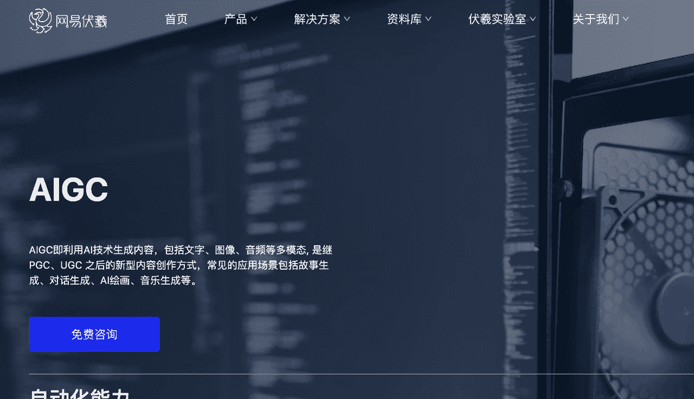

### 网易伏羲

**上线时间：**2017 年 9 月

**产品介绍：**网易伏羲成立于 2017 年 9 月。它是网易旗下专业从事游戏与泛娱乐 AI 研究和应用的顶尖机构，致力于在游戏、文娱、工业等产业中应用人工智能技术，推动技术的发展。

**主要作用：**提供各类 AI 应用及场景解决方案

**面向人群：**B 端客户

**体验地址：**https://fuxi.163.com/

# 十、360

## 2024 年 1 月

### 360 AI 搜索

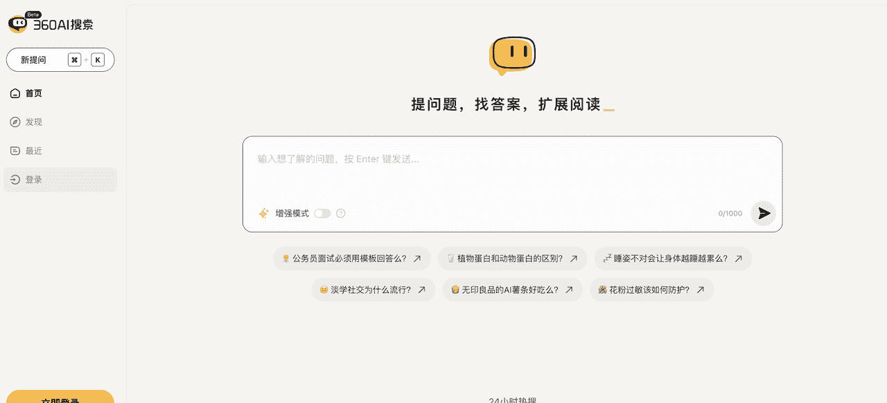

**产品介绍：**360 AI 搜索，新一代答案引擎，提供复杂查询的精准答案，结合大模型技术，优化搜索体验。

**主要作用：**通过问题分析、网页检索等流程，生成逻辑清晰、有理有据的答案。

**面向人群：**适合需要高效、精准搜索结果的用户，如专业人士、研究人员及普通网民。

**体验地址：**https://so.360.com/?ref=aihub.cn

## 2023 年 9 月

### 1）中文原生 AI 绘画模型 BDM

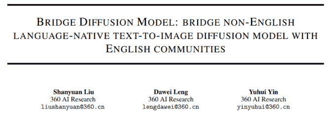

**产品介绍：**360 人工智能研究院发布 BDM，中文原生 AI 绘画模型，解决中文概念生成与英文社区兼容难题。

**主要作用：**BDM 精确生成中文语义图像，兼容英文社区插件，实现中英双语绘画。

**面向人群：**适合中文内容创作者、设计师及 AI 绘画爱好者使用。

**论文链接：**https://arxiv.org/abs/2309.00952

**体验入口：**https://ai.360.cn/

### 2）AI 数字员工

**产品介绍：**360 公司推出 AI 产品“数字人广场”，支持与 200 多个角色对话，包括历史名人和现代专家。

**主要作用：**提供个性化对话体验，用户可选择数字名人或数字助理，获取专业回答和建议。

**面向人群：**B 端企业

**体验地址：**https://ai.n.cn/home?src=ai_360_com

## 2023 年 5 月

### AI 商店

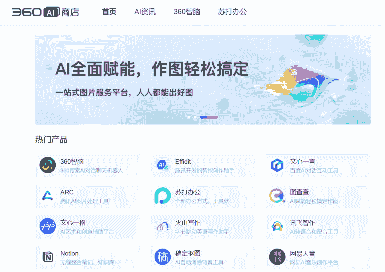

**上线时间：**2023 年 5 月 14 日

**产品介绍：**360AI 商店是 360 推出的 AI 导航平台，集成全球 AI 工具，提供 AI 作图、写作、音频制作等百余种应用。

**主要作用：**为 AI 垂直创业公司提供展示窗口，同时让普通用户便捷使用 AI 工具，推动 AI 技术的普及和应用。

**面向人群：**适合 AI 应用开发者、中小微企业以及对 AI 技术感兴趣的普通用户。

**体验地址：**http://360ai-shop.cn/（需要用 360 浏览器访问）

## 2023 年 3 月

### 360 智脑

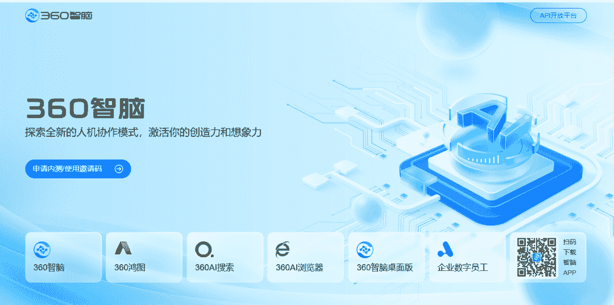

**上线时间：**2023 年 3 月 29 日

**产品介绍：**360 智脑大模型是 360 公司自研的认知型通用人工智能大模型，具备生成与创作、阅读理解、多轮对话等十大核心能力，覆盖广泛的应用场景。

**主要作用：**提供多模态处理能力，支持软件、App、网站的重塑，以及智能硬件的硬件化应用。

**面向人群：**面向公众开放，适用于需要内容创作、文档处理、多轮对话等智能服务的用户群体。

**体验地址：**https://ai.360.com/

# 十一、金山

## 2024 年 1 月

### 1）轻舟智问

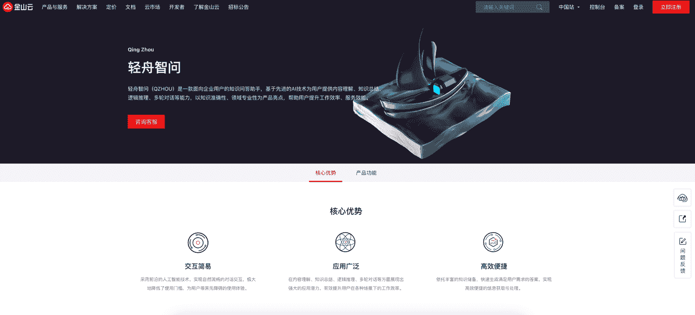

**上线时间：**2024 年 1 月

**产品介绍：**轻舟智问（QZHOU）是金山云推出的企业级知识问答助手，利用 AI 技术提供内容理解、知识总结、逻辑推理和多轮对话。

**主要作用：**通过自然流畅的对话交互，帮助用户快速获取信息，提升工作效率和服务效能。

**面向人群：**适合需要高效信息处理和知识管理的企业用户，如客服、技术支持和知识工作者。

**体验地址：**https://www.ksyun.com/nv/product/QingZhou.html

### 2）瀚海大模型平台

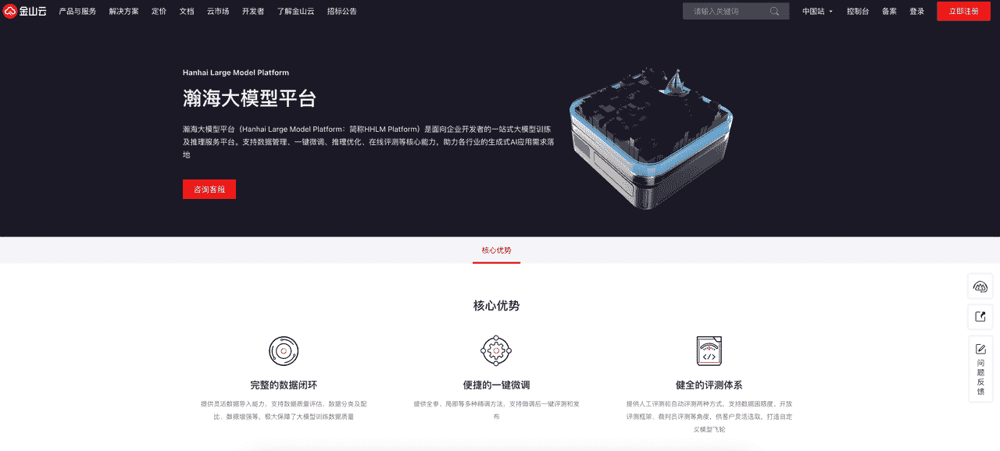

**产品介绍：**瀚海大模型平台是金山云提供的一站式大模型训练及推理服务，支持数据管理、微调、优化和评测。

**主要作用：**助力企业开发者实现生成式 AI 应用，提供数据闭环管理、一键微调、推理加速等功能。

**面向人群：**适合企业开发者，尤其是需要大模型训练和推理服务的 AI 应用开发者。

**体验地址：**https://www.ksyun.com/nv/product/HHLMPlatform.html

## 2023 年 7 月

### WPS AI

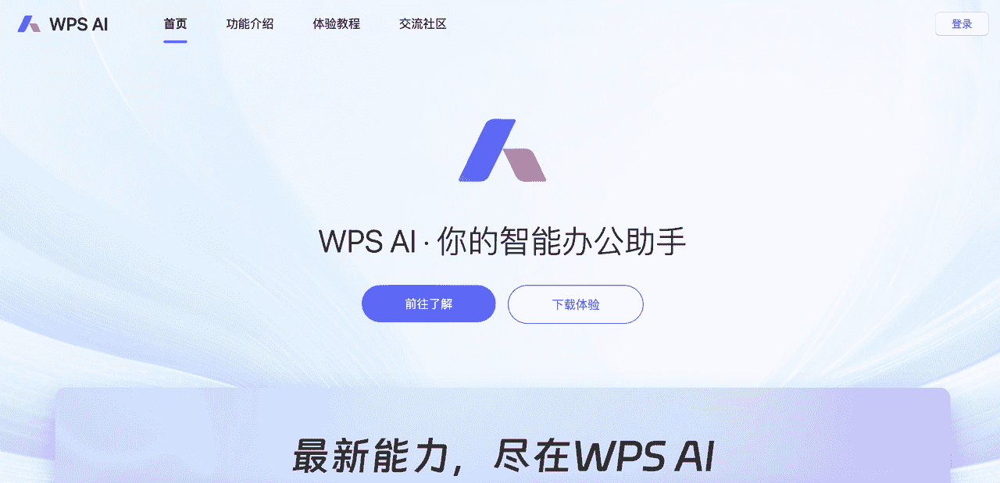

**上线时间：**2023 年 7 月 16 日

**产品介绍：** 金山 WPS AI 提供智能文档处理，包括内容生成、表达优化等。

**主要作用： **增强文档编辑效率，提供个性化内容创作辅助。

**面向人群： **适合办公人员、内容创作者和需要高效文档处理的用户。

**体验地址：**https://ai.wps.cn/

# 十二、美团

## 2023 年 11 月

### WOW

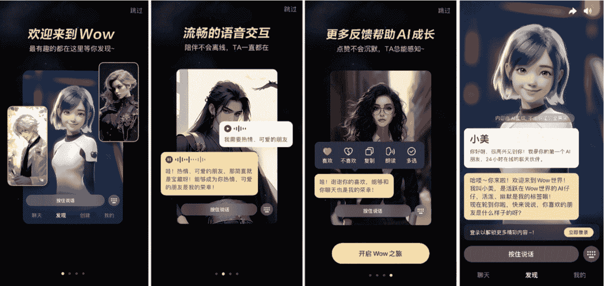

**上线时间：**2023 年 11 月

**产品介绍：**Wow 是一款属于年轻人自己的 AI 朋友社区，为年轻人打造虚拟角色扮演情感陪伴的理想 AI 伙伴。Wow 内的 AI 伙伴采用 AIGC 技术，能模拟人类的对话，拥有精美的虚拟形象和逼真的声音。

**主要作用：**AI 社交社区

**面向人群：**C 端用户

**体验地址：** IOS 和安卓平台可下载

# 十三、快手

## 2023 年 12 月

### 快手智播

**上线时间：**2023 年 12 月

**产品介绍：**快手智播是快手官方推出的 AI 数字人无人直播平台，提供 24 小时虚拟人直播服务，降低直播门槛和成本。

**主要作用：**支持矩阵账号运营，实现快速开播和内容制作，提升广告主的转化效益。

**面向人群：**适合广告主、主播及商家，特别是需要高效直播运营和降低成本的用户。

**体验地址：**https://virtuallive.kuaishou.com/login

## 2023 年 10 月

### AI 小快

**上线时间：**2023 年 10 月 26 日

**产品介绍：**“AI 小快”是快手内测的 AI 账号，基于快意大模型，提供评论区智能回复服务。

**主要作用：**在评论区实现互动问答、图片生成、攻略检索、文案修改等 AIGC 服务。

**面向人群：**适合快手用户，尤其是需要在评论区进行互动和内容创作的用户。

**体验地址：**用户在快手搜索“AI 小快”即可申请参与内测，获得资格的用户在短视频评论区发布艾特@AI 小快 的评论，便可收到@AI 小快 的回复。

## 2023 年 9 月

### AI 玩评

**产品介绍：**快手推出“AI 玩评”功能，基于 AI 技术自动生成与评论内容相匹配的图片。

**主要作用：**用户通过输入各种创意文字，可一键生成海量风格图片，更便捷的在评论区进行趣味互动。

**面向人群：**快手用户

**体验地址：**站内短视频评论区

## 2023 年 8 月

### 大模型“快意”

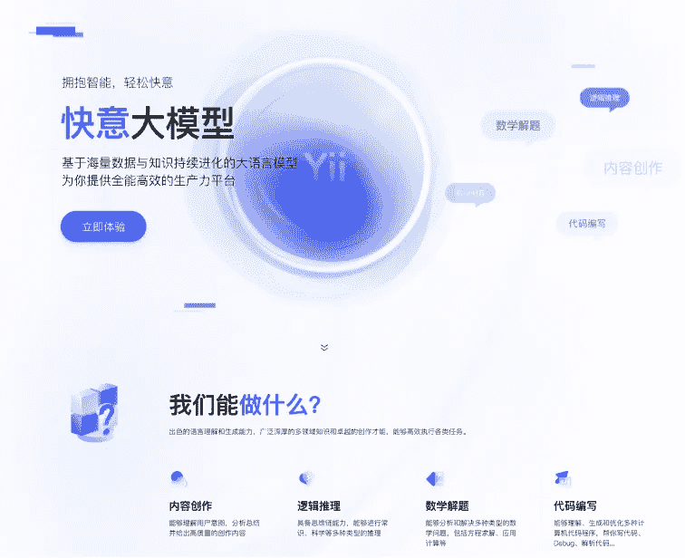

**产品介绍：**快手推出“快意”大模型，一系列大规模语言模型，包括预训练模型和对话模型。

**主要作用：**快意模型具备通用技术底座能力，支持内容创作、信息咨询、数学逻辑、代码编写等任务。

**面向人群：**适合开发者、内容创作者、教育工作者及对 AI 语言模型应用感兴趣的专业人士。

**体验地址：**https://github.com/kwai/KwaiYii

---

# AI 创业交流社群

1.持续关注并更新 AI 的**相关资讯动态，研究报告，赚钱案**例，常见问题，永久免费在线查看，无收费内容，目标是成为最大的免费 AI 学习社群。

2.已建立社群聊聊 **AI** 发展及应用，**没进群的可以扫码加入，群满可加 AI 研究爱好者大国🛰️ ID：zyg90s（备**注：AI），已经在社群内的无需重复加入，开源知识库及社群学习全部为公开免费分享。

3.**关于文档负责人大国**：高帆文化CEO，曾就职于教培大厂，目前创业，主攻研究AI落地应用、企业流量增长及达人IP孵化。

**进群一起学习 AI创业**

**进群一起学习 AI创业**

🛰️好友（ID：zhangyuguo94s）

**扫码加🛰️入🛰️群**

**欢迎扫码了解更多AI创业知识**

**觉得有用欢迎留个赞**