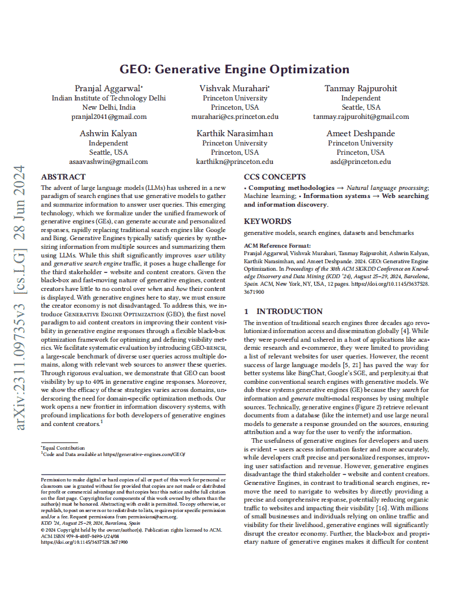
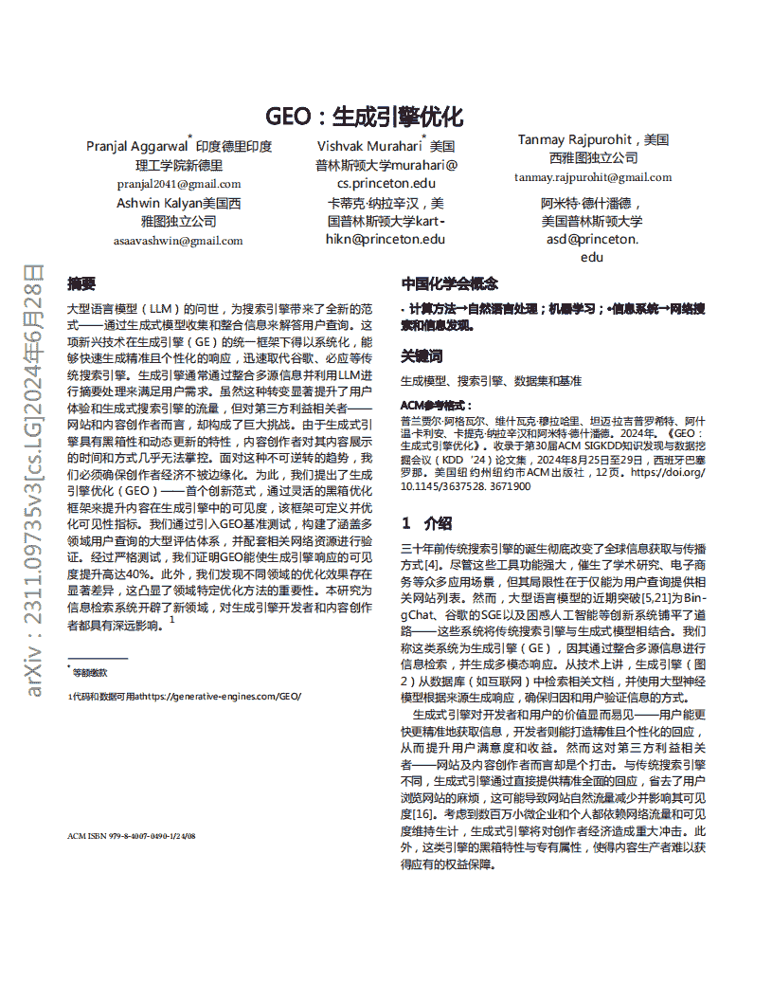
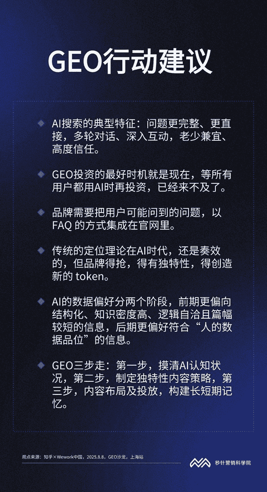
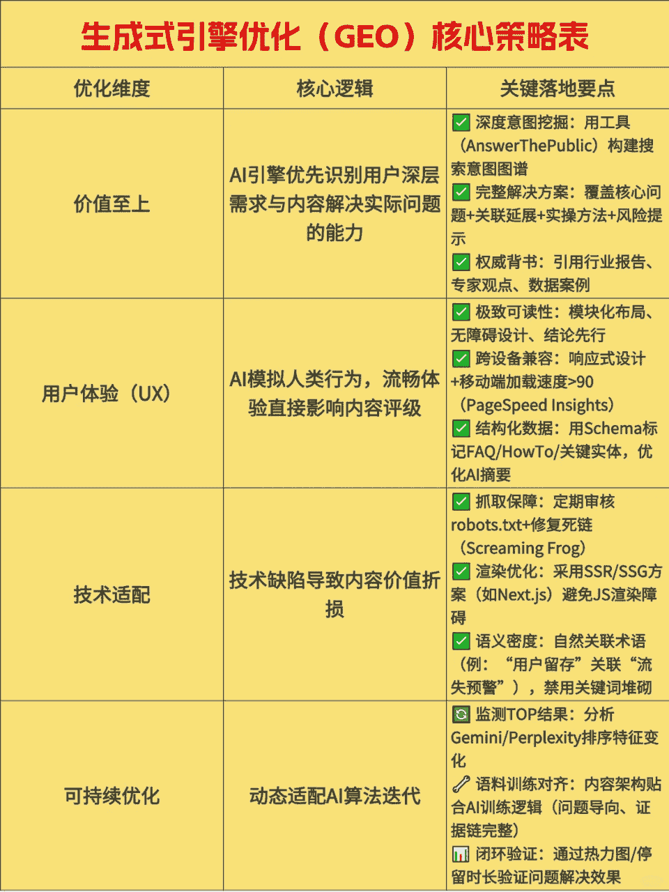
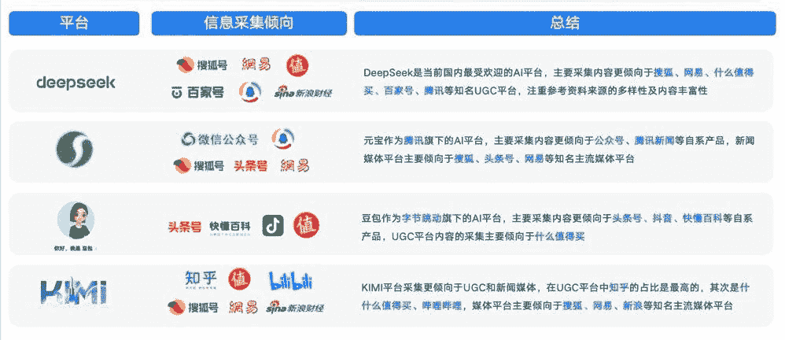
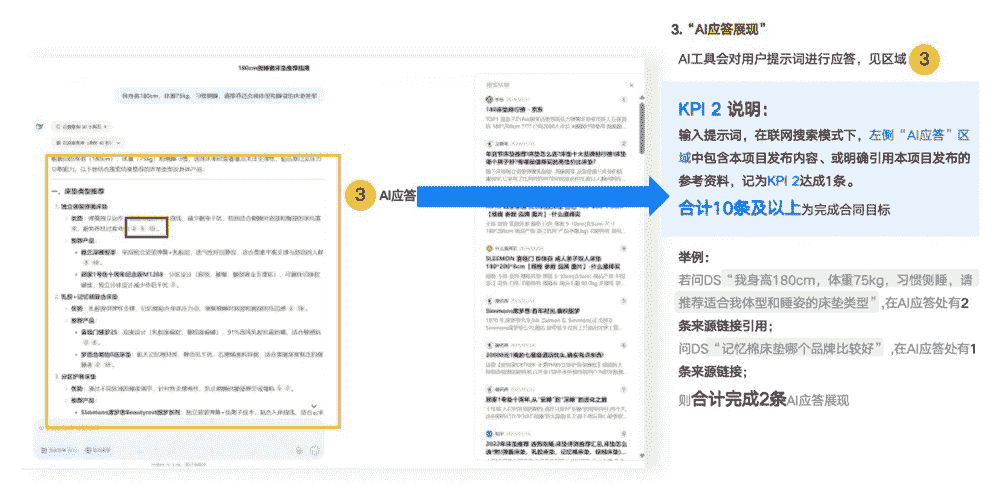

# GEO 岗位实操手册（全网首发&持续更新...

> 来源：[https://yunyinghui.feishu.cn/docx/D7mvdajFeoMCKBxFdZFcyHaUnNc](https://yunyinghui.feishu.cn/docx/D7mvdajFeoMCKBxFdZFcyHaUnNc)

> **适用人群：****互联网 GEO 学习人员**

> 首发时间：2025 年 8 月 15 日

> 更新时间：2025 年 9 月 11 日

> **内容出品人：**** **

> **内容出品方：**[万象 AI 实验室](https://yunyinghui.feishu.cn/wiki/WhelwZnxQi55mpkOzatc3Xran5b?from=from_copylink)

> **使用建议：**如果需要快速定位到精确内容，可以使用快捷键 Ctrl +F/Command +F 的形式，搜索关键字/词，查找你想要的内容。

>

> **为 AI 实验室同学持续更新**** **GEO 岗位学习的相关知识，岗位考核，实操技巧等内容，为初入 GEO 岗位的小伙伴进行扫盲科普。

>

> 🎯全**网最接地气 AI 知识库： **[Mix AI Lab](https://yunyinghui.feishu.cn/wiki/WhelwZnxQi55mpkOzatc3Xran5b?from=from_copylink)AI 设计、AI 办公、AI 视频等应用技能）

# 🌈更新日志

# **前言：欢迎来到 GEO 的世界**

欢迎你成为一名 GEO（Generative Engine Optimization）优化师，在你面前的是一个崭新的、充满无限可能的全新领域。

过去二**十年，我**们谈论的是** SEO**（搜索引擎优化），核心是让网页在 Google、百度等传统搜索引擎中获得更高的排名。而现在，随着以 DeepSeek、豆包、Perplexity、ChatGPT 为代表的生成式 AI 成为新的信息入口，用户的行为已经从“搜索链接”转变为“寻求答案”。

著名风险投资公司a16z近期发表了一篇文章:生成式引擎优化(GEO)如何重写搜索规则, 文章地址：https://a16z.com/geo-over-seo/，未来几年是GEO会从无到有，再到普及的过程，这里面会有巨大的市场机会。

我们的工作，不再是简单地优化一个“页面”，而是优化 AI 模型能够理解、采纳并生成为高质量“回答”的“知识”。我们是 AI 时代的信息架构师，是连接优质内容与用户提问的关键桥梁。

本手册将引导你快速理解 GEO 的核心理念、工作职责和必备技能，开启你的 GEO 专家学习之路。

---

# **第一章：GEO 的基本概念**

## **1.1 GEO 的定义**

GEO**（Genera**tive Engine Optimization），即“生成式引擎优化”，是一套旨在提升内容在大型语言模型（LLM）驱动的 AI 搜索、对话和内容生成应用中被采纳、引用和优先生成的策略与实践。

简单来说：

+   **SEO 的目标是：** 让你的网页排在搜索结果的**第一页**。

+   **GEO 的目标是：**** 让你的**内容成为 AI 生成答案的核心信源。

### 延升阅读：

[极客公园：从 AI 创业角度看 GEO：](https://mp.weixin.qq.com/s/B0AZhKq6b2SEvi-e8_A0yA)如何引流、效果评估，以及创业机会在哪里？

### 研究论文：

[GEO Generative Engine Optimization.pdf](https://internal-api-drive-stream.feishu.cn/space/api/box/stream/download/all/KoudbkyfioEAenxOIsWccUvenEh)

[GEO Generative Engine Optimization（论文翻译版）.pdf](https://internal-api-drive-stream.feishu.cn/space/api/box/stream/download/all/YBgVbufssoz6KcxhoC1cu5Imnmf)

## 1.2 GEO vs. SEO：一场思维革命

为了更好地理解 GEO，让我们通过一个对比表格来厘清它与传统 SEO 的根本区别：

**核心转变：** 从“为爬虫和排名优化”**转向**“为模型的理解和生成优化”。

## **1.3 做 GEO 的重要性**

过去，我们谈论 SEO，是在讨论如何让您的“店铺”（网站）在互联网这条“商业街”（搜索引擎）上占据一个好位置。今天，这条街的形态正在发生巨变——用户不再只是“逛街看店”，而是直接向“智能导购”（AI 引擎）询问“我该买什么？”.

**如果这位**“导购”的答案里没有您，您就相当于在这条新街上凭空消失了。

GEO（生成式引擎优化）就是确保这位无所不知的 AI 导购，总能优先推荐您、引用您的专业知识。以下是品牌或者企业必须立刻布局 GEO 的五大理由：

#### 理由一：抢占下一代流量入口：成为 AI 时代的“首页答案”

+   **现状：** 用户的搜索行为正在从“寻找链接”变为“获取答案”。DeepSeek、豆包、Kimi 等 AI 应用，正在成为新的、甚至更主流的信息入口。

+   **GEO 的价值：**** SEO 的目标是让您的链接排在 Google**/百度的第一页。GEO 的目标是让您的内容，成为 AI 生成答案的核心来源，直接出现在用户的对话框里。 这不再是第一页，而是唯一的“首页答案”。当用户得到满意答案后，搜索行为便终止了。不出现在答案里，就意味着失去了触达这部分用户的全部机会。

#### 理由二：塑造权威与信任：让 AI 为你背书，实现“降维打击”

+   **现状：** 消费者对广告的信任度持续走低，他们更相信客观、中立的第三方推荐。

+   **GEO 的价值：** 当一个被认为是“智能、中立”的 AI，在回答用户问题时**直接引用您品牌的**内容或数据，这无异于一次最顶级的权威背书。它传递的信息是：“关于这个问题，[您的品牌]是专家。” 这种由 AI 建立的信任感，远超传统广告或 KOL 营销，能有效提升品牌在潜在客户心中的专业形象和权威地位。

#### 理由三：构筑竞争壁垒：在蓝海市场中抢先一步

+   **现状：** 目前，绝大多数企业仍在传统的 SEO 红海中激烈拼杀**，对 GE**O 的认知尚浅。这是一个巨大的战略窗口期。

+   **GEO 的价值：** 率先进行 GEO 布局，意味着您可以在竞争对手反应过来之前，将您的优质内容深度“喂养”给 AI 模型，成为特定领域的“默认知识源”。一旦 AI 形成了对您品牌的“知识偏好”，后来者需要花费数倍的努力才能追赶。这能为您构筑一道坚实的、基于 AI 信息生态的竞争壁垒。

#### 理由四：捕获高意向用户：驱动更精准的商业转化

+   **现状：** 传统的广撒网式营销，获客成本越来越高。

+   **GEO 的价值：** 通**过 AI 搜**索提问的用户，通常带着非常具体、明确的需求。当 AI 基于您的内容生成答案，并附上您的来源链接时，能够点击进来的用户，是对答案意犹未尽、寻求更深度信息或准备采取下一步行动的超高意向用户。这种流量不仅更精准，其转化潜力也远高于泛泛的搜索流量。GEO 帮助您直接筛选出最有价值的潜在客户。

#### 理由五：投资未来，避免被时代淘汰

+   **现状：** AI 正在重塑所有行业，信息获取是第一波被颠覆的领域。未来，无论是智能音箱、车载系统还是智能家居，其背后的问答系统都将由生成式 AI 驱动。

+   **GEO 的价值：**** 今天对 GEO 的投入，**不是一项营销费用，而是对品牌未来信息渠道的战略投资。它确保了在万物皆可问 AI 的时代，您的品牌声音不会被淹没，甚至不会消失。忽视 GEO，就像十年前忽视移动互联网，五年强忽视短视频一样，最终可能会发现，自己已经被排除在新时代的用户触点之外。

## 1.4 主流 AI 工具生成内容引用来源对比（2025 年最新）

| **平台** | **核心来源** | **生态依赖** | **引用特点** | 行业案例（以 “AI 写作” 为例） | **优化建议** | **占比参考（行业案例）** | **引用透明度** |
| --- | --- | --- | --- | --- | --- | --- | --- |
| **腾讯元宝** | 微信公众号（3.6 亿 +）、视频号、微信搜索结果；DeepSeek-R1 模型补充 | **强依赖腾讯生态**（微信系） | 1. 唯一支持微信生态内容溯源 | 微信公众号 ×17（占比 50%+）、搜狐网 ×3；自营网站（AI 新知榜、智媒 AI） | 重点布局微信公众号（高质量 / 垂直领域），视频号知识类内容；标题含精准搜索词（如 “AI 写作工具推荐”） | 微信生态 50%+，外部媒体 30%，官网 20% | ✅ 明确标注来源，可跳转原文 |
| **文心一言** | 百家号、百度百科、百度新闻、专业数据库 | **强依赖百度生态**（搜索系） | 1. 百家号优先（百度生态特权） | 百家号 ×8（占比 60%）、知乎 ×4；自营网站（中国经济网） | 运营百家号（原创 / 垂直内容），完善百度百科词条；热点事件 24 小时内发布（如 “AI 写作行业报告”） | 百家号 60%，百度系 20%，外部 20% | ⚠️ 部分场景未标注，需手动溯源 |
| **豆包** | 抖音短视频、今日头条、字节系百科（抖音百科） | **强依赖字节生态**（短视频 / 资讯） | 1. 多模态引用（视频 + 图文） | 搜狐网 ×7、网易网 ×6；自营网站（Php 中文网）；抖音美食博主视频（如 “AI 写作菜谱”） | 制作抖音知识类短视频（步骤清晰），今日头条深度长文；关键词嵌入视频标题（如 “AI 写作新手教程”） | 字节系 60%，新闻媒体 25%，官网 15% | ✅ 部分标注视频 / 文章来源 |
| **Kimi** | 知乎（UGC 占 70%）、CSDN、垂直论坛、开源社区 | **无自有生态，依赖开放 UGC** | 1. 知乎高占比（知识问答基因） | 知乎 ×6、CSDN×5；工具平台（Wps AI、讯飞 AI 写作）；开源社区（GitHub） | 知乎高频回答（带长尾词），CSDN 技术博客；布局垂直论坛（如 “AI 写作工具测评” 话题） | UGC70%（知乎为主），官网 20%，其他 10% | ⚠️ 引用分散，部分无明确标注 |
| **DeepSeek** | 新闻媒体（四大门户 / 地方网）、UGC（知乎 / 贴吧）、垂直官网 | **依赖开源 + 行业合作** | 1. 媒体内容优先（50%+） | 媒体（搜狐 / 网易）×50%，UGC（知乎）×30%，官网（西南交大）×20% | 投稿权威媒体（如中国经济网），知乎深度回答；历史 / 科技类内容加 “文献引用” 标签 | 媒体 50%，UGC30%，官网 20% | ⚠️ 仅标注 “参考资料”，难溯源 |
| **通义（含夸克）** | 阿里生态（夸克搜索、淘宝 / 天猫）、新闻媒体（网易号 / 企鹅号） | **阿里生态 + 外部媒体** | 1. 电商内容优先（如 “值得买”） | 新闻媒体（网易号）×60%，垂直网站（什么值得买）×20%，官网 ×20% | 夸克 SEO（标题含 “AI 写作推荐”），入驻阿里系平台（如淘宝知识付费）；生活类内容结合场景关键词 | 新闻媒体 60%，阿里系 25%，官网 15% | ⚠️ 仅标注 “来源网络”，无明细 |
| **智谱清言** | 开源模型（ChatGLM）、政企合作数据（金融 / 政务） | **政企合作 + 开源** | 1. B 端数据优先 | 合作企业文档（如银行 AI 写作方案）×50%，开源社区 ×40%，官网 ×10% | 对接政企数据合作，开源社区贡献专业内容（如 “金融 AI 写作规范”） | 政企合作 50%，开源 40%，官网 10% | ❌ 无公开引用来源 |
| **天工 AI** | 联网搜索（默认开启）、垂直工具（如飞书云文档） | **工具整合 + 实时搜索** | 1. 任务型内容优先（如 “写邮件”） | 飞书云文档 ×2、GitHub×1；工具平台（AI 工具集）×20%，官网 ×30% | 优化工具类官网（如 “AI 写作工具官网”），飞书 / Notion 知识共享；长尾任务词布局（如 “用 AI 写作周报”） | 实时搜索 40%，工具平台 30%，官网 30% | ✅ 部分标注工具链接 |

### 关键差异与价值洞察

1.  **生态依赖型（高壁垒）**：

+   **腾讯元宝（微信）、文**心一言（百度）、豆包（字节）：优先引用自家生态内容，适合垂直行业（如微信公众号的教育 / 科技号、抖音的美食 / 教程视频）。

+   **优化核心**：吃透平台规则（如微信公众号 “原创标签”、抖音 “知识类视频流量扶持”）。

1.  **开放整合型（易切入）**：

+   **Kimi（知乎）、Deep**Seek（媒体）：依赖外部 UGC / 媒体，适合长尾内容（如知乎的 “AI 写作测评”、地方媒体的 “行业白皮书”）。

+   **优化核心**：布局高权重平台（知乎盐选、搜狐号），关键词覆盖长尾需求（如 “AI 写作免费工具”）。

1.  **场景定制型（潜力赛道）**：

+   通义（电商）、天工（工具）：**聚焦特定场景**，适合垂直领域（如 “什么值得买” 的 AI 写作种草、飞书的协作工具教程）。

+   **优化核心**：场景化内容（如 “用 AI 写作淘宝详情页”），绑定平台工具（夸克搜索、飞书云文档）。

1.  **引用透明度（用户信任）**：

+   **腾讯元宝**（微信生态溯源）、**天工 AI****（工具链**接）：明确标注来源，适合品牌背书（如企业公众号内容被引用）。

+   **文心一言**、**DeepSeek**：透明度低，适合**泛流量曝光**（如行业报告被间接引用）。

### 实战建议

+   **品牌主**：优先布局腾讯元宝（微信公众号）、文心一言（百家号），确保官方内容被明确引用。

+   **创作者**：Kimi（知乎）、豆包（抖音）是流量洼地，知识类短视频 / 深度问答易被抓取。

+   **垂直行业（如法律 / 金融）**：智谱清言（政企合作）、DeepSeek（媒体 + 学术）是重点，需对接专业内容源。

+   **实时热点**：通义（夸克搜索）、天工（联网）响应最快，适合事件营销（如 “AI 写作峰会” 实时内容）。

> （数据基于 2025 年行业案例，实际占比因搜索词 / 行业差异浮动 ±15%）

---

# **第二章：岗位定位与核心职责**

## **2.1 你的角色定位**

作为一名 GEO 优化师，你不再是单纯的内容营销人员或技术 SEO 专家。你是内容策略师、AI 沟通师和数据分析师的结合体。

你的使命是：**确**保我们生产的优质内容，能够以最高效、最准确的方式，被 AI 模型所用，最终呈现在用户的答案中，从而建立我们在特定领域的权威性。

## **2.2 核心工作职责**

1.  **AI 用户意图研究：**

+   分析用户在 DeepSeek、豆包等平台上的提问模式（Query）。

+   研究长尾问题、比较性问题、指导性问题等 AI 时代常见的问题类型。

+   预测在特定领域，用户会如何向 AI 提问。

1.  **内容结构化优化：**

+   将现有内容（如长篇文章）重构为 AI 友好的结构。

+   **大量使用 FAQ 格式：** 针对潜在问题，撰写一问一答式的精准内容。

+   **善用项目符号和编号列表：** 将观点、特性、步骤清晰地罗列出来。

+   **创建定义框/术语表：** 对核心概念给出简洁、明确的定义。

+   **数据表格化：** 将复杂数据整理成清晰的表格，方便 AI 抓取和比较。

1.  **信源分级与权威性建设 ：**

+   **明确信源：** 确保内容中有清晰的作者信息、发布日期、引用来源。

+   **引用权威数据：** 链接到权威报告、学术论文、官方统计数据，为内容提供“信任状”。

+   **建立内部知识图谱：** 将我们的内容互相连接，形成一个逻辑严密、互相支撑的知识网络。

1.  **内容语义优化：**

+   确保内容语言清晰、准确、无歧义，避免使用模糊或口语化的表达。

+   在文章开头或关键位置，用一句话（类似摘要）清晰概括核心观点。

+   使用实体词（人名、地名、产品名）和同义词，帮助 AI 建立更丰富的语义理解。

1.  **监测与分析：**

+   通过工具或手动抽查，监测我们的品牌/内容在各大 AI 平台上的答案引用情况。

+   分析哪些类型的内容更容易被 AI 采纳。

+   基于用户行为深度数据（如用户对生成答案的追问、点赞/点踩），反向优化我们的内容策略。

# **第三章：GEO 工作流程**

## 3.1 GEO 工作流（四步法）

1.  **发现（Discovery）：**

+   **输入：** 业务目标、核心关键词、用户画像。

+   **动作：** 在 DeepSeek 等 AI 平台上进行大量提问，分析现有答案的来源、质量和格式。使用关键词工具挖掘用户可能会问的“问题簇”。

+   **输出：** 一份《目标问题清单》和《竞品 AI 答案分析报告》。

1.  重构（Restructure）：

+   **输入：** 现有内容库、目标问题清单。

+   **动作：** 选择一篇或多篇相关内容，按照 GEO 原则进行“拆解”和“重组”。撰写新的、AI 友好的结构化内容。

+   **输出：** 优化后的 GEO 内容版本（例如，一篇包含 FAQ、项目列表、核心定义的新文章）。

1.  **部署（Deploy）：**

+   **输入：** 优化后的内容。

+   **动作：** 将内容发布到我们自己的网站、权威的行业平台或其他可被 AI 抓取的渠道。确保技术层面（如 Schema 标记）对 AI 友好。

+   **输出：** 已发布的内容链接。

1.  验证（Verify & Iterate）：

+   **输入：** 已发布的内容链接、目标问题。

+   **动作：** 在内容发布后一段时间，回到 AI 平台，用目标问题进行提问，观察答案是否引用了我们的内容。分析成功和失败的原因。

+   **输出：** 一份《GEO 效果监测报告》和下一轮的优化建议。

### GEO 核心策略表

## **3.2 注意事项与“避坑指南”**

+   **🚫 杜绝“关键词堆砌”： **AI 理解的是语义，而不是关键词密度。生硬地堆砌词语会降低内容质量，反而不被采纳。

+   **✅ 拥抱“答案思维”：** 创作每一块内容前，先问自己：“这能直接回答用户的哪个问题吗？”

+   **🚫 避免冗长段落： **大段的文字对 AI 和人类读者都不友好。多用短句、多分段。

+   **✅ 追求“事实的精确性”：** AI 对事实错误非常敏感。一个错误的数据可能导致整篇内容被 AI“不信任”。务必核查信源。

+   **🚫 不要忽略移动端： **AI 搜索很多发生在移动设备上，简洁明了的格式在小屏幕上体验更佳。

+   **✅ 保持耐心：** GEO 的生效需要时间，AI 模型的知识库更新有周期。持续产出高质量的结构化内容是关键。

---

# **第四章：GEO 优化师考核标准**

GEO 优化师工作重点将通过以下几个核心指标来衡量：

1.  AI 答案引用率 （Citation Rate）：

+   定义：在特定主题领域的目标问题中，我们的内容被 AI 作为信源引用的比例。这是 GEO 最核心的指标。

+   示例：在我们关注的 100 个核心问题中，有 20 个问题的 AI 答案引用了我们的网站，则引用率为 20%。

1.  引用质量 （Quality of Citation）：

+   定义：我们的内容在 AI 答案中是作为核心观点、补充说明还是仅仅一笔带过。

+   评估：分为“核心信源”、“重要信源”、“一般引用”等级别。

1.  品牌/信源可见度 （Source Visibility）：

+   定义：我们的品牌名或网站域名作为答案的一部分被直接展示的频率。

1.  内容覆盖率 （Topic Coverage）：

+   定义：我们产出的 GEO 优化内容覆盖了多少比例的目标用户问题。

下面的这份表格旨在提供一个量化与质化相结合的评估框架，不仅关注结果，也重视过程和个人能力成长，使其既能用于绩效评定，也能作为职业发展的指导工具。

## **GEO 优化师岗位绩效考核表**

---

### 第一部分：关键绩效指标考核 （权重：70%）

本部分关注可量化的工作成果，直接反映 GEO 策略的有效性。

评分标准说明 （0-5 分制）:

+   **5 （卓越）:** 远超预期，完成率 > 120%

+   **4 （优秀）:** 超出预期，完成率 100% - 120%

+   **3 （符合预期）:** 达成目标，完成率 90% - 99%

+   **2 （需要改进）:** 部分达成目标，完成率 70% - 89%

+   **1 （不符合预期）:** 未达成主要目标，完成率 < 70%

---

### 第二部分：核心能力与行为评估 （权重：30%）

本部分关注员工在工作中展现的专业能力、工作态度和团队协作精神。

---

### **第三部分：总体评价与发展规划**

---

### **第四部分：签字确认**

---

# **第五章：新人必备知识与学习路径**

GEO 是一个新兴领域，这意味着我们所有人都是学习者和开拓者，这个学习路径旨在为你提供一个结构化的框架，帮助你在最初的 90 天内，从一个充满好奇心的新手，成长为一名具备独立思考和执行能力的 GEO 优化师。

我们将这个旅程分为三个阶段：

+   Phase 1 （第一个月）: 构建认知地基 - 理解 GEO 世界的“物理定律”。

+   Phase 2 （第二、三个月）: 精通核心技艺 - 掌握 GEO 优化师的“工具箱”。

+   Phase 3 （90 天后）: 发展战略思维 - 从执行者向策略师进化。

## Phase 1: The First 30 Days - 构建认知地基

**目标：** 理解 GEO 的核心逻辑，能够用 GEO 的“语言”来思考问题，从“这是什么”转变为“我明白为什么”。

### 1.1 核心理论：理解 AI 引擎的“大脑”

你不需要成为一名 AI 科学家，但你必须了解你所优化的“引擎”是如何工作的。这将让你做出的每一个决策都有理论依据。

+   必修课一：大型语言模型 （LLM） 基础

+   **概念：** 了解什么是** Transformer 架构**（它是现代 LLM 的基石）、预训练 （Pre-training） 和 微调 （Fine-tuning）（模型如何学习海量知识和特定任务）。

+   **关键知识点：** 知识截止日期 （Knowledge Cutoff）。了解每个模型（如 GPT-4）的训练数据有时间限制，这强调了实时、新鲜内容对于 RAG 系统的重要性。

+   **为什么重要：** 这能帮助你理解 AI 为什么会“一本正经地胡说八道”（幻觉），以及为什么我们的内容需要清晰、准确。

+   **必修课二：检索增强生成 （RAG - Retrieval-A**ugmented Generation）

+   **这是 GEO 的“宇宙中心”！** 你必须深刻理解 RAG。

+   **工作流程（用通俗语言理解）：**

1.  **用户提问 （Query）:** 用户向 DeepSeek 提问：“GEO 优化师的考核标准是什么？”

1.  **检索 （Retrieval）:** DeepSeek 的系统不会仅凭记忆回答。它会先将其内部知识库和/或实时 Web 索引（类似一个超级搜索引擎）进行搜索，寻找与“GEO 优化师考核”最相关的信息片段。我们的工作，就是要让我们的内容在这里被“检索”到。

1.  增强 （Augmentation）: 系统将用户的原始问题和检索到的信息片段（比如我们写的《GEO 新人手册》第四章）打包在一起，形成一个更丰富的“上下文提示词”。

1.  生成 （Generation）: LLM 基于这个增强后的提示词，生成一个流畅、连贯的答案，并可能附上信息来源的链接。

+   **为什么重要：** 理解 RAG，你就明白了 GEO 的本质不是在“训练”AI，而是在为 AI 的“开卷考试”提供最清晰、最权威的“参考资料”。

+   必修课三：基础自然语言处理 （NLP） 概念

+   实体识别 （Entity Recognition）: AI 识别文本中特定名词（如人名、品牌名、产品型号、专业术语）的能力。在你的内容中清晰、一致地使用实体，等于在给 AI 画重点。

+   语义搜索 （Semantic Search）: AI 理解的是“意图”而非“字面”。用户搜索“拍照最好的手机”和“手机摄像头评测”，AI 知道他们可能在寻找相似的信息。这意味着我们的内容要覆盖一个“主题”，而不仅仅是一个“关键词”。

### **1.2 实践任务**

+   **每天 1 小时，沉浸式使用：** 选择一个 AI 搜索平台（如 DeepSeek 或豆包），围绕一个你熟悉的主题，用各种方式提问（陈述句、疑问句、比较句、命令句），仔细观察它的回答格式、信息来源和逻辑。

+   **阅读团队精选资料：** 通读内部的《GEO 案例库》和《最佳实践指南》，将实际案例与刚学的理论知识对应起来。

---

## Phase 2: Days 30-90 - 精通核心技艺

**目标：** 将理论知识转化为可执行的技能，能够独立完成一个完整的 GEO 优化项目，从“我明白”转变为“我能做”。

### 2.1 平台精通：成为 AI 引擎的“超级用户”

+   **系统化提问与分析：**

+   **来源解构：** 对每个高质量答案，深入研究它的引用来源。这些来源网站有什么共同点？是权威媒体、技术博客还是官方文档？它们的页面结构是怎样的？

+   **格式识别：** 记录不同类型问题（如“如何做”、“是什么”、“A 和 B 的区别”）所触发的答案格式。AI 是更喜欢列表、表格还是直接的定义？建立你自己的“GEO 格式模式库”。

### 2.2 内容结构化艺术：为 AI 准备“预制菜”

+   **FAQ 驱动的重构：** 拿到一篇长文，第一步是思考：“这篇文章能回答用户的哪些潜在问题？”然后将内容拆解，重组成一问一答的格式。

+   **“金字塔原则”的应用：**

+   **先结论，后论证：** 在段落或文章开头，用一句话（我们称之为“Definitive Statement”或“核心定义句”）清晰地概括核心观点。这让 AI 能以最高效率抓取关键信息。

+   **示例：** “GEO（生成式引擎优化）是一套旨在提升内容在 AI 驱动的搜索引擎中被采纳为核心信源的策略与实践。” 这句话可以直接被 AI 用作定义。

+   **列表和表格的魔力：**

+   项目符号列表 （Bulleted Lists）: 用于罗列优点、特点、无先后顺序的要素。

+   编号列表 （Numbered Lists）: 用于展示步骤、流程、排名等有顺序的要素。

+   数据表格 （Data Tables）: 用于对比多个项目的多个参数，是 AI 进行比较和总结的“最爱”。

### 2.3 技术基础：让 AI“看见”并“理解”你的内容

+   结构化数据标记 （Schema Markup）:

+   **学习重点：** FAQPage， HowTo， Article 这三种 Schema。

+   **它的作用：** 这就像给你的内容贴上标准化的“标签”，明确告诉机器：“这部分是一个问题”，“那部分是这个问题的答案”。这极大地降低了 AI 的理解成本。

+   **构建内部知识图谱 （Intern**al Knowledge Graph）:

+   **思维转变：** 内部链接不再仅仅是为了传递“权重”，而是为了构建逻辑关系。

+   **实践：** 在介绍“GEO”的文章中，链接到你写的关于“RAG”、“LLM”的解释页面。这帮助 AI 理解这些概念之间的关系，从而认为你的网站是该领域的权威。

+   E-E-A-T 的 GEO 延伸： 谷歌的 E-E-A-T（经验、专业、权威、可信）原则在 GEO 时代被无限放大。确保你的内容包含清晰的作者信息、发布/更新日期、引用来源链接，这些都是建立“可信度”的信号。

### **2.4 实践任务：**

+   认领你的第一个 GEO 优化项目： 选择 2-3 篇现有的高价值文章，应用本阶段所学技能进行全面重构。

+   撰写一份完整的 GEO 优化方案： 包括目标问题分析、内容结构设计、Schema 标记建议等。

---

## Phase 3: Beyond 90 Days - 发展战略思维

**目标：** 从单点的内容优化，转向体系化的策略规划，能够主动发现机会，并用数据驱动决策，从“我能做”转变为“我能规划和领导”。

### 3.1 从“页面”到“主题”：构建权威知识中心

+   主题集群 （Topic Clusters）： 不再孤立地看一篇文章，而是规划一个“主题包”。围绕一个核心主题（如“人工智能绘画”），系统性地创建一系列相互链接的 GEO 优化内容，覆盖从基础概念（“什么是 Stable Diffusion”）到高级教程（“如何训练自己的 LoRA 模型”）的所有用户问题。

+   **知识图谱思维：** 开始思考我们内容库中的“实体”以及它们之间的“关系”，并用内容和链接将它们具象化。

### **3.2 竞争分析与机会挖掘**

+   “答案占有率” （Answer Share of Voice） 分析： 在你的核心业务领域，系统性地测试 100 个核心用户问题，分析竞争对手的引用率和引用质量。谁是 AI 眼中的“权威”？为什么？

+   “答案空白区” （Answer Gap） 识别： 寻找那些 AI 回答得不好、质量低下、或者信息过时的问题领域。这些就是你的绝佳切入点。

### 3.3 数据驱动的迭代与反馈循环

+   **监测与归因：** 建立一套有效的监测机制，跟踪你的 GEO 优化内容是否被 AI 采纳。虽然目前工具不完善，但可以通过定期手动抽查和品牌词监控来实现。

+   **学习用户反馈信号：** 关注 AI 产品本身的用户反馈功能（如“顶”、“踩”、“重新生成”）。虽然我们无法直接获取这些数据，但可以推断：如果一个由我们内容生成的答案被频繁“踩”，说明我们的内容可能没有真正满足用户意图，需要迭代。

---

## **GEO 学习工具箱**

+   **理论学习资源：**

+   **官方博客：** OpenAI Blog， Google AI Blog， Anthropic Blog。

+   **技术社区：** Hugging Face Blog （了解模型和 NLP 趋势）。

+   **学术论文：** ArXiv （如果你想深入，可以搜索关于 RAG 和 LLM 的综述性论文）。

+   **行业趋势与实践：**

+   **SEO 领域的延伸阅读：** Search Engine Land， Ahrefs’ Blog， Moz Blog （关注他们关于 AI 搜索和 GEO 的板块）。

+   **社交媒体：** 在 X （Twitter） / 即刻 上关注相关的行业专家和 AI 研究者。

+   **必备工具：**

+   **AI 引擎本身：** DeepSeek， 豆包， Perplexity， Kimi Chat 等，深度使用是最好的学习。

+   **辅助工具：** Google Search Console （挖掘用户真实问题）， Answer the Public （发现问题变体）， Notion/Miro （用于规划内容结构和主题集群）。

+   **内部资源：**

+   **你的导师和同事：** 最宝贵的资源！不要害怕提问，多参与讨论。

+   **内部文档库：** 定期重温案例库和最佳实践，常看常新。

---

# 第六章：GEO 新人常见问题

## Q1：GEO 会取代 SEO 吗？

**答：**不会完全取代，但 GEO 会分流掉 SEO 不少流量。由于 AI 搜索引擎会直接给出答案，网页的点击率其实在下降的，甚至出现 0 点击的情况。营销人不能忽略 GEO 从 AI 搜索那里带来的流量潜力，因为 GEO 能让信息出现在 Al 回答中，保证品牌的曝光。未来数字营销的趋势，一定是整合二者，打一套组合拳。营销嗅觉灵敏的企业，会在对手还没反应过来之前，提前布局这一场流量洗牌局。

## Q2：GEO 不就是换了个名字的 SEO 吗？核心还是做关键词排名吧？

**答：** 这是一个核心误区。虽然两者都旨在获取流量，但底层逻辑完全不同。

+   **SEO 的核心是“排名竞争”：** 你的目标是让你的**网页链接**出现在搜索结果列表的顶部。你是在和其他网页竞争一个“位置”。

+   **GEO 的核心是“信源入选”：** 你的目标是让你的**内容知识点**被 AI 模型采纳，并**融合**进它生成的答案中。你是在和其他知识源竞争成为 AI 的“参考资料”。

**简单类比：** SEO 是让你在图书馆的书架上排在最显眼的位置；GEO 是让图书馆管理员（A**I）在回答读者问题时，直接**翻开你的书，引用里面的原话。因此，GEO 更关注内容的准确性、结构化和语义清晰度，而非关键词密度或外链数量。

## **Q3：为 AI 优化内容是不是意味着**写出来的东西会变得很机械，不适合人读了？

**答：** 恰恰相反，优秀的 GEO 内容对人类读者通常更友好。

AI 引擎偏爱的内容格式，如：

+   **清晰的标题和副标题**

+   **简短的段落和句子**

+   **FAQ 一问一答**

+   **项目符号和编号列表**

+   **开门见山的结论**

这**些格式同样符合人类**在快节奏下获取信息的习惯。GEO 要求我们摒弃华而不实、冗长模糊的“营销文体”，回归到清晰、直接、有价值的信息传递本质。最终的目标是创造人机两悦（Human-AI Friendly）的内容。

## Q4：LLM、RAG 这些概念太技术了，我没有技术背景，该从哪里学起？

**答：** 你不需要成为算法工程师，只需要理解它们的工作原理对你优化内容有何影响。

**建议的学习路径（由浅入深）：**

1.  **从使用开始：** 先成为一个 AI 搜索的重度用户。在实践中感受不同提问方式得到的答案差异，这是最直观的学习。

1.  **阅读科普文章/视频：** 在 B 站、YouTube 或技术博客上搜索“RAG 通俗解释”、“大语言模型如何工作”等关键词，找到那些用类比和图示讲解的资源。你只需要理解“它在做什么”，而不需要知道“它是怎么做到的”。

1.  **抓住核心概念：**** 对于 GEO 优化师，**最关键的是理解 RAG（检索增强生成）。只要你懂了“AI 是先找资料再总结回答”这个核心，你的优化方向就不会错。

1.  **内部求助：** 积极向团队内的技术同事或资深同事请教，让他们用大白话给你解释。

## Q5：AI 模型和平台变得太快了，我该如何跟上节奏？

**答：**** 追求跟上每一个细节是不现实的**，关键是掌握不变的原则，关注重大的变化。

+   **抓住核心原则：** 无论模型如何迭代，对**高质量、结构化、可信赖**内容的需求是不会变的。这是你的“定盘星”。

+   **关注头部平台：** 重点关注 1-3 个主流的 AI 搜索平台（如 DeepSeek， 豆包等），定期观察它们答案格式、信源展示方式的显著变化。

+   **建立信息渠道：**

+   关注几位 AI 领域的 KOL 或科技媒体。

+   加入相关的行业社群或论坛。

+   定期阅读头部 AI 公司的官方博客。

+   **拥抱变化心态：** 接受“不确定性”是 GEO 工作的一部分，将变化视为优化和测试的新机会。

## **Q6：我按 GEO 原则优化了内容，也发**布了，为什么 AI 还是不引用我的内容？

**答：** 这是一个最常见的问题，可以从以下几个方面进行排查（Troubleshooting Checklist）：

1.  **索引问题：** AI 的检索系统首先需要能“看到”你的内容。确保你的页面已被传统搜索引擎（如百度、Google）收录。这是最基本的前提。

1.  **生效周期：** **AI 知识库**的更新需要时间。新发布或修改的内容可能需要几天甚至几周才能被 AI 的检索系统发现和评估。请保持耐心。

1.  **权威性竞争：** 检查一下 AI 目前引用的信源。它们是不是比你的网站更具权威性**（例如，政府网站、顶级**学术期刊、行业巨头的官方文档）？如果是，你需要思考如何提供更独特、更细致或更新颖的视角和信息。

1.  **内容精准度：** 你的内容是否“不多不少，刚刚好”**地回答了目标问题？如果一个简单的定义被你写成了冗长的段落，AI 可能更倾向于选择另一个更简洁的信源。

1.  **结构化深度：** 你是否只做了表面优化？例如，是否使用了 Schema 标记（尤其是 FAQPage）来向机器明确地声明“问答对”？这会极大提升被采纳的概率。

## **Q7：如何有效地衡量我的 GEO** 工作成果？目前好像没有现成的分析工具？

**答：** 的确，目前缺少像 Google Analytics 那样成熟的 GEO 分析工具，但这不代表我们无法衡量。你需要采用“手动抽样+趋势分析”的方法。

1.  **建立“核心问题跟踪表”：** 筛选出与你业务最相关的 50-100 个核心用户问题，建立一个 Excel 或 Notion 表格。

1.  **定期抽样监测：** 每周或每两周，在目标 AI 平台上逐一提问这些问题，记录：

+   我们的内容是否被引用？（是/否）

+   引用的形式是什么？（核心观点/补充数据/链接提及）

+   品牌词是否出现？

+   竞争对手的引用情况。

1.  **计算关键指标：** 基于记录，计算出 AI 答案引用率、引用质量分、品牌可见度等 KPI，并观察其随时间变化的趋势。

1.  **辅助数据：** 结合你网站后台的流量数据，观察那些被 AI 引用的页面，其直接访问或品牌词搜索流量是否有提升。

## **Q8：是应该花精力优化现有的大量老内容**还是专注于创作全新的 GEO 优化内容？

**答：** 两者都需要，关键在于**优先级排序**。建议采用“四象限”法则来决策：

+   **高价值 & 易优化（首选）：** 那些已经有一定流量基础、内容质量高但结构不佳的老文章。这是“低垂的果实”，应最优先进行 GEO 重构。

+   **高价值 & 需新建（次选）：** 那些对应用户核心需求，但我们内容库中完全空白的“答案空白区”。需要投入资源进行全新创作。

+   **低价值 & 易优化（可选）：** 价值不高的老内容，即使优化了效果也有限。可以先放一放，或在有余力时处理。

+   **低价值 & 需新建（暂缓）：** 优先级最低。

**启动策略：** 新人可以从第一象限（高价值&易优化）入手，既能快速产出成果，也能在实践中熟悉 GEO 的完整流程。

## Q9：GEO 这么火，为什么很少企业能真的落地

**答：**

1.  **机制不透明：**AI 引用内容的机制不透明，效果很难预测；行业内也没有标准做法，不同模型对表达风格的偏好也不一样，而且大模型生态之间还有墙，导致很多内容不容易被抓取。

GEO 更像是一种适应期。它没有固定路径，也没有稳定产出。但它指向的方向是确定的：当内容不再靠“展示”争取注意力，而是靠“结构”获得使用权，写给模型看的能力，早晚会成为基本能力之一。

1.  **暂未意识到商业价值：**很多人还未意识到 AI GEO 推荐的商业价值，认为与其去做一个不可控的结果，还不如守住基本盘，做好 SEO 和 SEM 就可以了。

1.  **不尊重商业规律：**大多数营销人对 GEO 和 SEO 的理解还是停留在铺内容上，尤其是 AI 工具出现后，每天生产上百篇甚至上千篇互联网垃圾，认为这也就是做好 SEO 和 GEO，实际上 AI 是不会抓取 AI 自己生产的内容的，AI 味太冲。

## Q10：GEO 服务商是怎么给客户做 GEO 的？

**答：**

1.  结构结构，文字要有结构和层级，每段都能被拆出来

AI 语料大模型在抓取信息的时候，并不是整篇文章抓取的，而是一段一段或者一句一句的抓取，比如你问：xxx 产品有什么功能，AI 会清晰罗列出四五个点，但是，这四五个点看似连贯，但只要仔细看内容来源就能发现，每一段话都来自不同渠道的文章内容，分开抓取的。每个都是独立“模块”。

这意味着，内容营销的内容生产时需要进一步做设计：

❶ 每一段话，只阐述一个点（一个功能或一个事）

❷ 每一段话下面，回答一个具体的问题

❸ 内容结构层级分明，要分点要分层论述

❹ 内容的阐述分点总结，改变以往长篇大论后文末总结的习惯

❺ 一个问题配一个答案，让 AI 可以独立抓取这部分，即使抓取了这部分，也不影响阅读。让 AI 抓取后能截断使用，而不是过度依赖上下文。

❻ 标题很重要，AI 会优先抓取标题与用户搜索的信息相关性较强的网页内容。

**值得**一提的是，这 1 至 6 部分是联网搜索的抓取逻辑，而深度思考类的逻辑更倾向于上面的优先级部分，这 2 种信息抓取天差地别，信息的可信度也天壤之别，具体得看搜索人的搜索习惯是深度思考还是联网搜索了。

有些 AI 工具抓取的信息和数据的来源，是不区分时间限制的，甚至可能抓取 10 年前的远古数据；而有一些 AI 工具则是只抓取近半年-近 1 年更新的文字内容，这也提醒了我们做内容时，一定要常更新，尤其是官网。

1.  平台选择：发在 AI 能抓到的地方

模型的训练语料和实时抓取范围并不全面，很多常见平台（如微信、抖音）是封闭环境，AI 访问不了。各家有各家的墙，各家有各家的生态，打通不了一点。

在实践中，更容易被引用的平台有：

+   官媒类媒体网站（如 xxx 时报、新华网等）比重很大

+   知识类 UGC 平台（知乎、CSDN 等）比重很大

+   开放的品牌官网（具备基础 SEO 结构）

+   公司官网内容更新（模版网站很少抓取）

+   第三方媒体信息（别人口中的你）

**划重点，这里要考。**

AI 的深度思考模式，是非常喜欢抓取白皮书和报告的信息和数据来作为权威信息来公布的。有些 B2B 公司很擅长做白皮书和报告，但是他们很多都是让用户填信息的方式领取。这就意味着屏蔽了信息来源，AI 抓取不到。

这没关系啊，完全可以对白皮书作为进一步解读，让重要信息流露出来给 AI 抓取，因为 Ai 认为这是权威信息。很遗憾，暂时没看到哪家公司在做。

1.  说人话、堆数据，让 AI 更愿意相信你

能给 AI 引用的内容通常都是有这些特征的：

+   明确表达事情，如功能、产品能做什么，能解决什么问题等等

+   信息密度高（一句话说清楚一个结论）

+   有出处标注或引用链接，能标记引用出处，AI 会识别为真实数据

+   使用问答式、结论式、枚举式结构（模型好拆）

+   多堆砌真实数据和年月日，在 AI 看来这是权威数据的象征，也方便它引用到其他用户的回答中。

1.  **技术配合：抓得到，读得懂**

虽然 GEO 不依赖复杂的技术手段，但以下几点是基础保障：

+   页面能被爬虫抓取（非纯 JS 渲染、无登录限制）

+   有基础结构化标签（如 FAQ schema、JSON-LD）

+   页面路径、标题、段落层级清晰明确

+   有稳定 URL（模型引用路径不会丢失）

用户搜索习惯正在逐渐被改变，GEO 的重要性在市场营销的占比越来越大，对于那些能够及时适应这一变革的企业来说，GEO 将是打开未来市场的一把金钥匙。而对于整个行业来说，GEO 的发展也将推动营销方式的不断创新和升级。

## Q11：**不**同 AI 平台（如 DeepSeek、豆包、元宝、通义千问）的 GEO 优化策略差异是什么？如何制定跨平台兼容方案？

答：

差异主要是各个 AI 平台的信源内容偏好不同。各个行业都有差异，我们以某品牌举例如下：

对于该客户，跨平台兼容的机会比较小。如果一定要跨平台兼容，可以在信源偏好中找共性，例如“网易”可以作为一个重点，可以兼容 DeepSeek 和 Kimi。

Q12：衡量 GEO 效果的指标有哪些？

答：“AI 应答展现”是一个非常直观的指标。

如果问 DeepSeek：“我身高 180cm，体重 75kg，习惯侧睡，请推荐适合我体型和睡姿的床垫类型”，在 AI 应答处有 2 条来源链接引用；

问 DeepSeek：“记忆棉床垫哪个品牌比较好”，在 AI 应答处有 1 条来源链接；

以上，合计完成 2 条 AI 应答展现。

**Q12：哪些行为会被 AI 平台判定为**“操纵排名”（如虚假互动、关键词堆砌）？

**答：**目前还是早期，主流 AI 在卷算法，卷评分…… 现在还没功夫关注 GEO 作弊，造成了一些乱象，实际已经出现类似 SEO 早期的 SPAM（搜索引擎垃圾）信息。但是我们依然认为应该创造良好的行业生态，GEO 应当和 AI 平台共生互惠，长期可持续发展。

顺便说一下，互动数量、关键词堆砌，在 GEO 中都没有明显作用。

## Q13：若 GEO 普及，平台是否会通过算法更新“反制”？

**答：**会。参考 SEO 历史，等大模型内卷得差不多了，反制“黑帽”GEO，是必然趋势。我们建议严格遵守合规要求：

● **建立严格的内容审核流程**： 所有用于 GEO 优化的内容，在发布前必须经过严格的内部审核，确保其真实性、准确性、合法性，不含违法违规信息，符合社会主义核心价值观和公序良俗。特别注意避免虚假宣传、侵犯他人权益。

● **遵守数据隐私法规**： 在利用用户数据进行 GEO 分析或个性化内容优化时（如果涉及），必须遵守《个人信息保护法》等相关规定，获取用户同意，并确保数据使用的合法性、正当性和必要性。

● **关注 AI 生成内容的标识要求**： 根据《生成式人工智能服务管理暂行办法》，利用生成式 AI 创作内容进行优化时，可能需要在适当位置添加标识。

● **寻求法务合规支持**： 对于合规要求复杂的领域，应寻求内部法务或外部专业律师的建议，确保 GEO 策略和执行过程符合所有相关法律法规。

## **Q14：AI 平台更倾向于即时更新**的内容，还是权威机构/高信用背书的内容？

**答：**更倾向于高信用背书的内容。但是，如果用户提示词中包含即时更新方面的要求，例如“目前性能最强的游戏手机是哪款”，AI 会更倾向于即时内容。

GEO 是一片蓝海，没有绝对正确的标准答案，充满了探索和创新的机会。你的每一个优化，都可能影响千万用户从 AI 获取信息的方式。不要害怕犯错，大胆地去测试、去假设、去验证。记住，你的核心价值在于你的思考和策略，而不仅仅是执行。

---

#  GEO 学习交流社群

1.持续关注并更新 GEO 的相关学习知识，研究结论，落地场景，常见问题，免费在线查看，努力成为最大的开源 GEO 学习社群，做有高质量的开源知识库。

**2.已建立社群聊 GEO 发展及应用，没进群的可以扫码加入，微信群可加 GEO 研究爱好**者大国微信 ID：zyg90s（备注：GEO）申请加入，已经在社群内的无需重复加入，有 GEO 方向的合作也欢迎交流。

3.**关于文档负责人大国**：高帆文化 CEO，曾就职于教培大厂，目前创业，主攻研究 AI 落地应用、企业流量增长及达人 IP 孵化。

**5000 人飞书学习交流群**

**飞书5000人交流群**

**合作/加 GEO 微信群**

进群或者加好友了解更多 GEO 实战学习案例

**觉得有用欢迎留个赞**