# 企业 GEO 实战：如何让 AI 推荐你？

> 来源：[https://yunyinghui.feishu.cn/docx/KRx1dSy2Ho1rZpxvgpDc5x6UnMh](https://yunyinghui.feishu.cn/docx/KRx1dSy2Ho1rZpxvgpDc5x6UnMh)

> **本文作者：**邹叔，来源👸号：邹叔海外营销与 AI 实战。

> **推荐理由：**这篇文章用万字长文概述了企业 GEO 实战的经验和方法论，邹叔作为大国的前辈，一直做企业端的服务，在 GEO 这块的理解和实践值得所有人学习与了解。

大家好，我是邹叔。

在过去的两年里，我和我的团队还有合作伙伴，有幸一起服务了超过七十家企业，与超过五十位国内外的数字营销与 AI 专家进行了深入的交流，并系统性地研究了二百余份相关的学术论文和技术报告。

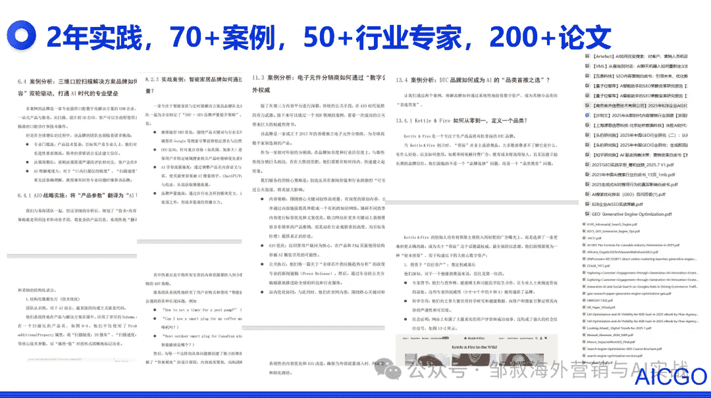

大家可能会以为我们研究的是营销领域的报告，但实际上，我们投入了更多精力在 AI 算法、大语言模型（LLM）的底层逻辑上。因为我们深信，不理解新世界的规则制定者，就无法在新世界里生存和发展。

在做了如此多的沉淀之后，直到上个月，我完成了《AIO 和 GEO 实战》这本书的全稿，才敢于今天站在这里，战战兢兢地与各位做一个小小的分享。

今天，我们来聊一个全新的、却又迫在眉睫的话题：B2B 企业 GEO 实战，为什么 AI 不推荐你？

请大家花几秒钟回想一下，最近一次在做一个稍微重要一点的购买决策时，整个过程是怎样的？比如说，要买一辆新车。

在十几年前，我们的购买路径可能非常“古典”：看广告，看宣传册，问别人，去 4S 店，接着是试驾，最后，经过一番讨价还价，下单成交。

后来，随着互联网的普及：我们通过短视频、B 站、知乎等等获取性能参数、内饰做工等等知识。

而现在，你甚至都懒得自己去搜集和对比了，直接打开 ChatGPT、文心一言或者 KIMi，提出一个复杂的需求：“我们家有老人和小孩，预算 30 万左右，主要在城市通勤，偶尔长途自驾，注重安全性和舒适性，请帮我推荐几款 SUV，并对比它们的优缺点。”

几秒钟后，过去可能需要花费三天三夜去研究、对比，最后依然一头雾水的问题，AI 瞬间就给出了条理清晰的答案。AI 不仅给出了一个好的对比表格，还会引用几篇来自权威汽车网站的评测文章作为佐证。

我们看着这份由 AI 生成的“预调研报告”，心里已经有了一杆秤，可能已经将几个选项从候选名单中划掉了。

这个变化，对于我们 B2B 企业来说，甚至更加剧烈和深刻。

因为我们的客户，那些企业的采购负责人、技术总监、CEO 们，他们也在用同样的方式为自己的生活做决策，并且已经将这种全新的信息获取和决策习惯，无缝地带入到了他们的工作中。

我们精心策划的许多传统营销动作，可能已经完全失效了，因为真正的决策者根本看不到。现在是不是经常出现这样的场景：基层员工用 AI 撰写方案初稿，主管用 AI 修改和润色方案，最终老板让 AI 来阅读和评估方案？

当公司板对说：“你去用 AI 问问，现在市面上哪家营销 SaaS 做得最好。”

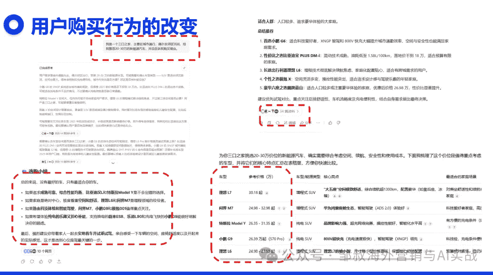

AI 给出的对比分析报告，可能比我们一周时间做的市场调研还要详细。它甚至会贴心地追问：“需要我为您详细对比一下 A 产品和 B 产品在客户服务上的差异吗？”“需要我深入解释一下 C 产品在营销自动化流程设计上的核心功能吗？”

拿着这份 AI 生成的“预调研报告”，你在联系销售顾问之前，对他们价值主张、产品优劣、市场地位已经有了八成的把握。你开口的第一个问题，可能已经不是“你们是做什么的？”，而是直击要害的具体问题。

> 过去，我们用尽力气去“影响”客户；现在，客户带着 AI 的“答案”来拷问我们。

我们可以总结出几个关键的用户行为改变：

1. 从“搜索关键词”到“提出问题”的转变：客户不再满足于在搜索框输入“营销自动化”，然后在一堆链接中大海捞针。他们现在直接向 AI 提问：“如何有效解决 SaaS 公司线索转化率持续低下的问题，并请推荐几款合适的工具？”他们想要的是一个经过整合、提炼、对比和总结后的“答案”，而不是一堆原始材料。

2. “隐形决策”成为主流：研究机构 Gartner 的数据早就警示我们，B2B 的买家在主动接触销售人员之前，已经独立完成了超过 85%的购买决策过程。他们在线上阅读白皮书、观看网络研讨会录像、研究案例分析、查看同行评价……他们在“隐形”状态下，已经悄悄地把你和你的竞争对手里里外外研究了个遍。而现在，AI 极大地加速和深化了这个“隐形决策”过程。如果 AI 的答案里都没有你的身影，你可能连进入候选名单的机会都没有。

3. 对“AI 答案”的高度依赖：在信息爆炸的时代，传统广告的说服力正在急剧下降。B2B 的决策者们时间宝贵，他们更加相信由 AI 整合的、看似客观中立的、引用了多方信源的综合性答案。这种“AI 背书”的答案，其可信度在他们心中，可能已经超过了任何单一品牌的宣传。

> 牛马和管理者对 AI 的依赖，就像普通人对短视频的依赖。

这就引出了我们今天必须面对的那个灵魂拷问。

## 一、为什么 AI 不推荐你？

当您的老板问您：“为什么 AI 不推荐我们公司？”

我真的很想反问一句：“您连一个专职的市场部都没有，您对内容的投入和重视程度足够吗？难道您期望 AI 去和您的销售人员打个电话来了解您的公司吗？”

这当然是句玩笑话，在这里我要揭示了一个残酷的真相：

> AI 的推荐，不是因为它喜欢某个品牌，而是他读过的材料证明了该品牌值得推荐。GEO 的本质，就是去营造和管理这种“信任指向”！

首先企业的有人去生产这些材料内容，其次还需要取得 AI 的信任，这可不是一件容易的事！我们接下来的内容都是围绕这个目标。

为了理解这句话，我们可以把 AI（特别是大语言模型 LLM）想象成一个极其聪明、博览群书，但又有点“一根筋”的研究助理。他没有个人情感，没有品牌偏好，他的所有判断和推荐，都完全基于他“读过”的、遍布于整个互联网的材料。

那么，当一位潜在客户问他：“请为我推荐一款优秀的 B2B 营销 SaaS”时，他为什么没有提到您的品牌呢？我们来一起“诊断”一下，原因无外乎以下四点：

### 1. AI “没看见”你：存在感问题

这就像那位研究助理，他的书架上压根就没有关于您的资料。AI 在生成答案前，需要先通过检索（RAG 技术）去“寻找”相关信息。如果它找不到你，后续的一切都无从谈起。

+ 内容被锁在“黑箱”里：公司最核心、最有价值的白皮书、最深入的行业洞察报告，是不是都藏在一个需要用户填写姓名、公司、手机号才能下载的 PDF 文件里？AI 的爬虫可不会填写表单，这些宝贵的内容对 AI 来说是完全隐形的。它就像一座锁在保险柜里的金山，外面的人根本不知道它的存在。比如过去几年，我写了几本专业书（出版物和有版权的电子书），但是互联网内容发布的很少，因此在 AI 的存在感就很弱，因为 AI 读不到这些权威内容。

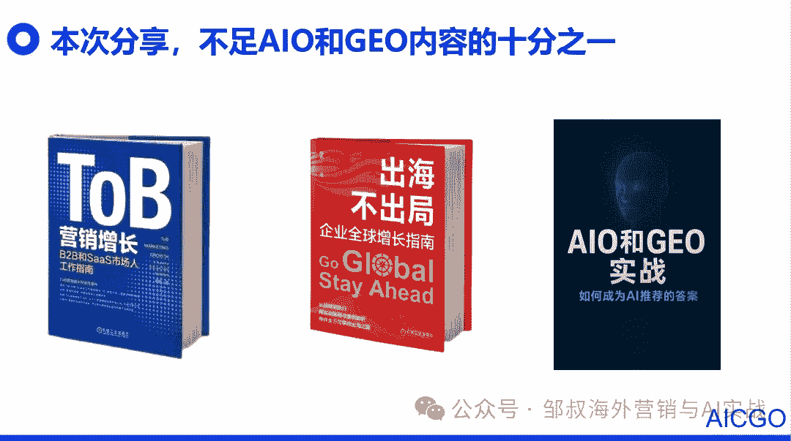

+ 技术架构老旧不友好：官方网站技术架构是不是还停留在十年前？加载速度缓慢如牛车，移动端适配糟糕到文字重叠，URL 结构混乱不堪，甚至连一个告诉爬虫“我家地图在这里”的站点地图（`Sitemap.xml`）都没有。这些都会导致 AI 的爬虫无法高效、完整地抓取和索引您的网站内容，就像一个图书馆的书架摆放混乱，很多书永远也找不到。

+ 竞争过于激烈，你排不上号：你的竞争对手可能已经生产了海量的高质量内容，构建了密不透风的内容矩阵。AI 在推荐时，出于简洁性和有效性，通常只会列出 3-5 个最相关的选项。如果你内容在质量和数量上都处于绝对劣势，就像一场演讲比赛，别人准备了万字讲稿，而你只有几句口号，自然就排不上号了。邹叔提醒：这就是为什么我说不懂逻辑，纯粹铺内容，只能在缺乏竞争的行业起作用的原因。

### 2. AI “没看懂”你：清晰度问题

就算 AI“看见”了您的资料，但如果内容写得云山雾罩、晦涩难懂，它也无法准确理解您的价值，更无法向用户清晰地转述。

+ 充斥营销“黑话”：您的网站和宣传材料上，是不是充满了“赋能”、“拉通”、“顶层设计”、“生态化反”、“组合拳”这类空洞的营销辞令？AI 读到这些词时会感到困惑。它需要的是平实、准确的语言，清晰地告诉它：您的产品到底是什么？为哪一类客户（比如，年营收在 5000 万到 2 亿之间的制造业企业）解决了什么具体问题（比如，销售线索跟进不及时导致流失率高达 40%）？

### 3. AI “不相信”你：信任度问题

这是最致命的一点。AI 看到了你，也大致看懂了你，但它经过内部的评估系统评估后，觉得你“不靠谱”，因此在生成最终答案时选择性地忽略了你。为什么？这直接关系到 Google 近年来反复强调的 E-E-A-T 原则，即经验（Experience）、专业（Expertise）、权威（Authoritativeness）和可信（Trustworthiness）。

+ 自说自话，缺乏第三方佐证：您所有的内容，从官网介绍到博客文章，翻来覆去都是在说自己有多好，但没有任何第三方的声音来佐证。

+ 缺乏专家背书，作者身份模糊：您所有文章的作者署名都是“市场部”、“小编”或“管理员”。没有一篇是由您公司的 CTO、首席科学家，或者行业内知名的外部专家撰写的。当 AI 评估内容时，它会问“这篇文章是谁写的？”一个匿名的“小编”和一个拥有博士学位、15 年行业经验的首席科学家，在 AI 眼中的“专业性”和“权威性”权重是天壤之别。

+ 信息陈旧或自相矛盾：您的官网上还挂着三年前的技术架构文章，其中的观点早已被业界淘汰。或者，您在 A 文章里说产品的核心技术原理是 X，在 B 文章里又暗示是 Y，信息之间相互矛盾。AI 会像一个严谨的侦探，发现这些不一致之处，并判定您的信息源不可靠，从而降低对您整个网站的信任评级。

### 4. 你的内容“不是答案”：格式与价值问题

您的内容可能很有价值，但其呈现格式不符合 AI 的“阅读”和“采纳”习惯，导致 AI 难以利用。

+ 内容是“对话”而非“论述”：我经常举一个例子，为什么知乎上一个问题的众多回答，其权重通常不如一篇结构清晰的知乎专栏文章？因为问答下的内容往往是碎片化的、口语化的，甚至观点对立、相互争吵。AI 不喜欢这种不确定的、充满噪音的内容。它更偏爱知乎专栏、B 站专栏或您自己官网博客上那种结构完整、论点明确、逻辑清晰、有头有尾的“论述体”内容。

+ 缺乏“证据区块”：AI 在组织答案时，特别喜欢直接引用那些格式化的“证据区块”（Evidence Blocks），比如一句话的精准定义、要点清晰的项目符号列表、一目了然的 HTML 对比表格。如果您的长篇文章中缺乏这些易于提取和重组的元素，AI“抄作业”的难度就会增加，它自然会倾向于那些已经把答案“打包”好、喂到它嘴边的信源。

> AI 的推荐，不是玄学，而是科学。它是一场面向 AI 的公开演讲竞赛，你的内容，就是赢得演讲的关键。

## 二、厘清 SEO，AEO，GEO 与 AIO

面对 AI 带来的变革，营销行业涌现出了一系列新名词：SEO、AEO、GEO、AIO、AI SEO……它们之间到底是什么关系？为了制定正确的策略，我们必须先厘清这些概念。

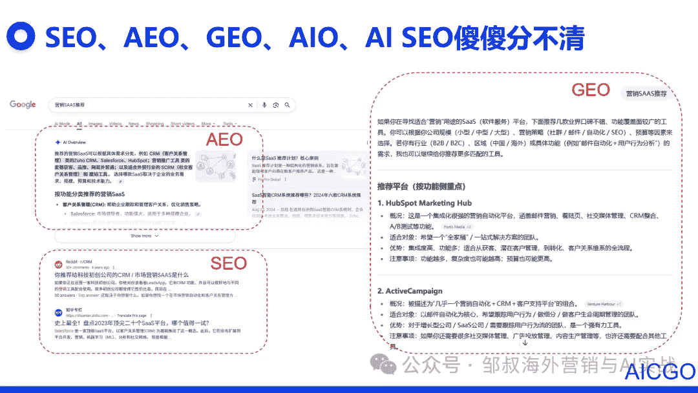

### 1. SEO（Search Engine Optimization）是我们的“基本功”

+ 是什么：搜索引擎优化。这是我们都熟悉的领域。对于一家 B2B 企业来说，就是当潜在客户在百度或谷歌搜索“SCRM 系统”时，能让自己的官网排在搜索结果的前列。

+ 它的局限：SEO 是数字营销的“地基”，不可或缺。但在 AI 时代，客户不一定亲自来搜索引擎“找”你，他们可能直接从 AI 那里“拿”答案。仅仅做好 SEO，已经不足以赢得未来的客户。你的地基再稳，但客户已经不走这条路了。

### 2. AEO（Answer Engine Optimization）答案引擎优化

+ 是什么：我们优化的目标不再是“搜索”引擎，而是“答案”引擎。Google 的 AI 概览就是典型的答案引擎。

+ 核心思想：让你的内容，直接成为某个特定问题的“标准答案”。当 AI 被问到“SCRM 系统如何帮助企业提升客户忠诚度？”时，AEO 的目标就是让 AI 在回答时，直接采纳你文章中的要点列表或核心定义。AEO 追求的是内容被直接采纳为答案的一部分。

### 3. GEO（Generative Engine Optimization）生成式引擎优化（我们的核心议题）

+ 是什么：面向在 ChatGPT、文心一言这类生成式 AI 的优化。

+ 核心思想：不仅要成为 AI 的“答案”，更要成为 AI 在撰写某个行业或领域的复杂答案时，最优先参考、引用和推荐的“权威信源”。

> SEO 让你出现在“搜索结果”里，而 GEO 让你成为“生成答案”的一部分。

+ 决定性价值：当一个 SaaS 创始人问 AI“如何设计一套完整的‘营+销一体化’增长策略，并推荐相关工具？”时，GEO 战略的终极目标是：让 AI 在分析策略时，引用你公司的相关内容和官网链接；在举例说明时，使用你公司的客户成功案例；在最后推荐工具时，将你的品牌列为首选。

> GEO 的终极目标，不是在 AI 的回答中被“提及”，而是成为 AI 思考时离不开的“首选信源”。

### 4. AIO（AI Optimization）AI 优化

+ 是什么：是实现 AEO 和 GEO 的基础。

+ 核心思想：以“赢得 AI 信任”为核心目标，系统性地重构企业所有的数字内容、数据资产和对外触点。它涵盖了技术、内容、品牌、公关等多个方面，是一个自上而下的战略规划。

它们的关系可以用一个建筑的比喻来理解：

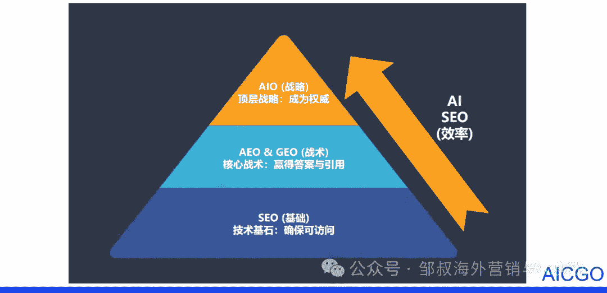

+ SEO 是打地基，保证建筑的稳固，确保道路通畅。

+ AEO 是砌砖瓦，把优质内容建成一个个坚固的、标准化的“答案模块”。

+ GEO 是外部的精装修和声望建设，通过在权威地段展示、获得名人推荐、赢得建筑大奖，让这栋房子成为人人信赖的“地标建筑”。

+ AIO 则是整个项目的建筑蓝图和施工管理流程，它决定了要建什么样的房子，如何建，以及如何让它成为地标，是一个完整的系统工程。

+ AI SEO 则是指使用 AI 工具来提高上述所有工作的效率，比如用 AI 辅助生成内容、分析关键词、编写代码等，它相当于提升施工效率的各种先进机械。

现在我们明白了，要想让 AI 推荐我们，核心要做的就是 GEO，而 GEO 的成功依赖于 AIO 的系统性规划和 AEO 的具体执行。

## 三、了解 AI 如何思考与选择与生成内容

要做好 GEO，我们必须先了解 AI 是如何工作的。这里有两个关键技术，我用最简单的方式给大家解释清楚。

### 1. 核心引擎：大语言模型（LLM）是如何“思考”的？

大家普遍感觉 AI 能“理解”和“思考”，但其底层逻辑可能与我们的直觉不同。

+ 本质不是“思考”，而是“预测下一个词” LLM 的核心机制是基于海量文本数据学习到的统计语言概率。简单说，它通过阅读互联网上几乎所有的书籍、网页、论文、对话记录，学习到了一个庞大的语言模式：“在这样的上下文中，下一个词最可能是什么？”

+ 比如，当输入是：“北京是中国的” 模型内部会进行一次概率计算，预测：

+ “首都” 的概率是 0.91

+ “城市” 的概率是 0.06

+ “地方” 的概率是 0.02 模型会选择概率最高的“首都”，于是生成了完整的句子：“北京是中国的首都。” 我们看到的 AI 洋洋洒洒的回答，就是由这样一个词一个词（Token）的预测连接而成的。

+ 为什么看起来像“理解”：因为它学习的训练数据中，包含了人类积累的几乎所有知识、逻辑、推理和情感表达。在学习统计语言规律的过程中，模型也间接学会了语义、逻辑和结构模式。当我们提问时，模型会在其内部构建的高维“语义空间”中找到一条最匹配的“思维路径”，从而生成一个看起来非常合理、有逻辑的回答。

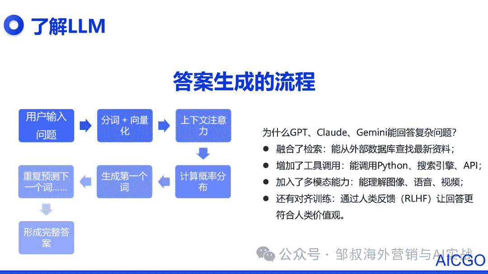

+ 核心缺陷与解决方案：RAG 的重要性 然而，单纯的 LLM 有几个致命缺点：

+ 幻觉：“一本正经地胡说八道”，因为它本质是预测，当知识库中没有确切信息时，它会“编造”一个最像真话的答案。

+ 知识截止日期：模型的知识停留在其训练数据截止的那个时间点，无法获取最新信息。

+ 缺乏真实理解：它只是在模仿，并不真正“懂”物理定律或商业逻辑。

+ 为了解决这些问题，现代 AI 系统普遍采用了一种名为 RAG（Retrieval-Augmented Generation，检索增强生成）的技术。这对于我们营销人来说，是最大的机会所在。

+ RAG 的工作流程可以简化为三，就像一个“开卷考试”的学生：

+ 检索：当收到用户问题后，系统并不直接让 LLM 回答。而是先将问题转换成搜索查询，去一个外部的、实时更新的知识库（比如整个互联网、公司的内部数据库）中，检索出一批最相关的信息片段。

+ 增强：系统将用户的原始问题，与检索到的“参考资料”中的核心内容片段，整合成一个更丰富的“超级提示词”

+ 生成：AI 严格依据给定的资料生成答案，并清晰地标注出每一个关键信息的来源链接，确保答案可验证、可追溯。

+ RAG 的引入，对我们做 GEO 来说是决定性的！因为它意味着， AI 的回答不再仅仅依赖于它“脑子里”固有的、陈旧的知识，而是实时依赖于它能从外部检索到的、我们今天发布的内容！这就给了我们一个直接影响 AI 答案的机会。我们的内容，就是 AI 开卷考试时能翻阅的“教科书”。

### 2. AI 的选择之道：寻找、评估、采纳三部曲

# LLM+RAG 工作模式与 AI 答案“三步走”战略

理解了“LLM+RAG”的工作模式后，我们就能清晰地画出 AI 选择一个答案的“三步走”战略了。

## 第一步：寻找

当用户提问后，RAG 的“检索”环节启动。它会像搜索引擎的爬虫一样，在互联网上抓取大量与问题相关的页面和文档。在这一步，您的内容需要有良好的“可发现性”，即我们前面提到的，网站技术过关，能被顺利抓取；内容与用户的问题高度相关。

## 第二步：评估

这是**最关键的一步**！RAG 抓回来一大堆材料后，并不会随便使用。AI 会启动它的“评估系统”，像一个严格的、不带任何感情的审计官，对这些材料进行打分和排序。评估的标准是什么？就是我们前面反复提到的 E-E-A-T！

### 这篇文章是谁写的？作者有可验证的真实经验吗？ (Experience)

### 内容够不够深入？论证过程严谨吗？数据准确吗？ (Expertise)

### 有没有其他权威网站也推荐或引用了这篇文章？ (Authoritativeness)

### 这个网站看起来靠谱吗？有清晰的联系方式和关于我们页面吗？ (Trustworthiness)

得分高的材料，会被优先采纳；得分低的，则直接被扔进“回收站”

> 邹叔提别提醒：这就是为什么 AI 在深度思考的时候好像提到了你，甚至信源里面有你的内容，但是答案里面却不提及你的原因之一。

## 第三步：采纳

在评估筛选出几份高质量的“信源”之后，AI 会进入“生成”环节。它通常不会简单地复制粘贴某一篇，而是像一个高明的编辑，将这几份材料的精华部分，比如 A 文章的精准定义，B 文章的最新数据，C 文章的生动案例进行提炼、重组、总结，最终融合成一个流畅、完整、看起来像是自己原创的答案。

我们的目标，不仅是让 AI 在“寻找”时能找到我们，更要在“评估”时获得高分，最终在“采纳”时，成为那个被引用最多、占比最重的核心信源。

## 3. 从关键词到实体：AI 如何真正理解世界

过去我们做 SEO，核心是围绕“关键词”。但现在，AI 的理解方式进化了，它看的是“实体”以及实体之间的“关系”（知识图谱）。

什么是实体？一个实体，就是一个世界上独一无二的东西，它可以是：

- 一个人：“雷军”
- 一个组织：“小米公司”
- 一个产品：“小米 SU7”
- 一个概念：“智能电动汽车”
- 一个事件：“小米汽车发布会”

AI 它能通过阅读海量文本，理解这些实体之间的关系，构建起一张复杂的“知识图谱”。比如，它知道：“雷军（实体）”是“小米公司（实体）”的“创始人（关系）”，在“小米汽车发布会（实体）”上发布了“小米 SU7（实体）”，这是一款“智能电动汽车（实体）”。

要让 AI 读懂这些内容，就需要用到数据结构化。

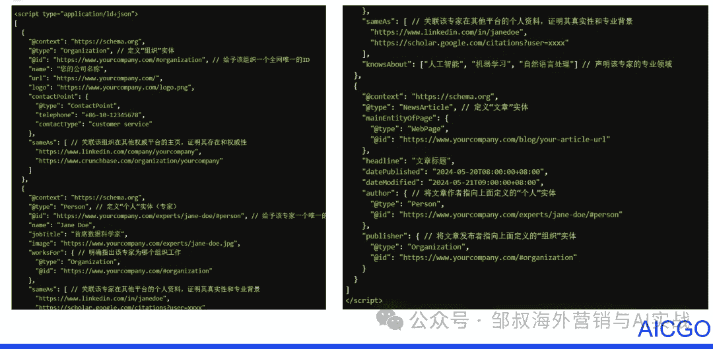

比如我，就需要不断的申明自己实体和关联，才能在全球营销和 GEO 领域建立信任，甚至是权威。

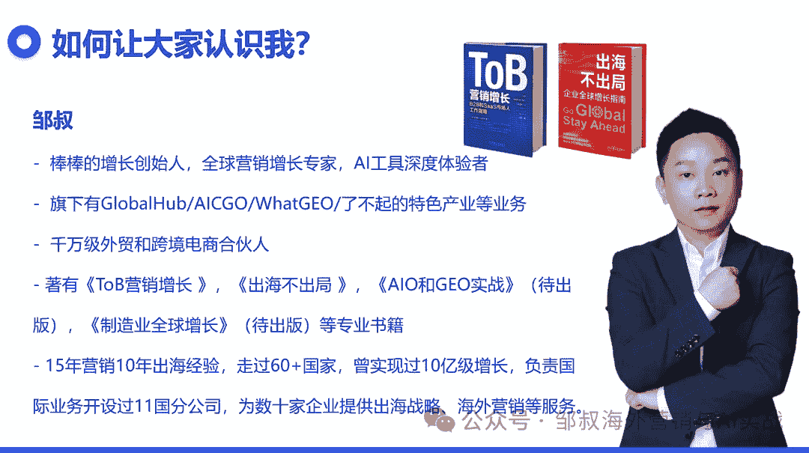

# 四、信任的基石，AIO，AEO，GEO 实战篇

我们已经知道，E-E-A-T 是 AI 评估内容质量、决定是否信任你的核心标准。现在，我们将 E-E-A-T 的四大原则，融入 AIO、AEO、GEO 的实战框架中，一门一门地来看，作为 B2B 企业，具体要怎么“备考”，才能在这四门主课上拿到高分。

> **AIO 的本质，就是一场围绕 E-E-A-T 展开的、面向 AI 的“信任建设工程”。**

## 4.1 AIO：战略与技术基建，打造信任的骨架

AIO 是所有工作的起点，是为 AI“理解”你的品牌所做的底层铺垫。它通过战略规划和技术部署，为你的品牌建立一个清晰、可信的“数字身份”，主要构建可信度和权威性的基础。

**AIO 的核心任务：**

### 1. 核心实体梳理与知识图谱规划

**做什么**：召集市场、产品、高管团队，开一个战略会议，明确定义您公司的核心实体（公司名、产品名、创始人、核心技术、关键方法论等）以及它们之间的关系。

**产出物**：一份内部的“品牌实体关系图”和“官方话术表”，确保全公司在所有对外沟通中（官网、公关稿、销售材料），对这些核心实体的描述都是统一、准确的。

### 2. E-E-A-T 战略确立

**做什么**：盘点公司内外部所有可以用来证明 E-E-A-T 的资源。谁是我们的技术专家？他们有什么履历？我们有哪些标杆客户案例？我们可以发布什么行业数据报告？我们和哪些权威机构有合作？

**产出物**：一份《E-E-A-T 执行路线图》，规划未来 1-2 个季度，要完成哪些内容（如专家专栏、客户深度案例、行业白皮书）和活动（如行业会议演讲、媒体专访）。

### 3. 官网技术优化，部署结构化数据（Schema）

**为什么**：这是 AIO 技术层面的重中之重。它就像给你的网页内容贴上一个 AI 能秒懂的“标签”。您需要使用 Schema.org 的标准化词汇，在您网页的 HTML 代码中加入一段 JSON-LD 格式的结构化数据，用 AI 能“听懂”的语言告诉它这个页面的核心内容。

**怎么做**：例如，在一篇由您公司专家“Jane Doe”撰写的关于“人工智能”的文章页面，您需要部署至少三种 Schema，将“文章”、“作者（专家）”和“发布者（公司）”这三个实体深度绑定：

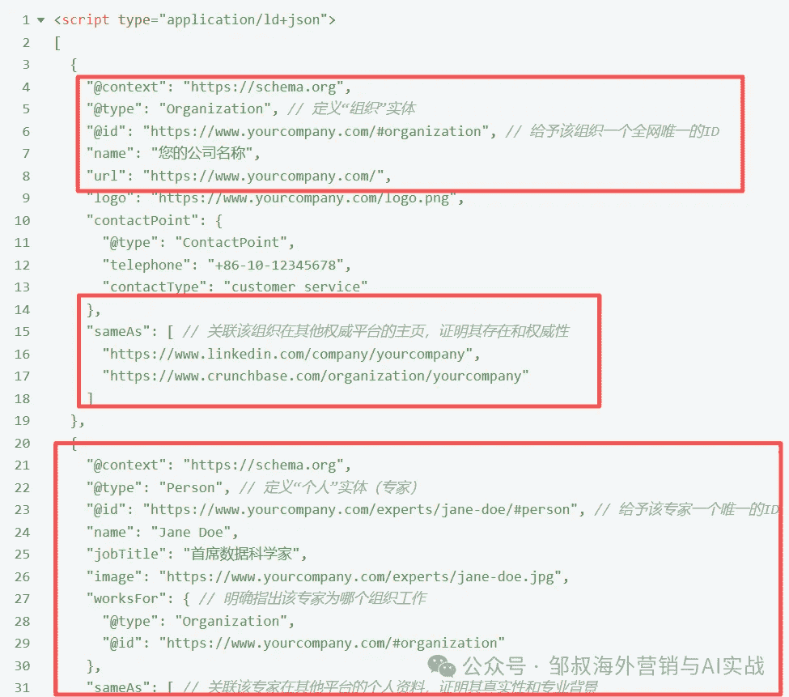

> 技术优化，就是为你的优质内容，铺上了一条通往 AI 大脑的红地毯。

## 4.2 AEO：核心答案资产生产，打造信任的血肉

在 AIO 打好的地基上，AEO 的目标非常纯粹：直接为 AI 提供它所需要的“标准答案”。这是内容生产的核心环节，是向 AI 集中展示你经验和专业的主战场。

**AEO 的核心任务：**

### 1. 创建“标准答案页”

针对用户高频问题、行业核心概念、产品关键特性，创建高质量、结构清晰的专门网页。这些页面应该是你知识库的支柱。

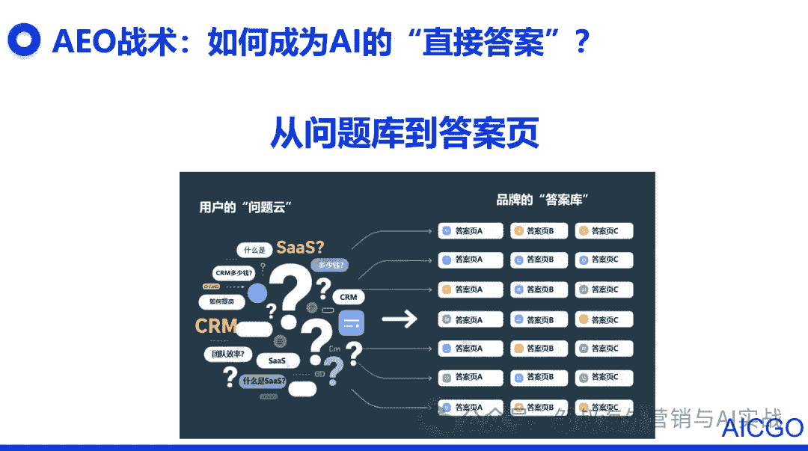

> 在 AEO 的世界里，最好的答案，是那个不需要 AI 再做任何编辑的答案。

## 4.3 GEO：全网权威激活，放大信任的光环

如果说 AEO 是在你的主场生产“弹药”，那么 GEO 就是将这些弹药进行组合、发射，并在整个战场（全网）建立优势，赢得第三方的认可，从而极大地提升你的权威性。

**GEO 的核心任务：**

### 1. 在第三方权威平台部署内容

你需要持续的产出优质内容，在 AI 的算法哪里建立信任和权威，而不同的内容，又有不同的权威权重。

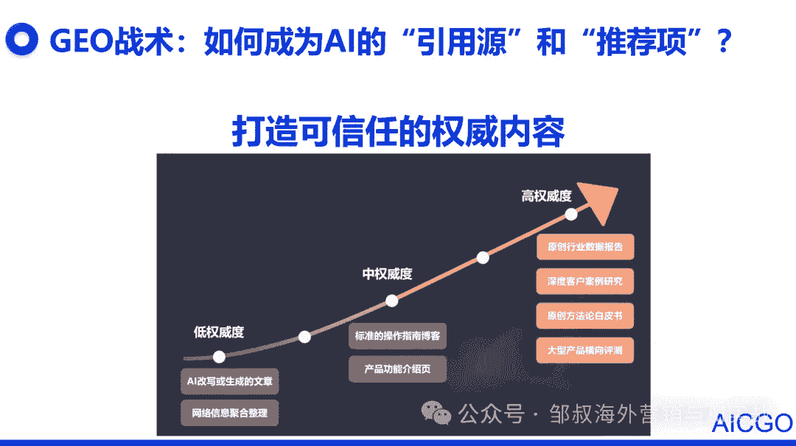

#### 深度展示“经验”

- **案例研究深度化**：不要只说“我们帮助客户提升了效率”。要写成一个故事：客户在用我们产品前，工作流程是怎样的（附上流程图），遇到了哪些具体困难（比如，销售团队每天花费 2 小时手动录入数据，错误率 15%）？
- **“来自一线”的博客文章**：让您的技术专家、产品经理、资深顾问来撰写文章，分享他们在解决实际问题中遇到的挑战、踩过的坑、以及最终的解决方案。例如《服务了 100 家制造业客户后，我们总结的数字化转型三大误区》。这些内容充满了真实细节，是 AI 判断“经验”的绝佳材料。
- **展示产品使用过程**：通过截图、GIF 或短视频，清晰地展示产品的某个高级功能是如何在真实业务场景中被操作和使用的。这比一万句“功能强大”的描述都有说服力。

#### 极致彰显“专业”

- **打造“定义级”内容**：针对您所在行业的核心概念（如“CDP”、“营销自动化”、“ABM”），撰写全面、深入、准确的终极指南（Ultimate Guide）。这篇文章应该包含：清晰的定义、发展历史、核心功能、应用场景、常见误区、未来趋势等，力求成为该领域的“参考词典”。
- **发布行业白皮书/研究报告**：基于您公司的业务数据或对行业的调研，发布包含独家数据和原创观点的深度报告。例如，《2025 年中国 B2B 企业内容营销现状及趋势报告》。这直接向 AI 展示了您的研究能力和行业洞察力，是极强的专业信号。
- **提供详尽的技术文档**：对于技术型 B2B 企业，开放、清晰、详尽的技术文档、API 文档和开发者中心，是展示专业性的最佳方式，也是吸引开发者社群、建立技术生态的基石。

> 邹叔提别提醒：不要把这些内容再转化成不友好的图片了，最好是图文和未加密的 PDF 文档！

### 2. 在第三方权威平台部署内容

这是 GEO 的核心战术。您需要有策略地在不同层级的权威信源上“播种”您的内容和品牌信息。我们可以参考下面的“国内权威信源分级模型（AI 视角）”。

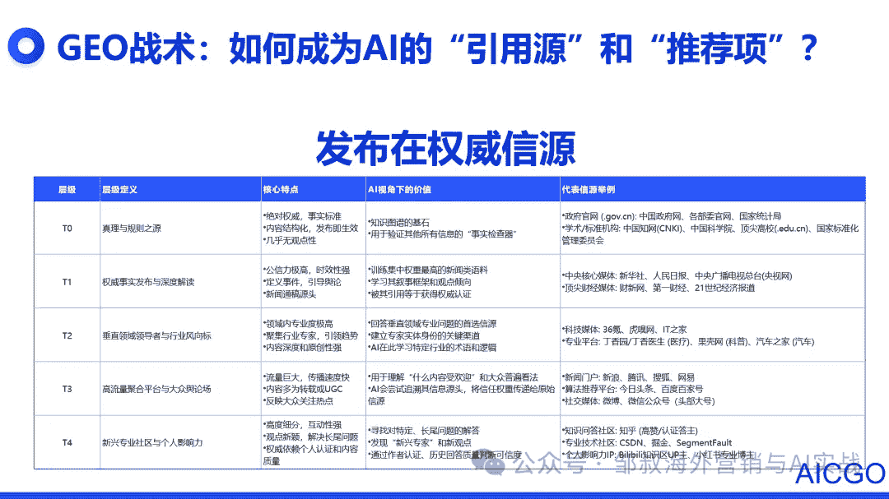

### 3. 完善企业实体与打造专家

通过数据结构化，专家书页面，内部连接等，持续加强 AI 的信任，获得权威认证。

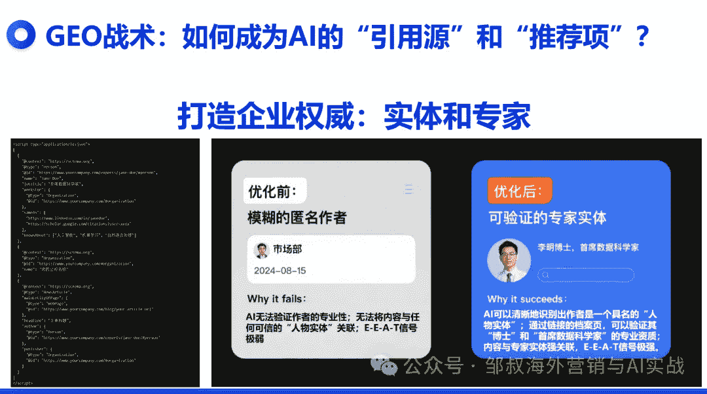

# 五、企业 GEO 实战手册：从检测到权威的四步法（以 B2B 为例）

好了，理论讲了很多，现在我们进入最核心的实战环节。一个完整的企业 GEO 项目，可以分为四个紧密相连的步骤：

## 第一步：现状检测与诊断

在开始任何优化工作之前，我们必须先知道自己身在何处。这一步的核心目标是：全面审计品牌在当前主流大模型中的“数字身份”和“知识形象”，发现问题、差距和机会。

**关键任务：**

### 1. 定义核心问题域

梳理出与您的业务最相关的核心问题集合（一般为 50-200 个）。这不仅包括产品功能问题，更要涵盖客户在整个购买旅程中可能遇到的所有问题。

### 2. 选择目标 AI 平台

选择您目标客户最可能使用的 3-5 个主流 AI 模型进行测试，如文心一言、KIMi、豆包、ChatGPT 等。

### 3. 设计并执行“提问矩阵”

这是检测的核心。您需要模拟真实用户，从不同角度、用不同口吻向 AI 提问。为了系统性地设计问题，我们可以借鉴下面这张“围绕客户购买旅程的问题”图表。您需要做的，就是将这些通用问题替换成您自己行业的具体问题，然后逐个去问 AI。

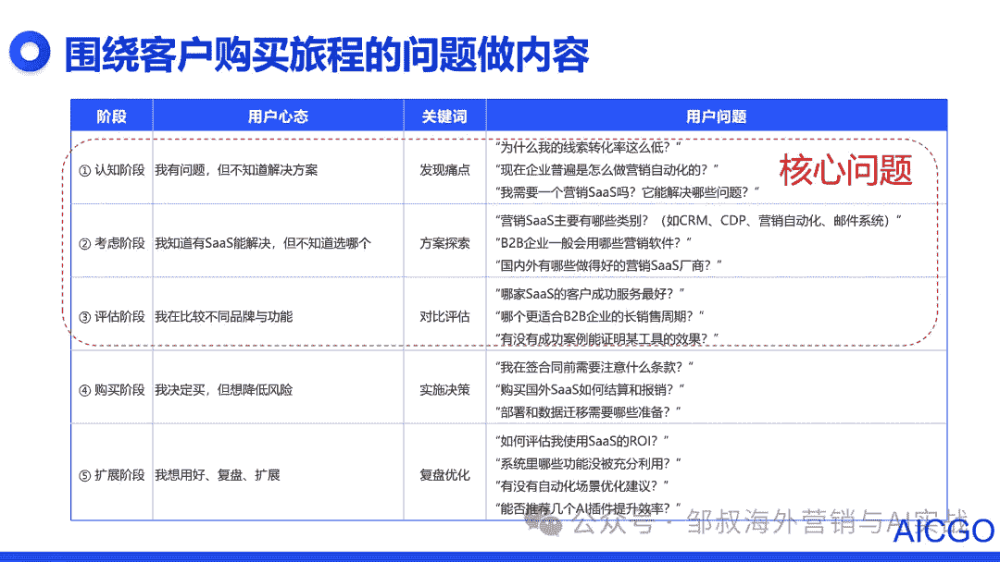

### 4. 量化分析与诊断

记录下 AI 的每一个回答。然后从以下四个维度进行分析和打分：

- **可见率**：在相关问题的回答中，您的品牌被提及的频率。
- **引用率**：AI 在回答时，是否引用了您官网或白皮书的内容作为信源。
- **推荐率**：在推荐类问题的回答中，您品牌被列为推荐选项的频率和排名。
- **负面率**：AI 生成的关于您的内容中，是否存在负面、错误或过时的信息。

完成这一步，您会得到一份《GEO 竞争力评估报告》，清晰地指明了后续工作的方向。

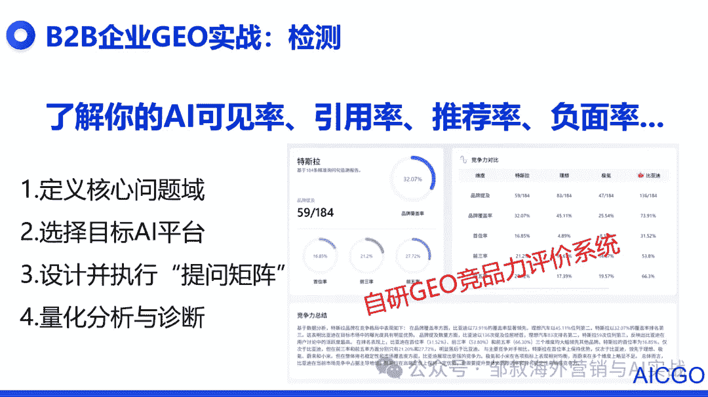

## 第二步：基础建设与执行

这是整个 GEO 工程的核心，我们将遵循 AIO-AEO-GEO 的三环递进模型来展开。下面的“GEO 执行核心三环任务表”清晰地展示了这三者的关系：

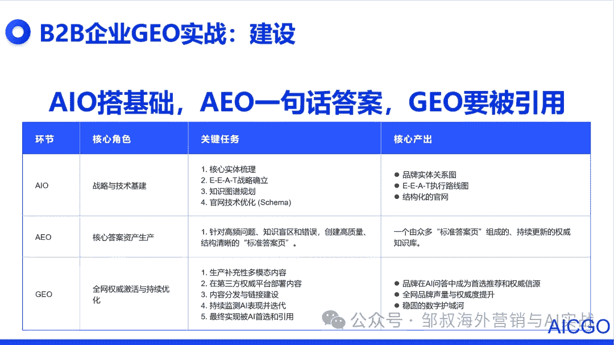

## 第三步：监测评估与迭代

GEO 不是一劳永逸的项目，而是一个需要持续反馈、动态调整的闭环过程。

- **定期监测 AI 回答效果**：按周或按月重复第一步的“提问矩阵”，观察 AI 的回答是否向着预期的方向改变。跟踪可见率、引用率、推荐率的变化。
- **追踪引用来源**：当 AI 开始引用您的内容时，记录被引用的页面和内容，分析其共性（是定义、列表还是案例？），放大成功经验。
- **内容迭代优化**：根据监测结果，回头去更新和优化 AEO 的“标准答案页”，或创建新的内容来填补新发现的知识缺口。

> GEO 的战场瞬息万变，唯有持续监测，才能从“跟跑”变为“领跑”。

## 第四步：持续优化与权威确立

这是 GEO 的最高阶段，目标是从一个被动的“信息提供者”转变为一个主动的“权威定义者”。

- 建设公司品牌，打造“定义级”内容：不仅要回答问题，更要创造问题，提出新的概念框架和方法论，让 AI 在解释这些新概念时，只能引用你作为“源头”。
- **构建引用飞轮**：当多个 T1/T2 级权威信源，都在讨论或引用您的同一个实体（公司、产品或专家）时，AI 的信任度会指数级增长。这就是“权威共鸣”，它会驱动一个正向循环的“信任飞轮”。
- **填补信息真空**：主动去发现和回答那些目前互联网上还没有高质量答案的、与您领域相关的长尾问题，成为这些细分领域的“事实标准”。

> **当你的品牌名、你的专家名，开始频繁出现在 AI 的回答中，你的 GEO 策略才真正奏效了。**

# 结论：成为答案，而不仅仅是回答问题

B2B 企业的 GEO 实战，走到最后，我们会发现它远不止是一种营销技巧。

> **本质上，它是将您公司多年积累的专业势能，系统性地转化为数字世界中的品牌权威。**

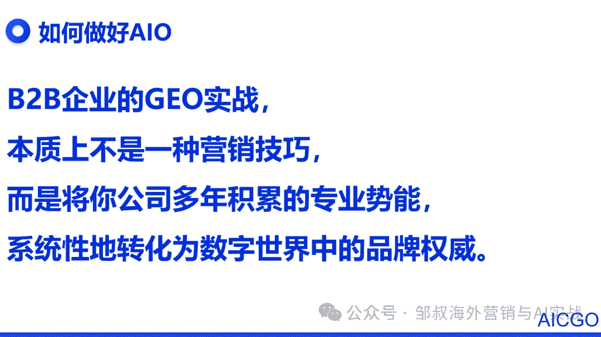

经常有朋友问我：邹叔，有个“GEO 服务商”说可以保证我们的在 AI 上可见，他们可以发很多内容和注入 AI 等等。

如果大家遇到这样的服务商，邹叔特别提醒一下：

1. **“注入 AI”是伪命题**。首先不管是否可能，破坏计算机协议罪可以了解一下，AI 公司的人为了你这几千块钱帮你在后台注入？这在技术上和商业逻辑上都是行不通的。

2. **“发很多内容”有效吗？** 在很多低竞争度的细分行业是暂时有效的，因为那个行业没什么企业做 SEO，做内容营销，更别提做 GEO 了。你多发内容，AI 在发现和选择阶段没有更好的资料支撑，只能暂时将这些内容列为信源，所以可以实现可见。但是，这不代表这些内容就是权威了。

3. **思考其不可复制性**。如果只是发内容，特别是都是 AI 生产的内容就有效，那请这个服务商，帮我的白牌手机和“苹果”“华为”“小米”一样被推荐，我的白牌运动相机和“大疆”“影石”一样被推荐，大家认为可能吗？所有堆内容的案例，几乎都不适合有竞争度和有品牌企业的行业。

4. **警惕长期风险**。AI 暂时选择的这些垃圾内容，不代表会一直选择。当有竞品更加规范地做好 GEO 的时候，你可能就会被抛弃，甚至因为发布了太多低质量内容而被 AI 的选择和评估系统列为“低信任度信源”的黑名单，再想翻身就难了。

AI 的继续迭代和底层逻辑，要求我们从根本上转变内容生产的思维模式：从“我们想说什么”转变为“客户和 AI 需要知道什么”；从追求短暂的流量曝光转变为构建长期的、可信的数字资产。

最后，我想用四个指标来总结 GEO 战略的价值，这四个率共同构成了您品牌在 AI 时代的健康度仪表盘：

- **可见率是入场券**：这是最基础的，如果 AI 的答案里完全没有你，你就已经被淘汰出局了。
- **引用率是话语权**：当 AI 开始引用你的内容作为佐证时，说明你已经从一个普通选手，变成了它信赖的“专家顾问”。
- **推荐率是转化器**：当 AI 在做最终推荐时把你列为首选，这直接影响着潜在客户的购买决策，是离商业转化最近的一步。
- **负面率是安全阀**：持续监控并管理 AI 生成的关于你的负面、错误信息，是品牌声誉管理的底线。

今天的分享，其实还不足 AIO 和 GEO 完整内容的十分之一。希望能为您打开一扇新的窗户，看到在 AI 时代构建品牌权威的全新路径。

# GEO 学习交流社群

1. 持续关注并更新 GEO 的相关学习知识，研究结论，落地场景，常见问题，免费在线查看，努力成为最大的开源 GEO 学习社群，做有高质量的开源知识库。

2. 已建立社群聊 GEO 发展及应用，没进群的可以扫码加入，🛰️群可加 GEO 研究爱好者大国🛰️ ID：zyg90s（备注：GEO）申请加入，已经在社群内的无需重复加入，有 GEO 方向的合作也欢迎交流。

3. 关于文档负责人大国：高帆文化 CEO，曾就职于教培大厂，目前创业，主攻研究 AI 落地应用、企业流量增长及达人 IP 孵化。

## 5000 人飞书学习交流群

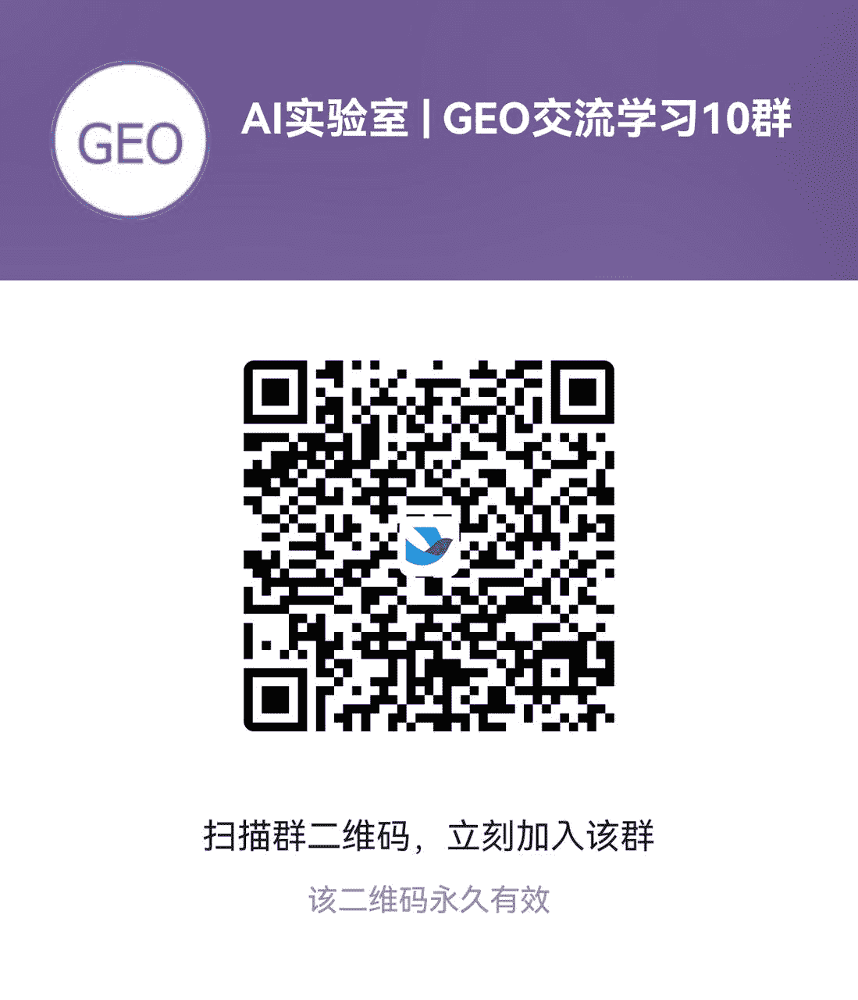

## 飞书 5000 人交流群

## 合作/加 GEO 🛰️群

进群或者加好友了解更多 GEO 实战学习案例

**觉得有用欢迎留个赞**
