# AI 时代，设计师如何破局？答案藏在这 3 个实践里

> 来源：[https://yunyinghui.feishu.cn/docx/N8dAdEhRKoE1EPxo37bcrhlMnGd](https://yunyinghui.feishu.cn/docx/N8dAdEhRKoE1EPxo37bcrhlMnGd)

> **来源公众号：**58UXD

> **发文时间：**2025-09-19 17:06:35

> **推荐理由：**这篇文章主要探讨了在 AI 时代设计师如何通过三个核心实践实现职业转型和效率提升，文章强调，设计师需主动驾驭 AI 工具，聚焦业务价值，才能在新挑战中实现“反脆弱”成长。

最近，设计圈被一组数据刷屏了：三年间设计岗位数量同比减少 40%，超 1 万名设计师受到 AI 冲击，中型公司淘汰率达 30%。

这种并非个例，但我们想说的是让 AI 做工，设计师做主 。用 AI 让团队设计效率提升 3 倍，业务转化数据再创新高。今天就拆解实战经验，看看普通设计师如何借 AI 实现 “反脆弱”。

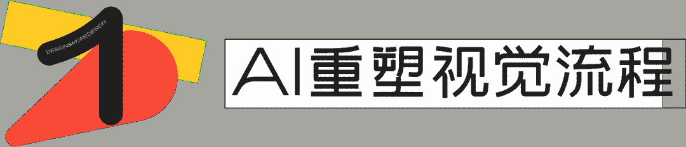

**传统设计流程有多 “磨人”？ **团队设计师小李曾吐槽：“为了一个活动 KV，先花 2 天找参考图，脑暴会开 3 次，出 5 版方案都被毙，最后改到第 8 版才通过，结果上线后点击量还没达标。” 这种 “凭感觉、靠试错” 的模式，不仅消耗设计师精力，还难和业务目标挂钩。

我们的破局思路，是把线性工作流升级为 “AI 初筛 + 人工精修 + 数据验证” 的闭环模式，用 “漏斗法” 层层聚焦需求：

+   我们此次把传统的线性工作流结合 AI 打造成 AI+人的工作流。能够利用 AI 有效的在业务上进行需求归纳，指导设计，并对数据有正向的提升。

+   并且我们从多维度深入对比传统方法与 AI 解法。基于大数据支撑，AI 决策展现出碾压传统方法的绝对优势，其客观精准程度远非传统方法可。面对 AI 回答通用普适的困境，我们另辟蹊径，借漏斗提问模型深度挖掘，逐层聚焦问题，并嵌入业务属性，最终产出与业务诉求精准匹配的答案，完美驾驭 ai 为我所用

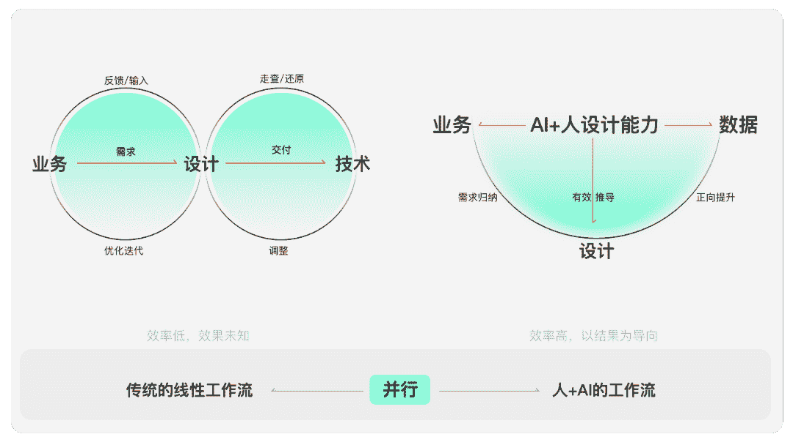

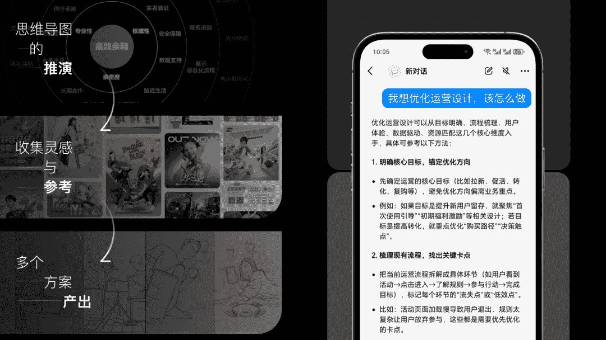

借助 “人 + AI” 的创新工作流程，我们紧扣业务诉求与用户痛点展开分析，最终确定了全新的设计风格。

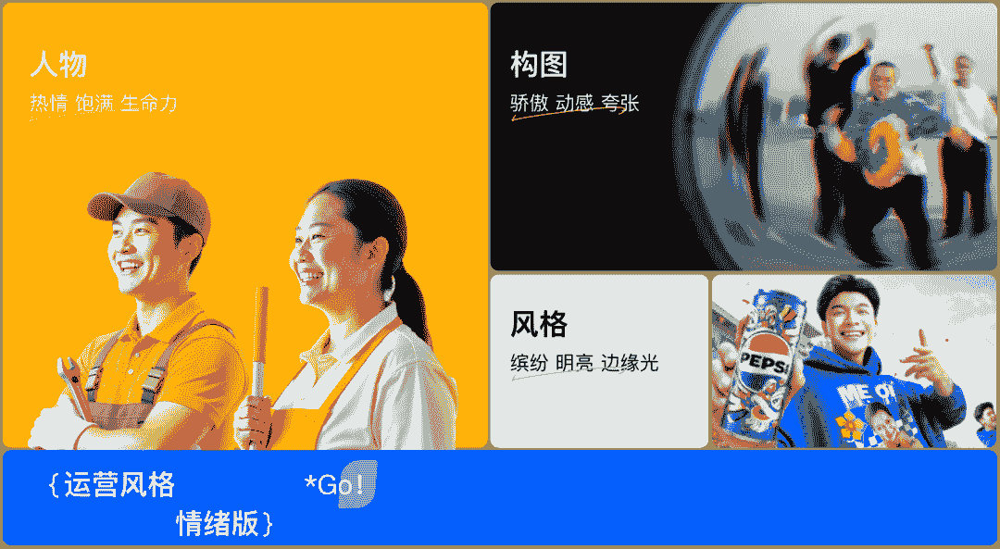

我们也将新的设计风格在实际需求场景中全面落地应用，不仅赢得了需求方的高度认可，相关数据反馈也呈现出积极态势，双重肯定彰显成效。

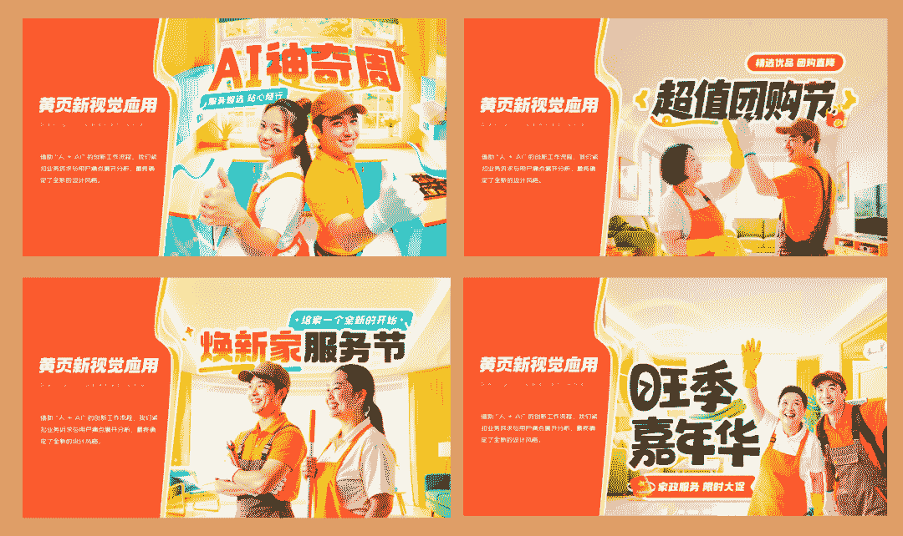

不过，我们并不满足。设计不能仅追求好看，还得解决业务问题、提升点击数据。我们首次将设计重点从会场主 KV 转至各流量入口，依据不同入口流量特性定制文案与画面，做到精准触达用户、提升流量利用率

经过经过几轮的 AB 测和数据优化，所有资源位数据均有明显提升并持续呈上升趋势，后续我们会根据每次数据总结的结果来优化下一次运营设计

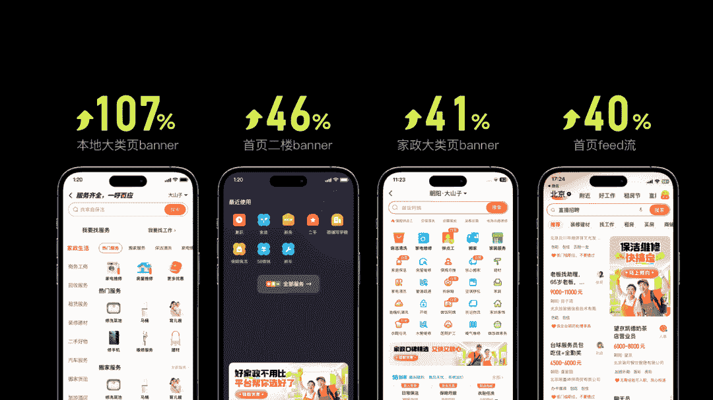

**咱们都来当 “拿来主义者”！**

之前的 “人 + AI” 新工作流程具备普适性，各业务都能复制，到家业务便是例证。我们利用 AI+人设计能力的新工作流程，分析行业-用户-业务，并形成以色彩+构图+人物的设计形式，完成到家的设计升级。在清洗节、健康节、空调维修等多个活动进行，落地应用

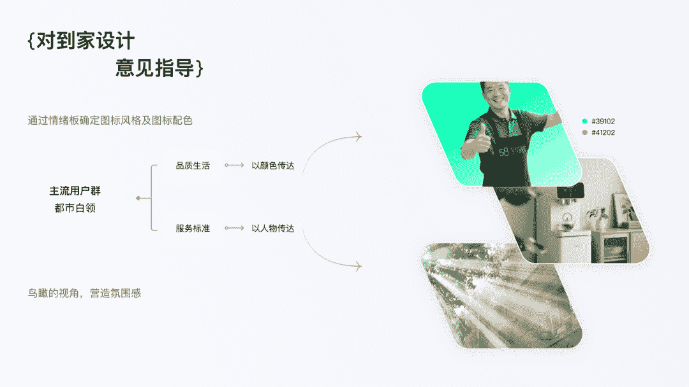

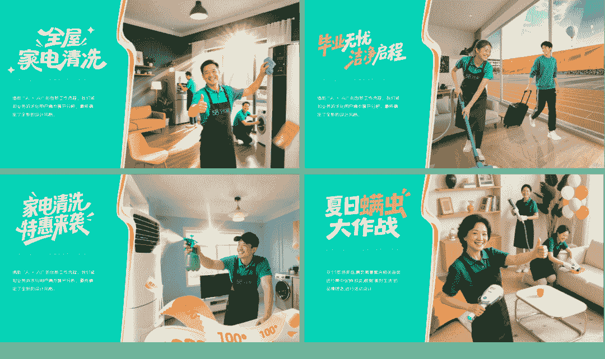

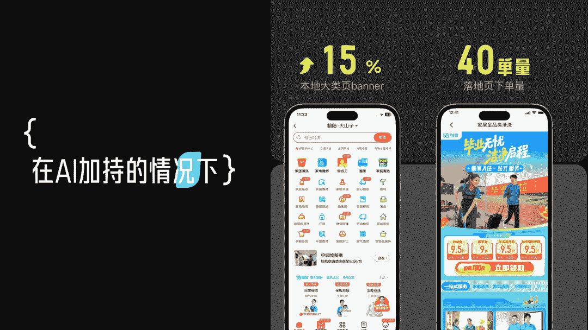

“以前是设计师‘猜’用户喜欢什么，现在是用 AI 铺量、用数据说话，我们终于从‘画图工’变成了‘业务策略伙伴’。” 这是核 心的转 变。

“我只会做平面设计，3D 建模、动效设计完全没接触过，现在公司要做 3D 风格的会员图标，我该怎么办？” 这是设计师小张去年遇到的困境，也是很多设计师在 AI 时代的 “能力焦虑”。

解法是在 Comfy-UI 平台搭建专属工作流，把复杂的设计技能 “拆解成可复用的模块”，让普通设计师也能快速上手跨领域设计：

+   我们这半年在 Comfy-UI 工作流中利用 AI 编程器和人对业务的洞察，通过调整 comfy-ui 的参数和节点，增加了 6 个不同的工作流，并沉淀了丰富的相关文档，让工作流数量变多，可应付多个业务需求，让生图精度变高，可以产出塔尖的设计，可以说是打造了一场视觉革命。

+

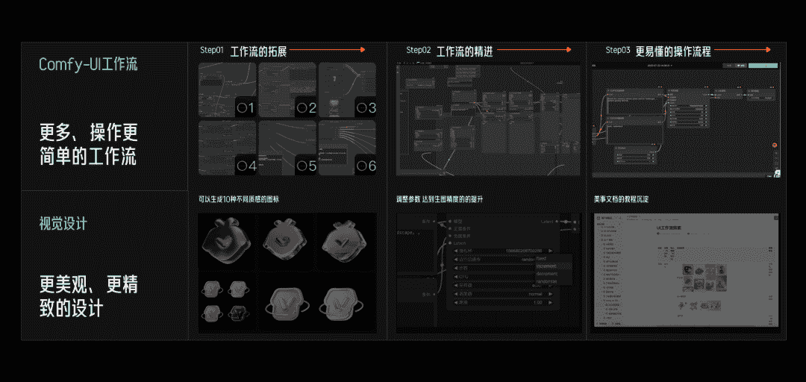

+   适配业务场景 ：为了让工作流更实用，团队还加入了 “业务规则库”。比如商家端等级图标，需要区分 “普通商家→银牌商家→金牌商家” 的视觉层级，他们就在工作流中预设 “金牌图标需增加光效、银牌图标用金属质感” 的规则，AI 生成时会自动匹配，避免设计师反复修改。

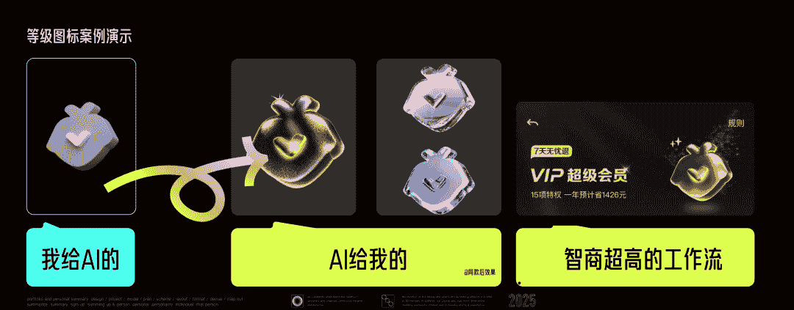

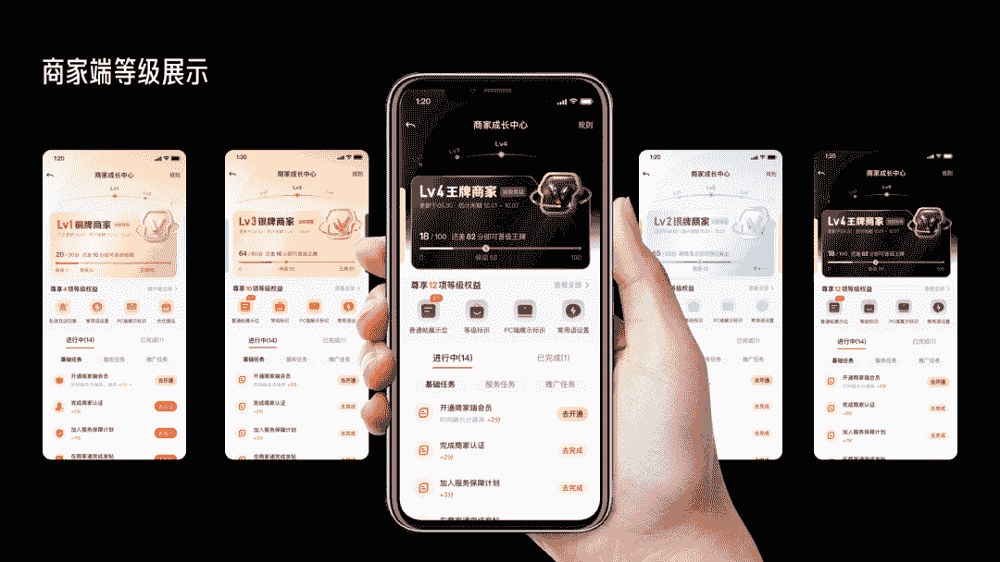

+   新人快速上手：以前新人学 3D 建模要 1 个月，现在通过工作流，小张只用 3 天就掌握了 3D 图标的制作，还能根据业务需求调整细节。“我现在不仅能做平面设计，还能独立完成 3D 图标和简单的动效，上个月还因为一个 3D 会员图标方案，得到了业务方的特别表扬。” 小张的成长，正是团队职能跃迁的缩影。

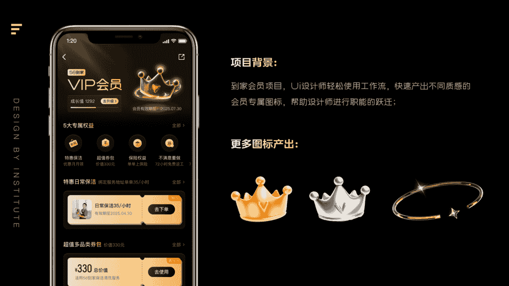

目前团队已搭建 6 个专属工作流，覆盖 80% 的业务设计需求，生图精度提升 60%，新人上手速度比以前快了 4 倍。

最后，我们打造了人+AI 设计知识库 打造团队 AI 设计能力 让绝大部分同学都变成 AI 设计师

在美事文档沉淀的 AI 生成视频的标准化流程，包含了写故事的能力，分镜头的能力，静态生图的能力和动态图的能力。我们通过筛选合理的资料，构建了 AI 设计知识库，利用节点化的串流形式，打造了 AI 设计准则，从而提升 AI 的生成能力

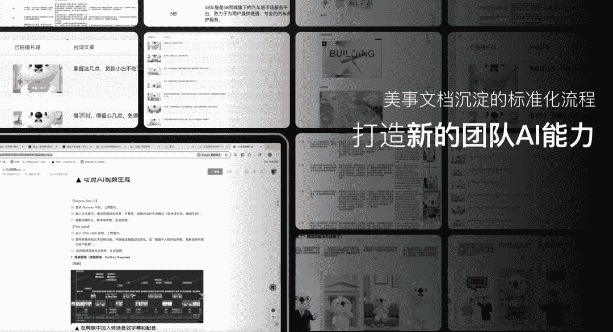

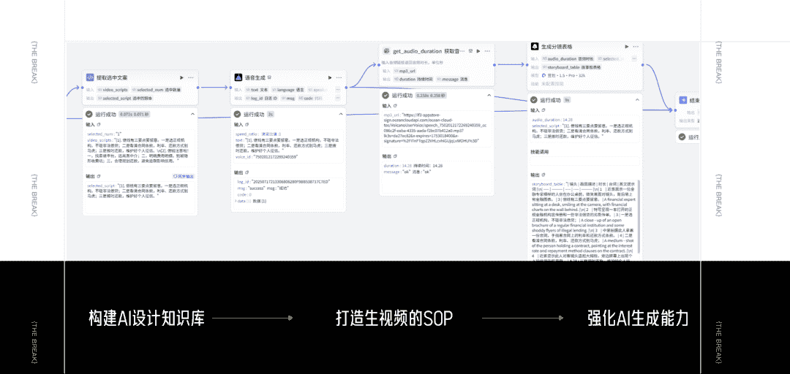

我们利用利用人+AI 对流程的把控力，让 AI 讲故事 画故事，在金融 IP 形象上，利用 AI 生产的能力，设计师只用在背后制定角色框架，AI 帮忙想出故事和画面，在反诈视频、放贷宣传等内容上，快完成宣传。并收到业务的一致好评。

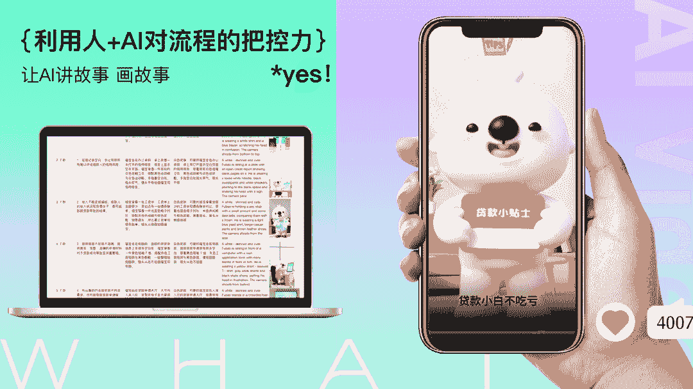

有人说 “AI 会淘汰设计师” ，但实践证明：淘汰的从来不是设计师，而是 “只会执行、不会思考” 的设计师。当 AI 负责 “重复的执行工作”，设计师就能把精力放在 “理解业务、洞察用户、创意策略” 上，让设计真正为业务赋能。

**未来，还会持续深耕设计流程 **，计划把 “AI + 设计” 的模式推广到更多业务线，把团队打造成真正的 “AI 型设计战队”。而对于我们每一位设计师来说，AI 不是 “对手”，而是 “伙伴”—— 只要学会驾驭 AI，就能在新时代找到自己的位置，甚至创造出以前不敢想象的可能。