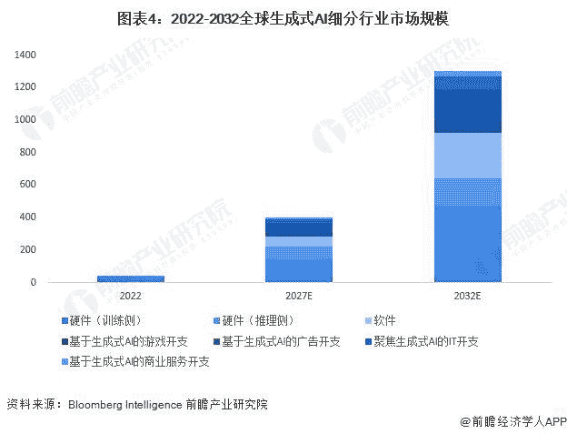
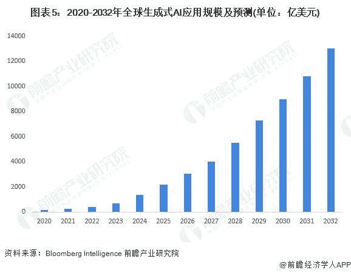

# 全球生成式AI独角兽清单

> 来源：[https://yunyinghui.feishu.cn/docx/W65cdrgQho0c1bxNhTjcqKQenPb](https://yunyinghui.feishu.cn/docx/W65cdrgQho0c1bxNhTjcqKQenPb)

> 适用人群：关注生成式AI发展人群

> 首发时间：2024 年 6 月 11 日

> 更新时间：2024 年 6 月 11 日

> **内容出品人：**** **

> **使用建议：**如果需要快速定位到精确内容，可以使用快捷键 Ctrl +F/Command +F 的形式，搜索关键字/词，查找你想要的内容。

> **持续更新世界生成式****AI 独角兽企业级产品****相****关的动态和调研，让用户了解独角****兽，了解前沿生成式A**I产品，为产品经理及创业者提供思路，永久免费在线查看，欢迎收藏转发支持，文末有惊喜，大国出品，必属精品。

> 🎯全**网最接地气AI知识库： **[Mix AI Lab](https://yunyinghui.feishu.cn/wiki/WhelwZnxQi55mpkOzatc3Xran5b?from=from_copylink)AI绘画、AI写作、AI视频等应用技能）

# 国内外生成式AI独角兽公司

最新数据，据日经新闻、调查公司CB Insights报道，截至2024年4月底，生成式AI领域的“独角兽”企业达37家，与去年4月底的20家相比，几乎翻了一番。业务涉及基础大模型，以及AI绘画、文生视频、AI辅助编程、翻译等方向，独角兽为估值10亿美元以上的公司。

| # 国外知名AI大模型及应用独角兽公司 |  |  |  |  |
| --- | --- | --- | --- | --- |
| **公司名称** | **领域** | **成立时间** | **总部** | **当前估值（亿美元）** |
| Open AI | AI对话机器人 | 2015年12月 | 美国硅谷 | 860 |
| Midjourney | AI绘画工具 | 2021年 | 美国加州 | 100 |
| ScaleAI | 数据标注 | 2016年 | 美国旧金山 | 73 |
| Anthropic | AI对话机器人 | 2021年 | 美国加州 | 50 |
| JUNLALA | AI绘画专项模型 | 2016年 | 美国旧金山 | 50 |
| Hugging Face | 开源机器学习社区和平台 | 2016年 | 美国纽约 | 45 |
| inflection | AI助理对话机器人 | 2022年 | 美国加州 | 40 |
| Dataiku | 站式数据和AI管理及可视化平台 | 2013年 | 法国巴黎 | 37 |
| CoreWeave | 云基础设施公司 | 2017年 | 美国新泽西 | 24 |
| Cohere | AI基础大模型 | 2019年 | 加拿大多伦多 | 22 |
| Glean | 企业级AI搜索服务公司 | 2019年 | 美国纽约 | 预计投后20亿 |
| Mistral AI | AI基础大模型 | 2023年5月 | 法国巴黎 | 20 |
| Helsing | 人工智能软件防御技术公司 | 2021年 | 德国柏林 | 18 |
| Lightricks | 图像视频编辑工具 | 2013年 | 以色列耶路撒冷 | 18 |
| Quantexa | 人工智能数据分析 | 2016年 | 英国伦敦 | 18 |
| Jasper | AI驱动营销软件平台 | 2021年 | 美国得克萨斯 | 15 |
| Runway | 文生视频 | 2018年 | 美国纽约 | 15 |
| AI21 Lab | 大语言模型 | 2017年 | 以色列特拉维夫 | 14 |
| Replit | AI代码开发者平台 | 2016年 | 美国旧金山 | 12 |
| Viz. ai | AI生成检测工具 | 2016年 | 美国旧金山 | 12 |
| DeepL | 翻译 | 2009年 | 德国科隆 | 11 |
| Adept AI | 通用大模型 | 2022年 | 美国旧金山 | 10 |
| Character. AI | AI对话机器人 | 2021年 | 美国加州 | 10 |
| Imbue | 人工智能研究实验室 | 2021年 | 美国旧金山 | 10 |
| Stability ai | 文本到图像生成器 | 2019年 | 英国伦敦 | 10 |
| Synthesia | AI生成视频 | 2017年 | 英国伦敦 | 10 |
| Typeface | 人工智能内容创作平台 | 2022年 | 美国旧金山 | 10 |

| # 国内知名AI大模型及应用独角兽公司 |  |  |  |  |
| --- | --- | --- | --- | --- |
| **公司名称** | **业务方向** | **成立时间** | **总部** | **当前估值** |
| 智谱AI | 基础大模型、开源大模型 | 2019年6月 | 北京 | 16亿美元 |
| 百川智能 | 基础大模型及应用 | 2023年3月 | 北京 | 100亿 |
| Minimax | 多模态大模型 | 2021年11月 | 上海 | 12亿美元 |
| 零一万物 | 开源大模型 | 2023年8月 | 北京 | 超70亿元 |
| 月之暗面 | 基础大模型及应用 | 2023月3月 | 北京 | 30亿美元 |

# 全球生成式AI细分行业市场规模

根据预计2022~2035年全球市场规模增量主要来源于训练侧硬件、广告应用和软件。其中，在训练侧硬件方面的增量约4440亿美元；在广告应用方面，相关年复合增长率将达到125%，增量达1924亿美元;而软件方面，在约2800亿美元的增量中，生成式AI助理软件增量可观，达890亿美元，年复合增长率有望达到70%。

# 全球生成式AI行业市场规模及预测

随着ChatGPT的火爆出圈，生成式AI成为各行各业关注和热议的话题。全球科技巨头和AI厂商纷纷下场，唯恐错过此番科技盛宴。行业翘楚和媒体将生成式AI浪潮类比昔日的移动互联网机遇，认为它将对全球经济和各个行业带来深远影响，企业也将迎来重大变革机遇，同时这一堆。根据Bloomberg Intelligence披露的数据，2023年全球生成式AI市场整体规模约为670亿美元，预计2029年及2032年将分别达到7280亿美元和1.3万亿美元，2022-2032年复合增长率高达42%。

---

#  学习交流社群

1.持续关注并更新 AI 的相关资讯动态，研究报告，赚**钱案例，应用场景，商业案例**，常见问题，永久免费在线查看，目标是成为最好的 AI 学习社群。

**2.已建立社群聊聊 AI 产品及创业，没进群的可以扫码加入，提前了解最新学习内容，**群满可加 AI **研究爱好者大**国🛰️ ID：zyg90s（备注：AI），加好友送《GPT 在不同岗位的应用场景案例解析》，已经在社群内的无需重复加入。

3.**关于文档负责人大国**：互联网知识科普博主，互联网流量观察家，曾就职于互联网大厂，现研究 AI 实战应用，努力成为最懂 AI 的项目操盘手。

**进群领一起学习 AI创业**

🛰️好友（ID：zhangyuguo94s）

**扫码加🛰️入🛰️群**

**欢迎扫码了解更多大厂产品动态**

**觉得有用欢迎留个赞**