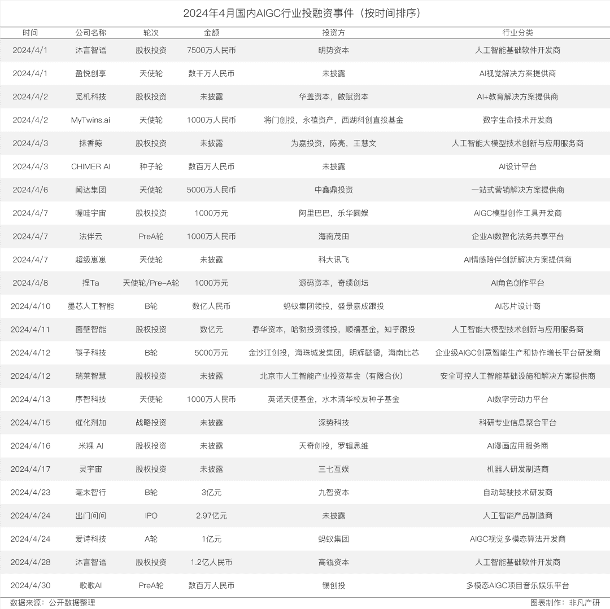
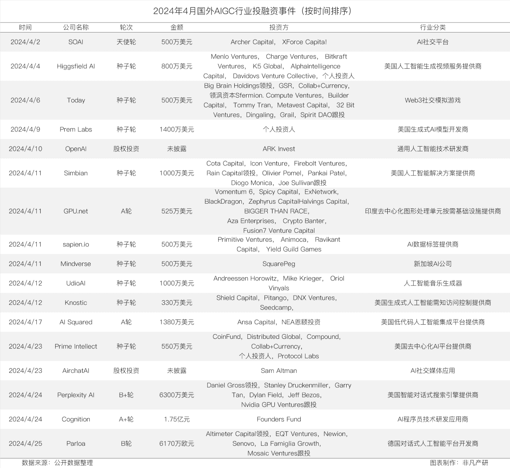
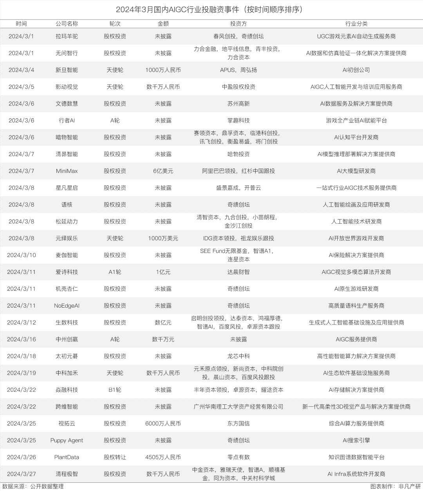
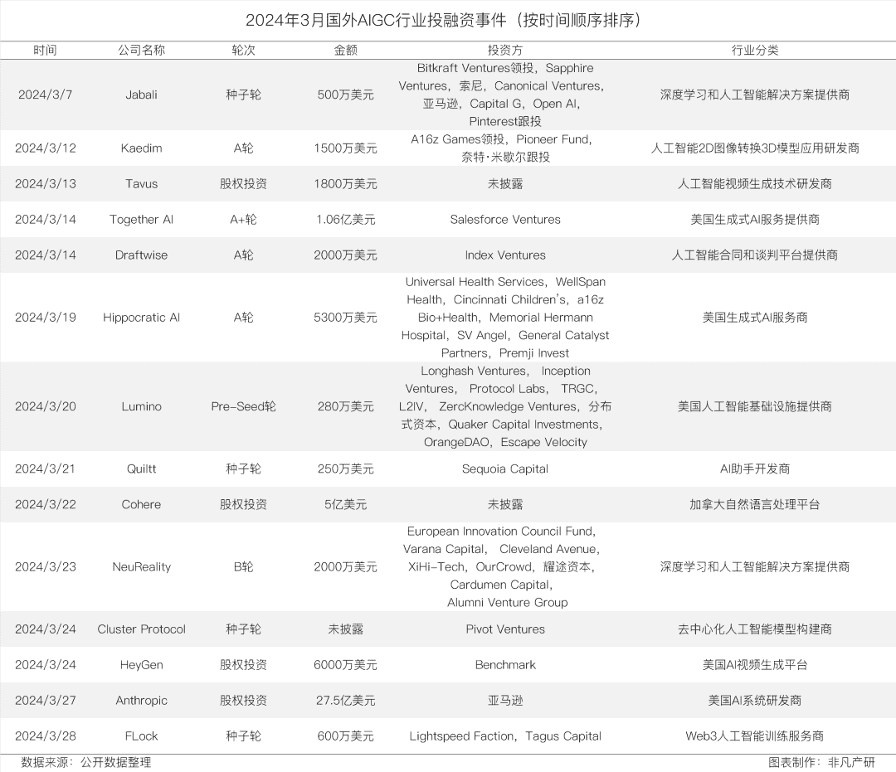

# AIGC投资动态内参

> 来源：[https://yunyinghui.feishu.cn/docx/F6NFdofYNoRzx8x6VXIccX5SnAb](https://yunyinghui.feishu.cn/docx/F6NFdofYNoRzx8x6VXIccX5SnAb)

> **适用人群：****关注AIGC投融资人群**

> 首发时间：2024 年 6 月 11 日

> 更新时间：2024 年 6 月 11 日

> **内容出品方：**[Mix AI Lab](https://yunyinghui.feishu.cn/wiki/WhelwZnxQi55mpkOzatc3Xran5b?from=from_copylink)

> **内容出品人：**** **

> **使用建议：**如果需要快速定位到精确内容，可以使用快捷键 Ctrl +F/Command +F 的形式，搜索关键字/词，查找你想要的内容。

> **持续更新**** AIGC投资****相关的动态和调研****，****永久免费在线查看，****欢迎收藏转发支持，文末有惊喜，****大国出品，必属精品。**

# 2024年度

## 4月

### 国内

### 国外

### 原文解读

2024年4月全国AIGC行业月报-资本篇

## 3月

### 国内

### 国外

### 原文解读

2024年3月全国AIGC行业月报-资本篇

# 2023年度

# 2022年度

# 2021年度

# 2020年度