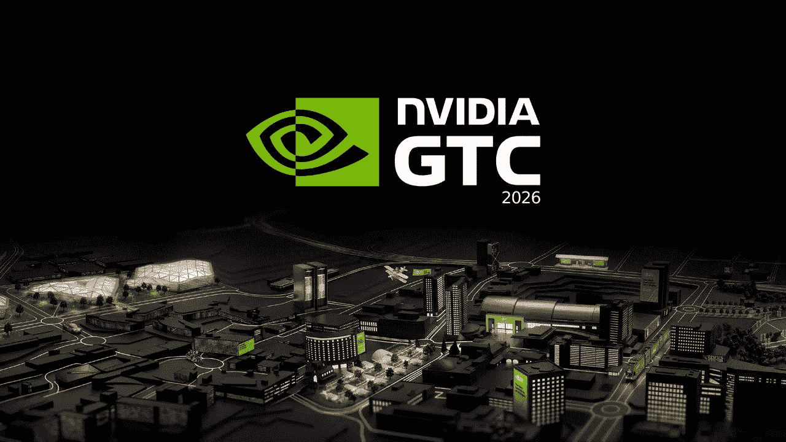

# 英伟达 2026 GTC 大会黄仁勋演讲全文

来源：`https://yunyinghui.feishu.cn/docx/YJd4doKm2oE4I7xu2pvcmQ9YnRG`

## 大会简介

2026 年 GTC 大会，即 NVIDIA GTC 2026，是英伟达公司于 2026 年 3 月 16 日至 19 日在美国加州圣何塞举办的 AI 大会，其核心人物为首席执行官黄仁勋。

大会主题聚焦于人工智能与新一代 AI 基础设施，预计将发布代号 Feynman 的 GPU 架构、Rubin GPU 等新一代 AI 芯片，并计划首次展示搭载三星 HBM4 的 Vera Rubin 产品。该大会在 AI 行业面临“泡沫论”质疑的背景下举办。2026 年 2 月，英伟达发布创纪录的财报以回应市场关切，黄仁勋在财报电话会中表示代理式 AI 已达到拐点，并对即将到来的 GTC 大会进行预热，称将发布新一代 AI 芯片。

大会采用线下与线上相结合的混合形式举办，主会场位于圣何塞 McEnery 会议中心，主题演讲在圣何塞 SAP 中心举行。日程包括 3 月 15 日的现场全天培训，以及 3 月 16 日至 19 日的会议与展览，其中黄仁勋的主题演讲于 3 月 16 日举行，会议期间将举办超过 500 场技术会议。大会涵盖代理式 AI、生成式 AI、机器人、量子计算等多个主题领域，并按行业设置了众多分领域会议。

## 演讲观点速览

英伟达 2026 GTC 大会于 2026 年 3 月 16-19 日在美国圣何塞举办，黄仁勋在 3 月 16 日发表的近 2 小时主题演讲是本次大会核心，演讲立足 AI 行业“泡沫论”质疑的市场背景，以英伟达创纪录财报为基础，不仅发布了全栈式 AI 基础设施产品，更重新定义了 AI 产业的发展阶段与商业逻辑，核心观点和内容可总结为以下五大方面：

### 一、核心产业判断：AI 正式迈入推理工业化时代

1. 明确推理拐点已至：黄仁勋指出过去两年 AI 计算需求爆发式增长，已从实验室的模型训练阶段，全面走向实际生产的推理落地阶段，推理算力成为企业核心竞争力，AI 需完成思考、推理、行动等生产性工作。

1. 提出 Token 工厂核心概念：未来数据中心将从存储计算中心升级为生产 `Token`（词元）的“AI 工厂”，`Token` 成为数字时代核心大宗商品，每瓦电能生产的 `Token` 数量将成为衡量数据中心效率的关键指标，而英伟达目前在 `Token` 成本和能效比上具备绝对优势。

1. 定义 AI 工业化新阶段：AI 进入推理+智能体+物理 AI 的三重革命时代，不再是企业可选工具，而是必备的基础设施，形成“能源→芯片→基础设施→模型→应用”的五层产业架构。

### 二、重磅产品发布：推出覆盖全链路、多场景的 AI 基础设施矩阵

本次演讲发布了从芯片到系统、从硬件到软件的全栈产品，覆盖当前量产、中期布局、长期技术储备三个阶段，核心硬件均明确量产时间：

#### 硬件核心产品

+ Vera Rubin 超级 AI 计算平台：本次大会主力产品，2026 下半年量产，由 7 款芯片组成，搭载三星 HBM4 内存，训练性能为前代 Blackwell 的 3.5 倍、推理性能提升 5 倍，单 `Token` 生成成本降至原有 1/10，已获 OpenAI、微软等头部企业锁定订单。

+ Feynman（费曼）GPU 架构：提前 2 年亮出技术底牌，全球首款面向世界模型/物理 AI 的 GPU 架构，采用 1.6nm 工艺，推理性能为 Blackwell 的 5 倍，通过硅光子光互连技术打破超大规模 AI 集群“互连墙”，支撑万亿参数模型、具身智能等未来场景。

+ Groq 3 LPU 芯片：专为低延迟推理设计，首 `Token` 延迟＜0.1 秒，推理性能为 H100 的 10 倍，适配自动驾驶、智能客服等实时交互场景，2026 年三季度正式出货。

#### 前沿技术布局

发布全球首个 CPO 光电共封装交换机，能耗仅为传统铜缆的 5%，将 2026 年定为硅光子技术商用元年；推出 Space-1 Vera Rubin 轨道数据中心，算力为 H100 的 25 倍，实现算力布局从地面向太空延伸。

#### 软件生态产品

推出 NemoClaw 智能体平台（被喻为 Agent 时代的“Linux”）、DSX 数据中心模拟器，以及 `cuDF`、`cuVS` 数据处理库，打通从模型训练到实际应用的全链路，提升结构化与非结构化数据处理效率。

### 三、行业发展预测：重构 AI 商业逻辑与产业模式

1. 商业模式从 SaaS 向 AaaS 转变：黄仁勋预测“所有 SaaS 公司都将消失”，未来企业不再购买工具，而是租用具备专业能力的 AI 智能代理（AaaS），软件将全面走向 AI 原生。

1. 物理 AI 成为重要增长极：重点布局自动驾驶、工业机器人、人形机器人等物理 AI 领域，宣布与比亚迪、现代等车企达成自动驾驶深度合作，同时展示与迪士尼合作的机器人项目。

1. `Token` 成为核心生产资料：`Token` 的消耗将随推理场景普及呈指数级增长，未来硅谷等科技行业招聘或将出现“年薪+`Token` 预算”的新模式，企业竞争力将直接与 `Token` 生产效率挂钩。

1. 万亿级市场规模预判：将 2027 年英伟达新一代芯片架构的收入机会预测从 5000 亿美元提升至至少 1 万亿美元，明确 AI 基础设施将迎来数万亿美元的市场空间。

### 四、战略定位升级：从“芯片供应商”到 AI 时代“基建总包商”

黄仁勋明确英伟达的战略转变：不再满足于做 AI 时代的“卖水人”（单纯的 GPU 芯片供应商），而是通过芯片-系统-软件的垂直整合，成为全球 AI 基础设施的“基建总包商”。

其核心竞争壁垒在于 `CUDA` 生态的“飞轮效应”：`CUDA` 的庞大安装基数吸引开发者，开发者创造新算法进而催生新市场，反哺生态扩大，让英伟达的算力成本形成“长期下降曲线”，即便旧款 GPU 也能因软件优化持续增值。

### 五、大会基础信息与行业意义

1. 大会采用线下+线上混合形式，举办超 500 场技术会议，涵盖代理式 AI、生成式 AI、机器人、量子计算等领域，是英伟达对 AI 行业“泡沫论”的直接回应；

1. 本次发布的 Feynman 架构、Vera Rubin 平台等产品，进一步拉大了全球 AI 芯片领域的技术代差，同时黄仁勋提出的“主权 AI”概念，也为不同国家和地区的 AI 产业差异化发展提供了思路；

1. 此次演讲不仅是一次技术发布会，更是英伟达对 AI 未来的宣言：AI 将成为像电力一样的公共事业，而英伟达将成为这一全新数字世界的规则定义者与基础设施构建者。

## 黄仁勋主题演讲全文

主持人：欢迎英伟达创始人兼首席执行官黄仁勋上台。

### 黄仁勋，创始人兼首席执行官：

欢迎来到 GTC。我想提醒大家，这是一场技术大会。能看到这么多人一大早排队入场，能看到在座的各位，我感到非常高兴。

在 GTC，我们将聚焦三大主题：技术、平台和生态系统。英伟达目前拥有三大平台：`CUDA-X` 平台、系统平台，以及我们最新推出的 AI 工厂平台。

在正式开始之前，我要感谢我们的预热环节主持人——`Conviction` 的 Sarah Guo、红杉资本的 Alfred Lin（英伟达的第一位风险投资人），以及英伟达的第一位主要机构投资人 Gavin Baker。这三位对技术有深刻的洞见，在整个技术生态系统中拥有极广的影响力。当然，我还要感谢今天所有我亲自邀请出席的贵宾们。感谢这支全明星团队。

我同样要感谢今天到场的所有企业。英伟达是一家平台公司，我们拥有技术、平台和丰富的生态系统。今天到场的企业代表了价值 100 万亿美元行业中几乎全部的参与者，共有 450 家公司赞助了本次活动，在此深表感谢。

本次大会共设有 1,000 场技术论坛、2,000 位演讲嘉宾，将覆盖人工智能“五层蛋糕”架构的每一个层级——从土地、电力与机房等基础设施，到芯片、平台、模型，以及最终推动整个行业腾飞的各类应用。

### CUDA：二十年的技术积淀

一切的起点，就在这里。今年是 `CUDA` 诞生二十周年。

二十年来，我们始终致力于这一架构的研发。`CUDA` 是一项革命性的发明——`SIMT`（单指令多线程）技术允许开发者以标量代码编写程序，并将其扩展为多线程应用，其编程难度远低于此前的 `SIMD` 架构。我们最近还新增了 `Tiles` 功能，帮助开发者更便捷地编程张量核心（`Tensor Core`），以及当今人工智能所依赖的各类数学运算结构。目前，

`CUDA` 已拥有数千种工具、编译器、框架和库，在开源社区中存在数十万个公开项目，并已深度集成到每一个技术生态系统之中。

这张图表揭示了英伟达 100%的战略逻辑，我从最初就一直在讲这张幻灯片。其中最难实现、也是最核心的要素，是图表底部的“装机量”。历经二十年，我们已在全球范围内积累了数亿块运行 `CUDA` 的 GPU 和计算系统。

我们的 GPU 覆盖所有云平台，服务于几乎所有计算机厂商和行业。`CUDA` 庞大的装机量，正是这个飞轮不断加速的根本原因。装机量吸引开发者，开发者创造新算法并取得突破，突破催生全新市场，新市场形成新生态并吸引更多企业加入，进而扩大装机量——这个飞轮正在持续加速。

英伟达库的下载量正以惊人的速度增长，规模庞大且增速不断提升。这个飞轮使我们的计算平台能够支撑海量应用和层出不穷的新突破。

更重要的是，它还赋予了这些基础设施极长的使用寿命。原因显而易见：`NVIDIA CUDA` 上可运行的应用极为丰富，涵盖 AI 生命周期的每个阶段、各类数据处理平台，以及各种科学原理求解器。因此，一旦安装了英伟达 GPU，其实际使用价值极高。这也是为何我们六年前发布的 Ampere 架构 GPU，其云端价格反而在上涨。

这一切的根本原因在于：装机量庞大，飞轮强劲，开发者生态广泛。当这些因素共同发挥作用，加之我们持续更新软件，计算成本便会不断下降。加速计算在大幅提升应用性能的同时，随着我们长期维护和迭代软件，用户不仅能在初期获得性能跃升，还能持续享受计算成本的下降。我们愿意为全球每一块 GPU 提供长期支持，因为它们在架构上完全兼容。

我们之所以愿意这样做，是因为装机量如此庞大——每发布一次新的优化，便能惠及数百万用户。这种动态组合，使得英伟达架构在持续扩大覆盖范围、加速自身成长的同时，不断压低计算成本，最终刺激新的增长。`CUDA` 是这一切的核心。

### 从 GeForce 到 CUDA：二十五年的演进之路

而我们与 `CUDA` 的旅程，实际上早在二十五年前就已开始。

`GeForce`——相信在座有很多人是伴随着 `GeForce` 长大的。`GeForce` 是英伟达最成功的市场推广项目。我们从你们还买不起产品的时候就开始培养未来的客户——是你们的父母代替你们成为了英伟达最早的用户，年复一年地购买我们的产品，直到有一天，你们成长为优秀的计算机科学家，成为真正意义上的客户和开发者。

这是二十五年前 `GeForce` 奠定的基业。二十五年前，我们发明了可编程着色器——这是让加速器实现可编程化的一项显而易见却意义深远的发明，也是世界上第一款可编程加速器，即像素着色器。这五年后，我们创造了 `CUDA`——这是我们有史以来最重要的投资之一。当时公司财力有限，但我们将绝大部分利润押注于此，致力于将 `CUDA` 从 `GeForce` 延伸到每一台计算机。我们之所以如此坚定，是因为我们深信其潜力。尽管初期历经艰辛，公司坚守这一信念长达 13 代、整整二十年，如今 `CUDA` 已无处不在。

正是像素着色器推动了 `GeForce` 的革命。而大约八年前，我们推出了 `RTX`——为现代计算机图形时代对架构进行了全面革新。`GeForce` 将 `CUDA` 带给了全世界，也正因如此，让 Alex Krizhevsky、Ilya Sutskever、Geoffrey Hinton、Andrew Ng 等众多学者发现，GPU 可以成为加速深度学习的利器，由此点燃了十年前人工智能的大爆炸。

十年前，我们决定将可编程着色与两个全新理念相融合：一是硬件光线追踪（`RayTracing`），这在技术上极具挑战；二是一个当时颇具前瞻性的想法——大约十年前，我们就预见到 AI 将彻底变革计算机图形。正如 `GeForce` 将 AI 带给了全世界，AI 如今也将反过来重塑整个计算机图形的实现方式。

今天，我要向大家展示未来。这是我们的下一代图形技术，我们称之为神经渲染（`Neural Rendering`）——3D 图形与人工智能的深度融合。这就是 `DLSS 5`，请看。

### 神经渲染：结构化数据与生成式 AI 的融合

这是不是令人叹为观止？计算机图形就此焕发生机。

我们做了什么？我们将可控的 3D 图形（虚拟世界的真实基础）与其结构化数据相结合，再融入生成式 AI 和概率计算。一个完全确定性，另一个概率性却高度逼真——我们将这两种理念融为一体，通过结构化数据实现精准可控，同时进行实时生成。最终，内容既美观惊艳，又完全可控。

结构化信息与生成式 AI 融合这一理念，将在一个又一个行业中不断复现。结构化数据是可信 AI 的基石。

### 结构化数据与非结构化数据的加速平台

现在我要带大家看一张技术架构图。

结构化数据——大家熟悉的 `SQL`、`Spark`、`Pandas`、`Velox`，以及 `Snowflake`、`Databricks`、`Amazon EMR`、`Azure Fabric`、`Google BigQuery` 等重要平台，都在处理数据框（`Data Frame`）。这些数据框就像巨型电子表格，承载着商业世界的全部信息，是企业计算的基本事实（`Ground Truth`）。

在 AI 时代，我们需要让 AI 来使用结构化数据，并对其实现极致加速。过去，加速结构化数据处理是为了让企业更高效地运转。而未来，AI 将以远超人类的速度使用这些数据结构，AI 智能体也将大量调用结构化数据库。

非结构化数据方面，向量数据库、`PDF`、视频、音频等构成了世界上绝大多数的数据形态——每年生成的数据中，约 90%是非结构化数据。过去，这些数据几乎完全无法被利用：我们读取它们，存入文件系统，仅此而已。我们无法查询，也难以检索，原因在于非结构化数据缺乏简单的索引方式，必须理解其含义与语境。而现在，AI 可以做到这一点——借助多模态感知与理解技术，AI 能够读取 `PDF` 文档、理解其含义，并将其嵌入可供查询的更大结构之中。

英伟达为此创建了两个基础库：

`cuDF`：用于数据框、结构化数据的加速处理

`cuVS`：用于向量存储、语义数据和非结构化 AI 数据的处理

这两个平台将成为未来最重要的基础平台之一。

今天，我们宣布与多家企业达成合作。`IBM`——`SQL` 语言的发明者，将使用 `cuDF` 加速其 `WatsonX Data` 平台。Dell 与我们联合打造了 Dell AI 数据平台，整合 `cuDF` 与 `cuVS`，并在 NTT Data 的实际项目中实现了大幅性能提升。`Google Cloud` 方面，我们现在不仅加速 `Vertex AI`，还加速 `BigQuery`，并与 `Snapchat` 合作将其计算成本降低了近 80%。

加速计算带来的好处是三位一体的：速度、规模、成本。这与摩尔定律的逻辑一脉相承——通过加速计算实现性能飞跃，同时持续优化算法，让所有人都能享受到持续下降的计算成本。

英伟达构建了加速计算平台，其上汇聚了众多库：`RTX`、`cuDF`、`cuVS` 等等。这些库整合进全球云服务和 `OEM` 体系，共同触达全球用户。

### 与云服务商的深度合作

与主要云服务商的合作

`Google Cloud`：我们加速 `Vertex AI` 和 `BigQuery`，与 `JAX/XLA` 深度集成，同时在 `PyTorch` 上表现卓越——英伟达是全球唯一一家在 `PyTorch` 和 `JAX/XLA` 上均表现出色的加速器。我们将 Base10、CrowdStrike、Puma、Salesforce 等客户引入 `Google Cloud` 生态。

`AWS`：我们加速 `EMR`、`SageMaker` 和 `Bedrock`，与 `AWS` 有着深度集成。今年令我格外兴奋的是，我们将把 `OpenAI` 引入 `AWS`，这将大幅推动 `AWS` 云计算的消耗增长，帮助 `OpenAI` 扩展区域部署和计算规模。

`Microsoft Azure`：英伟达 100 PFLOPS 超算是我们构建的第一台超级计算机，也是第一台部署在 `Azure` 上的超算，这奠定了与 `OpenAI` 合作的重要基础。我们加速 `Azure` 云服务和 `AI Foundry`，合作推进 `Azure` 区域扩展，并在 `Bing` 搜索上深度协作。值得一提的是，我们的 `保密计算（Confidential Computing）` 能力——确保即便是运营商也无法查看用户数据和模型——英伟达 GPU 是全球首批支持保密计算的 GPU，可支持 `OpenAI` 和 `Anthropic` 模型在全球各地区云环境中的保密部署。以 `Synopsys` 为例，我们加速其全部 `EDA` 和 `CAD` 工作流，并部署于 `Microsoft Azure`。

`Oracle`：我们是 `Oracle` 的第一个 AI 客户，我为能够第一次向 `Oracle` 解释 AI 云的概念感到自豪。此后他们发展迅猛，我们也为其引入了 `Cohere`、`Fireworks`、`OpenAI` 等众多合作伙伴。

`CoreWeave`：全球第一家 AI 原生云，专为 GPU 托管和 AI 云服务而生，拥有出色的客户群，增长势头强劲。

`Palantir + Dell`：三方联合打造了全新的 AI 平台，基于 `Palantir` 的本体论平台（`Ontology Platform`）和 AI 平台，可在任何国家、任何气隙隔离环境下、完全本地化地部署 AI——从数据处理（向量化或结构化）到 AI 的完整加速计算栈，无所不包。

英伟达与全球云服务商建立了这种特殊的合作关系——我们将客户引入云端，这是一种互利共赢的生态。

### 垂直整合，横向开放：英伟达的核心战略

英伟达是全球第一家垂直整合、横向开放的公司。

这一模式的必要性非常简单：加速计算不是芯片问题，也不是系统问题，其完整表述应为应用加速。CPU 可以让计算机整体运行得更快，但这条路已走到瓶颈。未来，唯有通过应用或领域特定的加速，才能持续带来性能飞跃和成本下降。

这正是英伟达必须深耕一个又一个库、一个又一个领域、一个又一个垂直行业的原因。我们是一家垂直整合的计算公司，没有其他路可走。我们必须理解应用，理解领域，深刻理解算法，并能够将其部署在任何场景下——数据中心、云端、本地、边缘乃至机器人系统。

同时，英伟达保持横向开放，愿意将技术整合进任何合作伙伴的平台，让全世界都能享受到加速计算的红利。

本届 GTC 的参会者结构充分体现了这一点。本次参会者中，金融服务行业的比例最高——希望来的是开发者，不是交易员。我们的生态系统覆盖了上游和下游供应链。无论是成立 50 年、70 年还是 150 年的企业，去年都迎来了历史最佳年份。我们正处于某件非常、非常重大事情的起点。

## CUDA-X：各行业的加速计算引擎

在各个垂直领域，英伟达均已深度布局：

自动驾驶：覆盖范围广泛，影响深远

金融服务：量化投资正从人工特征工程转向超级计算机驱动的深度学习，迎来其"`Transformer` 时刻"

医疗健康：正在迎来属于自己的"`ChatGPT` 时刻"，涵盖 AI 辅助药物发现、AI 智能体支持诊断、医疗客服等方向

工业：全球规模最大的建设浪潮正在展开，AI 工厂、芯片厂、数据中心厂纷纷落地

娱乐与游戏：实时 AI 平台支持翻译、直播、游戏互动，以及智能购物代理

机器人：深耕十余年，三大计算机架构（训练计算机、仿真计算机、机载计算机）齐备，本次展会共有 110 款机器人亮相

电信：约 2 万亿美元规模的行业，基站将从单一通信功能演进为 AI 基础设施平台，相关平台名为 `Aerial`，与诺基亚、`T-Mobile` 等企业均有深度合作

以上所有领域的核心，正是我们的 `CUDA-X` 库——这是英伟达作为算法公司的根本所在。这些库是公司最核心的资产，让计算平台得以在各个行业发挥实际价值。

其中最重要的库之一，是 `cuDNN`（`CUDA` 深度神经网络库），它彻底革新了人工智能，引发了现代 AI 的大爆炸。

大家刚才看到的一切都是仿真——包括基于物理原理的求解器、AI 代理物理模型，以及物理 AI 机器人模型。一切均为仿真，没有任何手工动画或关节绑定。这正是英伟达的核心能力所在：通过对算法的深刻理解与计算平台的有机结合，解锁这些机遇。

## AI 原生企业与新计算时代

你们刚才看到了沃尔玛、欧莱雅、摩根大通、罗氏、丰田等定义当今社会的行业巨头，也有一大批大家从未听说过的公司——我们称之为 AI 原生企业。这份名单极为庞大，里面有 `OpenAI`、`Anthropic`，以及众多服务于不同垂直领域的新兴企业。

过去两年，这一行业经历了惊人的腾飞。风险投资流入初创企业的资金规模达到 1,500 亿美元，创人类历史之最。更重要的是，单笔投资规模首次从数百万美元跃升至数亿乃至数十亿美元。原因只有一个：这是史上第一次，每一家此类公司都需要大量计算资源和大量 `token`。这个行业正在创造、生成 `token`，或者为来自 `Anthropic`、`OpenAI` 等机构的 `token` 增值。

正如 `PC` 革命、互联网革命、移动云革命各自孕育出一批划时代的企业，这一代计算平台变革同样将诞生一批极具影响力的公司，成为未来世界的重要力量。

## 推动这一切的三大历史性突破

过去两年究竟发生了什么？三件大事。

### 第一：`ChatGPT`，开启生成式 AI 时代（2022 年底至 2023 年）

它不仅能感知和理解，还能生成独特内容。我展示了生成式 AI 与计算机图形的融合。生成式 AI 从根本上改变了计算的方式——计算从检索式转变为生成式，这深刻影响着计算机架构、部署方式和整体意义。

### 第二：推理 AI（`Reasoning AI`），以 `o1` 为代表

推理能力使 AI 能够自我反思、规划、分解问题——将它无法直接理解的问题拆解为可处理的步骤。`o1` 让生成式 AI 变得可信，能够依据真实信息进行推理。为此，输入 `context` 的 `token` 量和用于思考的输出 `token` 量大幅增加，计算量随之显著提升。

### 第三：`Claude Code`，首个智能体模型

它能读取文件、编写代码、编译、测试、评估并迭代。`Claude Code` 彻底革新了软件工程——英伟达 100% 的工程师都在使用 `Claude Code`、`Codex` 和 `Cursor` 中的一种或多种，没有一位软件工程师不借助 AI 助力。

这是一个全新的拐点——你不再是询问 AI"是什么、在哪里、怎么做"，而是让它"创建、执行、构建"，让它主动使用工具、读取文件、分解问题、付诸行动。AI 从感知，到生成，到推理，再到如今真正能够完成工作。

过去两年，推理所需的计算量增长了约 10,000 倍，使用量增长了约 100 倍。我一直认为，过去两年计算需求增长了 100 万倍——这是所有人的共同感受，是 `OpenAI` 的感受，是 `Anthropic` 的感受。如果能获得更多算力，就能生成更多 `token`，收入就会提升，AI 就会变得更智能。推理拐点已然到来。

## 万亿美元的 AI 基础设施时代

去年此时，我在这里表示，我们对 `Blackwell` 和 `Rubin` 在 2026 年之前的需求和采购订单有高度信心，规模约为 5,000 亿美元。今天，在 GTC 一年之后，我站在这里告诉大家：展望到 2027 年，我看到的数字至少是 1 万亿美元。而且我确信，实际的计算需求将远不止于此。

## 2025：英伟达推理年

2025 年是英伟达的推理年（Year of Inference）。我们希望确保，在训练和后训练之外，也能在 AI 生命周期的每个阶段都保持卓越，使已投资的基础设施能够持续高效运转，且有效使用寿命越长，单位成本越低。

与此同时，`Anthropic` 和 `Meta` 正式加入 `NVIDIA` 平台，与此共同代表了全球三分之一的 AI 算力需求。开源模型已接近前沿水平，无处不在。

英伟达是目前全球唯一一个能够运行所有 AI 领域——语言、生物学、计算机图形、计算机视觉、语音、蛋白质与化学、机器人等——所有 AI 模型的平台，无论边缘还是云端，无论何种语言。英伟达架构对所有这些场景均具备通用性，这使我们成为成本最低、置信度最高的平台。

目前，英伟达 60% 的业务来自全球前五大超大规模云服务商，剩余 40% 遍布区域云、主权云、企业、工业、机器人、边缘计算等各个领域。AI 的覆盖广度本身就是其韧性所在——这无疑是一次全新的计算平台变革。

## `Grace Blackwell` 与 `NVLink 72`：大胆的架构革新

在 `Hopper` 架构还处于鼎盛时期，我们就决定彻底重新架构系统，将 `NVLink` 从 8 路扩展为 `NVLink 72`，对计算系统进行全面分解重构。`Grace Blackwell NVLink 72` 是一次巨大的技术押注，对所有合作伙伴而言都不容易，在此向所有人表示诚挚感谢。

同时，我们推出了 `NVFP4`——不只是普通的 `FP4`，而是一种全新类型的张量核心和计算单元。我们已经证明，`NVFP4` 可以在无精度损失的情况下实现推理，同时带来巨大的性能提升和能效提升，并且同样适用于训练。此外，`Dynamo` 和 `TensorRT-LLM` 等一系列新算法相继问世，我们甚至为优化内核而专门投入数十亿美元建造了一台超级计算机，称之为 `DGX Cloud`。

结果证明，我们的推理性能令人瞩目。来自 `Semi Analysis` 的数据——这是迄今为止最全面的 AI 推理性能评测——显示英伟达在每瓦 `token` 数和每 `token` 成本两个维度上均遥遥领先。原本摩尔定律可能给 `H200` 带来 1.5 倍的性能提升，但我们做到了 35 倍。`Semi Analysis` 的 `Dylan Patel` 甚至说："黄仁勋保守了，实际上是 50 倍。"他说得没错。

我在此援引他的话："`Jensen sandbagged`（黄仁勋保守报数）。"

英伟达的每 `token` 成本是全球最低，目前无人能及。原因正在于极致协同设计（Extreme Co-design）。

以 `Fireworks` 为例，在英伟达更新全套软件和算法之前，其平均 `token` 速度约为每秒 700 个；更新后接近每秒 5,000 个，提升约 7 倍。这就是极致协同设计的力量。

## AI 工厂：从数据中心到 `token` 工厂

数据中心过去是存储文件的地方，现在它是生产 `token` 的工厂。每一家云服务商、每一家 AI 公司，未来都将以"`token` 工厂效率"作为核心经营指标。

这是我的核心论点：

纵轴：吞吐量（Throughput）——在固定功率下每秒生成的 `token` 数

横轴：交互速度（`Token Speed`）——每次推理的响应速度，速度越快，可使用的模型越大、`context` 越长，AI 越智能

`token` 是新的大宗商品，一旦成熟，将分层定价：

免费层（高吞吐、低速度）

中级层（～每百万 `token` 3 美元）

高级层（～每百万 `token` 6 美元）

高速层（～每百万 `token` 45 美元）

超高速层（～每百万 `token` 150 美元）

与 `Hopper` 相比，`Grace Blackwell` 在最高价值层提升了 35 倍吞吐量，并引入全新层级。以简化模型估算，将 25% 功率分别分配给四个层级，`Grace Blackwell` 可比 `Hopper` 多产生 5 倍的收入。

## `Vera Rubin`：下一代 AI 计算系统

（播放 `Vera Rubin` 系统介绍视频）

`Vera Rubin` 是一个完整的、端到端优化的系统，专为智能体（`Agentic`）工作负载设计：大型语言模型计算核心：`NVLink 72` GPU 集群，处理前填充（`Prefill`）和 `KV Cache`

全新 `Vera CPU`：专为极高单线程性能设计，采用 `LPDDR5` 内存，兼具卓越能效，是全球唯一使用 `LPDDR5` 的数据中心 CPU，适合 AI 智能体工具调用

存储系统：`BlueField4` + `CX 9`，面向 AI 时代的全新存储平台，全球存储行业 100% 加入

`CPO Spectrum X` 交换机：全球首款共封装光学以太网交换机，已全面量产

`Kyber` 机架：全新机架系统，支持 144 块 GPU 组成单一 `NVLink` 域，前端计算、后端 `NVLink` 交换，形成一台巨型计算机

`Rubin Ultra`：下一代超算节点，竖插式设计，配合 `Kyber` 机架，支持更大规模 `NVLink` 互联

`Vera Rubin` 已 100% 液冷，安装时间从两天缩短至两小时，采用 45°C 热水冷却，大幅降低数据中心冷却压力。这次 `Satya`（纳德拉）已发文确认，首台 `Vera Rubin` 机架已在 `Microsoft Azure` 上线运行，我为此深感振奋。

## `Groq` 整合：推理性能的极致延伸

我们收购了 `Groq` 团队并获得其技术授权。`Groq` 是一种确定性数据流处理器（`Deterministic Dataflow Processor`），采用静态编译和编译器调度，拥有大量 `SRAM`，专为推理单一工作负载优化，具备极低延迟和极高 `token` 生成速度。

然而，`Groq` 的内存容量有限（500MB 片上 `SRAM`），难以独立承载大模型的参数和 `KV Cache`，限制了其大规模应用。

解决方案正是 `Dynamo`——一套推理调度软件。我们通过 `Dynamo` 将推理管线解聚（`Disaggregate`）：

**前填充（`Prefill`）及注意力机制的解码（`Decode`）**在 `Vera Rubin` 上完成（需要大量算力和 `KV Cache` 存储）

**前馈网络解码（`Feed-Forward Network Decode`）**即 `token` 生成部分，在 `Groq` 上完成（需要极高带宽和低延迟）

两者通过以太网紧密耦合，借助特殊模式将延迟减少约一半。在 `Dynamo` 这一"AI 工厂操作系统"的统一调度下，整体性能提升 35 倍，并开辟了 `NVLink 72` 此前无法触及的全新推理性能层级。

`Groq` 与 `Vera Rubin` 的组合建议：

若工作负载以高吞吐为主，使用 100% `Vera Rubin`

若大量工作负载为代码生成等高价值 `token` 生成，可引入 `Groq`，建议比例约为 25% `Groq` + 75% `Vera Rubin`

`Groq LP30` 由三星代工，目前已进入量产，预计 Q3 开始出货。感谢三星的全力配合。

## 推理性能的历史性飞跃

将此前技术进步量化：在 2 年时间内，1 吉瓦 AI 工厂的 `token` 生成速率将从 2,200 万 `token`/秒提升至 7 亿 `token`/秒，提升 350 倍。这就是极致协同设计的力量。

## 技术路线图

`Blackwell`：当前在产，`Oberon` 标准机架系统，铜缆扩展至 `NVLink 72`，可选光学扩展至 `NVLink 576`

`Vera Rubin`（当前）：`Kyber` 机架，`NVLink 144`（铜缆）；`Oberon` 机架，`NVLink 72` + 光学，扩展至 `NVLink 576`；`Spectrum 6`，全球首款 `CPO` 交换机

`Vera Rubin Ultra`（即将推出）：新一代 `Rubin Ultra` GPU，`LP35` 芯片（首次集成 `NVFP4`），进一步提升数倍性能

`Feynman`（下一代）：全新 GPU，`LP40` 芯片（由英伟达与 `Groq` 团队联合打造，集成 `NVFP4`）；全新 CPU——`Rosa`（`Rosalyn`）；`BlueField 5`；`CX 10`；同时支持铜缆和 `CPO` 两种扩展方式的 `Kyber` 机架

路线图明确：铜缆扩展、光学扩展（`Scale-Up`）、光学扩展（`Scale-Out`）三条路线并行推进，我们需要所有合作伙伴在铜缆、光纤和 `CPO` 方面持续扩产。

## `NVIDIA DSX`：AI 工厂的数字孪生平台

AI 工厂越来越复杂，但组成它的各类技术供应商过去从未在设计阶段相互协作，直到在数据中心才"相遇"——这显然不够。

为此，我们创建了 `Omniverse`，以及基于其上的 `NVIDIA DSX` 平台——一个供所有合作伙伴在虚拟世界中共同设计和运营吉瓦级 AI 工厂的平台。`DSX` 提供：

机架级机械、热学、电气、网络仿真系统与电网的连接，实现协同节能调度

数据中心内基于 `Max-Q` 的动态功耗和冷却优化

保守估计，这套系统可将能源利用效率提升约 2 倍，在我们谈论的规模上，这是非常可观的收益。`Omniverse` 从数字地球开始，将承载各种规模的数字孪生，我们正与全球合作伙伴共同构建人类历史上最大的计算机。

此外，英伟达正在进军太空。`Thor` 芯片已通过辐射认证，正在卫星中运行。我们正与合作伙伴开发 `Vera Rubin Space-1`，用于建设太空数据中心。在太空中只能依靠辐射散热，热管理是核心挑战，我们正集结顶尖工程师攻关。

## `OpenClaw`：智能体时代的操作系统

`Peter Stein berger` 开发了一款名为 `OpenClaw` 的软件。这是人类历史上最受欢迎的开源项目，在短短几周内便超越了 `Linux` 三十年的成就。

`OpenClaw` 本质上是一个智能体系统（`Agentic System`），能够：

管理资源，访问工具、文件系统和大型语言模型；执行调度、定时任务；将问题逐步分解，并调用子智能体；支持任意模态的输入输出（语音、视频、文字、邮件等）。

用操作系统的语法来描述，它确实就是一个操作系统——智能体计算机的操作系统。`Windows` 让个人计算机成为可能，`OpenClaw` 让个人智能体成为可能。

每一家企业都需要制定自己的 `OpenClaw` 战略，正如我们都需要 `Linux` 策略、`HTML` 策略、`Kubernetes` 策略一样。

## 企业 IT 的全面重塑

`OpenClaw` 之前的企业 IT：数据和文件进入系统，流经工具和工作流，最终变成供人类使用的工具。软件公司创建工具，系统集成商（`GSI`）和咨询公司帮助企业使用这些工具。

`OpenClaw` 之后的企业 IT：每一家 `SaaS` 公司都将转变为 `AaaS`（`Agentic as a Service`，智能体即服务）公司——不只是提供工具，而是提供专精特定领域的 AI 智能体。

但这里有一个关键挑战：企业内部的智能体可以访问敏感数据、执行代码、与外部通信。这在企业环境中必须得到严格管控。

为此，我们与 `Peter` 合作，将安全性融入企业级版本，推出了：

`NeMo Claw`（参考设计）：基于 `OpenClaw` 的企业级参考框架，集成 `NVIDIA` 的全套智能体 AI 工具包

`Open Shield`（安全层）：已集成至 `OpenClaw`，提供策略引擎、网络护栏、隐私路由，确保企业数据安全

`NeMo Cloud`：可下载使用，并与所有 `SaaS` 企业的策略引擎对接

这是企业 IT 的文艺复兴，一个原本 2 万亿美元规模的产业，即将成长为数万亿美元规模，从提供工具转向提供专业化的 AI 智能体服务。

我完全可以预见：未来，公司里的每一位工程师都将拥有年度 `token` 预算。他们年薪可能是几十万美元，我会额外给他们相当于薪资一半的 `token` 配额，让他们的产出放大 10 倍。"入职附带多少 `token` 配额"已经成为硅谷的新晋招聘话题。

每一家企业未来都将既是 `token` 的使用者（供工程师使用），也是 `token` 的生产者（为其客户提供服务）。`OpenClaw` 的意义不可低估，它和 `HTML`、`Linux` 一样重要。

## `NVIDIA` 开放模型倡议

在自定义智能体（`Custom Claw`）方面，我们提供了 `NVIDIA` 自研的前沿模型：

模型领域 `Nemotron` 大型语言模型 `Cosmos` 世界基础模型（`World Foundation Model`）`GROOT` 通用人形机器人模型 `Alpamayo` 自动驾驶 `BioNeMo` 数字生物学 `Phys-AIAI` 物理

我们在每一个领域都处于技术前沿，并承诺持续迭代——`Nemotron 3` 之后有 `Nemotron 4`，`Cosmos 1` 之后有 `Cosmos 2`，`Groq` 也将迭代到第二代。

`Nemotron 3` 在 `OpenClaw` 中名列全球三大最佳模型之列，处于前沿水平。`Nemotron 3 Ultra` 将成为有史以来最强的基础模型，支持各国构建主权 AI。

# Nemotron 联盟成立及 GTC 主要发布

今天，我们宣布成立 Nemotron 联盟，投资数十亿美元推进 AI 基础模型研发。联盟成员包括：Black Forest Labs、Cursor、LangChain、Mistral、Perplexity、Reflection、Sarvam（印度）、Thinking Machines（Mira Murati 的实验室）等。一个又一个企业软件公司加入，将 `NeMo Claw` 参考设计和 NVIDIA 智能体 AI 工具包整合到自身产品中。

## 物理 AI 与机器人

数字智能体在数字世界中行动——撰写代码、分析数据；而物理 AI 则是具身化的智能体，也就是机器人。

本次 GTC 共有 110 款机器人亮相，几乎囊括了全球所有机器人研发企业。英伟达提供三台计算机（训练计算机、仿真计算机、机载计算机）和完整的软件栈及 AI 模型。

自动驾驶方面，自动驾驶的 `ChatGPT` 时刻已经到来。今天，我们宣布四家新合作伙伴加入英伟达 `RoboTaxi Ready` 平台：比亚迪、现代、日产、吉利，合计年产量 1,800 万辆。加上此前的奔驰、丰田、通用，阵容进一步壮大。我们同时宣布与 Uber 达成重大合作，将在多个城市部署并接入 `RoboTaxi Ready` 车辆。

工业机器人方面，ABB、Universal Robotics、KUKA 等众多机器人企业与我们合作，将物理 AI 模型与仿真系统相结合，推动机器人在全球制造产线的落地。

电信方面，卡特彼勒（Caterpillar）和 T-Mobile 也在其列。未来，无线基站将不再只是一个通信节点，而是一个 `NVIDIA Aerial AI RAN`——能够实时感知流量、调整波束成形，实现节能增效的智能化边缘计算平台。

## 特别环节：Olaf 机器人亮相

（播放 Disney Olaf 机器人演示视频）

黄仁勋：雪人登场！`Newton` 运行正常！`Omniverse` 也运行正常！Olaf，你好吗？

Olaf：见到你我真的太开心了。

黄仁勋：是的，因为是我给了你计算机——`Jetson`！

Olaf：那是什么？

黄仁勋：就在你的肚子里。

Olaf：太神奇了。

黄仁勋：你是在 `Omniverse` 里学会走路的。

Olaf：我喜欢走路。这比骑驯鹿仰望美丽的天空好多了。

黄仁勋：这正是因为物理仿真——基于 `NVIDIA Warp` 运行的 `Newton` 求解器，这是我们与 Disney 和 DeepMind 联合开发的，让你能够适应真实的物理世界。

Olaf：我正想说这个。

黄仁勋：这就是你聪明的地方。我是雪人，不是雪球。

黄仁勋：你能想象吗？未来的迪士尼乐园——所有这些机器人角色在园区里自由漫步。不过说实话，我以为你会更高一些。我从没见过这么矮的雪人。

Olaf：（不置可否）

黄仁勋：来帮我结束今天的演讲好吗？

Olaf：太棒啦！

## 主题演讲总结

黄仁勋：今天，我们共同探讨了以下核心主题：

推理拐点的到来：推理已成为 AI 最核心的工作负载，`token` 是新的大宗商品，推理性能直接决定收入

AI 工厂时代：数据中心已从文件存储设施演变为 `token` 生产工厂，未来每家公司都将以"AI 工厂效率"来衡量自身竞争力

`OpenClaw` 智能体革命：`OpenClaw` 开启了智能体计算时代，企业 IT 正在从工具时代走向智能体时代，每家企业都需要制定 `OpenClaw` 战略

物理 AI 与机器人：具身智能正在规模化落地，自动驾驶、工业机器人、人形机器人共同构成物理 AI 的下一个重大机遇

感谢大家，GTC 愉快！
