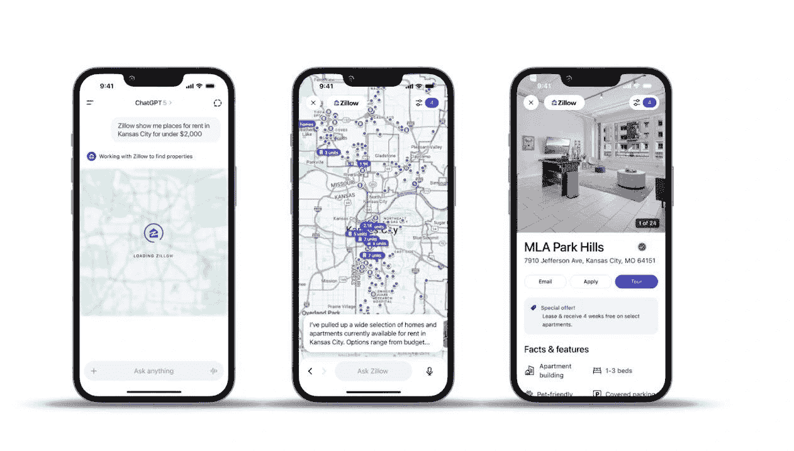
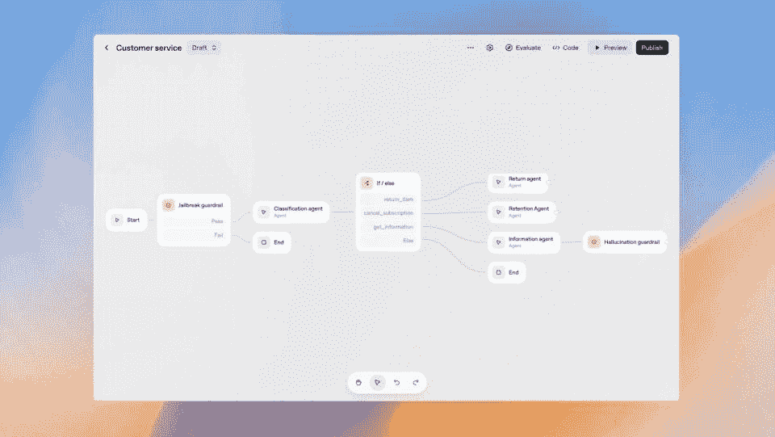
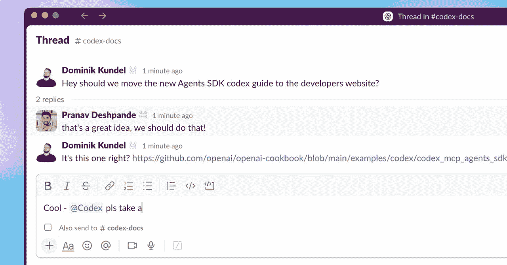

# OpenAI 2025 开发者大会纪要：重塑 AI 生态的操作系统级革新

> 来源：[https://yunyinghui.feishu.cn/docx/L25vdFMTPoWcFCxr4qwc5pPvnOb](https://yunyinghui.feishu.cn/docx/L25vdFMTPoWcFCxr4qwc5pPvnOb)

> 首发时间：2025 年 10 月 6 日

> 更新时间：2025 年 10 月 10 日

> **内容出品人：**** **

> **内容出品方：**[Mix AI Lab](https://yunyinghui.feishu.cn/wiki/WhelwZnxQi55mpkOzatc3Xran5b?from=from_copylink)

> **使用建议：**如果需要快速定位到精确内容，可以使用快捷键 Ctrl +F/Command +F 的形式，搜索关键字/词，查找你想要的内容。

>

> **为 AI 实验室同学持续更新** OpenAI 2025 开发者大会学习纪要内容，为 AI 学习者总结大会纪要！

>

> 🎯全**网良心 AI 开源知识库：「**[**AI 实验室」知识库（**](https://yunyinghui.feishu.cn/wiki/space/7340161844864598017?ccm_open_type=lark_wiki_spaceLink&open_tab_from=wiki_home)AI 绘画、AI 写作、AI 视频等应用技能）

## 发布会核心亮点概述

**2**025 年 10 月 6 日，OpenAI 在年度开发者大会（Dev Day）上发布了一系列颠覆性产品，标志着 AI 行业从单一模型竞争进入生态系统构建的新阶段。这场被 CEO Sam Altman 称为"重新定义人机交互方式"的发布会，不仅展示了技术突破，更揭示了 OpenAI 打造 AI 操作系统的宏大愿景。

**数据显示，OpenAI 生态在过去两年实现了指数级增长：开发者人数从 200 万增至 40**0 万，ChatGPT 周活跃用户从 1 亿飙升至 8 亿，API 每分钟处理 Token 数量突破 60 亿，较两年前增长 20 倍。

#### 四大战略支柱重构 AI 应用范式

> OpenAI 通过 ChatGPT 内置应用系统（Apps SDK）构建"应用商店"

> AgentKit 降低智能体开发门槛

> Codex GA 版实现团队级编程协作

> 以及 GPT-5 Pro/Sora 2 等模型升级，形成了从基础设施到应用分发的完整生态闭环。这一架构使 ChatGPT 从聊天工具进化为可运行应用、管理任务、连接外部服务的全能 AI 操作系统

## 核心产品技术解析

### 1. ChatGPT 应用生态系统：从对话到超级入口

ChatGPT 内嵌应用

OpenAI 推出的 Apps SDK 彻底改变了应用交互模式，允许第三方应用直接嵌入 ChatGPT 界面，实现无需跳转的无缝体验。与 2023 年的插件系统不同，新框架支持完整界面渲染，用户可直接在对话中@应用名称调用功能。

#### Canva 集成案例

> 用户输入"帮我制作产品宣传海报"，ChatGPT 直接调出 Canva 完整编辑界面，支持拖拽设计与即时修改，全程无需离开聊天窗口

#### Zillow 房产查询

> 用户询问"纽约带庭院的房子"，系统直接展示 Zillow 地图界面，支持房源筛选、距离测算等功能，语音指令可控制缩放与信息查询

首批合作伙伴包括 Figma、Coursera、Spotify 等，OpenAI 计划年底开放应用商店审核机制，并将支持 Agentic Commerce Protocol 商业协议，实现应用内支付闭环

### 2. AgentKit：零代码构建企业级智能体

开发者既可以从空白项目模板开始，也可以使用预构建模板启动

AgentKit 作为智能体开发的全生命周期工具包，通过可视化拖拽界面彻底简化了复杂工作流的创建过程。其核心组件包括：

#### Agent Builder

> 可视化画布支持工具调用、条件分支、人工审核等节点配置，内置版本管理与灰度发布功能，Ramp 团队使用后将采购智能体开发周期从两个季度缩短至两个 sprint

#### Guardrails 安全层

> 开源模块化安全框架，可屏蔽个人信息（PII）、检测越狱尝试，支持 Python/JavaScript 集成，满足企业级合规需求

#### Evals 评估系统

> 逐节点打分定位失败环节，自动优化提示词，支持横向对比 Claude、Gemini 等外部模型，Klarna 使用该工具构建的客服智能体已处理 2/3 工单

#### ChatKit 界面组件

> 几行代码即可集成品牌化对话窗口，支持文件上传、卡片消息等功能，HubSpot 集成后客服响应速度提升 40%

### 3. 模型升级：GPT-5 Pro 与 Sora 2 的技术突破

| 产品 | 核心升级 | 应用场景 |
| --- | --- | --- |
| **GPT-5 Pro** | 40 万 token 上下文窗口  强化推理能力  支持 Custom tool calls | 金融财报分析、法律合同审查、医疗病例解读等专业领域，在 GPQA 科学基准测试中刷新纪录 |
| **Sora 2** | 物理一致性提升  音画同步技术  1792x1024 分辨率（Pro 版） | 广告概念开发、电影级镜头创建，与美泰合作实现玩具设计草图转概念视频 |
| gpt-realtime-mini | 成本降低 70%  低延迟流式交互  保持语音质量 | 智能客服、语音助手、实时语音转写，适合成本敏感型应用 |

#### GPT-5 Pro 实测性能突破

> 实测显示，GPT-5 Pro 能在 1 分 10 秒内完美解决数独问题，正确识别 6 个时钟中的 5 个（仅 1 个接近正确答案），并在 16 分钟内求解 IMO 数学竞赛题。相比之下，Gemini 2.5 Pro 在同类测试中错误率显著更高

> 在 9 月 30 日刚发布的视频生成模型 Sora 2，此次也面向开发者生态开放 API 预览权限。开发者可直接在自有应用中调用驱动 Sora 2 的核心模型，将其视频生成能力融入产品场景。Sora API 提供五大核心端点，覆盖视频生成全流程：

> **·创建视频：**通过提示词、可选参考输入或重混 ID，发起新的视频渲染任务；

> **·获取视频状态：**检索渲染任务当前状态，实时监控进度；

> **·下载视频：**任务完成后，获取最终 MP4 格式视频文件；

> **·列出视频：**支持分页枚举历史视频，便于在仪表板或资源库中管理；

> **·删除视频：**从 OpenAI 存储中移除指定视频，释放资源。

### 4. Codex GA：团队级语义编程革命

Codex 新推出 Slack 集成功能

**正**式发布的 Codex GA 版实现了三大突破：Slack 集成支持团队频道直接分配任务、SDK 允许嵌入自有工作流、管理员工具提供环境控制与监控面板。OpenAI 内部数据显示，工程师每周约 70%的代码提交依赖 Codex 辅助。

###### 自然语言驱动开发

> 工程师仅需描述"创建舞台灯光和摄像头控制界面"，Codex 即可自动生成前端 UI、后台服务，并整合手柄控制与语音指令

###### 语义编程范式

> 从"编写代码"转向"指令-转换-验证"流程，支持语音操控代码修改，实现 React 界面调整、字幕添加等功能

###### 团队协作集成

> 代码评审、部署流水线融入工程团队工作流，解决 AI 工具在企业中规模化应用的管理难题

## 行业影响与未来挑战

### 生态扩张与竞争格局重塑

OpenAI 的生态系统战略正在引发行业连锁反应。通过提供从开发工具到流量平台的完整解决方案，其正在构建类似于苹果 App Store 的生态壁垒，但不同之处在于 AI 时代的入口通过动态对话而非图标点击实现需求满足

#### 全球化布局与监管挑战

> 值得注意的是，Apps SDK 目前未被包含在欧盟预览名单中，反映出不同地区监管制度对 AI 生态扩张的制约。OpenAI 需要在全球扩张过程中平衡创新与合规，特别是在数据流通限制和隐私保护政策方面

### 商业应用案例与价值创造

#### HubSpot

> 使用 AgentKit 升级客服系统，股价上涨近 7%

#### Clay

> 销售智能体实现 10 倍增长

#### Ramp

> 财务流程自动化节省 40%人力

### 技术民主化与社会影响

OpenAI 强调技术普惠性，展示了 89 岁日本开发者利用 ChatGPT 开发 11 款助老应用，以及亚利桑那州医学生创建模拟病人交流训练程序的案例

#### 关键挑战与风险

> 尽管前景广阔，OpenAI 仍面临多重挑战：应用开发者生态信任建立、中间层工具可能被边缘化、"裁判兼运动员"的角色冲突、数据安全与隐私保护，以及谷歌、Meta 等巨头在模型和生成体系的激烈竞争，这些因素将共同决定 AI 竞争下半场的格局演变。

行业分析师指出，AI 竞争已从"谁模型更强"转向"谁能搭建用起来舒服、低门槛、安全可控的生态"。OpenAI 的 Dev Day 2025 发布会清晰地传递了这一信号，预示着人工智能技术正在进入以生态系统为核心竞争力的新阶段。