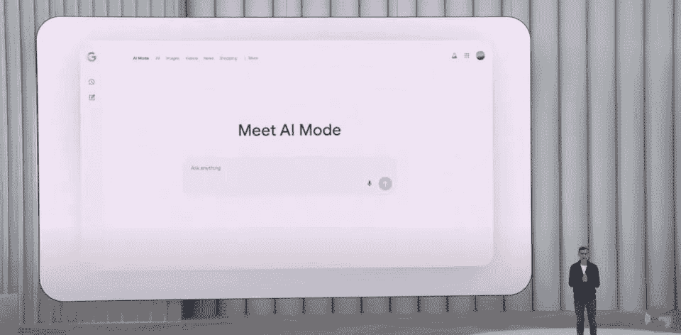

# 2025谷歌 I/O 开发者大会（省流版）

> 来源：[https://yunyinghui.feishu.cn/docx/NH6MdVAixoIaCFxGmdBckiPSnrl](https://yunyinghui.feishu.cn/docx/NH6MdVAixoIaCFxGmdBckiPSnrl)

> 首发时间：2025 年 7 月 16 日

> 更新时间：2025 年 7 月 16 日

> **内容出品人：**** **

> **内容出品方：**[Mix AI Lab](https://yunyinghui.feishu.cn/wiki/WhelwZnxQi55mpkOzatc3Xran5b?from=from_copylink)

> **使用建议：**如果需要快速定位到精确内容，可以使用快捷键 Ctrl +F/Command +F 的形式，搜索关键字/词，查找你想要的内容。

>

> **为 AI 实验室同学持续更新**2025谷歌 I/O 开发者大会学习纪要内容，为 AI 学习者总结大会纪要

> 2025谷歌 I/O 开发者大会是谷歌围绕技术开发者群体开展的年度活动，于2025年5月20日至21日举办。

> 本届大会包含主题演讲与技术讲座，聚焦Android开发工具及谷歌开源模型Gemma，同时在加州山景城海岸线圆形剧场设立线下主会场。

>

> 🎯全**网良心AI开源知识库：「**[**AI 实验室」知识库（**](https://yunyinghui.feishu.cn/wiki/space/7340161844864598017?ccm_open_type=lark_wiki_spaceLink&open_tab_from=wiki_home)AI 绘画、AI 写作、AI 视频等应用技能）

## **1）速览本次大会发布十余款新品**

**基础模型**

+   Gemini 2.5 Flash 新版：毫秒级推理、稀疏 MoE 路由，性能更强。

+   Gemini 2.5 Pro + Deep Think  ：“多链自审”推理模式，思考更深入，效果提高

+   Imagen 4  ：新版图像模型，4 K画质、1.2 s 文生图，文字排版零失真

+   Veo 3 + Flow应用：最新版视频生成模型，支持1080p，60帧输出，首个支持原生对话、音效同步生成的视频模型。Flow可用于剪辑

+   Stitch：自然语言直接转化为前端UI

**搜索侧**

+   AI Mode ：更高级的AI搜索模式，可以应对复杂问题，并可以继续追问

+   Shopping Graph 2.0：AI搜索购物推荐引擎，包含5000亿 SKU、支持虚拟试衣

+   Deep Search：类似OpenAI的深度研究功能，能提供更复杂、系统化的信息

+   Search Live：可通过实时摄像头进行问答、搜索，物体标注

**安卓+硬件**

+   Android XR与智能眼镜：谷歌与Xreal合作推出了支持Android XR的智能眼镜，具备实时导航、翻译和摄像功能

**Agent**

+   Project Mariner：谷歌版的计算机应用Agent，可以浏览网页，网页自动填表、订票 / 订位“一键代办”

**其它小工具**

+   Google Meet实时翻译：新增了实时AI翻译功能，支持多语言交流，提升会议效率

+   Google Beam：原Project Starline项目更名为Google Beam，提供基于AI的3D视频通话体验，计划与HP合作推出相关设备

+   Gmail智能回复：引入了AI个性化回复功能，使回复内容更贴近用户语气

## 2）本次 I/O 大会最值得关注的部分

+   谷歌搜索主动求变，全新的 AI Mode 上线，今起在美国市场推出

+   Gemini 2.5 Flash轻量级模型发布，2.5 Pro随后将至

+   Veo3、Imagen 4这两个多模态模型，让谷歌有了挑战OpenAI的另一个支柱

+   Android XR正式版亮相，谷歌重新下场做智能眼镜，试图挑战AR眼镜的终极形态