# 2024 苹果全球开发大会纪要

> 来源：`https://yunyinghui.feishu.cn/docx/OHNRd1qxLofXoyxfUWRcp8p1nXg`
> 首发时间：2024 年 6 月 11 日
> 更新时间：2024 年 6 月 11 日
> **内容出品人：**
> **内容出品方：万象 AI 实验室**
> **使用建议：**如果需要快速定位到精确内容，可以使用快捷键 Ctrl +F/Command +F 的形式，搜索关键字/词，查找你想要的内容。
> **为 AI 实验室同学持续更新苹果 WWDC24 开发者大会学习纪要内容，为 AI 学习者总结大会纪要。**2024 苹果全球开发大会（WWDC 2024）是苹果公司于 2024 年 6 月 10 日至 14 日（北京时间 2024 年 6 月 11 日至 15 日）举办的大会。
> 🎯全网良心AI开源知识库：[「AI 实验室」知识库](https://yunyinghui.feishu.cn/wiki/space/7340161844864598017?ccm_open_type=lark_wiki_spaceLink&open_tab_from=wiki_home)（AI 绘画、AI 写作、AI 视频等应用技能）

## 大会观看地址

### 观看地址

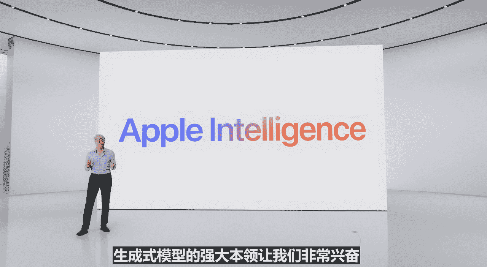

> 🍎发布会观看地址：[www.apple.com](https://www.apple.com/apple-events/)

## 核心要点

> **在会上苹果发布了以下重要消息：**
>
> 1、苹果宣布，与 OpenAI 构建合作伙伴关系，整合对方的 ChatGPT。苹果宣布可以在系统中直接调用 ChatGPT，只要你同意，而且不用创建账户，已有账户可以进行关联。
>
> 2、苹果围绕 AI 功能宣布“苹果智能”（Apple Intelligence）套件，能够优先置顶推送、总结文本、生成图片。
>
> 3、苹果发布 Vision Pro 的操作系统 VisionOS 2，该软件采用机器人学习方式，以创建空间和 3D 图像。
>
> 4、苹果头显 Vision Pro 将在中国、日本和新加坡推出。国行版起售价 29,999 元人民币，6 月 14 日上午 9 点接受预购，6 月 28 日发售。
>
> 5、苹果宣布计算器应用登陆 iPad。
>
> 6、苹果发布 macOS 15，该系统将出现一个叫做“iPhone 镜像”的功能，可以使用 Mac 操作 iPhone。
>
> 7、苹果提出了一个“私有云计算”的概念：“苹果智能”将在使用苹果芯片的专用服务器上启用云计算模式，确保用户数据的私密性和安全性。
>
> 8、苹果宣布为 iMessage 和短信应用推出卫星短信功能。
>
> 9、苹果发布 iOS 18、iPadOS 18、watchOS 11 等系统的更新。
>
> 10、苹果正式发布 macOS Sequoia 系统。这一系统将支持用户直接在 Mac 上实现 iPhone 镜像并操作 iPhone，用户可在主屏幕上滑动页面并通过 Mac 的触控板启动应用程序。开发者测试版现已推出，公开测试版将于 7 月推出。完整版将于 2024 年秋季发布。
>
> 11、陪伴苹果用户超过 20 年的「Apple ID」或将与果粉告别，在 iOS 18 中更名为「Apple Account」。
>
> 12、在 iOS 18 中，苹果首次为主屏幕引入额外的自定义选项。用户不再需要借助第三方工具就能尽情施展自己的创意，创造出更多异形布局，具体表现为自由制定主屏幕的行、列参数。

## OpenAI 官方公布

**官方公布原文：**`https://openai.com/index/openai-and-apple-announce-partnership/`

**翻译文：**

> 苹果正在将 ChatGPT 集成到 iOS、iPadOS 和 macOS 的体验中，允许用户访问 ChatGPT 的功能（包括图像和文档理解），而无需在工具之间切换。
>
> 在需要时，Siri 还可以利用 ChatGPT 的智能功能。Apple 用户在向 ChatGPT 发送任何问题以及任何文档或照片之前都会被询问，然后 Siri 会直接提供答案。
>
> 此外，ChatGPT 还将出现在 Apple 的系统级写作工具中，帮助用户生成他们所写内容。用户还可以利用 ChatGPT 图像工具生成各种风格的图像，以补充他们所写的内容。
>
> 在 Siri 和写作工具中访问 ChatGPT 时，隐私保护功能已内置 - OpenAI 不会存储请求，并且用户的 IP 地址会被隐藏。用户还可以选择连接他们的 ChatGPT 帐户，这意味着他们的数据偏好将受 ChatGPT 政策的约束。
>
> 由 GPT-4o 提供支持的 ChatGPT 集成将于今年晚些时候登陆 iOS、iPadOS 和 macOS。用户无需创建帐户即可免费访问，ChatGPT 订阅者可以直接通过这些体验连接他们的帐户并访问付费功能。

## 大会核心速记

### VisionOS 2 及 VisionPro 在中国发售

visionOS 2 改进了一些手势，比如抬手并轻点两指，便能快速打开主屏幕视图、翻转手掌并轻点可以查看电池电量等。visionOS 2 可以将 iPhone 拍摄的 2D 照片转换为具有景深效果的空间照片。

> **核心更新**
>
> + 照片：VisionOS 2 将使用 AI 将普通照片转换为与 Vision Pro 兼容的空间照片。
>
> + 空间视频：空间视频可以在苹果开发的视频编辑软件 Final Cut Pro（FCP）中编辑，并在 visionOS 的新 Vimeo App 中查看。专业人士可以利用新的空间视频功能更轻松地制作新的空间内容。
>
> + 新手势：VisionOS 2 将推出新的手势驱动控件。
>
> + 超宽显示屏：Vision Pro 现在将支持超宽显示屏，苹果称其相当于并排两块 4K 显示器的分辨率。
>
> + 旅行模式 Travel 支持火车，之前只支持飞机。

一图总结更新：

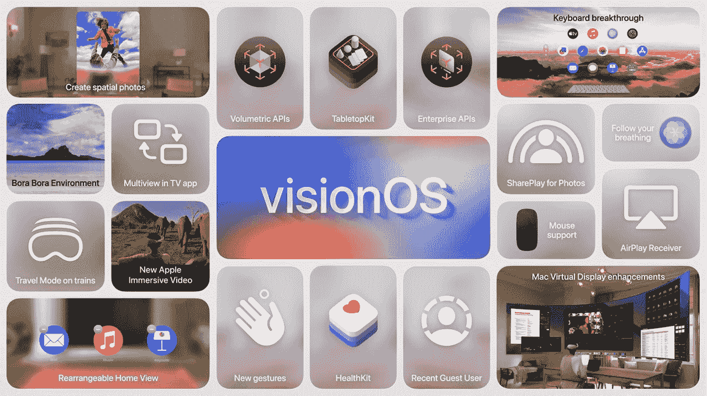

苹果在演讲中提到 Vision Pro 将于 6 月 28 日在中国大陆、中国香港正式发售，国行售价 29999 元起。7 月 12 日，开始在澳大利亚、加拿大、法国、德国和英国出售。

### iOS 18

**重点功能更新纪要**

1. 提供了个性化主屏幕的功能，控制中心也进行了重新设计，具体表现在图标可以在任意位置摆放、深色模式下图标也会自动变为深色，以及能够自定义所有图标的整体色调。

2. 控制中心也进行了重新设计，上下轻扫能切换分类，控制项的布局和大小也可以更加方便地调整。

3. 锁屏界面，左右两边的快捷键在 iOS 18 中也能够自定义了，你可以把它们换成你想要的 app。

4. 新增“隐私模式”，担心别人偷看你的 app，那么就可以使用 "App 上锁" 功能，想打开必须经过 Face ID 或密码验证；有某个 app 不想被人看见，也可以把它隐藏起来。当 app 被锁定或隐藏时，app 内的信息或电子邮件等内容也会被隐藏，不会出现在搜索、通知中，以及系统内的其他地方。

5. “照片”单一视图取代了网格设计，照片 APP 也重新设计了，比如按主题分类（精选集）置顶某个喜欢的精选集、在显示照片时过滤掉截屏等等。

6. 信息 APP 新增了定时发送功能，消息还可以使用各种文字效果来进行强调。

7. 发布卫星信息功能，iPhone 14 及之后机型支持卫星短信功能，不过预计和卫星通话一样，国内用不了。

8. 新增“游戏模式”，通过减少后台来维持更长时间的高帧率，同时在连接耳机和手柄时减少延迟。

9. 邮件 app 也进行了重新设计，会将邮件按照不同分类进行汇总，来自同一发件公司的邮件可以更方便查看。

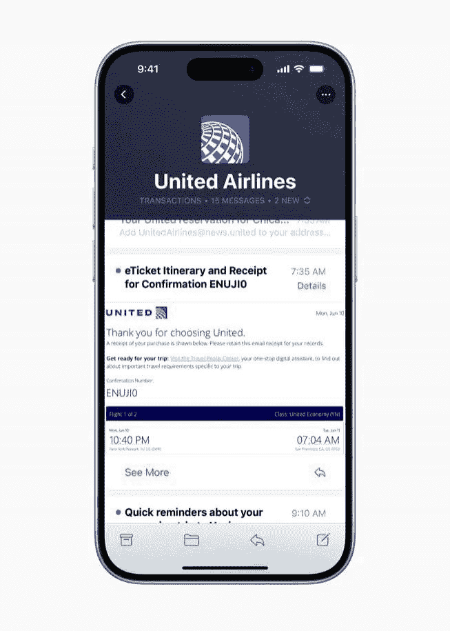

10. 地图 app 在美国支持可以离线使用的地形图。

11. 钱包支持 tap to cash，具体来说就是 iPhone 间互相碰一碰就可以进行转账，看起来像是我们经常用的🛰️收款功能。

12. 划重点，iOS 18 支持通话录音，同时还能将通话转录为文字保存。

### Audio & Home

1. 在公共场合和 Siri 对话看起来比较蠢，所以苹果在这方面进行了一些优化：当你戴着 AirPods，你可以通过点头或摇头来回应 Siri，不用张嘴了。

2. 在 AirPods Pro 上，加入了噪音隔离功能，让用户在任何环境条件下打电话都能有最佳通话质量。

3. 玩游戏时，也支持个性化空间音频，首批支持空间音频的游戏是腾讯和 EA 共同开发的极品飞车手游，更多开发商游戏将持续适配。期待以后玩吃鸡更加精准的听声辩位了。

4. tvOS，这玩意没有国行，国内关注的人不多。这次新增了一个 "insight" 功能，在播放剧集时，当你按下暂停就会实时显示当前演员信息和角色名称，也可以识别当前的背景音乐。

5. 新版 tvOS 终于支持支持 21:9 宽屏显示，屏保也进行了重新设计，可以显示照片海报、精彩剧集片段或是史努比。

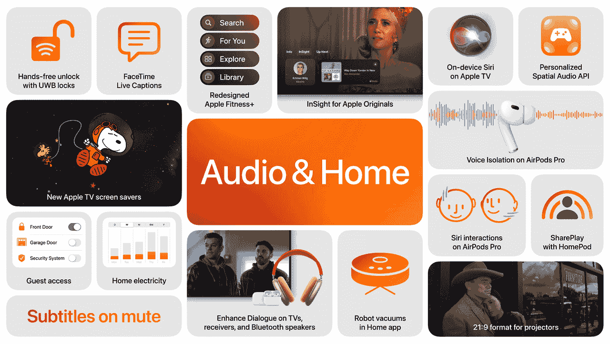

### watchOS 11

1. Training mode：新增了训练负荷功能，可以追踪你的运动强度并进行打分，免受伤，定制卡片显示。

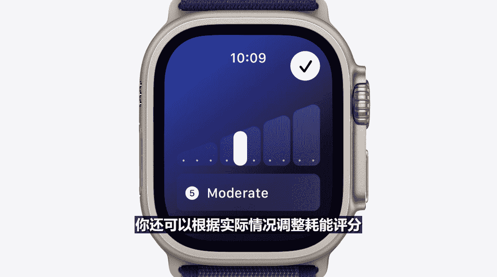

2. Health：Vitals app 关联健康数据，孕期追踪。

3. Connected：增加翻译、比分、check-in，同步运动，表盘设计。

4. 重新设计的照片表盘。

5. 有了一个有意思且刚需的功能，在手表上就可以直接识别语音并翻译。

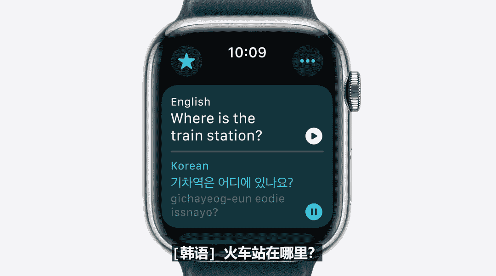

一图总结一下 watchOS 11。

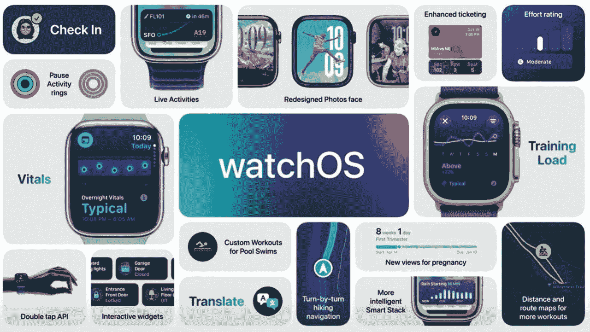

### iPadOS 18

1. iPadOS 18 支持 iOS 18 的所有新功能，终于有原生的计算器 app 了，而且比 iPhone 上的更好用。支持数学笔记，只要你写下 =，就会帮你自动计算，不仅仅是简单的加减乘除，甚至能解答更复杂的数学表达式 ...

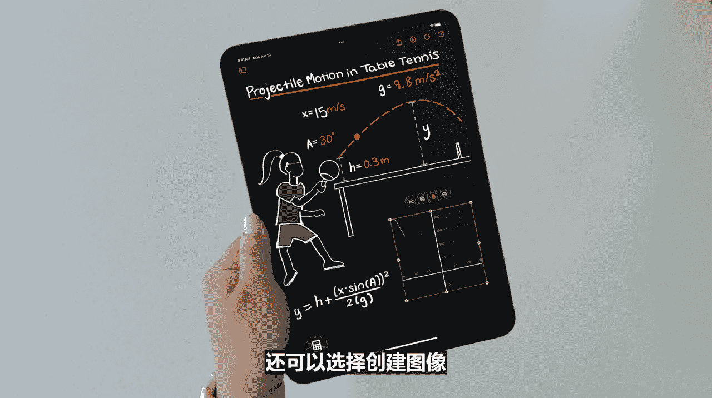

2. Smart script：备忘录 APP 中，系统会帮你自动美化字迹，书写体验也更加顺畅，粘贴过来的文本也能够自动模仿你的字迹。

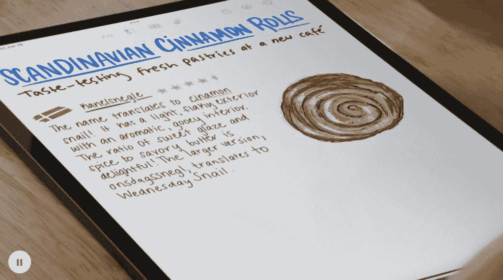

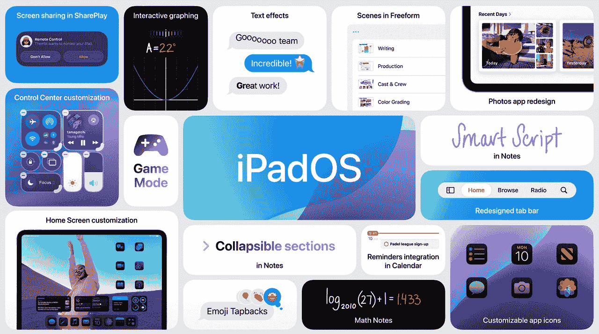

### macOS Sequoia

1. 升级版的连续互通功能可以在你不解锁 iPhone 的情况下完全访问并控制 iPhone，包括滑动页面、打开 app 等操作，在这期间你的 iPhone 本体一直保持锁屏状态，其他人看不到你对 iPhone 的操作。此外，用户还能直接在 Mac 上浏览并回复 iPhone 通知。

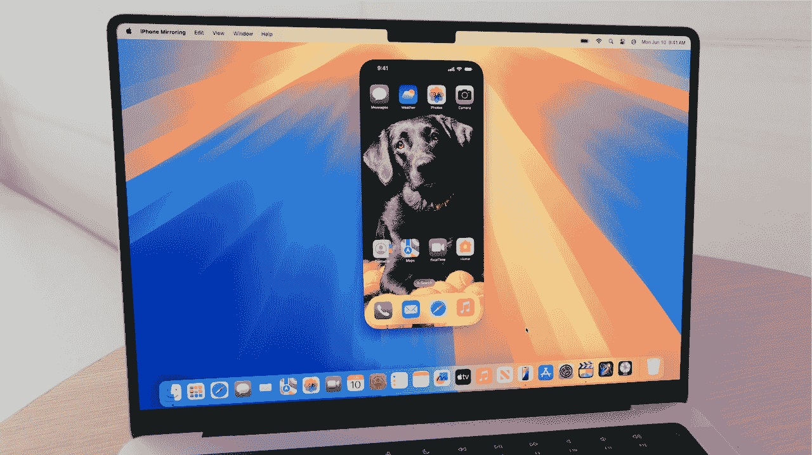

2. 深入优化用 Mac 玩游戏的体验，《波斯王子：失落的王冠》和《刺客信条：影》《魔兽世界：地心之战》《冰汽时代 2》《幻兽帕鲁》《狙击精英 4》《机械战警：暴戾都市》等大型游戏都将能够在 Mac 上运行。

3. 地图优化。

4. iPhone mirror:控制 iPhone，消息同步，拖动视频。

5. 快速拖动自动组合多窗口。

6. FaceTime 自动组合背景。

7. Keychain 升级为 password，统一安全验证

8. Safari：最快最省电，private 模式隔绝追踪，AI 识别网页 highlight，reader 和 viewer 功能。

9. Metal 3:M 芯片开发的游戏，升级开发工具，提升游戏兼容性。

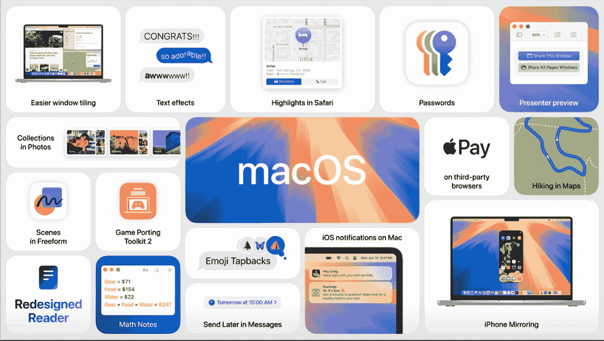

### Apple Intelligence

到这里重磅的才刚刚开始，苹果推出了 Apple Intelligence，这是一种生成式 AI 大模型，能够理解并生成语言和图像。

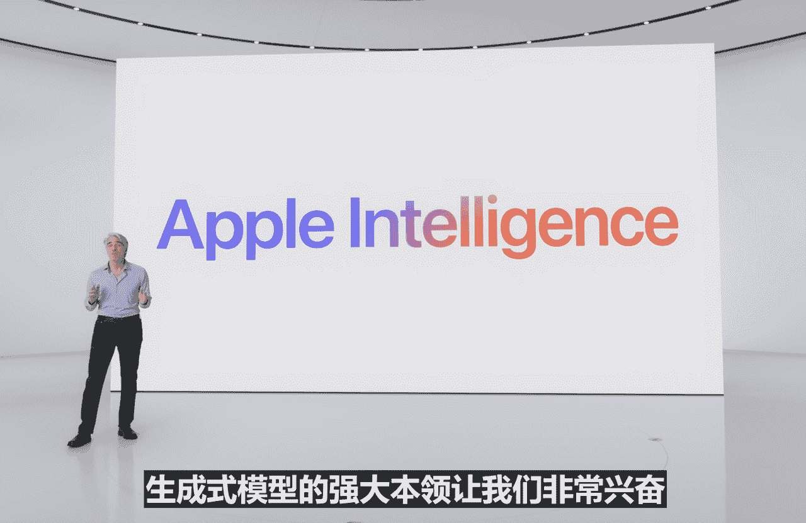

1. 用户可以与 Siri 文字交流，在文本和语音之间任意切换，用最适合当时需要的方式与 Siri 沟通。

2. 全新 Siri 有了全新的外观，当唤出 Siri 时，iPhone 的屏幕边缘会发光。它能够联系上下文理解语义、能够帮你进行操作。比如你可以让 Siri 从设备中找一张某人穿粉色衣服的照片并用🛰️发送给某人；或者当你正在填写一份要求输入身份证号码的表格，Siri 会从相册自动找到你的身份证照片并帮你把号码填到表格中；对了，Siri 还能帮你 P 图。

3. 可以随时随地，画各种各样的图。比如直接画一个 Emoji，苹果把这个称为 Genmoji，Genmoji 能根据提供的描述生成最符合你心意的 emoji，还能根据相册中的人物定制。

4. Siri 深度集成了 ChatGPT 模型，支持用户直接运用 ChatGPT 的专长，包括它对图像和文档的理解能力，为用户省去在不同工具间来回切换的麻烦。

5. 可能会有其他 AI 模型加入，例如谷歌 Gemini、百度文心一言等。

6. Apple Intelligence 还可以生成动画、插画、手绘三种风格的图像风格；可以帮助用户重写、校对和总结文本等。

7. 使用自然语言搜索图像视频。

8. 苹果 AI 还能支持清除照片中的干扰物。

9. Apple Intelligence 拥有设备端和云端两种处理方式，算力足够的情况下会在本地运算，更复杂的则使用私密云计算。

> **Apple Intelligence 的使用门槛是** A17 Pro 芯片和 M 系列芯片。

> **iOS 18：**所有支持 iOS 17 的设备都能升级到 iOS 18，但仅有 iPhone 15 Pro、iPhone 15 Pro Max 支持 Apple Intelligence 功能。

> **iPadOS 18：**iPad 7 及更新机型、iPad mini 5 及更新机型、iPad Air 3 及更新机型、iPad Pro 2018 及更新机型。

### Siri 2.0

**在 Apple Intelligence 加持下，Siri 正式迈入新纪元。**

1. 从外观来看，当和 Siri 对话时，屏幕边缘会环绕一圈光晕。

2. 从智能度来说，Siri 现在可以理解更丰富的语言，就说的不连贯，也可以，Siri 现在还可以联系上下文信息。

3. 不止可以语音输入了，连点屏幕底部屏幕两下，还能吊起文字输入。

4. Siri 也能查到手机上的所有信息，不管是邮件里的、信息里的、日历里的、PDF 的等等等等，所有的信息都能查到。

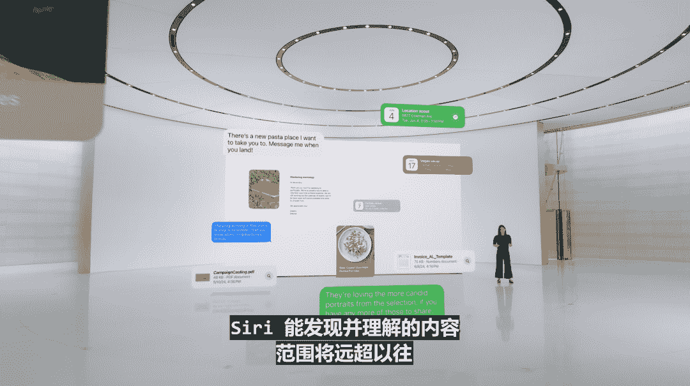

5. AI 加持下，还能跨应用操作 APP，终于有了 action。

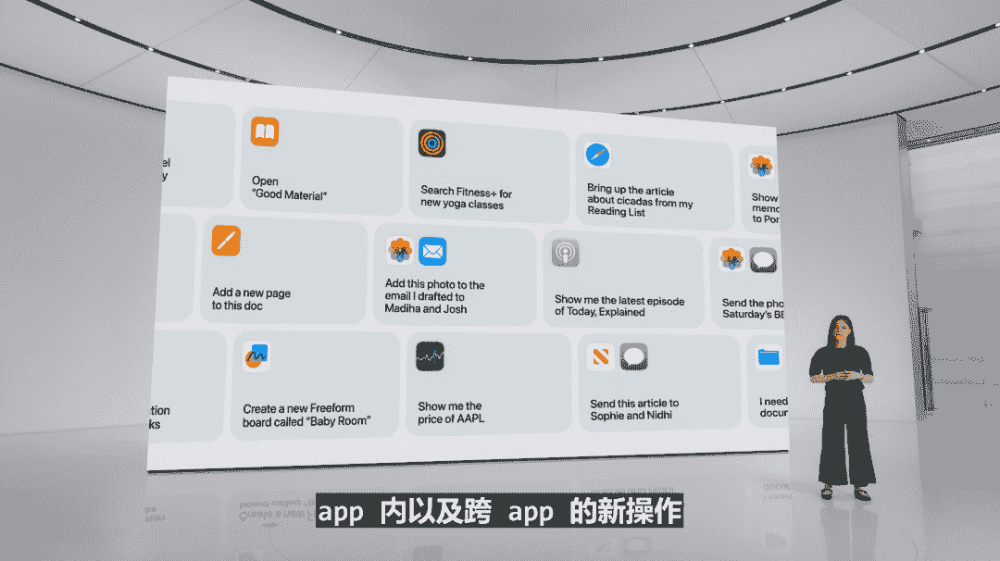

## 更新功能介绍

### 支持通话录音

凌晨的苹果 WWDC24 开发者大会上，iOS 18 官宣迎来 Apple Intelligence 功能。在一个一闪而过的介绍图中，出现了用户等待已久的通话录音功能。

不过，为了保证用户知情，苹果表示，通话录音开启时，参与者都会自动收到通知。

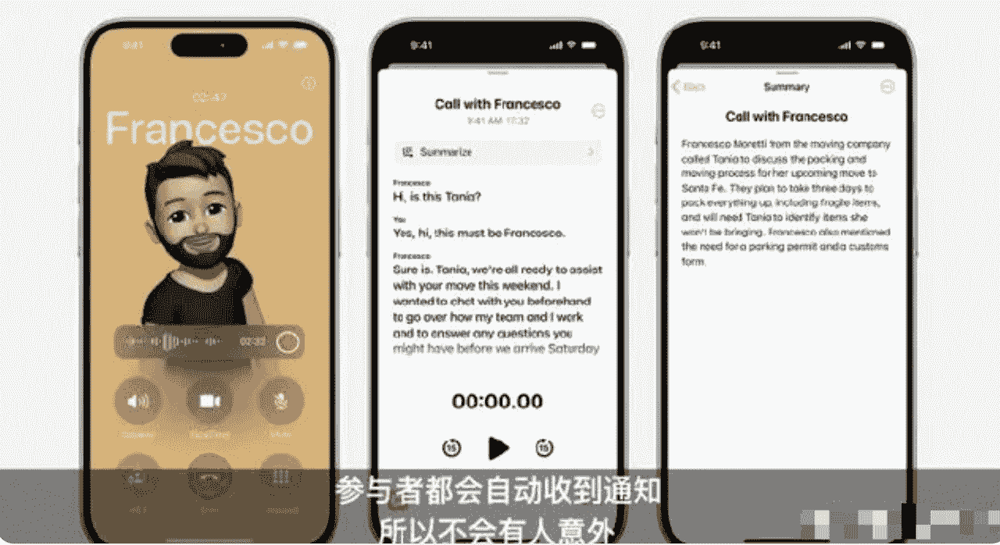

### 可自定义主屏幕

用户可以新的方式排列 App、更改颜色并调整 App 的明暗。例如，用户可以围绕他们设置为背景的照片排列 App，这样就不会遮盖照片。

### 隐私更新

用户可以锁定 App，这样他人无法在未经身份验证的情况下查看或访问信息。用户可以控制哪些联系人可适用于哪些不同的 App。新的控件可以限制网络和附件访问。

### 钱包新增点击付款功能

这是一种 Apple Pay 在线支付的现金付款新方式。用户只需将自己的 iPhone 和他人的放在一起，即可对他人进行快速、私密的付款，有点类似于“一碰传”。

### 游戏模式 Game Mode

用户如果在 iOS 18 支持的 iPhone 上玩游戏，手机将最大限度地减少后台活动，并增加对无线控制器和 AirPods 的支持。

### Siri 无缝接入工作流

Siri 能免费调用 ChatGPT 了，还能关联 GPT-4o。Siri 真的变聪明了，能更自然地回答问题、读懂模糊表达、理解多轮对话，还将能够识别屏幕、总结信息、个性化定制、跨应用操作、在 App 中执行数百项操作等。

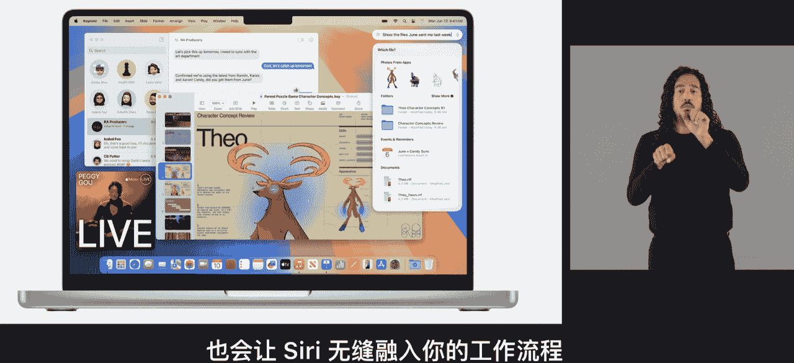

## 照片 App Photos 大改动

让用户可以更轻松地搜索照片。Photos 现在是一个单一的网格，底部有图库。网格将显示在顶部，网格下方的新空间用于“收藏集”（collections），以时间、人物、旅行或特定日期为主题显示在下方。新的过滤按钮可让用户按类型缩小范围，可以过滤掉屏幕截图。Photos 可以按人脸对图像进行排序。用户可以固定收藏集，让它保持在顶部。

## 邮件优先级功能

邮件应用程序中的优先级功能，会在你同时收到很多邮件时显示你最重要的邮件或信息。这些浓缩的通知会直接显示在你的 iPhone 锁屏上。这与新的 Focus 一起工作，减少了通知的数量，只显示最重要的通知。

## iPhone 游戏模式

Mac 的 Game Mode 也将推出 iPhone 版本。该模式应该在游戏中自动启动。这将最小化后台任务，从而将更多处理能力投入到游戏中。它应该可以改善控制器或 AirPods 的延迟。

## iPad 上线计算器

iPad 终于有了一个计算器应用程序，但它比计算器有趣得多。它可能看起来也适用于苹果铅笔。数学笔记从计算器按钮中弹出，如果你写出一个等号，它会为你解决它，根据不同的函数实时更新它。它还可以与列表一起工作，让你快速地将数字制成表格。Notes 还具有与 Calculator 相同的数学功能。

## Safari 阅读器功能总结文本

Safari 的新更新引入了几个新的人工智能功能。在列表的顶部是人工智能生成的网页内容摘要。阅读器模式改变了网站的外观，并带来了一个目录。目前还不知道它是否会同时删除广告。

## Apple Watch 的 Watch OS 11 进入训练模式

苹果手表为健身爱好者提供了一些新功能。在“训练模式”中，一个人工智能算法会告诉你在最近的锻炼中你付出了什么样的努力。这可能会告诉你，你最近的锻炼是太软还是太硬了。此外，你还可以自定义你的健身应用，让你一眼就能看到你想要看到的数据。

## 设备密码追踪

苹果发布了一款新的密码应用程序，可让您跟踪不同设备上的登录详细信息。该应用程序可让您生成和存储类似于 LastPass 和 1Password 等其他密码管理器的密码。密码将在 iOS、iPadOS、macOS、visionOS 甚至 Windows 上可用，密码也可跨设备同步。

## AirPods Pro 更新将让你安静地响应 Siri

Apple 将在下一次 AirPods Pro 软件更新中推出 Siri 互动功能，让您可以摇头表示 " 是 " 或 " 否 " 来回应 Siri 的播报。AirPods Pro 还配备了语音隔离功能，以提高语音质量并减少背景噪音。

## 上线 Apple Intelligence

苹果围绕 AI 功能宣布“苹果智能”（Apple Intelligence）套件，能够优先置顶推送、总结文本、生成图片。们已经很熟悉的文本摘要、文字生成等功能，Apple Intelligence 也能实现了。

[Apple Intelligence来啦！](https://www.apple.com/apple-intelligence/)

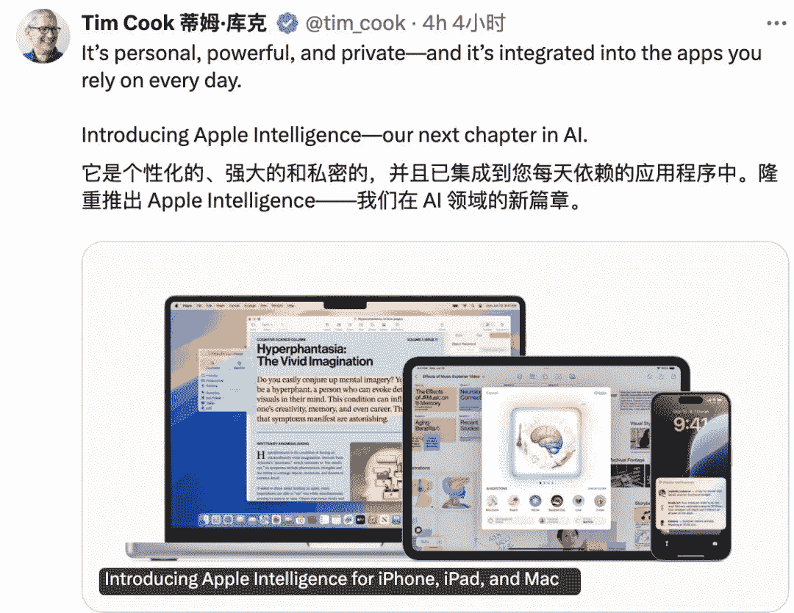

不过它的特殊之处在于，用户不用专门打开一款 App 或网址，直接在文本编辑界面即可呼出这一功能。比如说，写邮件时编辑框内选中文字即可调用系统级的 AI 相关功能，生成后的文字会直接填充在编辑框中。

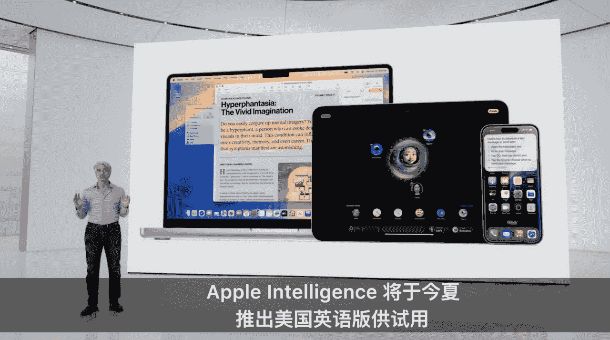

> 国内将接入本土大模型

> 据悉，苹果或许不会在 iOS 18 上接入自研 AI 大模型 Ajax，或许是起步较晚的缘故，Ajax 还未达到苹果要求。据《华尔街日报》报道，苹果已经与 Alphabet 公司旗下的谷歌、OpenAI 以及 Anthropic 进行了讨论。不排除在 iOS 18 中引入一个或引入多个 AI 大模型，为 iOS 系统提供生成式 AI 聊天机器人功能。

> 国内市场方面，我国法规要求大模型在上市前必须获得批准，目前百度文心一言、阿里通义千问、科大讯飞星火等 40 多款大模型已经获批，但苹果 Ajax 大模型并不在名单之中，因此苹果国行版手机想要引入 AI 大模型，最佳选择是与国内大模型进行合作。

# 大会各路观点

## 彭博社：苹果谨慎对待 AI OpenAI 沦为小配角

苹果与 OpenAI 的合作酝酿了几个月，但是在备受期待的 WWDC 上只是短暂提及，大部分时间都在宣扬苹果在自主 AI 技术。整场主题演讲超过了 1 小时 45 分钟，但是苹果只拿出了大约两分钟讨论与 OpenAI 的合作。OpenAI CEO 山姆·奥特曼（Sam Altman）出现在了苹果 WWDC 现场，但是没有登上主题演讲的舞台。他在苹果宣布与 OpenAI 合作后发布推文称，“非常高兴”与苹果合作。

彭博社指出，苹果对于 AI 的态度十分谨慎，因为 ChatGPT、Gemini 等聊天机器人有时难以提供完全准确的信息，而苹果则希望更多聚焦风险较低的任务，例如整理照片集或帮助预订晚餐。

## 路透社：WWDC 未能打动华尔街 AI 提振作用短期看不到

路透社称，华尔街对于苹果 WWDC 的开幕反应冷淡，因为投资者希望看到苹果推出更多令人赞叹的 AI 功能，以及让苹果在与市场领头羊微软竞争中处于有利地位的保证。周一收盘，苹果股价下跌近 2%。“苹果智能确实会以一些小而有意义的方式取悦用户，它让苹果达到与其同行相同的水平，但不会超过他们。”研究公司 Forrester 分析师迪潘詹·查特吉（Dipanjan Chatterjee）表示。

而且，苹果仍然过度依赖 iPhone。一些分析师表示，新的 AI 功能带来的任何提振作用都不太可能在短期内实现。咨询公司 PP Foresight 分析师兼创始人保罗·佩斯卡托雷（Paolo Pescatore）表示：“在这场早期竞争中，Alphabet，尤其是微软，抢占了先发优势，并拥有云资产，他们处于更有利位置。”

## 华尔街日报：苹果转嫁 AI 责任

苹果股东 Aptus Capital Advisors 的投资组合经理戴维·瓦格纳（David Wagner）表示，随着苹果与外部开发商建立合作伙伴关系，开发更先进的 AI 功能，该公司正在寻找方法，使自己免受与这些生成式 AI 模型相关的一些风险和成本的影响。这些新的 AI 系统耗费了数十亿美元的计算资源，其中一些系统偶尔会编造事实，并出现其他意想不到的行为。“苹果正在把 AI 责任转嫁给 OpenAI 这样的合作伙伴。苹果知道哪些仗该打，哪些仗不该打。（AI）不是他们要打的仗。”瓦格纳表示。

## 纽约时报：苹果加入 AI 竞争 弱点或放慢发展速度

在 OpenAI 掀起生成式 AI 大战近两年后，苹果终于在周一加入了这场竞争，宣布将把 AI 带给全球逾 10 亿 iPhone 用户。苹果推出的新 AI 功能也有助于平息人们的担忧，那就是它在科技行业部署 AI 的竞争中落后于其最大的竞争对手。今年早些时候，微软取代苹果成为世界上市值最高的科技公司。

但是，苹果有几个弱点可能会放慢其 AI 的发展。这家以保密著称的公司一直难以招募和留住知名 AI 研究人员，因为它限制公司发表研究成果的数量。它还寻求对已发表的论文进行授权，并反对在未经许可的情况下收集这些材料，就像其他生成式 AI 公司在构建和训练自己的技术时所做的那样。

## 日经亚洲：苹果承认不足 与 OpenAI 合作是一个新方向

《日经亚洲》称，苹果此前一直不愿在核心技术上与外部公司合作，这次在 AI 上与 OpenAI 合作是该公司一个新方向。“苹果需要讲述一个 AI 故事，苹果智能应该有助于安抚紧张的投资者，让他们相信苹果正在跟上竞争对手的步伐，”伦敦行业研究公司 CCS Insight 的首席分析师本·伍德（Ben Wood）表示，“与 OpenAI 在 ChatGPT 上的合作标志着苹果的一个新方向，该公司此前一直不愿在核心技术上与外部公司合作。”伍德同时指出，与 OpenAI 的合作也表明苹果承认了自己的不足。“可以说，苹果承认了它的不足，因为 ChatGPT 是在 Siri 不再能够帮助用户时参与进来的。这确实会让苹果面临一些漏洞风险，因为它无法控制 OpenAI 的模型，但也为苹果生态系统提供了一个引人注目的 AI 合作伙伴关系。”他表示。

## BBC：苹果与 OpenAI 合作不同寻常

尽管外界普遍预计苹果将会整合 OpenAI 的 ChatGPT 技术，但是对于这家一向严格保护自己产品的公司来说，这是一个不同寻常的举动。BBC 指出，多年来，苹果拒绝允许其用户下载 App Store 以外的任何应用，理由是这些应用可能不安全。而现在，苹果要与外部公司合作了。另外，苹果还得小心 AI 犯错。近几个月来，谷歌和微软已经因其 AI 产品所犯的错误而面临审查。在错误答案走红网络后，谷歌在 5 月份取消了一项新功能。

# 媒体相关报道

## 腾讯科技

[苹果 WWDC 前瞻：AI 唱主角、Siri 大进化，我们梳理了所有值得期待的](https://mp.weixin.qq.com/s/U10ufyEE8edP9tB9Ij1gfw)

## 甲子光年

[苹果重新定义 AI：AI=App Intelligence｜甲子光年](https://mp.weixin.qq.com/s/S7bHAA7RleNKbGQOcWipPw)

## 太平洋科技

WWDC24 没有王炸，AI 正在动摇苹果根基

## 爱范儿

[苹果 WWDC 超全总结：GPT-4o 加入 iOS 18，Vision Pro 国行确定，29999 起！](https://mp.weixin.qq.com/s/glyZNakqEto2qTBrOaSoHQ)

## IT 之家

苹果今天给 iOS/iPadOS 更新了波大的，但画的饼也很大

---

# AI 学习交流社群

1. 持续关注并更新 AI 的相关资讯动态，研究报告，赚钱案例，常见问题，永久免费在线查看，无收费内容，目标是成为最大的免费 AI 学习社群。

2. 已建立社群聊聊 AI 发展及应用，没进群的可以扫码加入，群满可加 AI 研究爱好者大国🛰️ ID：zyg90s（备注：AI），已经在社群内的无需重复加入。

3. 关于文档负责人大国：项目操盘手，互联网流量观察家，曾就职于互联网大厂，现研究 AI 实战应用，努力成为最懂 AI 的运营人。

**飞书学习群**

**飞书扫码进群学习**

🛰️好友（ID：zhangyuguo94s）

**扫码加🛰️入🛰️群**

进群或者加好友了解更多 AI 相关书单

**觉得有用欢迎留个赞**
