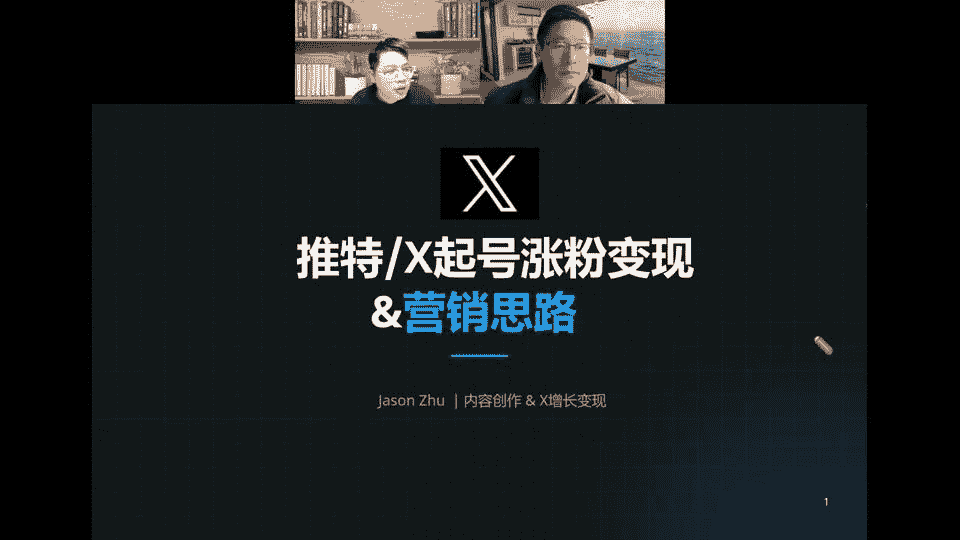
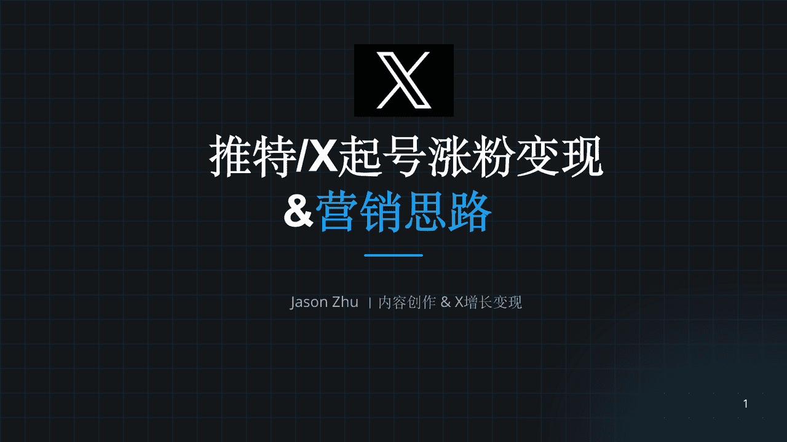
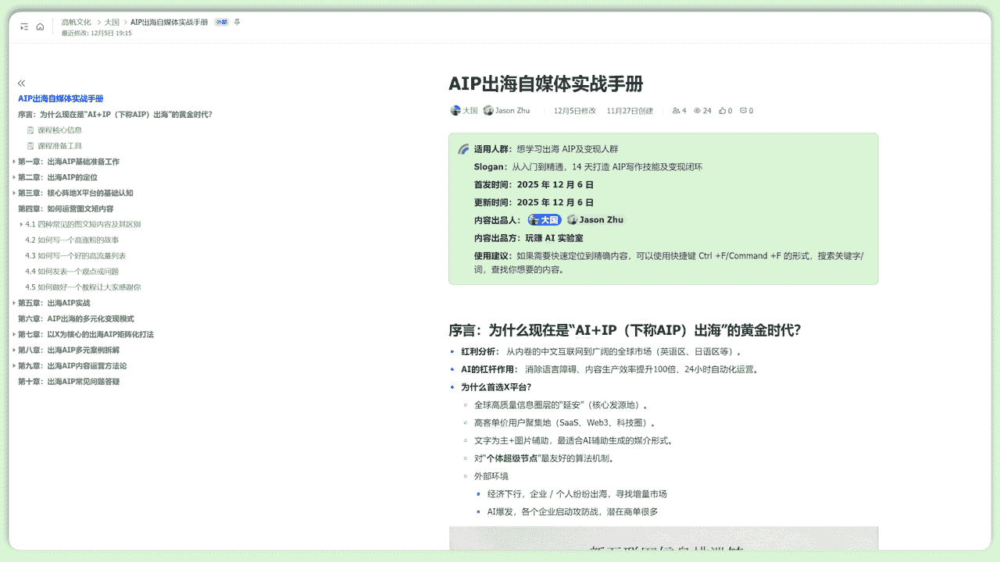

# 社区共学课件：新人推特起号涨粉变现及营销指南

> 来源：[https://yunyinghui.feishu.cn/docx/LqIMddGhvomOenxhc7EcLPvEnrb](https://yunyinghui.feishu.cn/docx/LqIMddGhvomOenxhc7EcLPvEnrb)

> **直播介绍：**眼下出海正成为一种潮流，自媒体海也是一个趋势，很多优质的 AI 博主，开始一起选择出海做优质内容，和全球的 AI 学习者交流，更为获取最先进的 AI 知识提供了优质的渠道。

>

> 今晚 8 点邀请了优秀新锐 X 上面的🧑🏼‍🏫AI 博主 Jason zhu 来分享，新人如何在 X 上面起号涨粉，如何在 X 上面变现，欢迎大家锁定直播间！

# 自我介绍

**Jason Zhu**

+   曾任职唯品会/喜马拉雅等名企

+   AI 博主和 AI 赛道创业者

+   授权发明专利 4 项

# 直播回放

> **课程回放：**

[新人推特（X）起号涨粉变现及营销指南.mp4](https://internal-api-drive-stream.feishu.cn/space/api/box/stream/download/all/H3iFbL3VmoDcMNxdTOAcNjiInze)

# 直播课件

[【玩赚AI实验室】推特起号涨粉变现及营销思路全景指南公开课..pptx](https://internal-api-drive-stream.feishu.cn/space/api/box/stream/download/all/Vg3xbecKoojX1qxbUMCcoz8XnPe)

# 交流入群

请添加微信，进交流群，一起做出海 AIP

