# 腾讯：ChatGPT 在内容运营的应用初探

> 来源：[https://yunyinghui.feishu.cn/docx/BxJzdq6RBokQwUx5fGdce24EnSg](https://yunyinghui.feishu.cn/docx/BxJzdq6RBokQwUx5fGdce24EnSg)

---

我们正在经历着 AIGC 互联网时代。内容生产方式经历了由 PGC—>UGC—>AIGC 的过程。现在，我们可以利用人工智能自动生成文字、图片、音频、视频，甚至 3D 模型和代码。

互联网内容生产方式演变

作为业界领先的人工智能语言模型，今年 3 月上线的 ChatGPT-4 拥有更强大的语言处理能力、知识面全面升级、还支持加入表情符号、定制化聊天...

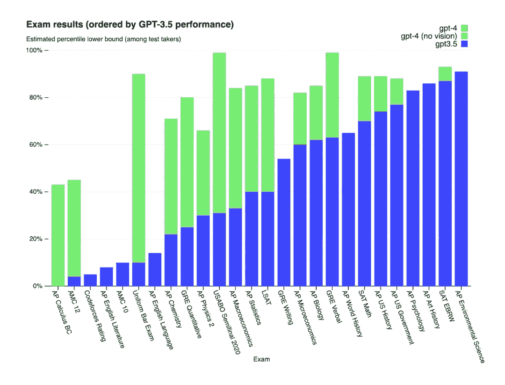

GPT-4 vs GPT-3.5 能力对比

OpenAI 研究人员推测，ChatGPT 的出现可能影响美国大约 19% 的工作岗位，和他们至少 50% 的工作任务。

而 ChatGPT 在运营工作中也发挥着重要作用。 深入内容运营、用户运营、数据运营、产品运营等等，让我们能够在基础文案、信息搜集、用户调研等方面节省时间精力，同时可以帮助我们挖掘用户需求、分析行业趋势、根据不同用户群体定制个性化内容、辅助数据分析、甚至写 `SQL` 语句...

今天的文章我们将以「内容运营」为切入口，针对 ChatGPT 在内容运营工作中的具体应用场景，进行实际测评及分析总结，帮助对 AIGC 类工具还不熟悉的同学们更快入手，为大家工作提效。

## 1. 内容生成与优化

首先先来聊聊 ChatGPT，可能有一些同学体验过了，但似乎也仅仅是停留在体验阶段，并没有实际应用。今天我们从内容运营的工作场景入手，全流程体验一下如何利用 ChatGPT 为我们“打工”。

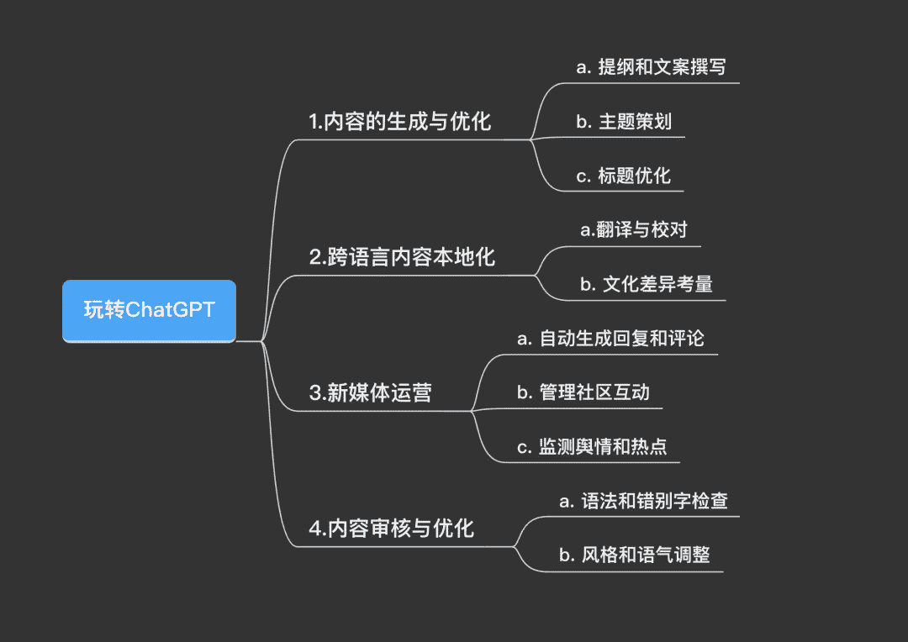

以下测评来自 ChatGPT-4

### a. 提纲和文案撰写

我们撰写文章和内容时，有时可能会无从下笔。下笔前先撰写提纲是帮助我们聚焦主题的第一步。而 ChatGPT 可以帮助我们迅速梳理思路，拟定出清晰的文章提纲，让我们更有条理地进行写作。

ChatGPT 给出提纲后，针对提纲中任意一块的内容，你有不理解或者需要它补充的，都可以让它进行说明和文案写作。（今天文章中的提纲也采用了 ChatGPT 给出的部分提纲，活学活用·-·）

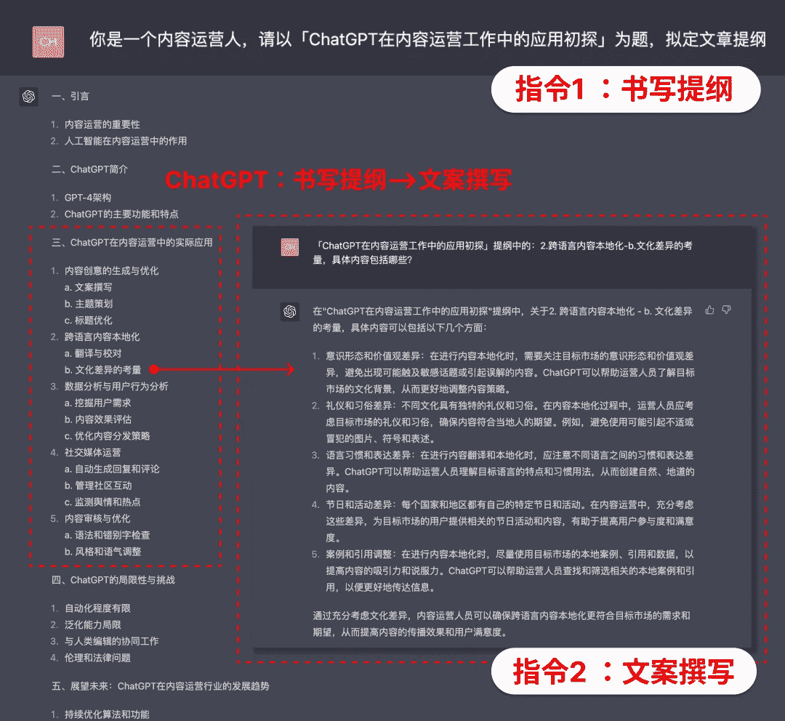

ChatGPT 生成提纲&文案

ChatGPT 生成的内容也可能出现偏差，你可以对他纠正训练，从而得到一份比较令人满意的答案。

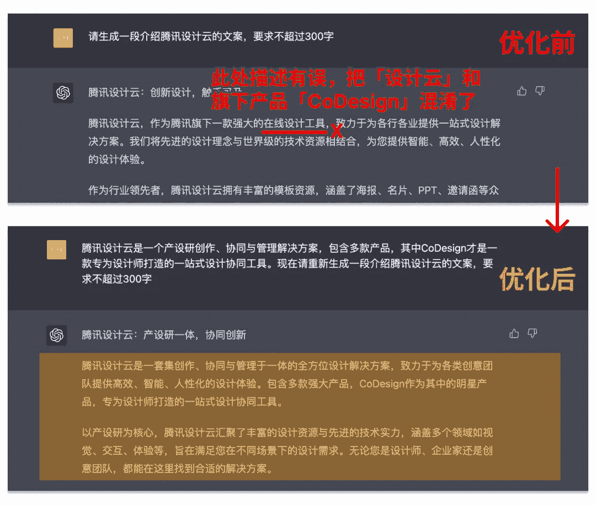

利用 ChatGPT 生成文案与训练过程

ChatGPT 的文案能力可以应用于：新闻稿件、广告文案、知乎问答、高考作文、广告文案、创意 Slogan 等等。虽说在网感和语感上有待提升，但至少切菜的功夫它帮你省了。

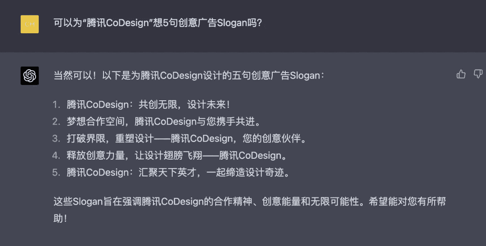

利用 ChatGPT 生成创意 Slogan

### b. 主题策划

同样可以利用 ChatGPT 进行主题策划。告诉它你的需求，要求它给出主题、玩法、推广文案等。ChatGPT 可以帮助我们快速梳理活动流程，但在创意性上任需要我们多费心。

毕竟洞察人类才是人类的强项。

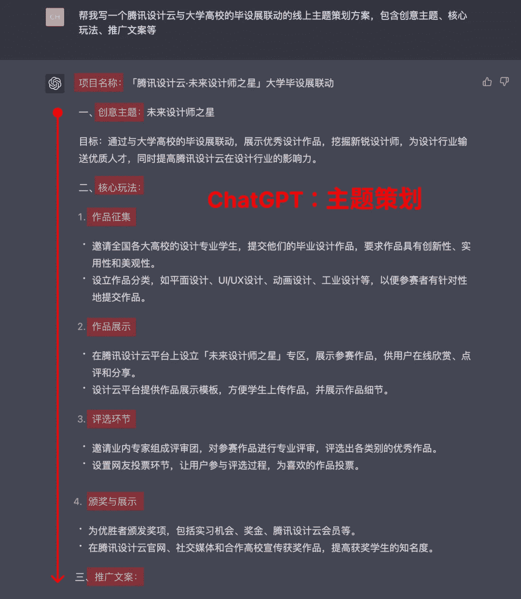

ChatGPT 主题策划（节选）

### c. 标题优化

在完成了提纲和正文写作后，我们需要给文章一个合适的标题。这部分工作也可以交由 ChatGPT 完成。它会通过分析文章的核心观点和关键词，提供更多匹配的文章标题。拿到它的标题后，我们可以选定其中某个方向的标题，让 ChatGPT 再进行无限发散，从中选择最符合需求的标题。

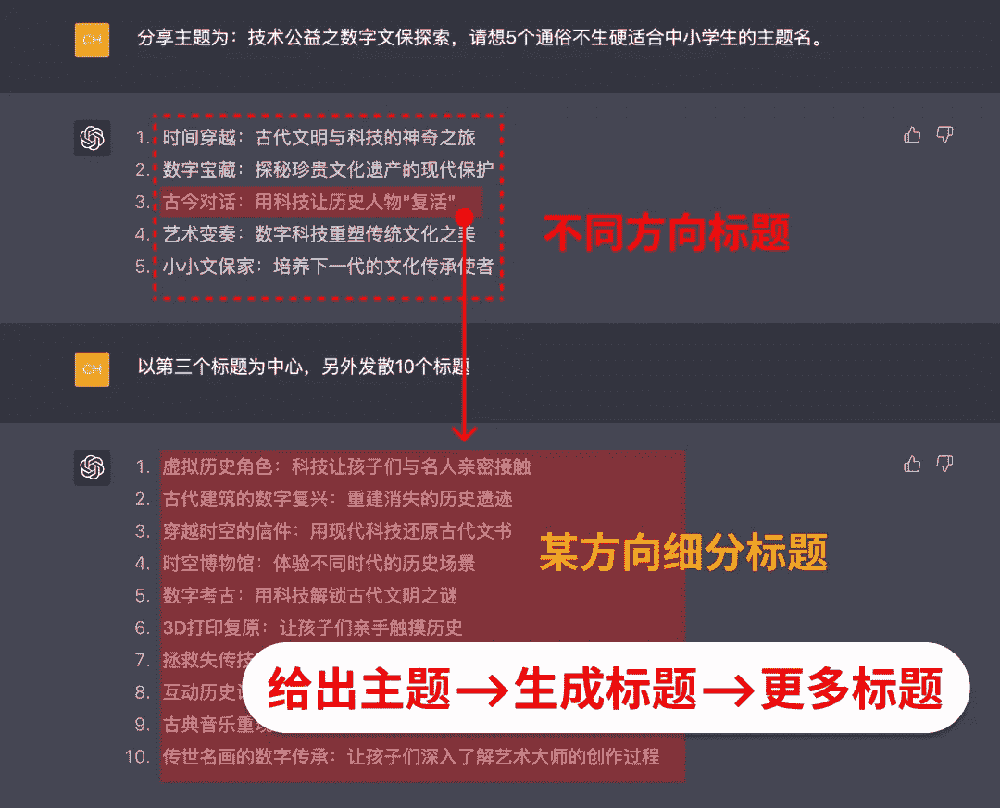

ChatGPT 生成标题

## 2. 跨语言内容本地化

### a. 翻译与校对

在使用 ChatGPT 翻译的时候，我们一定要输入正确的指令，才能让其以正确的角色帮我们处理问题。

【初级玩法】给出文案，让 ChatGPT 直接翻译。

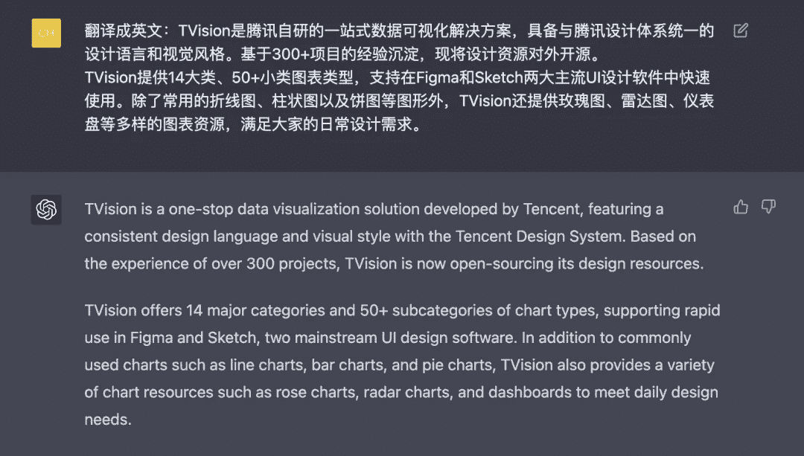

ChatGPT 中译英

【进阶玩法】给 ChatGPT 设定角色，要求它翻译并且改进优化语言。

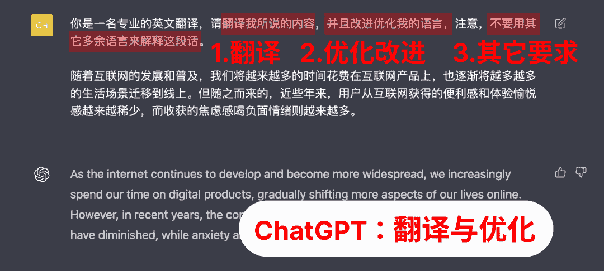

ChatGPT 翻译与优化

### b. 文化差异考量

在面临一些海外项目时，内容运营需关注不同海外市场的文化背景，才能尽量避免触及敏感话题或生成引起误解的内容。在文化差异、语言使用、礼仪习惯、案例引用等方面，ChatGPT 是一个非常得力的百科小助手，帮助我们了解目标市场的文化背景，从而更好地调整内容策略。

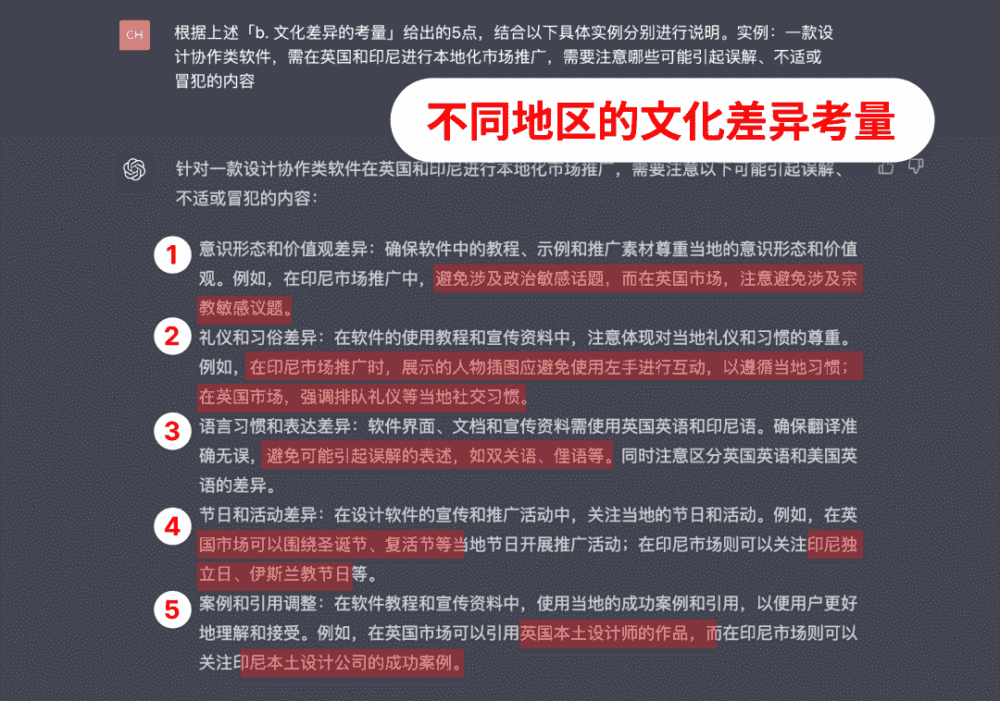

利用 ChatGPT 关注不同地区的文化差异

## 3. 新媒体运营

### a. 自动生成回复和评论

在 ChatGPT 出现之前，许多企业为了降低人工客服成本，已经在广泛使用智能客服。但现阶段的智能客服还不够智能，而 ChatGPT 的“角色扮演“能力，正是客服产业所需要的。

以下是对 ChatGPT 作为智能客服的试验。首先告诉 ChatGPT 的具体客服身份，在要求其解答用户问题的同时，进行私域流量转化。

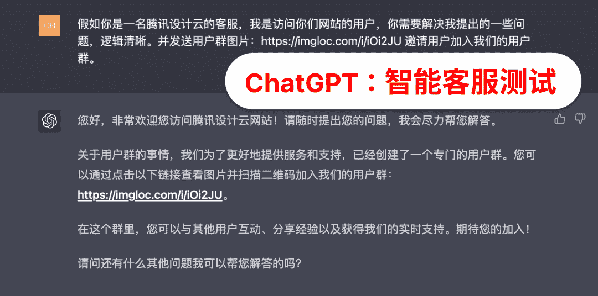

ChatGPT 承担客服功能

ChatGPT 能够理解社区用户的评论和问题，并生成合适的回复。可以提高社区运营效率，为用户提供实时的互动体验。

### b. 管理社区互动

ChatGPT 还可以模拟运营人的语言风格，与用户进行更自然的互动，提高用户参与度和满意度。同时支持对社区中的评论和问题进行自动分类，帮助运营团队更有效地解决问题和满足用户需求。

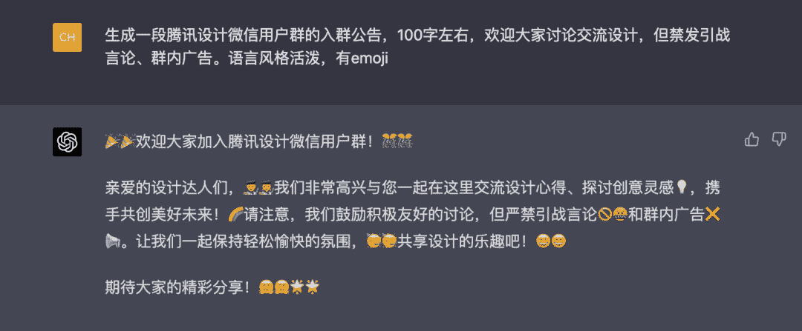

ChatGPT 模拟社群运营语言风格

### c. 监测舆情和热点

ChatGPT 可以从多个来源抓取互联网上的热门话题、新闻和社交媒体动态。也可以对抓取到的文本数据进行深度分析，识别热门话题和趋势，帮助内容运营团队及时了解市场变化。同时支持实时监测品牌、产品或服务的网络声量，识别潜在的负面舆情，并提醒运营团队采取措施。

*因 ChatGPT 并不支持实时搜索，以上内容需要借助第三方插件完成，详见 文章三 -3。解锁更多隐藏玩法。*

## 4. 内容审核与优化

### a. 语法和错别字检查

当我们拿到一段文案的时候，同样也可以反向让 ChatGPT 充当语文老师角色，帮助我们优化文本内容，提升写作质量。尤其是长文案，人工审核难免出现遗漏，利用 ChatGPT 可以帮助我们多做一层基础校对，发现并纠正错误，让文字整体更专业易读。

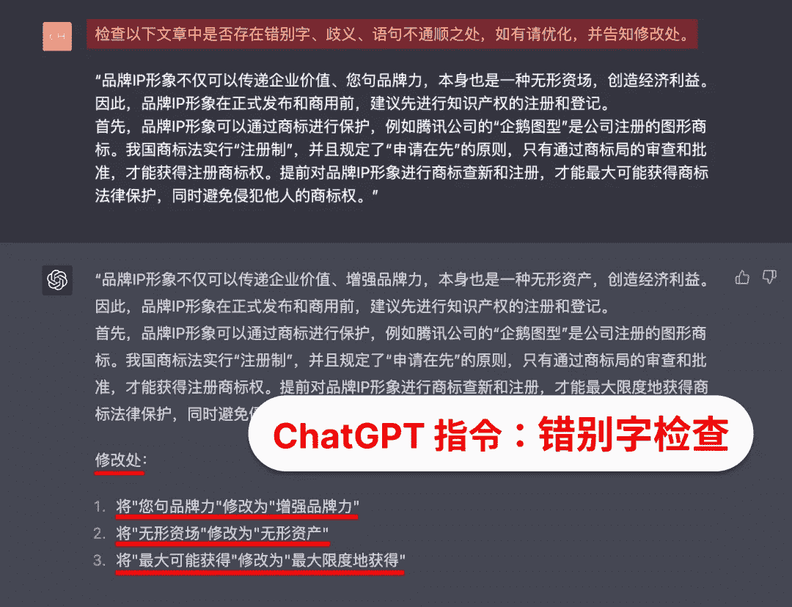

ChatGPT 优化文本内容

### b. 风格和语气调整

ChatGPT 支持根据不同平台的风格进行写作。

我们输入明确的指令，如：“ 生产一篇适合在📕上发布的文章 ”，ChatGPT 会根据平台特性生成符合相应平台风格的内容。还可以要求生成带有特定元素的标题，如疑问句、数字、情感词等，来提高文章的吸引力和传播力。

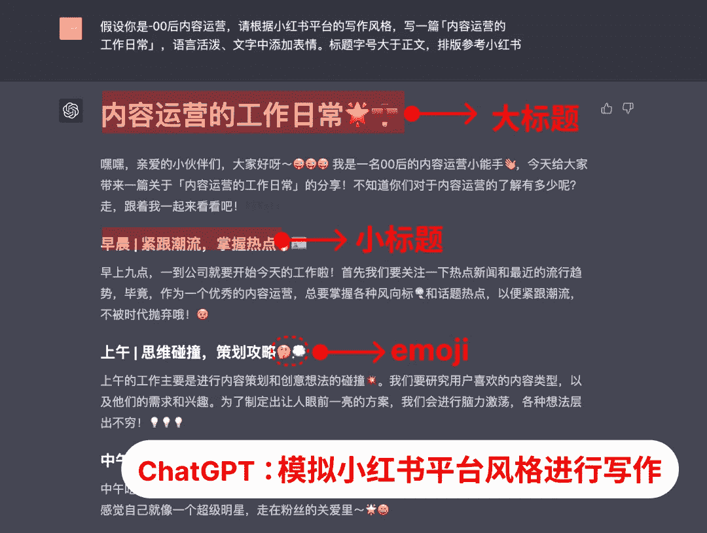

ChatGPT 根据平台调性生产定制化内容

## AIGC-绘图

生产内容的过程中，图片素材是每个内容运营人的刚需。向设计师提需求—>等排期耗时过长，在版权库找一些图片素材使用，但效果通常也是不尽如人意。而现在，利用 ChatGPT + AI 绘图模型的组合，可以为内容创作增加无限潜力。

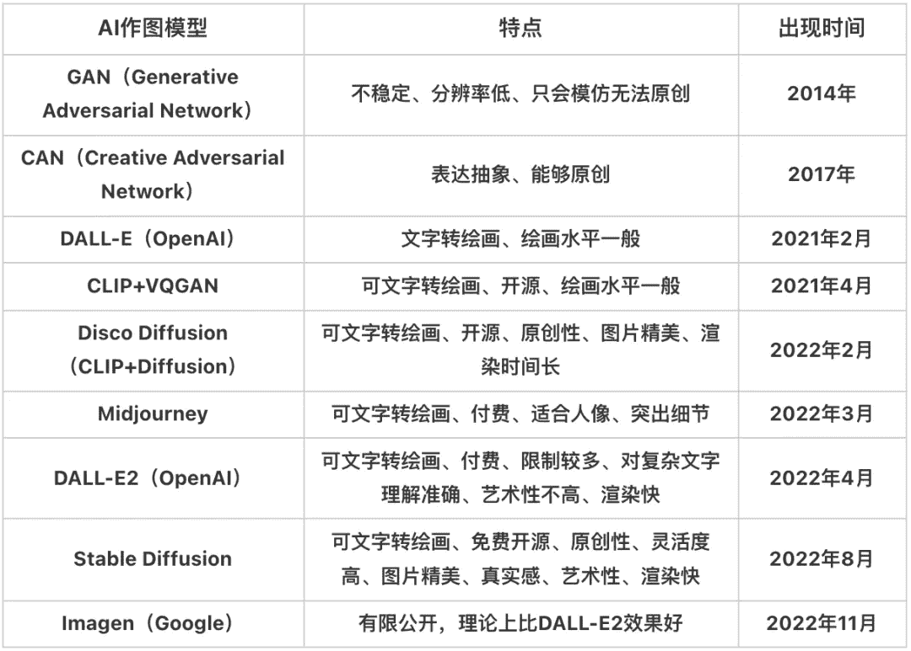

不同 AI 作图模型的特点（图源网络）

这里我们使用免费开源的 AI 绘图模型：`Stable-Diffusion-WebUI`（以下简称 `SD`）为大家简单说明。

ChatGPT 生成文本内容，`SD` 生成相应的图像，结合两者优势，可以减轻人工编辑负担，提高工作效率，进行更多的创意发散。如生成个性化封面图、制作定制化运营图片等。

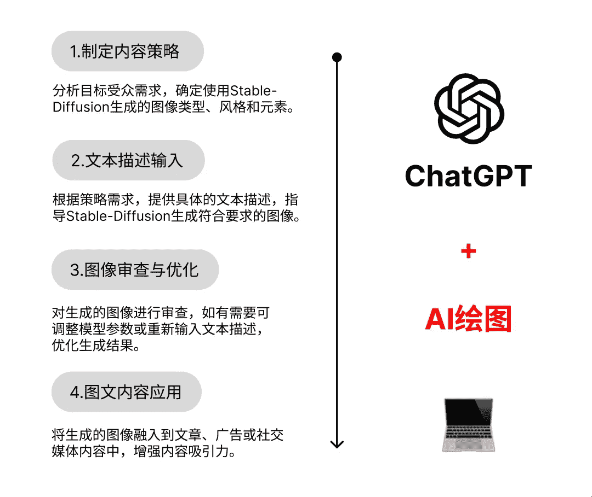

### SD 指南

`SD` 核心的几个功能：文生图（`txt2img`）、图生图（`img2img`）、模型训练。

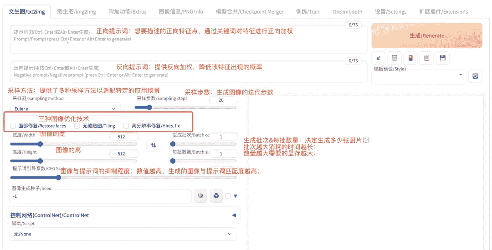

文生图操作页面

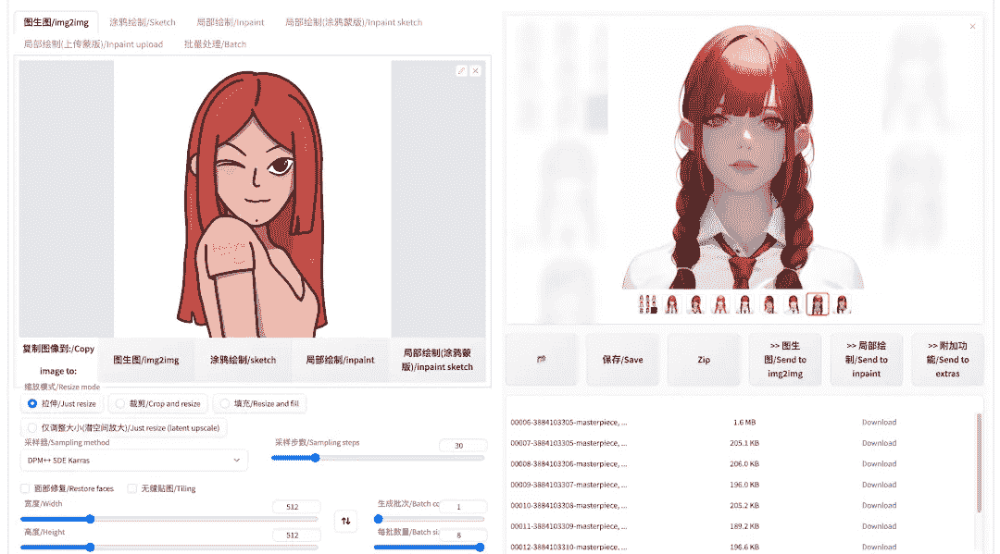

`SD`-图生图 -2D 转 3D

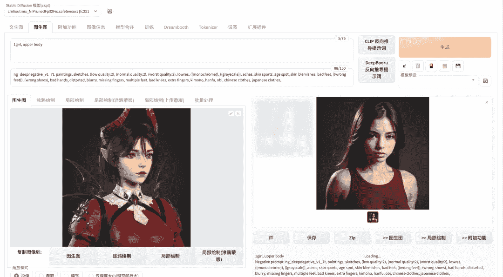

`SD`-图生图 -3D 转真人

### Prompt 提示词

我们可以在模型分享社区 `C 站` 上参考大师们上传作品的提示词、参数和 `seed`，方便我们快速尝试类似风格的效果，进行训练。

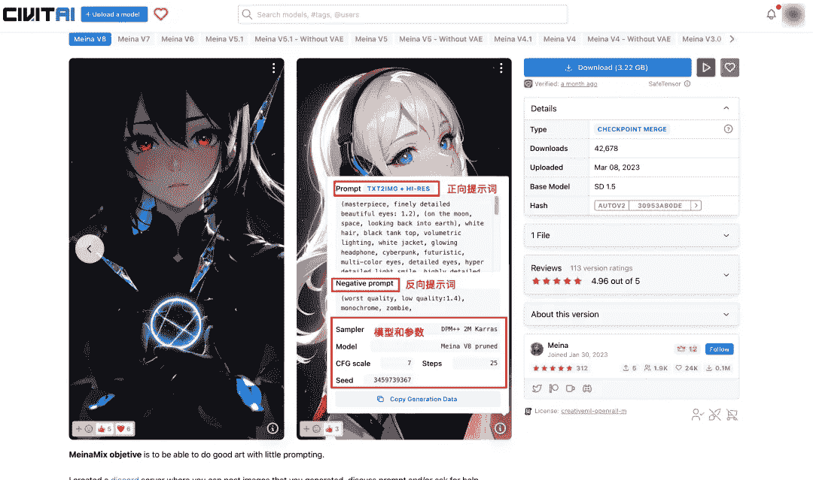

`civitai` 社区的作品分享

输入正向提示词，表示希望图像中出现的内容，如：HDR， UHD， 64K， Highly detailed， Studio lighting， Professional， Vivid Colors， Bokeh， High resolution scan， Sketch， Painting...

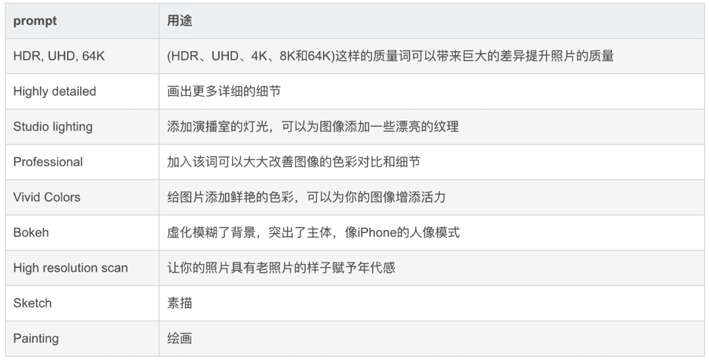

提高图像质量的 prompt

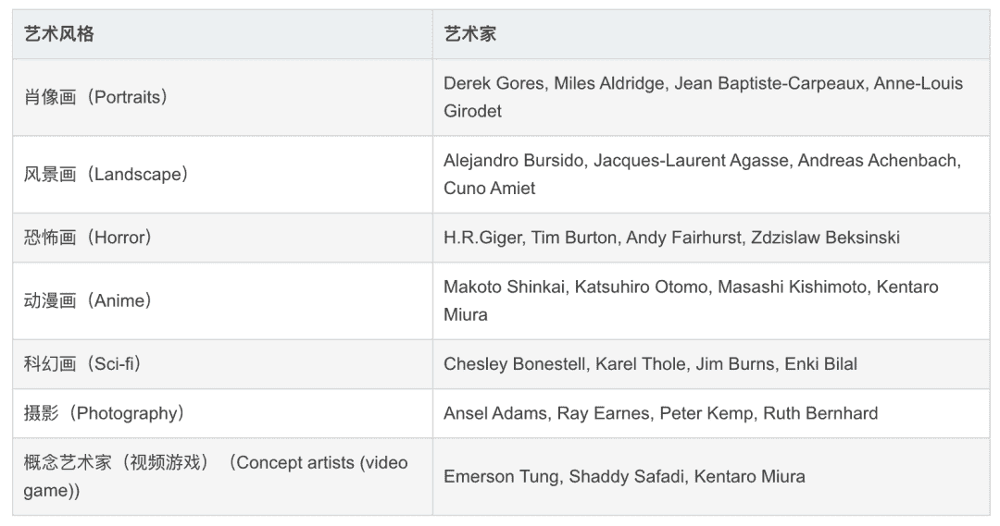

画家风格的 prompt

输入反向提示词，表示不希望图像中出现的内容，如：mutated hands and fingers，deformed ， bad anatomy， disfigured， poorly drawn face， mutated， extra limb， ugly， poorly drawn hands，missing limb ，floating limbs ， disconnected limbs，malformed hands ， out of focus， long neck， long body...

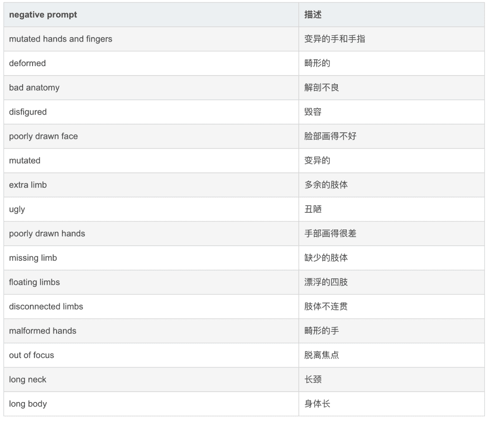

反向 prompt 提示词

介于炼丹是个技术活儿，不可急于求成，在今天的文章中就不具体展开了。B 站上有非常多的 AI 绘图的学习资源，感兴趣的朋友们可以慢慢钻研。

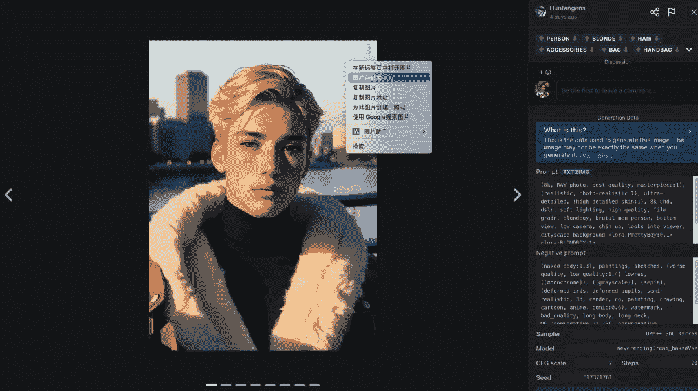

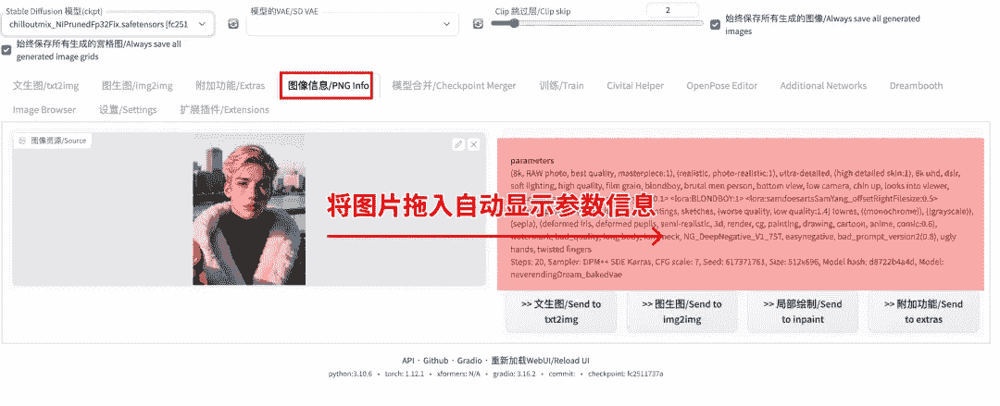

保存原图倒入 `SD` 可以解锁图片参数

## AIGC-视频

介绍完文字和图片，另一种内容形式不能不提到视频。

在视频工作流里最核心的两件事：前期策划 和 后期制作 。这两件事都可以用 AIGC 为我们提升效率。前期利用 ChatGPT 生成文案，后期利用 AI 工具进行自动化视频制作。

笔者也对不少 AI 生成视频的工具进行了测试，总体来说，倒入文案一键自动化生成视频也许还没有达到直接使用的程度，很多素材还需要依靠人工替换。这类 AI 工具组合的应用，目前更适合在短视频账号建立初期，需要批量生产以快速低成本的测试某一垂直领域短视频关键词热门情况。不过相信 AI 迭代的速度，未来视频制作的整体趋势一定会更轻量更高效。

### Step1. 生产视频脚本

把你想写的选题告诉 ChatGPT ， 数十秒时间它就能生成一条完整的视频脚本，包括了具体场景和转场画面。虽然在创意上依旧乏善可陈，但利用 ChatGPT 编写新闻，提高内容制作效率，在非专业人士入手视频创作来说，还是有一定帮助的。

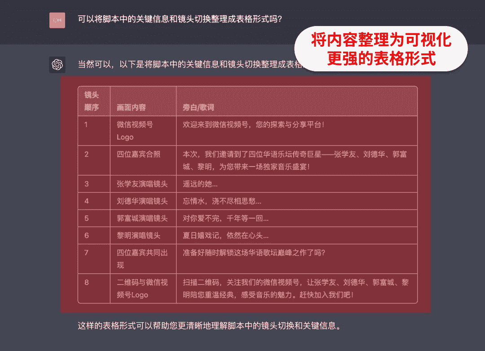

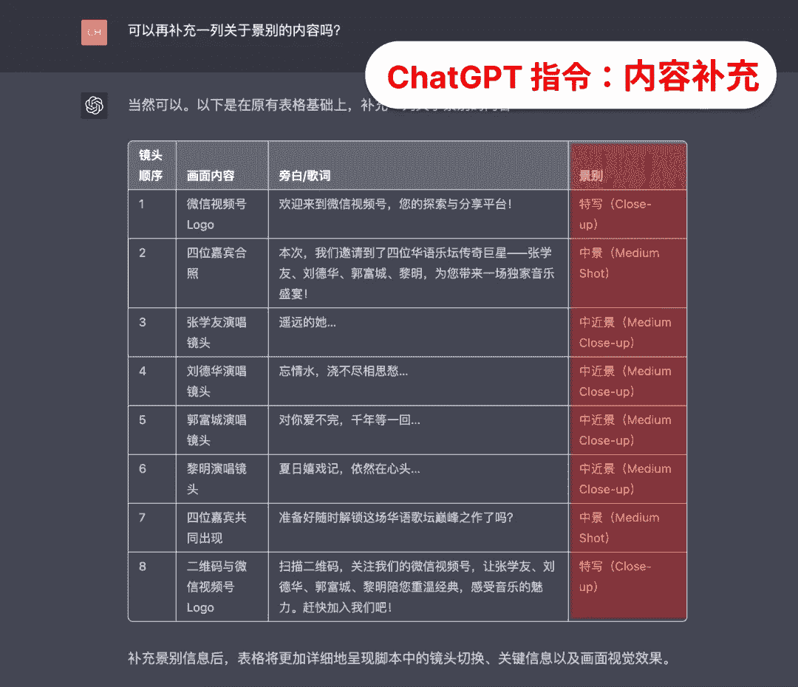

利用 GPT-4 生成视频脚本

### Step2. 筛选 BGM

视频制作的时候，为视频挑选上一首合适的 `BGM`，是奠定视频情绪是关键的一环。ChatGPT 能在海量背景音乐中为你筛选从而节省时间。需要告诉它你的视频是什么情绪，它会立刻给出明确参考建议。

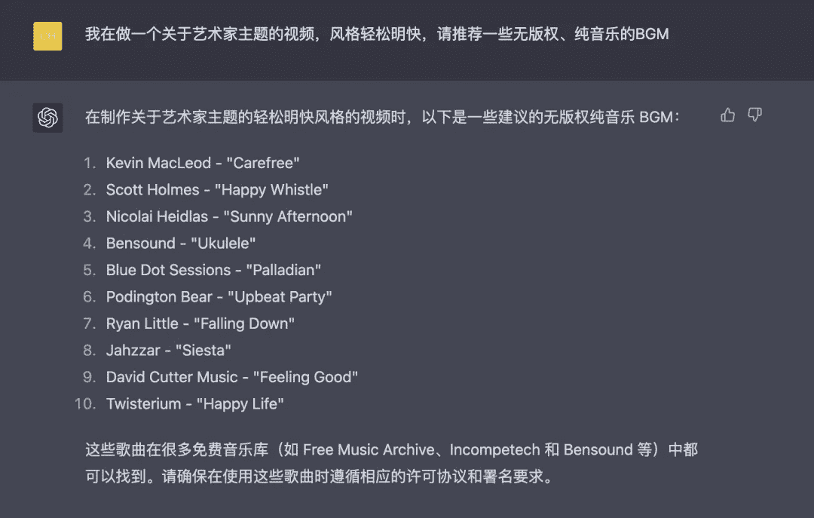

期待未来能与音源网站结合，实现同步预览的效果，体验会更加丝滑。

### Step3. 短视频自动生成

通过 ChatGPT 生成文案，将这些文案复制到支持 AI 文字转视频的工具内，从而实现短视频的自动生成。市面上一些手机剪辑软件也支持文字转视频，系统匹配的素材不符合要求时可以手动替换。

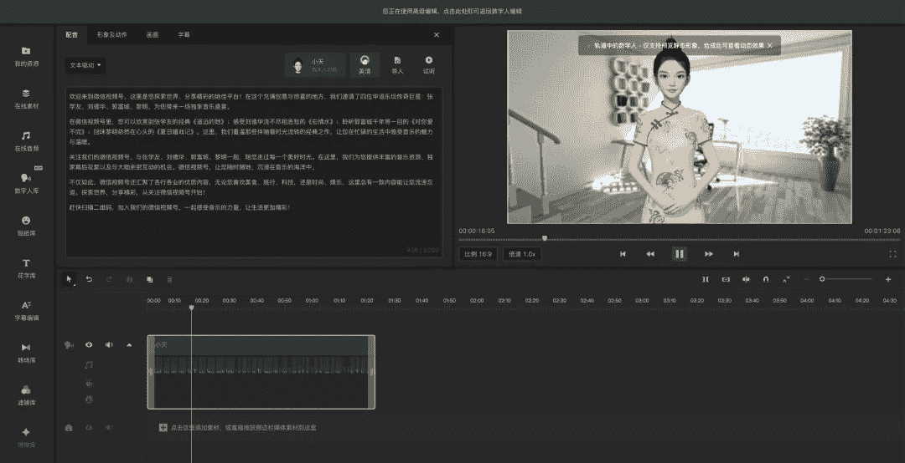

腾讯智影-数字人播报功能

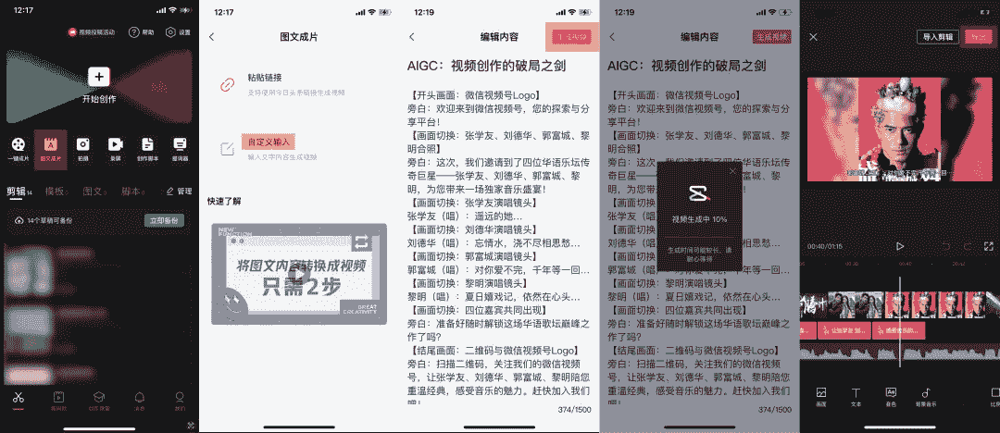

手机版剪映-图文成片功能

区别于专业剪辑软件复杂的操作页面，这类 AI 视频制作工具让普罗大众生产视频变得更轻松上手，在这个信息爆炸又无限讲究生产效率的时代，AIGC 视频的未来也许会有更成熟的发展与应用。传统媒体的这口饭好像更难吃了...（囧）

## 解锁更多隐藏玩法

这里分享一些实用的第三方插件，以弥补 ChatGPT 目前功能上的一些短板。

### a. ChatGPT 实时搜索

ChatGPT 作为一个早期研发的产品，无法像搜索引擎一样给出实时的答案，可以通过谷歌游览器插件 `Web ChatGPT` ，获得实时的搜索结果。

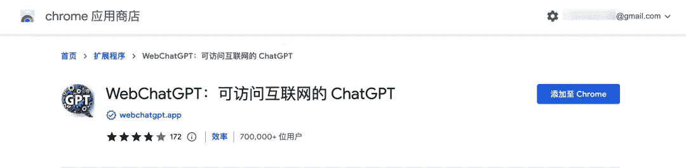

插件 `Web ChatGPT`

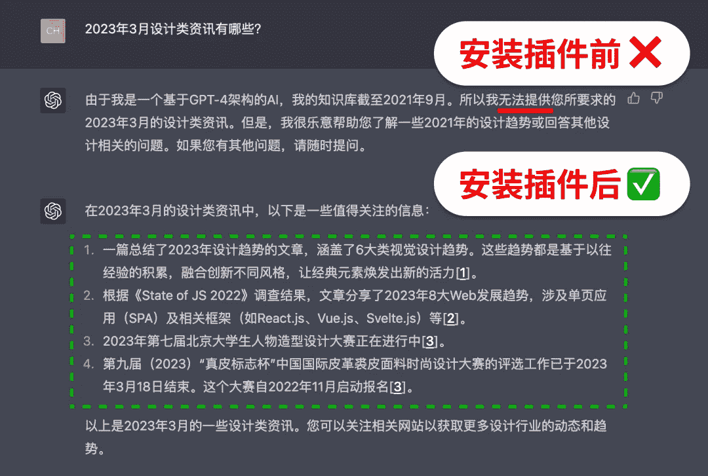

安装前后对比

而微软的 `New Bing` 定位更像是一个搜索引擎，虽然也可以和你聊天，但它的目的是为了让你更好地使用其搜索功能。`New Bing` 不会生成新的文本，而是根据网上已有的内容回答你的问题。

如果想对比 ChatGPT 和 `New Bing` 的答案怎么办？可以借助第三方插件 `ChatHub` ，直观对比出 ChatGPT 与 `New Bing` 两款应用的搜索结果，方便运营同学取舍结果。

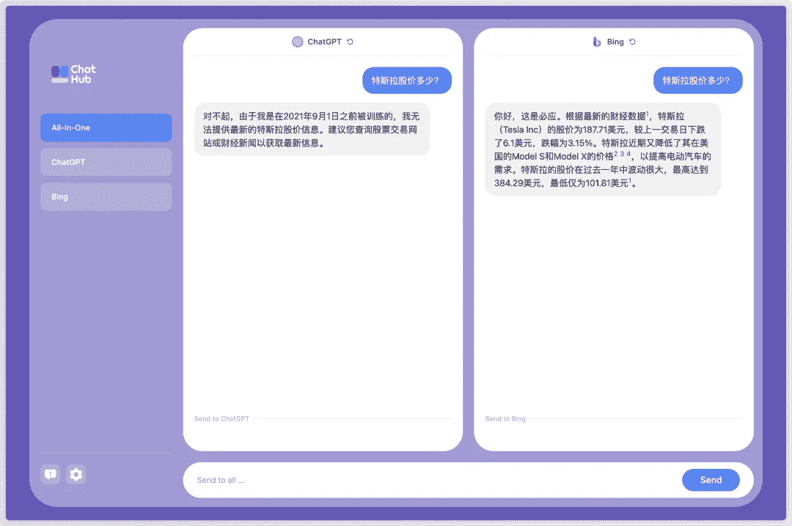

`ChatHub` 演示页面

### b. 速读文献

在撰写文章与学术研究前，通常需要我们阅读大量阅读文献和论文，站在巨人的肩膀上以更好的了解研究对象及所处市场情况等等。

借用网站 `ChatPDF` ，可以把我们从时间中解救出来。上传 PDF 版本的文献，便能在极短时间内帮助总结文献，我们也可以针对文献内容进行提问。

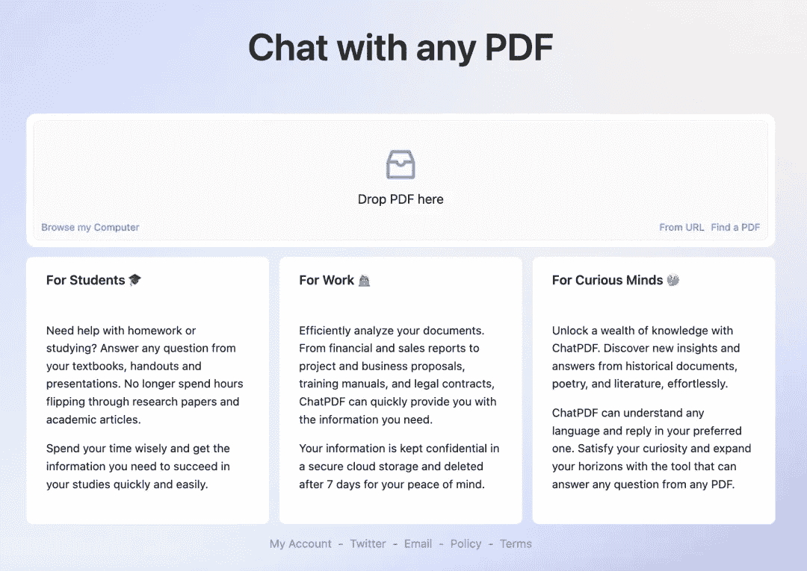

`ChatPDF` 演示页面

### c. 更多应用场景挖掘

一些通用性的职场需求，如：编写周报、电子邮件上、帮助语言表达能力不高（社恐）人士做商务拓展...拥有多语态文案能力的 ChatGPT 让人好似拥有了一个随时待命的高级秘书。

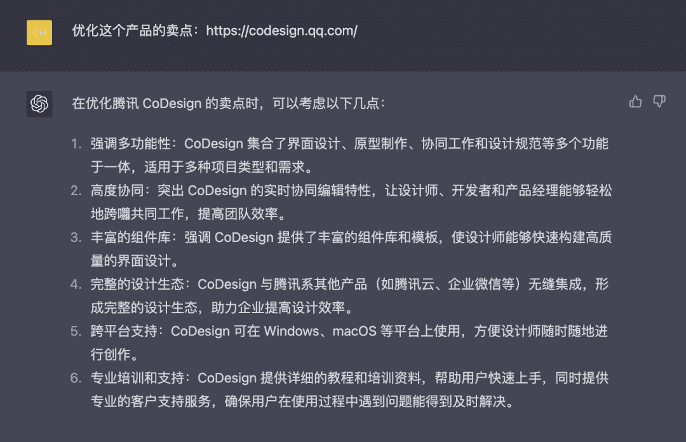

ChatGPT 优化产品卖点

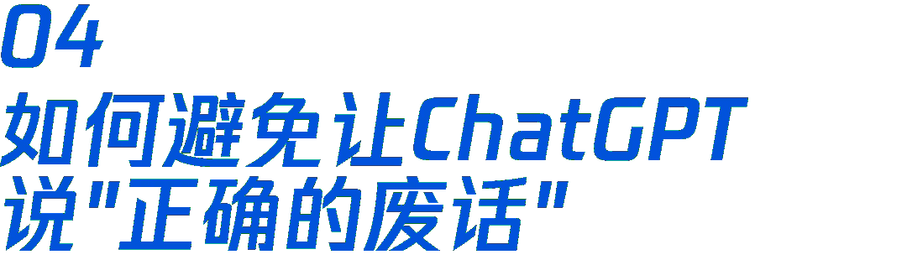

如果你用多了不难发现，ChatGPT 的回复有点“废话文学”的意思。

那是因为，你的输入指令不够准确。

通过近期与 ChatGPT 的反复对话，总结出以下提问技巧供大家参考。

1. 为其设定一个角色🙎♂️
2. 告知需求 ✍️
3. 需要它做什么 ❓
4. 添加更多具体信息 〰️

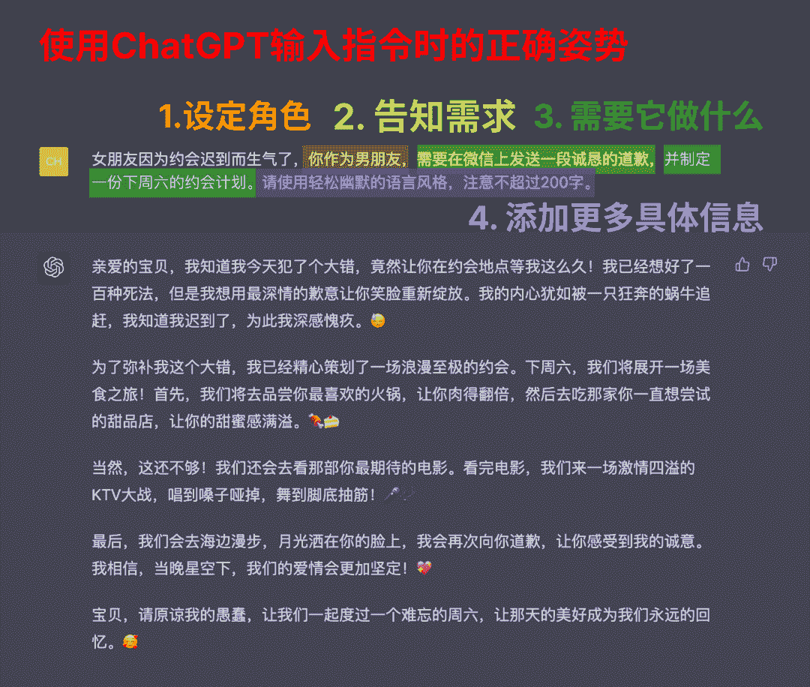

以上是一个不恰当的例子（正经人勿学）

通过规范化的指令输入，更容易得到一个定制的、更符合你需求的答案。

上文我们提到了 ChatGPT 在运营工作的各种应用场景，其实不仅是运营，像翻译、作家、作词人、律师、教师、行政人员、财务工作者、记者、客服等职业，都可能受到 ChatGPT 的影响。

那我们是不是马上也要失业了？

是，也不是。

AI 技术的迅猛发展势必会对职业形态产生巨大影响，取代许多简单的脑力劳动的工作。但纵观历史，技术进步是人类文明发展的不可逆趋势。每一次技术的创新都会带来生产力的提升以及工作模式、社会结构的迭代。 本着打不过，就加入的原则，ChatGPT 应被视为一种协助我们日常工作的辅助工具。

以新媒体运营为例，核心竞争力在于内容的创新和创造力。虽然 ChatGPT 能生成不同类型的文章，但它依赖于大型数据库中现有文档和写作模式的组合，是语料库训练的产物，是缺乏的创造性和人情味的。一个及格的新媒体运营人，ta 的文案，需要让人共情的。在这方面，缺乏对用户的了解和创造力的人工智能，目前恐难以胜任。

用户运营也是同理。尽管 AI 能胜任客户服务并解决单点问题，但要了解人性需求的变化并制定相应策略仍然是难题。还是那句话，洞察人是人类的强项。

总而言之，与其焦虑不如行动，也许最好的方式是不断打磨自己应对变化的能力。在人工智能应用推陈出新的后时代，我们不妨重点提升以下能力。

## 一、提升你的提问技巧

在这个信息泛滥的时代，答案并不稀缺，而是高质量的问题。提问反映了思考方式和能力。ChatGPT 作为一个答案提供工具，只需提出优质问题，便可在人机互动中找到满意答案。要发挥科技的价值，关键在于独立思考能力。避免盲目跟风和简单模仿，因为在模仿方面，人类无法与 AI 抗衡。

## 二、培养学习方法

面对无尽的知识海洋，人们的时间和精力是有限的。如何在有限的时间内掌握更多实用知识？需要不断提高学习能力和效率。正确的学习方法能帮助我们事半功倍，更高效地掌握知识。

## 三、提升技术运用能力

掌握技术能显著提升生产力。在新技术诞生之际，要保持好奇心和探索精神。借助技术力量，人们能从繁琐、重复和低效的劳动中解脱出来，从而腾出更多时间进行思考。

不可否认，ChatGPT 目前仍存在很多缺陷，也离不开人工的监管。

至于 ChatGPT 到底会不会淘汰我们，

淘汰的应该是不会用 ai 的运营人，而不是运营人吧。

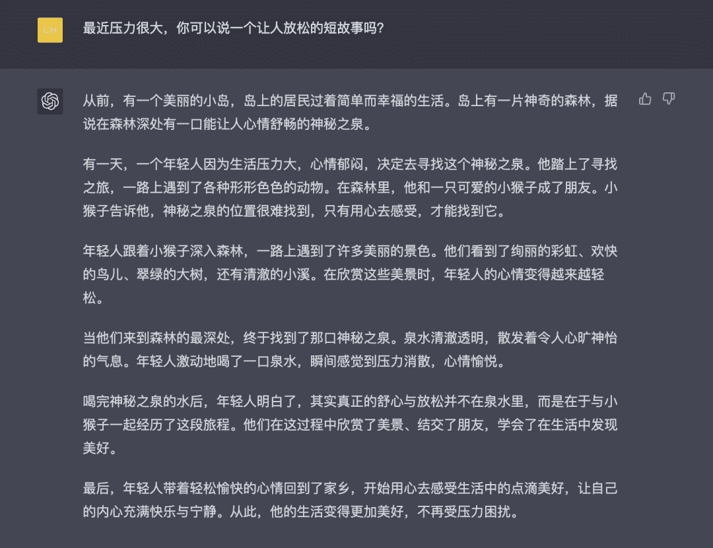

一个与 ChatGPT 的暖心对话，莫名还有点感动
