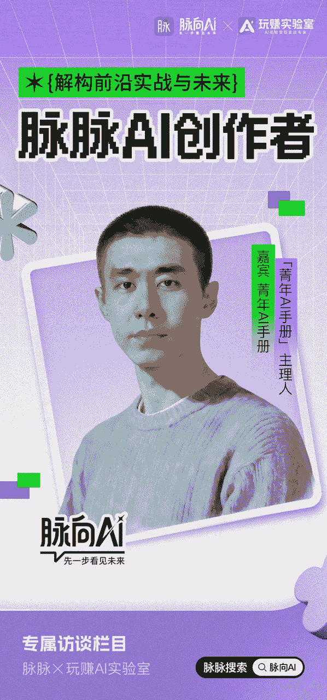
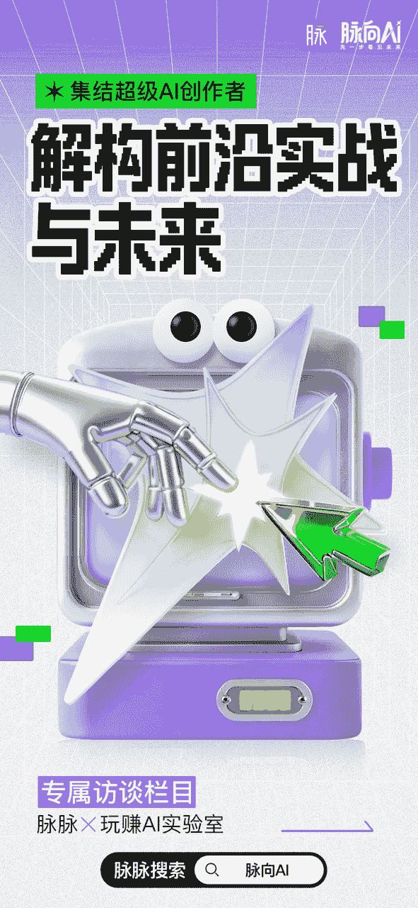

# 万象AI实验室 x 菁年 AI 手册：在算法中寻找温度

> 来源：[https://yunyinghui.feishu.cn/docx/WGqLdLxjhoHRrWxFDfUcnpzlnEg](https://yunyinghui.feishu.cn/docx/WGqLdLxjhoHRrWxFDfUcnpzlnEg)

---

脉脉联合**「****万象AI实验室****」**的固定专栏——「脉向 AI」，第五期来啦。

在这个 AI 浪潮席卷每个角落的时代，我们深知，你需要的不只是又一篇高谈阔论的趋势分析，而是能够照亮前行道路的真实火把。「脉向 AI」专栏因此而生。我们不谈遥远的未来，只聚焦于已经发生的改变。如果你正对 AI 感到迷茫，渴望找到自己的切入点，「脉向 AI」愿成为你的第一份实战地图。

如果你在脉脉刷到过那些充满生命力的 AI 视觉大片，你一定对“斑墨”这个名字不陌生。 在 AIGC 技术狂飙的当下，有人忙着追赶参数，有人却在算法中种出了玫瑰。作为脉脉上阅读量超 500 万的 AI 内容厂牌，「菁年 AI 手册」不仅链接了 1000 位 AI 践行者，更将 AI 带进了珠宝设计、高定成衣甚至线下的“学术酒吧”。

本期《脉向 AI》，我们对话了「菁**年 AI 手册」创始人斑墨。在他看来，** AI 时代的职场人，最核心的竞争力的确是“温度”，但这份温度，有着全新的定义。

# 谈焦虑：人类从未征服高山，只是被高山接纳

脉脉： 斑墨老师好。在脉脉，很多职场人面对 AI 迭代是有“被替代”焦虑的。你发起的 AI PLAN 1000 计划接触了这么多践行者，你认为那个不可替代的“温度”究竟是什么？

斑墨： 其实，这个计划的初衷非常“Web 3.0”——寻找一群对通用人工智能（AGI）乃至人工意识（AMI）有共识的同路人。

在交流中我发现， **职**场人与 AI 绝非取代关系，而是一种共生。 就像登山，人类从未真正“征服”过高山，而是高山以博大胸怀“接纳”了我们。

如果你把 AI 仅仅看作冰冷的工具，它就是你的对手；但如果你把它看作一个“新物种”，选择拥抱它，任何机械都能传递温情。这份源于人类情感、共情与创造力的链接能力，就是我们最核心的“温度”。AI 赋能于有温度的人，而非取代他们。

# 谈实战：AI 负责 80% 的生产，你负责 20% 的“灵魂”

脉脉： 脉友们最关注的是“AI 到底怎么搞钱”。从 AI 珠宝到高定成衣，甚至线下的 AI 学术酒吧，从视觉图变成实体产品，这中间最难的“坑”在哪里？

斑墨： 很多人觉得 AI 创业是“春风得意”，但只有真正下场的人才知道，这更像一场“荒野求生”。

在我们的工作流中，80% 的生产环节由 AI 完成，剩余 20% 则由人工进行精细化协同。 比如你在脉脉看到的 AI 珠宝：从生图、3D 建模到人工微调，最后 3D 打印。这条人机协同的流水线，高效且极具趣味。

避坑建议： **现在流行一人公司（OPC），AI 确实提供了强大的加速度**，但你自身的专业底座决定了你能走多远。 AI 是“迭代”而非“替代”。那些脱离行业基因、凭空捏造的商业愿景，就像摩擦生热后一瞬即逝的火花，绚烂却不长久。扎实的技术与专业功底，才是硬道理。

# 谈技能：高质量提示词，是你个人审美的“翻译官”

脉脉： 对于非技术背景（运营、市场、行政）的职场人，现在学 AIGC 视觉创作还来得及吗？提示词和视觉叙事能给本职工作带来什么增量？

斑墨： 在学习这件事上，任何时候开始都为时不晚。 我设计的课程并非“填鸭”。对于成人，它是影像创造营，更像一种艺术视觉疗愈；对于孩子，是山海经研学，在 AI Coding 中培养灵感。

很多人把“高质量提示词”看作一种工具包，但在我看来，它更像是你通往心灵深处的一隅净土。它是你个人审美、艺术想象力、对生活的感知力，以及对周遭人事物关怀的综合体现。

**真**正的增量，不在于你多出了一张图，而在于你具备了高效的人机协同意识，能用愉悦的情绪完成“交付”。 这种由内而外的赋能，才是职场通关的入场券。

# 谈未来：下一个风口，是给“数字生命”一个身体

脉脉： 手册中提到了“数字永生”。展望未来一年，AIGC 的下一个爆发点在哪？「菁年 AI 手册」下一步有什么大动作？

斑墨： “永生”是人类基因里的执念，就像《流浪地球 2》里的图丫丫。虽然目前社会伦理还有待探讨，但我认为下一个爆发点在“具身智能”与机器人应用。

设想一下：未来我们将承载记忆的“数字生命”，搭载于具身智能机器人之上，送往外太空。AI 在那里生活，我们在地球起居。想念时，遥望星空，那一闪一闪的星星就是来自宇宙深处的问候。这种画面，本身就很艺术。

至于「菁年 AI 手册」，我们将建立自己的数据库，坚守“从 0 到 1，通过人机协同落地交付”。我们要做的，是帮助更多职场朋友，将 AI 切实应用到生产创造中。

正如「菁年 AI 手册」所言： “1000 个人，有一千个宇宙。” 无论算法如何演进，核心始终是“人”如何去理解与创造。希望这场对话，能让你在焦虑的职场丛林中，找到属于自己的那份“AI 态度”。

