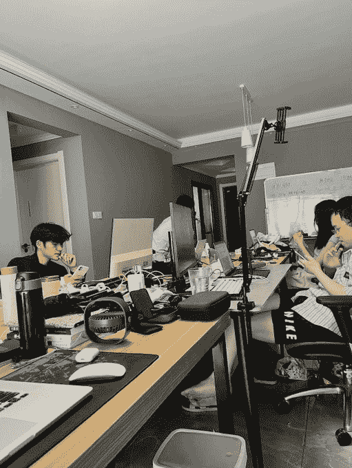

# 万象AI实验室 x Jason 丨用 AI 产品给自己兜底的「非运气」创业者

> 来源：[https://yunyinghui.feishu.cn/docx/FPisdaRYyouFhDxqz84cj41anJd](https://yunyinghui.feishu.cn/docx/FPisdaRYyouFhDxqz84cj41anJd)

---

脉脉联合「**万象AI实验室**」的固定专栏——「脉向 AI」 ，第四期来啦。

这不是讲大道理的栏目，而是想做一件很具体的事： 去找到那些已经通过 AI 真正赚到钱的人，把他们的故事拆开讲出来，给还在观望的普通打工人，提供一些可参考的样本。

这一期的主角，某种意义上，和脉脉的很多用户一样。

**Jason 不仅是脉脉的 资深用**户 ，现在更是脉脉的 AI 创作者 。 在还上班的那些年里，他几乎每天都会刷脉脉——看同行在做什么，看别人如何转型，也在平台上 真实地记录和分享过自己的薪资成长路径 。

**“那时候其实谈不上什么规划，更多是想搞**清楚： 别人是怎么一步步走到今天的？ ”

也正是在那些反复刷帖子、看经历、对比路径的过程中，一个念头在他心里慢慢变得清晰起来： 我不想只靠一份工作，来决定自己的人生上限。

后来，他辞掉了月薪 1.5 万 的产品经理工作；再后来，他走上了产品、出海和 AI 的这条路。

今天，我们回到脉脉，把他的故事讲出来。他是 Jason ，PaywallPro 的创始人。

我终于过上了那个，曾经以为很遥远的生活

**J**ason 在社交媒体上写过这样一段话： 我终于实现了那个曾经以为很遥远的生活：一边带娃，一边做喜欢的事，赚着被动收入；没错过 AI 时代的红利，也没错过孩子的成长。

这段话下面，很多人留言说羡慕。

但很少有人知道，这句话背后，是 整整三年极高密度的投入、反复试错、以及几次非常痛的调整 。

三年前，他辞掉了月薪 1.5 万 的产品经理工作； 三年后，他做了 20 个 App、12 个网站 ， 用户量突破 500 万 ，单款产品营收超过 12 万美金 。

但如果你以为这是“辞职 → 自由 → 起飞”的直线剧情，那就误会了。

## 第一幕：在体系内“顺风顺水”，却越来越清醒

2015 年，Jason 只是一个月薪 3800 元 的 UI 实习生。

**那时的他，对“创业”并没有**执念。他更在意的是： 把事情做好，把能力磨出来。

2018 年，他进入西安一家出海公司，做影像类产品。UI、交互、产品、项目管理，一步步接触更核心的位置。

那几年，其实是他职业生涯里 最顺的一段时间 ：

+   参与多款 月活百万级 App

+   产品拿过 美榜第 1、第 2

+   亲手设计的 App，被 苹果 ASM 官网免费展示了一年多

**但**也正是在这个阶段，一种隐约的不安开始出现。 “我在公司能看到非常真实的数据。 也正因为能看到数据，我慢慢意识到：努力、加班、负责，并不一定和回报挂钩。”

在西安，产品经理的天花板几乎是明牌： 2 万人民币左右。“那不是抱怨，是一个客观判断。”

## 第二幕：加班、团建、酒局，把“不想要的人生”看清楚

2022 年初，Jason 跳槽去了一家公司做小说变现业务。

这份工作，让他第一次真正体会到“被榨干”的感觉。

+   无数次加班到凌晨

+   晚上 12 点多到家

+   凌晨五六点又被电话叫回公司

+   团建必须喝酒（而当时正好在备孕）

“在公司被开发虐，被运营虐，夹在老板和项目经理中间，两头受气。”

那半年，他经常在回家的路上问自己：如果这就是我未来十几年的生活，我真的接受吗？

半年后，他受够了。2022 年 8 月底，疫情期间，他选择了裸辞。“离职那一刻，是真的神清气爽。”

## 第三幕：创业日记、并行项目，与第一个真正的拐点

离职后，他并没有立刻“规划宏大蓝图”。他做的第一件事是两件非常朴素的事：

1.  **在网上发帖找人合作**

1.  拍创业日记 Vlog，逼自己持续输出

短短 3 个月 ，他并行推进了 4 个产品 。

那是一段极度消耗的时期：

+   选品

+   UI

+   测试

+   上架

+   运营

除了写代码，所有事情他一个人扛。 “一个人同时和四五个 iOS 开发对接，那种感觉其实非常焦虑。”

直到做到第三个产品，转折点终于出现：

👉 单产品利润突破 4000 美金/月

而就在 同一个月 ，他的女儿出生了。“那一刻我突然意识到：我不是在赌，我是在为一个家庭打底。”

## 第四幕：AI 爆火，自媒体带来的自由与幻觉

2023 年，AI 爆火。Jason 顺势 All in 自媒体：

+   第 3 条视频爆了， 73 万播放

+   粉丝迅速涨到 10 万+

+   接过商单、卖 GPT 账号，赚了几万

那段时间，他真切感受过自由职业的快乐： “跑去大学录视频、蹭饭， 那种感觉很真实。”

但这种快乐并没有持续太久。 “我心里始终很清楚：流量是情绪资产，产品才是时间资产。”

## 第五幕：扩张失败，用真金白银交学费

2023 年中，他做了一个现在看来并不理性的决定。他招了 6 个实习生 ，开始做矩阵账号。

结果非常残酷：

+   没流量的没流量

+   被封的被封

+   唯一有希望的账号，也被限流

“产品赚的钱，被硬生生用来养自媒体。”

那是他第一次深刻体会到： **不聚焦，是创业者最贵的成本。**

## 第六幕：解散团队，回到最熟悉、也最笨的路

2023 年 9 月 ，合伙人去找铁饭碗。 Jason 解散了团队。

11 月 ，他停更自媒体，回到出海工具。“那一刻有点落寞，但我反而松了一口气。”

他重新开始做一件“慢事”—— PaywallPro 。

PaywallPro：从情报平台，到 Paywall Agent

PaywallPro 最早的定位是：一站式付费墙情报调研平台

**但随着积累越来越深，Jason 对它的判断也在变化： “我**们真正想做的，是 Paywall Agent。不只是给你看数据， 而是帮你判断：你该怎么做。”

真正的确认，来自两封邮件—— RevenueCat 和 Adapty。

合作邮件、会议讨论。

## 第七幕：稳定、停滞，与对成长的重新理解

过去一年：

+   用户量突破 500 万

+   单款产品营收超 12 万美金

但 Jason 说得很坦白：“增长其实是停滞的。”

多个新产品没有带来预期回报。 “这就是独立开发最真实的样子，不可能永远高歌猛进。”

## 尾声｜愿你也能走到属于自己的那一步

采访快结束的时候，我们问 Jason：如果可以对三年前的自己说一句话，你会说什么？

他想了想，说： “勇敢地去做吧，会成功的。虽然慢一点，但慢，就是快。”

其实很少有人知道，刚工作那几年，他也和很多普通职场人一样——

在深夜刷脉脉、刷帖子、看别人的经历。那些故事里，没有完整的路线图，也没有“照着做就能成功”的答案。

但它们像一束光，让人突然意识到一件事： 原来普通人，也真的可以走出另一条路。

后来，Jason 一步步走了过来。并不快，也并不轻松。

有过犹豫、踩过坑、停下来调整过方向。

直到今天，他依然不觉得自己“已经抵达了终点”。

但至少，有一件事已经发生了变化—— 他不再只是那个仰望故事的人，而是开始把自己的经历，讲给后来的人听。

命运在这里，完成了一个很安静的闭环。

生活也许不会给每个人相同的结果，但它从不辜负那些 愿意长期投入、持续向前的人 。

愿你在自己的节奏里，也能一步一步，走到那个属于你的位置。

