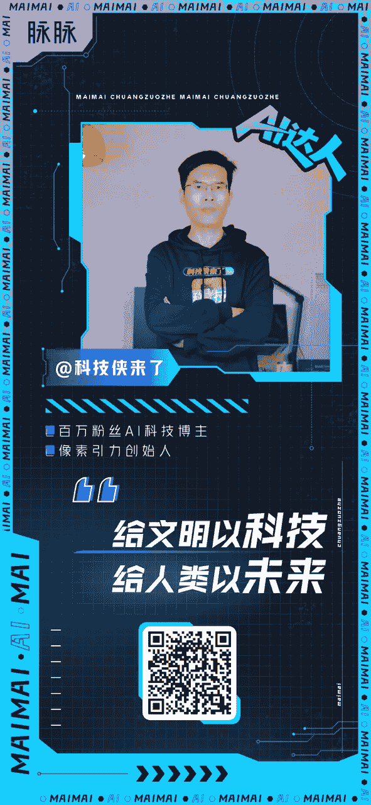

# 万象AI实验室 x 全网百万粉博主科技侠来了：用“严选思维”把 AI 变成生产力，拒绝做大模型的“韭菜”

> 来源：[https://yunyinghui.feishu.cn/docx/MPCadbxMdoJlKrxjEQpcDTawnhf](https://yunyinghui.feishu.cn/docx/MPCadbxMdoJlKrxjEQpcDTawnhf)

---

脉脉联合「**万象AI实验室**」的固定专栏——「脉向 AI」，第三期来啦。

在这个技术日新月异的时代，我们不想贩卖焦虑，只想提供解法。本栏目致力于挖掘那些已经不仅是“看到”风口，而是真正“站上”风口的实干家。通过复盘他们的路径，让“AI 赋能”不再是一句空洞的口号，而是每个人都能上手的工具箱。

本期， 我们把访谈对象瞄准了技术流博主、效率工具探索者：科技侠来了。 科技侠的视角，能给许多在这个“AI 应用爆炸”时代感到迷茫的职场人一剂清醒剂：他是全网粉丝 100W+的硬核科技博主，也是 AI 场景化落地的实践者。

他不像很多人那样盲目吹捧 AI，而是用近乎苛刻的“严选思维”去审视每一个工具。他的核心理念非常直接： AI 不是用来聊天的玩具，而是必须嵌入工作流的生产力。

**有**人问他：“现在 AI 应用每天出几百个，普通人怎么选？”他说： “我看 AI 产品不看它‘演示视频’有多炫，而是看它能否嵌入真实工作流。孤岛式的 AI 应用没有未来，它必须能和我不同的业务连接。” 这是科技侠的“工具流”心法，也是普通人从“玩 AI”进阶到“用 AI”的必修课。

**严选**

“拒绝做大模型的韭菜，我要的是可控的生产力”

科技侠的起点是技术出身，这让他看产品的眼光格外毒辣。在每日涌现数百款 AI 应用的当下，很多职场人容易陷入“工具焦虑”——买了课、充了会员，最后发现只是买了一堆“聊天机器人”。

“我的‘严选标准’核心在于：可控性与连通性。”科技侠一针见血地指出。在他看来，一个合格的 AI 生产力工具，必须具备几个“核心手脚”：

1.  结构化输出能力：不能只会陪聊。必须能输出 Markdown、JSON 这些可直接编辑的格式，这是玩具和工具的分界线。

1.  长上下文与记忆：能处理复杂项目背景，而不是聊两句就“失忆”。

1.  开放性：必须能连接 Notion、飞书或本地工作流，孤岛工具没有价值。同时，他也给职场人划出了绝对的“雷点”。

“很多工具只是 OpenAI 的简单套壳，交互甚至更差，还要收高昂订阅费，这种我坚决打假。”尤其是对于职场人来说，数据隐私是红线，如果无法关闭训练开关，或者关键事实出现幻觉，那带来的不仅是低效，更是“职场事故”。

**闭环**

“不要只做提问者，要做自动化流程的编排者”

如果让你给完全不懂代码的职场人推荐一条“最小 AI 工作流”，你会怎么选？科技侠没有推荐具体的单一工具，而是给出了一个“收集-编排-交付”的组合拳。

“很多新人陷入误区，觉得用 AI 就是要学 Python。其实真正的高手都在做 SOP 的自动化。” 他向我们展示了普通人也能快速搭建的“自动化小团队”：

第一步：燃料采集（输入端）

别再手动复制粘贴了。用 Perplexity、豆包等 AI 搜索结合插件，瞬间把分散的研报、网页清洗成机器可读的“原料”。质量决定上限。

第二步：逻辑中枢（编排端）

这是拉开差距的关键。用 Coze（扣子）把你的业务 SOP（比如写标题-写大纲-润色）固化成一个 Bot；或者用 n8n 把 APP 串联起来。把“随机的灵感”变成“稳定的产能”。

第三步：降维交付（输出端）

客户不看你用了什么模型，只看结果。用 AI 直接生成 PPT，或者用 Midjourney 生成商业配图。核心标准是“可交付”——即生成的东西能直接发给客户签字，而不是还要改两小时的半成品。

“这一套组合拳打通后，你就不是在‘玩 AI’，而是在运营一个属于你个人的自动化小团队。”

**清醒**

“AI 吃掉平庸的搬运，人类把关灵魂的决策”

在“AI 替代论”甚嚣尘上的今天，科技侠保持着极度的清醒。

他认为，AI 目前最应该彻底“吃掉”那 20%的耗时工作，比如格式转换、会议纪要、长文摘要、翻译。这些本质是信息的搬运和重组，AI 做得比人快且准。但剩下的 80%，人类必须亲自把关。

“AI 现在的平庸率很高。作为创作者，你得知道什么是‘好’。”科技侠说道，“AI 可以给你生成 10 个标题，但选出那个最能击中人心、最符合当下情绪的，必须是你。这就是审美。”

更重要的是决策。“AI 可以分析出 A、B 方案的优劣，但最终拍板‘我们要承担风险做 A’的那个瞬间，责任在人。AI 没有直觉，也没有担当，而这两点是高阶职场人的核心护城河。”

很快，人类会从“操作者”变成 AI 们的“助手”和“润滑剂”，而把关审美与决策，将是我们最后的阵地。

写给所有想入局 AI 副业小伙伴的三点建议

1. 拒绝“做号”思维，寻找“超级专才”路径

现在的网络不缺生成式垃圾内容。不要试图用 AI 批量生产低质文章去薅流量，平台算法已经开始围剿这种行为了。自媒体是竞争最激烈的行业，比进大厂还难。

你的 0 到 1，应该是把你本职工作中最擅长的那个点，用 AI 放大 10 倍。你是 HR？试着做一个“AI 简历优化助手”；你是财务？试着做“AI 一键分析财报”。在熟悉的领域深度使用 AI，才是正道。

**2. 真正的收益来自“可交付”**

别停留在“试玩”截图发朋友圈。真正的商业收益来自你能用 AI 交付一个完整的 LOGO、一份深度报告、一段不需要修改的视频。把 AI 变成你的“外包团队”，而不是你的“聊天对象”。

**3. 现在入局，刚刚好**

很多人问现在晚不晚？其实前两年是“基建期”，现在才是“应用期”。不要为了“做自媒体”而学 AI，而要为了“解决工作痛点”用 AI。

**尾声**

“愿你也能成为驾驭工具的超级个体”

采访的最后，科技侠分享了一个观点：对于 AI，我们要非常重视它的价值，不能只停留在“可用可不用”的心态。现在这个时代，AI 已经成了任何人都不能轻视的角色。

希望这篇干货满满的分享，能帮你在这个技术变革的时代，找到属于自己的那套“最小闭环”。

未来已来，愿你我不做被技术浪潮淹没的人，而做那个站在浪潮上冲浪的“超级个体”。

