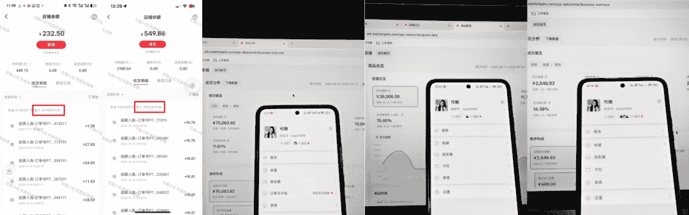
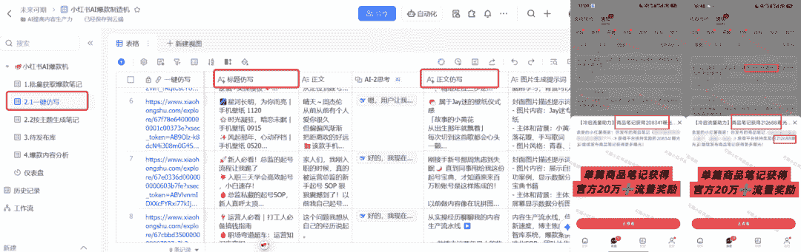

# 万象AI实验室 x 前大厂运营可期：用 AI 做虚拟电商，打通闭环实现月入 10 万

> 来源：[https://yunyinghui.feishu.cn/docx/Nb3LdEo6KouACHxyQxrczCdwnhf](https://yunyinghui.feishu.cn/docx/Nb3LdEo6KouACHxyQxrczCdwnhf)

---

脉脉联合「**万象 AI 实验室**」的固定专栏——「脉向 AI」 ，第二期来啦。

**这**不是讲大道理的栏目，而是想做一件很具体的事： 去找到那些已经通过 AI 真正赚到钱的人，把他们的故事拆开讲出来，给还在观望的普通打工人，提供一些可参考的样本。

一边，是「万象 AI 实验室」里那群已经把 AI 用到副业、内容创作、本职工作的朋友；另一边，是脉脉上越来越多对「AI + 职场」「AI 副业」好奇的职场人。

「脉向 AI」就站在这两拨人中间——我们会持续邀请已经用 AI 赚到钱的创作者 / 开发者，聊聊他们是怎么起步、踩过什么坑、赚到第一笔钱之后又怎么走下去的。

本期，我们把访谈对象瞄准大厂做副业的人群，其中的一个代表：可期。

可期的经历，容易让很多职场人都能产生共鸣：

+   大学读的是会计，毕业就转行到了互联网公司

+   一年前，她也是“大厂螺丝钉”，利用业余时间做副业

+   一年后，她是某社交平台 AI 虚拟电商的矩阵操盘手，从单打独斗到带领几百人掘金，自营盘矩阵号月入 10 万+，用 AI 拿到了逆袭剧本

有人问她：“你一个女孩子，为什么要这么拼？”

她说；“作为女生可能很多人从小就被灌输了依靠他人的想法，小时候依靠父母，长大依靠老公，但在我的认知里依靠谁都不如依靠自己，只有自己能给自己兜底，只有自己强大了，世界才会吻上来。我拼尽全力就是希望能给自己和家人更好的生活”

这是可期的突围史，也是普通人利用 AI 杠杆，撬动命运齿轮的真实样本。

### **觉醒**

### “拒绝做大厂螺丝钉，我要给自己造安全感”

可期的学历起点，并不算太高。

作为一个双非本科生，她毕业第一年就拿到了 30W+的年薪，随后跨行、转岗，一路杀进互联网大厂升职加薪。在很多人看来，这已经是“普通人的天花板”。

“我始终相信吸引力法则，你有多想要，就一定能得到。但我更清醒地看到，大环境在下行，我要有脱离平台的能力，就算哪天项目不行了，行业不行了，我依旧能够靠我的第二增长曲线生活的很好。”可期回忆道，“在职场，你的努力和回报往往不成正比。升职是玄学，跳槽可能也是坑。如果最坏的情况发生，谁来为我兜底？”

她骨子里有着极强的好胜心和野心。在最开始“我不觉得做好主业就够了。我要做那个在暴风雨来临前，就已经造好诺亚方舟的人。”

当身边的同事还在刷剧、吐槽老板时，刚工作第一年的可期，就已经像猎手一样在互联网上寻找猎物。

当别人没意识到要做副业时，她开始大范围尝试；当别人开始跟风时，她已经做到了这个领域的头部。

去年她敏锐地捕捉到了某社交平台 AI 虚拟电商这个风向标。

“这简直是为我量身定做的。”可期分析道，“不需要囤货，不需要发快递，我有做矩阵号的经验，只要能解决内容生产和产品制作的效率问题，这就是一台印钞机。”

从 2024 年 6 月份开始测试这个项目，目前已经跑通项目 0-1，1-10 的阶段，月营收破 10 万，正处于放大阶段。

### **破局**

### “超级个体时代，AI 是我雇佣的超级军团”

AI 对于她来说，不是辅助，而是主力。AI 目前主要解决了两个痛点：原创虚拟产品制作和高质量笔记内容生产。

可期没有选择做一个苦哈哈的“搬运工”，而是选择成为一名“AI 指挥官”，她毫无保留地向我们展示了她是如何用 AI 把时间卖出天价的。同时她也给我们分享了各行各业的人在社交平台上通过 AI 搞钱的案例：AI 制作测评链接卖了 40 万+，AI 制作社会化指南卖了 26 万+，AI 制作教务工具卖了 18 万+，AI 制作油管英语素材库卖了 150 万+。

AI 的出现让供给变得无限丰富，比如秒哒，无需代码小白也能几句话搓应用，让很多“小到懒得做”的需求，变得可行了。Gemini 3 pro 超强上下文对话窗口，让类似于社会化指南的十几万字原创文档也可以通过 AI 几小时内生成高质量内容。

可期还做了一个飞书多维表格+deepseek 自动化爆款制造机，从自动采集爆款内容，自动仿写爆款内容，自动出📕爆文，数据分析全方位的帮助我们批量化产出内容。“目前团队的笔记内容基本 100%全部都是使用 AI 出的，使用 AI 产出的高质量内容一样可以获得高曝光奖励，团队内部账号多个单篇笔记都获得了平台 20 万+的流量奖励”可期说道。

狠劲“时间管理？不，我只有 All in”

在光鲜的数据背后，是可期不为人知的“狠”。

经常有人问她：“你是怎么做时间管理的？”

可期的回答却是：“没有管理，就是 All in。”

在项目起步期，除了吃饭睡觉，她把所有时间都给了项目。“忙起来的时候，每天连轴转十几个小时，连休息十几分钟都是奢侈。”

这种高强度的投入，也透支了她的身体，颈椎和腰都向她发出了警报。（ 她在采访中特意叮嘱：大家搞钱很重要，但也一定要注意健康，不要把自己当作不会坏的机器。 )

但即便累到想放弃时，她也咬牙挺过来了。

“每一个问题最终都会被解决，现在的困难只是暂时的，不要错过任何一个我生命中出现的好机会”

她总结了自己的“成事四字心法”：

+   快： 看到机会，马上行动。先赚到第一块钱，只有赚到钱，你才算真正进了新手村，先通过实操，完成赚钱闭环，建立基础的流量-产品-变现的认知。

+   准： 抓住机会，要么不做，要做就抱着必成的决心去做。

+   狠： 怼到极致，既然没有背景，没有资源，那就比别人更努力，更拼命

+   稳： 持续迭代，永远在学习的路上，稳住，我们能赢！

### 写给所有正在观望小伙伴的三点建议

**1.改变认知快速行动**

别人开始搞，你说不好搞；别人坚持搞，你说利润少；别人搞大了，你说搞迟了；别人挣钱了，你说人家搞得早。选对项目，快速行动，去先赚到第一块钱，开始质变。

我反复强调大家要去先赚到第一块钱，为什么要去先赚第一块钱？赚到第一块钱，是质变，你会从眼高手低的人，开始进入新手村，这个时候才真正开始了赚钱的游戏。如果你没有通过项目赚到过第一块钱的经历，你对于项目或者创业的认知，可以说，基本都是错的，因为你根本不理解那句话或者那个认知背后无数的细节，不要说你读过多少书，和多少人聊过，听过多少播客，看过多少文章，干过的和没干过的，是有本质上的区别的。先通过实操，完成赚钱闭环，有基础的流量-产品-变现的认知，只有真正的从实操里面建立起来的认知，你才会发自心底的坚定和相信。

**2.尽早把自己产品化**

经常有人问我：“我是普通人，不懂技术，也没有资源，我真的行吗？”

我的答案永远是：“永远要有 80 分教 60 分的心态，现在就是最好的时候，也是门槛最低的时候。”

AI 把“产品化”的难度降到了最低，你的个人优势，加上 AI 的效率，就是你的专属产品。别总觉得自己没有东西可卖，你的爱好、你的经验、甚至你踩过的坑，对别人来说都是价值。尽早把自己产品化，并不是让你立马辞职创业，而是让你开始拥有“睡后资产”的意识。 种一棵树最好的时间是十年前，其次就是现在。

**3.融入圈子快速拿结果**

普通人升级靠努力，高手破局靠生态。 你的圈子，就是你的未来加速器。别用你昂贵的时间，去重复造轮子；我们要做的，是站在巨人的肩膀上直接起飞。做副业最难的是孤独和惰性。一个人在家很容易想躺平，但当你看到群里小伙伴的爆单时，那种“他行我也行”的肾上腺素，会逼着你不得不动起来。你的圈子，就是你的视野、你的认知、你未来的可能性。

说起来很巧，我也是在脉脉上加到万象 AI 实验室主理人大国并加入这个圈子的，看到了各种优质信息，后面一步步从普通职场打工人逆袭成为了月入 10 万+的虚拟电商操盘手。

### 尾声“愿你也能如她一般未来可期”

采访的最后，可期讲了一个很感人的细节。

刚工作第一年，她也是在脉脉上，刷到了一个和她经历相似的伙伴分享的搞钱故事。

那个故事像一道光，照亮了当时迷茫的她。她暗暗发誓：“他可以，我也一定可以！”

命运完成了一个闭环。今天，可期变成了那个讲故事的人。

生活不会辜负每一个有理想、在奋斗的人。愿你也能如她一般，未来可期。