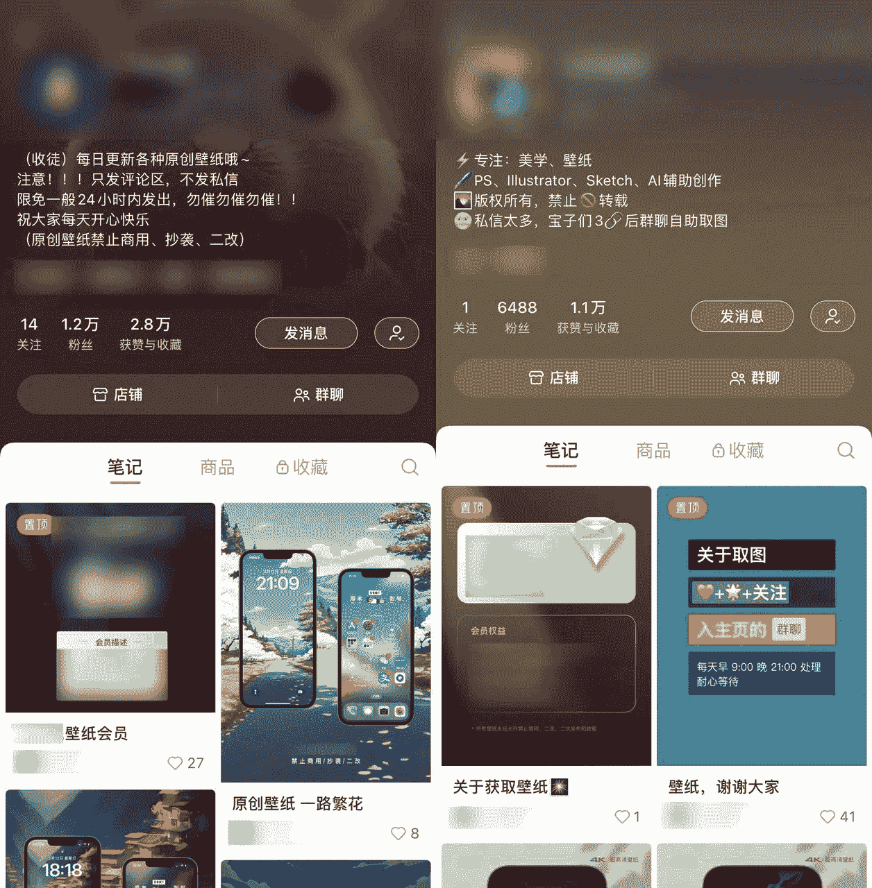
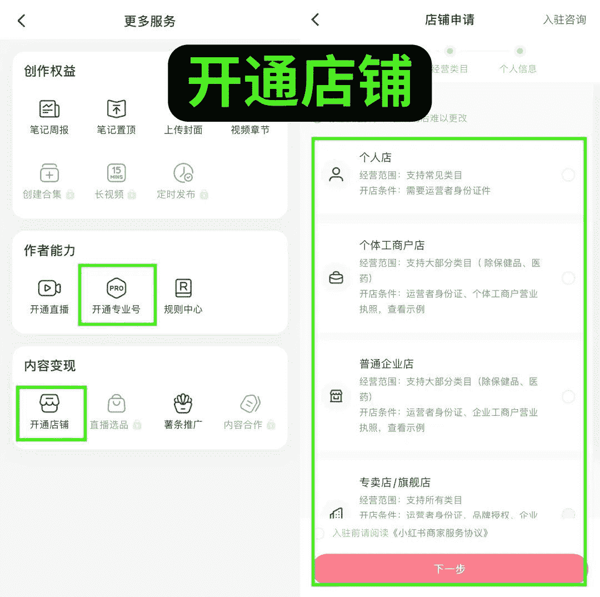
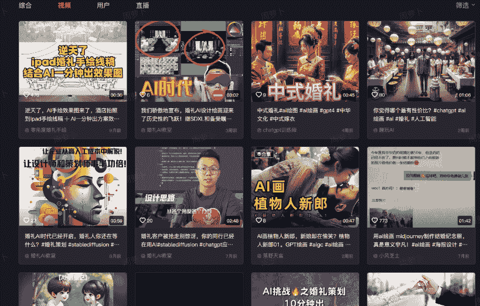
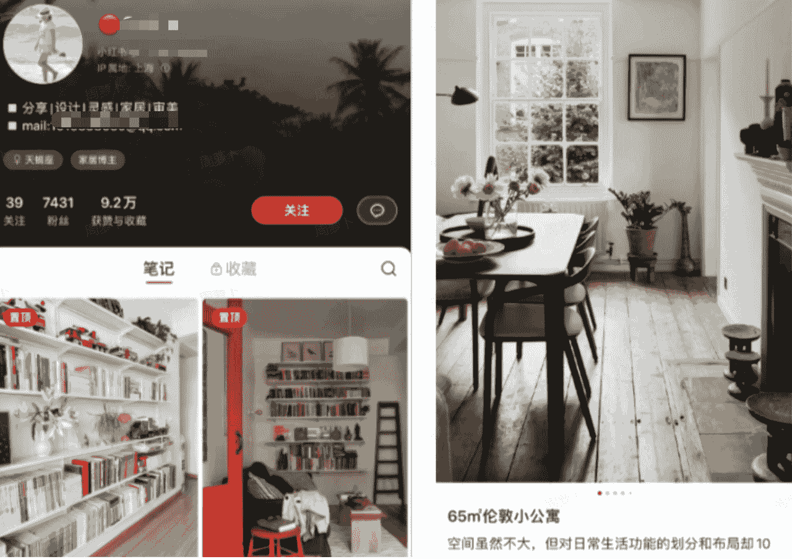
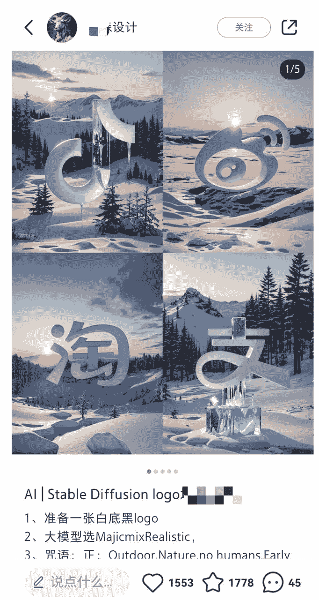

# AI 绘画变现案例库

> 来源：[https://yunyinghui.feishu.cn/docx/MPYXdeJipofwdqxymw4cdd2Yndc](https://yunyinghui.feishu.cn/docx/MPYXdeJipofwdqxymw4cdd2Yndc)

> **适用人群：****互联网 AI 绘画搞钱人群**

> 首发时间：2024 年 3 月 6 日

> 更新时间：2024 年 3 月 17 日

> **内容出品人：**

> **内容出品方：**[Mix AI Lab](https://yunyinghui.feishu.cn/wiki/WhelwZnxQi55mpkOzatc3Xran5b?from=from_copylink)

> **使用建议：**如果需要快速定位到精确内容，可以使用快捷键 Ctrl +F/Command +F 的形式，搜索关键字/词，查找你想要的内容。

> **持续更新 AI 副业搞钱学习的****基本玩法，创****新模式等内容，另案例**非项目操作手册，仅作为思路提供灵感，永久免费在线查看，欢迎收藏转发支持，文末有惊喜，大国出品，必属精品。

# 案例 1：AI 绘画+**📕头像壁纸**

## 项目说明

**在📕这片**创意的**海洋中**，有一个趋**势正悄悄兴起，那就是使用 A**I 工具制作的壁纸，每天发布“用 AI 工具生成的手机壁纸”吸引爱换手机壁纸的年轻人付费购买。

## 账号案例

## 涉及工具

用 Midjourney/SD+ChatGPT，生成手机壁纸

## 基本玩法

1、注册📕账号，开通📕店铺

账号搭建：账号名称以@XX 兔、XX 视界为例，每天 1-2 更，笔记直接发壁纸成品图，一般以风格各异的风景图、动漫、二次元人物等为主，一定要高颜值、吸睛。

**开通📕店铺：**一机一号，开店账号无粉丝量要求，每张身份证能开 1 家店，每张营业执照能开 3 家店。

账号主页创作中心→更多服务→开通专业号→选择个人/企业，个人号免费认证，企业号需缴纳 600 元年费。

**【个人店】**

开通个人店需进行实名认证，再认证个人专业号，才能开店。

**【企业店】**

包括个体店/普通企业店/专卖店/旗舰店，企业店能卖的类目多，营销权益更多（设置快捷自动回复、可使用投放工具等）。

**2、制作内容，每天 1-2 更**

用 Midjourney+Chat GPT 自动生成 AI 图片。

AI 绘画工具可用 Midjourney，操作简单，输入提示词（图片尺寸、绘画风格、效果等）+图片描述词（画面场景），即可生成图片。

**3、规模放大多账号矩阵操作**

**我们可以同时**多做几个账号，每天早中晚都各发一条笔记，达到量变引起质变的效果。

**坚持下去，保持日更是非常重要的**。只要长期坚持，成功的概率就会非常大，只要这几个账号其中的一条笔记火了，就可以进行变现操作了。

# 案例 2：**Al 绘画 +婚礼定制服务**

## **项目说明**

这是一个 To B 的项目，利用 Midjourney Al 技术大幅提升婚礼布场设计的效率，创造出传统手绘难以比拟的效果图，并开辟 Al 赋能在婚礼策划行业中的新商机。后面可以通过婚礼策划师的 Midjourney 培训、开发行业小程序以及销售成熟 prompt 等等途径进行变现。

## 账号案例

## 涉及工具

MJ

## **基本玩法**

1）婚礼策划师的 Midjourney 使用培训

+   介绍 Midjourney 的基础知识，历史背景，主要功能和特点

+   如何在 Midjourney 上创建、编辑和保存婚礼布场设计。深入讨论特定婚礼的设计技巧，如何选择正确的颜色、布局和元素

+   如何解决在使用 Midjourney 时可能遇到的常见问题

+   Q&A 环节，解答策划师在使用过程中可能出现的疑惑

2）开发行业小程序

+   设计工具集成：集成 Midjourney 的核心功能，允许用户通过小程序进行直观的婚礼布场设计

+   模板库：提供多种婚礼场景模板，从室外到室内，从传统风格到现代风格，满足不同客户的需求

+   实时预览：允许用户在设计过程中实时查看效果图，包括不同视角和光线条件下的预览

+   教学区：提供视频教学和文字指南，帮助新手快速掌握小程序的使用

3）销售成熟的 prompt 集

+   需求调查：与婚礼策划师进行深度访谈，了解他们在设计婚礼布场时面临的挑战和需求

+   prompt 创作：基于需求调查，创作多种婚礼布场设计的 prompt，每个 prompt 应具有独特性，能满足不同风格和主题的婚礼需求

+   测试与反馈：在少量目标用户中测试这些 prompt，根据反馈进行调整和优化

+   分层定价：将 prompt 集分为初级、中级和高级三个层次，根据其复杂性和应用范围进行定价

+   组合包装：提供不同数量的 prompt 组合包，如“初级套餐”，“婚礼主题套餐”等，满足不同策划师的需求

# 案例 3：**AI绘画+📕家居家装**

## **项目说明**

基于📕平台，利用 Stable Diffusion 对毛坯房进行 Instagram 和国内内家居应用获取的家居图片进行内容创作，通过精准关键词和简介吸引用户，实现引流并变现。

## 账号案例

## 涉及工具

Stable Diffusion

## 基本玩法

1．注册📕账号，可以进行矩阵的配合。在个人简介中提供联系方式或者在评论区进行引流到私域流量中，注意不要违规。

2．训练相关的 Stable Diffusion 模型（或者在网上进行搜索下载），进行绘画后发布；也可以定期从国外 Instagram 和国内家居应用中搜索高质量家居图片。

3．结合热门话题和关键词进行内容创作和发布。

# 案例 4：**AI绘画+LOGO 设计**

**项目说明**

将众所周知的公司 LOGO 设计需求一直都有。通过做账号引导评论以及回复粉丝来获得更多评论，从而涨高账号杈重来达到快速起号的目的。后面可以通过定制化设计、Al 绘画培训等进行变现。到私域进行定制化的设计方案或者进行相关培训收费，质量只要过关有很多的转介绍和复购。

## 账号案例

## 涉及工具

Stable Diffusion

## 基本玩法

1.本地部署 Stable Diffusion 或者进行云端部 Stable Diffusion

2.将相应要转换的 LOGO 进行抠图处理

3.然后用到 Stab Diffusion 中的 segment anything 进行处理，或者使用局部重绘

4.进行📕的专题号发布，可以对标下方的账号

# AI学习交流社群

1.持续关注并更新 AI 的**相关资讯动态，研究报告，赚钱案**例，常见问题，永久免费在线查看，无收费内容，目标是成为最大的免费 AI 学习社群。

2.已建立社群聊聊 **AI** 发展及应用，**没进群的可以扫码加入，群满可加 AI 研究爱好者大国🛰️ ID：zyg90s（备**注：AI），已经在社群内的无需重复加入，开源知识库及社群学习全部为公开免费分享。

3.**关于文档负责人大国**：高帆文化CEO，曾就职于教培大厂，目前创业，主攻研究AI落地应用、企业流量增长及达人IP孵化。

**飞书学习群**

**飞书扫码进群学习**

🛰️好友（ID：zhangyuguo94s）

**扫码加🛰️入🛰️群**

进群或者加好友了解更多 AI变现案例

**觉得有用欢迎留个赞**