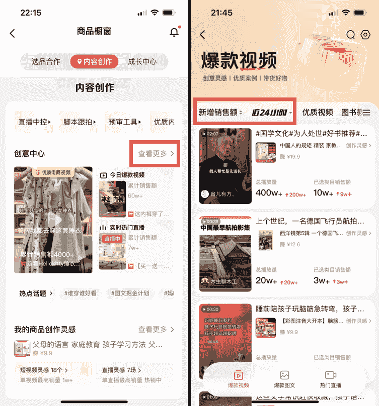
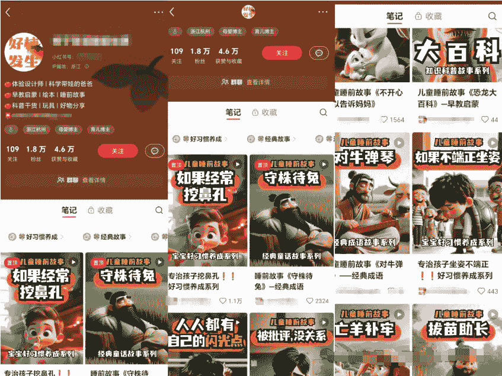
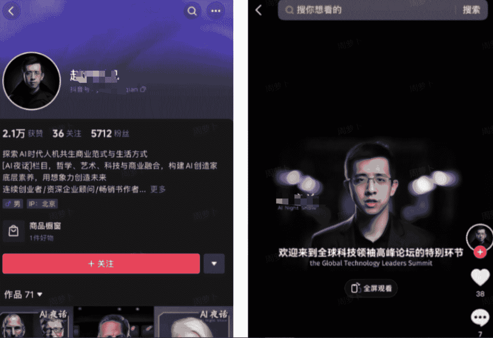

# AI 视频变现案例库

> 来源：[https://yunyinghui.feishu.cn/docx/E1ENdtElLoOlJtx0CtdczhwYnmd](https://yunyinghui.feishu.cn/docx/E1ENdtElLoOlJtx0CtdczhwYnmd)

> **适用人群：****互联网 AI 视频搞钱人群**

> 首发时间：2024 年 3 月 6 日

> 更新时间：2024 年 3 月 17 日

> **内容出品人：**

> **内容出品方：**[Mix AI Lab](https://yunyinghui.feishu.cn/wiki/WhelwZnxQi55mpkOzatc3Xran5b?from=from_copylink)

> **使用建议：**如果需要快速定位到精确内容，可以使用快捷键 Ctrl +F/Command +F 的形式，搜索关键字/词，查找你想要的内容。

> **持续更新 AI 副业搞钱学习的****基本玩法，创****新模式等内容，另案例**非项目操作手册，仅作为思路提供灵感，永久免费在线查看，欢迎收藏转发支持，文末有惊喜，大国出品，必属精品。

# 案例 1：AI+书单号短视频带货变现

## **项目说明**

该玩法就是借 AI 之力，让传统图书带货项目，内容生产倍增的一个新打法。

## **账号案例**

## 涉及**工具**

GPT+PPT+剪映+抖音/视频号

## **基本玩法**

**1.做好定位**

要选择一种最适合自己的搭配，做好定位。

在开始行动之前，想要你是做育儿类？励志类？还是国学类……有明确的定位才好做下一步。

**2.注册账号**

建议多平台同步注册，**抖音、小红书、视频号**。

一次性填好账号的基本设置（头像，昵称，背景，简介等资料，完成度 100%），这也是在注册账号之前明确账号定位的原因，不会填写的，可以在各自平台寻找对标账号，参考模仿。

**3.寻找对标账号**

现在，抖音有一个非常牛的，寻找对标账号的入口，尤其是对做带货号的朋友。

点击你的商品**橱窗→内**容创作→创意中心→查看更多→选择图书教育

然后你就能看到近 24 小时，图书类目流量最高、带货最好的视频了！

**当然，如果你是个新号，没**有开通购物橱窗，直接去抖音、小红书的搜索入口，搜索关键词，比如：图书/书单/好书推荐……

然后，筛选近期的热门内容，再反向追踪对标账号就可以了。

4.找选题，用 GPT 一键洗稿

接下来，就是让内容快速、批量化生产的重点——用 ChatGPT 等 AI 工具一键洗稿！

我们可以从 3 个维度寻找素材：

第一：调用 ChatGPT 自身数据库内容；

第二：找到销量 Top 榜图书，去外部平台扒文案、热评、书摘；

第三：找热门带货视频，把文案撸下来。

**5.如何将商品放到橱窗**

以抖音为例打开个人主页→商品橱窗→精选联盟→选品广场。

选中图书类目，找自己想要添加的商品上架到橱窗（选品：综合销量高、佣金高、评分高的商家），基本佣金都在 30%-60%区间。

后期有了销量可以找商家谈定向高佣，可以申请到 50%-70%。

**需要注意的是：**

**①** 开通抖音橱窗条件：**抖**音视频≥10 条**，粉丝量****≥****10**00，500 保证金；

② 提现账户：需要实名认证，对应一张实名本人银行卡；

③ 单机单号：不要多个抖音号在 1 部手机频繁切换，容易被限流；

④ 多账号矩阵：作品风格可以类似，但是不要同一个作品，多个抖音号同步发。

# 案例 2：AI+小说推文短视频变现

## 项目说明

小说推文的起源可以追溯到网络文学和短视频内容消费兴起的背景下。随着互联网技术的发展和移动设备的普及，人们获取和消费内容的方式发生了根本性变化。短视频平台因其便捷的内容消费方式和高效的信息传播能力迅速成为人们日常生活的一部分。在这样的背景下，小说推文应运而生，成为连接网络文学和广大读者的新桥梁。

小说推文的成功在于它能够充分利用短视频的视觉和听觉双重冲击力，通过精彩的内容片段和吸引人的配音，快速激发观众的兴趣。与传统的文本广告或图文推广相比，小说推文更能够在短时间内吸引潜在读者的注意，有效提高转化率。

随着 AI 时代的到来，已经开始借助 AI 生产视频内容来做账号，进行推广小说。

> **小说推文的变现的两个主要途径：**

> **平台拉新与会员开通：**通过推文引导用户下载应用并开通会员，创作者可获得推广佣金。例如，知乎会员开通可得 6 元佣金，而仅需下载番茄等软件，即可获得 5-7 元不同平台设定的佣金。

> **

> 售卖课程**：创作者可以通过销售相关课程或成为拉新团长来变现。前者直接售卖课程较难，后者则通过免费教授技术和项目操作，抽取学员佣金作为收益。

> 这样的变现方式使得小说推文不仅能够推广作品，同时也为创作者提供了收入来源。

## 账号案例

## 涉及工具

GPT，Midjourney/SD，配音秀，剪映

## 基本玩法

在小说推文的世界里，AI 技术的应用已经彻底改变了游戏规则。

以下是通过 AI 工具简化并优化推文创作流程的详细介绍：

**1.小说改写：**使用 ChatGPT 来重构小说内容，这一步骤关键在于通过 AI 的理解和创新，将原始故事转化为更加吸引人、适合视频形式展示的版本。ChatGPT 能够根据需求调整故事情节，无论是增加幽默元素还是加强情感冲击力，都能轻松应对。

**2.制作镜头脚本：**利用 ChatGPT 进一步细化故事，为之后的视频制作提供具体的镜头指导。这个过程包括确定每个场景的视觉效果、情感氛围和关键动作，确保视频内容丰富、引人入胜。

**3.AI 绘画生成：**将 ChatGPT 提供的镜头提示词提交给 AI 绘画工具，如 Midjourney 或 Stable Diffusion。这些工具能够基于文字提示生成高质量的图像，为视频提供必要的视觉素材。

**4.AI 配音制作：**选择合适的 AI 配音工具给改写后的小说配音。现代 AI 配音技术可以提供多种声音选项，从而确保配音质量既符合故事氛围又能吸引目标观众。

**5.视频剪辑：**最后，将配音、绘制的图像及选定的文案使用视频剪辑软件（如剪映）组合起来。这一步骤要求创作者关注视频的节奏、转场和整体表达方式，以确保最终产出既专业又具有吸引力。

# 案例 3：AI+睡前故事短视频变现

## 项目说明

在当今社会，父母都希望为孩子提供最好的教育资源，而睡前故事作为孩子成长过程中不可或缺的一部分，承载了教育和娱乐的双重功能。凯叔讲故事等成功案例证明了睡前故事不仅是育儿中的一个环节，更是一个具有巨大商业潜力的市场。随着 AI 技术的发展，传统的睡前故事正逐步被 AI+睡前故事所替代，这一变革不仅为行业带来了新的生机，也为广大家长和孩子提供了更多选择。

> 创作者在 AI+睡前故事领域拥有了更多变现的机会。以下是几个立竿见影的变现方法：

>

> **私域引流：**通过售卖电子故事书、早教课程或儿童相关产品，吸引并维护忠实客户群体。

> **小红书带货：**在小红书开设店铺，直接销售儿童故事书或玩具，利用平台流量实现销售。

> **商业合作：**凭借精准的粉丝群体，接受品牌合作，通过视频推广赚取广告费。

> **视频收益：**在多个平台分发视频，利用平台的创作分成计划，根据播放量获得收益。例如可以参加视频号的创作者分成计划等。

## 账号案例

## 涉及工具

GPT，MJ 或者 SD，配音工具 ttsmaker，剪映，3D 工具 LeiaPix

## 基本玩法

**1.素材搜集：**在各大视频平台搜索“儿童睡前故事”，挑选那些受欢迎的绘本故事，收集内容。

**2.故事脚本创作：**使用 AI 创作工具，根据收集到的故事内容，生成新的文案。确保使用 4.0 版本，以便能够创作多图内容。

**3.分镜与图片生成：**让 AI 根据故事内容，生成与角色一致的分镜图片。

**4.配音制作：**利用文本转语音技术，将故事脚本转化为音频。

**5.3D 动画制作：**使用在线 AI 工具，将静态图片转化为动态 3D 效果。

**6.视频剪辑：**在剪映等视频编辑软件中，将 3D 动画与配音结合，添加字幕和背景音乐，完成视频制作。

**7.视频发布：**制作好睡前故事视频后，我们就可以将其发布到各大视频平台上，比如抖音、快手、B 站，西瓜视频等。在发布视频时，要注意选择一个合适的标题和封面，能够吸引用户的点击。同时，我们还可以通过社交媒体、微信群等方式来推广我们的睡前故事视频，提高视频的曝光率和点击率。

# 案例 4：**AI+名人采访**

## **项目说明**

通过数字技术采访名人，创意值得参考，我们完成账号专题化后可以进行细分市场里的变现，比如挂车卖商品以及接广告等路径进行变现。

## 账号案例

## 涉及工具

GPT/AI 数字人/剪映/MJ 或者 SD

## 基本玩法

1.利用 GPT 写出对应的脚本

2.利用 MJ 或者 SD 做出名人照片

3.利用数字人制作工具制作视频

4.剪辑工具剪辑与二次创作

5.在某音或者某红薯平台上面进行引流作。〔注意版权问题，不要违规）

# AI学习交流社群

1.持续关注并更新 AI 的**相关资讯动态，研究报告，赚钱案**例，常见问题，永久免费在线查看，无收费内容，目标是成为最大的免费 AI 学习社群。

2.已建立社群聊聊 **AI** 发展及应用，**没进群的可以扫码加入，群满可加 AI 研究爱好者大国微信 ID：zyg90s（备**注：AI），已经在社群内的无需重复加入，开源知识库及社群学习全部为公开免费分享。

3.**关于文档负责人大国**：高帆文化CEO，曾就职于教培大厂，目前创业，主攻研究AI落地应用、企业流量增长及达人IP孵化。

**飞书学习群**

**飞书扫码进群学习**

微信好友（ID：zhangyuguo94s）

**扫码加微信入微信群**

进群或者加好友了解更多 AI变现案例

**觉得有用欢迎留个赞**