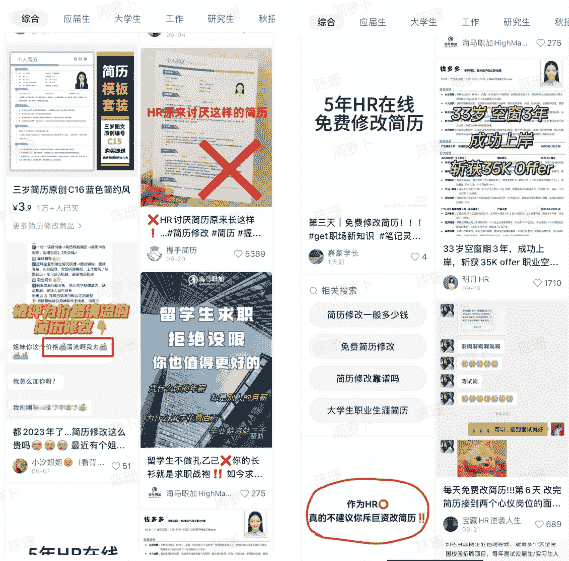
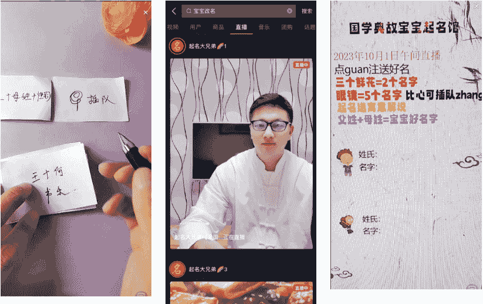
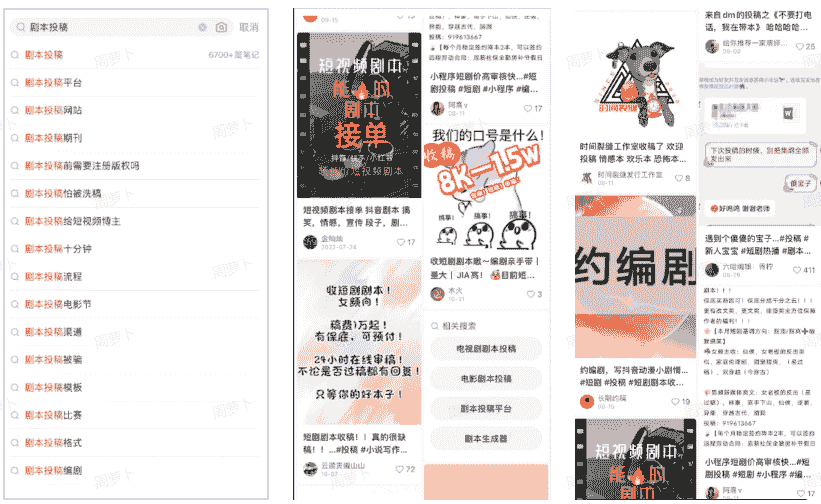

# AI 写作变现案例库

> 来源：[https://yunyinghui.feishu.cn/docx/PHRpd4dTaoXBpsxflfdc7Hq3nzd](https://yunyinghui.feishu.cn/docx/PHRpd4dTaoXBpsxflfdc7Hq3nzd)

> **适用人群：****互联网 AI 写作搞钱人群**

> 首发时间：2024 年 3 月 17 日

> 更新时间：2024 年 3 月 17 日

> **内容出品人：**

> **内容出品方：**[Mix AI Lab](https://yunyinghui.feishu.cn/wiki/WhelwZnxQi55mpkOzatc3Xran5b?from=from_copylink)

> **使用建议：**如果需要快速定位到精确内容，可以使用快捷键 Ctrl +F/Command +F 的形式，搜索关键字/词，查找你想要的内容。

> **持续更新 AI 副业搞钱学习的****基本玩法，创****新模式等内容，另案例**非项目操作手册，仅作为思路提供灵感，永久免费在线查看，欢迎收藏转发支持，文末有惊喜，大国出品，必属精品。

## 案例 1：**AI +简历修改**

## **项目说明**

随着求职市场的竞争加剧，更多的求职者需要简历优化服务。简历代作即帮助客户编写和优化简历，利用 Al 快速进行简历优化，从而获得利润。

## 操作案例

各大电商平台有很多简历接单的商品

## 涉及工具

GPT、以及各大电商 APP

## 基本玩法

1．账号注册：下载闲鱼 app 并通过淘宝登录。新手切勿随意修改信息（避免违规），先熟悉主界面和功能后再设置昵称。

2．发布标题：某鱼比较自由，只要不是违规都可以。

3．Al 修改案例实操：将简历内容输入 GPT 进行关键信息的提取

1）提取关键信息：首先，通过 GPT 技术对简历进行深度分析，包括提取关键词、技能、工作经验和教育背景

2）质量评估：利用 GPT 评估简历的整体质量，确保简历内容的完整性和准确性。

3）语法和拼写检测：利用 GPT 技术对简历进行语法和拼写的自动校对，确保没有明显的错误

4）内容优化：根据 GPT 的建议，对简历内容进行流畅性、逻辑性的调整和优化，确保简历展现出佳的自我形象。

# **案例 2：Al +宝宝起名**

## **项目说明**

在某音平台、某红薯或其他平台中进行直播给宝宝起名字或者公司改名，通过收取礼物进行插队变现，或者可以引流到私域中进行进一步定制

## 账号案例

## 涉及工具

GPT

## 基本玩法

1.采用投喂的方法先训练好你的 ChatGPT 提示词，做到给出两个姓氏或者相关字眼就能够给出稳定的名字的地步，比如上中的“王+何"，输出结果为”王书禾“，最后还能够给出男宝宝和女宝宝的名字。

2.请书法比较好的人进行手写名字，制定相对应的直播循环话术。

3.矩阵化运营账号可以是多账号也可以是同场直播在不同平台上面同时进行。

4.逐步对每个步骤进行优化和迭代，以持续提高效率和效果

# 案例 3：AI+自媒体爆文写作

## **项目说明**

通过分析自媒体文章的流量数据，找出潜在市场机会，然后利用 GPT 创作专业内容，逐步扩大规模和优化策略，实现稳定的收益。变现途径：流量主收益。

## 账号案例

以👸号为例

## 涉及工具

GPT或者kimi等

## 基本玩法

1.寻找那些通常阅读量为几百到几千的自媒体文章，但突然有一篇或多篇文章的阅读量飙升到几万或者几十万的情况（这种情况说明流量主要来自公共区域，而这种异常指实际上可能代表着这个话题是当下的热点，至少是经过市场验证的热门话题）

2.使用 GPT 在该领域创作专业的内容，可以利用 AI 生成配图或寻找相关图片

3.创建多个账号以扩大操作规模

4.逐步对每个步骤进行优化和迭代，以持续提高效率和效果

# 案例 4：**AI+剧本创作**

## **项目介绍**

利用 Al 技术手剧本创作商单， 可以实现低成本交付。项目痛点 ：原创剧本生产不足， 且人力成本高昂， Al 创作可提供高效解决方市场商机：在📕、拼多多、淘宝等平台上的竞争较小，且有机会与商家建立长期合作。

## **账号案例**

## 涉及工具

GPT

## **执行策略：**

1.制作内容寻找投稿渠道（📕/抖音）

2.需求拆解与试稿

3.测试迭代优化

4.项目放大

# AI 学习交流社群

1.持续关注并更新 AI 的**相关资讯动态，研究报告，赚钱案**例，常见问题，永久免费在线查看，无收费内容，目标是成为最大的免费 AI 学习社群。

2.已建立社群聊聊 **AI** 发展及应用，**没进群的可以扫码加入，群满可加 AI 研究爱好者大国🛰️ ID：zyg90s（备**注：AI），已经在社群内的无需重复加入，开源知识库及社群学习全部为公开免费分享。

3.**关于文档负责人大国**：高帆文化CEO，曾就职于教培大厂，目前创业，主攻研究AI落地应用、企业流量增长及达人IP孵化。

**飞书学习群**

**飞书扫码进群学习**

🛰️好友（ID：zhangyuguo94s）

**扫码加🛰️入🛰️群**

进群或者加好友了解更多 AI 变现案例

**觉得有用欢迎留个赞**