# 开源强势来袭！Qwen-Image 能否撼动即梦 AI 的地位？（附 20+提示词示例）

> 来源：[https://yunyinghui.feishu.cn/docx/WScjdbZrWoAwxuxfxiBcHU66n2f](https://yunyinghui.feishu.cn/docx/WScjdbZrWoAwxuxfxiBcHU66n2f)

---

**朋友们，阿里通义千问团**队最近正式推出了最新的开源图像模型： Qwen-Image。

它主打的就是 **中文文字渲染和视觉设计 **，一上线就吸引了不少关注（以下图像为 Qwen-Image 模型生成） 。

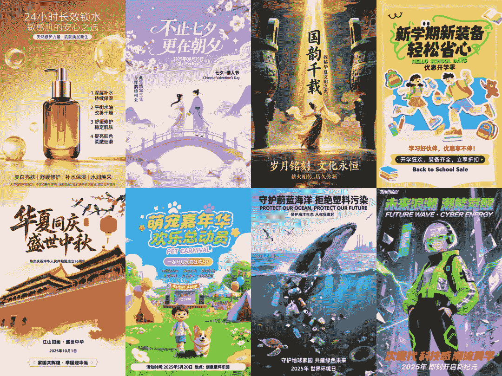

**与此同时，A**I 绘图领域里另**一位老熟人 即**梦 **AI ，也凭着超强**的 文字渲染效果 和 简单易上手的操作 ，成为国内 TOP 级的 AI 图像生成工具。

**那**么问题来了：在实际的电商海报制作、节日活动宣传设计中， 谁更胜一筹 。

接下来这篇文章，我会从多个维度对这两个模型进行一次全面的测评对比。

## **01 ****模型介绍**

Qwen-Image 是由通义千问团队推出的新一代开源图像生成模型，基于 20B 参数的 MMDiT 架构，能稳定处理中文和多语言文字，生成的画面清晰自然，不会模糊变形，看起来细腻又具有表现力。

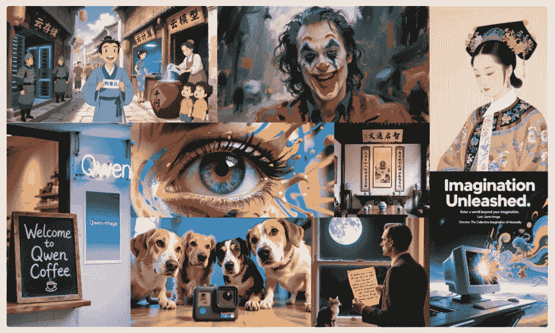

Qwen-Image 最擅长的是文字与图像进行融合，细节清晰又自然，既真实又有艺术感，而且开源。

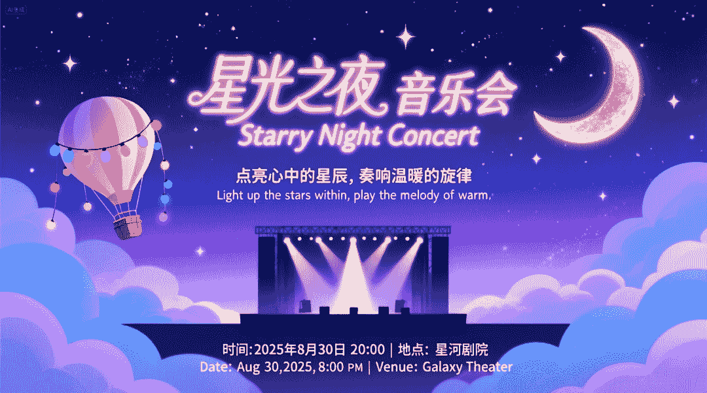

## **02 ****模型测评**

### **1.文字渲染**

我先让两个模型各自生了一张护肤品广告海报来看看效果。

> **产品海报： **生成一张高端护肤品广告海报，画面中央是一款琥珀色玻璃精华瓶，瓶身光泽通透，配备金属质感按压泵头，整体优雅奢华。风格为高级护肤广告，写实渲染，质感明亮。背景为金色渐变氛围，点缀晶莹剔透的水珠和液体泡泡元素，表现锁水与保湿的概念。画面顶部居中有大标题：“24 小时长效锁水”，副标题为：“敏感肌的安心之选”，下方口号：“天然修护力量 · 肌肤焕发新生”。画面右侧以竖排列表形式展示功能卖点：1。深层补水，持续保湿 2。平衡水油，改善干燥 3。舒缓修护，稳定肌肤 4。提亮肤色，柔嫩细滑。画面底部横排文字为：“美白亮肤丨舒缓修护丨补水保湿丨水润焕采”，最下方以小字说明：“天然植物萃取配方，不含酒精与香精，温和低敏，经皮肤科测试验证，适合日常使用”。整体排版为瓶子居中，文字主要集中在右侧，左侧保持留白，整体布局呼吸感强，氛围高级而具有吸引力。

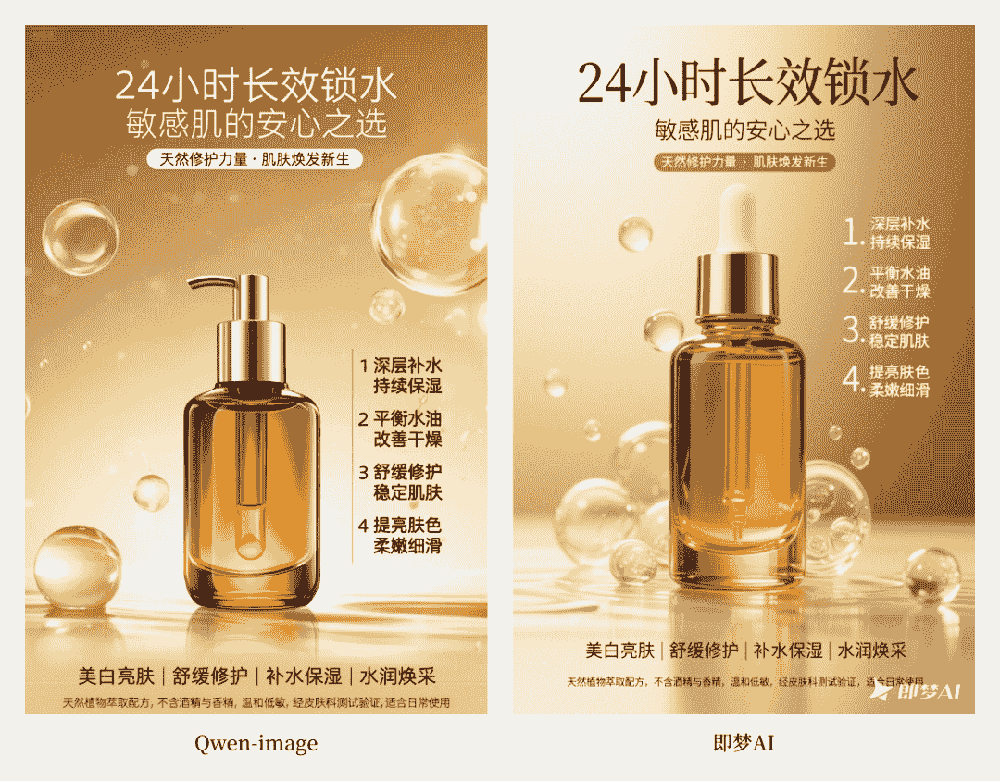

最近七夕节快到了，我们再接着生成一张七夕节海报。

> 节日海报 ：生成一张七夕节主题海报，画面中央是一对身着古风服饰的情侣站在粉红色鹊桥上，手牵着手，氛围温柔浪漫。整体风格为唯美插画，粉色与紫色为主色调，带有柔和渐变。背景有盛开的桃花、流动的云雾、远处的山峦和闪烁的星光，营造浪漫梦幻的氛围。画面顶部居中有大标题“不止七夕 更在朝夕”，下方有日期“2025 年 08 月 29 日 Qixi Festival”，右下方有文字“七夕·情人节 Chinese Valentine’s Day”。画面左侧点缀小字诗意文案：“今宵鹊桥相会”，“此生情定三生”。整体排版以情侣和桥为视觉中心，文字分布在上方和下方，布局对称，氛围浪漫温柔。

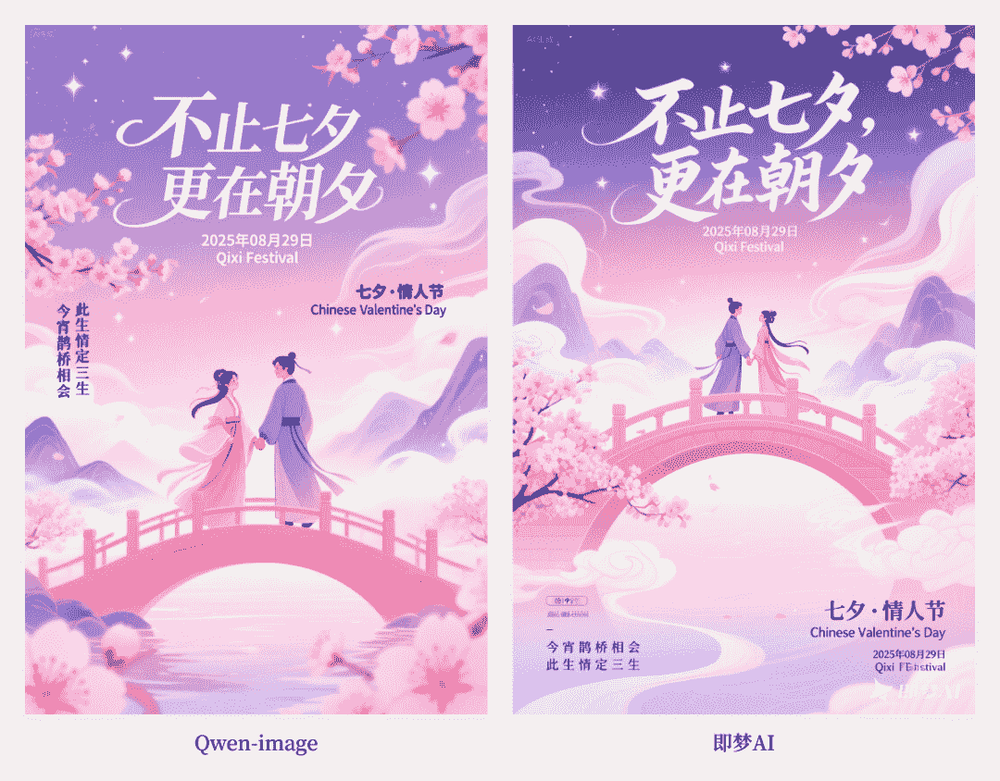

这里能看出来，即梦 AI 有时候会生成一些重复的文字内容。

接着我们加大一下难度，一次性生成六种不同的字体风格合集。

> 字体设计 ：在白色背景上设计一张中文字体合集展示海报，整体采用三行两列的网格布局，共六个单元，每组字体各自独立但保持整体对齐和留白，突出多样化的字体风格。上左位置是现代极简无衬线粗黑体，搭配绿色几何线条装饰，文字写“向前出发”，居中对齐，简洁有力；上右位置是古风书法感字体，带有水墨渲染和飞白效果，文字写“风雅千年”，居中稍微偏上，背景带有淡淡墨韵；中左位置是金属赛博朋克风格字体，冷蓝色光效结合机械纹理，文字写“未来序章”，文字居中，底部加入精细的电路线条点缀；中右位置是俏皮卡通泡泡字，圆润饱满并配以粉色描边，文字写“今天好萌”，居中排布，周围点缀小星星和爱心元素；下左位置是涂鸦街头风格字体，潦草随性的笔触和红蓝撞色喷漆质感，文字写“热血街头”，整体略微倾斜，占据画面大部分空间，背景加入泼墨质感；下右位置是优雅时尚杂志感字体，细长高挑的字形，金色渐变与极简细线结合，文字写“光影之间”，居中偏上摆放，留有呼吸感。整张海报保持网格化布局与统一的间距，六组字体在同一画面中各具特色，形成对比鲜明、规整有序的多元字体展览效果。

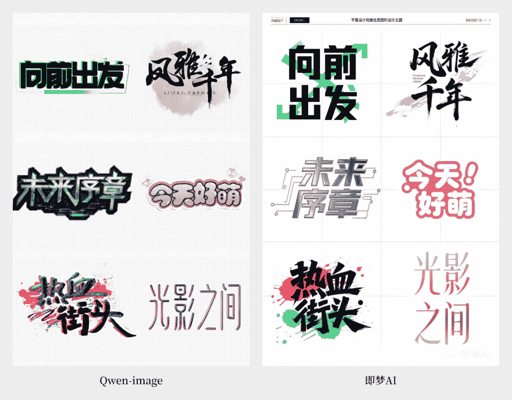

面对一次性生成六种不同风格字体的挑战，Qwen-Image 和 即梦 AI 都拿捏得很稳，效果都还不错。

> 国风海报 ：一幅富有东方古韵与历史厚重感的海报设计，整体采用对称式构图，两尊巨大的青铜器分列在画面左右，如同庄严的守护者，画面中央从天顶倾泻下一束金色光芒，光束下方是一位身着华丽舞裙的古代仕女翩然起舞，衣袖飘逸，与光影交织成优雅的律动，背景虚化处理，在青铜与光芒之间若隐若现浮现古代壁画与祥云纹理，增强历史厚重感；中央竖排大标题“国韵千载”，右侧紧贴竖排小字副标题“探秘华夏文明之光”，底部横排大字说明“岁月铭刻 文化永恒”，最下方横排副标题“薪火相传 历久弥新”，文字层次清晰、呼应主体，整体色调以青铜绿与金色为主，画面庄严而神秘，充满史诗般的厚重感与艺术美感。

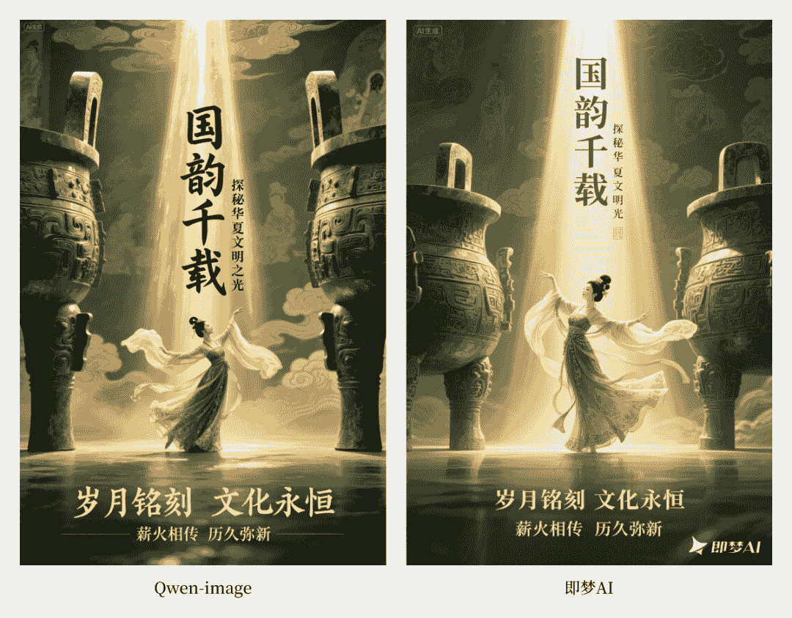

随后，我们再生成一张插画海报，看看其表现如何。

> 插画海报 ：设计一张开学主题的促销海报，整体色调以明亮的黄色为主，搭配蓝色和橙色点缀，营造青春活力的氛围。画面上方是大标题，采用卡通粗黑体字体，辅以绿色手绘线条和俏皮的眼睛表情作为装饰，文字写“新学期新装备，轻松省心”；大标题下方有小字副标题，采用简洁无衬线字体，文字写“HELLO SCHOOL DAYS 优惠开学季”。画面中部放置两位卡通学生角色：一位背着书包开朗奔跑的女孩，另一位手拿水杯、神采飞扬的男孩，动作夸张有趣，呈现积极向上的学习氛围，旁边点缀彩色书包、文具和小熊形象的贴纸插画。中间标题区域下方添加一句红色小字广告语“学习好伙伴，优惠享不停！”，字体轻快醒目。最下方设置一块黄底黑字横条，突出活动信息，文字写“开学狂欢，装备齐全，立享折扣”，并配有英文小字“Back to School Sale”。整体构图分为三部分：上方标题区、中部角色与插画区、下方活动信息区，层次清晰，画面充满动感与童趣。

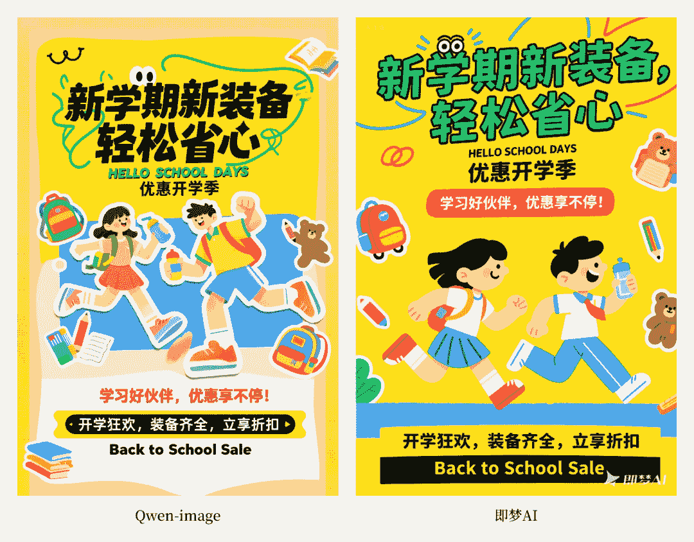

> 活动海报 ：竖版卡通 3D 风格海报，欢乐明亮。背景是蓝天白云下的户外草地嘉年华场景：绿色草地上有彩色帐篷和气球，帐篷之间挂着彩旗，草地上点缀鲜花；远处搭建了小舞台，横幅上写着节日标语，现场氛围热闹喜庆。前景是一位卡通小朋友牵着一只可爱的柯基犬散步，画面 Q 萌温馨。 文字排版： - 上方大标题（粗体活泼中文，带星星和爪印装饰）： “萌宠嘉年华 欢乐总动员” - 副标题（英文点缀）： “PET CARNIVAL” - 中部彩色圆角框内标语： “一起开启宠物狂欢日！” - 活动亮点介绍（白色小字，居中两行）： “宠物运动会 · 趣味互动 · 萌宠写真” “主题市集 · 欢乐打卡 · 养宠答疑” - 底部日期与地点（现代中文字体，留白区域）： “活动时间：2025 年 5 月 20 日 地点：创意草坪乐园”

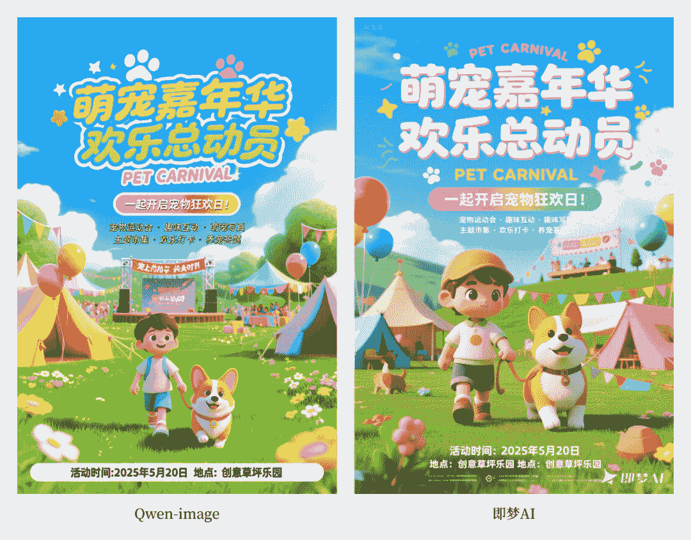

> 宣传海报 ：竖版环保主题公益海报，写实与创意结合。画面主体是一头巨大的鲸鱼跃出海面：水面之上的鲸鱼部分是真实的蓝鲸，身体庄严、线条优美，展现自然的壮丽；而在水面以下的部分，鲸鱼的身体由塑料瓶、废弃包装袋、饮料罐、渔网、旧轮胎等垃圾拼接而成，碎片在水中漂浮，形成强烈的对比。海面波光粼粼，远处有模糊的城市天际线和工厂轮廓，象征人类对自然的影响；天空中有海鸟飞翔，部分在远离鲸鱼；海水深蓝，水下除垃圾外，还有小鱼和海龟在挣扎游动，凸显生态困境。上方大标题（粗体中文）： “守护蔚蓝海洋 拒绝塑料污染”，副标题（英文）： “PROTECT OUR OCEAN， PROTECT OUR FUTURE”， 中部横向标语（白色小字）： “保护海洋生态 从你我做起”，底部公益口号（黑体）： “守护地球家园 共建绿色未来”，底部日期（现代中文字体）： “2025 年 世界环境日”。整体氛围：震撼、对比强烈、警示意味浓厚，画面层次丰富，突出“真实与污染的反差”，文字清晰可见。

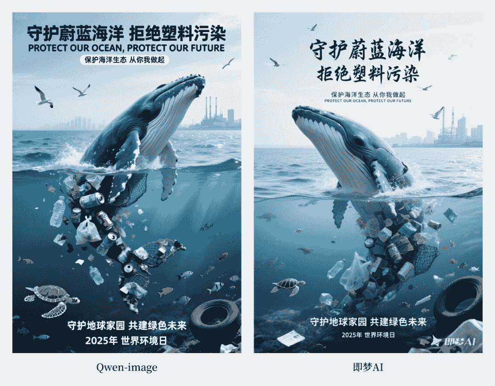

看完这些案例之后，我个人认为 **Qwen-Image **与 **即梦 AI **的表现都相当出色。尽管它们可能各自存在一些细节上的不足，但整体效果依然令人满意，完全能够满足日常的创作需求。

**但是，如果是电商、宣传**类的设计，我会更倾向于用 Qwen-Image （毕竟是开源的）。当然，如果你追求的是即开即用的体验，不想折腾参数和工作流，即梦 AI 依然是最友好的选择。

那我们接下来继续模型的风格测评。

### **2.写实风格**

> 写实人物 ：写实风格的照片，一位年轻男子，短卷发，戴着圆形墨镜，身穿黑色连帽衫，上面有一个小的白色 Nike 标志，背景是灰色石墙。人物面向镜头，表情冷峻，氛围沉稳，光影对比强烈，整体质感偏暗调，带有街头时尚感。

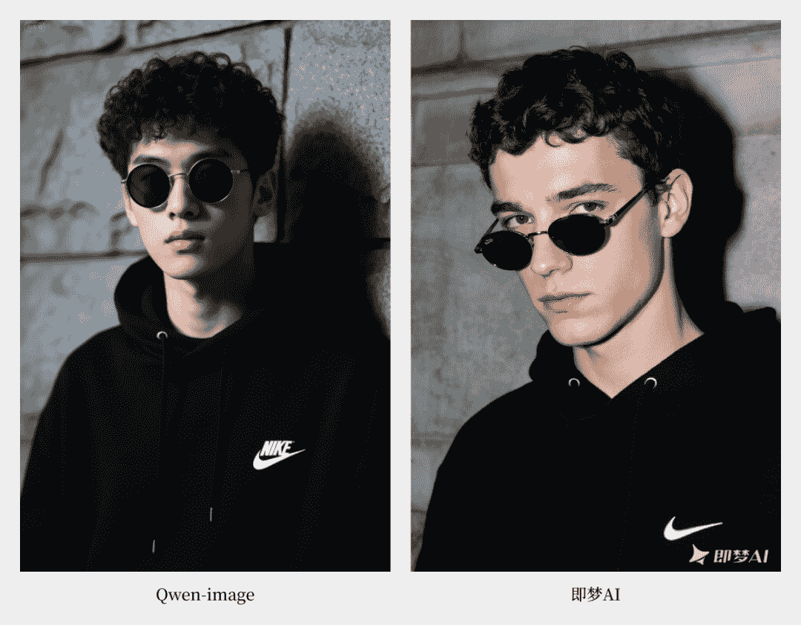

> 写实风景 ：写实风格的森林清晨，画面以超高清摄影质感展现。阳光从高大茂密的树林间穿透而下，形成自然的光束，空气中漂浮着轻微的薄雾，使光线更柔和梦幻。地面铺满湿润的绿色苔藓和细小的落叶，仿佛能感受到清新的泥土气息。前景中枝叶清晰可见，细节锐利；中景和远景的树林层次分明，树干被阳光照亮，投下斑驳的影子。几片金黄色和绿色的树叶在空中缓缓飘落，增加了画面的动态感。整体构图自然和谐，色彩饱满却不夸张，给人一种置身真实森林中的沉浸感，如同专业摄影作品。

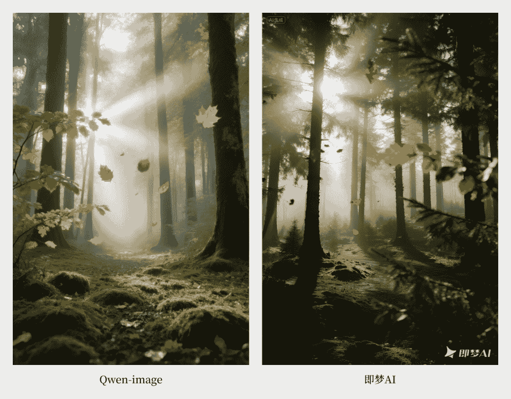

> 写实动物 ：写实风格的高山野生动物摄影，两只毛茸茸的土拨鼠静静地蹲坐在岩石上。前景细节清晰可见，毛发质感柔软，阳光从侧面照射，勾勒出温暖的金色轮廓光。背景是高耸的雪山与暮色天空，采用浅景深虚化，使焦点集中在两只动物身上。画面氛围宁静而自然，色彩对比强烈但真实，带有电影级别的光影效果。整体构图平衡，充满野生动物摄影的纪实感与美感，如同出自国家地理杂志的专业作品。

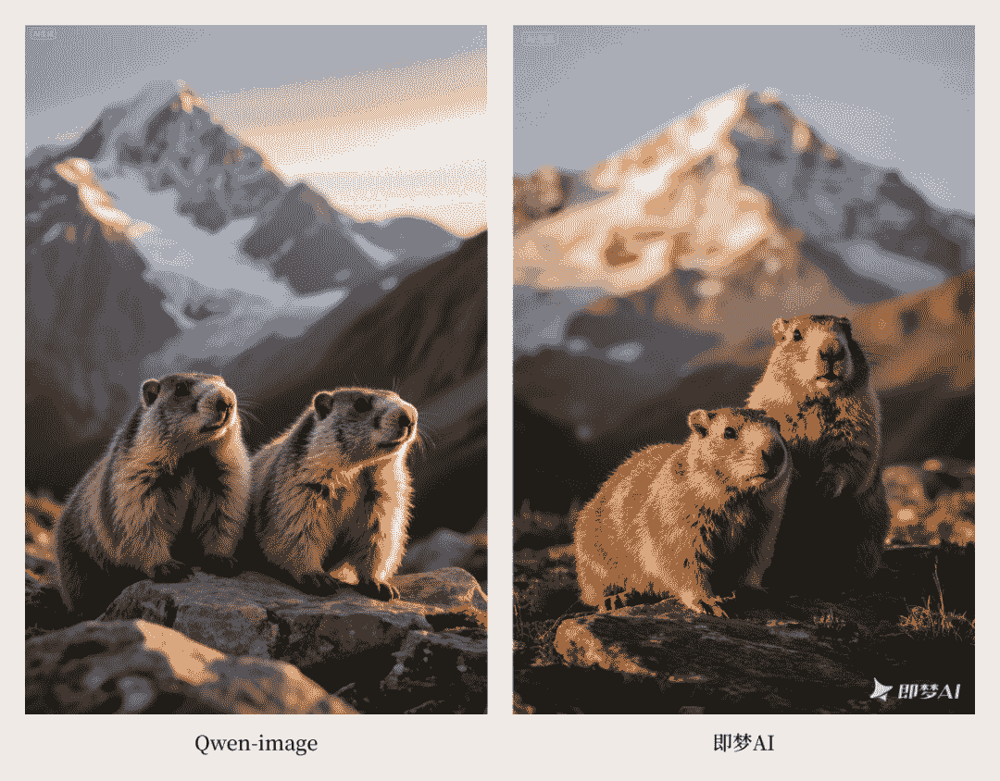

> 写实物体 ：写实风格的静物摄影，一只白色简约陶瓷花瓶摆放在桌面上，插着几朵浅粉色玫瑰、绿色枝叶和米色干草。阳光从窗外斜射进来，在桌布和物品上投下柔和的光影。背景是一排书籍和艺术摆件，整体色调干净明亮，带有北欧极简风格与日系家居的清新氛围。画面构图平衡，充满生活感与美学气息，细节清晰，色彩自然。

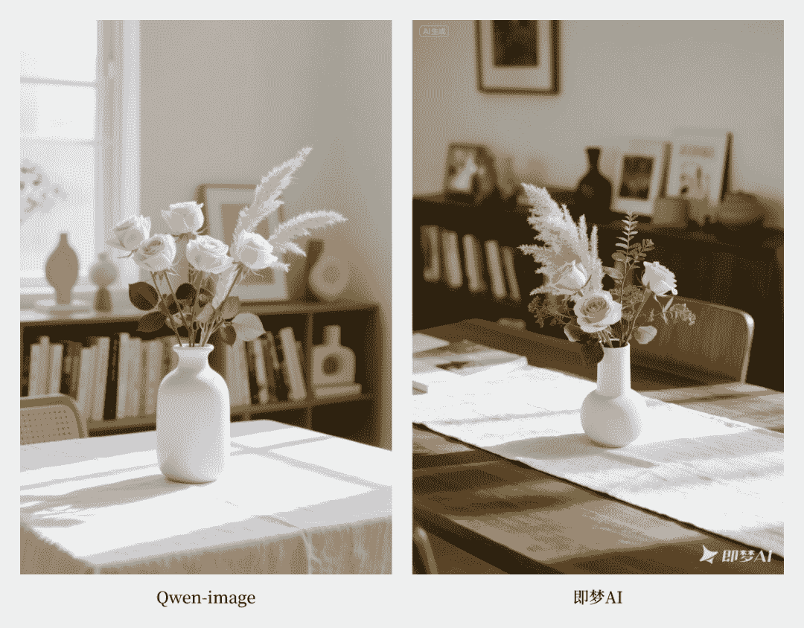

在写实风格上，我认为即梦 AI 更接近摄影滤镜效果，光影自然、氛围真实。而 Qwen-Image 则更偏向渲染图。

### **3.插画风格**

> 水墨风 ：水墨国画风格的竹子，黑白灰色调，墨韵飘逸。几根挺拔的竹干与竹叶交错，留白处充满东方美学意境。墨色有浓淡变化，带有泼墨和飞白效果，墨迹自然渗透、晕染开来，洒落的水墨点缀增强了灵动感。整体画面淡雅清新，写意与写实结合，展现出竹子的坚韧与清雅之美，带有中国传统水墨画的韵味与禅意。

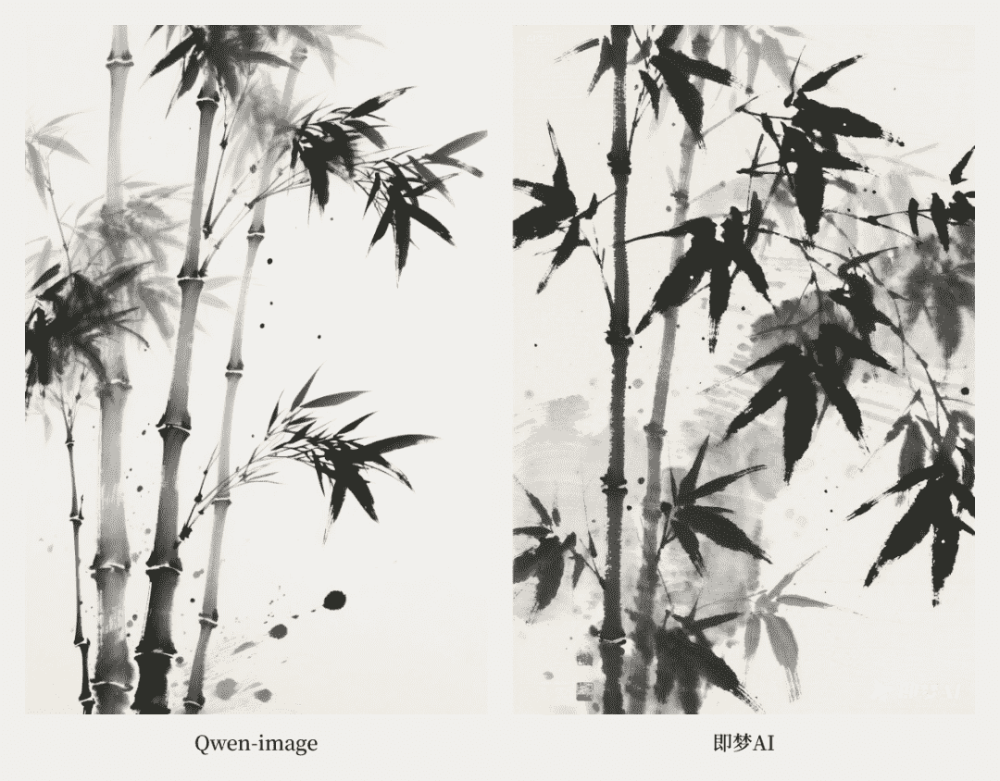

> 吉卜力 ：宫崎骏风格的动漫插画，一个巨大、圆润、毛茸茸的幻想生物，身形可爱、表情憨厚，张开双臂快乐地跳跃在空中。画面下方有两个天真烂漫的孩子，一个穿着橙色上衣，另一个穿着蓝色衣服，他们在草地上奔跑追逐，脸上洋溢着兴奋与欢笑。背景是蓝天白云，阳光透过枝叶洒落在草地上，形成斑驳光影。四周是茂盛的森林，绿叶随风摇曳，点缀着小花和草丛，空气中有飘散的花瓣与飞舞的落叶。整体氛围明亮温暖，充满童真、幻想和治愈感，色彩鲜艳饱和，画面梦幻唯美，具有强烈的吉卜力动画质感。

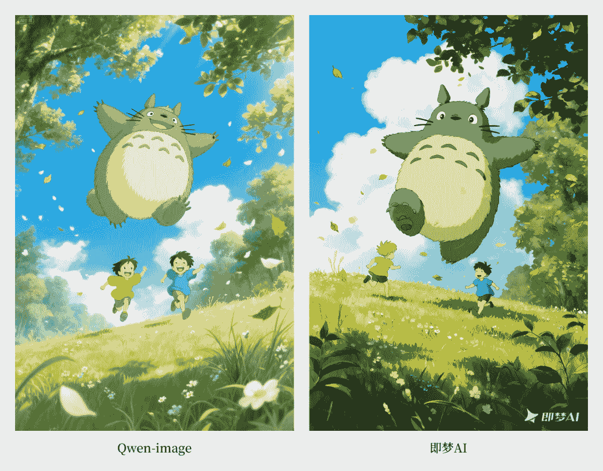

> 像素风格 ：像素风格（Pixel Art），哥特萝莉风少女，长银色头发，戴着咖啡色贝雷帽，穿着棕色连衣裙和白色衬衣。少女坐在夜色森林里，被黑色树枝环绕，手里拿着笔在写字，神情安静而略带神秘。背景是深蓝色的夜空和湖面，光影对比强烈，色调冷暗，带有一点复古游戏画面的颗粒感。整体氛围安静、神秘，像是 RPG 游戏中的剧情插画。

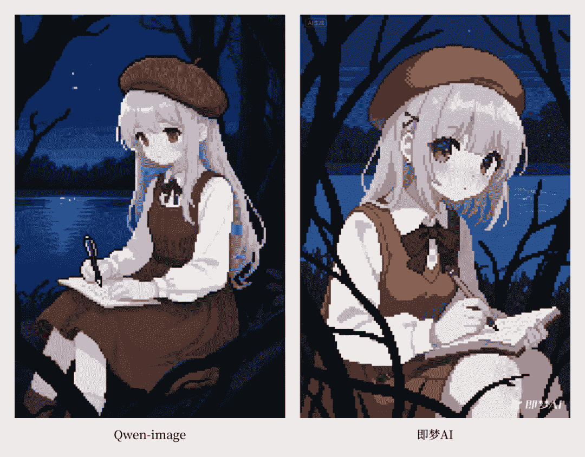

在插画风格上，两家表现都挺不错的。像水墨风、吉卜力这种常见风格，都能画得有模有样，氛围也拿捏得挺到位。

> 梵高风格 ：梵高风格厚涂油画，小王子坐在一颗小行星上，身穿绿色长袍和金黄色长围巾，金色短发随风飞扬。旁边有一朵鲜艳的红玫瑰。行星表面用厚重的油彩笔触涂抹出黄色、蓝色和白色的肌理，充满质感。背景是深蓝色宇宙，旋转的星空充满梵高式的流动感，布满金黄色的星星和圆润的星球，光芒柔和闪烁。整体画面梦幻浪漫，色彩鲜明强烈，既有童话般的浪漫氛围，又带有梵高油画特有的激情与厚重感。

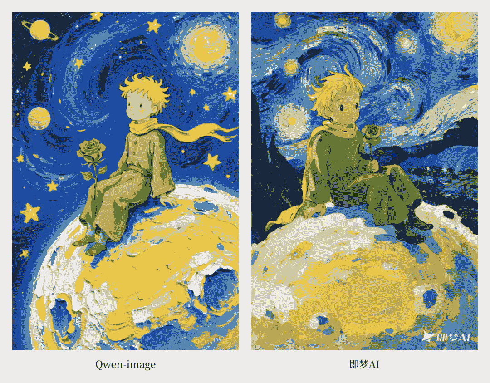

### **4.3D 风格**

> 3D 卡通 ：3D 卡通渲染风格，一只圆滚滚、胖乎乎的小柴犬，金黄色和白色相间的毛发，毛茸茸的质感，闭着眼睛微笑，露出幸福满足的表情。身体比例夸张，像一个毛绒球一样呆萌可爱。背景是一片阳光下的草地，蓝天白云，四周有花草，氛围温暖治愈，像皮克斯动画角色在户外的场景。

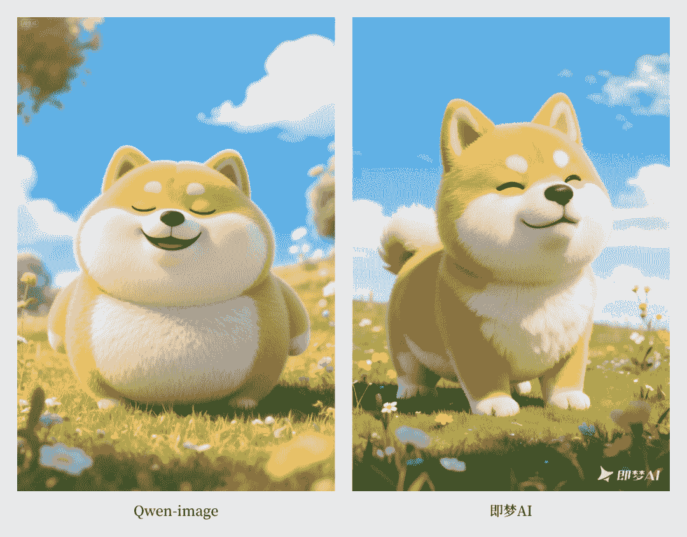

> 3D 黏土 ：两个可爱的 3D 黏土风小摆件，一个是戴着黄色小帽、绿色衣领的奶油色小狗，一个是粉色的小兔子，蓝色衣领，肩并肩坐在干净的白色桌面上。背景是一间温馨的粉彩色卧室，有木质书架、毛绒玩具、墙上的小海报和暖黄色小彩灯。画面氛围温暖柔和，细节丰富，黏土质感，3D 渲染，软糯的哑光质感，可爱卡通风格，精致童趣。

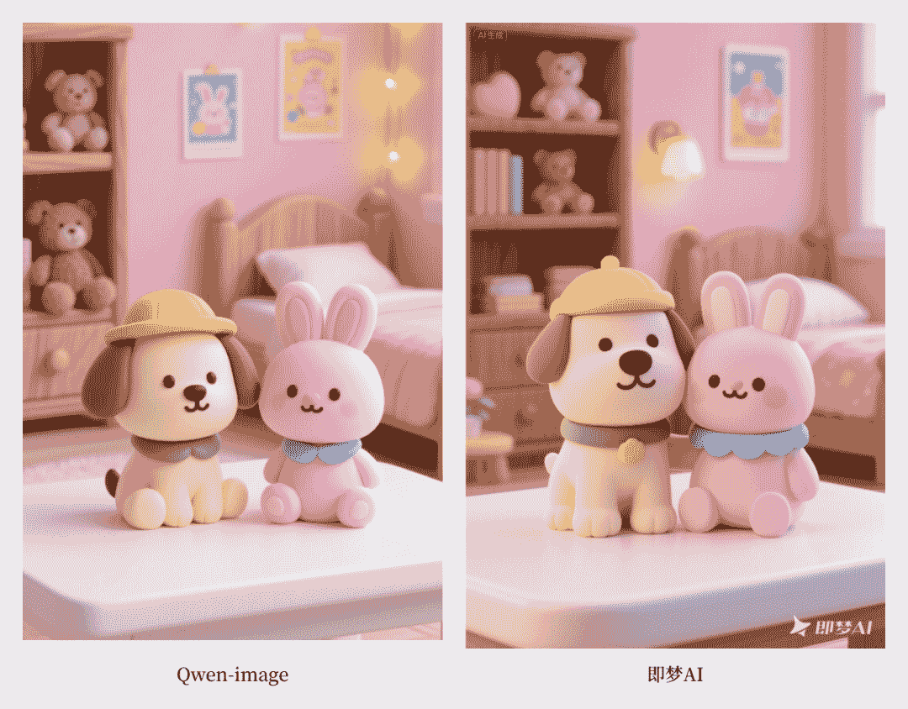

> 3D 毛绒 ：一颗可爱的毛绒小星星，带着微笑，趴在柔软的毛茸茸星球上，星球表面蓬松有质感。背景是梦幻的夜空，渐变的蓝色天空，发光的弯月，周围漂浮着蓬松的白云。整体画面色彩柔和温馨，光影柔和，充满童话氛围，3D 渲染，毛绒玩偶质感，卡哇伊可爱风格。

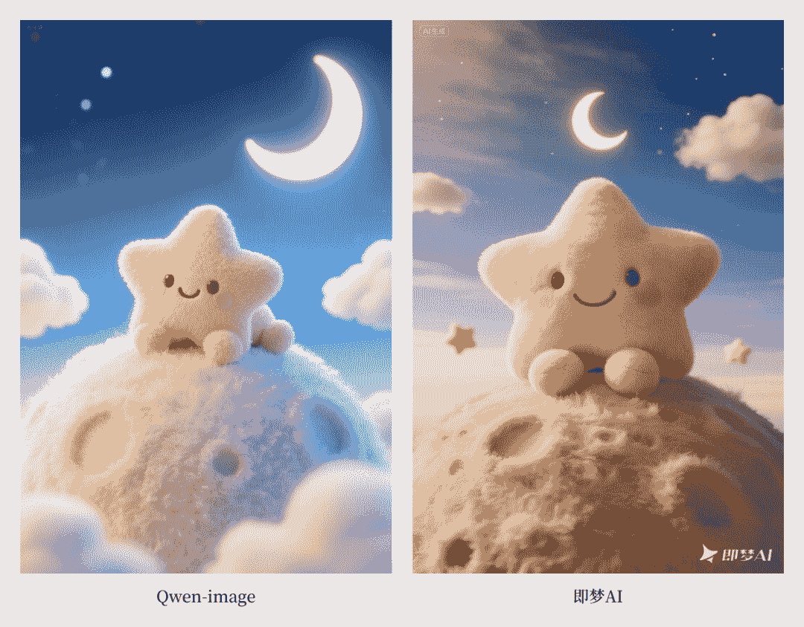

3D 风格方面，我自己的体验是两者都挺稳定的。像卡通、黏土、毛绒这些风格，它们都能表现出比较细腻的质感和饱满的氛围，看上去很有完成度。整体效果都很可爱，也很贴近设计需求。

案例都测了一圈了，那接下来就来看看，它到底是怎么操作的吧。

## **03 ****操作步骤**

操作并不复杂，直接使用 **ComfyUI 工作流 **即可。官方已经提供了相关链接，包含工作流文件和模型下载。

地址在这： https://docs.comfy.org/zh-CN/tutorials/image/qwen/qwen-image

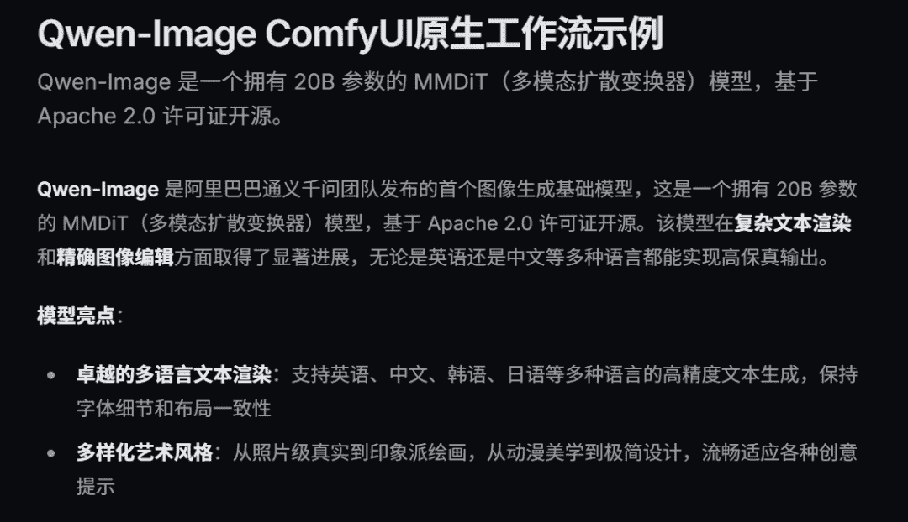

工作流的模块非常简单，只需设置模**型、生成参数和提示词，**就能快速上手使用 Qwen-Image 模型。

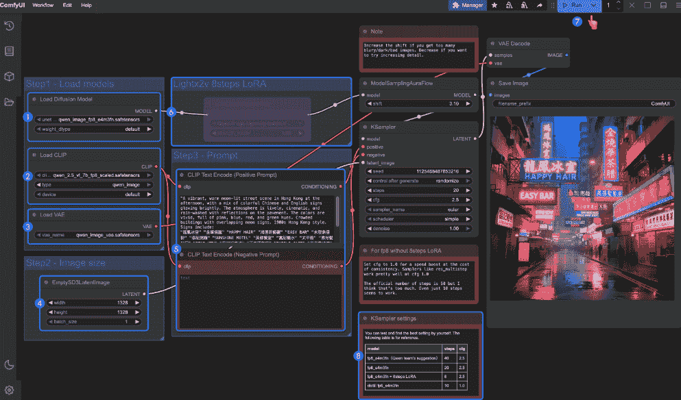

## **04 ****写在最后**

整体体验下来，我认为两者生成的效果差距并不大。

Qwen-Image 开源，可以在 Stable Diffusion 生态中自由扩展，比如搭配 LoRA 模型，调用不同的节点、插件，这一点是闭源的即梦 AI 无法实现的。

如果是日常、非专业级的需求，即梦 AI 更加简单易用，上手快。

但如果你熟悉 Stable Diffusion，并且有复杂的设计需求，Qwen-Image 则能满足你，工作流可以完全按自己的想法搭建。

再补充一句：Qwen-Image 是目前唯一能在 Stable Diffusion 中生成中文文字的模型......

**今年，DeepSee**k 的开源席卷全球，证明了一个趋势： 开源之势，势不可挡。

在我看来，唯有开源生态，才能让更多人共同参与，推动 AI 的进步与迭代加速。

闭源固然带来稳定与便捷，但决定未来的，一定是开放的合作与创新。

所以，无论是 Qwen-Image，还是更多后来者，开源生态会让 AI 迭代更快，走得更远。