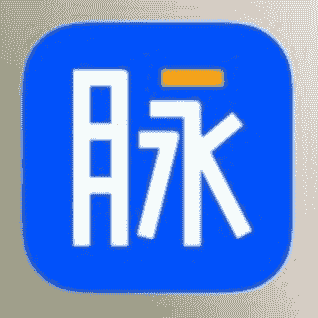
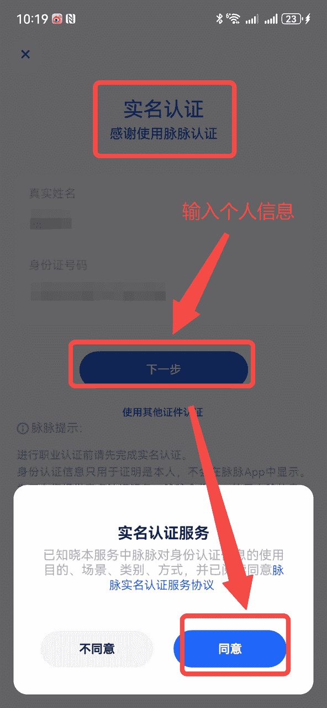
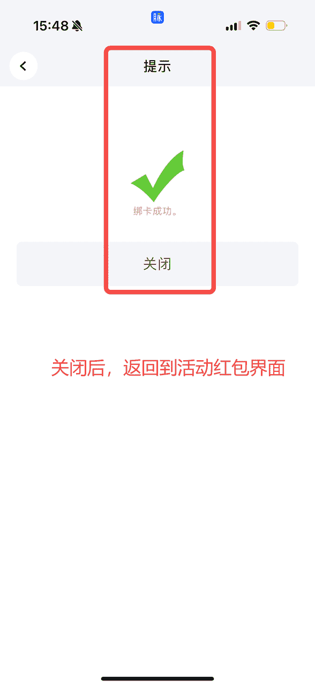
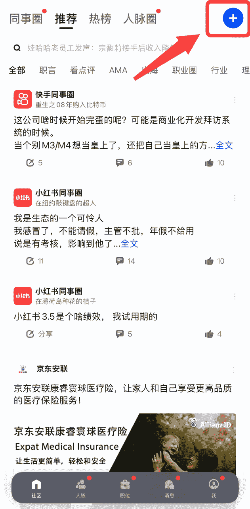
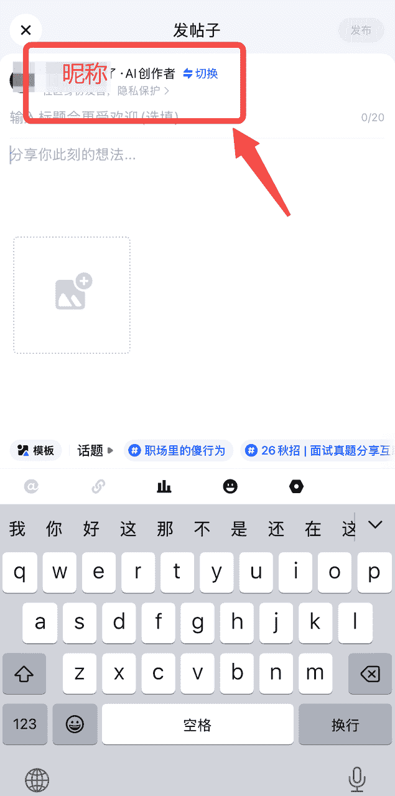
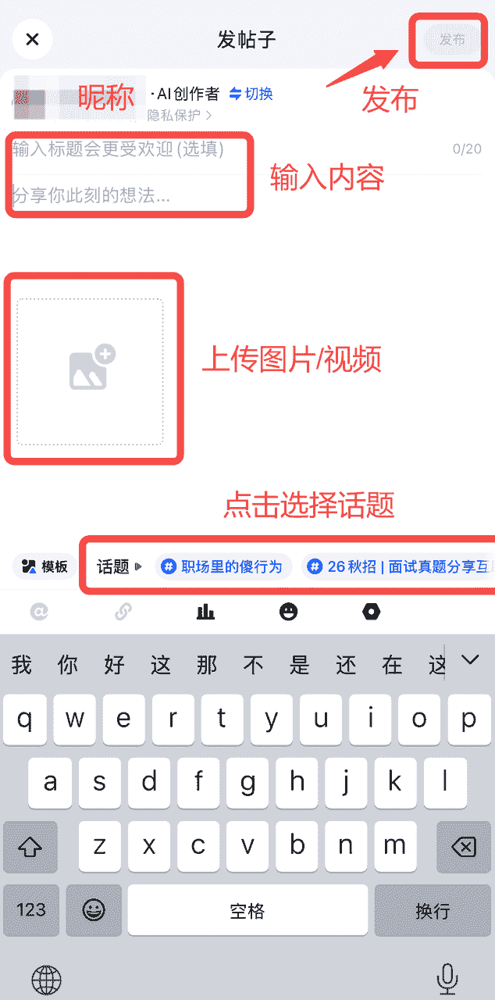
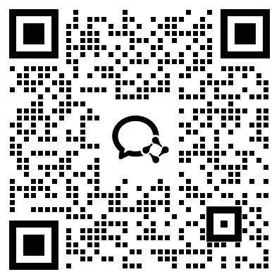
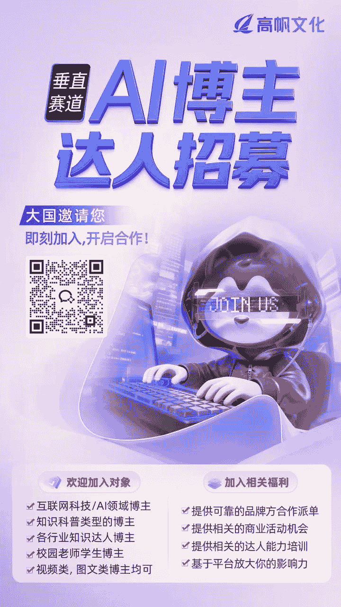

# 脉脉 AI 创作者入驻招募说明

> 来源：[https://yunyinghui.feishu.cn/docx/LpMfdcPFYocShNx2rVUcXPNYncS](https://yunyinghui.feishu.cn/docx/LpMfdcPFYocShNx2rVUcXPNYncS)

> **说明：**[Mix AI Lab](https://yunyinghui.feishu.cn/wiki/WhelwZnxQi55mpkOzatc3Xran5b?from=from_copylink)为脉脉引入优质创作者，这里持续更新脉脉平台 AI 创作者招募的政策和策略，欢迎各位 AI 博主建联沟通。

> 第一阶段：11月10日-12月2日

# 一、脉脉介绍

**脉脉（màimài）**创立于 2013 年 10 月，是拥有 1.2 亿用户的职场社区和社交平台。脉脉采用“唯一昵称+实名身份认证”的 ID 机制，通过认证员工生产的职场内容，发展出了两大核心业务：内容社区和人脉服务。

内容社区是现实职场空间的网络映射。脉脉通过同事圈、社区推荐、社区热榜等丰富的内容版块，帮助职场人做好职业选择，助力职业成长。脉脉为企业提供丰富的人脉连接服务：脉脉高聘（人才银行+雇主品牌服务）、专家网络服务、拓客通、会员服务，满足不同场景下的客户需求。

脉脉通过内容社区与人脉服务为职场人创造新鲜事、新成长、新点评、新机遇四重价值。脉脉平台上汇聚了海量的“中高端人才”，用户来自诸多世界 500 强、中国 500 强公司，以拥有高学历、高收入的城市职场精英为主。目前用户已经覆盖 IT 互联网、人工智能、新能源汽车、芯片、生物医药、审计、金融、文化传媒、房地产、制造业、教育培训等各行各业。脉脉希望通过提供平等连接、平等表达、平等选择职业与发展的权利，促进企业与员工平等对话。并在未来十年内成长为服务 101 个国家的 10 亿专业人群，成就职业梦想。

# ⼆、项目背景

脉脉作为**国内最大**的高端人才交流社区，诚邀各类 AI 专业人才、AI 泛兴趣爱好者入驻脉脉，⼀起交流，打造中文 AI 互动交流社区。

# 三、脉脉需要的达人内容

> ** ****基本要求**

> a. 粉丝量≥100 （任意平台，如📕，视频号，👸号，即刻，X，Reddit等等）

> b. 本人入驻后的脉脉账号名称需与原平台⼀致

> c. 原平台内容发布量≥12 条，且近 15 天需至少发布 1 篇内容

> d. 图片&视频博主均可

# 四、达人入驻指南

**审核通过后的入驻流程**

## **1. ****注册认证操作流程**

1）应用商城下载脉脉 APP

—>2）打开 app ，手机号注册登入—>3）填写个人信息 —>4）认证（先身份认证、再进行公司及岗位认证） —>提交即完成

•  打开脉脉 app ，手机号注册后 ，填写个人信息

请与站外名称保持一致

•  注册后 ，点击右下方我的 ，下滑找到身份认证 ，选择第一个 ，点击认证后先进行实名认证

## 2. 提现操作流程（for 个人）

操作流程分两步：绑定银行卡&提现

打开脉脉找到 【我】 —>2。找到钱包—>3。点击余额 —>4。点击活动红包—>5。点击提现—>6。绑定银行卡—>7。回到余额界面—>8。点击活动红包—>9。点击提现—>提交完成

注意事项：需要提前准备一张银行卡

1.打开脉脉 app 后左下角点击 【我】 ，下滑找到并点开钱包 ，点击余额 ，点击活动红包 ，点击提现跳转到绑定银行卡页面

2.绑定一张银行卡 ，根据步骤操作即可

##

## 3. 社区身份内容发布教程

•  总共有 3 个步骤 ，重点是第二步选择发布身份、第三步带话题

**第一步：**打开脉脉 APP 后首页点击右上角的“ ＋号”跳转到内容发布页面

** 第二步：**跳转到发布页后 ，点击切换→选择“ 昵称+AI 创作者” 的身份

** 第三步：**选择好身份后 ，输入

内容→上传图片/视频→带上话题 【AI 从业者 ，知无不言】 →点击发布即

#

# 五、 达人激励机制

## 1. 奖金激励

> 备注：奖励机制不叠加 ，取最高值；即 ，您分别于 7 日内发布 3 条内容后 ，再继续发布 12 条内容 ，共计 15 条内容也仅可获得 500 元的最高奖励

## 2. app 站内资源扶持

入驻后还会给予本次项目中所有达人一个特殊标识（待上线） ，在推荐分发及用户视角中都会有特别展现

# 六、达人奖励结算规则

有以下行为 ，不予结算

•  结算前删除内容视频低于可结算内容条数

•  发布内容与其他平台内容不符 ，搬运他人内容、水贴、水文、调性差异较大

•  发布内容违反政策法规及脉脉社区守则

# 七、入驻后内容更新方向

# 八、达人入驻扶持社群

申请需要填写入驻填表，入驻成功以后，邀请进官方创作者扶持交流群，拿官方流量扶持资源包，以及和众多优质AI创作者交流。

**扫码联系审核员**

**入驻相关问题答疑群**

负责人联系🛰️：zhangyuguo94s（备注：**AI 博主**，已经加过的不用重复加大国）

目前，高帆文化不仅局限于达人合作，还有品牌商务合作，欢迎各位达人链接，帮你做更好的商业化传播/变现。

