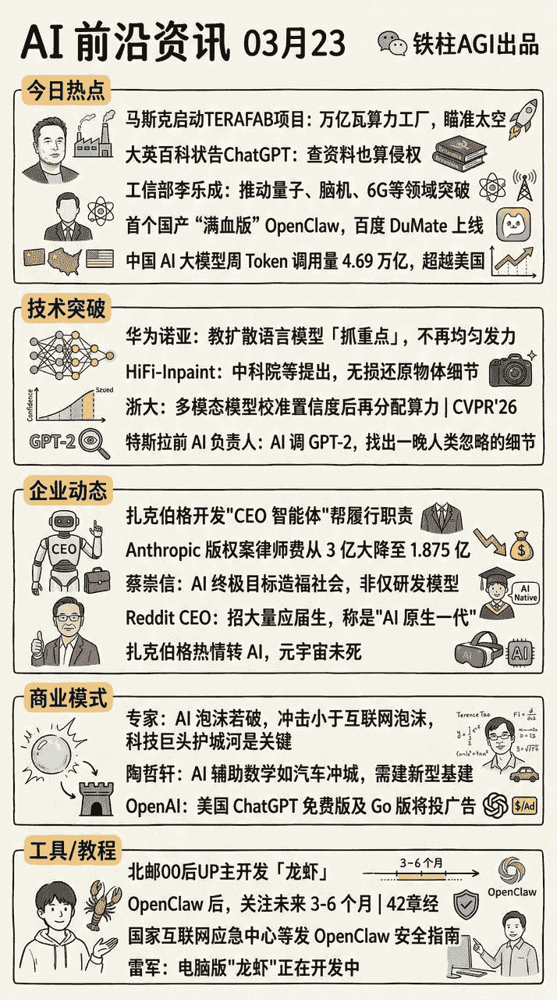

# 2026-03-23 万象 AI 日报

> 来源：[https://yunyinghui.feishu.cn/docx/Jm0qdEuu4oretFxEVqRc1GSJnKc](https://yunyinghui.feishu.cn/docx/Jm0qdEuu4oretFxEVqRc1GSJnKc)

### 🔥 今日热点

1.  **马斯克启动万亿瓦太空算力工厂** ([链接](https://mp.weixin.qq.com/s?__biz=MzA3MzI4MjgzMw==&mid=2651022970&idx=2&sn=e3eccb77a7b1cecdbacc5d0f7298fe5f))：马斯克宣布由其SpaceX和Tesla共同推进TERAFAB项目，目标年产超1太瓦算力，其中80%用于太空，旨在利用无限太阳能突破地面数据中心在电力、散热和土地上的限制。

1.  **大英百科诉 OpenAI 侵权** ([链接](https://mp.weixin.qq.com/s?__biz=MzI3MTA0MTk1MA==&mid=2652685570&idx=3&sn=c7f77fb24c1e02833b6e784f6972c262))：指控 ChatGPT 训练、输出及 RAG 实时检索均侵犯其近 10 万篇版权内容，并涉及商标侵权，为 AI 版权诉讼新焦点。

1.  **工信部推动未来产业攻关** ([链接](https://www.ithome.com/0/931/517.htm))：部长李乐成表示将系统布局技术攻关，推动量子科技、生物制造、氢能和核聚变能、脑机接口、具身智能、6G等领域突破。

1.  **百度 DuMate 全量上线** ([链接](https://www.ithome.com/0/931/552.htm))：国内首个国产企业级“满血版”龙虾产品，支持本地部署，提供安全沙箱隔离、高风险操作授权及文件权限管控等企业级安全能力。

1.  中国[ A](https://www.ithome.com/0/931/481.htm)I 大模型周调用量首超美国 (链接)：OpenRouter 数据显示，中国 AI 大模型周调用量达 4.69 万亿 Token，连续两周超越美国，全球前三均为中国模型。

### 🚀 技术突破

1.  **华为诺亚优化扩散模型训练** ([链接](https://mp.weixin.qq.com/s?__biz=MzA3MzI4MjgzMw==&mid=2651022970&idx=1&sn=b8597016016f826ca918c914e4af417b))：提出智能噪声调度方法，优先遮蔽代码和数学推理中的高信息密度区域，引导模型学习关键内容，在多个基准测试上平均提升约4%。

1.  Hi[Fi](https://mp.weixin.qq.com/s?__biz=MzA3MzI4MjgzMw==&mid=2651022970&idx=3&sn=143a4c11223060534827a2d7d0f8dd6c)-Inpaint 重塑图像修复 (链接)：中科院、港中文等提出新模型，通过显式提取并注入高频特征，在保留商品Logo、文字等细节上实现高保真图像修复，已被CVPR 2026接收。

1.  **浙大破解多模态模型盲目自信** ([链接](https://mp.weixin.qq.com/s?__biz=MzIzNjc1NzUzMw==&mid=2247876681&idx=2&sn=48e69f5934067cefce0d5cb4b2580f4c))：提出CA-TTS框架，先校准模型置信度使其与视觉证据对齐，再基于置信度动态分配推理算力，在四大视觉推理基准上平均超越SOTA 8.8%。

1.  AI[ 一](https://www.ithome.com/0/931/538.htm)夜发现人类忽略的关键参数 (链接)：特斯拉前 AI 负责人手动调试 GPT-2 数月，自主智能体仅用一晚便找到其遗漏的精细调优参数及相互作用，指出研究人员应避免成为流程瓶颈。

### 🏢 企业动态

1.  **扎克伯格开发“CEO 智能体”** ([链接](https://www.ithome.com/0/931/567.htm))：Meta 内部推动 AI 转型，CEO 扎克伯格开发专属智能体以提升效率，公司鼓励全员使用 AI 工具并调整组织架构以应对竞争。

1.  An[th](https://www.ithome.com/0/931/554.htm)ropic 版权案律师费大幅下调 (链接)：在与 Anthropic 达成 15 亿美元版权和解案中，代表作家与出版商的律师团队将律师费申请额从 3 亿美元下调至 1.875 亿美元。

1.  蔡崇[信谈](https://www.ithome.com/0/931/529.htm)中国 AI 发展三大驱动力 (链接)：指出中国AI突破源于电力基建、开源信念及“制造业+AI”，强调发展AI的终极目标是推动应用普及、造福社会，并披露阿里正依托千问模型全面进军智能体AI时代。

1.  **Reddit 将大量招聘应届生** ([链接](https://www.ithome.com/0/931/514.htm))：CEO 称应届毕业生是“AI 原生一代”，擅长用 AI 编程，公司将持续招聘工程等岗位，并认为最优秀的人才将不会出现在公开求职市场。

1.  Me[ta](https://www.ithome.com/0/931/498.htm) 元宇宙未死但重心转向 AI (链接)：Meta 旗下 Reality Labs 部门已亏损超 800 亿美元但未被砍，仍在开发 VR 头显与 AI 眼镜；扎克伯格公开谈论焦点已从元宇宙大幅转向 AI 与打造“超级智能”，核心目标始终是建立自主掌控的平台。

### 💼 商业模式

1.  AI[泡沫](https://www.ithome.com/0/931/530.htm)破裂冲击或小于互联网泡沫 (链接)：专家称科技巨头凭借平台模式、用户黏性及强大现金流构筑的“护城河”，将限制市场下跌幅度，使潜在冲击更温和短暂。

1.  **陶哲轩论AI辅助数学证明** ([链接](https://www.ithome.com/0/931/520.htm))：将AI对数学研究的影响类比汽车冲击城市，认为需构建适配机器的新型数学基础设施以保留探索价值，而非强行融入现有体系。

1.  Op[en](https://www.ithome.com/0/931/509.htm)AI 将在 ChatGPT 免费版投放广告 (链接)：未来几周内开始向美国 ChatGPT 免费版及 Go 版用户展示广告，以探索新的收入来源。

### 🛠️ 工具/教程

1.  北邮[UP](https://mp.weixin.qq.com/s?__biz=MzI3MTA0MTk1MA==&mid=2652685570&idx=1&sn=39199863a7ff9ed9bde4534473bafdac)主超前开发Agent框架 (链接)：北邮学生Soulter早在2023年初就发布了开源Agent编排平台AstrBot，其项目在B站独特的社区反馈机制下成长，展现了平台作为AI技术落地“第一现场”的价值。

1.  Op[en](https://mp.weixin.qq.com/s?__biz=MzIyMDE5OTYyMw==&mid=2651051504&idx=1&sn=cc66fec24f5390a95cf049fd591c6f04)Claw 之后，我只想未来 3-6 个月的事情 (链接)：对话指出 AI Coding Agent 已能完成长程复杂任务并颠覆 SaaS，未来机会在于降低使用门槛，作者团队正转向开发“管 AI 的 AI”以提升效率。

1.  **OpenClaw 安全指南发布** ([链接](https://www.ithome.com/0/931/532.htm))：国家互联网应急中心等联合发布安全使用实践指南，为普通用户、企业、云服务商及开发者提供防护建议，包括环境隔离、权限最小化、隐私保护等核心措施。

1.  **小米开发电脑版“龙虾”** ([链接](https://www.ithome.com/0/931/531.htm))：雷军确认电脑版“龙虾”智能体正在开发中，此前已发布手机版“龙虾”miclaw，支持操控手机及米家设备。