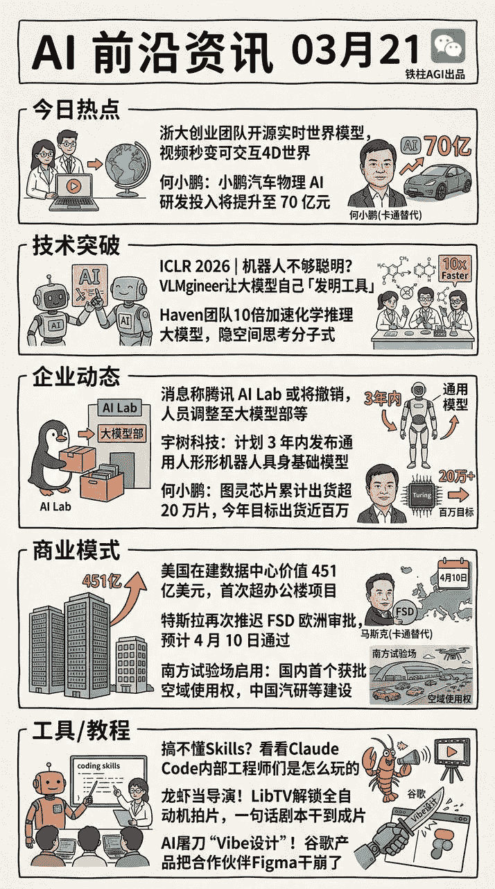

# 2026-03-21 万象 AI 日报

> 来源：[https://yunyinghui.feishu.cn/docx/CUjpdgulhoEnQjxWL9JcASL7nQ7](https://yunyinghui.feishu.cn/docx/CUjpdgulhoEnQjxWL9JcASL7nQ7)

### 🚀 技术突破

1.  浙大[团队](https://mp.weixin.qq.com/s?__biz=MzA3MzI4MjgzMw==&mid=2651022576&idx=1&sn=05f58042f6e26b85db834aaa94bde171)开源实时世界模型登顶全球榜单 (链接)：影溯（InSpatio）发布开源模型 InSpatio-World，仅用百卡算力在权威榜单 WorldScore-Dynamic 实时交互类模型中夺冠，可将单目视频实时重建为可交互的4D世界。

1.  VL[Mg](https://mp.weixin.qq.com/s?__biz=MzA3MzI4MjgzMw==&mid=2651022576&idx=3&sn=facbb05c9c66c704caad7406583f1540)ineer让机器人自主发明工具 (链接)：宾夕法尼亚大学提出全自动工具设计框架，利用视觉语言模型与进化搜索，让机器人从零开始自主设计工具并学会使用，相关论文已被ICLR 2026接收。

1.  La[te](https://mp.weixin.qq.com/s?__biz=MzIzNjc1NzUzMw==&mid=2247876334&idx=3&sn=4e8fec432e5072ff01f3fbc1c1e03170)ntChem 10倍加速化学推理 (链接)：Haven团队提出让大模型在隐空间而非文本表面进行化学推理，在ChemCoTBench上胜率提升近60%，平均推理速度提升超10倍。

### 🏢 企业动态

1.  小鹏[汽车](https://www.ithome.com/0/931/169.htm)物理 AI 研发投入将增至 70 亿元 (链接)：何小鹏透露公司已建立物理 AI 全栈自研技术体系，预计2026年AI将走向物理世界，自动驾驶将实现L2到L4跨越。

1.  **腾讯 AI Lab 撤销** ([链接](https://www.ithome.com/0/931/165.htm))：成立近十年后撤销，相关人员调整至大模型部与产学研合作中心，原负责人蒋杰不再担任该职务。

1.  宇树[科技](https://www.ithome.com/0/931/138.htm)拟 3 年内发布具身基础模型 (链接)：计划发布具备四大泛化能力的通用人形机器人模型，赋能工业场景并拓展至生活领域，同时布局“世界模型-动作”与 VLA 技术路线。

1.  **图灵芯片出货超 20 万片** ([链接](https://www.ithome.com/0/931/152.htm))：何小鹏透露图灵芯片累计出货超 20 万片，今年全系车型切换，目标出货近百万片，并搭载于新一代 IRON 机器人。

### 🛠️ 工具/教程

1.  Cl[au](https://mp.weixin.qq.com/s?__biz=MzA3MzI4MjgzMw==&mid=2651022576&idx=2&sn=60b2201d751c7a0b135907be04bdfe00)de Code Skills 实战指南 (链接)：编译自 Anthropic 团队博客，总结了内部使用 Skills 的九大类型（如库参考、自动化、部署等）及最佳实践，包括如何编写、分发和衡量效果。

1.  **LibTV 解锁全自动视频创作** ([链接](https://mp.weixin.qq.com/s?__biz=MzIzNjc1NzUzMw==&mid=2247876334&idx=1&sn=3ef5755145cf7a758ca2f551ad7915f8))：提供无限画布与节点工作流供专业用户精细创作，同时支持通过Agent（如🦞）一句话全自动生成从剧本到成片的视频。

1.  **谷歌AI设计工具冲击Figma** ([链接](https://mp.weixin.qq.com/s?__biz=MzIzNjc1NzUzMw==&mid=2247876334&idx=2&sn=1fb3500c5a2f6c23582d2968075fa2e0))：谷歌发布支持语音“Vibe Design”的AI工具Stitch，功能与Figma高度重叠且免费，导致Figma股价两日暴跌约13%，凸显巨头入场对软件行业的冲击。

### 💼 商业模式

1.  **美国数据中心建设支出首超办公楼** ([链接](https://www.ithome.com/0/931/200.htm))：2025年12月数据中心建设支出达35.7亿美元，首次超过办公楼，标志AI基础设施投资浪潮正重塑美国建筑业格局。

1.  **特斯拉 FSD 欧洲审批再推迟** ([链接](https://www.ithome.com/0/931/171.htm))：特斯拉宣布 FSD 在荷兰完成测试但审批推迟至 4 月 10 日，欧盟整体审批预计延至夏季，马斯克此前多次承诺均未兑现。

1.  **南方试验场启用** ([链接](https://www.ithome.com/0/931/178.htm))：国内首个获批空域使用权的大型综合试验场，由中国汽研、广汽集团等五方共建，占地8600亩，可覆盖智能网联汽车及低空飞行器测试。