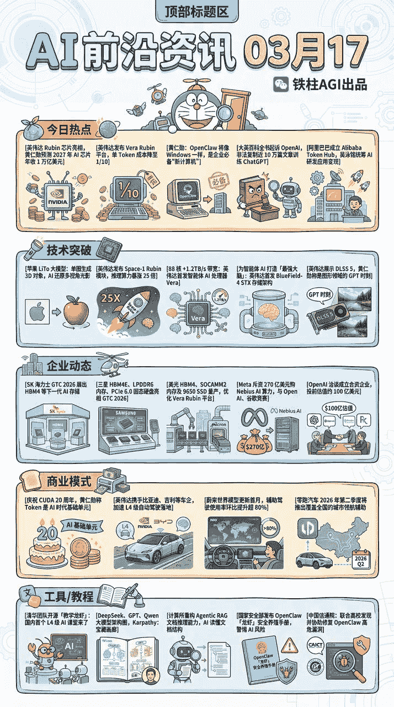

# 2026-03-17 万象 AI 日报

> 来源：[https://yunyinghui.feishu.cn/docx/G4wnd3dKxoFuupx8WT3cHXzVnif](https://yunyinghui.feishu.cn/docx/G4wnd3dKxoFuupx8WT3cHXzVnif)

### 🔥 今日热点

1.  **英伟达发布 Rubin 芯片** ([链接](https://www.ithome.com/0/929/694.htm))：黄仁勋在 GTC 2026 上发布多款新硬件，并预测到 2027 年 AI 芯片销售有望带来 1 万亿美元收入。

1.  英伟[达发](https://www.ithome.com/0/929/683.htm)布 Vera Rubin AI 平台 (链接)：该平台为史上最强 AI 基建方案，相比上一代，其 NVL72 机架仅需 1/4 GPU 完成 MoE 模型训练，每瓦推理吞吐量提升 10 倍，单 Token 成本降至 1/10。

1.  黄仁[勋：](https://www.ithome.com/0/929/690.htm)OpenClaw 是企业必备“新计算机” (链接)：英伟达CEO在GTC上呼吁企业制定OpenClaw战略，称其如同Windows对PC的意义，并推出主打安全的自有版本NemoClaw。

1.  **大英百科全书起诉 OpenAI** ([链接](https://www.ithome.com/0/929/675.htm))：指控后者非法复制近10万篇文章训练ChatGPT，侵犯版权并分流其网站流量，要求经济赔偿及禁令。

1.  阿里[成立](https://www.ithome.com/0/929/639.htm) ATH 统筹 AI 业务 (链接)：阿里巴巴组建 Alibaba Token Hub 事业群，由 CEO 吴泳铭挂帅，整合千问模型研发、消费应用及钉钉等产品，旨在加速 AI 战略协同与商业化变现。

### 🚀 技术突破

1.  苹果[ L](https://www.ithome.com/0/929/704.htm)iTo 大模型实现单图 3D 重建 (链接)：苹果发布 LiTo 模型，仅需单张图像即可重建完整 3D 对象，并在多视角下高度还原光影效果，性能超越现有模型。

1.  **英伟达发布太空计算平台** ([链接](https://www.ithome.com/0/929/686.htm))：推出Space-1 Rubin模块，太空AI推理算力较H100提升最高25倍，并发布IGX Thor等平台，旨在将数据中心级性能带入太空，实现实时感知与决策。

1.  英伟[达首](https://www.ithome.com/0/929/685.htm)发 Vera AI 处理器 (链接)：英伟达发布全球首款专为智能体AI和强化学习定制的88核Vera数据中心CPU，带宽达1.2TB/s，处理效率为传统CPU的两倍。

1.  英伟[达发](https://www.ithome.com/0/929/684.htm)布 BlueField-4 STX 存储架构 (链接)：针对智能体AI长上下文推理，发布模块化存储参考架构，集成CMX内存平台，处理Token速度提升5倍，戴尔、HPE等供应商正联合设计下一代AI基础设施。

1.  **英伟达发布 DLSS 5** ([链接](https://www.ithome.com/0/929/681.htm))：黄仁勋称其为图形领域的“GPT时刻”，融合AI与手工渲染实现照片级真实感，将于今年秋季上线并获多家顶级游戏开发商支持。

### 🏢 企业动态

1.  SK[ 海](https://www.ithome.com/0/929/703.htm)力士亮相 GTC 2026 (链接)：集中展出下一代 HBM4 等 AI 存储产品，展示与英伟达在 AI 基础设施上的合作成果，包括液冷固态硬盘及 DGX Spark 超级计算机。

1.  三星[ G](https://www.ithome.com/0/929/700.htm)TC 2026 展示 AI 全栈方案 (链接)：首发 HBM4E 内存（带宽 4.0 TB/s），并展出量产 HBM4、LPDDR6、PCIe 6.0 SSD PM1763 及 SOCAMM2 服务器内存，全面布局从高性能计算到端侧 AI 的解决方案。

1.  **美光 HBM4 等新品量产** ([链接](https://www.ithome.com/0/929/693.htm))：宣布专为英伟达 Vera Rubin 平台优化的 HBM4、SOCAMM2 内存及 9650 SSD 已同步量产，HBM4 带宽较前代提升约 2.3 倍。

1.  Me[ta](https://www.ithome.com/0/929/635.htm) 斥 270 亿美元采购 AI 算力 (链接)：将在未来五年向云服务商 Nebius 支付最高 270 亿美元获取 AI 基础设施，以与 OpenAI、谷歌等对手竞争。

1.  Op[en](https://www.ithome.com/0/929/667.htm)AI 拟与私募成立合资企业 (链接)：OpenAI 正与多家私募股权机构深入谈判组建合资公司，投前估值约100亿美元，以推广其企业产品；Anthropic 也在进行类似谈判。

### 💼 商业模式

1.  黄仁[勋称](https://www.ithome.com/0/929/682.htm) Token 是 AI 基础单元 (链接)：在庆祝 CUDA 诞生 20 周年的 GTC 大会上，英伟达 CEO 黄仁勋强调“Token”是新 AI 时代的基础构建单元，并称英伟达是“Token 国王”，其每 token 成本全球最低。

1.  英伟[达携](https://www.ithome.com/0/929/689.htm)手车企加速 L4 自动驾驶落地 (链接)：宣布与比亚迪、吉利、日产等合作基于DRIVE Hyperion平台开发L4级自动驾驶，并推出安全架构Halos OS、开源模型Alpamayo 1.5及仿真工具Omniverse NuRec以推动规模化应用。

1.  **蔚来辅助驾驶使用率激增** ([链接](https://www.ithome.com/0/929/677.htm))：世界模型新版本推送后首月，辅助驾驶使用率环比提升超80%，总里程首超2亿公里。

1.  零跑[汽车](https://www.ithome.com/0/929/671.htm) 2026 年 Q2 推全国城市领航辅助 (链接)：计划 2026 年第二季度推出覆盖全国的城市领航辅助功能，并预计年底前完成智驾基座模型搭建，实现技术行业领先。

### 🛠️ 工具/教程

1.  清华[开源](https://mp.weixin.qq.com/s?__biz=MzA3MzI4MjgzMw==&mid=2651021695&idx=1&sn=cf9c302c1497b4bbc9461f257549e1c8) L4 级 AI 课堂平台 OpenMAIC (链接)：清华团队开源 AI 课堂平台，可自动将 PDF 或需求生成互动课程，具备 AI 老师、助教和虚拟学生角色，旨在实现因材施教、互动陪伴和教师减负。

1.  **大模型架构图集上线** ([链接](https://mp.weixin.qq.com/s?__biz=MzA3MzI4MjgzMw==&mid=2651021695&idx=2&sn=dfb05cf45cec9e723315eafd701ccd46))：研究者整理主流大模型统一架构图，汇集GPT、Llama、DeepSeek等模型核心设计，Karpathy评价为创意资源库。

1.  De[ep](https://mp.weixin.qq.com/s?__biz=MzI3MTA0MTk1MA==&mid=2652683412&idx=3&sn=0e2c139705bb4725353a9759c106d3c0)Read 解决 AI 文档结构盲 (链接)：中科院计算所提出 Agentic RAG 框架，通过 OCR 建模文档层级与顺序，利用 Retrieve 和 ReadSection 工具协同实现类人推理，在长文档问答任务上准确率提升 17%。

1.  **警惕 AI 智能体原生风险** ([链接](https://www.ithome.com/0/929/697.htm))：国家安全部发布《“龙虾”（OpenClaw）安全养殖手册》，指出这款能自主执行任务的开源 AI 智能体存在权限滥用、数据泄露、被恶意操控等原生风险，并提供了安全使用建议。

1.  Op[en](https://www.ithome.com/0/929/636.htm)Claw 高危漏洞被修复 (链接)：中国信通院联合高校发现该开源框架存在LLM驱动型命令注入漏洞，可致远程代码执行，已协助完成修复。