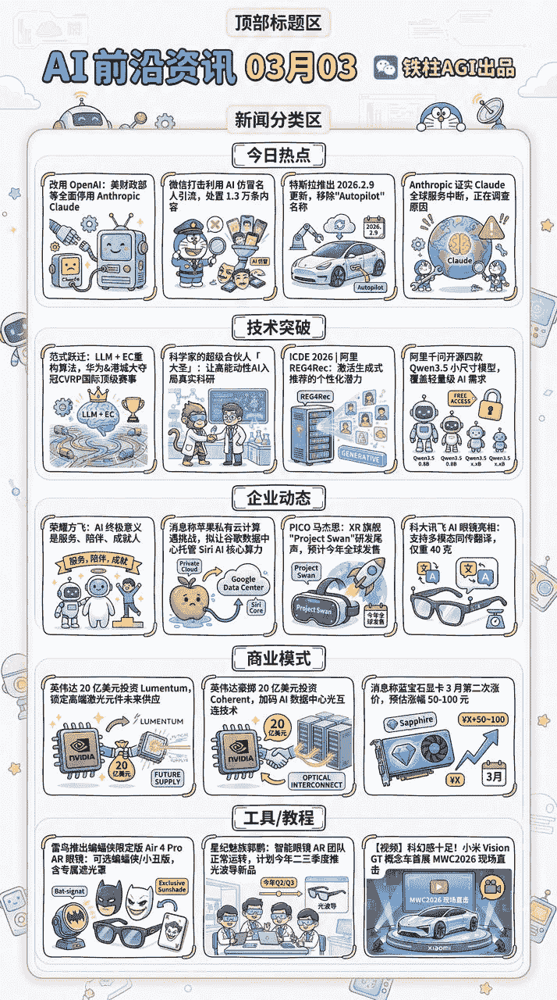

# 2026-03-03 万象 AI 日报

> 来源：[https://yunyinghui.feishu.cn/docx/B2Sodo7ECoLKo8xwXJVcxX3onBh](https://yunyinghui.feishu.cn/docx/B2Sodo7ECoLKo8xwXJVcxX3onBh)

### 🔥 今日热点

1.  美财[政部](https://www.ithome.com/0/925/225.htm)等部门全面停用 Anthropic （链接）：美国财政部、国务院及联邦住房机构正全面终止使用 Anthropic 产品，将改用 OpenAI 技术，此前特朗普已下令政府机构弃用 Anthropic。

1.  **微信打击 AI 仿冒名人引流** （[链接](https://www.ithome.com/0/925/171.htm)）：处置 1.3 万余条仿冒内容及 1200 余个违规账号，将持续提升 AI 生成内容识别与治理能力。

1.  特斯[拉移](https://www.ithome.com/0/925/169.htm)除 Autopilot 名称 （链接）：通过 2026.2.9 软件更新将“自动辅助导航驾驶”等核心功能重命名为“自动转向导航”和“自动驾驶”，以应对监管压力并重塑品牌形象。

1.  **Claude 全球服务中断** （[链接](https://www.ithome.com/0/925/186.htm)）：Anthropic 确认 Claude 出现全球服务中断，用户在网页端、移动端及 API 使用中可能遇到请求失败或响应超时，原因正在调查中。

### 🚀 技术突破

1.  华为[&港](https://mp.weixin.qq.com/s?__biz=MzA3MzI4MjgzMw==&mid=2651018881&idx=1&sn=b1a610953f1cb57a931918ee0a1d5254)城大夺冠 CVRP 赛事 （链接）：联合团队凭借“大模型+进化计算”架构，在 CVRPLib 挑战赛中刷新 98 个历史最优解，AI 首次在顶级算法竞赛中战胜人类专家。

1.  **星河启智推出科研 AI“大圣”** （[链接](https://mp.weixin.qq.com/s?__biz=MzA3MzI4MjgzMw==&mid=2651018881&idx=2&sn=0a94b60a8c8eae612571452d02fab268)）：具备认知、行动、记忆与验证四大能力，通过多模态基础模型、300+科研级 Skills、群体记忆架构及干湿实验闭环，系统性组织科研流程，实现科学家与 AI 的深度协作。

1.  阿里[ R](https://mp.weixin.qq.com/s?__biz=MzA3MzI4MjgzMw==&mid=2651018881&idx=3&sn=a49c461de62e904ccb4daf654c358c64)EG4Rec 激活生成式推荐个性化潜力 （链接）：阿里提出推理增强生成式推荐模型 REG4Rec，通过并行语义码本、动态推理路径和 GRPO 强化学习，将推荐从静态匹配升级为多步推理，在 Lazada 线上实现广告收入提升 5.60%、GMV 提升 3.29%。

1.  阿里[开源](https://www.ithome.com/0/925/206.htm) Qwen3.5 四款小尺寸模型 （链接）：阿里千问开源 Qwen3.5-0.8B/2B/4B/9B 四款小尺寸模型，覆盖从 0.8B 到 9B 的轻量级需求，适用于从移动端到服务器端的多种部署场景。

### 🏢 企业动态

1.  **荣耀方飞谈 AI 终极意义** （[链接](https://www.ithome.com/0/925/226.htm)）：荣耀方飞在 MWC 2026 表示，AI 的终极意义在于服务、陪伴、成就人，AI 硬件“寒武纪大爆发”时代已来临，未来需开放共创生态。

1.  苹果[拟让](https://www.ithome.com/0/925/218.htm)谷歌托管 Siri AI 算力 （链接）：消息称苹果私有云计算系统利用率低且技术老化，因不愿大规模扩建云设施且面临算力需求，已开始采用谷歌云基础设施以运行未来的 Gemini 版 Siri。

1.  PI[CO](https://www.ithome.com/0/925/216.htm) 旗舰 XR 头显 Project Swan 研发近尾声 （链接）：采用双芯片架构，性能较 XR2 Gen2 大幅提升，搭载自研芯片与新一代 MicroOLED 屏幕，预计 2026 年全球发售。

1.  **科大讯飞 AI 眼镜亮相** （[链接](https://www.ithome.com/0/925/209.htm)）：专为面对面交流设计，支持多模态同传翻译，通过唇动识别降噪提升准确率，整机重量仅 40 克。

### 💼 商业模式

1.  英伟[达 ](https://www.ithome.com/0/925/190.htm)20 亿美元投资 Lumentum （链接）：达成战略合作，锁定高端激光元件未来供应，并聚焦于为人工智能数据中心开发光互连技术与封装集成方案。

1.  英伟[达 ](https://www.ithome.com/0/925/188.htm)20 亿美元投资 Coherent （链接）：双方达成战略合作，聚焦光互连与先进封装技术，为人工智能数据中心提供高带宽、高能效的连接方案。

1.  **蓝宝石显卡 3 月二次涨价** （[链接](https://www.ithome.com/0/925/164.htm)）：消息称蓝宝石显卡继 1 月涨价后，3 月将再次执行成本上涨，预估涨幅至少 50-100 元。

### 🛠️ 工具/教程

1.  **雷鸟推蝙蝠侠限定版 AR 眼镜** （[链接](https://www.ithome.com/0/925/197.htm)）：在 MWC 2026 推出，可选蝙蝠侠/小丑版遮光罩，是全球首款支持 HDR10 的 AR 眼镜，支持 2D 转 3D，重 76g 可投射 201 寸虚拟屏。

1.  星纪[魅族](https://www.ithome.com/0/925/168.htm)回应 AR 团队集体入职传闻 （链接）：郭鹏称 AR 部门正常运转，计划今年二三季度推出光波导新产品，此前人员流动属正常情况。

1.  小米[ V](https://www.ithome.com/0/925/167.htm)ision GT 概念车首展 （链接）：小米在 MWC2026 首次展出外形科幻的 Vision GT 概念车。