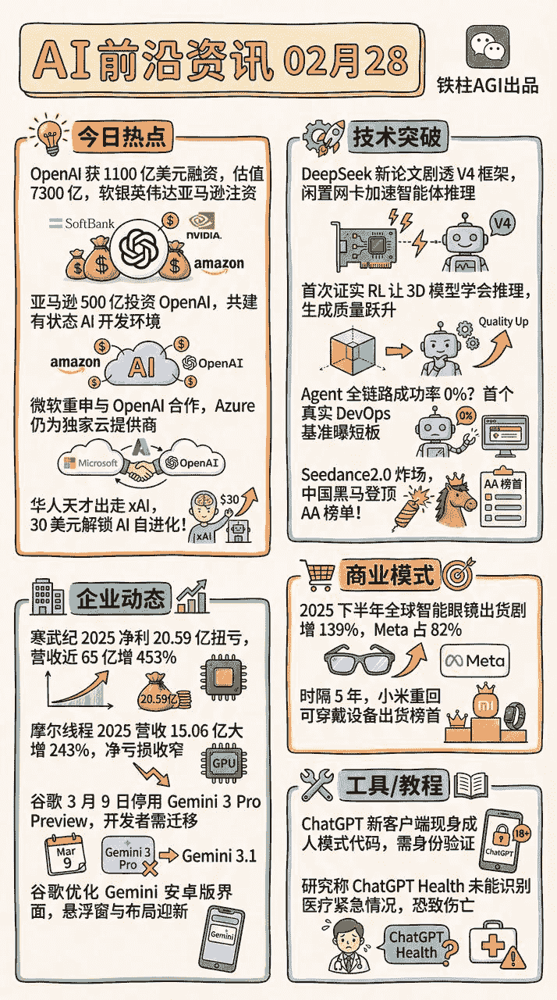

# 2026-02-28 万象 AI 日报

> 来源：[https://yunyinghui.feishu.cn/docx/ZG7WdlXA2ofA1VxqSitcWxbdn3b](https://yunyinghui.feishu.cn/docx/ZG7WdlXA2ofA1VxqSitcWxbdn3b)

### 🔥 今日热点

1.  Op[en](https://www.ithome.com/0/924/376.htm)AI 获 1100 亿美元融资 (链接)：以7300亿美元估值完成新一轮融资，软银、英伟达、亚马逊共同注资，并与亚马逊、英伟达达成战略合作。

1.  亚马[逊 ](https://www.ithome.com/0/924/372.htm)500 亿美元投资 OpenAI (链接)：亚马逊将向 OpenAI 投资 500 亿美元，双方将联合开发基于 OpenAI 模型的“有状态运行时环境”，并通过 AWS 独家分发 OpenAI Frontier 平台。

1.  微软[重申](https://www.ithome.com/0/924/373.htm)与 OpenAI 合作稳固 (链接)：双方重申合作关系不变，Azure 仍为 OpenAI API 独家云提供商，知识产权与收入分成安排保持不变，OpenAI 与第三方合作产生的 API 调用也将托管于 Azure。

1.  **华人天才出走xAI** ([链接](https://mp.weixin.qq.com/s?__biz=MzI3MTA0MTk1MA==&mid=2652678480&idx=2&sn=e6b641be0d7b4d205c15d64b3e311dc4))：核心成员 Jiayi Pan 与 Toby Pohlen 相继离职，其开源项目 TinyZero 以30美元成本实现小模型自我验证与推理，挑战巨头算力竞赛路径。

### 🚀 技术突破

1.  De[ep](https://mp.weixin.qq.com/s?__biz=MzIzNjc1NzUzMw==&mid=2247870799&idx=1&sn=db1a82726be958a63025b8a8ec7d3eef)Seek 新框架 DualPath 剧透 (链接)：DeepSeek 联合北大清华发布智能体推理新框架，通过双路径加载与闲置网卡利用，解决长文本推理 I/O 瓶颈，实测吞吐量提升近 2 倍。

1.  **RL首次赋能3D生成推理** ([链接](https://mp.weixin.qq.com/s?__biz=MzIzNjc1NzUzMw==&mid=2247870799&idx=2&sn=2b0533c6fbe7a5e606992a3ad72e0a09))：CVPR 2026研究系统性引入强化学习，通过定制奖励、算法与评测基准，显著提升模型在复杂文本描述下的3D生成质量与推理能力。

1.  De[vO](https://mp.weixin.qq.com/s?__biz=MzI3MTA0MTk1MA==&mid=2652678480&idx=3&sn=01b6bc0bbfab330a4b4a9b7116b10875)ps-Gym 基准曝 AI 全链路短板 (链接)：首个真实 DevOps 基准显示，SOTA 模型在构建、监控等任务中成功率低下，全链路端到端任务成功率归零，暴露 AI 缺乏长程推理与动态系统理解能力。

1.  昆仑[天工](https://mp.weixin.qq.com/s?__biz=MzI3MTA0MTk1MA==&mid=2652678480&idx=1&sn=d4ad15f73feb8b31f49cdf2fef402fe8)SkyReels-V4登顶全球AI视频榜 (链接)：昆仑天工SkyReels-V4在权威榜单Artificial Analysis的文本到视频（含音频）全球排名中位列现役模型第二，其多模态输入、音画同步及全流程编辑能力可生成影院级视频。

### 🏢 企业动态

1.  **寒武纪 2025 年扭亏为盈** ([链接](https://www.ithome.com/0/924/333.htm))：年度营收近 65 亿元同比暴增 453%，净利润 20.59 亿元，受益于 AI 算力需求攀升及产品竞争力。

1.  摩尔[线程](https://www.ithome.com/0/924/340.htm) 2025 年营收大增 243% (链接)：营收达 15.06 亿元，净亏损收窄至 10.24 亿元，旗舰 GPU 智算卡 MTTS5000 实现量产并支持万亿参数大模型训练。

1.  谷歌[停用](https://www.ithome.com/0/924/375.htm) Gemini 3 Pro Preview (链接)：谷歌宣布3月9日起停用Gemini 3 Pro Preview，开发者需迁移至3.1 Pro Preview，但有开发者担忧新模型在写作和幽默度方面表现逊色且幻觉率较高。

1.  谷歌[优化](https://www.ithome.com/0/924/347.htm) Gemini 安卓界面 (链接)：新版悬浮窗将回复区与输入框分离，精简顶部标题与按钮布局，并将“临时聊天”移至主界面顶部，旨在减少界面杂乱感。

### 💼 商业模式

1.  全球[智能](https://www.ithome.com/0/924/344.htm)眼镜出货激增 139%，Meta 占 82% 份额 (链接)：Counterpoint 数据显示，2025 年下半年全球智能眼镜出货量同比剧增 139%，其中 AI 眼镜占 88%，Meta 以 82% 的市场份额主导市场，Ray-Ban Meta AI 眼镜第二代获市场认可。

1.  **小米重返可穿戴设备榜首** ([链接](https://www.ithome.com/0/924/371.htm))：Omdia数据显示，小米以18%市场份额自2020年后重回全球可穿戴设备出货量第一，苹果、华为紧随其后，竞争转向生态系统与数据服务。

### 🛠️ 工具/教程

1.  Ch[at](https://www.ithome.com/0/924/383.htm)GPT 成人模式代码曝光 (链接)：新版客户端出现“Naughty Chat”相关代码，将向18岁以上通过验证的用户开放更大胆的成人话题内容。

1.  Ch[at](https://www.ithome.com/0/924/384.htm)GPT Health 医疗紧急识别存缺陷 (链接)：研究显示其在超半数案例中低估紧急程度，常未能识别自杀意念或建议立即就医，专家警告可能导致可避免的伤亡。