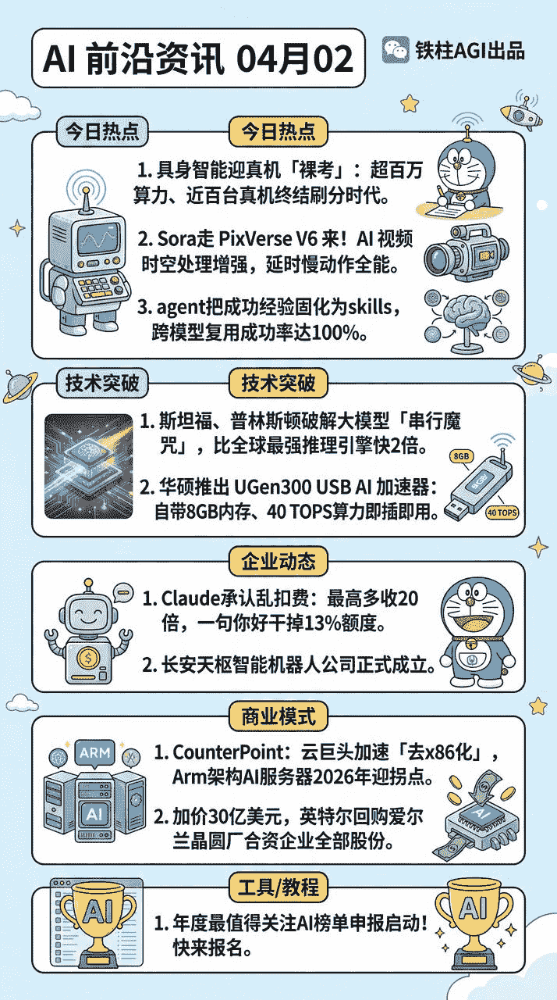

# 2026-04-02 万象 AI 日报

> 来源：[https://yunyinghui.feishu.cn/docx/KFiSdlB57oTEpaxcrfPco7Dgn0f](https://yunyinghui.feishu.cn/docx/KFiSdlB57oTEpaxcrfPco7Dgn0f)

### 🚀 技术突破

1.  EA[ID](https://mp.weixin.qq.com/s?__biz=MzA3MzI4MjgzMw==&mid=2651024977&idx=1&sn=54de96702b5aa4a41f10478815ac262b)C 终结具身智能刷分时代 (链接)：全球首届具身智能开发者大会通过72小时真机“裸考”检验模型，20支队伍在统一硬件与超百万算力支持下，于真实环境中完成套环、分拣、插线、拼词等任务，旨在推动开源生态与真实泛化能力。

1.  **SSD 破解大模型推理串行瓶颈** ([链接](https://mp.weixin.qq.com/s?__biz=MzA3MzI4MjgzMw==&mid=2651024977&idx=3&sn=0822e79ac232d10242b5f0c10689410b))：斯坦福、普林斯顿等团队提出SSD框架及SAGUARO算法，实现草拟与验证并行化，推理速度比当前最强引擎快2倍。

1.  **PixVerse V6 发布** ([链接](https://mp.weixin.qq.com/s?__biz=MzIzNjc1NzUzMw==&mid=2247879591&idx=1&sn=5aca906a42c51bb5e4aec7fa266aaa81))：爱诗科技推出AI视频模型PixVerse V6，实现电影级视听质感、复杂运镜控制与物理级真实还原，支持延时拍摄与慢动作，并推出团队计划与实时世界模型R1升级。

1.  **Agent固化技能跨模型复用** ([链接](https://mp.weixin.qq.com/s?__biz=MzIzNjc1NzUzMw==&mid=2247879591&idx=3&sn=dec29add1f405202592b1d9b6e6b54c7))：SkillCraft研究让Agent将成功工具链固化为可复用技能，显著提升效率并降低成本，高质量技能可跨模型复用，如Claude创建技能在其他模型上成功率100%。

1.  华硕[推全](https://www.ithome.com/0/935/125.htm)球首款 USB AI 加速器 (链接)：华硕推出全球首款支持经典与生成式AI的USB边缘AI加速器UGen300，搭载Hailo-10H处理器，提供40 TOPS算力、8GB内存，即插即用。

### 🏢 企业动态

1.  Cl[au](https://mp.weixin.qq.com/s?__biz=MzIzNjc1NzUzMw==&mid=2247879591&idx=2&sn=7d39b57cd592ec5702cab4147227f6a2)de Code 被曝乱扣费 (链接)：Anthropic 承认 Claude Code 计费存在严重问题，因缓存失效等 bug 导致用户使用额度被多扣 10-20 倍，一句“你好”即可消耗 13% 额度。

1.  An[th](https://www.ithome.com/0/935/132.htm)ropic 误删数千 GitHub 仓库 (链接)：在清理 Claude Code 源代码泄露时，因下架请求范围判断失误，导致约 8100 个仓库（含自身开源项目分支）被波及，引发用户不满。

1.  **长安天枢机器人公司成立** ([链接](https://www.ithome.com/0/935/084.htm))：长安汽车成立机器人公司，以“1+N+X”战略布局具身智能，发展人形机器人及多机器人产业，并计划三季度前用固态电池搭载机器人验证。

1.  鸿蒙[ 6](https://www.ithome.com/0/935/081.htm) 负一屏内测关联 Claw 智能体 (链接)：智慧助手内测版本支持关联 Claw 智能体，可提供 AI 任务完成提醒等服务，并新增晨间简报、AI 搜索等功能。

### 💼 商业模式

1.  **云巨头加速去 x86 化** ([链接](https://www.ithome.com/0/935/138.htm))：CounterPoint 预测 Arm 架构 AI 服务器 CPU 份额将从 2025 年的 25% 飙升至 2029 年的 90%，替代趋势将在 2026 年下半年显著加速。

1.  英特[尔加](https://www.ithome.com/0/935/106.htm)价30亿美元回购爱尔兰晶圆厂股份 (链接)：英特尔宣布以142亿美元从Apollo手中回购其爱尔兰Fab 34晶圆厂49%的股权，恢复完全控制，较2024年出售价高出30亿美元。

1.  天钡[ M](https://www.ithome.com/0/935/091.htm)ACO 47 迷你主机发售 (链接)：搭载 AMD 锐龙 AI 9 HX470 处理器，板载 32GB RAM，准系统版本首发价 5299 元。

### 🛠️ 工具/教程

1.  20[26](https://mp.weixin.qq.com/s?__biz=MzIzNjc1NzUzMw==&mid=2247879591&idx=4&sn=913e78fac93c3bfc4618f0bb3d387bd3)年度AIGC榜单申报启动 (链接)：量子位发起2026年度值得关注的AIGC企业与产品评选，申报截至4月27日，结果将于5月中国AIGC产业峰会公布。