# AI 每日大事记（2023 年度）

> 来源：[https://yunyinghui.feishu.cn/docx/IVeidlyAdoDZFExb1eucDfcan4b](https://yunyinghui.feishu.cn/docx/IVeidlyAdoDZFExb1eucDfcan4b)

> 适用人群：互联网关注 AI 发展人群

> 首发时间：2023 年 4 月 19 日

> 更新时间：2023 年 12 月 30 日

> 内容出品方：[Mix AI Lab](https://yunyinghui.feishu.cn/wiki/WhelwZnxQi55mpkOzatc3Xran5b?from=from_copylink)

> 内容出品人：

> 使用建议：如果需要快速定位到精确内容，可以使用快捷键 `Ctrl +F/Command +F` 的形式，搜索关键字/词，查找你想要的内容。

> 持续更新 AI 发展的相关资讯动态，每天一分钟，知晓 AI 圈内事儿！永久免费在线查看，欢迎收藏转发支持，文末有惊喜。

## 2023 年 12 月

### 2023 年 12 月 30 日

【微软 Copilot iOS 版上线】

不需要通过 Bing 就可以使用

### 2023 年 12 月 29 日

【LG 发布小型实体 AI 机器人】

计划在 CES 展示，被用于协助远程的主人照顾居家的宠物

### 2023 年 12 月 28 日

【百度 CTO 王海峰：文心一言用户规模破 1 亿】

12 月 28 日消息，百度首席技术官王海峰在第十届 WAVE SUMMIT 深度学习开发者大会上披露，目前文心一言用户规模已突破 1 亿。

此外，据媒体报道，自 10 月发布以来，文心大模型 4.0 在过去两个多月整体效果又提升了 32%。

截至 2023 年 12 月底，与文心一言技术框架深度绑定的百度飞桨开发平台，目前开发者数量已经超过千万，达到 1070 万，服务 23.5 万家企事业单位，基于飞桨创建了 86 万个模型。（来源：综合消息）

【优酷上线 AI 搜片功能】

12 月 28 日，优酷官方宣布推出 AI 搜片功能，用户可点击优酷 App 搜索栏，再点击左侧的“AI”按钮进入对话页面，通过多轮对话来实现模糊搜索、影视问答、剧情检索等功能，还能和 AI 交流全网影视知识。

【雷鸟推出 RayNeoAI 大模型语音助手，已于旗下 X2AR 眼镜展开内测】

雷鸟公司近日推出了一款名为 RayNeoAI 的大模型语音助手，这款助手已经开始在雷鸟旗下的 X2AR 眼镜中展开内测。

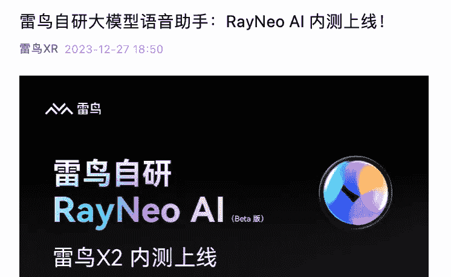

据介绍，用户只需唤醒语音助手即可使用。RayNeoAI 主要提供自然语言对话、行程规划、百科问答、查询天气等功能，具有一定的实用性。

此外，雷鸟计划在明年上线视觉理解能力，支持多模态对话和多项功能，如识别空间关系、物体计数、场景理解和多语言解析等。

【澜舟科技通过生成式 AI 备案并发布两款大模型】

据澜舟科技👸号发文，12 月 26 日，澜舟科技正式通过国家互联网信息办公室颁布的《生成式人工智能服务管理暂行办法》备案，将很快向公众发布孟子大模型及其核心能力。

同时，澜舟科技正式发布孟子 GPT-金融 -13B 大模型和澜舟的第一款代码助手大模型：孟子 GPT-Code-6.7B 大模型。

据介绍，孟子 GPT-金融 -13B 行业大模型专为金融领域打造，能够精准理解和解答用户在金融市场、投资理财等相关主题的问题，同时也能编写各种金融分析文章、研究报告，以及完成各类金融信息的深度加工等任务。

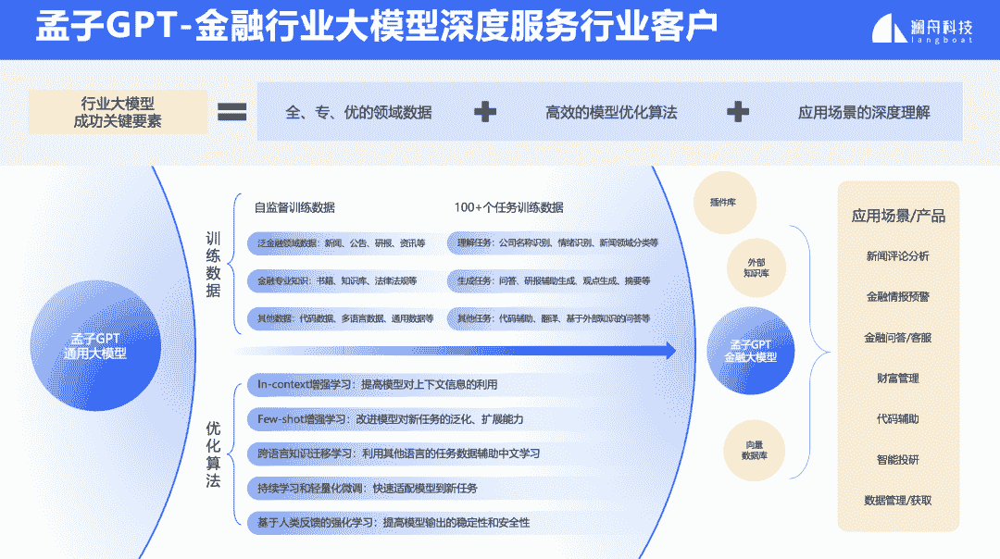

孟子 GPT-Code-6.7B 大模型基于开源模型 DeepSeekCoder 开发，引入了金融行业的数据进行预训练，并使用高质量的任务数据进行了微调，能够为金融领域和软件开发领域提供全面支持，并且支持中英文两种语言、兼容 100 多种编程语言。

孟子 GPT-金融 -13B 大模型体验链接：`langboat.com/product/mchat?model=mengzi-gpt-fin-13b`

孟子 GPT-Code-6.7B 大模型体验链接：`langboat.com/product/mchat?model=mengzi-gpt-code`

【深言科技“语鲸大模型”通过生成式 AI 备案】

据深言科技👸号发文，12 月 26 日，深言科技“语鲸大模型”正式通过《生成式人工智能服务管理暂行办法》备案，将陆续面向社会公众开放服务。

据介绍，“语鲸大模型”具备强大的语义理解与文本生成、代码理解与生成、逻辑推理等能力，提供文本创作、数学计算、代码补全等服务，在中文理解和生成能力上领先。深言科技成立于 2022 年，由清华大学自然语言处理实验室与北京智源 AI 研究院共同孵化。

【我国首例“AI 文生图”著作权案一审生效】

据北京互联网法院👸号发文，近期，北京互联网法院审结了李某与刘某侵害作品署名权和信息网络传播权纠纷一案，明确了利用人工智能生成图片的“作品”属性和使用者的“创作者”身份。

对此案件，“头号 AI 玩家”已先后发文梳理介绍，感兴趣的玩家可移步了解更多案件详情：`http://mp.weixin.qq.com/s?__biz=MzA3NzUxMzQ5Mw==&mid=2648109507&idx=1&sn=ce73f5c7ae444abc9d00fbea6212e222&chksm=877287b9b0050eaf5edaf610b0cf3223194530129b10d51675779afa1c5137aa89c61a8f2bd2&scene=21#wechat_redirect` 7 万网友围观！中国首例“AI 文生图”著作权案庭审直播，AIGC 构成作品吗？、对话中国 AI 绘画著作权第一案当事人：AI 生成内容如何维权？

【AI 芯片公司"鲲云科技"获数亿元 C 轮融资，由普罗资本领投】

AI 芯片公司"鲲云科技"近日宣布完成数亿元 C 轮融资。此轮融资由普罗资本领投，鼎晖百孚、联通旗下联创基金、张科垚坤基金、钟楼金控集团跟投。

本轮资金主要用于支持下一代可重构数据流 CAISAAI 芯片的研发和规模落地，构建 CAISA 芯片在各垂直行业的产业化生态。

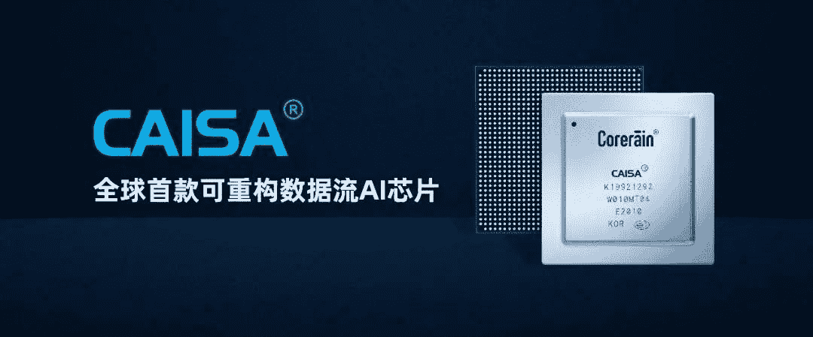

"鲲云科技"成立于 2017 年，是一家基于可重构数据流技术路线，研发高性能、低成本的大算力 AI 芯片的公司。（来源：36 氪）

【中科闻歌雅意大模型通过生成式 AI 备案全面开放】

12 月 28 日，中科闻歌👸号发文称根据国家互联网信息办公室颁布的《生成式人工智能服务管理暂行办法》要求，中科闻歌“雅意大模型”已正式通过相关备案，将面向政企用户开放能力，全面支持商用。

据介绍，雅意大模型拥有数据、模型、应用全自主知识产权，支持 128k 上下文窗口输入，图文多模态生成，十余种语种对话、智能工具调用、多轮对话角色扮演等，已构建媒体宣传、舆情感知、政务治理、金融分析、中医药等领域大模型，形成完整的大模型应用生态。

雅意大模型地址：`yayi.wenge.com/chat`

【韩国明确 AI 生成内容不受版权保护】

韩国文化体育观光部日前宣布不对人工智能（AI）生成的内容进行版权登记，从法律上不承认此类内容的创造性。

该部门补充说，只有那些明显传达人类思想和情感的作品才有可能进行版权登记。这一决定将很快在面向 AI 企业、版权持有者和用户的“AI 版权指南”中公布。指南还规定，AI 企业需要向版权持有者提供公平的补偿，以确保其产品的使用权，建议版权持有者明确表达其意图或采取技术措施，以防止其创作被用于 AI 研究。（来源：综合消息）

【三星计划推出 AI 智能冰箱，可量身定制食谱】

12 月 28 日消息，三星计划在明年 1 月的 CES（消费电子展）上推出带有 AIFamilyHub+的新款智能冰箱，提供新的 AI 功能，包括一个可以识别单个食品的内部摄像头，以及一个可以根据库存推荐食谱的应用程序。

用户可以将 Galaxy 手机的显示屏镜像到 32 英寸的 FamilyHub 触摸屏上，三星食品应用可以连接到三星健康档案，并根据饮食需求量身定制食谱。

“从图像到食谱”功能可以识别照片中的饭菜和食品，并生成食谱。此外，还有一项“个性化”功能，可根据无麸质、无鱼类、无乳制品、素食等饮食偏好定制食谱。（来源：TheVerge）

### 2023 年 12 月 27 日

【纸媒起诉 OpenAI 和微软】

《纽约时报》拿到证据证明 ChatGPT 和 Copilot 擅自使用其文章，要求“销毁”大模型中相关内容

### 2023 年 12 月 26 日

【Pika 宣布免费开放！】

网页端开放，支持文生视频、图生视频、视频生视频；生成视频最高帧率 24 帧，视频长度已支持 7 秒

### 2023 年 12 月 25 日

【AI 制作的 AI 游戏发布！】

斯坦福开发者发布，名为《查拉图斯特拉如是说》。角色设定和对话完全由 ChatGPT 产生，视觉音效由 DALL-E3、MJ、Stable Audio 完成

### 2023 年 12 月 21 日

【MJ V6 开启 alpha 测】

用户可以用更长更精准的句子表达。平移缩放等功能下个月开始陆续发布。

### 2023 年 12 月 20 日

【《出版业生成式人工智能技术应用指南》发布】

由中国音像与数字出版协会发布，于 2024 年 1 月 20 日起开始实施

### 2023 年 12 月 19 日

【微软发布 Copilot 安卓版】

悄悄上线，能使用 DALL-E3

### 2023 年 12 月 12 日

【李飞飞×斯坦福×谷歌：逼真视频模型 WALT】

论文已经受到广泛审阅

项目链接：`https://walt-video-diffusion.github.io/samples.html`

论文地址：`https://walt-video-diffusion.github.io/assets/W.A.L.T.pdf`

【推理快的开源大模型：Mistral AI】

任何人都可以注册使用其 API。，支持 `Python` 和 `JavaScript` 客户端库。

其另有平台服务测试版——Ia plateforme，其中两个聊天模型 `mistral-tiny` 和 `mistral-small` 的商业价格比 GPT4-turbo 好很多。

【Runway 声明战略：做通用世界模型】

Pika 1.0 半年的成果碾压 Runway 两年成果后，Runway 决定招聘更多人力去理解现实世界的物理运动，并用在视频生成上——从而与 Pika 进入了不同赛道

## 2023 年 11 月

### 2023 年 11 月 29 日

【Pika 宣布融资 5500 万美元】

并推出了正式版本 1.0。由 Nat Friedman 和 Daniel Gross 领投种子轮，光速创投领投 A 轮，另有 Quora 创始人、OpenAI 联创、Hugging Face 联创参与。

【秒出图：SDXL Turbo 发布】

Stability AI 官方发布。

但更令人惊叹的是网友魔改后的模型更快，例如 TurboVisionXL。

参考地址：`https://civitai.com/models/215418/turbovisionxl-super-fast-xl-based-on-new-sdxl-turbo-3-5-step-quality-output-at-high-resolutions`

### 2023 年 11 月 27 日

【浪潮大模型开源】

名为“源 2.0”，包括 1026 亿、518 亿、21 亿三种参数规模的模型

代码链接：`https://github.com/IEIT-Yuan/Yuan-2.0`

论文地址：`https://github.com/IEIT-Yuan/Yuan-2.0/blob/main/docs/Yuan2.0_paper.pdf`

【东南亚大模型：画面数数执牛耳】

南洋理工华人团队推出的 80 亿参与多模态大模型 OtterHD 搞定了 GPT-4V 都发愁的难题：盘点画面内容数量。

2446×1766 像素的清明上河图局部被成功盘点出有 3 只，甚至会谦虚指出这有点难度

论文地址：`https://arxiv.org/abs/2311.04219`

### 2023 年 11 月 20 日

【妙鸭相机上线 AI 修图】

AI 做到了被期望的事情：乱发重塑、眯眼睁开……

### 2023 年 11 月 10 日

【挑战苹果手机的硬件问世：AI Pin】

Open AI CEO 萨姆·奥特曼投资于 2020 年的的 Humane 公司今天发布了可穿戴设备，专门为大模型交互而设计：磁力吸附衣物+语音操纵 GPT+激光投影在手掌（代替屏幕，接近 iWatch）

少用点手机，多融入三次元生活！

### 2023 年 11 月 9 日

【大规模宕机原因众说纷纭】

今天奥特曼解释是疯狂涌入的用户，然后公司公告一切解决。黑客组织也认领 lDDos 攻击，并认为公司并不敢承认。

【英伟达确定中国特供款 AI】

三款产品，应对芯片限售令，基于 H100。但英伟达并未正面回应该消息。

三款产品分别对应：训练、推理和边缘场景。年底或年初大规模生产

### 2023 年 11 月 7 日

【比 Pika 更强一点：阿里视频模型 I2VGen-XL】

展示出了更丰富的更真实多样的动作内容。

`https://cloud.video.taobao.com/play/u/null/p/1/e/6/t/1/434357257087.mp4`

论文地址：`https://arxiv.org/pdf/2311.04145.pdf`

项目地址：`https://i2vgen-xl.github.io/`

## 2023 年 10 月

### 2023 年 10 月 30 日

【百川 Baichuan 发布，最长长文本 LLM】

一次处理 35 万汉字，上下文窗口高达 192K。已经开放给法律、媒体、金融等行业合作伙伴。

### 2023 年 10 月 25 日

【LLM 之外的可靠方案出现：MLC 组合性元学习】

来自美国纽约大学和西班牙庞培法布拉大学的研究，已发表在 Nature。

论文地址：`https://www.nature.com/articles/s41586-023-06668-3`

### 2023 年 10 月 24 日

【Apple GPT 最快明年上线】

除了可期待的用于整合苹果全家桶，还将用于 Xcode 协助开发。

【科大讯飞股价下跌约 10%，董事长回应】

董事长回应 10 月 22 日事件，认为负面满天飞有推手。

【AIGC 病毒出现！让 SD 识别出现重大谬误】

用“病毒”污染图像，人眼看起来污染图没有变化，却能让 Stable Diffusion 训练后产生与关键词迥异的内容和风格，从而干扰生成。

SD 被污染后难以移除带毒部分，暂时。

论文地址：`https://arxiv.org/pdf/2302.04222.pdf`

### 2023 年 10 月 22 日

【大模型双拼！Meta 的 Sam 和 OpenAI 的 Clip】

双拼的实现让应用更为可观。

论文地址：`https://arxiv.org/abs/2310.15308`

【BondGPT 升级为 BondGPT+】

6 月 6 日本文介绍了 BondGPT 诞生，广受好评！官方已升级！

申请使用：`https://www.ltxtrading.com/bondgpt`

【科大讯飞 AI 学习机出现诋毁伟人内容】

由家长曝出，山东海报新闻记者今天跟进采访此事，工作人员紧急下架相关学生用的文章

### 2023 年 10 月 21 日

【Meta AI：智能体 Habitat3.0 发布】

作为集团智能体的模拟器，Habitat3.0 带给用户体验“清洁机器人去把虚拟卧室的垃圾扫了”“烹饪机器人去把虚拟厨房的鸡蛋翻面儿”的功能，由于支持逼真的外观，还有更细节的实验用法。

### 2023 年 10 月 19 日

【LLM+机器人的典范 Eureka】

通过 GPT4 等 LLM 语言能力，能够成功指挥传统编程机器人开展复杂的动作：比如转笔！

论文地址：`https://arxiv.org/pdf/2310.12931.pdf`

项目链接：`https://eureka-research.github.io/`

代码链接：`https://github.com/eureka-research/Eureka`

### 2023 年 10 月 18 日

【META AI：思维具象化进展！】

运用 MEG 脑磁图综合计算机综合影像信息计算而成

论文地址（内网不可用）：`https://ai.meta.com/static-resource/image-decoding`

# 2023 年 10 月 17 日

## 【文心 4.0 发布，邀请测试】

李彦宏：综合水平与 `GPT4` 相比毫不逊色。

企业用户可登录百度智能云官网，在千帆大模型平台上申请测试文心大模型 4.0 的 `API`。

## 【谷歌发布视觉语言模型 VLM 新方案】：`PaLI-3`，犹如电子管到半导体

在前辈 `OpenAI` 的 `CLIP` 和 `Google` 的 `BigGAN` 基础上，谷歌和 `DeepMind` 成员成功联合开发出了更小参数量，更快性能、更多实用性的 `PaLI-3`，未完全开源。

论文地址：`https://arxiv.org/abs/2310.09199`

# 2023 年 10 月 16 日

## 【VIVO 官宣即将发布大模型 `vivoLM`，主打人文社科优势】

另 `OPPO` 也有自己的大模型 `AndesGPT-7B`

## 【`Stack Overflow` 宣布裁员 28%】

去年公司疯狂招聘扩大一倍规模达到 540 人，代码辅助网站 `SO` 今年因 `ChatGPT` 冲击已宣布裁员一百多人。当初就是 `SO` 哺育了 `ChatGPT` 的数据，却没有回报。

为自救，已经对抓取数据的“友商”要求付费。

# 2023 年 10 月 14 日

## 【新创公司生生科技进军“意识上传”技术研发与应用】

今天创始人兼 `CEO` 刘骁奔和另外 6 人举行第一次创始人正式会议。

生生科技始于 2023 年 `AI` `Tamer` 大赛，并持续获得了赢在南京、中美青年创客大赛、英伟达初创加速计划、`SVC` 双子星创客大赛等赛事成果，并在本月获得种子轮融资。

意识上传技术是乔布斯生前也着迷的技术方向，在大模型的猛进下有望实现。

# 2023 年 10 月 12 日

## 【百度举办“百度世界 2023 媒体预沟通会”】

披露网盘、智能工作平台如流、阿波罗智舱等产品 `AI` 进化进展。截至 10 月 11 日晚，百度世界大会 2023 已迎来超 1000 万人关注。

10 月 17 日即将在北京首钢园召开“百度世界 2023”，大会当天，李彦宏将围绕“手把手教你做 `AI` 原生应用”进行主题演讲，从技术、行业和应用等多维度进行分享，阐述生成式 `AI` 的“理解、生成、逻辑、记忆”四大核心能力以及 `AI` 大模型的实际应用价值。

此外，大会还面向企业、开发者、合作伙伴、投资人等，设有 7 场前沿科技分论坛，多位重磅嘉宾将轮番现身进行专题分享，与观众进行 30 小时思维和观点的碰撞。

## 【正式提出 `GameGPT`：让开发更加丝滑】

以 `GPT3.5` 为基础，引导 `GPT` 以模板化的方式去参与游戏开发的整体流程，特别是立项后的流程、`NPC` 行动模板、内容审核等。该研究处于早期，巨大潜力等待行业人才加入。

论文地址：`https://arxiv.org/abs/2310.08067`

## 【`Stateof.ai`：《2023 年度人工智能现状报告》今日发布】

官网链接：`https://www.stateof.ai`

# 2023 年 10 月 11 日

## 【英伟达在以色列特拉维夫 `AI` 峰会取消！英伟达员工被绑架】

10 月 8 日，黄仁勋内部邮件传达全体员工，多位员工在巴以冲突中受困、遇害或被绑架。早些时候，英伟达官宣在以色列的 `AI` 硬件主题发布会取消。

# 2023 年 10 月 10 日

## 【帮你写图文混合文章的国产大模型“书生·浦语灵笔”发布】

上海人工智能实验室出品，已上架 `Github`、`Hugging Face` 和 `ModelScope`。

论文地址：`https://arxiv.org/abs/2309.15112`

## 【Adobe 发布 `firefly` 重大更新】

直接命名 `firefly2`，也是 `firefly` 产品线的正式发布。包含了生成矢量等新功能，业内少有。

值得一提的是，`firefly` 训练模型素材用的是上亿自有版权和第三方授权图，出图无需担心版权问题。

详情原文：`https://news.adobe.com/news/news-details/2023/Adobe-Releases-Next-Generation-of-Firefly-Models/default.aspx`

## 【超强的文字转视频模型 `Moonvalley`】

在文字转图片和应用场景文上小有建树的网站 `draft.oi` 的公司 `ContentFly` 重磅推出自称最强 `AI` 视频模型的 `Moonvalley`，看在他们 6 人团队却已经拿到 `YC`、`KV`、`Global` 约 3600 万美元投资，产品绝对值得一试。

官网：`https://moonvalley.ai`

模型调用：`https://discord.gg/vk3aaH7r`

# 2023 年 10 月 9 日

## 【新研究方向：人类虚拟体（智体）】

由于大模型可以基于语言“理解”人的表达和对应的情感，那么辅助人的生理属性和其他必要数据，就可以实现更完整意义的虚拟人的制作，并用于测试诸如“十个暴躁的男人住在大别墅每天会怎么过”之类的社科研究。从而实现“社会试验”，为人文社科摆脱缺乏科学实验的帽子

论文地址：`https://arxiv.org/abs/2310.05418`

## 【美图 `Miracle Vision3.0` 发布】

在美图 15 周年生日会上，美图公司创始人、董事长兼首席执行官吴欣鸿表示，目前用户可以访问 `AI` 视觉创作工具“`WHEE`”官网体验 `MV3.0`

吴欣鸿预测，视觉大模型应用普及将经历三个阶段：2024 年之前为探索期，2024-2025 年为高速发展期，2026-2030 年为成熟期。随着视觉大模型在生产端的应用走向成熟，视觉大模型将助力千万设计场景，引领美学的升级与社会经济增长。

# 2023 年 10 月 7 日

## 【小度科技 `CEO` 景鲲离职】

景鲲 2006 年加入微软（中国）负责必应亚洲市场研发，深度参加微软“小冰”开发。2014 年加入百度，2020 年作为新成立的小度科技的 `CEO`，实现诸多业绩。景鲲被称为“中国 `AGI` 产品经理第一人”。据传已和同时离职的小度 `CTO` 朱凯华联手创业。

# 2023 年 10 月 6 日

## 【微软十一月推出人工智能芯片 `AI` `Chip`】

以戒掉对英伟达的 `GPU` 依赖。微软从 2019 年开始研发，代号可能是 `Athena`（雅典娜）。`微软另有人工智能芯片 `MI300X` 在发布的路上。

# 2023 年 10 月 4 日

## 【微软将 `DALL-E 3` 嵌入 `Bing Chat` 和 `Bing Image Create` 并免费提供给用户使用】

`DALL-E 3` 是 `OpenAI` 九月出品模型，作为 `Midjourney` 的竞品。微软在生图中内置了符合 `C2PA` 规范的数字水印。

# 2023 年 10 月 3 日

## 【`Oracle` 官方发布 `DALL-E 3` 的技术报告，让输出更少争议！】

尽可能避免了不道德内容的产出、抗拒敏感话题、侵犯在世名人肖像权、版权侵犯的规避等。

全文链接：`https://cdn.openai.com/papers/DALL_E_3_System_Card.pdf`

# 2023 年 10 月 2 日

## 【3D 大模型 `MVDream` 论文更新！】

难点：让产生的模型符合生活常识！

论文地址：`https://arxiv.org/abs/2308.16512`

`GITHUB`: `github.com/MV-Dream/MVDream`

案例：`mv-dream.github.io/`

# 2023 年 9 月 29 日

## 【`GPT-4V` 版本分析微软版】

共 11 章，分不同功能展开定性介绍和样本说明。

全文链接：`http://arxiv.org/pdf/2309.17421.pdf`

# 2023 年 9 月 28 日

## 【`ChatGPT` 准确预测诺奖得主】

基于必应联网，`ChatGPT` 给出“由一些化学家预测，`mRNA` 疫苗开发可能会获得诺奖”的观点成功预测。

## 【🛰️对话平台 `v2.8` 发布】

2019 年 5 月 22 日腾讯 `AI` 团队发布了🛰️对话平台，因 `AIGC` 潮流而让该功能逐渐瞩目，今天有了重大升级。

官网链接：`chatbot.weixin.qq.com`

# 2023 年 9 月 27 日

## 【`Mistral AI` 发布首个大模型免费提供任何人使用】

谷歌 `DeepMind` 和 `Meta` 前职员于今年早些时候在法国创立。此前，该公司完成 1.18 亿美元的种子轮融资，据说是欧洲历史上最大的种子轮融资。

# 2023 年 9 月 26 日

## 【`TUBi` 推出基于 `GPT-4` 的荐片模型 `Rabbit AI`】

作为美国最大免费影视平台之一，`Tubi` 选择让用户从文本对答获得喜欢的电影来接入 `AI`。

# 2023 年 9 月 25 日

## 【亚马逊投资微软竞对：`anthropic` 公司】

四十亿标的。是 `Claude` 的开发商，由 `OpenAI` 前研究副总裁 Dario Amodei、`GPT-3` 论文一作 Tom Brown 等人在 2021 年共同创立。创始成员大多为 `OpenAI` 的核心员工，他们曾经深度参与过 `OpenAI` 的 `GPT-3`、引入人类偏好的强化学习等多项研究。

## 【百川智能开放 `API` 给企业用户】

版本为 `Baichuan2`，期待后续版本 `Baichuan2-192K` 发布！

# 2023 年 9 月 21 日

## 【方太举办 `AI` 绘画大赛】

高端厨电品牌方太携手 `AIGC` 社群野神殿举办绘画作品赛，主题“有方（方法、方向、方式）”，9 月 21-27 日征集，三天评选，10.2 公示作品秀。

## 【`LongLoRA` 成为超长文本驾驭高手】

香港中文大学贾佳亚团队联手 `MIT` 发布 `LongLoRA` 作为开源模型，让全球大语言模型的对话缺陷第一次得到解决。阅读完一本小说能较准确提炼、作答、分析用户提问！

论文地址：`https://arxiv.org/abs/2309.12307`

# 2023 年 9 月 20 日

## 【贝恩咨询发文宣布推进 `AIGC` 落地，合作方 `Oracle`】

早在二月开启合作，今天正式发文用于企业组织管理和员工管理上。贝恩是世界三大咨询公司之一

# 2023 年 9 月 18 日

## 【软银考虑对 `OpenAI` 进行投资】

`Arm` 重磅上市后，软银正寻求在人工智能领域投资数百亿美元，`OpenAI` 是软银正在考虑进行投资的几个选择之一。软银还在寻找 `OpenAI` 的一系列替代方案，包括对 `OpenAI` 直接竞争对手进行大量投资。此外，软银还初步拟收购英国人工智能芯片制造商 `Graphcore`。

## 【小米 14 系列将全球首发 `MIUI 15`：将会接入语言大模型】

据悉，全新的小米 14 系列有望提前在今年 10 月底亮相，并可能首发搭载新一代骁龙 8 Gen3 旗舰平台和 `MIUI 15` 系统。不仅如此，`MIUI 15` 系统上的小爱同学将会接入语言大模型，拥有更强大的理解能力和更丰富的知识储备，可以一直聊下去。

## 【极越 01 明天开启预订：全球首台 `AI` 汽车机器人 中国首发高通 8295】

9 月 18 日消息，吉利汽车旗下的「高端智能汽车机器人品牌」——极越汽车宣布，极越 01 将于 9 月 19 日 15:00 首发亮相，同时开启限时预订。极越 01 号称是「全球首台 `AI` 汽车机器人」，将融合文心一言的全面能力，打造首个针对智能汽车场景的大模型人工智能交互体验，支持汽车机器人实现自然交流的再进阶。

## 【周鸿祎：大模型自身不是壁垒，挑战在于垂直大模型深度定制】

9 月 17 日消息，360 集团创始人周鸿祎在一场主题演讲中指出，通用大模型在企业级场景中没法直接用，存在缺乏商业深度、不“懂”企业、数据安全隐患等七大问题。对此，他提出，大模型未来的发展趋势是“垂直化”。在时机选择上，周鸿祎认为，不要等大模型完美了才做，想清楚场景就可以开始干了。

## 【大模型生成提速 2 倍！单 `GPU` 几小时搞定微调，北大数院校友共同一作】

只需给大模型“加点小零件”，推理速度立刻提升 2 倍！不需要额外训练一个模型，也不需要对计算硬件做优化，单张 `A100` 最快几小时就能微调完成。相比之下，它可以和大模型一起训练，只需要冻结大模型的参数就行，甚至单个 `GPU` 就能搞定。

# 2023 年 9 月 17 日

## 【智源发布全球最大中英文向量模型训练数据集！规模高达 3 亿文本对】

日前，智源研究院发布面向中英文语义向量模型训练的大规模文本对数据集 `MTP`（`Massive Text Pairs`）。这是全球最大的中、英文文本对训练数据集，数据规模达 3 亿对，具有规模巨大、主题丰富、数据质量高三大特征，进而可以推动解决中文模型训练数据集缺乏问题。

## 【`DeepMind` 提出让 `AI` 大模型自己优化提示词的方法】

`DeepMind` 的研究人员在一篇新论文中提出了一种新方法：`Optimization by PROmpting`（`OPRO`），一种使用 `AI` 大语言模型（`LLM`）作为提示词优化器的方法。这种方法的独特之处在于，优化任务是用自然语言定义的，而不是通过正式的数学定义。

## 【`Anthropic` 与 `BCG`（波士顿咨询）合作，为客户提供企业人工智能】

`AI` 独角兽初创公司 `Anthropic` 以其 `Claude 2` 大语言模型（`LLM`）助手挑战 `OpenAI` 的 `ChatGPT` 而闻名，该公司正在将其产品提供给更多企业。日前，`Anthropic` 公司宣布与波士顿咨询集团（`BCG`）合作，为其客户提供对 `Claude 2` 和 `Anthropic` 人工智能技术的“直接访问”。

## 【富士通推出自动化机器学习和人工智能公平性开源项目】

日本领先的人工智能技术开发商富士通最近宣布了对开源人工智能的重大承诺，与 `Linux` 基金会合作启动了两个新项目。这些项目提供的工具可以自动生成新机器学习模型的代码并解决训练数据中的潜在偏差。

# 2023 年 9 月 16 日

## 【`a16z` 发布全球访问量前五十的 `AI` 产品榜单：`ChatGPT`、`Character.AI`、`Bard` 位居前三】

风投公司 `a16z`（`Andreessen Horowitz`）今日发布了一份报告，该公司根据截至 2023 年 6 月 `LikeWeb` 统计的网页端和移动端 `App` 的流量数据，对目前市面上的生成式 `AI` 产品进行了排名，并在报告中展示了前 50 名，榜单 Top 5 分别是 `OpenAI` 的聊天机器人 `ChatGPT`、聊天机器人网站 `Character.AI`、谷歌的聊天机器人 `Bard`、问答网站 `Quora` 下的 `Poe`。美国在线辅导网站 `Course Hero` 推出的写作工具 `QuillBot`。

## 【腾讯混元大模型首批通过备案，将陆续对公众开放】

9 月 15 日，腾讯宣布旗下的腾讯混元大模型已首批通过《生成式人工智能服务管理暂行办法》备案，将正式上线，并陆续面向公众开放。腾讯混元大模型是由腾讯全链路自研的实用级大模型。据了解，腾讯已将大模型技术深度应用到多个业务场景中，包括腾讯云、腾讯广告、腾讯游戏、腾讯金融科技、腾讯会议、腾讯文档、🛰️搜一搜、🐧 浏览器等在内的超百个业务和产品，已经接入腾讯混元大模型测试。

## 【快手 `AIGC` 玩评功能进行内测】

快手在短视频评论区开始内测 `AI` 文生图功能“快手 `AI` 玩评”。用户通过输入各种创意文字，可一键生成海量风格图片，更便捷的在评论区进行趣味互动。

## 【知情人士：谷歌即将发布 `Gemini` `AI`】

据 `The Information` 援引知情人士说法称，谷歌已向一小部分公司提供了 `Gemini` 的早期版本，一些外部开发人员也已经用上了 `Gemini`。谷歌可能会将 `Gemini` 和旗下家族应用融合，同时再通过谷歌云向企业出售 `API` 接口。

## 【阿里巴巴旗下天猫精灵确定改名，或将接入大模型产品】

据天猫精灵官方消息，天猫精灵确认即将改名，而其改名后首款产品将会在 9 月 19 日正式发布。据悉，天猫精灵或将会更名为「`XGENIE`」。除了改名之外，天猫精灵旗下的产品还将会通过线上升级的方式接入大模型产品，并获得多项全新的 `AIGC` 能力。

## 【网易智企发布客服领域行业大模型“商河”】

网易智企发布客服领域行业大模型“商河”。目前，商河大模型能在坐席辅助、知识库构建、工单创建、会话洞察等场景提供意图理解、文本生成、多轮会话、文本摘要、信息提取、双语问答等能力。

## 【日本正在打造自己的日语版“`ChatGPT`”】

日本正在打造自己的聊天机器人 `ChatGPT`。据《自然》消息，日本政府联合 `NEC`、富士通、软银等大型科技公司投入数亿美元，开发日语的大型语言模型（`LLM`）。

## 【第十二届中国智能产业高峰论坛在南昌举行】

会务从今天到 9 月 18 日，中间发布了 `CAAI` 系列白皮书，其中广为关注的有《中国人工智能系列白皮书——深度学习》。

阅读链接：`https://www.caai.cn/index.php?s=/home/file/download/id/683.html`

# 2023 年 9 月 15 日

## 【B 站将上线“创作者声明”功能，发布 `AI` 生成内容需添加声明】

B 站发布《关于“主动添加内容标识”的公告》称，将在 9 月 20 日上线“创作者声明”功能。该功能可以帮助 `UP` 主在发布稿件时，补充对稿件的作者声明。如果创作者选择的声明与稿件内容不符，社区可能会将错误声明进行编辑或修改。

## 【在线开发平台 `Replit` 推出 `ModelFarm`，无需 `API` 密钥即可开发生成式 `AI` 应用】

在线编程开发和部署平台 `Replit` 宣布推出 `ModelFarm`，旨在为开发人员提供轻松、安全的访问生成式 `AI` 模型的能力。通过 `ModelFarm`，无需管理 `API` 密钥即可快速调用模型进行 `AI` 应用程序的开发。截至 10 月 15 日，`Replit` 所有的 `Hacker` 和 `Pro` 订阅者都可以免费访问 `Google Cloud Vertex AI` 提供的精选 `Gen AI` 模型。

## 【`OpenAI` 宣布将在爱尔兰都柏林开设办事处】

`OpenAI` 宣布将在爱尔兰都柏林开设办公室，这将是该公司的第三个办事处。`OpenAI` 总部位于旧金山，此前于 6 月宣布在伦敦开设办事处。`OpenAI` 首席战略官 Jason Kwon 表示，都柏林办公室不会成为公司的欧洲总部，目前也不会有公司高管管理。

## 【微软下月推出 `Teams AI Library`，帮助公司创建消息机器人】

# AI 资讯汇总

## 微软公司宣布将于 2023 年 10 月推出 Teams AI Library 功能
微软公司宣布将于 2023 年 10 月推出 Teams AI Library 功能，开发者可以访问多个大语言模型，为所在公司创建消息机器人或者 AI 工具，从而简化企业工作流程提高生产力。根据 Microsoft 365 路线图，微软下月将会为 Teams 应用引入 Teams AI Library 功能，官方介绍如下：Teams AI Library 为开发者提供了一套代码功能，可以简化集成大语言模型的过程，帮助其创建丰富的聊天对话式 Teams AI 应用。

## 微软 Edge 浏览器正测试 AI-writing 功能，由 ChatGPT 和 Bing AI 驱动
微软正在对一组选定的用户进行 A/B 测试 AI-writing 功能，但只有部分用户可以在 Chromium Edge 的 Canary 版本中使用动功能。在“设置”中打开“AI-writing”后，在文本框中选择文本，然后单击“重写”。Edge 将生成所选文本的新版本，然后可以将其插入文本框或使用 AI 上下文按钮进行更改。

## 微软将为 Android 版 SwiftKey 输入法增加新 AI 功能
据 Windows Central 报道，微软近日为旗下键盘程序 SwiftKey 增加了一个 AI Editor 功能，目前该功能正在测试。SwiftKey 的 AI 编辑功能可以帮助用户检查拼写是否正确，并改善文档措辞不当的问题。该功能还可以将原文改写成不同风格的语句，或者是直接根据用户提示生成内容。

## 安永推出 AI 平台 EYi 和大模型 EY.ai EYQ
全球四大会计事务所之一的安永表示，公司最近完成了一项价值达 14 亿美元的人工智能投资。安永于周三推出了 EY.ai，这是一个帮助客户促进人工智能采用的综合平台。另外，公司已经创建了自己的大语言模型“EY.ai EYQ”，并将对其 40 万名员工进行 AI 培训。

## Stability AI 推出音乐生成工具 Stable Studio
Stability AI 推出 AI 音乐生成工具 Stable Audio，用户只需输入文本描述想要的音乐和音效（提示语可以包括流派乐器、情绪、节拍数等细节），便能自动生成音频。

## 亚马逊推出生成式 AI 工具帮助卖家撰写产品描述
亚马逊正在向卖家提供新的生成人工智能功能，帮助亚马逊卖家创建更全面、更吸引人的产品描述、标题和上架详细信息。

## Adobe Firefly 生成式 AI 工具正式上线
经过几个月的 Beta 测试，Adobe 宣布其 Firefly 生成式 AI 模型现已在 Adobe Creative Cloud、Adobe Express 和 Adobe Experience Cloud 上商用。

## 欧盟将允许欧洲人工智能初创公司使用超级计算机来训练其模型
欧盟委员会主席乌苏拉·冯德莱恩表示，欧洲人工智能初创公司将能够使用欧盟的超级计算机来进行研究和训练新模型。

# 2023 年 9 月 14 日

## 工业和信息化部工业文化发展中心组建 AI 应用工作组
为了进一步推动人工智能应用的落地和创新，工业和信息化部工业文化发展中心，于 9 月 12 日上午在北京举行第一次筹备会议，并正式成立 AI 应用工作组。

## 阿里云通义千问向全社会开放
阿里云宣布通义千问大模型已首批通过备案，并正式向公众开放，广大用户可登录通义千问官网体验，企业用户可以通过阿里云调用通义千问 API。

## 百度发布文心一言插件生态平台“灵境知阵”
9 月 13 日，在百度联盟大会上，百度发布文心一言插件生态平台“灵境知阵”，向广大开发者开启激测，并提供百亿流量、亿元基金等激励措施，扶持插件生态建设。

## 美图秀秀推出全新 AI 滤镜功能，可快速复制滤镜效果
近日，美图秀秀推出一项全新功能“AI 滤镜”，通过滤镜克隆方式，可以帮助用户快速复制优质滤镜效果，创建更具个人特色的滤镜风格，重塑滤镜体验的同时，为用户提供了更为精简高效的影像处理方式。

## 小鹏前自动驾驶 AI 负责人刘兰个川入职安克，负责具身智能研发
雷锋网《新智驾》消息，小鹏前自动驾驶 AI 负责人刘兰个川（Patrick）近期已加入安克（Anker），负责具身智能方面（机器人+大模型）的研发工作。在小鹏期间，刘兰个川曾担任小鹏自动驾驶平台北京负责人、XPILOT 总监。离开小鹏前，他管理着数十人的团队。

## 微克科技公布可穿戴 AI 新技术
近日，人工智能技术公司微克科技正式对外公布可穿戴 AI 新技术，并发布“全球首创 AI 表盘”和“GPT 人工智能 2.0”。

## APUS 发布网信大模型创新应用
近日，APUS 旗下郑州阿帕斯数云信息科技有限公司与河南省委网信办举报中心签订合作协议，将以 APUS 大模型能力在辟谣平台、举报平台、创新人工智能应用场景等方面开展全方位深度合作，并发布智慧网信大模型创新应用“智慧网信· 辟谣助手”。据介绍，“智慧网信·辟谣助手”公益服务应用基于 AIGC 智能学习和应答能力，在线提供信源可靠、案例清晰、图文并茂的辟谣信息。

## MiniMax 上线应事 AI 对话助手，免费开放
AI 工具集获悉，由腾讯、米哈游等投资的大模型初创公司 MiniMax，推出并上线新的 AI 对话助手应事 AI，该工具现可通过网页版在线使用，或通过 App Store 和各大主流安卓应用商店下载使用。据悉，MiniMax 为国内首批获批上线的大模型产品之一。

## 牛津大学与风投公司 OpenOcean 合作推出了免费开放的英国 AI 初创企业数据库 O（3）
牛津大学和 OpenOcean 联手创建了一个开放式初创企业洞察平台 O（3），以反映英国人工智能初创企业生态系统，为所有利益相关者提供有价值的数据。使用 O（3），用户可以轻松搜索、筛选和探索包含近 1300 家英国人工智能公司相关信息的数据库。

# 2023 年 9 月 13 日

## 美国白宫：英伟达等八家公司自愿承诺管理 AI 风险，包括展开安全测试、添加数字水印等
美国白宫发布声明称，Adobe、Cohere、IBM、英伟达、Palantir、Salesforce、Scale AI 和 Stability 八家公司承诺采取自愿监管措施管理 AI 技术开发风险，包括在推出前展开安全测试、构建将安全放在首位的系统、为 AI 生成内容添加数字水印等。今年 7 月，亚马逊、Anthropic、谷歌、Inflection、Meta、微软和 OpenAI 七家公司已向美国白宫作出上述承诺。

## 微软携手 Project Gutenberg，利用 AI 语音技术制作 500 本免费有声书
微软近日与“免费数字图书馆计划”Project Gutenberg 合作，利用 AI 为电子书库制作了超过 5000 本免费有声书。据悉，在这一项目中，研究人员结合了机器学习、自动文本选择和自然语音合成等多项 AI 技术，实现了电子书自动转化为语音的全流程。

## AI 绘画工具 `sdxl-emoji` 上线，可在线生成苹果 Memoji 风格头像
苹果发布会即将到来，而目前有一款第三方 AI 绘模型 `sdx-emoti` 已经放出，基于该模型的线上 Demo 也悄然上线 Replicate 平台，小伙伴们可以使用这款 AI 模型，在线生成苹果 Memoji 风格的头像。

## 微软推出安卓版 Microsoft Designer 设计工具
微软旗下 AI 设计应用 Microsoft Designer 现已登陆 Android 平台，用户可通过 Google Play 下载。Microsoft Designer 是微软在 2022 年 10 月推出的 AI 设计应用，可以根据用户的描述来制作各种图片，并配备了多种模板和风格供用户挑选。

## 三星或将与微软合作，推出 AI 聊天机器人
据 wccftech 报道，三星或正在内部与微软进行合作，开发一款生成式 AI 聊天机器人。据悉，该款机器人主要用于协助三星内部的工作，它基于 OpenAI 推出的大模型研发，将具备翻译和文档摘要功能。目前这款产品还处于概念验证阶段。

## Google.org 将投资 2000 万美元，为智库和学术机构提供以人工智能为重点的资助
9 月 11 日，谷歌宣布启动“数字未来项目”（Digital Futures Project），为人工智能研究人员和公共政策解决方案提供支持。作为这项工作的一部分，谷歌的慈善机构 Google.org 将设立一个 2000 万美元的基金，为开发人工智能专业技术的智库和学术机构提供资助。

## Salesforce 为其所有 CRM 应用程序引入了人工智能助手 Einstein Copilot
客户关系管理软件（CRM）领导者 Salesforce 今天在旧金山举行的年度 Dreamforce 2023 会议上宣布对其人工智能套件 Einstein 进行重大更新。Einstein Copilot 是一款新型生成式 AI 对话助理，Salesforce 将其原生引入其 CRM 和所有支持的应用程序中，使其能够帮助完成各种特定于应用程序的任务。

## 阿里新任 CEO 吴泳铭宣布两大战略重心：用户为先、AI 驱动
9 月 12 日，阿里巴巴集团新任 CEO 吴泳铭发布全员信，宣布确立两大战略重心「用户为先」「AI 驱动」。在此基础上，阿里集团将对三类业务加大战略性投入：1、技术驱动的互联网平台业务；2、AI 驱动的科技业务；3、全球化的商业网络。

## 腾讯健康公布医疗大模型：已在上海落地应用，支持「病历检索影像报告」等功能
9 月 12 日消息，据腾讯健康官方👸号报道，腾讯健康在日前公布了旗下医疗大模型，并发布「智能问答、家庭医生助手、数智医疗影像平台等多场景 AI 产品矩阵」，以及药物发现平台「云深」（iDrug）。上海仁济医院当下已经率先运用腾讯医疗大模型，以互联网医院适老化服务为重点，打造高度拟人化的虚拟数字形象「小威护士」。

## 百度飞桨黑客松第五期开赛
活动包含三大赛道：开源贡献个人挑战赛、大模型应用与创意赛、飞桨护航计划集训营

9 月 13 日 -12 月 22 日

官方详情页：`https://www.paddlepaddle.org.cn/contributionguide?docPath=hackathon_cn`

# 2023 年 9 月 12 日

## Meta 计划挑战 OpenAI 和谷歌：明年或发布新 AI 模型
Meta 正在研发一款新的人工智能系统，旨与 OpenAI 提供的最先进模型媲美。据透露，这家 Facebook 母公司计划在明年推出这一新的 AI 模型，预计其性能将比商业版本 Llama 2 强大数倍。Llama 2 是 Meta 于 7 月份推出的一款开源 AI 语言模型，通过 Microsoft 的 Azure 云服务分发，以与 OpenAI 的 ChatGPT 和谷歌的 Bard 竞争。

## 微软和英伟达将分别同多家越南企业达成合作，涉及部署 AI 与开发解决方案
微软和越南 AI 金融科技公司 Trusting Social 将宣布达成协议，为越南和新兴市场开发基于生成式 AI 的解决方案。此外，英伟达将与越南软件集团 FPT、越南军用电子电信公司和越南最大集团公司 VinGroup 合作，在云计算、汽车和医疗保健行业部署 AI。

## 亚马逊新政策：Kindle 出版商须公开作品中 AI 使用情况
9 月 11 日，亚马逊近日宣布了一项新政策，要求其 Kindle Direct 出版商必须披露他们在作品中使用的人工智能。这一政策的推出经过了数月与作家协会的讨论，旨在确保透明度和保护消费者。

## 字节跳动旗下「悟空搜索」更名「小悟空」，加入 AI 大模型工具集
9 月 11 日，字节跳动于去年推出「悟空搜索」App，宣布更名为「小悟空」。据介绍，小悟空 App 内包含基于大语言模型的 AI 工具合集，支持智能对话和辅助推荐功能。智能工具分类包括创作生成、学习提升、工作职场、专业咨询、虚拟角色、休闲娱乐等，用户可以使用该工具进行翻译、法律咨询、趣味测试等操作。

# 2023 年 9 月 11 日

## 微软宣布与 Paige 合作建立世界最大的基于图像的 AI 模型，旨在识别检测癌症
9 月 10 日消息，微软宣布将与数字病理学提供商 Paige 合作，建立世界上最大的基于图像的人工智能模型，用于识别癌症。该人工智能模型正在针对「前所未有的数据量」进行训练，其中包括数十亿张图像。

## 汤姆猫：结合新的 AI 交互技术，公司正开展智能语音机器人的升级迭代计划
汤姆猫近期在接受调研时表示，在硬件智能机器人领域，公司于 2021 年下半年在海外市场推出了一款智能语音机器人 GameBud Talking Tom，该产品具备游戏「主播」、游戏陪玩、语音互动等功能。结合新的 AI 交互技术，公司正开展智能语音机器人的升级迭代计划。

## 俄 IT 巨头开发 GPT 大模型，称与 ChatGPT 抗衡“只是时间问题”
据俄媒报道，科技巨头 Yandex 开发的 YandexGPT 在与 ChatGPT 竞争中展现出更大的前途。Yandex 表示，YandexGPT 在生成俄语内容的表现已优于 ChatGPT 3.5 版本，甚至在多种情况下超过 ChatGPT 4.0 版。

## 陶哲轩：初学者不宜用 AI 工具做专家级任务，GPT 对专家帮助不大
著名数学家陶哲轩使用 ChatGPT 一段时间发现，虽然 AI 工具对自己研究中的核心数学部分并不是那么有用，但是在生成代码和创建论文中的流程图初稿等任务中都非常有用。对于专家而言，使用 GPT 进一步提供的收益相对不大。

## MBA 高材生与 ChatGPT 进行创意大比拼，结果让人感到意外
美国宾夕法尼亚大学的教授们针对“人工智能在创意方面的表现到底有多好”这个问题，让 ChatGPT 与 MBA 高材生进行了一场测试。结果显示，测试中获得的 40 个最佳想法中，5 个由学生生成，而有 35 个是由 ChatGPT 生成的。

# 2023 年 9 月 10 日

## 蚂蚁发布金融大模型：两大应用产品将在完成备案后上线
日前，在上海举办的外滩大会上，蚂蚁集团正式发布金融大模型。据了解，蚂蚁金融大模型基于蚂蚁自研基础大模型，针对金融产业深度定制，底层算力集群达到万卡规模。该大模型聚焦真实的金融场景需求，目前已在蚂蚁集团的财富、保险平台上全面内测。

## 李彦宏、马斯克、黄仁勋获评《时代》周刊全球 AI 领袖
北京时间 9 月 7 日晚，《时代》周刊发布了首届全球百大 AI 人物，百度创始人、董事长兼首席执行官李彦宏、特斯拉 CEO 埃隆·马斯克、英伟达创始人兼 CEO 黄仁勋、Open AI CEO 萨姆·奥特曼等被评为全球 AI 领袖。

## 抖音：发布 AI 生成、虚构情节等特定内容需主动添加标识，否则最高封号
抖音今日公布了关于“发布特定内容需主动添加标识”的公告，鼓励创作者尊重事实、发布客观真实信息，同时对于特定信息，应以“内容标识”的形式提供充分的说明。

## 蚂蚁集团开源代码大模型 CodeFuse，面向开发者提升编程效率
外滩大会分论坛上，蚂蚁集团开源了代码大模型 CodeFuse。这是蚂蚁自研的代码生成专属大模型，根据开发者的输入提供智能建议和实时支持，帮助开发者自动生成代码、自动增加注释，自动生成测试用例，修复和优化代码等以提升研发效率。

## eBay 为卖家推出 AI 商品上架工具
电商平台 eBay 推出“Magical”Listing Tool，该工具可以根据照片自动编写标题和描述，以及包括产品发布日期在内的信息，并建议类别，子类别、标价和运费。目前该功能将率先在 ios 版应用中提供，Android 版将于后续几周推出。

## 英伟达和印度信实工业将合作开发大型语言模型，推进人工智能在印发展
英伟达与印度信实工业宣布将合作推进人工智能在印度的发展，建设超级计算基础设施以支持人工智能的指数级计算需求。两家公司将合作建设人工智能基础设施，合作开发印度自己的大型语言模型。

## 淘宝首款 AI 导购应用“淘宝问问”开启内测
AI 大模型应用“淘宝问问”正在进行内测。据了解，淘宝问问可以理解消费者跨类别、跨领域的需求，还能够实现信息搜索、创意内容生成等方面的需求和场景。目前，该应用可通过淘宝 App 搜索“淘宝问问”提交内测申请，或通过邀请码参与测试。官方暂未透露应用全量上线的时间。

## Mojo 编程语言开放下载：专为 AI 设计，号称比 Python 快 68000 倍
Mojo 是 Modular AI 公司开发的一种编程语言，专门面向 AI 设计，号称比 Python 快 68000 倍。官方宣布 Mojo 现已开放本地下载运行，除了编译器之外，Mojo SDK 还包括一整套开发者和 IDE 工具，可以用于构建和迭代 Mojo 应用。

## 苹果计划在 ios 18 中使用语言大模型，让 Siri 变得更加智能
据媒体报道，苹果计划在 ios 18 中使用语言大模型，让 Siri 变得更加智能，苹果希望 Siri 能够理解用户的语音指令并执行复杂的任务操作。

## 微软承诺将为企业客户使用 Copilot AI 生成的内容版权风险负责
微软宣布，将通过新的 Copilot 版权承诺对使用其 Copilot AI 服务的企业客户进行赔偿，如果第三方因使用 Copilot 或其生成的输出内容而起诉企业客户侵犯版权，微软将为客户辩护并支付因诉讼而产生的任何不利判决或和解金额。

## Anthropic 为其 Claude 聊天机器人推出付费 Pro 版本
人工智能公司 Anthropic 在美国和英国推出了 Claude 聊天机器人的付费版本。新的 Claude Pro 选项的价格为每 20 美元（或 18 英镑），可在网站繁忙时提供优先访问、提前访问新功能以及发送更多消息的能力。

# 2023 年 9 月 9 日

## 纳斯达克：首款 AI 驱动的交易所订单类型获美国证监会批准
9 月 9 日消息，纳斯达克宣布已获得美国证监会（SEC）批准，可推出该公司所称「首款 AI 驱动的交易所订单类型」。纳斯达克表示，今年还在其美国期权市场采用了预测性 AI 技术。

## 【英伟达与印度的信实工业和塔塔集团达成 AI 合作】

英伟达分别和印度最大私营企业信实工业及印度最大企业集团塔塔达成合作，和信实开发印度语言的基础大语言模型，和塔塔开发 AI 云和 AI 超级计算机，两家公司都将打造 AI 计算基础设施和生成式 AI 应用。

## 【Adept AI 开源大语言模型 Persimmon-8B】

Adept AI 日前宣布推出开源大模型 Persimmon-8B，参数量低 100 亿个，使用宽松的 Apache 许可证。Adept 称，其基础模型超过了其他的 80 亿参数模型，虽然训练数据量仅为 LLaMA2 的 37%，但性能却与 LLaMA2 相当。

# 2023 年 9 月 8 日

## 【腾讯混元大模型正式亮相：参数规模超千亿，已在多个内部产品测试】

腾讯正式发布混元大模型，据介绍，混元大模型参数规模超千亿，预训练语料超 2 万亿 tokens，腾讯云、腾讯广告、腾讯游戏、腾讯金融科技、腾讯会议、腾讯文档、🛰️搜一搜 🐧 浏览器等超过 50 个腾讯业务和产品，已经接入腾讯混元大模型测试，并取得初步效果。

## 【百度营销发布全球首个 AI Native 营销平台“轻舸”】

随着文心一言全面向公众开放，百度“用 AI 原生应用重构所有产品线”战略驶向快车道，具备全新生成式 AI 能力的新产品陆续面世。今日，百度营销发布全球首个 AI Native 营销平台“轻舸”，通过生成式 AI 贯通营销方案表达和广告投放优化，预期可以将广告投放转化率提升超 20%。

## 【摩根士丹利本月将推 AI 聊天机器人：与 `openAI` 共同研发 可提供投资见解】

据报道，在与 1000 名财务顾问测试了数月后，摩根士丹利将于本月晚些时候推出一款生成式人工智能（AI）聊天机器人，该 AI 聊天机器人由摩根士丹利和 ChatGPT 开发商 OpenAI 共同研发。

## 【中国电信、蚂蚁、华为、百度、字节跳动等 30 余机构共同发起 AI 安全工作组】

9 月 7 日下午，在 2023 incusion·外滩大会举行的《探索下一代安全智能》论坛上，世界权威国际产业组织“云安全联盟”（CSA）大中华区宣布成立“AI 安全工作组”，中国电信、蚂蚁集团、华为、百度、字节跳动、西安电子科技大学国家金融测评中心等 30 余家机构成为首批发起单位。该组织致力于共同解决 AI 技术快速发展所带来的安全难题。

## 【TII 推出 1800 亿参数的开源大模型 Falcon 180B，性能超 LLaMA 2，直逼 GPT-4】

Falcon 是由阿布扎比的全球领先技术研究中心 TII 推出的开源大模型，此前已经推出了三种大小的模型，分别是 1.3B、7.5B、40B。官方介绍，Falcon 180B 是 40B 的升级版本，可免费商用。据悉，Falcon 180B 在 3.5 万亿 token 完成训练，目前已登顶 Hugging Face 排行榜。基准测试中，Falcon 180B 在推理、编码、熟练度和知识测试各种任务中，一举击败 Llama 2。

# 2023 年 9 月 7 日

## 【百川智能发布开源大模型 Baichuan2 70 亿和 130 亿参数规模的两个版本】

百川智能发布开源大模型 Baichuan2 70 亿和 130 亿参数规模的两个版本。相比于上一代 Baichuan 模型 Baichuan2 在文科理科能力方面得到了全面提升，其中数学能力提升 49%，代码能力提升 46%、安全能力提升 37%、逻辑推理能力提升 25%、语义理解能力提升 15%。

## 【阿里云魔搭社区推出 AI Agent 开发框架 ModelScope-Agent】

据阿里云官方消息，AI 模型社区魔搭现已推出适配开源大语言模型的 AI Agent 开发框架 ModelSope-Agent。借助 ModelScope-Agent，所有开发者都可基于开源 LLM 搭建属于自己的智能体应用，最大限度释放想象力和创造力。

## 【🛰️上线“腾讯混元助手”小程序】

🛰️上线“腾讯混元助手”小程序，腾讯混元大模型多模态对话 Bot 产品，可以回答各类问题，也能处理多种任务，目前仅向受邀体验用户开放。

## 【谷歌 DeepMind 联合创始人：五年之内每个人都会有 AI 助手】

谷歌人工智能部门 DeepMind 的联合创始人 Mustafa Suleyma 表示，随着人工智能技术变得更便宜、更普及，未来五年内，每个人都将拥有自己的人工智能助手。它将是一个研究助手，甚至是一位教练和伴侣。

## 【OpenAI 官宣将举行首届开发者大会】

9 月 6 日，美国人工智能公司 OpenAI 在官网宣布，其将在旧金山举行公司的首届开发者大会“OpenAI DevDay”。OpenAI 在官网称，为期一天的活动将邀请来自世界各地的数百名开发者与 OpenAI 团队一起预览新工具并交流想法。现场与会者还可以参加由 OpenAI 技术人员领导的分组会议。OpenAI 首席执行官 Sam Altman 表示：“我们期待展示我们的最新成果，帮助开发人员构建新事物。”

## 【Meta 大模型核心团队一半出走！内部三大矛盾首次被曝】

虽然 Meta 发布的大语言模型 Llama 和 Llama 2 得到了广泛好评，但有知情人士透露，2 月份发表 Llama 原始研究论文的 14 名作者中，有一半以上已经离开了 Meta。Meta 的 AI 研究部门 FAIR 的开发压力增加，同时还存在计算资源分配问题和团队士气问题。

# 2023 年 9 月 6 日

## 【商汤绝影携智能座舱大模型产品亮相慕尼黑车展】

商汤绝影携智能座舱大模型产品亮相慕尼黑车展。据介绍，该产品以商汤“日日新 SenseNova”大模型体系为底座，结合多传感器融合感知能力，具备 AI 说明书、驾乘守护、健康问诊、多元 SenseChat 等功能。

## 【RLHF 再也不需要人类了！谷歌团队研究证明，AI 标注已达人类水平】

谷歌最新研究提出，不用人类标注，AI 标注偏好后，也能取得与 RLHF 一样的效果。结果发现，RLAIF 可以在不依赖人类标注员的情况下，产生与 RLHF 相当的改进效果，胜率 50%。这可能是 RLHF/RLAIF 方法或预训练造成的。

## 【WPS AI 正式面向社会开放，率先应用在 WPS 智能文档】

金山办公首席执行官章庆元宣布，WPS AI 正式面向社会开放，率先应用在 WPS 智能文档。据了解，WPS 智能文档是金山办公旗下新一代在线内容协作编辑产品，可支持内容生成、表达优化、文档理解及处理等功能。

## 【360 智脑大模型即日起面向公众开放使用】

360 智脑大模型即日起将面向公众开放，全面接入 360“全家”。360 智脑将在五大平台面向公众开放，用户可以通过 360 智脑官网、各大应用商店下载“360 智脑”App。此外，官方还表示，用户也可以升级 360 安全卫士、360 安全浏览器、360 搜索至最新版本，登录即可体验大模型服务。

## 【百度智能云全面升级“千帆大模型平台”】

9 月 5 日，2023 百度云智大会在京召开。会上，百度智能云千帆大模型平台宣布实现 2.0 全面升级，首次公布月活企业数已近万家，覆盖金融、制造、能源、政务、交通等行业的 400 多个业务场景。此外，百度智能云还发布了基于大模型重构的金融解决方案“开元”，基于文心大模型升级的工业解决方案“开物”，基于大模型重构的智能交通解决方案“ACE 3.0”。

## 【“硅谷精神之父”预言大模型未来：程序员、医生、教师和工作台将受革命性影响】

被称为“硅谷精神之父”的凯利表示，未来会出现的大语言模型、机器学习肯定是更加专精于具体场景的定制型人工智能。大模型是爆炸性的发明，就跟十几年前互联网的发展一样。目前是大模型的发展初期，未来会有各种各样版本的大模型出现。

## 【黄仁勋与莫迪会面，探讨印度在 AI 领域的发展潜力】

英伟达 CEO 黄仁勋与印度总理莫迪在新德里会面，讨论了印度在 AI 领域的潜力。黄仁勋认可印度在 AI 产业的进展，并对其年轻才子期待满满。

# 2023 年 9 月 5 日

## 【科大讯飞星火大模型即日起向全民开放】

9 月 5 日消息，讯飞星火大模型今日上线，面向全民开放，用户可在各大应用商店下载直接注册使用。据了解，当前，讯飞星火在 AI 学习机、办公本、讯飞听见、星火语伴 App、iFlyCode 等 C 端软硬件，以及教育、办公、医疗、工业等 B 端业务赛道落地应用。

## 【美国商务部长雷蒙多称美将对华出售芯片，但不卖最顶尖 （人工智能）芯片】

美国商务部长雷蒙多于 8 月 30 日结束为期四天的访华之行返回美国。据美媒报道，雷蒙多 9 月 3 日出现在美国有线电视新闻网（CNN）“国情咨文”节目中。她声称美国将继续向中国出售芯片，但“不会向中国出售我们最顶尖的（人工智能）芯片”。

## 【三星电子明年将在所有家电产品中引入基于 Bixby 的生成式 AI】

三星电子家用电器部门副总裁 Mivoung Yu 在 IFA2023 展会上宣布，三星电子明年将在所有家用电器中引入基于 Bixby 的生成式 AI 功能。如果计划顺利，三星电子家用电器预计不仅会在 Bespoke 等高端产品线中采用 AI 服务，还会在入门产品线中应用和实施。

## 【百度推出视频生成模型 VideoGen】

据 HuggingFace 页面显示，百度的视觉技术研究团队近日发布论文，推出了一款视频生成模型产品 VideoGen。论文显示，研究团队先通过图像生成模型用文本生成高质量图片，之后引入了一个以参考图像和文本提示为条件的高效级联潜在扩散模块，用于生成潜在视频，之后通过增强型视频解码器将潜在视频表示映射为高清视频。

## 【腾讯集团副总裁李强：近期将正式对外发布混元大模型】

9 月 4 日，腾讯集团副总裁、政企业务总裁表示，腾讯自研的混元大模型将于近期会正式对外发布。他表示，腾讯坚定看好，全面拥抱大模型，在今年年初基于最新的 GPU（图形处理器）算力构建了大规模算力中心，近期 MiniMax 和百川智能旗下的大模型都使用了腾讯的算力。他透露，腾讯提出了内部所有产品接入大模型或基于大模型进行改造。他还表示，腾讯致力于把行业数据与腾讯能力相结合，基于客户的行业化数据来解决行业特定问题，“与实体行业结合，更能够推动大模型的社会、经济利益和商业价值。”

## 【国产语音对话大模型来了：李开复零一万物参与，中英双语多模态】

一篇关于语音-文本多模态大模型的论文近期出现在 arXiv 上，署名公司中出现了李开复旗下大模型公司 01.ai——零一万物的名字。这篇论文提出了一个中英双语可商用对话模型 LLaSM，同时支持录音和文本输入。

## 【大陆集团宣布将在汽车驾驶舱中整合谷歌云 AI 技术】

德国大陆集团宣布，将在其汽车驾驶舱系统中整合谷歌云的人工智能技术，使驾驶员可在行车过程中提问，获取有关附近景点情况以及车辆信息的实时反馈。大陆集团预计该解决方案将在 18 个月内投产。该公司表示，到明年年底，将有约 30 种不同的汽车配备高性能驾驶舱计算机。

# 2023 年 9 月 4 日

## 【DeepMind 联合创始人称 OpenAI 正秘密训练 `GPT-5`，比当前模型大 100 倍】

`GPT-5` 仍在秘密训练中，DeepMind 联合创始人在近日采访中透露，未来 3 年，Inflection 模型要比现在的 GPT-4 大 1000 倍。其实，Sam Altman 此前曾否认训练 GPT-5 的这一说法。对此，网友表示，OpenAI 可能给它起了一个新名字，所以他们才说没有训练 GPT-5。

## 【百度输入法上线「超会写」AI 助手，基于文心一言大模型打造】

在百度宣布「文心一言」首批获批向全社会开放之后，百度输入法于近日迎来安卓版本更新。据介绍，升级后的百度输入法新增全场景 AI 创作助手「超会写」，该功能基于文心大模型打造，可帮助用户「高情商沟通」、「神评论」、改写文案等。此外，该功能还支持为用户提供短视频配文、📕爆款标题、创意🧣等。

## 【蚂蚁原副总裁漆远创业公司被曝 all in 大模型，原方向 AI 制药不做了】

复旦大学 AI 创新与产业研究院院长漆远创办的公司无限光年，现在从 AI 制药领域，转向专注于生成式 AI 和 AGI 研发。该公司规划自研百亿千亿大模型搭建底座，最终构建行业应用落地医疗、游戏和教育场景。

## 【国内大厂争夺 AI 人才 平均年薪已超 30 万】

国内方面，百度、360 集团、阿里巴巴国内三家国内大模型巨头近日开启招聘，其中，360 集团为 360 智脑招募含大语言模型算法、数据加工与清洗、模型安全等 9 大方向人才。猎聘大数据还显示，人工智能行业人才平均年薪已达到 30 万元。

## 【莫斯科国立大学推出新型超级计算机，峰值算力达 400 “AI”PetaFLOPS】

莫斯科大学（MSU）近日推出了一台名为 MSU-270 的新型超级计算机，其峰值计算能力达到 400 “AI” PetaFLOPS，主要用于各种人工智能（AI）和高性能计算（HPC）应用，以及训练大型 AI 模型。MSU-270 采用了“最新的图形加速器”，但 MSU 没有透露其来源。

## 【人工智能助力卫星地图提升清晰度，展示全球可再生能源项目和森林覆盖率】

由微软联合创始人保罗·艾伦创立的艾伦人工智能研究院（Allen Institute for AI）近日发布了一款全新的工具，名为 Satlas，其中包含全球首个利用生成式人工智能技术提高卫星图像清晰度的地图，可以显示全球范围内的可再生能源项目和森林覆盖率。

# 2023 年 9 月 3 日

## 【Stability AI 推出其首个日语图像视觉模型 Japanese InstructBLIP Alpha】

Stability AI 发布了其首个日语视觉语言模型 apanese nstructBLIP Alpha，可以输入日语文本描述生成图像，也可以为给定的图像生成问题的答案

## 【Meta 推出开源数据集 `FACET`，用于解决 AI 模型公平性问题】

北京时间 9 月 2 日消息，据 Meta 官方透露，Meta 近日将推出一款名为 `FACET` 的 AI 工具，用于识别计算机视觉系统中的种族和性别偏见。据悉，`FACET` 中包含了 32000 张图像，其中包括大量人体图像。`FACET` 可以对图片中人的性别和肤色进行感知，甚至可以识别出角色的身份。据悉，`FACET` 的开源将有助于研究人员执行类似的标竿测试，以理解自己的模型中所存在的偏见。也可用来监控为了解决公平问题而采取的对冲措施所造成的影响。

## 【作业帮发布银河大模型，C-Eval、CMMLU 双榜排名第一】

9 月 2 日，作业帮发布自研银河大模型。据介绍，该模型融合 AI 算法和教育数据，是一款覆盖多学科、多学段、多场景的教育大模型。数据显示，银河大模型在 C-Eval、CMMLU 两大权威大语言模型评测榜均居榜首，成为首个同时在上述两大权威榜单平均分排名第一的教育大模型。

# 2023 年 9 月 2 日

## 【第二批 110 个大模型算法备案信息公布】

从网信中国获悉，国家互联网信息办公室发布关于第二批深度合成服务算法备案信息公告，公布了第二批 110 个算法备案信息，涉及 360、百度、华为、金山办公等诸多互联网企业。

## 【OpenAI 官方发布：ChatGPT“课堂教学”使用指南】

据 OpenAI 官方消息，他们将会在课堂上使用 ChatGPT 辅助教学的教师群体发布一份指南，其中包括官方建议的提示词，ChatGPT 工作原理的解释以及 AI 监测器的功能。

## 【创新奇智发布“奇智孔明 AInnoGC”工业大模型产品矩阵】

青岛创新奇智科技集团股份有限公司集中发布拥有 150+亿参数量的工业大模型（AInno-15B）、大模型服务引擎以及三款基于大模型的生成式 AI 应用产品 —— “奇智明达 ChatRobot”生成式工业机器人任务编排应用、“奇智明数 ChatBI”生成式企业私域数据分析应用、“奇智明睿 ChatDoc”生成式企业私域知识问答应用。

## 【X（推特）调整隐私政策，可拿用户发布的信息训练 AI 模型】

9 月 1 日消息，据报道，伊隆·马斯克旗下社交平台 X（推特）日前调整了隐私政策，允许 X 使用用户发布的信息来训练其人工智能（AI）模型。对此，马斯克在 X 上回应称，X 只会使用公开的信息来训练人工智能模型，不会使用任何私有的内容。

## 【文心一言开放首日，回答网友 3342 万个问题】

8 月 31 日 0 点至 24 点，百度官方平台数据显示，短短 24 小时内，文心一言共计回复网友超 3342 万个问题。

## 【Meta 开源 DINOV2 视觉模型，允许商用分发，并推出 FACET 进行公平性基准测试】

Meta 基于 Apache 2.0 许可证开源了其计算机视觉模型 DINOV2，为开发人员和研究人员提供了更大的灵活性。Meta 还发布了一组基于 DINOV2 的密集预测模型，用于语义图像分割和单目深度估计。除此之外，还引入了 FACET，一种评估计算机视觉模型在分类和分割等任务中的公平性的基准。

# 2023 年 9 月 1 日

## 【11 家 AI 大模型产品 8 月 31 日起将陆续上线，腾讯华为讯飞等也将开放】

从多位独立信源处获悉，国内将有 11 家大模型陆续通过《生成式人工智能服务管理暂行办法》备案，首批将在 8 月 31 日起将陆续向全社会公众开放服务。其中北京 5 家，上海 3 家率先上线，广东省 2 家和其他省市 1 家也将陆续开放。据悉，广东地区获批公司分别为华为、腾讯，科大讯飞系其他地区获批产品。

## 【美国政府限制英伟达等公司向中东国家出口 AI 芯片，原因不明】

据英国《卫报》和路透社 8 月 31 日报道，美国政府将英伟达、AMD 将美芯片制造商的先进人工智能（AI）芯片的出口限制，从中国扩大到中东地区。英伟达方面已证实此事，目前尚不清楚美国政府用意何为，也不清楚具体哪些中东国家将受影响。

## 【🧣上线「明星 AI 情感伴聊」功能】

近日，🧣推出「明星 AI 情感伴聊」功能，用户向明星发送私信并授权使用该功能后，专属的 AI 助手将模拟明星的聊天方式和风格进行自动回复，以情感陪伴提升用户体验。当前该功能仅支持用户端发送文本类型消息，未来将进一步实现非文本格式消息的识别及发送。此外，由 AI 助手发送的消息都将以专属样式呈现，以便用户区别。

## 【动视为《使命召唤》游戏引入 `ToxMod`，借助 AI 帮助团队审核语音内容】

Sledgehammer Games 和动视近日宣布和 Modulate 展开合作，计划在游戏中引入 `ToxMod`。这是一种基于 AI 的语音聊天内容审查工具，可以识别仇恨言论，歧视和骚扰等语音内容。相比较文本方式，通过语音传播的仇恨言论，歧视和骚扰内容检测难度更高，动视表示团队将会借助 `ToxMod`，帮助 `anti-toxicity` 团队现有的审核工作，提高审核效率。

## 【昆仑万维：多模态大模型已完成数据收集和整理，进入实验性训练阶段】

昆仑万维在业绩说明会上表示，“天工”大模型自发布后一直以“周”为单位进行迭代，训练集群保持高负荷的运行。目前，“天工”大模型已经具备强大的自然语言处理和智能交互能力，并展现出更高级的自主学习和智能涌现能力。在文本写作和语义理解方面，“天工”已接近 `ChatGPT`，中文表现更优，在数学和逻辑推理方面还有进一步提升空间。同时，公司的多模态大模型也已经完成了数据收集和整理，进入实验性训练阶段。

# 2023 年 8 月 31 日

## 【北京首批 5 款 AI 大模型产品通过备案上线，今日起陆续向公众开放】

8 月 31 日消息，媒体从多位独立信源处获悉，北京首批 5 家大模型已经通过《生成式人工智能服务管理暂行办法》备案，8 月 31 日起将陆续正式向全社会公众开放服务。同时，上海、广东等地亦有大模型产品获批上线。

## 【百度：文心一言向全社会开放】

8 月 31 日消息，据百度官方👸号，文心一言率先向全社会全面开放。广大用户可以在应用商店下载「文心一言 APP」或登陆「文心一言官网」体验。

百度创始人、董事长兼首席执行官李彦宏表示，当文心一言向数以亿计互联网用户大规模开放服务后，能够获得大量真实世界中的人工反馈，这将进一步改进基础模型，并以更快速度迭代文心一言，创造更好的用户体验。

## 【美图 AI 数字人生成工具 DreamAvatar 上线】

据美图官方消息，美图公司旗下 AI 数字人生成工具 `DreamAvatar` 上线，首期推出“AI 演员”数字人服务，以 AI 驱动为核心，服务于视频内容创作、影视处理与剪辑等生产力场景。

## 【植入物结合 AI 将大脑信号转为语音】

荷兰拉德堡德大学和乌得勒支大学科学家成功将人类的大脑信号转化为人们能听得见的语音。借助植入物和人工智能解码来自大脑的信号，他们能够预测用户想说的话，准确率为 92%至 100%。研究人员希望这项技术能够帮助瘫痪且无法沟通的患者再次“发声”。相关论文发表于最新一期《神经工程杂志》。

## 【阿联酋推出开源阿拉伯语 AI 大语言模型 `Jais`，拥有 130 亿参数】

阿联酋团队日前公布了一个名为 `Jais` 的阿拉伯语 AI 大模型，该模型由一群工程师、研究人员和一家硅谷芯片公司合作开发。据介绍，`Jais` 大型语言模型包含 130 亿个参数，这些参数由大量阿拉伯语和英语相结合的数据组成，其中部分来自计算机代码。

## 【报道：Open AI 未来年收入 10 亿美元】

The lnformation 援引知情人士报道，按照 `OpenAI` 目前的营收增速，这家公司有望在未来 12 个月内通过销售 AI 软件和算力产生超过 10 亿美元的收入（即每个月将实现营收超过 8000 万美元），高于该公司此前对股东报告的收入预测。

## 【微软发布 Turing Bletchley `v3` 视觉语言模型：必应搜索图片更精准】

微软宣布推出第三代 `Turing Bletchley` 视觉语言模型，并逐步整合到必应（`Bing`）等相关产品中，可以大幅改进图像搜索体验。

## 【谷歌云召开 `Google Cloud Next 23` 大会，会上宣布了众多 AI 方面的动作】

谷歌云于美国旧金山举办了 `Google Cloud Next 23` 大会，会上推出了众多 AI 产品，包括：面向 AI 大模型推出 `TPU V5e` 芯片，搭载英伟达 `H100` 的 `A3` 虚拟机下月上市；自研模型升级，接入 `Llama 2` 等外部模型，AI 生成内容检测工具等上线；`Duet AI` 加速应用程序开发，简化基础设施和应用程序的操作和管理：推出 `AovDB AI` 等工具，新增 `SAP` 等合作伙伴。

## 【Google 的 `Duet AI` 办公助手正式上线 `Workspace`】

谷歌今天宣布将在其所有 `Workspace` 应用程序中推出 `Duet AI` 助手，包括 `Gmail`、`Drive`、`Slides`、`Docs` 等。该公司表示，`Duet` 技术已经测试了一段时间，已有超过一百万人试用了谷歌的虚拟助手。现在，任何付费购买 `GoogleWorkspace` 应用程序的人都可以使用它。

## 【Google DeepMind 团队推出对 AI 生成的图像进行识别和添加水印的工具 `SynthID`】

`DeepMind` 宣布与谷歌云合作，推出了 `SynthiD` 的测试版，这是一种用于对人工智能生成的图像进行添加水印和识别的工具。该项技术将数字水印直接嵌入图像的像素中，使人眼无法察觉，但可检测以进行识别。

## 【谷歌推出第五代 AI 芯片：训练和运行 AI 模型的速度提高 5 倍】

谷歌云表示，该版本芯片的开发重点是效率，与上一代 `TPU v4` 相比，`TPU v5e` 每一美元的训练性能提高 2 倍，每一美元的推理性能提高 2.5 倍，而成本不到 `TPU v4` 的一半，使得更多组织能够训练和部署更大更复杂的 AI 模型。

## 【亚马逊 `AWS` 收购命令行自动补全和协作工具 `Fig`】

`Amazon` 日前收购了 `Fig`，一家专注于通过自动完成和协作等工具为开发人员提供更好的命令行界面体验的公司，具本交易条款大披露。`Fig` 的 CEO Brendan Fak 表示，`Fig` 将成为亚马动最终愿景的一部分，即将人工智能融入到更多以开发者为中心的产品中。

# 2023 年 8 月 30 日

## 【AI 聊天机器人平台 `Poe` 推出多项更新，新增 Mac 应用和 `Lama 2` 模型】

`Poe` 是由知名问答网站 `Quora` 创立的一个 AI 聊天机器人平台，近日 `Poe` 发布了一系列的更新，包括 Mac 应用、与同一个 AI 机器人同时进行多个对话的功能、接入 `Meta` 的 `Lama 2` 模型等。此外，`Poe` 还计划推出企业级服务，让公司可以为员工管理平台使用情况。

## 【夸克扫描王 App 上线，搭载 AI 大模型技术】

阿里智能信息事业群正式发布手机扫描产品“夸克扫描王 App”。据介绍，该产品搭载 AI 大模型技术，集合高清扫描提取文字、格式转换、去除手写笔迹、自拍证件照等 20 多种功能于一身。

## 【12 项评测成绩超过 `GPT-4`，商汤发布新一代 AI 大模型】

商汤联合上海人工智能实验室等多家科研机构研发的 AI 大语言模型“书生·浦语”在 12 项权威评测中超越 `GPT-4`，综合性能全面超越 `GPT-3.5-turbo`。据介绍，`InternLM-123` 在主要评测中，有 12 项成绩排名第一。

## 【Snapchat 推出 AI 自拍合成功能：`Dreams`】

继今年早些时候发布 `My AI` 聊天机器人后，`Snapchat` 现在又推出另一项名为 `Dreams` 的生成式 AI 新功能，用户可以上传自拍照，利用该功能生成其他风格的照片。

## 【`SemiAnalysis`：谷歌 `Gemini` 算力达 `GPT-4` 五倍】

微软在 Windows 官方博客宣布，即日起将在 Windows Copilot 览版中为 Dev 频道符据半导体咨询公司 `SemiAnalysis` 知名分析师 Dylan Patel 和 Daniel Nishball 爆料，谷歌拥有的算力资源比 `OpenAI`、`Meta`、亚马逊、甲骨文和 `CoreWeave` 加起来还要多，其下一代大模型 `Gemini` 已经开始在新的 `TPUv5 Pod` 上进行训练，算力达到 `GPT-4` 的 5 倍，并称基于其目前的基础设施建设情况，到明年年底可能达到 20 倍。

## 【`GitHub Copilot` 更新：能在代码行里直接提问，上下文范围扩展到终端】

AI 编程助手 `GitHub Copilot` 推出更新，包括：全新交互体验——代码行中直接召唤聊天功能，不用切换界面；改善斜杠命令，一键删除，主打快捷操作、节省时间；上下文覆盖范围扩展到终端，长度增加到了 8k。

## 【微软 `Windows Copilot` 预览版推出企业版必应聊天】

微软在 Windows 官方博客宣布，即日起将在 `Windows Copilot` 览版中为 `Dev` 频道符合条件的商业客户推出企业版必应聊天（`Bing Chat Enterprise`）。已在 `Bing.com` 上启用必应聊天企业版的企业无需执行任何额外步骤即可在 `Windows Copilot` 预览版中启用该功能。

## 【雅虎推出人工智能电子邮件助手】

雅虎为其电子邮件服务增加了新的人工智能功能，宣布推出旨在节省用户时间和金钱的新工具 `Shopping Saver`，可帮助用户在购买后利用忘记的礼品卡、积分和折扣代码。此外，还包括用于建议电子邮件回复的扩展写作帮助、消息概述以及“更智能”的搜索功能。

# 2023 年 8 月 29 日

## 【面壁智能发布千亿多模态大模型“`Luca`”】

面壁智能发布千亿多模态大模型“`Luca`”，面壁智能联合创始人、CEO 李大海表示“`Luca`”的多项语言模型能力已媲美 `ChatGPT`，千亿基座模型驱动的多模态智能对话助手 `Luca 2.0` 正式开启公测。

## 【快手首次发布汽车行业品效运解决方案，推出首个汽车行业垂直模型】

日前，2023 快手汽车年度峰会在成都召开。会上，首次发布汽车行业的品效运解决方案，并强调新线市场增长可期。同时，在效果业务上，推出首个汽车行业垂直模型，解决投放精准度问题。

## 【我国拟立学位法： 利用人工智能代写学位论文等行为或被撤销学位证书】

生成式人工智能需要超大模型的支持，而大模型又需要接受海量数据的训练。学位法草案今日已提请审议，草案对学位获得者盗用、冒用他人身份顶替他人取得的入学资格，利用人工智能代写学位论文，以及学位授予单位非法授予学位等行为，规定了相应的法律责任。

## 【`OpenAI` 推出 `ChatGPT` 企业版：新增隐私保护、定制和高速访问等功能】

`OpenAI` 推出最新的 `ChatGPT` 企业版，旨在吸引范围更广的企业用户并提高收入。企业版提供高级安全与隐私保护、无限高速 `GPT-4` 访问、更长上下文窗口处理、高级数据分析功能等。已与 20 多家公司合作测试，并承诺不使用客户数据改进其 AI 技术。

## 【蚂蚁集团：将在外滩大会发布大模型落地进展】

蚂蚁集团自研大模型将在外滩大会上发布最新落地进展，从模型层到应用层都会有展示今年以来大模型热度持续攀升，全球近百家公司、机构相继发布大语言模型相关产品。

## 【借英伟达东风，SK 海力士赢下生成式 AI 领域关键之战】

SK 海力士是英伟达顶级人工智能处理器芯片上最新高带宽内存（`HBM`）组件的主要供应商。如今，随着依赖高带宽内存的人工智能应用的兴起，SK 海力士已经成为硬件领域的早期赢家之一，尽管竞争正在加剧，其与韩国竞争对手三星电子的差距也正在缩小。

## 【软银将带领印度创业者组团赴硅谷考察 AI 技术】

据报道，软银集团将于下月带领一批印度创业公司创始人前往硅谷考察人工智能技术，希望在其投资组合中注入更多人工智能元素。软银愿景基金欧洲、中东、非洲和印度投资负责人苏米尔·朱尼贾表示，该公司正帮助其投资的公司采用人工智能技术，并且已经安排这些公司的创始人与这一领域的顶尖企业进行交流。软银计划最多安排 20 位印度企业创始人随行。该公司在印度投资的公司包括 `Oyo` 酒店、网约车公司 `Ola` 和外卖平台 `Swiggy`。

# 2023 年 8 月 28 日

## 【中兴通讯：年内迭代出 `2.0` 版本基础大模型】

中兴通讯近期在接受调研时表示，电信大模型，已赋能运营商网络智能运维和部分增值业务；行业大模型，初步在城市治理行业试用，预计 2023 年底至 2024 年初实现商用；基础大模型，目前公司正在使用 `1.0` 版本基础大模型，年内将迭代出 `2.0` 版本基础大模型，未来公司自用和商用领域大模型都将迁移到 `2.0` 版本基础大模型上。

## 【华为宣布“`CANTIAN`”引擎开源】

华为正式宣布开源“`CANTIAN`”引擎。华为表示，“`CANTIAN`”引擎将坚定支持 `PG`、`MySQL` 开源社区及相关商业数据库，增强存算分离和多读多写能力，推动国产数据库向多主架构升级。华为将与数据库产业伙伴打造“分布式架构+集中式体验”的平替 `Oracle` 的数据库存储解决方案。

## 【`Phind`: `Meta` 的代码生成模型 `Code Llama-34B` 已在 `HumanEval` 测试中击败 `GPT-4`】

据 `Phind` 官方消息，研究团队在 `phind` 内部数据集上对 `CodeLlama-34B` 和 `Codellama-34B-Pvthon` 进行微调之后发现，这两款模型微调之后在 `HumanEval` 测试中的通过率均已超过 `GPT-4` 在今年 3 月份的成绩。

## 【今年 AR 高歌猛进 `Rokid` 发布人机交互新品】

国内 `AR` 智能眼镜企业 `Rokid` 发布消费级 `OST` 个人空间计算平台 `Rokid AR Studio`。该产品延续了 `Rokid` 分体式设计思路，由 `AR` 空间计算眼镜 `Rokid Max Pro` 和 `AR` 空间计算主机 `Rokid Station Pro` 组成。

# 2023 年 8 月 27 日

## 【澜舟科技正式发布参数量 400 亿的孟子 `GPT-40B` 通用大模型】

国内大模型创企澜舟科技正式发布参数量 400 亿的孟子 `GPT-40B` 通用大模型、参数量 70 亿的孟子 `GPT-7B` 金融大模型，并推出基于孟子 `GPT` 大模型打造的会议内容分析平台澜舟智会。

## 【航旅纵横上线民航大模型“千穰 `1.0`”，现已面向 `Plus` 会员开启公测】

航旅纵横近日上线了首个民航领域垂直大模型"千穰 `1.0` `AI`”，官方将其定位为“AI 出行助手”，将提供信息咨询与搜索增值服务。目前，航旅纵横 `plus` 会员可申请使用。

## 【AI 要被卡脖子了？训练大模型的数据或在 2026 年耗尽】

生成式人工智能需要超大模型的支持，而大模型又需要接受海量数据的训练。研究人员认为，对数据的需求将会急剧增加，可用于训练大模型的高质量文本数据或会在 2026 年耗尽。在美国，已经有许多针对模型构建者发起的侵犯版权案件，`OpenAI`、`Meta` 都成了被告。

## 【第四届深圳国际人工智能展定于 10 月 12-14 日亮相深圳会展中心（福田）2 号馆】

本届展会围绕“AI 融合创新·推动高质量发展”主题，以“1 场专业展览 +1 场权威奖项评选 +1 场主论坛+N 场同期系列活动”四位一体，着力打造集品牌宣传、产品交易、技术交流、学术探讨、人才建设等多要素深入融合的行业平台。

# 2023 年 8 月 26 日

## 【百度：国内首个大模型数据标注基地落地海口】

日前，位于海口市秀英区的百度智能云（海口）人工智能基础数据产业基地正式启动运营，这是百度智能云与海口市政府合作共建的国内首个大模型数据标注中心。据介绍，海口数据标注基地现拥有数百名专职大模型数据标注师，标注师的本科率达到 100%。

## 【微软 `Teams` 引入 `Typeface` AI 工具，加速企业创建品牌营销内容】

微软 `Teams` 官方博客今天发布博文，引入了一款来自 `Typeface` 的 AI 工具，可以增强 `Teams` 应用中的品牌内容。`Typeface` 于今年 2 月从 `Stealth` 平台脱颖而出，成功融资 6500 万美元，主要为企业创建品牌相关的生成式 AI 工具。

## 【阿里云开源通义千问多模态大模型 `Qwen-VL`】

阿里云推出大规模视觉语言模型 `Qwen-VL`，以通义千问 70 亿参数模型 `Owen-7B` 为基座语言模型研发，支持图文输入，具备多模态信息理解能力。

## 【奇安信发布 `Q-GPT` 安全机器人和大模型卫士】

奇安信集团在京发布了 `Q-GPT` （奇安信大模型）安全机器人和大模型卫士。据介绍，`Q-GPT` 安全机器人是基于奇安信大模型的“虚拟安全专家”，可以全天候工作。大模型卫士集安全风险发现、大模型访问控制、数据泄露管控、违法违规行为溯源等功能为一体。

## 【`Meta` 推出 AI 编程工具 `Code Llama`】

`Meta` 发布了一款名为 `Code Llama` 的工具，该工具构建在 `Llama 2` 大语言模型之上，用于生成和调试代码。使用与 `Llama 2` 相同的社区许可证，可免费用于研究和商业用途

## 【`OpenAI` 与 `Scale AI` 合作，帮助开发人员微调 `GPT-3.5`】

`OpenAI` 计划与第三方供应商合作，让开发人员（特别是企业）更轻松地使用自定义数据微调其人工智能模型。`OpenAI` 宣布将与总部位于旧金山的数据标注初创公司 `Scale AI` 合作，将 `Scale AI` 的微调工具和 `OpenAI` 的 `GPT-3.5` 文本生成模型结合在一起。

# 2023 年 8 月 25 日

## 【浪潮信息发布大模型智算软件栈 `OGAI`】

浪潮信息发布大模型智算软件栈 `OGAI`，据介绍，`OGAI`（`Open GenAI Infra`）"元脑生智”，是为大模型业务提供 AI 算力系统环境部署、算力调度保障及模型开发管理能力的全栈全流程的智算软件栈。

## 【好未来：千亿级大模型 `MathGPT` 正式上线并开启公测】

# 2023 年 8 月 24 日

## MathGPT 正式上线并开启公测
8 月 24 日，在好未来 20 周年直播活动中，CTO 田密宣布好未来自研的数学领域千亿级大模型 MathGPT 正式上线并开启公测。MathGPT 官网显示，MathGPT 的数学计算能力已覆盖小学、初中、高中的数学题，题目类型涵盖计算题、应用题、代数题等多个类型，还可以针对题目进行追问，暂未开放数学之外的问答互动。

## Gartner：2023 年全球 AI 芯片收入预测
根据市场研究公司 Gartner 的最新预测，2023 年全球用于 AI 的硬件销售收入预计将同比增长 20.9%，达到 534 亿美元（当前约 3887.52 亿元人民币）。到 2027 年，AI 芯片收入预计将比 2023 年的市场规模增长一倍以上，达到 1194 亿美元。

## AI 模拟芯片能效达传统芯片 14 倍
《自然》23 日发表的研究报道了一种能效为传统数字计算机芯片 14 倍的人工智能（AI）模拟芯片。这一由 IBM 研究实验室开发的芯片在语音识别上的效率超过了通用处理器。该技术或能突破当前 AI 开发中因算力性能不足和效率不高而遇到的瓶颈。

## Naver 推出生成式 AI 工具 HyperCLOVA X
据路透社消息，韩国互联网巨头 Naver 周四推出自家生成式人工智能工具。Naver 表示，其名为 HyperCLOVA X 的 AI 产品将为用户提供生成式 AI 驱动的搜索服务，并为企业客户提供定制服务。

## 阿里巴巴国际站发布全链路外贸 AI 产品
阿里巴巴国际站首次发布全链路外贸 AI 产品，拥有智能商品发布与管理、市场分析、客户接待、视频聊天实时翻译、企业管理等多项功能，覆盖外贸生意所有环节。

## 英伟达 Q2 业绩远超预期
北京时间 8 月 24 日凌晨，英伟达发布第二季度财报。根据财报，截至到 7 月 30 日，英伟达第二季度营收达到惊人的 135.1 亿美元，同比增长 88%；净利润火箭式蹿升至 61.9 亿美元，相比去年同期的 6.56 亿美元，暴涨超过 800%！

## 三星将于 9 月披露自家类 ChatGPT 生成式 AI 细节
根据韩媒 Korea Daily 报道，三星计划 9 月 12 日举办 Real Summit 2023 活动，将推出自家版本的生成式 AI。三星将会在活动中，向公众、媒体和三星客户公开生成式 AI 的相关信息，具备类似于 ChatGPT 的诸多技能。

## Hugging Face 推出企业级 AI 代码助手 SafeCoder
据 Hugging Face 官网消息，Hugging Face 宣布推出代码助手 SafeCoder，帮助企业提高软件开发效率。据悉 SafeCoder 是 Hugging Face 基于 StarCoder 模型开发的编程辅助工具，精通 80 多种编程语言。用户可以通过与 Hugging Face 的协作训练针对用户进行代码建议的个性化调整。

## Midjourney 更新增加 Vary（Region）功能
Midjourney 8 月 23 日宣布更新，增加了新的 Vary（Region）功能，可对已生成的图片内容进行修改。该功能允许用户对画面中的选定区域进行修改，在不影响画面大部分内容的情况下，重新绘制选定区域的内容。目前该功能一次只能选择一个区域进行修改，不过用户可以通过多次操作来获得想要的内容。

## 阿里平头哥推出首个 RISC-V AI 平台
阿里平头哥发布首个自研 RISC-V AI 平台，通过软硬件深度协同，较经典方案提升超 8 成性能，支持运行 170 余个主流 AI 模型，推动 RISC-V 进入高性能 AI 应用时代。

## 昆仑万维发布“天工 AI 搜索”
据昆仑万维官方消息，于 8 月 23 日正式推出国内第一款融入大语言模型的搜索引擎——天工 AI 搜索，并开启内测申请。

## GPT-3.5 Turbo 推出微调功能并更新 API
8 月 23 日，OpenAI 宣布推出基于 GPT-3.5 Turbo 的微调功能并更新 API，让企业、开发人员能够使用自身数据定制 ChatGPT。微调（Fine-tuning）是一种利用已有通用语言模型（如 GPT-3.5）来训练一个特定模型的方法。通过在自己数据上对通用模型进行微调优化，训练一个专属模型，可以更好地适应特定的使用场景。在保留通用语言模型强大能力的同时，进一步提高模型的准确度等效果和效率。

## 新型「仿生机器狗结构」问世
8 月 23 日消息，瑞士 EPFL 研究所的 Mickaël Achkar 日前研究了一种新型「仿生机械狗」结构，该机械狗根据实际犬类运动捕捉数据制作而成，不需要使用电力动力系统，放置在跑步机上，即可自行奔跑。

Mickaël Achkar 表示，他将真实犬类的运动数据分成多个描述狗运动主轴的矢量，进利用 3D 打印，组装出最终的仿生机械狗结构，在实验中，Mickaël Achkar 将机器狗放置在一台跑步机上，IT 之家从其发布的测试视频中发现，该机器狗无需电力，即可随着履带移动进行奔跑，不会被甩下跑步机。

## 微软或将为 Windows 11 的画图和照片等应用入 AI 功能
微软正在尝试通过不同的方式将人工智能功能引入 Windows，此类尝试包括将 OCR 引入到截图工具、相机和照片等应用程序中。另外，微软也在考虑将生成式人工智能引入画图应用程序。

## ElevenLabs 正式版推出，支持 30 种语言
ElevenLabs 是一家成立一年的 AI 初创公司，利用机器学习进行语音克隆和合成，今天宣布正式退出测试阶段，并支持 30 种语言的文本到语音模型，可供希望为全球受众定制内容的企业和个人使用。

# 2023 年 8 月 23 日

## ChatGPT 自定义指令功能向英国和欧盟用户开放
ChatGPT 于 8 月 10 日宣布”自定义指令“功能向所有用户免费开放，欧盟和英国除外。今日，ChatGPT 再次宣布”自定义指令"面向欧盟和英国用户开放。

## 清华大学联合字节跳动开源听觉大语言模型 SALMONN
清华大学联合字节火山语音团队提出了一种全新的听觉大语言模型——SALMONN。不仅能够感知如和理解各种类型的音频输入，而且还涌现出了多语言和跨模态推理等高级能力。

## Meta 推出 AI 模型 SeamlessM4T
Meta 近日发布了人工智能模型 SeamlessM4T，SeamlessM4T 支持对近百种语言进行语音以及文本识别，同时支持近 100 种输入语言和 36 种输出语言的语音到语音翻译。

## Google DeepMind 委托艺术家创作艺术图像
谷歌 DeepMind 希望通过提供”更加多样化和易于理解"的另类艺术和图像来改变人众对人工智能的看法，因此委托了 13 名艺术家创作了 100 多件作品，这些作品的灵感来自于"与公司科学家、工程师和伦理学家的对话”，所有这些图片和视频都可以在 Unsplash 和 Pexels 上公开免费下载获取。

## 微软邀请 A3/A5 Microsoft 365 用户测试必应聊天企业预览版
微软发布新闻稿，邀请已经购买 A3 或者 A5 的 Microsoft 365 用户，测试必应聊天企业版（Bing ChatEnterprise） 预览版。

## YouTube 将与环球音乐集团合作探索生成式 AI 时代的音乐未来
环球音乐集团和 YouTube 计划在产品开发、在人工智能程序中使用音乐的指导原则以及向人工智能生成内容中采用的艺术家作品支付报酬的新方法等方面开展合作。参与 YouTube 计划的艺术家将可以提前接触到正在开发的人工智能产品，并向该视频服务提供反馈意见。

## 高盛：全球人工智能投资规模 2025 年或接近 2000 亿美元
高盛集团最新研究报告显示，生成式 AI 具有巨大的经济潜力，在广泛使用后的十年内，每年都可提高超过 1 个百分点以上的全球劳动生产率。该机构经济学家表示，要实现大规模转型，企业需要对实体、数字和人力资本进行大量前期投资，以获取和实施新技术，并重塑业务流程。高盛预计，全球生成式 AI 投资规模到 2025 年或达到 2000 亿美元左右。

## 巨量引擎：推出 AI 智能成片工具
近日，巨量引擎推出一款 AI 智能混剪工具，免费开放给抖音商家使用。据介绍，该款工具只需 3 条商品空镜素材，智能成片 5 分钟即可生成 10+条符合抖音爆款的带货短视频。

# 2023 年 8 月 22 日

## YouTube 与环球音乐合作推出“音乐 AI 孵化器”
YouTube 官宣推出“音乐 AI 孵化器”，环球音乐集团是其首个合作伙伴。仅 2023 年，YouTube 上与 AI 工具相关的视频观看次数就超过 17 亿次。

## 北京将加强互联网诊疗监管，严禁使用 AI 自动生成处方
北京市卫健委日前牵头组织制定了《北京市互联网诊疗监管实施办法（试行）》，并向社会公开征求意见，公众可于 9 月 16 日前向市卫健委反馈意见。根据办法： 医疗机构开展互联网诊疗活动要加强药品管理，严禁使用人工智能等自动生成处方，严禁在处方开具前向患者提供药品。

## 快手自研大模型快意亮相
近日，在多个知名大模型排行榜上，一个新面孔 KwaiYi-13B 表现亮眼，并一举跃居 CMMLU 中文向排名首位，引发了广泛关注。据了解，这是来自快手 AI 团队从零到一独立自研的大模型快意（Kwaiyi）。

## 英国拟斥资 1.3 亿美元采购 GPU
为了在全球计算能力竞赛中迎头赶上，英国首相里希·苏纳克（Rishi Sunak） 计划斥资 1 亿英镑（约合 1.3 亿美元）购买数千颗高性能人工智能芯片。

## 韩国 SK 电讯宣布战略投资 Persona AI
韩国最大电信运营商 SK 电讯宣布战略投资韩国智能联络中心（AICC）开发商 Persona AI 的股份，并成为后者的第三大股东。SK 电讯计划加强其 AICC 部门，使其成为包括咨询、基础设施建设和维护在内的人工智能联络中心处理服务的综合供应商。Persona AI 拥有自研的自然语言处理引擎，并推出了韩国首个订阅型 AICC 服务。

## AI 医疗企业杉木完成千万级天使+轮融资
近日 AI 医疗企业"杉木（深圳）生物科技有限公司”完成千万级的天使+轮融资，该轮融资由启赋资本领投，浩方资本跟投。据了解，资金主要用于供应链搭建、医疗 AI 模型训练、产品研发和市场团队的搭建。

# 2023 年 8 月 21 日

## 印度将通过人工智能驱动的语音交易扩大数字支付
印度储备银行本月宣布了一项"对话式"支付计划： UPI（通用支付接口）用户将能够在手机上发出口头转账指令，该指令将使用基于人工智能的语音识别进行处理以启动交易，以解决偏远贫困地区因互联网接入和识字水平较低而无法有效开展数字支付。该服务将使用印度理工学院马德拉斯分校开发的开源人工智能语言工具，最初将提供英语和印地语版本，然后再扩展到其他语言。

## 美国一联邦法官裁定人工智能生成的艺术不受版权保护
据《好莱坞报道》消息，美国地方法院法官 Bervl A。 Howell 周五在主持一针对美国版权局的诉讼中裁定，人工智能生成的艺术作品不受版权保护，表示人类是”有效版权主张的重要组成部分”。

## 《纽约时报》禁止使用其内容训练人工智能模型，考虑起诉 OpenAI
OpenAI 可能面临《纽约时报》的起诉，原因是该公司使用了《纽约时报》的文章和图片来训练其人工智能模型，这违反了《纽约时报》的服务条款。如果诉讼成功，OpenAI 可能会遭受巨大的损失，包括删除其数据集、支付高额罚款等。

## 用友 BIP 重磅升级，发布首个企业服务大模型 YonGPT
用友 BIP 发布 BIP3 最新版，其中，新发布的业界首个企业服务大模型 YonGPT，以及融合大模型能力提供的丰富的数据服务和智能服务，引领企业数智化迈入 AI 普及应用时代，使能企业全面数智商业创新。用友网络董事长兼 CEO 王文京在会上创新提出“数智化 123”的概念，明确了企业数智化的三大步骤和发展路径。“数智化 1”是要推进“云化连接”，实现业务的云化部署、网络连接和实时感知；“数智化 2”是要推进“数据驱动”，实现数据治理、数据中台和数据应用与服务；“数智化 3”是要推进“智能运营”，实现业务运营智能化、人机交互自然化和知识与应用生成。

# 2023 年 8 月 20 日

## 雅可比机器人近日完成天种子轮融资
投资者包括百度前 COO、YC 中国创始人陆奇。

## 深势科技完成新一轮超 7 亿元人民币的融资
为 AI for Science 引入大模型时代。

## 光年之外收购的核心团队 OneFlow 近期将重新创业
近期将重新创业。创始人袁进辉强调新创业项目瞄准大模型推理成本问题。

## 萧山与新华三共建图灵小镇
计划五年内成为全国知名的 AIGC 产业发展先行区。

## Stability AI 发布 Control-LoRA
适用于 SDXL 的 ControlNet，目前支持深度、边缘线、黑白上色和两张图混合。

# 2023 年 8 月 19 日

## OpenAI 创始人 Sam Altman 回应微软收购传闻
表示 OpenAI 是不可出售的，并且 OpenAI 与微软有着良好的关系。

## 正在尝试使用生成式 AI 软件来降低成本和提高生产力
一些全球最大的广告商包括雀巢和联合利华、奥利奥等消费品巨头，正在尝试使用生成式 AI 软件来降低成本和提高生产力

## 微软计划与 Databricks 合作推出新版本软件
该软件将帮助客户为其企业开发人工智能（AI）应用。

## 英伟达制造 H100 GPU 成本为 3320 美元
而向客户给出的售价为 25000-30000 美元。售价为成本的近 10 倍

## 前华为“天才少年”创业首秀发布远征 A1 人形双足机器人
它的身高为 175cm，体重为 53kg，具备完整的人类造型。

# 2023 年 8 月 18 日

## 多名用户称📕偷用户作品训练自家 AI 模型
已发起抵制行动，📕尚未对事件以及当事人作出公开回应。

## reCAPTCHA 已被 AI 突破
应用在一些网站的“我不是机器人”验证上的机器人验证器 reCAPTCHA 已经被 AI 突破。未来难以具有实际作用。

## 前谷歌首席执行官埃里克・施密特筹建 AI 非营利组织
借助 AI 技术应对科学挑战

## 小米高级副总裁曾学忠：小米很快会推出端侧 AI 大模型应用
项目得到了新批的预算。

## 生成式 AI 已达“膨胀预期峰值”
市场调查机构 Gartner 近日发布报告，以生成式 AI 的炒作周期（Hype Cycle）来看，目前已达到“膨胀预期峰值”，即将跌入“幻灭的低谷”阶段。

# 2023 年 8 月 17 日

## Jada AI 完成 2500 万美元融资
Jada AI 是一个使用区块链技术的人工智能项目。最近完成了 2500 万美元的融资，其中包括了 LDA Capital 的投资。这笔融资将用于扩大开发团队并引入新的组织。

## AIGC 和 LLM 是 AI 发展催化剂
联想 CEO 杨元庆：AIGC 生成式人工智能和 LLM 大语言模型是人工智能发展和应用的催化剂和加速器。未来三年将追加 70 亿元投资 AI 技术和应用。

## 通用汽车主导 Mitra Chem B 轮融资
该公司正在主导 AI 初创公司 Mitra Chem 高达 6000 万美元的 B 轮融资项目。专注于“AI + 电动车电池研发”

## 阿里大文娱集团 CTO 确认妙鸭相机并入神力视界
阿里大文娱集团 CTO 郑勇于今日接受采访证实妙鸭相机将并入神力视界。

## Abnormal Security 年度经常性收入突破 1 亿美元
以 AI 驱动的电子邮件安全初创公司 Abnormal Security 向路透社表示，公司的年度经常性收入已突破 1 亿美元，正在考虑 IPO（首次公开募股）。

## Tabnine 推出企业级聊天应用程序 Tabnine Chat
该应用程序允许开发人员使用自然语言与 Tabnine 的 AI 模型进行交互。

## 字节跳动 AI 机器人“豆包”开始对外测试
所有用户均可通过手机号、抖音或者 Apple ID 登录。

## Litera 在 Kira 中集成生成式 AI
全球法律技术解决方案领导者 Litera 在官网宣布，在其合同分析软件 Kira 中集成生成式 AI，帮助律师全面提升合同的分析、审核和查询效率。

## 麦肯锡为员工推出生成式 AI 工具 Lilll
最大咨询机构之一麦肯锡公司为员工推出自家专属生成式 AI 工具 Lilll，回答提供完整来源信息。

## OpenAI 收购 Global Illumination
OpenAI 周三宣布收购了数字产品公司 Global Illumination，将致力于开发其核心产品，包括 ChatGPT。

## Andreessen Horowitz 开源 AI Town 代码
风险投资公司 Andreessen Horowitz（a16z）已在 GitHub 上开源了 AI Town 代码，允许开发人员创建由人工智能驱动的虚拟世界。

## 腾讯云发布“腾讯云智能·文案创作”工具
腾讯云发布了一款名为“腾讯云智能·文案创作”的商业类文创工具，适用于广告平台、UGC 平台和 SaaS 企业。该工具利用腾讯的大模型能力，通过标准化接口，可以根据少量文字输入，快速生成视频脚本、会议摘要和创意广告等文案。

## 魔珐科技推出三款超写实 3D 虚拟人 AIGC 消费级产品
魔珐科技推出“魔珐有言”、“魔珐有光”、“魔珐有灵”三款超写实 3D 虚拟人 AIGC 消费级产品，分别为虚拟人视频、虚拟人直播、虚拟人服务 AIGC 平台。

## 谷歌 DeepMind 测试生活建议生成式 AI 工具
谷歌 DeepMind 正在测试提供一款可提供生活建议的生成式 AI 工具。

测试团队由其承包商 `Scale AI` 组建。

# 2023 年 8 月 16 日

## 【旨在将 AI 应用于保险业的以色列初创公司 `Vesttoo` 周一在美国申请破产】

此前该公司被指控充当涉及伪造信用证的数十亿美元欺诈计划的渠道。

## 【`OpenAI` 宣布将使用 `GPT-4` 来开发和审核内容策略】

以实现更一致的标注，并提供更快的反馈循环，减少人类的参与。使用 `GPT-4` 的内容审核系统可以更快地进行策略更改，将内容策略的开发和定制时间从几个月缩短到几个小时。

## 【谷歌数百人团队正在为将于今年秋季发布的大型 AI 模型 `Gemini` 而努力】

这是谷歌迄今构建的风险最高的产品之一。

## 【`Sam Altman` 发推澄清，`OpenAI` 从未以任何方式根据提交至 `API` 的任何信息或使用该数据来改善模型】

## 【腾讯控股：正在以腾讯云模型即服务（`MaaS`）为合作伙伴提供模型库】

同时也在打磨自研的专有基础模型。

## 【阿里云推出数字人视频生成工具 `Live Portait`】

上传一张照片和一段文本或语音即可生成一段开口说话的数字人视频，可应用于视频直播、聊天机器人、企业营销等场景。体验地址：`https://modelscope.cn/studios/DAMOXR/LivePortrait/summary/` `钉钉` 个人版正式启动内测，以 `AI` 为核心，提供“贾维斯”文生文 `AI` 和“缪斯”文生图 `AI`。

## 【`Meta AI` 于 8 月 8 日发表论文提出语言模型 `Shepherd`】

用于评估模型响应并提出改进建议，从而提供更准确的生成式 `AI` 输出。

## 【仲景：首个实现从预训练到 `RLHF` 全流程训练的中文医疗大模型】

据称某些场景接近专业医生水平。

# 2023 年 8 月 15 日

## 【起草组发布《人工智能法示范法 1.0（专家建议稿）》】

中国社会科学院国情调研重大项目《我国人工智能伦理审查和监管制度建设状况调研》起草组发布《人工智能法示范法 1.0（专家建议稿）》，强调以国家机关的先行先试促进人工智能的推广应用。

## 【印发《生成式人工智能服务管理暂行办法》】

自今日起施行，旨在促进生成式人工智能健康发展和规范应用，维护国家安全和社会公共利益，保护公民、法人和其他组织的合法权益。

## 【沙特阿拉伯采购了至少 3000 块 `H100` 芯片】

总价值约 1.2 亿美元；阿联酋获得了数千个英伟达芯片的使用权，并开发了自己的开源大语言模型 `Falcon`。

## 【亚太地区投资者和企业对探索如何将 `AIGC` 应用于其金融科技项目的关注度显着提高】

毕马威（`KPMG` 最新报告显示，随着人工智能（`AI`）在全球范围内的快速发展，亚太地区投资者和企业对探索如何将 `AIGC` 应用于其金融科技项目的关注度显着提高。

## 【必应聊天（`Bing Chat`）的表现优于单纯的 `GPT-4`】

微软必应的首席执行官米哈伊尔・帕拉欣（`Mikhail Parakhin`）在推特上表示，必应聊天（`Bing Chat`）的表现优于单纯的 `GPT-4`，但这需要付出更高的成本。

## 【人工智能将替代很多技术岗位】

微软 `Azure` 人工智能副总裁在近日举办的研讨会上表示，人工智能将替代很多技术岗位，但艺术家等需要发挥创意的岗位不会受到 `AI` 的影响。

## 【`Bing Chat` 已经完成 99%的升级】

此次升级旨在提高 `Bing Chat` 的速度和可靠性，并引入第三方插件和“`nosearch`”等新功能。其中，“`nosearch`”功能可以让用户在不使用网络信息的情况下，通过 `Bing Chat` 回答他们的问题。

# 2023 年 8 月 14 日

## 【百川智能 CEO 王小川：坐在电脑面前工作是件危险的事，大概率会被 `AI` 取代】

8 月 13 日，在广州南沙举行的 2023（第二十三届）中国企业未来之星年会上，包括王小川在内的多位人工智能企业家就引爆科技圈、投资界巨大热情的 `ChatGPT` 技术展开讨论，认为以 `ChatGPT` 为代表的大语言模型是走向通用人工智能的一大步，但实现通用人工智能依旧非常有挑战。

## 【英伟达开源最强虚拟角色定制模型，超逼真动作零样本生成】

近日，英伟达正式开源了超强虚拟角色定制模型 `CALM`。基于此，开发者可以利用 `AI`，零样本生成复杂逼真的动作，简单而自由地控制角色。

## 【UC 伯克利教授惊人预测：2030 年 `GPT` 可执行人类 180 万年工作】

`GPT-2030` 会进化到什么版本？这位 UC 伯克利教授给出了史上最硬核预测。准备好，前方高能来袭！为了更好地进行预测，`Jacob` 查询了各种来源的信息，包括经验缩放定律、对未来计算和数据可用性的预测、特定基准的改进速度、当前系统的经验推理速度，以及未来可能的并行性改进。

## 【我国首次将 `AI` 技术规模化用于输电线路发热检测】

从华北电力大学获悉，由国网电力空间技术有限公司联合该校等单位研发的输电线路红外缺陷智能识别系统，近日在我国主要超特高压线路运维方面实现产业化应用。这是国内首次将人工智能（`AI`）技术规模化应用于输电线路发热检测。

## 【新华社研究院发布国产大模型报告，`讯飞星火`、`百度文心一言`分列 `TOP 2`】

新华社研究院中国企业发展研究中心昨日发布了《人工智能大模型体验报告 2.0》，《报告》指出，当前国产大模型产品已具有显著进步，但与接受过高等教育的人类相比，在智商、情商等方面仍存在一定程度差距。

## 【`AI` 有望助力肝包虫病的鉴别诊断】

据悉，该病分为囊型和泡型两种类型。其中，泡型包虫病由于其侵袭性生长的特点，素有“虫癌”之称。全球每年约有 91%的泡型包虫病发生在我国，主要高发于青海、新疆、西藏及四川等地的牧区。囊型包虫病可导致邻近器官受压，囊包破裂可诱发发热、荨麻疹、体内播散，甚至导致过敏性休克。

# 2023 年 8 月 13 日

## 【研究显示，人工智能（`AI`）比人类创造力高出 7 倍】

研究人员将 `ChatGPT 4` 与“就读于精英大学的学生”进行了比较

## 【用人工智能（`AI`）来检测森林火灾】

美国加州林业和消防保护局（`Cal Fire`）近日公布了一个新的项目，利用人工智能（`AI`）来检测森林火灾。名为“`Alert California AI`”，使用 1032 个 360 度旋转摄像头的视频信号，通过 `AI` 来“识别摄像头画面中的异常情况”。

## 【湖畔实验室社会免费开放 100 件 `AI` 专利许可】

湖畔实验室宣布，向社会免费开放 100 件 `AI` 专利许可，覆盖了图像技术、视频技术、`3D` 视觉等诸多 `AI` 技术领域，支持中小微企业使用。

## 【`AI` 画图生成动漫的作品《剪刀、石头、布》昨天更新了第二集】

2 相较于 1 的场景更加丰富，出场人物更多，时间跨度更长，更像一个完整的作品。同时，国内也开始使用这种方式拍摄制作作品。

# 2023 年 8 月 12 日

## 【`Runway` 宣布对其 `Gen-2` 视频生成模型进行更新】

支持生成 18 秒的视频，并首先面向网页版用户开放，之后将很快上线 `iOS` 端。

## 【`Meta AI` 研究人员推出了一种名为 `Shepherd` 的语言模型】

专门用于评估模型输出。它能够识别特定问题，如事实性、逻辑缺陷、连贯性和一致性，并提供修改建议来增强结果。

## 【妙鸭相机产品负责人第一天向用户收钱】

妙鸭相机产品负责人张月光“在 `AIGC` 时代，如果不能在第一天就向用户收费那么就永远都不可能收到用户的钱。”

## 【科大讯飞发布 2023 年半年度报告显示 `科大讯飞` 净利润同比下降 73.54% 】

回应：钱砸进 `AI` 大模型了。`AI` 学习机爆卖，6 月销额增速 217%。

# 2023 年 8 月 11 日

## 【`Midjourney` 今天推出了 `GPU` 集群的升级】

`Pro` 和 `Mega` 用户将会看到大约 1.5 倍的速度提升，渲染成本也将降低约 1.5 倍。此外，额外的 `GPU` 容量还将随机加速其他会员等级的操作。这次升级对于需要大量渲染工作的用户来说非常有利，而且即使不是 `Pro` 或 `Mega` 用户，其他用户也有机会受益于这次升级。这是一个用户友好和资源有效利用的策略，应该会得到用户的普遍欢迎。

## 【华为鸿蒙 4.0 和小米大模型的推出之后，`OPPO` 和 `vivo` 也开始在大模型领域发力】

但可能会稍晚一些。各家新系统的智能化已经成为一个大趋势。关于 `OPPO` 和 `vivo` 大模型的更多信息尚未透露。

## 【微软研究院和加州大学伯克利分校合作开发了一种名为 `Gorilla` 的新型大语言模型（`LLM`）】

据称其在准确性和灵活性等方面优于 `GPT-4`。`Gorilla LLM` 使用了一种称为“检索器感知训练”的技术，使得 `LLM` 能够学习 `API` 调用的语义，并生成语义和语法正确的文本内容。

## 【在 `AI` 医疗领域，中科创达公司基于英伟达 `Jetson` 平台的 `AI` 辅助诊断系统——“慧镜”系统】

已在北京三甲医院试用。

## 【华为：`昇腾 AI` 已原生支持 30 多个 `L0` 基础大模型】

包括 `GPT3`、`LLAMA2`。

## 【日本将敦促企业公开用于训练生成式人工智能程序的数据类型】

日本政府希望在今年晚些时候最终确定的指导方针能够消除与人工智能相关的偏见和其他滥用行为。

## 【`OpenAI` 最近对他们的 `API` 文档页面进行了一系列更新】

更新内容包括 `API` 规范的用户界面改进，速率限制页面的调整，增加了更多 `API` 规范的示例，并修复了一些 bug。

# 2023 年 8 月 10 日

## 【亚马逊为卖家提供人工智能工具来编写产品描述】

亚马逊发言人证实，亚马逊正在为其市场上的卖家推出一款人工智能工具，该工具将为产品列表编写文案，这标志着亚马逊将大语言模型集成到其电子商务业务中的首批例子之一。

## 【`Runway` 将生成视频延长到 18 秒】

`Runway` 发布了一项更新，允许将 `Gen-2` 视频延长至 18 秒。现已在浏览器中提供，并将很快在 `iOS` 上推出。

## 【`Stability AI` 发布了第一个日语 `AI` 模型】

我们发布了第一个日语模型 （`LM`），即 `Japanese StableLM Alpha`。它是目前为日语使用者创建的性能最佳的公开可用 `LM`。单独训练小语种模型以后可能是一个方向？

## 【`Rasgo AI` 整合 `GPT` 实现智能自助分析，为业务决策提供高效洞察】

`Rasgo AI` 是一个自助分析解决方案，将 `GPT` 集成到企业数据仓库（`EDW`）环境中。与其他 `GPT` 集成只提供自然语言聊天界面不同，`Rasgo AI` 通过使用 `GPT` 进行"智能推理"来区别于众。它能像熟练的业务分析师一样思考和行动，减轻了知识工作者的繁琐任务，使他们能够专注于战略决策。

## 【`DEF CON` 黑客大军将对生成式人工智能模型发起攻击】

`DEF CON` 将举办有史以来最大规模的红队攻击活动，目标是世界上顶尖的大型自然语言模型。这项活动得到了美国白宫科学、技术和政策办公室的支持，与拜登-哈里斯的人工智能权利法案和 `NIST` 的 `AI` 风险管理框架保持一致。参与者将测试来自多个组织和公司的模型，并在评估平台上进行。该活动旨在提供反馈，发现模型的弱点，并指导 `AI` 的发展。

## 【使用人工智能来寻找抗体快速且产生了难以想象的分子】

位于伦敦南部的一家糕饼工厂已经被机器臂、孵化器和 `DNA` 测序机取代。`James Field` 和他的公司 `LabGenius` 正在研发一种革命性的人工智能驱动的方法来改进新的医疗抗体。`LabGenius` 利用 `DNA` 测序、计算和机器人技术来自动化抗体发现过程。

## 【`360` 集团已将安全大模型应用于市场和内部业务】

`360` 集团宣布，其安全大模型已在公司内部和自有产品中得到成功应用，并已经投放市场，可为用户提供服务。此外，该集团还结合了 `360` 数字人与安全大模型，将其应用于日常安全态势分析和趋势讲解等实际业务场景，使得客户能够通过智能问答讲解在私有态势展示大屏上获得更智能的体验。

## 【`B` 站申请 `bilibiliAI` 商标】

`B` 站关联公司上海幻电信息科技有限公司近日申请注册"`bilibiliAI`"商标，国际分类为网站服务。该公司成立于 2013 年，其经营范围包括企业形象策划、动漫游戏开发等。

## 快手展示全模态大模型和数字人产品

快手 `AI` 负责人在光合创作者大会上展示了全模态、大模型 `AIGC` 解决方案和 `AIGC` 数字人产品快手智播的进展。该解决方案基于自研的大模型，提供了文本生成、图像生成、`3D` 生成、音乐生成、视频生成等技术能力，全面覆盖了内容创作的全流程。

## 【`OpenAI` 在中国申请注册“`GPT-5`”商标】

据国家知识产权局商标局官网显示，欧爱运营有限责任公司（`OPENAI OPCO`，`LLC`）已于上月下旬申请注册了两枚“`GPT-5`”商标，国际分类分别为 9 类和 42 类（科学仪器、设计研究），商标状态均为申请中。

# 2023 年 8 月 9 日

## 【`AI` 营销公司「奥创光年」获千万美元 `A` 轮融资，用人工智能提升全域营销效率】

`AI` 全链路营销公司「奥创光年」（`Mogic AI`）已于近日获得千万美元 `A` 轮融资，本轮由凯辉基金领投，老股东真格基金参与投资。此前，奥创光年已完成由真格基金和万物资本投资的天使轮融资。

## 【`Cube3.AI` 获得 820 万美元资金，推出基于人工智能的区块链安全应用】

区块链安全公司 `CUBE3.AI` 完成了 820 万美元的种子轮融资，并推出了其实时 `AI` 驱动的区块链安全应用。该公司计划使用这笔资金来进一步开发其产品。这个产品包括三个不同的产品，都使用实时机器学习算法来帮助保护区块链协议。

## 【`Deepset` 筹集了 3000 万美元，帮助企业释放 `LLM` 的价值】

德国初创公司 `Deepset` 宣布获得 3000 万美元的新一轮融资。`Deepset` 致力于帮助企业在工作流程中发挥大型语言模型（`LLM`）的价值。

## 【`ChatGPT 3.5` 向免费用户开放自定义指令】

`OpenAI` 宣布推出自定义指令功能，现已在免费版 `ChatGPT` 用户中可用。这一功能在欧洲联盟（`EU`）和英国（`UK`）以外的地区可用，并计划在不久的将来在 `EU` 和 `UK` 推出。

## 【中国的互联网巨头订购了 50 亿美元的英伟达芯片】

中国的互联网巨头们正急于购买高性能的 `Nvidia` 芯片，这些芯片对于构建生成式人工智能系统至关重要，目前已有总价值 50 亿美元的订单。百度、字节跳动、腾讯和阿里巴巴已经下单购买约 10 万颗 `A800` 处理器，其中价值 10 亿美元的部分将在今年交付，另外又购买了价值 40 亿美元的显卡处理器，预计 2024 年交付。

# 2023 年 8 月 8 日

## 【`NVIDIA` 首席执行官将生成式人工智能带到洛杉矶展会】

在全球最重要的计算机图形学会议 `SIGGRAPH` 上，`NVIDIA` 的创始人兼首席执行官 `Jensen Huang` 重返舞台，回顾了过去十年的创新成果并宣布了一系列新的技术突破。其中包括下一代 `GH200 Grace Hopper Superchip` 平台、`NVIDIA AI Workbench` 和 `NVIDIA Omniverse` 的重大升级。

## 【台积电公布了一项价值 110 亿美元的协议，将在欧洲建设首座芯片工厂】

台积电（`TSMC`）计划在德国建立其在欧洲的首个芯片工厂，投入价值 38.9 亿美元，以满足汽车行业对半导体的不断增长需求。`TSMC` 将与德国的 `Infineon`、`博世` 以及荷兰的 `NXP` 半导体共同成立欧洲半导体制造公司（`ESMC`），`TSMC` 将持有 70%的股权，而其合作伙伴将分别持有 10%的股权。

## 【谷歌推出了 `Project IDX`，这是一个新的基于浏览器的 `AI` 开发环境】

`Google` 宣布推出 `Project IDX`，进军提供基于 `AI` 的基于浏览器的全栈 `Web` 和多平台应用程序开发环境。目前，它支持 `Angular`、`Flutter`、`Next.js`、`React`、`Svelte` 和 `Vue` 等框架，以及 `JavaScript` 和 `Dart` 等编程语言，支持 `Python`、`Go` 和其他语言的工作正在进行中。

## 【百川智能正式发布首个闭源大模型 `Baichuan-53B`】

百川智能正式发布首个闭源大模型 `Baichuan-53B`，参数量为 530 亿。据介绍，`53B` 大模型在写作、文本创作能力更加完善。百川智能 CEO 王小川表示，本次发布的新模型计划主要面向 `B` 端落地。

## 【广汽 `AI` 大模型平台亮相，聚合多种模型】

广汽推出了广汽 `AI` 大模型平台，该平台能聚合多种 `AI` 大模型，并与广汽智能网联底层能力深度融合，为智能汽车提供全场景智能体验。

## 【`金蝶`发布苍穹 `GPT`】

`金蝶`在深圳举行了“2023 全球创见者大会”，发布了苍穹 `GPT` 大模型平台。该平台是针对企业管理的大模型平台，提供财务大模型等专业垂直模型。目前，企业对大模型的接受和应用还存在一定的观望态度，但仍有很大发展潜力。

# 2023 年 8 月 7 日

## 【`Meta` 解散蛋白质折叠团队，转向商业人工智能】

`Meta` 平台终止了一个使用人工智能构建超过 6 亿个蛋白质结构数据库的团队，这表明该公司放弃纯科学项目，转而倾向于开发赚钱的 `AI` 产品。尽管这个蛋白质折叠团队小于 `Meta` 雇佣的数千名 `AI` 科学家和工程师，但 `Meta` 取消他们的项目显示公司希望放弃蓝天研究，转而专注于能够产生收入的 `AI` 项目。

## 【微软将 `Bing AI` 引入更多浏览器】

微软宣布将其人工智能驱动的搜索引擎 `Bing` 扩展至第三方浏览器，例如苹果的 `Safari` 和谷歌的 `Chrome`。在过去的六个月中，`Bing` 已经产生了超过 10 亿次聊天和 7.5 亿幅由人工智能生成的图片。

## 【`Google` 搜索现在拥有一个由人工智能驱动的语法检查器】

`Google Search` 近日加入了一个语法检查器功能，该功能由人工智能驱动，可以分析词组或句子的构造，并在出现错误时提供建议。用户可以输入“`grammar check`，” "`check grammar`"或“`grammar checker`”等短语来激活该工具。

## 【`OpenAI` 推出了 `GPTBot` 网络爬虫来索引网站】

`OpenAI` 发布了一个名为 `GPTBot` 的网络爬虫，可以索引网站内容，但对网站所有者提供了选择退出的选项。`GPTBot` 的发布没有任何公告，只是新的文档说明如何使用和识别它。

# 2023 年 8 月 6 日

## 【字节对话类 `AI` 产品 `Grace` 内测，角逐 `AIGC` 千亿市场】

Tech 星球独家披露字节正在内部测试对话类 AI 项目，代号 `Grace`，经过 2 个月的研发测试，再次有了新进展。Tech 星球独家获悉，`Grace` 已经开启测试，测试界面终于曝光，另外，测试网站也已搭建好，或为后期官网。但目前想体验 `Grace`，需要邀请或授权的相关账号登录后，才能使用。Tech 星球向字节跳动方面进行求证，字节跳动相关负责人回复称，“目前产品还不成熟，还在内测阶段，与国外的领先模型相比，还有较大差距。

# 2023 年 8 月 5 日

【腾讯混元大模型开始应用内测，多个业务接入测试】

【华为发布 `HarmonyOS4`：推出方舟引擎 引入 C 端大模型】

【成都：加快大模型创新应用 推进人工智能产业高质量发展】

【库克：包括生成式 AI 在内，苹果多年来一直投资各种 AI 技术】

苹果 CEO 蒂姆・库克在接受采访时表示，苹果多年来一直在研究包括生成式 AI 在此的各种 AI 技术。库克表示，苹果正在寻找各种切入点，将包括生成式 AI 在内的各种 AI 技术融合到产品中，以进一步丰富用户的生活、工作。

【华为：小艺将具备 AI 大模型能力】

**【IBM 和 NASA 宣布在 `Hugging Face` 上线 `watsonx.ai` 地理空间基础模型】**

【谷歌旗下 `YouTube` 测试人工智能生成视频摘要功能】

# 2023 年 8 月 4 日

【大经中医发布“岐黄问道·大模型”】

【香港岭南大学：决定接受 `ChatGPT`，将对教学人员和学生提供培训】

香港岭南大学：决定接受 `ChatGPT` 将对教学人员和学生提供培训。香港岭南大学候任校长秦泗钊表示，岭大决定接受 `ChatGPT`，并已为全校购买 `ChatGPT 3.5` 版本的许可证，将对教学人员和学生提供培训。教授们必须决定和明确规定何时可以，或不可以在书面作业中使用 `GPT`。

【北京有公司宣布：一周工作 4.5 天！创始人：AI 缩短了工作时长】

**【中国移动公布 AI 新进展：研发 370 多项 AI 能力，累计赋能价值近 41 亿元】**

【AI 进化论：“AI 相机”不用镜头，“AI 明星”在线恋爱】

【腾讯云智能媒体 AI 能力获权威认可，助力央视等广电媒体提质增效】

【脉脉分析，`AIGC` 相关岗位数量井喷增长下 AI 行业发展趋势】

【AI 在金融领域：技术引领未来的同时，面临人才和数据的双重挑战】

【奥雅股份：公司国内国际团队都已在全面使用 `AIGC` 相关技术】

【`IDC`：2026 年 50％终端将搭载硬件 AI 引擎功能】

# 2023 年 8 月 3 日

【AI 与人类智慧的交融：小美 AI 城引领智能新潮】

**【清华领衔新研究：让大模型掌握 16000 多个真实世界 `API`；洪水来了？这个 AI 提前 7 天预测】**

【余承东：鸿蒙或将具备 AI 大模型能力】

**【格灵深瞳：对多模态大模型以及生成式 AI 的重视程度已经提升到战略层面】**

【AI 模特试穿：电商时代的虚拟购物体验与局限性】

【对话完美世界 CEO 萧泓：AI 理想的“试验田”是电竞与游戏】

# 2023 年 8 月 2 日

【亚马逊被曝组建新团队研发大语言模型，CEO 贾西亲自监督】

【`OpenAI` 向美国专利局提交“`GPT-5`”商标申请】

**【多个 `AIGC` 应用在苹果应用商店下架，接近监管人士：包含数据采集和使用不够规范等问题】**

**【消息称 `Meta` 正准备最早在下个月推出一系列展现不同个性的 AI 聊天机器人】**

【AI 大模型带动存储变革 业界呼吁重视存力建设】

**【开源车机软件 `Openpilot` 获得更新，可令普通汽车根据导航进行自动驾驶】**

【香港高校陆续拥抱 `ChatGPT`，暑期忙于筹备新学期变革】

# 2023 年 8 月 1 日

【吉利将于下半年发布全球首个汽车行业全场景 AI 大模型】

在中国信通院举办的“行业大模型高质量发展论坛暨可信 AI 大模型标准宣贯会活动”上，吉利汽车表示将于下半年正式发布“汽车行业首个全栈自研的全场景 AI 大模型”，为汽车行业量身打造的生成式 AI 大模型，将实现更多创新应用，为用户带来更多惊艳体验。此举标志着中国汽车行业在大模型领域的加速崛起，引领智能驾驶开启新纪元。

【易点天下“AI+营销”解决方案亮相 2023 `ChinaJoy`】

在 `AIGC` 的浪潮驱动下，AI 切实给游戏领域带来了巨大的降本增效，且生成式 AI 为泛娱乐行业赋予了新的灵感和商业化机会，`AIGC` 能够在开发、发行和运营等多维环节赋能游戏创作者。展会期间，`AIGC` 的话题被推向高潮，易点天下首个 `AIGC` 数字营销创作平台 `KreadoAI` 亮相，为行业伙伴带来更降本增效的「`AI+`」营销解决方案，全面推动创作效率升级，降低制作成本助力出海商家高效拓展全球市场。

**【猎聘：2023 上半年 `AIGC` 招聘平均年薪超 40 万元 碾压新能源行业】**

【`Google` 欲全面改革语音助手，融入生成式 AI 技术】

【调查：投资者对 AI 工具付费意愿低，但持续看好科技股】

【戴尔宣布与英伟达合作推出生成式 AI 解决方案，帮助企业升级】

**【`Gartner` 报告称全球客服中心正拥抱对话式 AI，今年支出将增长 16.2%】**

**【黑客展示恶意 AI 工具 `FraudGPT`，可自动生成多种网络攻击代码】**

# 2023 年 7 月 31 日

【马斯克：两年内缺硅会变成缺电，阻碍 AI 发展】

【`IDC` 最新技术评估报告显示：文心大模型获综合评分第一】

【湖南省 AI 核心产业产值 108 亿元，同比增长 20%】

【中医与 AI 结合，“岐黄问道·大模型”发布】

【中国信通院发布最新 `A1` 人才竞争力报告】

# 2023 年 7 月 30 日

【消息称 `Meta` 元宇宙服务「地平线世界」移动端应用即将上线】

**【机器人 `ChatGPT` 来了：大模型进现实世界，`DeepMind` 重量级突破】**

【微软警告称如果无法获得足够的 AI 芯片，数据中心服务可能会中断】

【商汤 AI 机器人与围棋世界冠军对决 “元萝卜”中盘胜】

# 2023 年 7 月 29 日

【英特尔 CEO 帕特・基辛格：计划在未来制造的每款产品中都融入 AI】

【`Stack Overflow` 全新 AI 工具发布：`OverflowAI` 助力解决编程难题】

【顺网科技发布 AI 陪伴引擎“`SPICE`”及 AI 陪伴应用“`灵悉`”：聚焦游戏场景，定义 AI 时代的智能陪伴】

# 2023 年 7 月 28 日

**【美外卖平台 `DoorDash` 开发 AI 聊天机器人 点餐不用刷菜单】**

美国餐饮外卖公司在开发基于人工智能技术的聊天机器人“`DashAI`”，让顾客的点餐操作进一步提速。有此机器人，客户只需要输入一些关键词，就能够获得个性化的外卖餐饮推荐。如果这一软件能够顺利上线，那么 `DoorDash` 也将在外卖市场获得先发优势。

【`Android` 版 `ChatGPT` 已支持 16 国市场】

`OpenAI` 宣布，安卓版 `ChatGPT` 应用现已面向阿根廷、加拿大、法国、德国、印度尼西亚、爱尔兰、日本、墨西哥、尼日利亚、菲律宾、英国和韩国用户推出。当地时间 7 月 25 日，`OpenAI` 宣布正式上线安卓版 `ChatGPT`，面向美国、印度、孟加拉国和巴西用户提供下载。

【搜狗原 CMO 洪涛加盟王小川创立的大模型公司】

搜狗原 CMO 洪涛在朋友圈宣布，即将入职搜狗前 CEO 王小川、搜狗原 COO 茹立云联合创立的 AI 大模型公司百川智能，负责商业化工作。7 月 11 日，百川智能正式发布参数量 130 亿的通用大语言模型 `Baichuan-13B-Base`、对话模型 `Baichuan-13B-Chat` 及其 `INT4/INT8` 两个量化版本。

【SK 电讯、德国电信等四家公司组建“全球电信 AI 联盟”】

韩国最大电信运营商 SK 电讯在首尔华克山庄酒店举办“全球电信 AI 联盟 CEO 峰会”。会上，SK 电讯、德国电信、`e&`（阿联酋电信品牌）、新加坡电信牵头的全球电信 AI 联盟正式成立，并签署了 AI 业务合作商业协议，共同开发基于核心人工智能能力的电信人工智能平台。

**【`WPS AI` 海外版开启公测，`OpenAI` 和 `PaLM2` 提供大模型支持】**

`WPS Office` 海外版内置的 `WPS AI` 与国内版本最大的不同，就是其大模型支持由 `OpenAI` 和 `PaLM2` 提供。经 IT 之家实测，该功能目前疑似处于部分地区受支持的状态，暂未找到官方称位于右上角的入口。

# 2023 年 7 月 27 日

【新壹科技发布国内首款视频垂直大模型，释放 `AIGC` 视频生产力】

日前，新壹科技在北京举办了“新视界·新壹视频大模型发布会”。会上，新壹科技发布了国内首款聚焦视频的大模型“新壹视频大模型”，以及 `AIGC` 视频生成平台“秒创视频创作平台”，首款基于商用的数字人平台“新壹数字人平台”，此外，还发布了国内首款明星数字人祝福视频制作产品“秒祝”。

目前，新壹科技的 AI 生成能力已覆盖文本、图像、音视频等内容模态，已成为国内 `AIGC` 领域布局最为全面、技术最成熟的公司之一，实现了从大模型到平台服务再到产品服务落地的 `AIGC` 业务全链路打通。

传送门：`https://aigc.yizhentv.com/invite/register.html?inviteCode=VDW5MSV8J8QVK1`

【网易有道正式发布“子曰”大模型】

36 氪获悉，网易有道推出国内首个教育领域垂直大模型“子曰”，并发布了基于“子曰”大模型研发的六大创新应用——“`LLM` 翻译”、“虚拟人口语教练”、“AI 作文指导”、“语法精讲”、“`AI Box`”以及“文档问答”。

【谷歌、微软等达成合作，致力于负责任地开发人工智能】

谷歌、微软、`OpenAI` 和 `Anthropic` 发布联合公告，宣布成立前沿模型论坛（`Frontier Model Forum`），致力于确保安全、负责任地开发前沿人工智能模型。

【台积电 AI 芯片已出现爆单，不排除须寻觅下个扩产地点的可能】

台积电将于竹科铜锣园区新建先进封装晶圆厂。据报道，该厂应可满足台积电现阶段 AI 订单需求，考量到 AI 强劲未来需求，不排除须寻觅下个扩产地点的可能；按照台积电过往作法，应会等到订单到手再审慎评估扩厂。现阶段，台积电 AI 芯片已出现爆单，即使调整制程也无法满足客户需求，铜锣园区封装晶圆厂的前两年都无法完整消化订单；铜锣厂盖完后，月产能 11 万片 12 吋晶圆的 `3D Fabric` 制程技术产能也仅能解决现阶段订单需求。

**【`OpenAI` 首席执行官称 AI 肯定会导致失业：对人工智能毫无畏惧是疯狂的】**

类似 `ChatGPT` 这样的生成式人工智能技术可以在未来几年提高许多工人的生产力。但在这个过程中，一些美国人可能会失去工作。这是 `OpenAI` 首席执行官萨姆·奥特曼的看法。在最近的一次采访中，他反驳了人工智能热潮只会对工人产生积极影响的观点。奥特曼认为，人工智能的发展可以为人们的生活质量提供“最巨大的飞跃”，但同时警告称，“对人工智能”以及其可能造成的“虚假信息问题或经济冲击”毫无畏惧，将是“疯狂的”。

**【代号 `G3PO`，消息称 `OpenAI` 正开发开源 AI 模型：对抗微软 `Llama2`】**

据 `The Information` 报道，`OpenAI` 为了对抗微软和 `Meta` 合作开发的开源模型 `Llama 2`，目前内部正在开发代号为“`G3PO`”的新源模型，尚不清楚何时才会发布。

【华为与科大讯飞启动 AI 存力底座联合创新项目】

华为今日披露，已与科大讯飞近日正式启动 AI 存力底座的联合创新项目，共同打造面向 AI 大模型场景的最佳数据存储解决方案。

# 2023 年 7 月 26 日

【软银涉猎 AI 仓储： 和美国仓库机器人厂商成立合资公司】

日本软银集团官布，将和美国仓储供应链服务商 `Symbotic` 建立一家合资公司，运营基于人工智能技术的仓储业务另外软银集团也将在这家合资伙伴增持股份。

**【百度副总裁：新版文心一言能力已超 `ChatGPT 3.5`，未来只会有少量大模型】**

`IDC` 发布 AI 大模型技术能力评估报告显示，百度文心大模型 3.5 拿下 12 项指标的 7 人满分，综合评分第一。在面向媒体沟通中，百度集团副总裁、深度学习技术及应用国家工程研究中心副主任吴甜指出，新版本文心一言 3.5 已超越 `ChatGPT3.5`，未来国内将只会有少量大模型。

【`OpenAI` 正式上线安卓版 `ChatGPT`】

7 月 26 日，`OpenAI` 通过其官方推特宣布，安卓版 `ChatGPT` 目前在美国、印度、孟加拉国和巴西提供下载，并计划在下周将其推广至更多国家。

【`AIGC` 走向内容社区，📕发布自动生成配图的新功能】

守“图文”创作的📕最近上线了一个新功能：发布纯文字笔记。根据📕官方🛰️的宣传，📕上线“此刻”功能，支持发布纯文字内容。在点击“此刻”功能后，用户还可以使用平台生成的 AI 图片作为笔记的配图。

【钉钉公布智能化最新进展：12 条产品线、`Teambition`、白板等加入 AI 能力，目前钉钉 12 条产品线、40 多项场景已接入大模型。用户通过斜杠输入自然语言，即可生成 PPT、思维导图、数据分析图表、项目看板等。】

【阿里云宣布支持 `Llama2` 全系列训练部署】

阿里云在国内推出针对 `Llama2` 全系列版本的训练和部署方案，便于开发者进行再训练，搭建专属大模型。阿里云 `PAI` 的预置环境支持开发者在云上进行模型微调，并通过通过 `Web UI` 及 `API` 的方式部署 `Llama2`。

【英特尔与埃森哲合作推出 34 个开源 AI 参考套件】

英特尔今天宣布和埃森哲（`Accenture`）合作，推出 34 个开源 AI 参考套件，旨在简化和加快数据科学家和开发人员部署 AI 的过程。

**【国产 1400 亿参数知未智能 `KDF` 大模型发布，聚焦金融和商业垂直领域】**

北京知未智能科技有限公司日前在上海发布了知未智能 `KDF` 大模型，以及基于该模型研发的一系列产品，包括 `KDF 智讯`、`KDF 绝未`、`KDF 中书`等金融行业工具。

# 2023 年 7 月 25 日

**【知名 AI 研究员 `Geoffrey Hinton` 认为 AI 可能将拥有情感】**

知名 AI 研究员 `Geoffrey Hinton` 在离开谷歌后致力于人工智能相关产业研究中。最近，在伦敦国王学院的一次演讲中，`Geoffrey Hinton` 阐述了关于“人工智能情绪”的相关研究，他认为未来的人工智能系统有望拥有情感能力。

【消息称谷歌 `Chrome` 正在测试总结摘要 AI 功能】

最新谷歌 App 中的谷歌助理将加入基于生成式人工智能的网页总结功能。根据外媒的测试，当用户在安卓端打开 `Chrome` 浏览器或其他支持 `Chrome` 技术的浏览器的标签页时，呼出谷歌助理后会出现一个新的 "`Summarize`" 按钮，用于对当前网页内容进行总结。然而，目前该功能尚未开放使用，测试发现点击该按钮后只会弹出一个错误提示框，提示用户在几分钟内重试。

**【小冰基于微软 `Azure` 向亚洲客户推出新一代 AI 数字员工解决方案】**

微软与小冰公司共同宣布，小冰将面向亚洲地区企业客户，发布基于微软国际版 `Azure` 的新一代 AI 数字员工解决方案。据介绍，得益于微软国际版 `Azure` 与小冰公司的 `X-CoTA` 技术，这一解决方案可实现拟人的对话式人工智能交互、广泛的逻辑思维能力、多模态生成能力与领域专业知识，从而进一步提高 AI 数字员工的效能。

【外媒：苹果已在内部使用 `Apple GPT` 来帮助员工工作】

据悉，苹果内部已在使用 `Apple GPT`，现阶段只允许部分员工有限运用 `Apple GPT`，目前苹果公司并未决定未来的开发方向。`Apple GPT` 经过大数据训练之后，主要帮助苹果员工开发未来的功能原型。

【软银涉猎 AI 仓储：和美国仓库机器人厂商成立合资公司】

日本软银集团宣布，将和美国仓储供应链服务商 `Symbotic` 建立一家合资公司，运营基于人工智能技术的仓储业务，另外软银集团也将在这家合资伙伴增持股份。

**【百度副总裁：新版文心一言能力已超 `ChatGPT 3.5`，未来只会有少量大模型】**

`IDC` 发布 AI 大模型技术能力评估报告显示，百度文心大模型 3.5 拿下 12 项指标的 7 个满分，综合评分第一。在面向媒体沟通中，百度集团副总裁、深度学习技术及应用国家工程研究中心副主任吴甜指出，新版本文心一言 3.5 已超越 `ChatGPT3.5`，未来国内将只会有少量大模型。

【`ChatGPT` 之父的加密货币上线首日飙升 一度涨 111%】

由 `OpenAI` CEO `Sam Altman` 联合创立的数字加密货币 `WorldCoin`7 月 24 日正式上线，在首日交易中一度大涨 111%。截至伦敦时间上午 11 点 12 分，`WorldCoin` 从最初的 1.70 美元跃升至 3.58 美元的高位，随后回落至 2.52 美元，交易量约为 1.45 亿美元。

# 2023 年 7 月 24 日

【三星下一代顶级旗舰曝光！最大亮点是 AI 大模型】

三星研发 AI 技术具体会应用到智能手机的哪个部分，目前暂未有更多的消息，但这难免会调动网友们的“奇思妙想”。有的认为三星新的 AI 技术将会直接取代 Bixby，也有人认为 AI 技术在手机上有更多发展空间，大模型和深度学习能力不仅能够用来增强语音助手的交互能力，还可以深入到手机的各个层面，可能会涉及图像优化、智能识别/分类，抑或是作为系统底层运行逻辑的一部分，提供更高的运行效率。

**【`B 站` 推出 `bilibili index` 大模型 为“搜索 AI 助手”功能提供技术支持】**

`B 站` 宣布推出 `bilibiliindex` 大模型，并且为目前正在内测的“搜索 AI 助手”功能提供技术支持。`B 站`“搜索 AI 助手”是 `B 站` 在本月初推出的一个内测功能，通过 A 助手，用户可以快速准确地搜索到自己需要的内容。用户可以参与内测提前进行功能体验。

# 2023 年 7 月 23 日

【华为发布 AI 大模型存储新品，可支持百亿级参数的模型】

华为推出的 AI 存储新品包括 OceanStor A310 深度学习数据湖存储与 FusionCube A3000 训练/推理超融合一体机。其中，OceanStor A310 深度学习数据湖存储可实现从数据归集、预处理到模型训练、推理应用的 AI 全流程海量数据管理。FusionCube A3000 训/推超融合一体机面向行业大模型训练/推理场景，针对百亿级模型应用，可提供拎包入住式的部署体验。

【斯坦福小镇开源！】

今年四月热门成果。

项目链接：`https://github.com/joonspk-research/generative_agents`

【美团独家投资大模型公司“智谱 AI”】

AI 大模型公司智谱华章数月前已完成 `B-2` 轮融资，金额为数亿人民币，由美团战投独家投资，该轮投资后估值为近 5 亿美金。

【阿里巴巴投资 AR 科技公司致敬未知】

北京致敬未知科技有限公司发生工商变更，新增阿里巴巴旗下杭州灏星企业管理合伙企业（有限合伙）等为股东，同时注册资本由约 778.3 万元增至约 990.3 万元，增幅约 27.23%。

# 2023 年 7 月 22 日

【SaaS 概念龙头赛富时披露 AI 服务定价：每人每月 50 美元】

赛富时的 AI 分成 `Sales GPT` 和 `Service GPT` 两个产品，分别对应销售和客户服务两个职能，这两项产品也作为基础套餐的拓展功能进行销售，每一种都需要单独额外付费。

【微软计划在 7 月 31 日前向美国军方交付改进版的作战 AR 护目镜】

微软将在 7 月 31 日以前交付改良版的军用 AR 眼镜，美国陆军将在 2025 年以前决定是否让军人配备 AR 眼镜。微软称，这批 AR 眼镜的交货时间，比预定期限早了三个月。如果初步评估顺利，双方将在 2024 年 7 月到 9 月期间签约，并在 2025 年 4 月到 6 月再次接受测试。

【黑客展示“没有道德限制”的 `WormGPT` 聊天机器人：可自动生成木马、钓鱼链接】

黑客利用一个名为 `GPT-J` 的开源 AI 模型，开发出了一款名叫“WormGPT”的生成式人工智能。`WormGPT` 能够自由生成由 `Python` 语言编写的恶意代码，并能够生成极具误导性的钓鱼邮件。

# 2023 年 7 月 21 日

【阅文集团正式发布国内首个网文大模型阅文妙笔】

在发布会上，阅文集团 CEO 侯晓楠还直接表态：这是国内第一个网文大模型，也将是最懂网文、最懂作家的大模型。为作家打造包括作家服务、数据运营、技术工具等在内的网文创作“新基建”，旨在依托平台和技术赋能，持续帮助作家创作好作品。

【谷歌测试 AI 技术来制作新闻报道】

7 月 20 日消息，谷歌正在测试一款利用 AI 技术制作新闻报道的产品，并已向《纽约时报》、《华盛顿邮报》和拥有《华尔街日报》新闻集团的高管进行了演示。据报道，消息人士透露，该工具内部代号为“`Genesis`（创世纪）”，可以接收时事新闻信息，并自动生成新闻稿件。此外，谷歌还认为该工具会非常“负责任”，能够帮助出版业者“远离 AI 陷阱”。

【高通全球副总裁孙刚：高通下一代手机平台将支持 50 亿 -70 亿参数大模型】

高通全球副总裁孙刚 7 月 20 日在 2023 世界半导体大会上表示，AI 计算将从云端逐步到云的边缘甚至终端迁移发展。“希望中国大数据模型也能在高通平台上落地。预计高通下一代手机平台，将有能力支持 50 亿到 70 亿参数的大数据模型；现在高通正在推出的新一代智能座舱平台，能够支持超过 100 亿参数的大数据模型。”

【华为首席供应官应为民：现在中国对人工智能芯片的需求和年初相比增长了十倍以上】

华为技术有限公司董事、首席供应官应为民日前表示，现在中国对人工智能芯片的需求和年初相比，在半年时间需求增长了十倍以上。一方面，我们要把 AI 大模型落地；一方面继续深耕算力，去打造坚实的算力及底座。

【内部备忘录显示 OpenAI 愿意接受有关当局的监管】

财联社 7 月 21 日电，OpenAI 起草的一份内部政策备忘录显示，该公司支持要求任何想要开发先进人工智能系统的人获得政府许可的想法。文件还表明，该公司愿意公开其用于训练图像生成器的数据。在 5 月白宫官员与 OpenAI 首席执行官等科技公司高管举行会议后，OpenAI 在内部文件中提出了一系列人工智能政策承诺，它在草案中表示，公司承诺与美国政府和世界各地的政策制定者合作，支持为未来几代能力最强的基础模型制定许可要求。

【Meta 高管：目前的人工智能“相当愚蠢” 不足以对人类构成明显威胁】

美国科技巨头 Meta 的全球事务总裁尼克·克莱格表示，目前的人工智能（AI）模型“相当愚蠢”，而且远远没达到足以对人类构成任何形式的“明显威胁”。克莱格补充说，人工智能发展出自主性和代理权的愿景，目前来看是很不现实的。至少我们的开源模型远远达不到这一点，事实上，在很多方面它们都相当愚蠢。

【谷歌向新闻巨头兜售其人工智能新闻写作工具，引发新闻界担忧】

据媒体报道，谷歌的新闻发言人日前发布声明，表示谷歌正在探索使用人工智能工具来辅助新闻写作的可能性，并已经与一些巨型新闻机构商谈，寻求在这些媒体的记者的写作过程中应用相关工具。然而，一些新闻机构对此并不买账。《纽约时报》自称，一些不具名的《纽约时报》高管看到了谷歌的宣传，并对其感到极度不安。

【抖音社交负责人调岗大模型团队，字节研发大模型新项目代号】

Tech 星球获悉，抖音社交负责人陆游，已经调岗至大模型团队担任相关负责人，向大模型团队负责人朱文佳汇报。另外，字节内部正在研发新的大模型项目，代号“`O`”。

从陆游、朱文佳调岗至大模型团队担任相关负责人的人事安排布局来看，大模型已经成为字节当下的业务重心，通过调动部分技术和管理高管为这项业务加码，能够加速构建成熟的大模型体系，以期能够在“百模大战”的行业竞争中更快掌握主动权。一位接近字节的人士透露，字节内部研发和探索的大模型、AI 产品，不在少数，涉及生成式 AI、AI 机器人、AI 绘画等赛道，而且正加大对大模型相关人才的招聘。

# 2023 年 7 月 20 日

【美团入股大模型公司智谱 AI】

天眼查 App 显示，近日，中文认知大模型平台智谱 AI 关联公司北京智谱华章科技有限公司发生工商变更，股东新增美团旗下天津三快科技有限公司，注册资本由约 1480.69 万人民币增至约 1652.86 万人民币。北京智谱华章科技有限公司成立于 2019 年 6 月，法定代表人为刘德兵，经营范围含技术服务、人工智能基础软件开发、数据处理和存储支持服务、科技中介服务等。

【苹果正在开发「Apple GPT」人工智能项目：尚未计划推出】

据报道，苹果正在开发名为「`Apple GPT`」的人工智能项目，可能与 `OpenAI` 的 `ChatGPT` 相媲美。在过去几个月里，AI 的研发对苹果来说已成为优先事项，因为聊天机器人服务和应用中的 AI 功能不断增加。

【微软公布 Microsoft 365 Copilot 定价，推出企业版 Bing Chat】

7 月 19 日，微软召开“Inspire 2023”大会，生成式 AI 成为本次大会重要主题之一。会上，微软公布了 `Microsoft 365 Copilot` 的定价，将以每个用户每月 30 美元（约 216 元）的价格提供服务，同时适用于 `Microsoft 365` `E3`、`E5`、商业标准版和商业高级版客户。微软还发布了企业版 `Bing Chat`，提供强大的商业数据保护。目前，处于预览版状态，并且费用已经包含在 `Microsoft 365` `E3`、`E5`、商业标准版和商业高级版中。未来，企业版 `Bing Chat` 将作为独立产品提供，每月每位用户收取 5（约 36 元）美元使用费用。此外，`Bing Chat` 新增了视觉搜索功能，可通过图片+文本提示实现全新的搜索模式。

【苹果被曝正秘密研究 AI 工具，股价随即飙升刷新历史新高】

苹果正在秘密研究能与 `OpenAI`、谷歌及其他公司竞争的 AI 工具，但目前还未决定如何将此技术推向市场。内部消息人士称，苹果已经构建了用于创建大型语言模型的框架。基于这个名为“`Ajax`”的平台，苹果还推出了一款聊天机器人服务，部分工程师将其命名为“`Apple GPT`”。不希望公开身份的消息人士表示，近期，苹果已将推进 AI 作为其核心任务，多个团队正在共同研发此项目。他们的工作重点是解决与该技术相关的隐私问题。苹果的股价随即上升了 2.3%，达到了创纪录的 198.23 美元。与此同时，`OpenAI` 的合作伙伴及主要投资方微软（`MSFT.US`）的股价下跌了大约 1%。

【文心大模型 3.5 IDC 技术评估拿下 7 个满分】

36 氪获悉，IDC 最新发布的《AI 大模型技术能力评估报告，2023》显示，百度文心大模型 3.5 拿下 12 项指标的 7 个满分，综合评分第一，算法模型第一，行业覆盖第一。据报道，百度拥有自研的深度学习平台 `飞桨` 有力支撑了大模型的高效训练和推理。`飞桨` 与文心的协同优化，让文心大模型 3.5 最新版本的模型效果提升 50%，训练速度提升 2 倍，推理速度提升 30 倍。

【麦肯锡宣布与 AI 创企 `Cohere` 合作，为客户提供 AI 解决方案】

咨询巨头麦肯锡表示，已与人工智能初创公司 `Cohere` 达成合作伙伴关系，为其企业客户提供人工智能解决方案。这是该公司首次宣布与大型语言模型提供商合作。麦肯锡与其他全球咨询公司一起加入了由 `ChatGPT` 引发的全球人工智能热潮。两家公司表示，他们已经共同为从金融服务到零售各个行业的公司提供服务，但没有透露这些公司名称。

【OpenAI 斥资 500 万美元与美国地方新闻机构合作】

据报道，微软支持的创业公司 `OpenAI` 与美国新闻项目（`American Journalism Project`，简称 `AJP`）合作，提供 500 万美元支持 `AJP`，用 AI 技术辅助地方新闻事业。除了上述承诺，`OpenAI` 还向非盈利组织 `AJP` 及其它相关组织提供最多 500 万美元的积分额度，额度可用于 `ChatGPT` 技术。`AJP` 将用 `OpenAI` 资金建立一个工作室，帮助地方新闻网站使用 `OpenAI` 技术。部分资金会分配给大约 10 个机构，让它们推进 AI 应用相关试点和实验。

【阅文发布行业首个网文大模型“阅文妙笔”】

36 氪获悉，2023 首届“阅文创作大会”于成都召开。发布会上，阅文公布了全新升级后的多项创作扶持举措，并发布了国内网络文学行业首个大模型“阅文妙笔”和基于这一大模型的应用产品“作家助手妙笔版”，为作家打造包括作家服务、数据运营、技术工具等在内的网文创作“新基建”。

# 2023 年 7 月 19 日

【微软宣布每月 30 美元人工智能订阅后 市值增加了 1540 亿美元】

周二，在微软发布了一款面向微软 365 商业用户的新产品后，该公司股价一度飙升 6%。

该公司推出了 `Copilot`，这是一套人工智能驱动的功能，可集成到微软的 365 软件套件中，其中包括 `Word`、`Powerpoint`、`Excel` 和 `Teams` 等产品。该公司将向每位用户收取每月 30 美元的费用，以便将人工智能驱动的 `Copilot` 添加到其软件产品中。在微软 Inspire 大会上，`Meta` 和微软宣布进一步合作，将在 `Azure` 和 `Windows` 上支持 `LLaMA 2` 大语言模型（`LLM`）系列。`LLaMA 2` 旨在帮助开发者和组织构建生成式人工智能工具和体验。

【Meta 发布 `Llama 2` 模型，与微软、高通展开合作】

时隔半年后，`Meta AI` 在周二发布了最新一代开源大模型 `Llama 2`。相较于今年 2 月发布的 `Llama 1`，训练所用的 token 翻了一倍至 2 万亿，同时对于使用大模型最重要的上下文长度限制，`Llama 2` 也翻了一倍。`Llama 2` 包含了 70 亿、130 亿和 700 亿参数的模型。`Meta` 同样在周二宣布，与微软云服务 `Azure` 合作，向全球开发者首发基于 `Llama 2` 模型的云服务。另外，`Meta` 也与高通宣布，`Llama 2` 将能够在高通芯片上运行，打破市场上英伟达、AMD 处理器对 AI 产业的垄断。

【华为盘古大模型能源领域首次商用】

山东能源集团、华为、云鼎科技联手发布全球首个商用于能源行业的 AI 大模型——`盘古矿山大模型`。作为 AI 大模型在能源领域的全球首次商用，山东能源、云鼎科技、华为在前期试点验证 AI 大模型赋能工业生产领域的基础上，正在开发和实施首批场景应用，涵盖采煤、掘进、主运、辅运、提升、安监、防冲、洗选、焦化 9 个专业 21 个场景应用。

【训练数据超 20 亿，云从科技视觉大模型刷新四项世界纪录】

36 氪获悉，云从科技在视觉大模型上取得重要进展，其行人基础大模型在 `PA-100K`、`RAP V2`、`PETA`、`HICO-DET` 四个数据集上从多家知名高校、企业与研究机构脱颖而出，刷新了世界纪录。其中最高在 `PA100K` 上的 Fine-tuning 准确率达到 92.89%。据介绍，云从行人基础大模型，使用了超 20 亿的数据，包括大量无标签数据集以及图文多模态数据集，使模型能够提取到非常稳健的特征，轻松应用于多种行人任务。（来源：36 氪）

【马斯克谈新 AI 公司竞争：对防止一家独大很有意义】

特斯拉首席执行官埃隆·马斯克上周公布了自己的 AI 公司 `xAI`，并表示该公司的目标是“理解宇宙的真实本质”。7 月 14 日，马斯克表示，`xAI` 的目标是建设一个有着“最大限度好奇心”和“求真务实”的“良好 `AGI`”。`xAI` 也将致力于创造有用的 AI 技术，并将在 AI 领域与 `OpenAI` 和谷歌等公司展开竞争。马斯克还表示，AI 领域的竞争对于防止某个公司一家独大很有意义，而竞争将会让公司更诚信。

【三星电子或与台积电共同为特斯拉供应下一代自动驾驶芯片】

三星电子或将生产特斯拉公司的下一代全自动驾驶芯片，用于特斯拉的 `Level 5` 自动驾驶汽车。目前特斯拉计划同时与台积电和三星合作，或者从台积电转而与三星合作。

【国内开源第一！百川开源大模型 `Baichuan-13B` 评测揭晓】

百川智能开源了中英文 130 亿参数模型 `Baichuan-13B`，对其进行的开放式多轮测评表明，它在中文百亿参数模型中表现最好，比国际代表性的 `ChatGPT3.5` 和 `Claude` 基础版都好，但在复杂任务如代码生成、数学计算、逻辑与推理上，还有进步的空间。

【Transformer 取代者登场！微软、清华刚推出 `RetNet`：成本低、速度快、性能强】

微软研究院和清华大学的研究者提出了一种新的神经网络架构 `RetNet`，它能够实现低成本推理、高效长序列建模、媲美 `Transformer` 的性能和并行模型训练，打破了 '不可能三角'。`RetNet` 引入了一种多尺度 retention 机制来替代多头注意力，具有三种计算范式：并行、循环和分块循环表征，展现出很好的训练并行化和推理效果，在语言建模、下游任务、推理速度等方面优于 `Transformer`。

【Stability AI CEO：由于人工智能，印度大多数外包程序员将在两年内消失】

`Stability AI` 的首席执行官 日前表示，由于人工智能技术的进步，现在可以用更少的人力来开发软件，大多数印度程序员将面临失业。

# 2023 年 7 月 18 日

【马斯克谈新 AI 公司竞争：对防止一家独大很有意义】

上周五在 `Twitter Spaces` 的节目中，马斯克表示，`xAI` 的目标是建设一个有着“最大限度好奇心”和“求真务实”的“良好 `AGI`”。`xAI` 也将致力于创造有用的 AI 技术，并将在 AI 领域与 `OpenAI` 和谷歌等公司展开竞争。

【韩国最大门户网站 `Naver`“押注”生成式 AI 对抗谷歌威胁】

韩国科技集团 `Naver` 计划发展生成式人工智能技术，以应对谷歌对其核心国内搜索引擎业务的侵入。`NAVER` 是著名社交软件 `LINE` 的母公司，世界第五大（仅次于谷歌、雅虎、百度和必应）搜索引擎网站，也是韩国最大的搜索引擎和门户网站、韩国股票市场上市值最大的互联网公司。

【傻瓜生图器炸场，`Stability AI` 最新绘图神器让涂鸦秒变大片】

零门槛就能晋升插画师，简单勾勒个草图就能得到电影级大片。`Stability AI` 的全新作图神器，简直要让画师和设计师原地失业了！

【百度网盘推出基于 AI 的高级图搜功能】

百度网盘日前宣布推出基于 AI 的高级图搜功能，据称可以使用“带有形容词的名词”进行更精确的搜索，也可以通过“地名”、“物体名称”、“图片中包含的文字”，查找到需要的图片。

【华为技术有限公司申请注册 2 枚“`ADNCHAT`”商标，国际分类为科学仪器、网站服务】

近日，华为技术有限公司申请注册 2 枚“`ADNCHAT`”商标，国际分类为科学仪器、网站服务，目前商标状态均为申请中。据悉，`ADN` 意指自动驾驶网络，华为官网显示，自动驾驶网络是华为通信网络 2030 的核心战略。

【携程发布旅游业垂直大模型“携程问道”】

携程集团发布首个旅游行业垂直大模型“`携程问道`”。“希望用户从包括‘`携程问道`’在内的产品获得旅游行业‘可靠的内容，放心的推荐’。”携程集团董事局主席梁建章介绍，智能社会背景下，旅游业作为“难以自动化的精神需求行业”，其需求会随着整体社会富裕程度的提升而增多，在经济中的占比也会扩大。“携程将积极拥抱智能社会，坚持聚焦全球旅游行业，利用 AI 做好行前、行中、行后的智能助手服务。”梁建章说。

# 2023 年 7 月 17 日

【网易云音乐内测上线“私人 DJ”，打造首个 AI 推荐音乐助手】

网易云音乐已内测上线“`私人 DJ`”功能，该功能基于歌曲推荐算法的创新升级，实现了推荐歌曲的智能讲解服务。据了解，“`私人 DJ`”将被打造成用户探索音乐世界的智能助手，它在传统音乐栏目的基础上，升级了个性化能力，在基于用户偏好个性化推荐歌曲的同时，也为用户讲解音乐，讲解内容包括推荐理由、歌曲解读、音乐百科等内容。

【Leader 联合无界 AI:打造首个“AI 定制皮肤冰箱”】

`Leader` 冰箱携手 `无界 AI` 举办的“白日梦想家”冰箱艺术皮肤 AI 创作大赛正式开启。大赛设置了预知绮梦、次元趣梦、难忘故梦等三个参赛方向，选手可根据各个方向的参赛标准自主选择方向报名参赛。本次大赛，选手以 `Leader iCase` 条式冰箱面板作为画纸，借助 `无界 AI` 工具进行创作设计，打造出行业首个“AI 艺术皮肤版冰箱”。据悉，作品提交后将由评委及观众参与投票，最终评选出一等奖、二等奖、三等奖及优秀奖，并为获奖选手提供了丰厚的奖品。

# 2023 年 7 月 16 日

## 【百度加码海外 AI 布局，推出 AI 社交 APP“SynClub”】

百度在海外对 AI 产品进行布局，目前已经在中国香港、日本等地，推出了名为“SynClub”的 AI 社交产品。该产品采用了百度最新的 AI 技术，用户可认识专属于自己的 AI 朋友。

## 【用 AI 重塑千行百业 北明软件携手华为云共建“数智”未来】

在“以客户为中心，以能力为核心，共建红火云生态”伙伴领导力高峰论坛环节，北明软件华为云事业部总经理杜雪做了题为《洞察创新添动力风起“云”涌领未来》的主题演讲，分享了北明软件在数字化转型时代对行业发展的深度思考和最佳实践。因在数字化转型领域的突出业绩表现，北明软件获颁“华为云先进云《数字化转型咨询与系统集成伙伴》”称号。

## 【三星移动端浏览器正测试集成 ChatGPT:可梳理生成网页摘要等】

三星尽管因为代码泄露事件，禁止员工使用 ChatGPT 等生成式 AI，但最新消息称三星已调整发展策略，计划在移动端浏览器中直接集成 ChatGPT。

## 【Meta 开发出文本生成图像模型 CM3Leon】

Meta 公司宣布开发出一款名为 CM3Leon 的人工智能模型，该模型可以根据文本生成高质量的图像，也可以为图像生成文本描述，甚至可以根据文本指令编辑图像。

# 2023 年 7 月 15 日

## 【美媒爆：美三大芯片巨头 CEO 将赴华盛顿，游说拜登放弃对华出口新限制】

彭博社 15 日援引知情人士消息，美国三大芯片巨头首席执行官（CEO）将于下周前往华盛顿与美政府官员和议员举行会谈，游说拜登放弃出台新的对华芯片出口限制。

报道说，据知情人士透露，这三家芯片巨头是英特尔、高通和英伟达，虽然他们并不指望能阻止美政府所有相关行动，但他们察觉到了一个机会窗口，他们希望让拜登政府相信，事态升级将损害白宫与中方当前接触以及建立更富有成效关系的外交努力。

## 【聊天机器人公司 Character.AI 正谈判新一轮融资，四个月前融资 1.5 亿美元】

据知情人士透露，聊天机器人公司 Character.AI 正与投资者谈判新一轮融资事宜。该公司目前成立了 20 个月，员工数 30 人。今年 3 月，Character.AI 宣布完成 1.5 亿美元融资，估值为 10 亿美元，领投方为 Andreessen Horowitz。此轮新融资将能帮助 Character.AI 应对其聊天机器人需求的飙升。此外，在众多科技巨头的夹击下，该公司还面临着维护数百万用户的压力。（来源：新浪科技）

## 【马斯克：新人工智能公司 xAI 将采用推文训练，并与特斯拉合作】

当地时间 7 月 14 日，马斯克在 Twitter Space 上的 xAI 讨论会上表示，新成立的人工智能公司 xAI 将采用来自推特的公开推文训练。不过，人类创造的数据“总有一天会用完“，因此人工智能最终将生成内容并访问。另外，xAI 还将在开发人工智能软件等多方面与特斯拉合作。

## 【GPT-4 耗尽全宇宙数据！OpenAI 接连吃官司，竟因数据太缺了】

著名 UC 伯克利计算机科学家 Stuart Russell 称，ChatGPT 和其他 AI 工具的训练可能很快耗尽「全宇宙的文本」。换句话说，训练像 ChatGPT 这样的 AI，将因数据量不够而受阻。这可能会影响生成式 AI 开发人员，在未来几年收集数据，以及训练人工智能的方式。

## 【OpenAI 突遭美国政府重拳出击，Altman 惊慌连发 3 推】

FTC 突然对 OpenAI 展开调查，Altman 连发 3 推澄清。FTC 对阵 OpenAI 的大戏正缓缓拉开帷幕。看到这一大串的问题，向来以成熟冷静，处变不惊著称的 Sam Altman 也有点麻了，连发 3 推给 OpenAI 压压惊。

## 【旷视科技恢复科创板上市发行注册程序】

上交所网站显示，旷视科技有限公司恢复了发行注册程序。此前，旷视科技因发行上市申请文件中记载的财务资料已过有效期，需要补充提交而中止其发行注册程序。

# 2023 年 7 月 14 日

## 【巨人网络与阿里云达成“游戏+AI”全面合作】

近日，巨人网络与阿里云宣布达成“游戏+AI”全面合作，双方在上海正式签署合作备忘录。根据合作备忘录，阿里云与巨人网络将共建“游戏+AI”智算平台。基于巨人网络的游戏研发平台、阿里云通义千问大模型以及 AIGC 产品能力，双方开展全面合作，打造 AI 在游戏领域的场景落地项目。

## 【华为发布大模型时代 AI 存储新品】

华为发布大模型时代 AI 存储新品 OceanStor A310 深度学习数据湖存储与 FusionCube A3000 训/推超融合一体机，前者面向基础/行业大模型数据湖场景，实现从数据归集、预处理到模型训练、推理应用的 AI 全流程海量数据管理，后者面向行业大模型训练/推理场景，针对百亿级模型应用，集成高性能存储节点、训/推节点、AI 平台软件与管理运维软件等，为大模型伙伴实现一站式交付。华为称，面向 AI 大模型时代，未来华为将持续提供多样化的存储方案与产品。

## 【周鸿祎谈生成式 AI 新规：三六零等头部厂商迎利好】

7 月 13 日，国家互联网信息办公室审议通过《生成式人工智能服务管理暂行办法》，2023 年 8 月 15 日起开始施行。360 集团创始人周鸿祎表示，《办法》内容表明了有关部门鼓励创新，支持大模型发展的态度，为科技企业创新提供了信心和保障。他认为，《办法》明确了适用边界，既能够规范大模型的公众服务，同时也有利于组织机构的研发和应用。目前，产业数字化已成为国家战略，大模型的发展也应该为产业数字化赋能，作为工业革命级的生产力工具，帮助传统产业特别是制造业实现数字化转型到智能化升级。大模型未来真正的发展机会就是企业级市场，包括组织机构、政府和城市。

## 【平均年薪 14.6 万美元！美国企业对 AI 人才需求激增】

根据全球求职平台 Adzuna 的最新数据，随着人工智能（AI）产业的高速发展，美国科技行业对人工智能人才的需求也不断攀升，其中许多工作岗位的年薪轻轻松松能达到六位数。

Adzuna 数据显示，6 月份美国有 760 万个空缺职位，而其中越来越多的职位要求具备人工智能领域的技能，目前与人工智能相关的职位空缺已上升至 169045 个，其中有 3575 个职位特别注明需要有生成式人工智能技能。

## 【重庆首个自研大语言模型“兆言”发布】

上海交通大学重庆人工智能研究院“兆言”大模型发布会在西部（重庆）科学城召开。发布会上发布该研究院最新研发成果——“兆言”大模型产品，这是重庆首个自主研发的大语言模型，同时，也是该研究院自落地科学城来首次进行的成果发布。“兆言”能够为学术研究、商业分析、生活咨询等用户呈现精准、专业的文本输出。

## 【立方数科推出 AI 训练平台立方 PAI】

据立方数科消息，近日，由立方数科自主研发的立方云 PAI（简称“立方 PAI”）经国家版权局审核，成功获得《计算机软件著作权登记证书》。立方 PAI 提供完整的人工智能模型训练和资源管理能力平台，易于扩展，支持各种规模的 on-premise、on-cloud 和混合环境，并且提供诸多 AI 用户友好功能，使最终用户和管理员更容易完成日常的 AI 任务。

## 【信也 E-LADF 大模型应用开发框架】

信也科技推出第一代 LLM（大语言模型）应用开发框架 E-LADF。E-LADF 以类 ChatGPT 大模型引擎、向量数据库等基础组件为底座，旨在提供一系列功能接口，帮助开发者构建和部署基于 LLM 的应用程序。

# 2023 年 7 月 13 日

## 【美国企业对 AI 人才需求激增】

根据全球求职平台 Adzuna 的最新数据，随着人工智能（AI）产业的高速发展，美国科技行业对人工智能人才的需求也不断攀升，其中许多工作岗位的年薪轻轻松松能达到六位数。Adzuna 数据显示，6 月份美国有 760 万个空缺职位，而其中越来越多的职位要求具备人工智能领域的技能，目前与人工智能相关的职位空缺已上升至 169045 个，其中有 3575 个职位特别注明需要有生成式人工智能技能。

## 【中国 AI 大模型「监管办法」来了】

网信中国官微消息称，国家网信办联合国家发展改革委、教育部、科技部、工业和信息化部、公安部、广电总局公布了《生成式人工智能服务管理暂行办法》（以下简称「办法」）。

其中，《办法》明确生成式人工智能服务提供者应当依法开展预训练、优化训练等训练数据处理活动，使用具有合法来源的数据和基础模型；涉及知识产权的，不得侵害他人依法享有的知识产权；涉及个人信息的，应当取得个人同意或者符合法律、行政法规规定的其他情形；采取有效措施提高训练数据质量，增强训练数据的真实性、准确性、客观性、多样性。此外，明确了数据标注的相关要求。

同时，《办法》中所称生成式人工智能服务提供者，是指利用生成式人工智能技术提供生成式人工智能服务（包括通过提供可编程接口等方式提供生成式人工智能服务）的组织、个人。

## 【ChatGPT 面临最大监管威胁？美国 FTC 据称正调查 OpenAI】

美国联邦贸易委员会（FTC）已对 OpenAl 公司展开了全面调查，理由是该公司涉嫌违反消费者保护法，将个人名誉和数据置于危险之中。

## 【数据确权的队伍又壮大了 OpenAI 与美联社签订授权协议】

OpenAl 与美联社达成交易，将在未来两年内使用美联社的新闻报道训练其人工智能模型，并访问美联社存档中早至 1985 年的部分内容，而美联社可优先获得 OpenAl 的技术和产品体验。

## 【谷歌杀向 ChatGPT！Bard 已支持中文，扩展到欧洲和巴西】

谷歌在欧洲和巴西推出了人工智能聊天机器人 Bard，在最新的更新中增加了一些新功能，这是自 2 月份该产品发布以来最大规模的扩张，并将与微软支持的 ChatGPT 竞争。

Bard 和 ChatGPT 都是模仿人类的程序，它们使用生成式人工智能与用户进行对话，并对各种指示进行回应。这些产品引发了全球的兴奋，但同时也令人对其保持谨慎态度。

谷歌高级产品总监杰克·克劳奇克（Jack Krawczyk）在一篇博客文章中说：「从今天开始，您可以使用 40 多种语言与 Bard 进行协作，包括阿拉伯语、中文、德语、印地语和西班牙语。」

他说，用户现在可以更改 Bard 回复的语气和风格，包括简单、长、短、专业或随意。他们可以固定或重命名对话，将代码导出到更多地方，并在给机器人的提示中使用图像。

## 【京东推出言犀大模型，预计 8 月正式上线】

13 日上午，京东在 2023 京东全球科技探索者大会暨京东云峰会上正式推出京东言犀大模型，同时发布言犀 AI 开发计算平台。该平台已经启动预约注册，预计 8 月正式上线。京东集团 CEO 许冉表示，大模型在京东内部已经取得明确的实践效果。此外，京东对大模型也制定了“三步走”的明确规划，分别是在内部打造通用大模型、在内部的产业场景大规模实践，大模型的价值在内部充分验证后，再开放给合作伙伴。（来源：环球网）

## 【消息称 Meta 将发布 AI 模型商业版 短期内不会收费】

7 月 13 日下午消息，据报道，多位知情人士表示，Meta 准备发布其人工智能（AI）模型的商业版本，允许其他公司在该技术之上定制软件。

此举将使 Meta 与微软支持的 OpenAI 和谷歌等公司展开竞争，目前这两家公司在开发生成式 AI 的竞赛中遥遥领先。这种生成式 AI 可以创建文本、图像和代码，由大型语言模型（LLM）支持。LLM 针对大量数据进行训练，需要巨大的计算能力。

今年早些时候，Meta 已经向研究人员和学者发布了自己的大语言模型「LLaMA」。而知情人士今日称，新的商业版 AI 模型将更广泛地推出，并可由其他公司定制。其中一位知情人士还称，新模型预计很快就会发布。

## 【GPU 紧缺持续发酵：英伟达 A800 一周涨价超 30%】

一位经销商告诉记者，目前其手中 A800 的售价已较一周前的 9 万多元上涨约 30%，单卡现货近 13 万元一颗，服务器现货则由 120 多万元一台涨至接近 140 万元。AI 企业人士透露，由于英伟达对 A800 砍单，其公司订购的服务器产品迟迟未能发货。A800 涨价与多因素有关，除了市场需求旺盛、政策因素外，目前英伟达在大力推广 H800，因此调低了 A800 的供应比例。据悉，一颗单卡 H800GPU 价格高达 20 余万元。

## 【华为申请注册盘古大模型商标】

天眼查 App 显示，7 月 7 日，华为技术有限公司申请注册“华为云盘古”、“Huawei Cloud Pangu Models”文字及图形商标，国际分类为网站服务、社会服务，当前状态均为申请中。此外，该公司还申请了多个“鸿蒙”“HARMOTOR”图形商标以及“NetChat”商标，国际分类包括科学仪器、运输工具等，当前状态也为申请中。

## 【谷歌将实验性的 AI 笔记本更名为 NotebookLM】

据报道，谷歌开始推出 Project Tailwind 人工智能笔记本电脑，并将其更名为 NotebookLM。在继续完善该产品的同时，谷歌将立即向美国的一小部分用户推出该产品。根据 NotebookLM 网站页面，这款 AI 笔记本电脑是实验性的，目前仅在美国地区提供。用户有意体验可申请加入等待名单。

# 2023 年 7 月 12 日

## 【OpenAI 因侵权被索赔 30 亿美元据报道】

OpenAI 被美国的律所和作家们给盯上了，纷纷跳出来起诉 OpenAI，要求数额不菲的赔偿金，起诉理由是训练数据侵权。位于北加州的 Clarkson 律所对 OpenAI 提起了集体诉讼，指控 OpenAI 在训练大模型时从网上抓取的数据，严重侵犯了 16 名原告的著作权和隐私，要求赔偿 30 亿美金。Clarkson 诉讼的核心主张 OpenAI 的整个商业模式都是基于盗窃。律所合伙人 Clarkson 表示：“律所代表那些信息被窃取，用来创造了这项强大技术的真实存在的普通人主张自己的合法权利。”该诉讼特别指控该 OpenAI：“在未经知情同意或不知情的情况下，使用从数亿互联网用户（包括各个年龄段的儿童）窃取的私人信息（包括个人身份信息）来创建其产品。”

## 【涉嫌非法采集用户数据训练 AI】

谷歌面临隐私侵权诉讼 7 月 12 日消息，谷歌当前正面临一项广泛的集体诉讼，这家科技巨头被指控非法收集数百万互联网用户的数据，来训练其旗舰聊天机器人 Bard 和其他人工智能程序。这项于 7 月 11 日向旧金山联邦法院提起的诉讼指控称，谷歌违反了一系列隐私和知识产权法，包括《数字千年版权法》。

# 2023 年 7 月 11 日

## 【传台积电拿下数十家大陆 AI 芯片厂商订单，包括阿里平头哥和中兴微电子】

消息人士指出，中国大陆目前至少有数十家芯片设计厂商正在继续研发面向 HPC 的 AI 芯片。其中阿里平头哥和中兴微电子自年一季度以来就扩大了对台积电 7nm 芯片的订单。报道称，平头哥与台积电合作紧密，高层多次赴台与台积电洽谈合作。

## 【14 款 AI 检测软件均不靠谱？手动微调 ChatGPT 内容之后竟能蒙混过关】

研究人员评估了 14 种人工智能文本检测工具，它们都声称具备检测 OpenAI ChatGPT 编写的文本的能力，检测未调整文本的准确率为 74%，但当 AI 生成的文本经过稍微调整后，准确率降至 42%。

## 【因苹果 Vision Pro 发布，三星推迟 3-6 个月推出 XR 头显】

据报道，三星的新款扩展现实（XR）头显原本预计于 2024 年 2 月推出，但现在被推迟了 3-6 个月。目前，三星尚未透露 XR 新品的大多数细节，但猜测它会搭载高通芯片以及谷歌操作系统，并且能够兼容三星 Galaxy 手机和手表产品。据报道，由于苹果在北京时间 6 月 6 日发布了混合现实（MR）头显 Vision Pro，三星决定重新审视其 XR 头显的规格和设计，进而导致这款头显的推出时间被推迟。

## 【ChatGPT 又被起诉索赔，「未经允许收集并泄露个人信息」】

据 Businessinsider 报道，美国著名喜剧演员萨拉・西尔弗曼（Sarah Silverman）因为其书籍被人工智能聊天机器人 ChatGPT 非法使用，而起诉了该机器人的开发公司 OpenAI。

除了西尔弗曼之外，还有两位作家也加入了这场诉讼，他们分别是克里斯托弗・戈登（Christopher Golden）和理查德・卡德雷（Richard Kadrey）。这三位原告指控 OpenAI 侵犯了他们的版权，因为该公司在训练 ChatGPT 时使用了他们的书籍作为数据来源，而没有得到他们的同意。

而在更早的 6 月 28 日，16 位匿名人士向 OpenAI 及微软发起诉讼，认为基于 ChatGPT 的 AI 产品在没有告知或获得本人同意的情况下，收集且泄露了他们的个人信息。原告认为 OpenAI 没能充分将这些敏感信息进行过滤，会导致数百万人面临信息被泄露的风险。

## 【调查显示 AI 工具每年可帮助企业员工节省近 400 个小时】

劳动力分析和规划公司 Visier 近期对英国、美国、加拿大和德国 250 多家公司的 3030 名员工进行了一项调查，结果显示已经采用 AI 工具的英国员工平均每天节省了约 93 分钟。以此计算，AI 工具每年可帮助企业员工节省 390 个小时。

即便如此，调查中超过一半（56%）的受访者声称他们的雇主还没有接受 AI 工具或鼓励员工使用它们提高生产力。

## 【Pano Al 获新一轮融资达 1700 万美元】

利用人工智能进行野火检测预警的初创公司 Pano Al 新一轮融资 1700 万美元，使其总筹集金额达到 4500 万美元。本轮融资由 Valor Equity Partners 领投，并增加了几位战略投资者：T-Mobile Ventures 和 Salesforce 等。

# 2023 年 7 月 10 日

## 【必应聊天今年 3 月月活用户数量逼近 15 亿】

根据 Reddit 网友 KSSolomon 分享的图表数据，今年访问必应聊天（Bing Chat）的月用户数量逼近 15 亿人，仅次于 OpenAI 的 ChatGPT。

ChatGPT 仍然是目前世界上最受欢迎的 AI 工具。ChatGPT 在 2023 年 3 月的月访问量突破了 15 亿次，并且一直持续到 2023 年 5 月。

## 【AMD 苏姿丰：未来绝对会有人工智能主导的芯片设计师出现】

在 2023 世界人工智能大会上，美国超威半导体公司（AMD）董事会主席兼首席执行官苏姿丰表示，未来绝对会有人工智能主导的芯片设计师这样的设定。对下一代来说，跨学科可能是所有工作最需要关注的事情，比如仅仅硬件深度设计的专家是不够的，你必须真正了解硬件是如何与软件和算法结合在一起，因为这将有助于更好的设计硬件，那些能够真正跨越端到端、能够去思考系统的使用方式、去思考客户的部署方式、以及应用会是什么样子的工程师，才能有更好地设计产品的基础。

## 【数据分析神器：ChatGPT 上线 GPT-4 以来最强应用「代码解释器」】

OpenAI 的语言模型 ChatGPT 最近推出了新功能：代码解释器（Code Interpreter）。这个新功能已经对所有 Plus 订阅用户开放，代码解释器扩展了 ChatGPT 的功能，为用户带来了更好的交互式编程体验和强大的数据可视化功能。有了它之后，即使不是程序员，只需要用自然语言向 ChatGPT 下达指令，也可以完成需要复杂编程技术的任务。

代码解释器对于经常使用代码和数据的专业人士和爱好者都非常有用，这是一个多功能的工具，可以用于分析数据、创建图表、编辑文件、执行数学运算等等。

## 【上海徐汇区发布 15 条生成式人工智能扶持新政】

《徐汇区关于支持生成式人工智能发展的若干措施》主要聚焦技术强基支撑，支持通用大模型、垂类大模型等关键领域自主创新，支持具身智能、自主智能体等前沿领域布局；聚焦场景应用示范，充分发挥徐汇特色产业基础和新赛道先发优势，全面推动生成式人工智能技术在医疗、金融、社交、智能网联汽车等领域融合赋能；聚焦创新生态构建，针对算力、数据、算法、融资、人才、监管等关键环节，强化要素支撑。

## 【AI 热潮推动，七大科技股总市值突破 11 万亿美元】

今年以来，在人工智能引发的投资者热情推动下，一批新的大型科技股正在统治标普 500 指数，它们被称为美股的“七蛟龙”。这 7 只股票包括苹果、微软、谷歌母公司 Alphabet、亚马逊、Meta、英伟达和特斯拉。今年以来，这七大科技股的总市值飙升了 60%，即 4.1 万亿美元，达到 11 万亿美元。这一数字几乎是德国经济规模的三倍，根据世界银行的数据，截至 2022 年底，德国的 GDP 规模略高于 4 万亿美元。

## 【将 AI 分类分级能力融入数据底座中，「霍因科技」完成数千万元 A 轮融资】

36 氪获悉，数据安全治理厂商「霍因科技」近期完成 A 轮融资。本轮融资投资方为奇安信集团与四川发展共同设立的奇安川发基金，航行资本担任独家财务顾问。据介绍，这是霍因科技继 4 月份获得合肥高投融资后，本年度的第二次融资。本轮融资金额在数千万元级别。公司创始人兼 CEO 吕颖轩向 36 氪介绍，霍因科技于 2018 年开始运营，从数据存储和传统数据治理服务切入，如今定位于一家提供平台级 AI 引擎+数据治理+数据安全的一体化数据服务的公司。

# 2023 年 7 月 9 日

## 【AI 下的游戏制作变革：Unity 工具可提升 10 倍效率】

I 正在驱动游戏制作新一轮的技术变革。全球知名游戏引擎公司 Unity 推出 Muse 和 Sentis 两款 AI 工具，旨在提高开发者的工作效率，增进他们实时 3D 创作的体验。Unity 方面称，其中 Muse 能帮助开发者工作效率提高 10 倍。

目前，这两款产品还在封测中。Unity 方面对《中国经营报》记者表示，产品发布的时间表将视开发进程在合适的时候对外公布。除了 Sentis 和 Muse，Unity 还在资源商店开放了新 AI 专区，提供 9 款第三方 AI 解决方案。

## 【AI 应用新场景，联合国拟使用无人驾驶车辆运送粮食援助】

财联社消息，联合国世界粮食计划署官员表示，由人工智能（AI）驱动的无人驾驶车辆最早将于明年开始应用，承担向灾区和爆发冲突的地区运送粮食援助的任务。此举旨在拯救人道主义工作者的生命。

## 【腾讯云 MaaS 再升级，AI for Science 取得新突破】

在业界普遍关注的 AI 大模型领域，腾讯云公布了技术底座、创新场景、AI for Science 三大领域升级，也是继 6 月行业大模型技术解决方案后的再次更新。其中，自研星脉高性能计算网络、向量数据库的最新升级，将为大模型的行业应用提供更强大的底层能力；金融风控、交互翻译、数智人等创新场景，为行业大模型行业探索提供更多可能性；AI for Science，持续将 AI 大模型等最新技术应用在天文探索、文化考古领域，以科技助力可持续社会价值创新。

## 【腾讯多媒体实验室发布自研 AI 作曲框架 XMusic】

在 2023 世界人工智能大会上，AIGC 技术是各企业展示的重中之重，记者探访本届世界人工智能大会的“镇馆之宝”之一的 XMusic，展位前早已人头攒动。据了解，XMusic 生成式通用作曲框架基于 AIGC 技术，支持视频、图片、文字、标签、哼唱等多模态内容作为输入提示词，生成情绪、曲风、节奏可控的高质量音乐。基于自研的多模态和序列建模技术，XMusic 可以将提示词内容解析至符号音乐要素空间，并以此为控制条件引导模型生成乐曲优美连贯、旋律起伏明显、节奏强弱交替的音乐，在诸多场景如视频配乐、互动娱乐、辅助创作、音乐教育、音乐治疗、个性化音乐生成等多处都有广阔的应用前景。

## 【四川长虹：“长虹超脑”兼容了科大讯飞等 AI 大模型】

四川长虹在互动平台表示，目前，部分长虹电视产品已经搭载“长虹超脑”人工智能系统，面向用户正式公测。“长虹超脑”兼容了科大讯飞等 AI 大模型。

# 2023 年 7 月 8 日

## 【华为：盘古大模型不会开源，和 ChatGPT 不在一个轨道】

2023 华为云开发者正式发布了盘古大模型 3.0。华为云盘古大模型全栈技术均由华为自主创新的，没有采用任何开源技术，另外，由于华为云盘古大模型定位于赋能千行百业，这里面必将聚集无数行业大数据（涉及行业机密等），因此未来盘古大模型不会开源。

## 【蚂蚁集团发布 AI 安全检测平台“蚁鉴 2.0”，用 AI 识别 AI 模型安全漏洞】

上证报中国证券网讯 023 世界人工智能大会（WAIC）“聚焦·大模型时代 AIGC 新浪潮—可信 AI”论坛举行，蚂蚁集团联合清华大学发布 AI 安全检测平台“蚁鉴 2.0”。蚁鉴 2.0 可实现用生成式 AI 能力检测生成式 AI 模型，可识别数据安全、内容安全、科技伦理三大类的数百种风险，覆盖表格、文本、图像等多种数据和任务类型，是业内首个实现产业级应用的全数据类型 AI 安全检测平台。据了解，该产品还入选了本届大会的“镇馆之宝”。

## 【阿里云宣布推出通义万相 AI 绘画大模型】

在 2023 世界人工智能大会上，阿里云宣布 AI 绘画创作大模型通义万相开启定向邀测，该模型可辅助人类进行图片创作，未来可应用于艺术设计、电商、游戏和文创等应用场景。继通义千问、通义听悟等模型和产品的相继推出，通义万相的问世意味着阿里云在大模型领域已经具备处理或生成文本、语音和图片等模态的能力。

## 【Mozilla 的 AI Help 工具终遭官方停用：生成的技术信息真假参半】

MDN Web 文档项目（此前称 Mozilla Developer Network）在开发者群体中具有比较好的声誉，被认为是非常可靠的信息来源，不过 Mozilla 近期在引入生成式 AI 工具 AI Help 之后遭到开发者吐槽 " 生成信息真假参半 "，当下该工具已经 " 被砍 "，无法再进行使用。

据悉，AI Help 是由 Mozilla 开发、基于生成式 AI 的工具，旨在成为开发者在 MDN Web Docs 上寻找答案时的 " 问题解决伴侣 "，可帮助 Web 开发者更快、更轻松地寻找相关文档支持。

# 2023 年 7 月 7 日

## 【开源大型语言模型在文本注释任务中表现优于 Crowd Workers 并接近 ChatGPT】

纸页： https://huggingface.co/papers/2307.02179

研究检查了开源大型语言模型 （LLM） 在文本注释任务中的性能，并将其与 ChatGPT 等专有模型和 MTurk 等基于人类的服务进行了比较。虽然之前的研究证明了 ChatGPT 在众多 NLP 任务中的高性能，但 HugginChat 和 FLAN 等开源法学硕士因其成本效益、透明度、可重复性和卓越的数据保护而受到关注。我们使用零样本和少样本方法以及一系列文本注释任务中的不同温度参数来评估这些模型。我们的研究结果表明，虽然 ChatGPT 在大多数任务中取得了最佳性能，但开源 LLM 不仅表现优于 MTurk，而且在特定任务中也表现出了与 ChatGPT 相比的竞争潜力。

## 【微软能从 ChatGPT 中赚到多少钱？摩根士丹利给出答案：至少 900 亿美元】

摩根士丹利日前发布研究报告，将微软的目标价从每股 335 美元上调至每股 415 美元。该公司分析师预计，按最低渗透率计，到 2025 财年人工智能可为微软带来高达 900 亿美元的增量机会。

## 【软银计划开发生成式 AI，有望获日本政府近 53 亿日元补贴】

据媒体报道，软银将从日本政府获得近 53 亿日元补贴，用于开发生成式 AI 所需的超级计算机。消息称，日本政府最快本周五宣布这一消息。

## 【中国移动将发布“九天”1＋N 大模型，中移研究院首席科学家冯俊兰带队】

据媒体报道，中国移动将于近期发布“九天”1+N 大模型，同时面向政务和客服两大应场景。牵头负责中国移动大模型技术及产品研发的负责人是中国移动研究院首席科学家、人工智能与智慧运营中心总经理冯俊兰。

## 【马斯克：4 到 5 级的全自动驾驶今年晚些时候就能实现】

2023 世界人工智能大会（简称 2023WAIC）在上海世博中心正式开幕。特斯拉首席执行官马斯克通过线上致辞时表示，特斯拉乐意与汽车制造商分享自动驾驶技术。

目前，特斯拉自动驾驶的进展已非常接近没有人类干预的全自动驾驶的状态，全自动驾驶或者说 4 级—5 级的全自动驾驶大概在今年晚一点时候就能实现。

马斯克说，一般家用车一周使用时间为 10 小时至 20 个小时，多数时间都在停车场趴着，但对于全自动驾驶的汽车而言，其使用时间一周可能在 50 至 60 个小时。

## 【梅赛德斯-奔驰正在车辆生产中测试 ChatGPT】

梅赛德斯-奔驰在官网发布公告称，该公司正在车辆生产中测试 ChatGPT，以加速这一智能工具在 MO360 数字生产生态系统中的使用，该系统于 2020 年首次推出。ChatGPT 将作为一个通用的、基于语音的界面支持生产员工，支持他们进行质量管理和流程优化等活动。

梅赛德斯-奔驰集团公司负责生产和供应链管理的董事会成员 Jörg Burzer 表示：「试点阶段取得成功后，ChatGPT 将应用于梅赛德斯-奔驰全球生产网络。」

## 【消息称谷歌首款 Pixel 完全定制芯片将推迟至 2025 年发布】

据两位知情人士向 The Information 透露，谷歌已将其首款完全定制芯片的发布推迟到 2025 年，这款芯片原计划将搭载于明年发布的 Pixel 系列智能手机。谷歌最新的 Pixel 7 系列智能手机搭载了自研的 Tensor G2 芯片，这是一款谷歌和三星合作的半定制芯片。

消息人士表示，谷歌原本计划于明年发布这款内部代号为 Redondo 的芯片，以取代目前与三星合作设计的芯片。不过，由于「事情没有按计划进行」，谷歌已决定继续与三星合作一年，并等到 2025 年再推出新的完全定制芯片，新芯片的内部代号为 Laguna。

此外，消息人士还透露，谷歌也计划把 Tensor 芯片的生产从三星转交给台积电，而 Laguna 芯片将基于台积电的 3nm 制造工艺，这是目前世界上最先进的芯片制造工艺。

## 【WPS AI 官网上线：招募智能办公体验官 文档表格一键生成】

在 2023 世界人工智能大会期间，金山办公正式推出基于大语言模型的智能办公助手 WPS AI。WPS AI 官网同步上线，并开启招募智能办公体验官的通道。金山办公 CEO 章庆元表示，金山办公将 WPS AI 定位为大语言模型的应用方。未来 WPS AI 将锚定 AIGC（内容创作）、Copilot（智慧助手）、Insight（知识洞察）三个战略方向发展。

# 2023 年 7 月 6 日

## 【Windows 11 大更新！Copilot 全面接入 GPT-4】

微软开发者大会发表 Windows 11 最重要新功能 Windows Copilot，并宣布 6 月推出预览版，终于赶在 6 月底推出支持 Windows Copilot 的开发者预览版更新，没有跳票，属实清流。

## 【隐私权政策更新，Google 扩大公开数据训练 AI 的能力】

Google 确立 AI 人工智慧是目前相当重要的发展方向，藉由隐私权政策更新，Google 正在扩大运用数据资料训练 AI 模型的能力。Google 更新了隐私权政策，新版自 2023 年 7 月 1 日生效，其中有个关键变化值得用户留意。Google 制定的隐私权政策中，允许该公司将搜集而来的公开信息和用户数据用于商业目的，包括「研究和开发」，像是建构和改善 Google 翻译等服务。然而外媒点出，新的隐私权政策允许 Google 搜集数据资料进一步用于训练 Bard、云端 AI 等产品。

## 【特斯拉将付钱请人开车，时薪可能破千元】

为了让车辆更有效率的学习人类开车方式，特斯拉最新的招式不只要依靠车主的驾驶数据，他们还打算付钱请人来开车，当做电脑的学习模板。

据特斯拉最新招募信息，正在寻求「开车工」，不需要学经历或任何特殊教育背景，都能申请加入，最长聘用期为 3 个月，工作内容就是开车。

## 【梵蒂冈公布人工智慧手册，为科技业界提供伦理指南】

人工智慧为今年科技界焦点，各国政府还未制定法规前，天主教教廷稍早发表人工智慧伦理手册，给予科技业界指导参考。手册是梵蒂冈与美国圣塔克拉拉大学马克拉应用伦理中心合作成果，两者一起成立技术、伦理和文化研究所。

# 2023 年 7 月 5 日

## 【AI 智能体成为科技巨头争抢的新风口】

近期，AI 领域的大佬和科技巨头对人工智能智能体的发展表现出极大兴趣，并寄予了厚望。特斯拉前 AI 总监、今年年初回归 OpenAI 的 Andrej Karpathy 近日在一次开发者活动上透露，OpenAI 内部对于新的 AI 智能体论文表现出极大兴趣，并进行认真讨论。

## 【宣称超越 Gen-2 还免费开放，文生视频大模型进入开源竞赛】

最近，Huggingface 上有作者发布了一个文生视频模型 Zeroscopev2，开发者 cerspense 表示，他的目标就是和 Gen-2 进行开源较量，即提高模型质量的同时，还能免费供大众使用。

## 【国内发布首个胸部 X-ray 诊断大模型，将提高医疗诊断准确性和效率】

上海交通大学与上海人工智能实验室联合团队聚焦医学人工智能，提出了首个基于医学领域知识增强的 Chest X-ray 的基础模型 KAD，论文成果入选 Nature 子刊。KAD 模型通过在大规模医学影像与放射报告数据进行预训练，通过文本编码器对高质量医疗知识图谱进行隐空间嵌入，利用视觉- 语言模型联合训练实现了知识增强的表征学习。

在不需要任何额外标注情况下，KAD 模型即可直接应用于任意胸片相关疾病的诊断，为开发人工智能辅助诊断的基础模型提供了一条切实可行的技术路线。

# 2023 年 7 月 4 日

## 【ChatGPT 访问量或现负增长，市场担忧“人工智能泡沫”】

网站流量监测服务商 Similarweb 的数据显示，今年以来，ChatGPT 访问量 1 月份的环比增长率为 131.6%，此后逐月下降。5 月时，这个数字已经跌至 2.8%，预计 6 月将会出现环比负增长的情况。不仅是 ChatGPT，市面上的主流人工智能聊天机器人网站，流量与订阅用户数量都出现了增长停滞，甚至是下降的趋势。资本市场方面，今年“人工智能大繁荣”可能将转变成“人工智能大泡沫”的担忧也日渐加剧。

## 【日本考虑年内制定 AI 使用规则，或采取被欧盟更柔和的立场】

据媒体报道，援引知情人士透露，日本正倾向于制定比欧盟更柔和的人工智能（AI）使用规则，因该国希望通过 AI 技术促进经济增长，并成为尖端芯片的领导者。该官员透露，日本政府目标年底前制定 AI 管理办法，相对欧盟倡导的严格监管可能更接近美国的态度。欧盟内部市场委员蒂埃里·布雷顿正在东京访问，与日本政府和企业讨论芯片及 AI 领域合作。

## 【医联 AI 医生迎首次“大考” 与三甲医院医生诊断一致性达 96％】

# 2023 年 7 月 3 日

7 月 3 日，互联网医疗平台医联宣布，此前举行的国内首次 AI 医生与真人医生一致性评测结果显示，旗下国内首款大模型驱动的 AI 医生——MedGPT 与三甲医院主治医生在比分结果上的一致性达到 96%。

## 【景林“内部信”曝光：“AI 板块必须参与”】

从渠道处获悉，景林资产发布了《2023 年中给投资者的一封信》。景林资产总经理高云程重点分析了 AI 领域的投资机会。他表示，随着大语言模型的发展和通用 AI 的商业化落地，未来制约真正智能机器人的障碍有望迎刃而解，理解自然语言、自由移动和执行自然语言交代的任务这三件事一旦突破，机器人将成为真正意义上的具备认知、理解、完成能力的智能设备，很多产业将被颠覆，世界将发生巨大变化。因此，景林资产会在有安全边际的前提下积极参与其中，这是不被淘汰的唯一方式。

## 【团队计划扩充到上百人，字节发力机器人领域】

据了解，字节机器人团队已有约 50 人，计划年底扩充到上百人，并生产一些服务字节自己的电商履约需求，能在仓库里分拣、打包货物的机器人。字节机器人团队目前隶属于字节 AI Lab，其负责人是 AI Lab 总监李航。李航曾担任华为诺亚方舟实验室主任和首席科学家，2017 年加入字节，现在向字节副总裁、算法技术负责人杨震原汇报。

## 【我国首艘数字孪生智能科研试验船开启首航，支持远程操控、无人驾驶】

我国首艘数字孪生智能科研试验船「海豚 1」于 6 月 30 日在烟台蓬莱港交付并首航，创造了多源信息融合协同探测、智能感知及环境重构、船舶与海洋环境数字孪生三个方面国内第一。海豚 1 配备我国第一套船舶数字孪生系统，首次建立了船舶数字建模、模型迭代进化、虚实实时交互、在线离线共生、船岸镜像等船舶数字孪生技术体系，既可远程操控驾驶，又可实现无人驾驶自主航行。

## 【华晨宝马与百度签约，探索 AI 与汽车业务融合创新】

36 氪获悉，据百度智能云消息，近日，华晨宝马汽车有限公司与百度举办战略合作备忘录签约仪式，双方将共享优势资源，探索 AI 技术与汽车制造业全域场景的融合创新，推进数字化、智能化技术合作。

## 【B 站内测搜索 AI 助手】

据网友反馈，B 站正在内测“搜索 AI 助手”功能当在搜索框内搜索问句或在搜索词中输入“？”即可体验新功能。网友给出的截图显示，该功能会给用户的搜索提供一个生成的答案，并且会在答案后面附上相关参考视频。

## 【百度文心一言 App 在苹果 AppStore 上架】

百度文心一言 App 已在苹果 App Store 上架，用户可免费下载安装。经实测，在登录个人百度账号后，页面显示“当前还没有体验权限”，但可提交排队申请。

## 【文字生成视频 AI 初创公司 Runway 再融资 1.41 亿美元】

Runway 是一家热门的生成式人工智能初创公司，其文本到图像视频工具备受关注。日前，该公司宣布进行了一轮新的融资，从谷歌、英伟达和 Salesforce Ventures 等投资者那里获得了 1.41 亿美元的 C 轮融资。

## 【万兴科技旗下亿图脑图全端上线 AI 绘画功能，支持文生图图生图等创作方式】

近日，万兴科技（300624）旗下亿图脑图正式上线 AI 绘画功能，并在海内外版本中实现移动端、Web 端、桌面端全端覆盖。据悉，亿图脑图全新上线的 AI 绘画功能，提供通用模型、二次元模型、图生图等多种 AI 绘画方式，用户可通过文字描述和图片上传的方式，快速生成精美插画、壁纸、二次元人物、头像等类型图片，适用于艺术创作、广告营销、内容运营、教育培训等领域的思维导图绘制，生成的图片版权归用户所有，支持商用

## 【穆迪与微软和 OpenAI 合作开发 AI 助手】

信用评级和研究公司穆迪 6 月 29 日宣布与微软建立新的战略合作伙伴关系，将使用微软 Azure OpenAI 创建一个 AI 助手，帮助客户分析评估风险所需的大量信息。这款名为“穆迪研究助手”（Moody's copilot）的工具将向包括分析师、银行家、顾问、研究人员和投资者在内的客户推出。

## 【OpenAI 劲敌 Inflection AI 筹资 13 亿美元，微软和英伟达参与认购】

在人工智能（AI）蓬勃发展之际，AI 初创公司 Inflection AI 周四表示，已从包括微软和英伟达在内的投资者手里筹集了 13 亿美元。这是当前 AI 热潮中规模最大的一笔融资之一。

## 【开发者称 Valve 拒绝使用加入 AI 生成艺术的游戏上架 Steam】

Valve 已经开始禁止 Steam 上的游戏使用 AI 生成的内容，除非开发者能够证明他们拥有用于训练 AI 生成这些资源的数据集所使用的所有 IP 知识产权。

# 2023 年 7 月 2 日

## 【上海 AI 实验室开源全球首个医疗基础模型群 OpenMEDLab 浦医问世】

由上海人工智能实验室（上海 AI 实验室）牵头，并联合国内外顶级科研机构、高校及医院共同发布全球首个医疗多模态基础模型群“OpenMEDLab 浦医”。

## 【人工智能（AI）初创公司 Typeface 从 Salesforce 和 GV 募资 1 亿美元】

人工智能初创公司 Typeface Inc。已经从包括 Salesforce Inc。和 Alphabet Inc。的投资部门在内的支持者那里筹集了 1 亿美元。这笔交易对 Typeface 的估值为 10 亿美元，使其融资总额达到 1.65 亿美元。据了解，Typeface 的工具允许企业训练生成式人工智能模型，将其用于自己的内容，协助完成制作营销材料等任务。

## 【国内最大 AIGC 并购案诞生，美团 21 亿收购光年之外全部权益】

创业仅四个多月，老东家高价收购。这成为国内史上最快被收购的创业项目，同时也是中国 AI 大模型领域最大的一笔并购交易。此前传闻的腾讯投资、快手创始人宿华均不在美团披露的新公司董事名单中。

## 【小鹏汽车专属“AI 代驾”四季度将开启】

今年四季度，小鹏汽车将向所有 XNGP 用户推出「AI 代驾」模式。AI 代驾意味着在没有高精地图覆盖的区域，小鹏汽车根据用户习惯个性化定制智能驾驶路线，依然能够实现 A 点到 B 点的高等级辅助驾驶。此功能是 XNGP 第二阶段核心能力的体现，不仅能够满足用户需求，充分覆盖用户的高频用车场景，例如上下班通勤，还有助于推动高阶辅助驾驶场景普及率的提升，推动智能辅助驾驶行业的用户接受度。

# 2023 年 7 月 1 日

## 【特斯拉人形机器人将于 7 月亮相上海 2023 世界人工智能大会】

2023 世界人工智能大会将于 7 月 6 日至 8 日在上海举办。智能机器人方面，本次大会现场将有二十余款机器人共同亮相，其中包括：有达闼搭载大模型对话能力的双足机器人、特斯拉人形机器人擎天柱、上理工小贝 4.0 等，多款为首发首秀。

## 【一家 380 亿美元的数据巨头 Databricks，要掀起企业「AI 化」革命】

美国知名数据平台 Databricks 举办了自己的年度大会——数据与人工智能峰会。会上，Databricks 公布了 LakehouseIQ、Lakehouse AI、Databricks Marketplace 、 Lakehouse Apps 等一系列重要新品。

## 【“华盛 GPT-天玑”上线，华盛证券以 AI 工具引领金融科技革新】

ChatGPT 问世以来，给各行各业带来了巨大的冲击，金融行业也迎来了前所未有的挑战和机遇。面对当下 AI 大模型技术带来的革新，香港头部金融科技券商华盛证券近日上线了其首个大模型工具“华盛 GPT-天玑”，精准助力金融科技高质量发展。

## 【美国大型新闻出版商寻求组建联盟以应对 AI 的影响】

据华尔街日报消息，知情人士透露，几家大型新闻和杂志出版商正讨论组建一个新的联盟，以应对人工智能对该行业的影响。纽约时报公司、《华尔街日报》母公司新闻集团、Vox Media、Conde Nast 母公司 Advance、Politico 和 Insider 母公司阿克塞尔·斯普林格以及 Dotdash Meredith 母公司 IAC 的高管和律师们讨论了成立这样一个组织的可能性。知情人士说，具体议程尚未确定，一些出版商也尚未承诺参与。他们说，这些出版商也可能不会成立联盟。知情人士表示，虽然出版商们同意需要采取措施，以保护自己的业务不受人工智能崛起的影响，但不同公司的优先事项往往不同。他们说，这些分歧可能会给制定联盟议程带来障碍。

## 【北京机器人新政策来了，支持开发机器人通用 AI 大模型】

北京市人民政府办公厅近日印发《北京市机器人产业创新发展行动方案（2023—2025 年）》，对人型机器人等细分产业的发展制定了目标和行动细则，强化人工智能大模型“支持机器人关键能力”。

# 2023 年 6 月 30 日

酷家乐 AI 正式发布，搭载 3D 云设计首个自研 AI 模型

国内首款 AI 商拍工具 WeShop 上线新功能，首创电商中文“咒语”交互

网易行业首推 AI 巡逻员，多 AI 模型 24 小时护航未成年人暑期游戏安全

调查发现 20%的男性使用 ChatGPT 等 AI 工具“美化”约会资料，提高交流技巧

瑞穗银行押注生成式 AI，开放 Azure OpenAI 给 4.5 万名员工使用

# 2023 年 6 月 29 日

AI 公司云知声向港交所提交上市申请

工业互联网工作计划出台 AI 大模型+工业互联网推动工业变革

视觉中国 AIGC+web3.0 赋能品牌 IP 打造限定数字藏品

MongoDB 与谷歌云合作发布 AI 计划，加速开发者开发 AI 应用程序

京东将推出言犀 AI 大模型，参数达到千亿级

百度推出「百分百计划」，AI 助力考生用好每一分

# 2023 年 6 月 28 日

## 【OpenAI 拟将 ChatGPT 变为「办公私人助理」】

美国科技媒体 The Information 消息，据悉，OpenAI 首席执行官山姆·阿尔特曼私下对部分开发者表示，OpenAI 寻求将 ChatGPT 变成一个「超级智能的办公私人助理」，可执行以特定用户的风格起草电子邮件或文件等任务。报道指出，加入办公助理的新功能可能使 OpenAI 与其主要业务合作伙伴微软以及赛富时等其他 OpenAI 软件客户发生冲突。这些公司希望使用 OpenAI 的软件打造「AI 协作者」，供人们在工作中使用。而根据阿尔特曼的评论和两位了解该公司计划人士的说法，为 ChatGPT 加入新功能将是 OpenAI 商业计划的重点。

## 【碾压 GPT-4！谷歌 DeepMind CEO 自曝：下一代大模型将与 AlphaGo 合体】

谷歌 DeepMind CEO 爆料称，全新 Gemini 模型将结合 AlphaGo 和大语言模型，一个是用强化学习击败人类围棋冠军、创造历史的 AI 系统，一个是目前霸榜几乎所有大模型榜单、一骑绝尘的最强多模态大模型，两个 AI 一合体，挑战 GPT-4，战斗力十足！

## 【英伟达联手 Snowflake，帮助企业客户建立自己的 AI 模型】

英伟达宣布与风头最劲的云数据平台 Snowflake 合作，帮助各行业的企业客户利用自有数据建立 AI 模型。Snowflake 的用户可以在数据不离开平台的前提下，直接利用英伟达的预训练 AI 模型，在云平台上对自己公司的数据进行分析，开发针对自己数据的「AI 应用」。黄仁勋表示，「目前的重大变革来自数据+AI 算法+计算引擎。通过我们的合作，我们的能够将这三点带到一起。」

## 【消息称谷歌放弃研发 AR 智能眼镜】

据 Business Insider 报道，谷歌终止研发数年的增强现实眼镜项目。三名知情人士称，在经历了裁员、重组和 AR/VR 主管 Clay Bavor 离职后，谷歌内部代号为 Iris 的智能眼镜于今年早些时候被搁置。内部人士表示，谷歌领导层不断改变 Iris 的战略，导致团队不断调整方向，让许多员工感到沮丧。报道称，自从搁置 Iris 眼镜项目以来，谷歌一直专注于建立一个 AR 软件平台，希望将其授权给其他头显制造厂商。一位员工将谷歌的雄心描述为「AR 版安卓」。

## 【京东将推出言犀 AI 大模型，参数达到千亿级】

在京东云城市大会上海站上，京东集团技术委员会主席、京东云事业部总裁曹鹏介绍，即将推出的言犀大规模预训练语言模型，是参数达到千亿级的新一代模型。京东大模型将面向多模态，深入零售、物流、工业等产业场景。曹鹏强调，在产业智能时代，也需要新一代数字基础设施，能广泛支持各类芯片架构，并兼容各类异构基础设施。

## 【62 人大模型公司卖 93 亿元，AIGC 最大收购案诞生】

大数据巨头 Databricks 以 13 亿美元（约 93 亿元人民币）的价格，买下仅 62 名员工的 AI 初创公司 MosaicML。这家初创公司主打生成式 AI 平台，成立不到两年，曾开源两个 MPT 系列大模型，其中 MPT-7B 下载量超过 300 万次。客户包括甲骨文、艾伦 AI 实验所等。在上轮融资中，MosaicML 估值还是 2.2 亿美元，结果此次收购直接将估值提高近 6 倍。

## 【AI 板块高热后“大降温”】

今年以来火热的投资主线之一——AI（人工智能）板块近期有所降温。一方面，AI 板块“减持潮”不断来袭，增持者无几；另一方面，众多 AI 概念股业绩增长乏力，难以支撑起股价上涨。同时，在全球范围内，AI 板块也日渐“熄火”，资金加速外流。业内专家表示，近期 AI 板块调整主要与一些投资机构获利后“下车”有关。中长期来看，行业仍处于高速发展阶段。但投资者在 AI 板块的投资中应谨防蹭热点，需仔细鉴别投资标的的成长性和真正研发实力。

# 2023 年 6 月 27 日

## 【周鸿祎：很多企业百亿级大模型就能满足需求 千亿级是成本浪费】

周鸿祎谈到他对大模型的看法，首次提到现有公有大模型存在四方面不足之处：第一，公有大模型虽然是通才，但它缺乏行业深度。第二，公有大模型容易造成企业内部数据泄露。第三，对企业来讲，公有大模型无法保障内容真正可信。第四，公有大模型无法实现成本可控。他举例称，许多企业其实只需要大模型写代码的能力，百亿级垂直大模型就能满足需求，如果使用千亿级大模型就是成本的浪费。

## 【华为：华为云盘古大模型将迎来重大升级】

近期，华为开发者大会 2023（Cloud）主题演讲议程公布。据悉，华为云盘古大模型将迎来重大升级。从演讲主题来看，盘古大模型将首次明确其 ToB 定位，盘古基础大模型的全栈创新和行业大模型的“炼成术”也将首次对外公布。

## 【腾讯云首次完整披露自研星脉高性能计算网络】

36 氪获悉，腾讯云首次对外完整披露自研星脉高性能计算网络。星脉网络具备业界最高的 3.2T 通信带宽，能提升 40%的 GPU 利用率，节省 30%～60%的模型训练成本，为 AI 大模型带来 10 倍通信性能提升。基于腾讯云新一代算力集群 HCC，可支持 10 万卡的超大计算规模。

## 【韩媒：HBM 成 AI 时代“新宠”，三星电子加快开发和量产步伐】

据韩媒报道，业界透露，三星电子正准备批量生产年传输速度可达 6.4Gbps 的 HBM3（16GB 和 12GB）产品，并计划于下半年推出较 HBM3 容量更高性能更强的下一代 HBM3P 产品。业界相关人士预测，HBM 市场还处于初期发展阶段，增长潜力巨大，HBM 市场规模直至 2025 年，有望年均增长 45%以上。

## 【NASA 正在开发人工智能界面】

美国宇航局（NASA）工程师表示，他们正在开发 ChatGPT 风格的人工智能界面，最终目标让宇航员可以与航天飞船实现对话交互，或让地面控制中心与探索遥远星球的智能机器人交流。据开发这项技术的工程师称，这种 AI 的早期版本有望部署在月球轨道空间站上。

## 【云南白药：与华为在人工智能药物研发领域开展广泛的交流和合作】

云南白药在互动平台表示，公司此前与华为技术有限公司签署了《人工智能药物研发全面合作协议》。双方将在人工智能药物研发领域，开展广泛的交流和合作，探索联合科研创新的机制，扩大双方合作的广度和深度，包括但不限于大小分子设计、相关病症、数据库开发等。

## 【傅盛与朱啸虎激辩：围绕 ChatGPT 的创业公司有没有价值？】

朱啸虎称 99%的价值都是 GPT 创造的，这样的创业公司没什么价值，但傅盛却公开批驳，硅谷一半的创业企业都围绕 ChatGPT 开始了，我们的投资人还能这么无知者无畏。

## 【64 亿美元！日光刻胶龙头被高溢价私有化 背后闪现政府身影】

日本政府支持的投资公司 JIC 计划斥资约 9093 亿日元（约合 64 亿美元），收购日本光刻胶龙头 JSR。日本政府目标在于，重新夺回日本在先进芯片生产中的领先地位，并保有材料及设备供应商的优势。

## 【欧盟 AI 法案出炉，全球领先的 AI 模型均不及其监管要求】

备受瞩目的欧盟人工智能监管法案（EU AI Act）正在走向收尾阶段。6 月 14 日欧盟议会通过欧盟人工智能监管法案（EU AI Act）草案，主席罗伯塔·梅佐拉（Roberta Metsola）即表示，这项法案“无疑将在未来数年成为全球标准”。不过由于种种原因，该法案还远未能落地。

斯坦福大学近日公布的一项研究结果表明，迄今为止，有 AI 基础模型部署的全球领先的 AI 公司距离满足欧盟的监管要求还有很远的距离。研究者认为透明度欠缺是目前大模型在监管合规上的主要障碍。他们的评估也显示，满足对欧盟 AI 监管草案的要求对这些基础模型提供者是可行的，首要任务就是要增强透明度。

## 【LinkedIn 推出 AIGC 辅助撰写简历，将向所有用户开放】

职场社交平台 LinkedIn 早前推出了广告创建支持功能，允许广告商通过生成式 AI 快速生成营销文案。如今，该平台开始将生成式 AI 应用到了更大范围——允许用户直接使用该技术发表帖文。

对于世界各地的专业人士而言，在 LinkedIn 上发帖已经成为在网络上分享最新简历的好办法，这些简历通常描述作者的职业轨迹、晋升和成就，以帮助作者寻求更好的工作机会。

但仔细策划和撰写这些帖文通常较为麻烦，因此 LinkedIn 的产品总监 Keren Baruch 宣布，将生成式 AI 引入帖文写作中，为用户提供更快捷的编写方式。要使用此功能，用户需至少输入 30 个单词来概述想要在帖文中传达的内容。然后，生成式 AI 会根据用户输入的内容生成草稿，供用户审阅、编辑或直接发布。Keren Brunch 表示，该功能目前正在测试中，之后会向所有用户开放。

# 2023 年 6 月 26 日

## 【疯抢 AI 芯片：机房拆旧货，一片卖 10 万】

# 2023 年 6 月 25 日

业内人士透露，在如今需求火爆的情况下，有人从机房里把芯片禁运政策生效前购买的 `A100` 80GB 拆出来倒卖。这些旧芯片不只没有保修，相比于去年 8 月前后 8 万多元的单价，价格还涨到了 10 万多元。

## 【人民日报：重视通用人工智能发展】

人民日报 6 月 26 日文章指出，人工智能不断进化，也会带来一定风险。积极推进人工智能治理，要有一定的前瞻性。通用人工智能可处理海量数据，生成近似原作的产品，将在知识产权保护、个人隐私保护、打击虚假信息等方面带来新的挑战。政府、行业、企业等相关各方应加强风险研判，共同制定标准和制度规则，有效防控人工智能的科技伦理风险，不断推动科技向善、造福人类。

## 【台积电最大危机来了！英特尔明年量产 1.8nm 制程】

英特尔近期已经陆续对外公布了合计金额超 600 亿美元的多项投资计划，英特尔宣布将会在 2024 年的下半年开始量产 `Intel 18A` 工艺，作为 `Intel 20A` 工艺的改进版，从晶体密度来看，基本等效于其他晶圆代工厂商的 1.8nm 工艺。同时，`Intel 18A` 工艺还会支持 `PowerVia`、`RibbonFET` 等技术，按英特尔的说法，`Intel 18A` 的效能会完全超过台积电和三星的 2nm 工艺。

## 【迄今最复杂人工智能语音模型创建，可模仿人的原声】

据英国《每日邮报》报道，脸书母公司元宇宙平台公司（`Meta`）称，其已研制出“迄今功能最强大的语音生成式人工智能 `Voicebox`”，它能够模仿任何人的声音，包括逝者。不过，由于担心这项先进技术会被滥用，`Meta` 宣布不会公开其人工智能模型。`Meta` 公司深度学习人工智能研究人员在介绍 `Voicebox` 时指出，`Voicebox` 使用了“流匹配”方法，其表现优于当前最先进生成式语音系统使用的扩散模型。

## 【斯坦福训练 `Transformer` 替代模型】

1.7 亿参数，能除偏、可控可解释性强

为解决训练集不平衡导致的偏见问题，斯坦福大学研究者提出了一种新型神经架构 `Backpack`，宣称能够调控意义向量来干预语言模型的行为，引导语言模型输出想要的结果。

## 【美国商务部宣布成立 `AI` 公共工作组，应对生成式人工智能潜在风险】

美国商务部部长吉娜・雷蒙多（Gina Raimondo）日前宣布，美国国家标准与技术研究院（`NIST`）将成立一个人工智能（`AI`）公共工作组，该工作组将在 `NIST` 人工智能风险管理框架（`RMF`）的成功基础上，进一步解决 `AI` 技术快速发展带来的问题。美国商务部表示，该工作组将招募来自私营和公共部门的志愿者与技术专家，并将重点关注与生成式 `AI` 相关的风险，因为生成式 `AI` 正在推动技术和市场的快速变化。

## 【可靠量子计算机研发获重大突破】

美国微软公司量子部门的一组研究人员在创建可靠且实用的量子计算机方面取得了第一个里程碑式突破。最新发表在《物理评论 B》杂志上的论文中，研究小组描述了这一里程碑式突破以及他们在未来 25 年内建造可靠量子计算机的计划。研究团队此次设计出了一种新方法来表示具有硬件稳定性的逻辑量子比特。据报道，该装置可诱导以马约拉纳零模态为特征的物质相——费米子的类型。研究团队还报告说，这些设备已显示出足够低的无序性，可通过拓扑间隙协议，证明该技术是可行的。

## 【ChatGPT 也涨不动了】

根据网站数据分析工具 `SimilarWeb` 数据，前期 `ChatGPT` 的访问量增长率惊人，1 月份的环比增长率为 131.6%，2 月份为 62.5%，3 月份为 55.8%，在 4 月份明显放缓，环比增长率为 12.6%，到了 5 月，这个数字已经变为了 2.8%。6 月的环比增长率有可能为负数。

## 【疯抢 `AI` 芯片：机房拆旧货，一片卖 10 万】

业内人士透露，在如今需求火爆的情况下，有人从机房里把芯片禁运政策生效前购买的 `A100` 80GB 拆出来倒卖。这些旧芯片不只没有保修，相比于去年 8 月前后 8 万多元的单价，价格还涨到了 10 万多元。

## 【高管离职、`IDG` 事业群收缩，卷入大模型之战后，百度自动驾驶让出 C 位】

据内部人士透露，百度近日对智能驾驶事业群（`IDG`）进行了组织架构调整，旗下智能交通事业部（`ACE`）被划归到智能云事业群（`ACG`）。业务收缩、高管离职、人员裁撤，百度在自动驾驶业务似乎走到一个分水岭。

## 【`ElevenLabs` 推出新一代语音 `AI` 产品并宣布 A 轮融资 1900 万美元】

`ElevenLabs` 是一家语音技术研究公司，也是音频 `AI` 软件领域的领导者。该公司已经获得了 1900 万美元的 A 轮融资，用以继续进行语音人工智能研究和产品部署。此轮融资由 `Nat Friedman`、`Daniel Gross` 和 `Andreessen Horowitz` 领投。该产品已在创意、娱乐和出版等领域吸引了超过 100 万注册用户。

## 【受雇训练 `AI` 模型的工作，正被外包给 `AI`】

研究发现约 33%-46%的 `AI` 模型训练工作被外包给了 `AI` 模型。这可能导致被训的 `AI` 模型产生更多的错误，并难以追溯错误来源。作者 `Robert West` 教授呼吁科技公司应重视并避免该问题。

## 【`MPT-30B` 发布】

`MosaicML` 推出了新的开源模型 `MPT-30B`，可用于商业用途，并且比 `MPT-7B` 更强大。此外，还发布了两个 fine-tuned 变体：`MPT-30B-Instruct` 和 `MPT-30B-Chat`。`MPT-30B` 系列模型具有 8k token 上下文长度以及高效的推理+训练性能，可部署在单个 `A100` 上。

## 【`Stability AI` 发布 `SDXL 0.9`】

近期，`Stability AI` 宣布推出 `SDXL 0.9` 模型。相较 4 月发布 `Stable Diffusion XL` 测试版，新模型的图像和构图细节比测试版有了显著改进，可生成更逼真的图像。

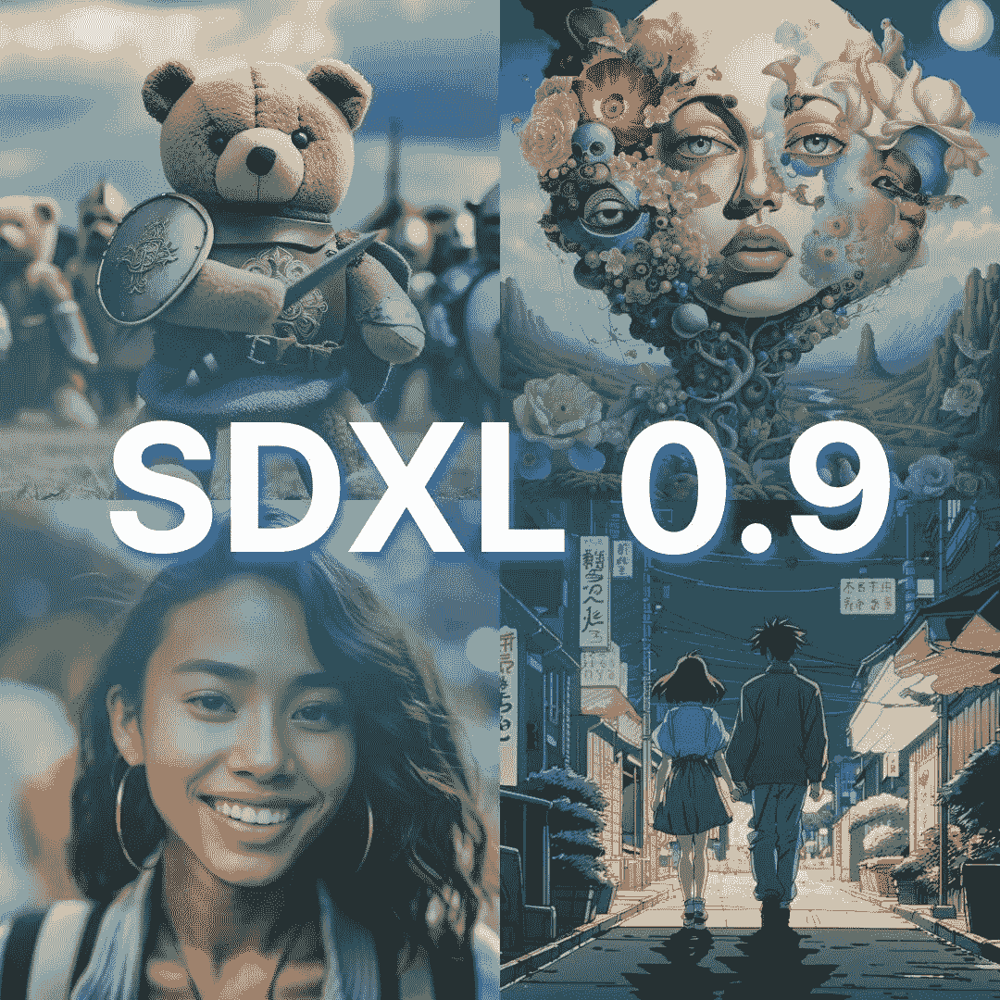

为了生成更逼真的图像，以及更大的深度和更高的分辨率（1024×1024），`SDXL 0.9` 使用了两个 `CLIP` 模型，包括迄今为止最大的 `OpenCLIP` 模型（`OpenCLIP ViT-G/14`）。

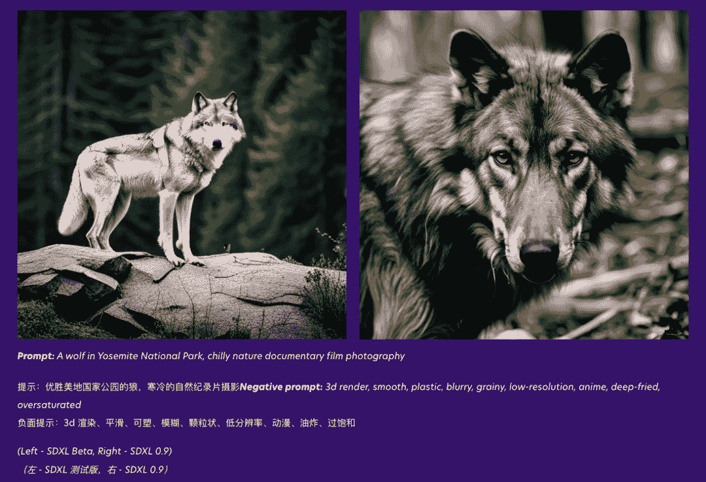

# 2023 年 6 月 24 日

## 【蚂蚁集团正开发大语言模型？回应：情况属实】

有消息称，蚂蚁集团的技术研发团队正在自研语言和多模态大模型，内部命名为“贞仪”。对此，蚂蚁集团回应称：情况属实。

## 【钉钉总裁叶军：`AI` 不是玩具，最重要的是进入生产力环节】

钉钉总裁叶军在“2023 罗汉堂数字经济年会”发表主题演讲《`AI` 重塑工作方式》。他认为，`AI` 等技术变革最重要的是要进入生产力环节，有了广泛的应用场景后，会涌现出更多能力。

## 【美国众议院召开听证会：既要监管 `AI`，又不能阻碍竞争】

据报道，美国立法者召开听证会，探索如何在不进一步强化微软和谷歌等科技巨头的早期优势的情况下，防范这项技术的风险。

## 【美国 5 月生成式 `AI` 招聘岗位增加约 20%，各大公司正探索新增长点】

根据就业门户网站 `Indeed` 的数据，上个月，美国生成式 `AI` 相关的招聘信息增加了约 20%，更是达到了 2021 年的两倍多，因为各大公司都希望利用这项技术找到自己下一个增长点，突显了 `ChatGPT` 的巨大成功引发的人工智能热潮。

## 【Opera 向桌面和安卓用户开放浏览器 `AI`“Aria”】

`Opera` 公司宣布向安卓版和桌面版 `Opera` 浏览器用户，正式开放 `Aria` AI。`Aria` AI 有别于 `ChatGPT` 的一点在于，后者只知道 2021 年之前的信息，而 `Aria` 可以通过网络获取实时结果，从而提供更现代化的结果信息。

# 2023 年 6 月 23 日

## 【软银孙正义：All in `AI`】

由于生成式 `AI` 的火爆以及与包括英特尔在内的潜在主要投资者的谈判，`ARM` 的 IPO 前景逐渐明朗。该公司正寻求筹集高达 100 亿美元的资金，券商也正在上调软银的目标股价。

## 【不到三个月，`Adobe` 摇身一变：从“`AI` 大输家”成了“`AI` 大赢家”】

面对 `AI` 的挑战，`Adobe` 转向果断而迅速，3 月份推出了差异化 `AI` 创作辅助工具“萤火虫”，`AI` 不仅没有拖累 `Adobe` 的业务，还成了其收入增长的催化剂。

## 【微软公布路线图，称 10 年内将制造出量子超级计算机】

在一篇新的博客文章中，微软概述了创建量子计算机的路线图。微软高级量子开发副总裁 Krysta Svore 表示，10 年内就能达到公司量子计算路线图的最后部分，也就是制造出量子超级计算机。

## 【华为 `AI` 新布局：盘古大模型 7 月将有重大升级】

近日，在华为开发者联创日深圳首站上，华为 `AI` 技术规划专家王琛表示，当前我们正处于第二代人工智能向第三代人工智能交替的阶段。与第二代人工智能相比，现在的人工智能是「知识+数据驱动」，意味着将使 `AI` 的系统具有常识经验推理等人类思考的能力。此次人工智能的升级，背后是大模型的演进，而大模型也是未来 `AI` 技术发展的重要方向之一。从华为开发者联创日上了解到，在接下来的 7 月，华为云盘古大模型将有重大升级。

## 【京东 `AI` 大模型官宣 7 月 13 日发布】

京东官方今日宣布，「2023 京东全球科技探索者大会暨京东云峰会」将于 7 月 13 日在北京举办。据介绍，本次大会以「跨越・产业智能」为主题，聚焦大模型与产业深度融合，将发布京东大模型，推出新一代数字基础设施，升级产品及解决方案。

## 【波音宣布与日本航空合作，用 `AI` 排查 787 零件老化和故障迹象】

波音公司昨日正式推出 `Insight Accelerator`（`IA`）服务，利用人工智能处理影响航班安全运营的潜在问题。该系统将首先在日本航空公司（`JAL`）的波音 `787` 梦想客机上应用，通过 `AI` 和机器学习技术对异常现象进行分类检测，从而可以在故障发生前识别和排除隐患。波音公司估计，应用 `IA` 的预测维护方案，可以减少多达 85% 的不必要检查。此外，`IA` 也可以将预测性维护分析所需的时间从几个月缩短到几天。

# 2023 年 6 月 22 日

## 【`OpenAI` 计划推出大模型应用商店】

该计划允许开发者在 `OpenAI` 技术基础之上销售自己构建的 `AI` 模型。企业客户可以基于 `ChatGPT` 的能力做一些定制化服务，并通过 `OpenAI` 提供的大模型市场与其他客户进行交易。由此构建的基于大模型的供需生态，将为 `OpenAI` 构筑新的壁垒。

## 【`OpenAI` 游说欧盟放宽监管】

尽管 `OpenAI` 在公开场合多次呼吁加强对 `AI` 的防护和监管，但在与欧盟官员的接触中，仍提出了多项修改意见并成功将它们纳入最终的《欧盟人工智能法案》中。其中包括 “不将 `GPT-3`、`Dall-E` 等模型标记为高风险”，从而减轻公司遵守 “透明度、可追溯性和人类监督” 等严格法律要求的负担。

# 2023 年 6 月 21 日

## 【谷歌因隐私问题被迫推迟 `Bard` 在欧盟的发布】

由于爱尔兰数据保护委员会（`IDPC`）提出的隐私问题，谷歌被迫推迟其生成式 `AI` 模型 `Bard` 在欧盟的推出。`IDPC` 称尚未收到详细的隐私简报、数据影响评估或支持信息，因此正在对 `Bard` 进行审查。

## 【`Blush`：人工智能约会模拟应用】

`Blush` 是由 `Replika` 团队推出的一款 `AI` 伴侣应用，旨在帮助用户练习约会技巧和建立亲密关系。与其他 `AI` 女友应用不同，`Blush` 的 `AI` 模型不仅用于调情，还可以帮助用户处理现实生活中的关系问题。

# 2023 年 6 月 20 日

## 【`GPT-4` 仅用 19 轮对话造出 130nm 芯片，攻克芯片设计行业巨大挑战 `HDL`】

`GPT-4` 已经会自己设计芯片了！芯片设计行业的一个老大难问题 `HDL`，已经被 `GPT-4` 顺利解决。并且，它设计的 130nm 芯片，已经成功流片。

## 【`LG` 发布首个生成式 `AI` 商业化服务 `Captioning AI`】

在加拿大温哥华昨日举行的全球最大计算机视觉会议 `CVPR 2023` 上，`LG` 人工智能研究所公开了该公司首个生成式 `AI` 商业化服务 `Captioning AI`，为需要管理大量图片的客户提供了更高效的解决方案。

## 【全球 `AI` 人才需求激增，部分岗位年薪逼近 40 万美元】

随着 `AI` 产业的高速发展，科技行业对 `AI` 人才的需求也在水涨船高。据《`USA Today`》报道，面对巨大人才缺口，越来越多的美国科技公司正试图用丰厚的薪水和福利来争夺有限的人才，从而在 `AI` 赛道的竞争中占得先机，其中部分岗位的年薪甚至已经逼近 40 万美元（当前约 285.2 万元人民币）。

## 【字节跳动已订购价值 10 亿美元的 `GPU`】

中国科技巨头字节跳动、腾讯、百度和阿里巴巴对英伟达的高性能计算（`HPC`）产品趋之若鹜，仅字节跳动一家在 2023 年已经下单了价值约 10 亿美元的英伟达 `GPU`，其中包括 `A100` 和 `H800` 卡。据悉，这些订单是在美国政府要求英伟达停止向中国出售其最高性能的 `HPC` 产品之前下单的。

## 【`Meta` 计划提供免费商业人工智能模型】

`Meta` 计划免费提供商业 `AI` 模型，对 `Google` 和 `OpenAI` 的闭源 `AI` 商业模式施加压力。这一举措可能会使得企业客户做出转变，并让 `Meta` 受益于全球无数 `AI` 工程师，及其对开源 `LLM` 贡献的专业知识。

## 【美国应对中国在 `AI` 领域的潜在威胁】

拜登政府希望应对中国在 `AI` 领域的潜在威胁，但如何定义 “对国家安全构成威胁的 `AI` 技术” 是一个核心挑战。行政令会限制美国企业投资一些地缘政治竞争对手，特别是对华投资，但在 `AI` 领域，如何区分军事项目与民用商业项目是非常困难的。

# 2023 年 6 月 19 日

## 【谷歌禁止员工使用生成式 `AI`】

四位知情人士透露，由于担心泄露公司机密信息，谷歌已要求员工不要使用生成式 `AI`，包括 `OpenAI` 的 `chatGPT` 和谷歌自己的 `Bard`。

## 【亚洲的生成式人工智能机遇】

生成式人工智能在亚洲越来越受到关注，有潜力改变行业并改善数十亿人的生活。像 `DALL-E 2`、`Fotor`、`Runway`、`AlphaCode` 和 `ChatGPT` 这样的 `AI` 工具正在被集成到主流软件产品中，作为日常任务的“副驾驶员”。印度、中国、日本、韩国和新加坡等国家正在引领 `AI` 采用，并专注于结合本地相关政策的解决方案。

## 【微软正为变现做准备】

`微软` 与 `OpenAI` 紧密合作，已成为软件市场的领导者。双方共同研发的 `GitHub Copilot` 工具，吸引了超 1 万家企业客户。预计未来四年内，整合了 `AI` 能力的 `Windows` 和 `Microsoft 365` 可增加高达 480 亿美元的额外年收入。基于 `ChatGPT` 的 `Bing` 聊天机器人，对搜索引擎市场产生重大影响。

分析师预测，得益于 `OpenAI` 提供的支持，`微软` 在 2027 年的收入可能达到 990 亿美元。尽管竞争激烈，`微软` 和 `OpenAI` 在全球范围内仍具有巨大竞争优势。

## 【在美国 92% 的开发工程师在工作中应用 `AI` 编码工具】

根据 `GitHub` 的一项新调查，92%的美国开发人员已经在工作中和工作外使用 `AI` 编码工具。这些开发者表示，`AI` 编码工具可以帮助他们提高代码质量、加快输出速度并减少生产级的事故。虽然 `AI` 正在以惊人的速度帮助开发者，但它并没有取代他们。如果正确使用，它可以使整个编程过程更快、更有效率，并让程序员更加满意。

# 2023 年 6 月 18 日

## 【`AI` 助力三星堆“国宝”青铜器完成模拟拼接】

【新华社客户端成都 6 月 16 日电（记者童芳）记者近日从四川省文物部门了解到，三星堆大型青铜器铜兽驮跪坐人顶尊铜像和铜罍座倒立鸟足顶尊神像的相对完整形态得以震撼呈现，背后少不了 `AI` 的功劳】

## 【普通人也能成为音频剪辑师，`Meta` 推出 `AI` 模型 `Voicebox`】

【`Meta` 继推出 `ImageBind` 之后，于今天再次推出了全新的生成式 `AI` 模型 `Voicebox`。该模型帮助创作者执行音频编辑、采样和风格化等语音生成任务，即便是普通用户也能轻松上手】

## 【四川路桥：拌合站集控式 `AI` 生产系统即将推广应用】

据“四川路桥道行天下”🛰️👸号消息，拌合站集控式 `AI` 生产系统现场验收会召开。专家组对系统涉及的关键技术和研发路径进行了评审，经充分讨论和研判，一致认为拌合站集控式 `AI` 生产系统通过验收，满足产业化推广条件。拌合站集控式 `AI` 生产系统具备生产数据感知和自动采集、神经网络学习、大数据分析等能力，可实现拌合站的人、料、机高度协同。生产管理人员可在集控室通过该系统对多个拌合站进行远程操作，真正实现混凝土全自动生产。

## 【华为胡厚崑：以 `ChatGPT` 为代表的新的人工智能时代已到来】

胡厚崑称：“我们可以大胆预测，所有的个人、工业应用都将被这种新的人工智能所改写。由于计算无所不及，以及算力需求的成倍增长，如到 2030 年，通用算力将增加 10 倍，人工智能算力将增加 500 倍。我们将建设大量的数据中心、人工智能计算中心等 `ICT` 基础设施，如何降低这些设施的能耗，也是绿色低碳发展需要面对的挑战。”

## 【百度 `AI` 共创计划：扶持 10 万创作者变现收入超 30 亿】

从图文到短视频时代，从 `PGC` 时代到 `UGC` 时代，过去十几年创作主体和创作方式正在不断发生改变。不少内容创作者乘风而上，也有不少曾经辉煌一时的创作者淹没在时代的巨浪里。当一个新时代的画卷在我们面前缓缓展开时，平台成为内容创作者们需要凭借着自己的判断押宝的方向之一

## 【`Meta` 首席 `AI` 科学家杨立昆：`AI` 智力连狗都不如，不应将其视作威胁】

据美国 `CNBC` 报道，`Meta` 的首席人工智能（`AI`）科学家杨立昆（`Yann LeCun`）昨日在巴黎举行的 `Viva Tech` 会议上表示，`AI` 目前的智力水平连狗都不如，不应将其视作对人类的威胁。

## 【消息称 `Meta` 考虑放宽开源 `AI` 大模型，允许开发者商用化赚钱】

Meta CEO 马克 扎克伯格他的副手们希望其他公司可以自由使用 Meta 正在开发的人工智能新软件，并能从中获利。对于那些越来越多地采用人工智能的开发者和企业来说，这个决定可能产生重大影响。

## 【中科院自研新一代 AI 大模型“紫东太初 2.0”问世，支持视频、3D 等模态数据】

记者 孙自法）记者从中国科学院自动化研究所（中科院自动化所）获悉，在 6 月 16 日举行的“人工智能框架生态峰会 2023”上，中科院自动化所所长徐波研究员正式发布“紫东太初”全模态大模型，持续探索可自主进化的通用人工智能（AI）。

# 2023 年 6 月 17 日

## 【以 AI 制药技术领跑生物补剂领域，LAIFE「小红盾」横空出世】

AIFE 品牌旗下又一精细化产品 LAIFE「小红盾」即将上市。作为一款抗过敏、并且是可以通过帮助人体提升免疫力对抗病毒的产品，LAIFE「小红盾」可以修复免疫损伤，加固免疫屏障，改善敏感体质，提振脑力体力，为女性健康保驾护航。

## 【前京东集团副总裁成立生成式 AI 公司 HiDream.ai】

前京东集团副总裁、京东探索研究院副院长梅涛自今年初离职后，确认在 AI 领域创业，成立生成式 AI 公司 HiDream.ai，方向是生成式视觉多模态基础模型与应用。梅涛表示，当前的生成式 AI 视觉领域产品普遍存在优化空间，HiDream.ai 的目标即是“对标并超越它们，成为世界级产品”。

## 【上海：家用版围棋机器人成中国青少年 AI 陪练】

上海知名的人工智能企业商汤科技发布首款家用版围棋机器人，棋力覆盖从业余级位到职业段位的 20 多个等级，通过 AI 视觉技术和机械臂设计实现人机对弈

## 【中国石化与百度签署战略合作协议，涉及 AI 大模型创新等领域】

中国石化与百度签署战略合作框架协议。双方将在石化行业人工智能、互联网+新业态、数字化转型升级等领域深化合作，提高智能制造水平，赋能实体经济，推动双方在合作共赢中实现高质量发展。

## 【ChatGPT 首次应用于车载系统，梅赛德斯-奔驰与微软合作测试其 AI 语音助手】

梅奔表示，这项合作将通过微软的 Azure OpenAI 服务为车主带来聊天机器人 ChatGPT 的体验。测试计划将于当地时间周五（6 月 16 日）开始，在美 90 万辆配备 MBUX 信息娱乐系统的车辆都可参与测试。

## 【京东联合百度打造电商业首个 AI 线下广告 AI 降本或释放电商产业利润】

今年 618 期间，京东联合百度文心一格，将 AIGC 应用于电商营销，进行了首次大规模线下广告尝试，打造电商行业首个 AI 线下广告。根据百度的测算，平时这样一组海报，从模特、服装、到设计、排版，单张成本可能接近一万元，而以 AI 的方式，制作周期缩短 70%，制作成本可以节省 80%左右。开源证券分析指出，基于消费持续复苏、2022 年低基数以及 AI 带来的降本，今年“618”大促给电商产业链相关公司二季度业绩带来的弹性值得关注。

## 【谷歌推出两项 AI 新功能，帮助广告主找到最佳广告展示位置】

据谷歌官方消息，谷歌近日宣布将为广告商推出两项自动化功能，借助 AI 技术来提高广告的投放转换率。

## 【Google 利用 AI 为在线购物应用，带来真人模特虚拟换衣体验】

谷歌宣布将为其在线购物工具引入新的生成式 AI 技术，该技术可以快速生成不同体型真人模特的试穿效果图，便于用户了解心仪的衣物是否适合自己的身材。负责虚拟试穿功能的谷歌产品经理 Shyam Sunder 在新闻发布上表示，该公司已经招募了 80 名模特（男女各 40 名）来构建该功能：“AI 可以根据零售商网站上的图片来生成模特穿着对应服装的照片，而且支持折叠、包裹、拉伸、褶皱和阴影等细节渲染，用户仅凭肉眼很难判断出该图像是由 AI 生成。”

## 【最强 AI 监管来了，欧盟通过《AI 法案》草案】

欧洲议会投票通过了关于《人工智能法案》的谈判授权草案。这是欧盟准备针对 ChatGPT 等应用的人工智能法规，旨在确保人工智能系统（AI）受到监管，决定如何对人工智能应用进行分类，以及什么样的活动不被允许。

# 2023 年 6 月 16 日

## 【开始全面渗入行业 AI 将给影视业带来巨大变革】

如果盘点第 25 届上海国际电影节的热词，AI 一定是其中之一。今年上影节的大小论坛上，都有导演、制片人、技术专家等围绕 AI 侃侃而谈，有人踌躇满志，有人满怀期待，也有人不无焦虑。AI 到底会在多大程度上改变影视行业及创作流程，现在下定论还为时过早，但可以确定的是，AI 已经开始全面渗入行业，未来的影视行业，一定会有 AI 的一席之地。

## 【联想集团：未来三年将追加 10 亿美元投资 AI 基础设施业务】

人工智能风口下，大模型能赚多少钱尚未可知，AI 基础设施产业已经开始盈利。该公司 ISG（基础设施方案业务集团）全球 AI 基础设施业务年度收入超过 20 亿美元，未来三年还将追加投资 10 亿美元，以加速全球企业的 AI 部署。

# 2023 年 6 月 15 日

## 【张勇对话西门子 CEO 博乐仁：AI 时代不持续转型就会落伍】

在 2023 西门子数字经济论坛上，阿里巴巴集团董事会主席兼 CEO、阿里云智能集团董事长兼 CEO 张勇与西门子董事会主席、总裁兼 CEO 博乐仁，围绕数字经济的未来进行了对话。张勇认为，对任何企业而言，无论来自哪里、无论如何诞生，未来如果无法在 AI 时代持续转型，将会在新技术浪潮中落伍。

## 【国内 15 款开源大模型齐齐上线，魔搭社区成中国 AI 模型开源第一门户】

在 2023 开放原子全球开源峰会上，阿里云公布 1+4 开源战略，在操作系统、云原生、数据库、大数据四大开源领域之外，AI 模型社区魔搭作为大模型方向的开源新势力首次亮相。据悉，目前已有 15 款支持中文的开源大模型在魔搭社区上线。

## 【亚马逊云计算部门正在考虑使用 AMD 的新 AI 芯片】

亚马逊云业务考虑使用 AMD 的新人工智能芯片。虽然 AWS 没有公开承诺在其云服务中使用 AMD 的新 MI300 芯片，但亚马逊弹性计算云的副总裁 Dave Brown 说 AWS 正在考虑这些芯片。

## 【OpenAI 正在升级其文本生成模型 GPT-3.5-turbo 和 GPT-4 并降低价格】

OpenAI 今日宣布对其大型语言模型 API（包括 GPT-4 和 gpt-3.5-turbo）进行重大更新，包括新增函数调用功能、降低使用成本、以及为 gpt-3.5-turbo 模型提供 16000 个 token 的版本。

## 【套娃不可取：研究人员证实用 AI 生成的结果训练 AI 将导致模型退化乃至崩溃】

如果用 AI 生成的结果来训练 AI，进行“套娃式训练”，能得到什么样的结果？目前还真有研究团队对此进行了观察记录，详细论文及得出的结果发表在了 arXiv 上。

# 2023 年 6 月 14 日

## 【直击三六零 AI 数字人：周鸿祎对话“马斯克”，数字分身成新闻发言人】

近日，360AI 数字人广场正式发布，提供 200 多个虚拟数字人角色。分为数字名人和数字员工两类。其中，数字名人包括历史人物、偶像明星、文学形象等，“孙悟空”“马斯克”“刘德华”都是其中角色。按照周鸿祎的看法，这可以让用户在与数字人的开放对话中实现与偶像的近距离接触，与先贤的思想交流。

## 【AI 大模型迎来风口 算力需求爆发】

随着 AI 大模型的发展，全球算力供不应求，相关订单需求骤增。在此背景下，电信运营商等产业链企业力争超前部署。业内人士表示，AI 大模型及下游应用爆发，将推动数字基础设施建设加快，芯片、服务器、数据中心、先进封装、算力租赁等领域迎来利好。

## 【华人“AI 王冠争夺赛”：AMD 推出超级芯片 MI300，挑战英伟达】

AMD 推出外界期待已久的数据中心 APU（加速处理器）Instinct MI300，其旨在帮助数据中心处理人工智能相关数据流量，并在这一快速增长的市场上挑战英伟达的垄断地位。

## 【Runway 旗下 AI 视频编辑工具免费开放试用】

《瞬息全宇宙》幕后技术公司 Runway 此前获谷歌投资，以加速 AI 在影视创作中的应用。而近日 Runway 公开了旗下具有 AI 功能的视频编辑工具 Gen-2，用户可以直接使用文本提示生成“逼真的视频内容”并“自动剪辑视频”。

## 【Meta 发布 AI 音乐模型 MusicGen】

近日，Meta 在 GitHub 上以开源方式发布了 AI 音乐生成模型 MusicGen 的代码，该 AI 模型利用 Transformer 架构，可以根据文本和旋律提示创作音乐。与 Riffusion、Mousai、MusicLM 和 Noise2Music 等其他音乐模型相比，MusicGen 在音乐与文本之间的匹配度以及作曲的可信度等客观和主观指标上表现得更加优异。

## 【OpenAI 发布 ChatGPT 函数调用及其他 API 更新】

OpenAI 今日宣布对其大型语言模型 API（包括 GPT-4 和 gpt-3.5-turbo）进行重大更新，包括新增函数调用功能、降低使用成本、以及为 gpt-3.5-turbo 模型提供 16000 个 token 的版本。

# 2023 年 6 月 13 日

## 【Salesforce 推出 AI Cloud 服务，并将其生成式 AI 风投基金规模翻倍】

客户关系管理软件服务提供商 Salesforce（NYSE: CRM）通过官网宣布推出 AI Cloud，将整合该公司包括 Einstein、Data Cloud、Tableau、Flow 和 MuleSoft 在内的技术，以提供可信的、开放的、面向企业的生成式 AI。据介绍，AI Cloud 的核心是 Einstein 技术，Einstein 通过生成式 AI 帮助每个公司和员工在销售、服务、营销和商业方面提升生产力和效率。另据彭博报道，该公司在一份声明中称，其专注于生成式 AI 的风险投资基金将由 3 月份宣布的最初的 2.5 亿美元增加到 5 亿美元。

## 【360 智脑通过中国信通院可信 AIGC 大语言模型功能评估，为国内首家】

360 智脑的 360GPT-S2-V8 型号产品获得了中国信息通信研究院（以下简称“中国信通院”）“可信 AIGC 大语言模型基础能力”评估报告（以下简称“报告”），报告显示必选项目评估内容均通过。据悉，360 智脑是国内首个通过中国信通院该项权威评估的大模型产品。

## 【OpenAI CEO 呼吁美国同中国合作应对 AI 风险，称“中国有世界上最优秀的人工智能人才”】

6 月 12 日消息，上周六，OpenAI CEO 山姆·奥特曼从海外连线参加了一场在北京召开的参与者众多的 AI 会议，他在讲话中强调了美国和中国研究人员通过合作降低 AI 系统风险的重要性。“中国拥有一些世界上最优秀的 AI 人才，”山姆·奥特曼说。“所以我真心希望中国的 AI 研究人员能在这方面做出巨大贡献。”

## 【AI 语言模型“提速”药物发现】

美国麻省理工学院和塔夫茨大学研究人员设计出一种基于大型语言模型（如 ChatGPT）的人工智能算法，这种称为 ConPLex 的新模型可将目标蛋白与潜在的药物分子相匹配，而无需执行计算分子结构的密集型步骤。相关论文发表在最新一期《美国国家科学院院刊》上。

## 【帮助用户筛选合适产品？亚马逊利用生成式 AI 总结产品评价】

据报道，亚马逊将利用人工智能技术帮助用户寻找合适的产品。这家电商巨头最近开始在其购物应用中测试一项功能，可以利用人工智能技术总结客户针对部分产品发表的评论。这项功能还会简单概述消费者喜欢或不喜欢某款产品的哪些方面，同时在总结内容旁标注“由人工智能根据客户评论生成”。

# 2023 年 6 月 12 日

## 【谷歌推出新 AI 工具 Imagen Editor，一句话快速二创】

谷歌推出 AIGC 工具 Imagen Editor，可以根据用户输入的文本要求，在现有图片基础上进行二次创作。

它并非生成完整的图像内容，而是基于用户的描述，在现有图片上进行修改和创作。谷歌官方提供的一个例子：先是高亮宠物狗的身体，然后输入“带有白色星星的红色宇航服”，在背景中显示用纸板制成的火箭，最后是让宠物狗戴上蓝色蓝牙耳机。

## 【达摩院人员提出综合视听能力大模型】

阿里达摩院的研究人员提出了 Video-LLaMA，能够感知和理解视频中的视频和音频信号， 并能理解用户输入的指令，完成一系列基于音视频的复杂任务，例如音 / 视频描述，写作，问答等。

论文地址：`https://arxiv.org/abs/2306.02858`

代码地址：`https://github.com/DAMO-NLP-SG/Video-LLaMA`

Demo 地址：

`https://modelscope.cn/studios/damo/video-llama/summary`

`https://huggingface.co/spaces/DAMO-NLP-SG/Video-LLaMA`

样例输入文件地址：`https://github.com/DAMO-NLP-SG/Video-LLaMA/tree/main/examples`

## 【支持普通话，桌面端 Bing Chat 新增语音聊天方式】

根据微软必应官方发布的博文透露，本周 Bing Chat 主要改进了桌面端的聊天体验。由于很多用户都喜欢在移动设备上，使用语音输入的方式进行聊天，因此微软方面改进了必应聊天的对话框，用户点击麦克风按钮，也可以在桌面端使用。微软表示目前仅支持英语、日语、法语、德语和普通话，后续会进一步丰富语言种类。必应聊天还支持用语音方式回答你的问题。使用语音输入，例如询问必应聊天：“你知道的最难缠绕口令是什么？”，必应聊天会以语音方式回复。

## 【中国电科发布生成式人工智能大模型“小可”】

中国电科所属电科太极在京正式发布生成式人工智能大模型产品“小可”，支撑特种场景辅助决策。据悉，“小可”已推出拟文助手、编码助手、智能标绘等系列智能应用。

## 【北京智源发布悟道 3.0 大模型，院长黄铁军：实现 AGI 有三条路线】

2023 北京智源大会在 6.9-6.10 召开，北京智源人工智能研究院院长黄铁军在会上作报告，发布悟道 3.0 大模型系列，并宣布进入全面开源的新阶段。此次悟道 3.0 包含悟道·天鹰（Aquila）语言大模型系列、“天秤（FlagEval）”大语言评测体系及开放平台以及悟道·视界视觉大模型系列。

# 2023 年 6 月 11 日

## 【Sam Altman 2023 首次中国演讲： 十年内将出现超级人工智能，再呼吁 AI 监管国际合作】

为 AI 安全最近四处奔波的 OpenAI 创始人 Sam Altman，近期现身中国 2023 年智源大会，再度就这一话题发声。

在 6 月 10 日的 2023 年北京智源大会上，Sam Altman 以视频连线方式在“AI 安全与对产”分论坛中露面，发表关于 AI 安全的演讲，并且与智源研究院理事长张宏江进行对谈

36 氛也在现场参与了这场分论坛。当张锁院士结束开场演讲后，Sam Altman 的视频会议连线画面出现在大屏幕上，在场的中国观众一阵欢呼，显现出对这位风云人物的高度关注。

## 【用模型进化模型，智源发布开源套装，大模型带不来 AGI，LeCun 提出三大挑战】

智源大会上，来自中美两国 AI 领域的顶尖人才们围绕着大模型和 AGI 的未来进行了探讨，由于非营利+科研型的特性，智源被业界视作“中国版的早期 OpenAI”，同时也是国内 AI 人才的黄埔军校。在智源的大模型研究项目“悟道”中，汇聚了智谱华章唐杰、循环智能杨植麟、元乘象卢志武等 AI 创业的高校第一梯队

## 【谷歌反垄断案，对 AI 技术的未来市场格局影响有多大】

谷歌的传播团队在《纽约时报》上讨论了人工智能技术以新的类人聊天机器人的形式存在的重要性，不仅强调了真正的创新，还强调了这些技术的潜在威胁服务于搜索巨头的商业模式。他们讨论的主要内容是，第一，新技术非常酷，第二，谷歌不再是垄断企业，美国政府应该放弃对这家搜索巨头的反垄断行动。

## 【引用《道德经》，谈大国分歧，Sam Altman 最新演讲： AI 安全始于足下】

大国之间分歧常有，但在重要大事上需要合作协调。OpenAI 创始人 Sam Altman 的环球之旅已经进行到第四周，在此期间，他已经去到五个大洲的近 20 个国家，与学生、开发人员和国家元首会面今天，北京时间上午 9 点 20 分，Sam 以视频连线的方式现身于中国北京举办的 2023 智源人工智能大会，发布了演讲，并接受了院士张宏江的访谈对话。

## 【AIGC 作品混入央美毕业展，真假难辨】

今年的央美毕业展上，有些嗅觉敏锐的应届生没等 AI 抢饭碗，就先下手为强，直接喊 AI 当助手，参与到今年自己的毕业作品制作流程中。且这类作品数量比前两年更甚，主要集中在 AI 绘画；用的 AI 工具也更新，诸如 Stable Diffusion 之类前几年的毕业展现场，出现过极个别作品让 GAN 参与设计/制作流程。

# 2023 年 6 月 10 日

## 【深度学习三巨头之一 Yann LeCun：大语言模型带不来 AGI】

当今世界，Yann LeCun 、Geoffrey Hinton 以及 Yoshua Bengio 三位科学家并称为深度学习三巨头。值得注意的是，三巨头之中，LeCun 对于 AI 发展所持的态度是最为乐观的。此前在马斯克提出“人工智能给人类文明带来了潜在风险”时，LeCun 曾公开反驳，认为人工智能远未发展到给人类构成威胁的程度。关于 AI 接下来该如何发展，在今天上午于北京举行的 2023 智源人工智能大会上，他发表了名为《走向能够学习、推理和规划的大模型》的演讲，表达了系统的思考。

## 【对话中国大模型的最早推行者黄铁军：全球可能只需要三个大模型生态】

迄今为止，中国已经发布了 79 个大模型（据《中国人工智能大模型地图研究报告》不完全统计）。黄铁军对此的观点更明确，全球仅仅需要三个大模型就够了。至于人类通往 `AGI`（通用人工智能）之路，究竟是不是能通过深度学习这条路径实现，目前还没有定论。但是可以肯定的是，人类已经看到了 `AGI` 的曙光。也正是这抹光的乍现，人工智能界最有影响力的人物，多次预警并联名签发公开信，预警风险。他们的担忧，究竟有哪些？

## 【华为计算：上海昇思 `AI` 框架&大模型创新中心将启动】

据华为计算官微消息，人工智能框架生态峰会将于 6 月 16 日在上海召开。根据议程，将发布“共建人工智能框架生态，繁荣中国人工智能产业”倡议，并举办“上海昇思 `AI` 框架&大模型创新中心启动暨伙伴入驻仪式”。另外，将共建 `AI` 开源生态，宣布昇思 `MindSpore` 社区理事会成立。

## 【Adobe 为自家 `AI` 工具 `Firefly` 的用户提供法律支持】

[`Adobe`](https://www.chinaz.com/tags/Adobe.shtml)正在为其[`Firefly`](https://www.chinaz.com/tags/Firefly.shtml)[`for Enterprise`](https://www.chinaz.com/tags/AIgongju.shtml)产品的用户可能因使用其新的 `AI` 工具 `Firefly` 产品而可能产生的与版权相关的法律费用提供全额赔偿。

## 【字节跳动正内部测试 `AI` 对话类产品，代号“`Grace`”】

字节跳动正在内部测试一款 `AI` 对话类产品，这款产品被称为“`Grace`”。对此，字节跳动方面向媒体回应称，`Grace` 是一个 `AI` 对话类测试项目的内部代号，目前还处于初级阶段，仅用于内部体验测试。

# 2023 年 6 月 9 日

## 【`AI` 初创公司 `Cohere` 宣布 2.7 亿美元 C 轮融资，英伟达、甲骨文参投】

6 月 8 日，人工智能初创公司 `Cohere` 官网宣布获得 2.7 亿美元的 C 轮融资。本轮融资由 `Inovia Capital` 领投，包括英伟达、甲骨文、`Salesforce Ventures` 在内的多家全球性机构和战略投资者也参与了此次融资。据了解，该公司最近发布了首个公开可用的多语言理解模型，该模型根据来自母语者的真实数据进行训练，它能够阅读和理解世界上 100 多种最常用的语言。

## 【家乐福进场：购物助手 `Hopla`】

今天官网宣布，导购风格就是 `ChatGPT4`。

家乐福内部已经用 `ChatGPT` 进行采购流程和产品管理。

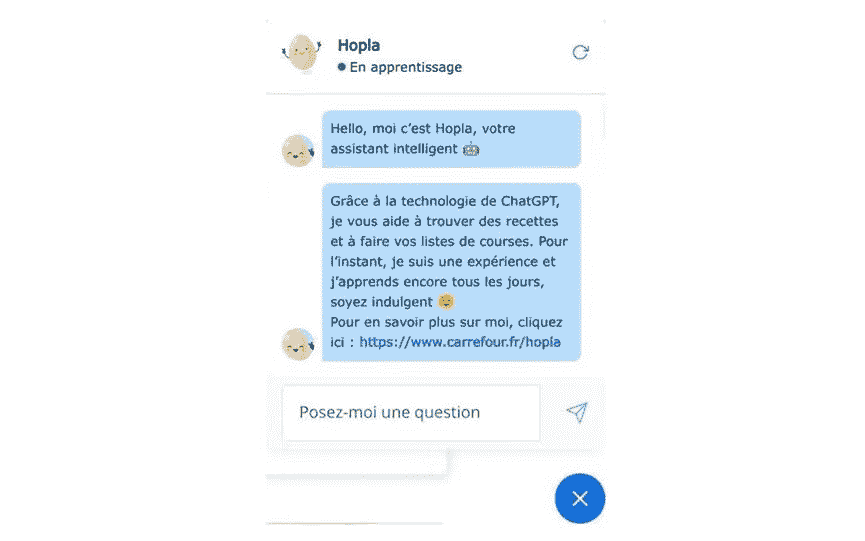

## 【`AIGC` 平台 `Cohere` 获得融资】

今日官网发布，C 轮融资 2.7 亿美元，估值 21-22 亿美元。`Inovia Capital` 领投，英伟达、甲骨文、`Salesforce`、施罗德资本、`DTCP` 参投。`Cohere` 是 `ChatGPT` 竞对，有更好的 `2B` 服务经验。

## 【消息称字节跳动正在内部测试对话类 `AI` 项目 `Grace`】

字节跳动正在内部测试一款 `AI` 对话类产品，这款产品被称为“`Grace`”。对此，字节跳动方面向媒体回应称，`Grace` 是一个 `AI` 对话类测试项目的内部代号，目前还处于初级阶段，仅用于内部体验测试。

## 【首家 `AI` 淘宝店参加淘宝 618 好价节，`AI` 数字人上岗直播间】

首次参加 618 淘宝好价节的首家 `AI` 淘宝店“卢咪微 `Lumiwink`”，其 `AI` 数字人马斯氪上岗淘宝直播间，2 个小时吸引超 16 万人次观看。今年 4 月，`36 氪`用 `AI` 工具开了这家淘宝店，引发行业新想象。随后 `36 氪`找到淘工厂，将 `AI` 设计的 `T恤`生产了出来。6 月 8 日晚，该款 `T恤`在 `TVB` 淘宝直播间获得港星陈敏之的推荐，目前已售出近 200 件。

# 2023 年 6 月 8 日

## 【思科进场：`AIGC` 集成 `Webex`】

华为网络设备老对手思科 `Cisco`，在 2007 年收购了视频会议鼻祖 `Webex`，今天宣布加入 `AIGC` 提高用户体验。

思科也侧重 `AIGC` 生成内容的安全、保护隐私、数据准确。

## 【脉脉高聘：`AI` 人才供需比持续低于 1 人才紧缺成行业挑战】

近日，`AI` 领域再度掀起波澜。华为常务董事、华为云 `CEO` 张平安在华为云开发者大会邀请函中表示，`AI` 技术风起云涌，“`AI for Industries`”将成为人工智能新的爆发点。

王慧文的 `AI` 创业公司`光年之外`成立不到 4 个月就被传融资 2.3 亿美元即将跻身独角兽行列，虽然后被证实估值和融资金额不实，但 `AI` 赛道被广泛看好已经成为共识。

## 【微软在 `Edge` 浏览器中展示伪装成 `AI` 搜索结果的必应广告】

微软推出了一个令人不悦的举措：当用户使用 `Edge` 浏览器下载谷歌的 `Chrome` 浏览器时，微软会在 `Edge` 中展示全屏广告。而现在，微软似乎又故技重施，并用了新的方法。

## 【百度：首个`文心千帆`大模型创新中心落户无锡】

在无锡市梁溪区政府见证下，无锡市梁溪人才集团与百度签订合作协议，共同建设百度智能云`文心千帆`大模型（无锡）创新中心，中心位于`清名桥街道清名路 318 号`，这也是`文心千帆`大模型平台全国首个区域私有化部署落地。依托百度人工智能、工业智能技术及生态资源，创新中心将提供先进的生成式人工智能全流程工具链，为工业企业带来精准的智能制造解决方案，推动长三角智能制造全面升级。

## 【`文心一言-Turbo` 高性能模式开放邀测】

据百度智能云🛰️👸号消息，6 月 6 日，文心大模型技术交流会第五站落地成都。百度集团副总裁侯震宇表示，“`文心一言-Turbo`”高性能模式正式开放邀测，在一些高频、核心场景中，“`文心一言-Turbo`”在满足同样客户需求的情况下，推理服务整体性能提升 50 倍。目前，企业可以在`文心千帆`大模型平台上申请测试「`文心一言-Turbo`」高性能模式。

## 【`GitLab` 计划推出 `AI` 代码编写产品 月费 9 美元】

据路透社消息，软件开发平台 `GitLab` 周二宣布计划推出一款提振收入的人工智能驱动产品。被软件开发人员广泛用于编码工作的 `GitLab` 将在其主要的`DevSecOps`平台上添加`ModelOps`功能，该功能包括提供代码编写建议。`GitLab` 表示，该产品预计将于今年推出，月费 9 美元。

## 【新加坡国立大学发布 `AI` 模型 `GOAT`，算数能力强于 `GPT-4`】

近日，新加坡国立大学研究者推出了 `Goat` 模型，称该 `AI` 模型“专门用于算术问题”。研究人员表示“在对 `LLaMA` 模型进行微调后，`Goat` 在算数上实现了比 `GPT-4` 更高的准确度与更出色的性能”。据介绍，研究人员在具备 `24GB` 显存的 `GPU` 上进行训练，并将最终得到的模型使用 `BIG-bench` 算数子任务进行测试，准确率结果较为出众，领先于业内的 `Bloom`、`GPT-NeoX`、`OPT` 等模型。其中零样本的 `Goat-7B` 的准确率甚至一度超过了少样本学习后的 `PaLM-540` 模型，在大数计算方面远超 `GPT-4`。

## 【`Zoom` 推出 `AI` 功能，可生成会议纪要】

`Zoom` 本周正式发布了 `AI` 助手 `Zoom IQ`，供指定计划用户免费试用。`Zoom IQ` 包含多项功能，重点的是会议主持人能使用其生成会议纪要，并通过 `Zoom` 内置聊天功能 `Zoom Team Chat` 或电邮发送给与会者，不用对会议进行录影以便回顾。此外，用户亦能使用 `AI`，协助其在聊天室里撰写讯息。该功能由 `Open AI` 驱动，会根据聊天内容创建讯息，并允许用户修改讯息语气或长度。

# 2023 年 6 月 7 日

## 【华为发布全球首款：可高效支撑 `AI` 训练等业务，释放算力】

据华为中国官方🛰️号 6 月 6 日消息，第 31 届中国国际信息通信展日前在北京国家会议中心隆重举行，会议期间，华为面向全球发布首款 `800GE` 数据中心核心交换机—— `CloudEngine 16800-X` 系列，正式开启数据中心 `800GE` 时代。

## 【百度推出基于大模型的代码编写助手“`Comate`”】

在文心大模型技术交流会（成都）上，百度智能云推出“`Comate`”编码智能推荐工具，并正式开放邀请测试。百度集团副总裁侯震宇表示，“`Comate`”代码助手是基于大模型打造的新一代编码辅助工具，已在百度内部进行了大量测试。测试结果显示，在“`Comate`”辅助编写的代码中，近 50%的建议代码被开发者采纳。据百度内部人士透露，辅助代码撰写是第一阶段的主要产品功能，第二阶段，“`Comate`”将实现在特定领域、场景的自然语言代码生成，第三阶段将实现全领域的自然语言开发。

## 【因美纳推出全新 `AI` 算法，可预测患者致病基因突变】

近日，全球基因测序和芯片技术的领导者因美纳（纳斯达克股票代码：`ILMN`），宣布推出全新的人工智能（`AI`）算法——`PrimateAI-3D`，它能高度准确地预测患者的致病基因突变。相关研究结果发表在 6 月 2 日的《科学》（`Science`）期刊（第 6648 期）的两篇论文里，文章详细介绍了这种算法的训练方式及其在英国生物样本库（`UK Biobank`）队列中 50 万个基因组的应用情况。另外两篇关于灵长类动物进化研究的论文也同期发表，并为 `PrimateAI-3D` 的开发提供了信息。

## 【特斯拉 CEO 马斯克称与中国就 `AI` 进行了探讨 和监管有关】

CNMO 注意到，根据环球网、路透社的信息，特斯拉首席执行官埃隆·马斯克在推特直播节目上表示，在此前的中国之行中，他与中国人士在人工智能（`AI`）问题上进行了富有成效的探讨。马斯克表示：值得注意的是，在我最近的中国之行中，我去见了那里的高级官员。我认为我们就人工智能的风险以及对一些监督和监管的需求进行了一些非常有成效的讨论。

# 2023 年 6 月 6 日

## 【东易日盛北京发布会：`AIGC`+家装】

会上展示了自家创意大师工具一小时百张创意，对应了传统检索阅读需要半天到一天。

董事长陈辉表示：行业缺乏人才，`AIGC` 可以取代一部分人才，让公司数字化发展获得质变。

会上工信部消费品工业司原司长高延敏表示：`AI` 技术是家装企业创新发展重要支撑。

## 【英特尔发布深度学习推理工具`OpenVINO 2023.0`】

在 `OpenVINO™`工具套件发布五周年之际，英特尔开展 `OpenVINO™ DevCon` 中国系列工作坊 2023 活动，旨在通过每月一次的工作坊，持续助力开发者系统学习、稳步提升。基于此，英特尔成功举办了首期以“焕然五周年·瞰见新特性”为主题的 `OpenVINO™ DevCon 2023` 系列活动，并在此次活动上发布了功能更加强大的全新英特尔®`OpenVINO™ 2023.0` 版本，以期在更大程度上帮助 `AI` 开发者简化工作流程，提升部署效率。

## 【华为申请注册了两枚“`HUAWEI NETGPT`”商标】

企查查 `APP` 显示，近日，华为技术有限公司申请注册了两枚“`HUAWEI NETGPT`”商标，国际分类包含科学仪器、设计研究，当前商标状态为注册申请中。

## 【日本横须贺市政府宣布将正式利用 `ChatGPT` 提高工作效率】

日本全国地方政府中率先在工作时尝试采用人工智能（`AI`）聊天软件“`ChatGPT`”的神奈川县横须贺市公布验证结果称，开始利用的 4 月以后制作文案等工作效率有所提升。市长上地克明在记者会上给予肯定称：“得到了非常好的工具。”从当天起转为正式利用。

## 【`NEC` 拟独自开发并提供生成式 `AI` 服务】

日本 `NEC` 公司社长森田隆之日前表示，正在探讨独自开发能自动制作精巧文章及图像的生成式人工智能（`AI`），并作为新服务提供。目前考虑对用户的提问给出可靠的答案。森田没有明确出示开始提供新服务的时期。

## 【Moka 将于 6 月 28 日发布面向 `HR` 行业的 `GPT` 产品】

`HR SaaS` 企业 `Moka People` 产品负责人、首席方案专家冷雪梅日前透露，Moka 将于 6 月 28 日发布面向 `AGI` 时代的 `GPT` 产品。

## 【港科大（广州）今日上线 `GPT` 服务，为国内高校首家】

香港科技大学（广州）将面向全校教职工及学生上线开放 `GPT` 服务。目前，`GPT` 服务已完成联调测试，成为国内率先在校内全面启用 `GPT` 服务的大学。据了解，港科大（广州）此次推出的 `GPT` 服务由港科大（广州）校长办公室主导，信息枢纽和资讯科技处共同承建，内容包括 `GPT-4`、`ChatGPT`，服务对象包括学校全体教职工、学生，服务区域为校园内，使用者仅可通过校园内网络接入。

## 【金融债券业小模型：`BondGPT` 启用！】

纽约的 `Broadridge` 子公司 `LTX` 今天发布，基于 `GPT-4`。主要用于债券市场帮助客户回答债券相关问题。`Broadridge` 海量金融数据整合数据平台 `Liquidity Cloud` 实现内容准确性和权威性。

# 2023 年 6 月 5 日

## 【`Midjourney` 劲敌来了！ 谷歌 `StyleDrop` 王牌「定制大师」引爆 `AI` 艺术圈 】

近期谷歌放出来一个王炸 `AI` 创作神奇 `StyleDrop`，用户只需要选择一张样例图片，然后修改特定文本 `Prompt` 中的关键词就可以生成类似原图风格的各种目标，效果逼真的简直要逆天！”

项目主页-`https://styledrop.github.io/`

论文地址-`https://arxiv.org/pdf/2306.00983.pdf`

## 【消息称华为版 `ChatGPT` 将于 7 月初发布 命名“`盘古 Chat`”】

近日，华为公司将发布一款直接对标 `ChatGPT` 的多模态千亿级大模型产品，名为“`盘古 Chat`”。预计华为`盘古 Chat`将于今年 7 月 7 日举行的华为云开发者大会（`HDC.Cloud 2023`）上对外发布并内测，产品主要面向 `ToB/G` 政企端客户。

## 【必应聊天所有聊天模式均已支持 `Bing Image Creator`】

微软 `Bing Chat` 公布更新进展称，目前在所有聊天模式下，都支持 `AI` 图片生成工具 `Bing Image Creator`，用户已经可以在精确和平衡模式下使用 `Bing Image Creator`。据悉，此前，`Bing Image Creator` 仅在创意模式下可使用。此外，`Bing Chat` 的旅行查询现在会生成更直观的结果，`Bing Chat` 将通过 `Bing Travel` 中的详细信息链接回答用户的问题。

## 【百度地图宣布接入`文心交通大模型` `Beta` 版能力】

近日，百度地图升级到 `18.5.0` 版本，结合`文心交通大模型` `beta` 版能力，全面提升车位级导航、车道级导航、隧道导航、红绿灯倒计时、实时公交地铁等产品体验。

## 【刘慈欣自曝用 `ChatGPT` 写发言稿】

6 月 5 日消息，近期，刘慈欣在做客俞敏洪直播间时表示，`ChatGPT` 肯定会对人类的生存方式、对社会造成很大的影响，但这种影响还达不到科幻小说里面那样人工智能统治人类等。目前的影响都是很现实的，比如可能会代替相当多的人的工作。他透露，自己在科幻大会上的其中一两个稿子，就是那 `GPT` 写出来的，自己实在没时间了，写得也挺好。

## 【`360 智脑`大模型应用发布会定档 6 月 13 日】

`360 智脑`大模型应用发布会定于 2023 年 6 月 13 日在北京召开。“`360 智脑`”为 `360` 自研千亿参数大语言模型，在此前多项测评中已具备认知智能通用大模型能力。

# 2023 年 6 月 4 日

## 【周鸿祎，用 `AI` 再造一个新 `360`】

周鸿祎也是对这次科技革命反应最快的大佬之一。他将大模型比喻成 " 发电 " 技术一般的技术革命，预言 " 每个行业、企业、个人都会拥有定制化 `GPT`"、" 多模态大模型与物联网结合是下一个风口 "、`GPT` 还是要发展，不发展才是最大的不安全 "。相比 `2016` 年布局 `AI` 时从零开始打地基，这一次，科技公司们因为有了业务基础，也让 `AI` 的实践在加速。

## 【大模型 `MiniMax` 完成超 2.5 亿美元新一轮融资 晋升 `AIGC` 独角兽】

国内 `AI` 大模型混战持续。最新消息显示，通用大模型初创企业 `MiniMax` 完成新一轮融资，总规模超 2.5 亿美元，项目估值超过 10 亿美元，跻身 `AIGC` 独角兽行列。据悉，与`腾讯`有关联的实体参与了 `MiniMax` 本轮融资。`MiniMax` 正以超 10 亿美元的价格进行新一轮融资。此前，`MiniMax` 已完成两轮融资，投资方包括`米哈游`、`IDG 资本`、`高瓴创投`、`云启资本`以及`明势资本`等。

## 【谷歌、真格基金加持 `AI` 独角兽`出门问问`递表`港交所`】

前`谷歌`科学家李志飞创办的人工智能公司`出门问问`向`港交所`递交招股书，向着“港股 `AIGC` 第一股”的目标发起冲刺。

`AIGC` 作为人工智能领域新的竞争点，对资金、人才及数据能力要求极高，去年`出门问问` `AI` 业务收入同比增长 `408.9%`，是少数实现 `AIGC` 规模化收入的 `AI` 公司。

## 【英伟达公布 `Neuralangelo` `AI` 模型，可将视频内容转换为高精 `3D` 模型】

英伟达宣布推出一款名为 `Neuralangelo` 的 `AI` 模型，该模型能够将视频片段转化为细节层次丰富的 `3D` 模型。英伟达强调，`Neuralangelo` 具备准确性与普适性。准确性即该模型可以准确呈现复杂材料的质地，例如屋顶瓦片、玻璃窗格和光滑的大理石；普适性即创作者们能简单使用智能手机拍摄的影片素材，即可创作出逼真的物件，并将其整合到他们的项目中。

## 【美军 `AI` 抗命“干掉”操控员，美国空军一名高级官员日前披露，在一次模拟演练中，美军人工智能（`ai`）系统抗命，为达成目标竟然“干掉”了无人机操控员。】

据美国商业内幕网站和英国《卫报》网站等媒体 1 日报道，美国空军人工智能测试和行动计划主管官员塔克·汉密尔顿在英国皇家航空学会主办的一次未来空战主题会议上介绍，在一次模拟演练中，人工智能系统操控无人机搜寻和瞄准敌方地空导弹系统，如果摧毁目标，就会得分。

## 【AI 首度成为裁员因素 美国 5 月已有近 4000 人因此失业】

“AI 时代”的到来，让“人工智能”这一因素首次被纳入了挑战者企业裁员报告中，或许 AI 引爆的裁员浪潮才刚刚开始，美国 5 月挑战者企业裁员人数超 8 万人，同比大涨 287%。注意的是，约有 3900 个工作岗位受到了人工智能的冲击，这也是人工智能首次成为裁员原因。

## 【必应聊天周报：“平衡”和“精确”模式也支持 AI 生成图片】

微软搜索和人工智能副总裁 Jordi Ribas 在最新推文中宣布，必应聊天（Bing Chat）进一步放宽限制，每轮会话最多支持 30 次，用户每天最多可进行 300 次交流。

## 【传音率先内测手机 AI 语音助手：基于 ChatGPT，即将向 Note 30 机型推送】

传音 [Infinix](https://android.ithome.com/) 目前正在旗下手机中测试基于 ChatGPT 的 AI 语音助手，成为了首个吃螃蟹的厂商。目前该语音助手正在传音 Infinix 旗下的 Note 30 手机中灰度测试。该语音助手可能拥有原生应用版及网页版本，被命名为 Folax，整体对话界面类似于安卓原生的聊天界面，用户预计可以通过语音转文字或直接键入文字与 AI 对话。

# 2023 年 6 月 3 日

## 【科技×政客×学者共舞：《ChatGPT 预示着一场智能革命》】

谷歌前 CEO 施密特×美国前国务卿基辛格×苏世民学院院长胡腾联名发布。其中基辛格为百岁高龄。近期他们还完成了新书《人工智能时代与人类未来》。

## 【高质量论文：结构化生成模型用于可控场景和 3D 内容合成】

苏黎世联邦理工大学 Dario Pavllo

论文地址：https://www.research-collection.ethz.ch/handle/20.500.11850/614499

## 【微软小冰公司：克隆人计划】

在 X EVA APP 中，用户付费 6 元为“标准版”半藏森林，主打 24 小时陪伴，支持情感模式、语音消息回应、同步本人朋友圈，30 元则升级为更聪明的超级半藏森林，号称能帮你工作、撰写文案和提供灵感，并且还能随时随地视频通话、塔罗牌占卜术、持续更新独家朋友圈内容等能力。

微软小冰出品，并计划每周四推出新人。对应的，已开放网红报名，让更多中国网红变成数字克隆人

## 【7 家 AI 明星公司，实习、校招、社招，上百岗位等你投递｜红利招聘×AIGC 专场】

传送门：https://36kr.com/p/2284196934047489

## 【周鸿祎：多模态是大模型发展的必经之路，与物联网结合是下一个风口】

过去的人工智能是弱人工智能，在此基础上打造的智能硬件不具有真正的智能。大模型出现后，计算机第一次真正的理解这个世界，并能够赋予 AIoT 真正的智能。他表示，大模型的出现标志着通用人工智能到来，AI 完成了从感知层到认知层的进化，不仅对传统人工智能而言是一场颠覆性的革命，还能够推动自动驾驶、蛋白质计算、机器人控制等领域的发展。

## 【对话范特科技：未来的大模型服务将会是订阅式的付费模式 | 年度 AI 对话】

传送门：https://www.163.com/dy/article/I67TO2IF05118DFD.html

# 2023 年 6 月 2 日

## 【OpenAI 首席执行官与欧盟再度举行会谈 计划在欧洲建立新总部】

OpenAI 的 CEO Sam Altman 将与欧盟进行进一步的会谈，并在欧洲大陆建立新的总部。Altman 曾因批评欧盟的 AI 法案引起轩然大波，赢得欧盟议员的好感将是他的下一次考验。

## 【摩根大通正寻求雇佣更多 AI 员工 比同行高出两倍】

根据 Evident 数据显示，今年 2 月至 4 月期间，摩根大通在全球宣传招聘 3651 个人工智能相关职位，几乎是花旗和德意志银行的两倍。

## 【亲宝宝冯培华：探索母婴领域“类 ChatGPT”的大模型应用产品】

自 ChatGPT 面世以来，人工智能领域对 LLM 大模型的研究和应用热情空前高涨起来。据近日发布的《中国人工智能大模型地图研究报告》显示，全国有 14 个省（市）在开展大模型研发，其中仅北京的大模型产品就达到 38 个。

## 【阿里云 AI 新产品“通义听悟”开放公测】

阿里云宣布通义大模型进展，推出聚焦音视频的 AI 产品通义听悟。阿里云智能 CTO 周靖人介绍，这是一款工作学习 AI 助手，能够对音视频内容进行转写、检索、摘要和整理。目前该产品已经开放公测，未来还会推出企业版。

通义听悟：https://tingwu.aliyun.com/

## 【Character.AI 首周下载量超 170 万：对标 ChatGPT，由前谷歌 AI 专家打造】

近日，一款声称对标 ChatGPT 的人工智能应用——Character.AI 对外公布，在 5 月 23 日面向全球 iOS 和 Android 用户推出不到一周的时间里，其 App 安装量已超 170 万。相比之下，ChatGPT 移动应用程序在头六天的下载量为超 50 万次。

## 【复旦大学 MOSS 系统负责人邱锡鹏：会有计划地推出算力更大、推理能力更强的 MOSS 模体】

运行一个多月来 MOSS 表现如何？复旦大学 MOSS 系统负责人邱锡鹏表示，MOSS 系统目前在开源社区里的下载量排名靠前，在 Github 平台上的关注用户已超 1 万人。

“截至目前，MOSS 后台已收到几百家企业的使用申请，其中多以中小企业为主，覆盖传统行业，智能信息服务、金融、医疗、教育等。目前 MOSS 模型的主要功能集中于帮助企业将大模型以更低成本应用到具体领域当中。”邱锡鹏说。

就 MOSS 模型的使用反馈来看，邱锡鹏直言，模型目前的聊天功能已实现良好的交互体验，但在处理复杂问题方面仍需进一步完善。邱锡鹏透露，接下来复旦会有计划地推出算力更大、推理能力更强的 MOSS 模型。

# 2023 年 6 月 1 日

## 【谷歌投资 AI 创企 Runway，从亚马逊 AWS 手中“夺取”云业务】

今天，The information 消息，谷歌投资总部位于美国纽约的人工智能初创企业 Runway，包括新资本在内的估值约 15 亿美元。Runway 的应用程序允许用户在手机上录制视频，并在几分钟内生成 AI 视频。

据报道，上述投资是一轮近 1 亿美元融资的一部分。知情人士称，亚马逊云科技已将 Runway 视作主要的 AI 创企客户，但预计 Runway 将从谷歌租用云服务器。

Runway 著名产品：Gen-1，Gen-2。

## 【惠普 CEO：AI 将催生 PC 全新品类，有望明年上市】

惠普首席执行官恩里克·洛雷斯（Enrique Lores）本周二在接受 CNBC 采访时，表示人工智能正颠覆个人电脑业务，惠普会在这浪潮中迎接各种挑战。

## 【李彦宏 10 亿创投基金促进大模型生态：启动"文心杯"创业大赛 设 1000 万大奖】

百度创始人、董事长兼首席执行官李彦宏在摩根大通全球中国峰会期间宣布，百度将设立 10 亿元人民币的百度文心投资基金，旨在推动大模型生态繁荣，同时启动“文心杯”创业大赛，最高奖项为价值 1000 万元早期投资。

## 【ChatGPT 之父警告 AI 可能灭绝人类，350 名 AI 权威签署联名公开信】

超过 350 名人工智能（AI）领域的行业高管、专家和教授签署了一封公开信，他们在信中警告称，AI 可能给人类带来灭绝风险。这封信于当地时间 5 月 30 日发表在非营利组织人工智能安全中心（CAIS）的网站上，签署者包括“ChatGPT 之父”OpenAI 首席执行官山姆·奥特曼、DeepMind 首席执行官 Demis Hassabis、Anthropic 首席执行官 Dario Amodei 以及微软和谷歌的高管等。

## 【钉钉斜杠“`/`”面向企业用户启动邀测】

钉钉斜杠“`/`”正式面向企业用户启动邀请测试，这是钉钉宣布接入大模型后智能化的最新进展。本次邀测开放了钉钉群聊、文档、视频会议及应用开发等场景，涉及文生文、文生图、摘要总结和应用生成等多种 AI 能力，输入「`/`」即可让 AI 自动进行开发应用、写文章、画画、整理纪要等。

# 2023 年 5 月 31 日

## 【猎聘 2023 应届生新赛道就业机会分析：AI 大模型职位增长 170%】

2023 年高校毕业生预计达 1158 万人，创历史新高。大学生作为重点就业人群之一，历来备受社会各界关注。猎聘大数据研究院推出《2023 届高校毕业生就业数据报告》，为大学生就业助一臂之力。

## 【猿辅导发布小猿学练机：墨水屏+AI 成亮点】

沉默近两年的猿辅导在智能硬件领域释放重磅动作，推出旗舰型产品小猿学练机。该产品面向全国中小学生，主打学练一体、以练促学，重新定义学练一体化的数字化产品体系。

## 【加拿大 AI 芯片创企 Tenstorrent 宣布与 LG 合作开发芯片】

市场消息称，加拿大 AI 芯片初创公司 Tenstorrent 与 LG 电子联合宣布，双方将合作开发新一代 RISC-V 架构的 AI 视频编解码芯片，为 LG 未来的高端电视和汽车产品以及 Tenstorrent 的数据中心产品提供潜在支持。

## 【华为版 AIGC 或于 7 月 7 日华为开发者大会发布】

华为云公布了 HDC.Cloud 2023 大会邀请函，内容直指“AI for Industries”。邀请函显示，2023 华为开发者大会（HDC）将于 7 月 7 日在召开，AI 将会是本次大会的主线。“未来三年将会是大模型是风起云涌的三年，AI for Industries 将是人工智能新的爆发点。”华为云田奇曾在今年 4 月召开的人工智能大模型技术高峰论坛表示。

## 【必和必拓将与微软合作，利用 AI 和机器学习提高全球最大铜矿铜回收率】

必和必拓宣布同微软达成合作，将利用 AI 和机器学习提高全球最大铜矿——智利埃斯康迪达铜矿的铜回收率。

必和必拓估计，未来 30 年，全球需要将铜产量提高一倍，才能跟上电动汽车、海上风电和太阳能农场等脱碳技术的发展步伐。该公司称，利用来自加工矿石工厂的实时数据，结合微软 Azure 平台基于 AI 的建议，工厂经营者将有能力调整影响矿石加工和回收率的变量。

## 【GPT-4 进行数据分析的成本不到人类分析师的 1%】

阿里巴巴旗下研究机构达摩院及新加坡南洋理工大学的研究发现，OpenAI 新发布的大型语言模型 GPT-4 进行数据分析的成本只要人类资深分析师（平均年薪 9 万美元）的 0.45%，或是菜鸟分析员的 0.71%。报告显示，GPT-4 的成本不但远比人类分析师低廉，效率也快上不少。不过，GPT-4 的图表正确度、部分个案的报告呈现及格式表现不如人类。

## 【云从科技从容大模型开启公测】

云从从容大模型宣布正式开启公测。根据云从科技此前的现场实时演示，从容大模型能够支持文章生成、代码编辑、俗语解释等功能，且能较好回答“午餐肉能否在晚上吃”等陷阱问题。

## 【Meta 发布 Megabyte AI 模型抗衡 Transformer】

近日 Meta 团队开发了一款名为 Megabyte 的 AI 模型以抗衡 Transformer，据称 Megabyte 解决了 Transformer 模型所面临的问题，并且在速度上提升了 40%。

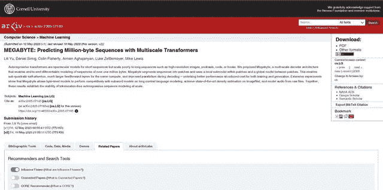

# 2023 年 5 月 30 日

## 【所想即所得！研究人员称 AI 模型 MinD-Video 可将大脑信号生成视频】

新加坡国立大学和香港中文大学的研究人员声称已经创造了一种人工智能——称为 MinD-Video，可以从大脑信号中重建“高质量”视频。

## 【英伟达 CEO 黄仁勋：AI 意味着现在每个人都可以成为程序员】

据报道，英伟达 CEO 黄仁勋周一表示，人工智能将使所有人只需对着电脑说话就能变身程序员，这意味着“数字鸿沟”被填平。

## 【调查：ChatGPT 成企业应用最多生成式 AI 工具，至少提升 50%生产力】

AI 平台 Writer 发布的一项关于生成式 AI 工具调查报告显示，ChatGPT 成为企业应用最多生成式 AI 工具；59%的企业今年已经购买或计划购买至少一种生成式 AI 工具；56%表示，生成式 AI 工具至少提升 50%或更多生产力；生成式 AI 工具几乎适用于企业每一个职能部门等。

## 【报告：中国 10 亿级参数规模以上大模型已发布 79 个】

在北京举行的中关村论坛平行论坛“人工智能大模型发展论坛”上，中国科学技术信息研究所所长赵志耘发布了《中国人工智能大模型地图研究报告》。

# 2023 年 5 月 29 日

## 【周鸿祎训练数字人代替演讲！直言有危机感 不想被数字人“干掉”】

2023 黑马 AIGC 产业大会上，360 集团创始人周鸿祎因为嗓子哑了不能到场，训练了数字人代替演讲。周鸿祎今天在🧣发文表示，观众认为数字人比本人温柔，让他有点危机感，直言不想被数字人干掉。

## 【韩国 Naver 将向外国政府提供其最新的、类似 Chatgpt 的人工智能模型定制版本】

韩国占主导地位的互联网搜索引擎 Naver 将向担心美国数据控制的外国政府提供其最新的、类似 Chatgpt 的人工智能模型的定制版本。据报道，Naver 倾向于为阿拉伯地区，以及西班牙和墨西哥等非英语国家开发本地化的人工智能应用程序。

## 【孩子王：公司 KidsGPT 智能顾问已正式推出】

孩子王在互动平台表示，公司 KidsGPT 智能顾问已在六一童玩节期间正式推出，实现在商业场景上的应用。目前，公司数字化技术应用中心针对 KidsGPT 智能顾问已经组建了专门的研发团队，负责 KidsGPT 智能顾问的研发、训练、应用等方面工作。

## 【中国工程院院士戴琼海：大模型预计 5 年左右将成为人工智能应用中的关键基础平台】

今日中国工程院院士、中国人工智能学会理事长戴琼海在中关村论坛上表示，大模型研究代表成果完全由美国主导，我国阿里、百度、清华等单位及时跟进，大模型预计 5 年左右将成为人工智能应用中的关键基础平台，类似 PC 时代操作系统，由美主导的大模型生态对我国形成严峻挑战。

## 【王兴：AI 将改变一切，内部团队正开发 AI 模型】

在近日美团一季度财报电话会上，针对 AI 相关问题，王兴表示，坚信 AI 将改变我们生活的方方面面，对 AI 的应用也绝不仅仅局限在手机或互联网行业。AI 的应用方式多种多样，AIGC（人工智能生成内容）只是其中的一部分。AIGC 将改变人们创作、生成内容的基本方式，同时也将对美团的业务造成影响。

# 2023 年 5 月 28 日

## 【李彦宏：百度要第一个把全部产品用大模型重做一遍】

我们正处在全新起点，这是一个以大模型为核心的人工智能新时代，大模型改变了人工智能，大模型即将改变世界。大模型时代来了，每一个产品都值得重做一遍，百度要成为第一个把全部产品都重做一遍的公司，不是整合，不是接入，是重做、重构。

## 【阿里研究员吴翰清离职，下一步或将开启 AI 短视频创业】

据 Tech 星球报道，阿里巴巴集团研究员吴翰清已从阿里离职，接下来其将深度拥抱 AI 新时代，投身于 AI 短视频赛道创业。这位被阿里程序员誉为大神的人，当下从阿里离职，也引发不少人关注。

## 【百度携大模型入局，电商要卷智商了】

百度移动生态最重要的大会之一——万象大会，在广州召开。大会现场，百度副总裁、百度电商总经理平晓黎提出智能电商战略，发布全新的百度电商品牌——百度优选。

## 【60 万年薪的高级工作可被 AI 取代：成本只要 2000 多】

最近几个月 ChatGPT 火遍全球，在帮助人类简化了大量枯燥工作的同时也让人很多人发愁，因为 AI 取代人类公司已经是现实了，而且它取代的还不是那种低级工作，年薪 60 万以上的数据分析师也难逃一劫。

## 【英伟达 AI 智能体接入 GPT-4，完胜 AutoGPT】

给游戏行业来点 GPT-4 式震撼？这个叫 Voyager 的智能体不仅可以根据游戏的反馈自主训练，而且还能自行写代码推动游戏任务。继斯坦福的 25 人小镇后，AI 智能体又出爆款新作了。英伟达首席科学家 Jim Fan 等人把 GPT-4 整进了「我的世界」（Minecraft）——提出了一个全新的 AI 智能体 Voyager。

# 2023 年 5 月 27 日

## 【李彦宏：未来你的薪酬水平将取决于提示词写的好不好】

百度创始人、董事长兼 CEO 李彦宏在 2023 中关村论坛发表题为《大模型改变世界》演讲。他表示，“我们正处在全新起点，这是一个以大模型为核心的人工智能新时代，大模型改变了人工智能，大模型即将改变世界。大模型成功地压缩了人类对于整个世界的认知，让我们看到了实现通用人工智能的路径。人工智能再次成为人类创新的焦点，越来越多的人认可第四次产业革命正在到来，而这次革命是以人工智能为标志的。”

## 【ChatGPT 在 iOS 美区下载火爆，6 天内下载量超过 50 万次】

尽管 OpenAI 的 ChatGPT 应用目前只面向美国的 iOS 市场，但它已经有了一个良好的开端。这款应用在发布后的头六天下载量就超过了 50 万次，这使它成为今年和去年发布的表现最好的新应用之一，仅次于 2022 年 2 月推出的由美国前总统特朗普打造的 Truth Social。

## 【又一开源替代品！Guanaco 性能已达 ChatGPT 级别】

有一种名为 `QLoRA` 的新方法可以在单个 `GPU` 上微调大型语言模型。目前已经有研究人员用它来训练 `Guanaco`，这是一个性能效果 99% 接近 `ChatGPT` 的聊天机器人。

## 百度度小满开源千亿参数金融大模型“轩辕”

度小满正式开源国内首个千亿级中文金融大模型——“轩辕”。轩辕大模型是在 1760 亿参数的 `Bloom` 大模型基础上训练而来，在金融名词理解、金融市场评论、金融数据分析和金融新闻理解等任务上，效果相较于通用大模型大幅提升，表现出明显的金融领域优势。

## 华为周斌：`AI` 算力需求正快速增加

华为昇腾计算业务 `CTO` 周斌在人工智能分论坛“智创大引擎，赋能新未来”上表示，大模型的效率曲线在持续演进，模型规模增加所带来的效果红利还在持续，也就意味着模型规模的增长脚步不会停下。

## Sam Altman 分享了他对人工智能未来的乐观看法

表示人们相互竞争以制造出越来越好的模型真是太棒了，只要我们不以会危及安全的方式竞争——如果我们在提高安全标准的前提下来竞争——我认为这是一件好事。

## 微软呼吁对人工智能监管

微软总裁 Brad Smith 周四表示，呼吁成立一个新的监管机构，通过向企业发放和管理许可证，来规范人工智能行业。

# 2023 年 5 月 26 日

## 机器人+`AI`，乐森打造全新家庭娱乐场景互动体验

乐森机器人（以下简称：乐森）在北京兰境艺术中心隆重举办以“Make Life More Fun”为主题的新品发布会。发布会上，乐森重磅推出三款消费级娱乐机器人，包括乐森巴斯光年、乐森大黄蜂 `G1` 性能版、乐森擎天柱《超能勇士崛起》精致系列机器人，以及两款乐森智能基地。期间，乐森首次对外公布了机器人四大核心技术以及三项关键人工智能技术。技术为芯，产品为足，成为乐森发展的原动力，正加速实现让消费级娱乐机器人正式进入人们的日常生活，开启消费级机器人新时代。

## 百度何俊杰：用 `AI` 原生思维“刷新”百度 `APP`、搜索、文库、电商等产品

在 2023 万象·百度移动生态大会上，百度集团资深副总裁、百度移动生态事业群组（`MEG`）总经理何俊杰发表《`AI` 重构未来》的主题演讲。

何俊杰首次提出要以 `AI` 原生思维重构百度移动生态，全面“刷新”百度搜索、百度 `APP`、百度文库、百度电商等产品与服务的用户体验，推动人机交互、内容生产、营销与商业三重变革。

## 卢伟冰：小米不会像 `OpenAI` 一样做通用大模型

在小米财报发布后的电话会议中，小米总裁卢伟冰在接受澎湃新闻记者采访时表示，会积极拥抱大模型，但不会像 `OpenAI` 一样做通用大模型，而是会深度和业务结合协同，利用 `AI` 技术提升内部效率。今年 4 月，小米正式组建 `AI` 实验室大模型团队。目前小米 `AI` 领域相关研发人员超 1200 人。

## `ChatGPT` 官方 `App` 在更多地区上线，含欧洲、韩国、新西兰等

`OpenAI` 今日宣布，其官方聊天机器人应用 `ChatGPT App` 已经在更多国家上线。上周，`OpenAI` 首次推出了这款移动应用，当时只能在美国市场下载，现在欧洲、韩国、新西兰等地方的用户也可以在 `App Store` 上下载这款应用。

## TikTok 据悉正测试 `AI` 聊天机器人“`Tako`”，可帮助用户发现短视频内容

据路透社报道，以色列人工智能公司 `Watchful Technologies` 称，`TikTok` 正测试一款 `AI` 聊天机器人，该工具可与用户交流短视频相关问题，并帮助他们发现内容。

## 英国首相会见 `OpenAI` 等三大人工智能企业 `CEO`：将携手确保 `AI` 技术造福社会

英国首相苏纳克同 `OpenAI` 首席执行官山姆·阿尔特曼、谷歌 `DeepMind` 首席执行官德米斯·哈萨比斯和 `Anthropic` 首席执行官达里奥·阿莫迪会谈后发布联合声明称，将携手确保社会从人工智能技术中受益。

## `AI` 首次通过广告图灵测试

人工智能（`AI`）广告首次通过广告图灵测试。据英国《新科学家》杂志网站 24 日报道，在一项衡量创造力和激发情绪反应潜力的测试中，`AI` 生成的广告的表现优于典型的美国平面广告，相关研究结果已经提交首届 `BrXnd` 营销和 `AI` 大会。

## 摩根大通打造 `ChatGPT` 式人工智能服务，为客户挑选投资标的

据报道，摩根大楼正在开发 `ChatGPT` 式软件服务，以帮助客户挑选投资标的。该行文件显示，该公司本月为一款名为 `IndexGPT` 的产品申请商标注册。`IndexGPT` 将采用“运用人工智能的云计算软件”来“分析和选择适合客户需求的证券”。

# 2023 年 5 月 25 日

## 微软打击 `AIGC` 深度伪造：使用密码学方法来标记 `AI` 生成的内容

在 `Build 2023` 开发者大会上，微软宣布将在未来几个月内增加一项功能，让任何人都能识别 `Bing Image Creator` 和 `Microsoft Designer` 生成的图像或视频片段是否是由 `AI` 生成的。

微软表示，“该技术使用密码学方法对 `AI` 生成的内容进行标记和签名，并附上有关其来源的元数据信息。”微软表示，该功能将适用于其两款 `AI` 内容生成程序支持的“主要图像和视频格式”，但是没有公布具体支持哪些格式。

微软本月早些时候宣布 `Bing Image Creator` 现已支持 100 多种语言，该程序已经创造了超过 2 亿张图像。

## 高通和微软达成合作，将规模化扩展 `AI` 能力

据高通官微消息，在 `Microsoft Build 2023` 开发者大会期间，高通技术公司展示了公司最新的终端侧 `AI` 创新，包括在骁龙®计算平台上运行生成式 `AI`，以及开发者在采用骁龙平台的 `Windows 11` `PC` 上创建应用的新路径。高通和微软确认达成合作关系，将面向消费级和企业级终端、以及工业设备，规模化扩展 `AI` 能力。高通表示，未来几个月内，包括大语言模型（`LLM`）在内的参数高达 100 亿的模型将有望在终端侧运行。据介绍，终端侧生成式 `AI` 解决方案将查询和推理转移到 `PC` 和手机等边缘终端。

## 马斯克：有必要开展 `AI` 业务抗衡谷歌和微软，推特与特斯拉可成为 `AI` 公司合作伙伴

马斯克在伦敦举行的《华尔街日报》`CEO` 理事会峰会上称，他认为有必要开展 `AI` 业务，与谷歌和微软相抗衡。

马斯克暗示，推特可能会是他创建 `AI` 业务努力的一部分。特斯拉一直在使用 `AI` 来改善其先进的辅助驾驶功能。马斯克称，推特和特斯拉可以成为一家 `AI` 公司的合作伙伴，类似微软和 `OpenAI` 之间的关系。据《华尔街日报》此前报道，马斯克已创建一家名为 `X.AI` 的 `AI` 公司。

## 西湖心辰、知衣科技联合推出面向服装设计行业的 `AI` 大模型 `Fashion Diffusion`

据心辰科技官微消息，西湖心辰和知衣科技近日联合推出了一款面向服装设计行业的 `AI` 大模型——`Fashion Diffusion`（以下简称 `FD` 模型），只需选择款式、颜色、材质等选项，10 多秒，`AI` 即可生成服装实穿效果图。`FD` 大模型的 `AI` 技术支持来自于西湖心辰，数据支持来自于知衣科技。

## 微盟发布基于大模型的 `AI` 应用型产品 `WAI`，当前已覆盖 25 个场景

过去半年，`AI` 大模型掀起全球发展浪潮，国内众多科技公司亦纷纷跟进入局。伴随 `AIGC`（人工智能生成内容）带来的“内容生产力”大爆发，以 `SaaS` 为代表的中国 `To B` 产业，正面临前所未有的新机遇。

在 `2023 Weimob Day` 微盟城市峰会北京站活动现场，微盟正式发布基于大模型的 `AI` 应用型产品 `WAI`。截至发布当天，微盟 `WAI` 已正式上线包括“话术生产、短信模板、商品描述、种草笔记、直播口播稿、👸号推文、短视频带货文案”等在内 25 个实际应用场景，其中部分高频应用场景，此前测试商家反馈已达到日常使用水平。

# 2023 年 5 月 24 日

## 孙燕姿回应“`AI` 孙燕姿”：人类无法超越 `AI` 做自己已然足够

近日，“`AI` 孙燕姿”翻唱歌曲在各大网络平台上走红。歌手孙燕姿在社交平台发文回应称，人类无法超越 `AI` 技术已指日可待，凡事皆有可能，凡事皆无所谓，“我认为思想纯净、做自己，已然足够”。

谈及近日引发争议的“顶流歌手 `AI` 孙燕姿”。博文称，粉丝们已经接受她就是“冷门”歌手，而 `AI` 却成为了目前的顶流。讽刺的是，人类无法超越它（`AI`）已指日可待。这种新技术将能够大量炮制每个人所需的一切。无论你多么小众、多么反常或者精神多么错乱，都可能有专门为你创建的独特内容。你并不特别，你已经是可预测的，而且不幸你也是可定制的。

## 推特疯传 `AI` 生成“五角大楼发生大爆炸”假图 导致股市短暂下跌

据法新社 5 月 22 日报道，一张五角大楼发生爆炸的假图像当天一度在网上疯传，导致市场出现长达 10 分钟的下跌，引发了关于生成式人工智能技术可能造成社会问题的进一步讨论。

## 微软必应成为 `ChatGPT` 内置搜索引擎

据《香港经济日报》报道，在 `ChatGPT` 及 `AI` 技术加持下，微软 `Build2023` 开发者大会上，宣布多项必应搜索及必应聊天服务新功能。其中最引人注目的更包括，必应搜索纳入 `OpenAI` 的 `ChatGPT`。微软 `CEO` 萨提亚。纳德拉表示，`ChatGPT Plus` 用户由即日起，可首先获得该新功能。在 `ChatGPT` 内置必应，亦意味着用户可以即时从线上取得更即时性、最新的答案。

## 鸿海推出新一代自动驾驶 `AI` 模型“`QCNet`”

每经 `AI` 快讯，鸿海科技集团官网宣布，旗下鸿海研究院人工智能研究所联合香港城市大学共同合作，首度推出新一代自动驾驶轨迹预测深度学习模型“`QCNet`”。据介绍，`QCNet` 可在复杂的道路环境捕捉车辆的多种潜在意图、超长距离预测未来 6 至 8 秒内的运动轨迹、可同时对场景中的多个目标进行准确的预测，并可将编码器的计算效率提升 85%以上。

## `Gartner`：约 26%中国用户已着手于生成式 `AI`

市场调查机构 `Gartner` 报告显示，在中国，有 6%的用户已经成功部署了与生成式 `AI` 相关的技术，有 26%的用户正在积极试点生成式 `AI` 技术，另有 24%左右的中国用户表示将在未来 0-6 个月内部署生成式 `AI` 相关的应用或技术。相比之下，东南亚和中东地区则为 3%，中国用户相对而言走在比较前面。

# 2023 年 5 月 23 日

## 甲骨易 `AI` 研究院“超越”中文大模型测试集正式发布

近期中文大语言模型蓬勃发展，但却一直少有出现可应用于评测“大模型能力”的测试。甲骨易 `AI` 研究院提出一种衡量中文大模型处理多任务准确度的测试，并在此基础上制作了一套适配“测试中文大模型”的数据集，并将其命名为“超越”，`MMCU`（`MassiveMultitaskChineseUnderstanding`）。据悉，5 月 20 日甲骨易 `AI` 研究院“超越”中文大模型测试集正式发布。

## 遭 `AI` 换脸名誉受损 多位网红博主起诉换脸手机 `APP` 运营公司

“`AI` 换脸”等深度合成技术快速发展，甚至已经能够达到以假乱真的水平，在一些影视、短片中，`AI` 换脸技术能够满足的需求越来越丰富。但该技术也被一些不法人员利用，生成恶搞视频、色情视频在网上传播、出售，对当事人的名誉造成侵犯。

企查查 `APP` 显示，近期，上海鱼腥草信息科技有限公司新增多份肖像权纠纷裁判文书。据悉，该公司系某款换脸手机 `APP` 运营公司，未经原告许可擅自使用其影像作品，并制作融脸视频模板，提供给付费会员使用。

## 苹果已在招聘有生成式 `AI` 背景或感兴趣的人员

据外媒报道，在 `OpenAI` 训练的人工智能聊天机器人 `ChatGPT` 大火之后，多家公司加入了生成式 `AI` 这一领域的竞赛，谷歌推出了竞品 `Bard` 人工智能聊天机器人，并已进行了升级，亚马逊也准备为电商增加类 `ChatGPT` 搜索，已在招聘研发人员。

## `GPT-4` 推理提升 1750％！普林斯顿清华姚班校友提出全新“思维树 `ToT`”框架

由普林斯顿和谷歌 `DeepMind` 联合提出的全新「思维树」框架，让 `GPT-4` 可以自己提案、评估和决策，推理能力最高可提升 1750%。简单来说，「思维树」可以让 `LLM`：

+   自己给出多条不同的推理路径
+   分别进行评估后，决定下一步的行动方案
+   在必要时向前或向后追溯，以便实现进行全局的决策

## 全国首个 `DNA` 存储领域预训练大模型“`ChatDNA`”发布

2023 祥符创新论坛转化医学产业高峰论坛在浙江嘉善举办。与会专家围绕精准医学及生命科学前沿热点问题，诊断技术、基因测序等前沿领域的最新进展，分享实践经验和创新思路，推动医学产业的健康发展。

## 蔚来汽车申请多个 `GPT` 商标

天眼查 `App` 显示，近日，上海蔚来汽车有限公司申请多枚“`KnowmeGPT`”“`NIOGPT`”“`NOMIGPT`”商标，国际分类涉及社会服务、建筑修理、科学仪器等，当前商标状态均为申请中。

## `OpenAI` 高层提议设立参考 `IAEA` 模式设立 `AI` 国际监管机构

人工智能的发展速度足够快，它可能带来的危险也足够明显，以至于 `OpenAI` 的领导层认为，世界需要一个类似于管理核能的国际监管机构——且速度要快。`OpenAI` 首席执行官 `Sam Altman` 上周向美国立法者提出了管理人工智能的各种想法，其中包括要求获得开发最复杂 `AI` 模型的许可证，并建立相关的治理体制，他本周正在访问欧洲政策制定者。（站长之家）

## `OpenAI` 正探索 `AI` 集体决策，提出类似维基百科条目模式

`ChatGPT` 的开发者 `OpenAI` 公司的总裁格雷格·布鲁克曼（Greg Brockman）表示，公司正测试如何收集影响其 `AI` 的决策的广泛信息。他提到了一种类似于维基百科的模式，后者要求观点不同的人聚集在一起，从而就百科条目达成一致。

# 2023 年 5 月 22 日

## 摩根大通算法交易产品 `Algo Central` 进军美国国债市场

摩根大通正推动其算法交易产品供应进军美国国债市场，押注计算机驱动的策略可以在这一世界上最重要的债券市场中更进一步。执行算法往往通过将大宗交易分成小块来评估各场所提供的价格，以决定如何以及何时进行交易。摩根大通等银行也寻求在推向更广泛的市场之前利用交易商的内部流程。除了将执行和分析工具 `Algo Central` 拓展至债券领域，摩根大通还将在未来几个月涵盖与其在外汇领域供应相同的市场结构信息。

## 知产学者丛立先：`AI` 生成作品应受法律保护

以 `ChatGPT` 为代表的人工智能应用愈发普遍，人工智能技术生成的内容是否应受法律保护素有争论。在 5 月 20 日举行的 2023 大湾区科学论坛上，华东政法大学知识产权学院院长丛立先称，当前阶段的生成式 `AI` 本质上仍是人类创作的工具，在不构成版权例外等特殊情况且满足作品构成条件下，其生成内容应受版权法保护。

## 国产中文大语言模型“`天河天元`”发布 由天河超算训练

国家超算天津中心刚刚在第七届世界智能大会期间举行的世界智能科技创新合作峰会上，发布了天河百亿亿级智能计算开放创新平台和国产中文大模型——天河天元。

## 第一代 `AIGC` 硬件悄然爆发，天猫精灵、小度、讯飞等齐上阵，`AIGC` 终端化浪潮开启

尽管人工智能喊了几十年，但 `AIGC` 的到来，可能还是第一次能够让普通人直接感受到技术的澎湃力量。实际上，除了天猫精灵的智能随身眼镜，`AIGC` 硬件过去一段时间内已经出现集中化涌现的浪潮。

百度小度全面接入文心一言，甚至借势推出面向垂直领域的智能手机产品；

科大讯飞的星火一经发布，就宣布接入旗下的学习机产品以及智能办公产品；

华米在其新款 `Amazfit Falcon` 运动智能手表上上线了 `ChatGPT` 表盘，拥有众多智能终端产品的小米更是爆出要自研大模型接入其生态产品中。

苹果批准了其 `AppleWatch` 硬件产品接入 `AIGC` 能力，智能眼镜公司 `Innovative Eyewear` 宣布将推出首款支持 `ChatGPT` 的智能眼镜。

## 有手就行？把大象 P 转身只需拖动鼠标，华人一作 `DragGAN` 爆火，代码预计 6 月开源

如果甲方想把大象 P 转身，你只需要拖动 `GAN` 就好了。在图像生成领域，以 `Stable Diffusion` 为代表的扩散模型已然成为当前占据主导地位的范式。但扩散模型依赖于迭代推理，这是一把双刃剑，因为迭代方法可以实现具有简单目标的稳定训练，但推理过程需要高昂的计算成本。

# 2023 年 5 月 21 日

## 扎克伯格：`Meta` 将建设一个新的人工智能数据中心

扎克伯格表示，`Meta` 将建设一个新的人工智能数据中心，该数据中心将配备支持液冷硬件的设备，以处理大规模的训练和推理；`Meta` 设计了“`Meta` 训练和推理加速器”首代定制芯片，为 `AI` 推荐系统提供动力；`Meta` 开发了名为“`CODECOMPOSE`”的生成式 `AI` 编码助手，帮助工程师在编写代码时提高效率。

## 张朝阳谈大模型：目前国内炒得过热，搜狐仍在观望

在搜狐科技峰会上，搜狐董事局主席兼 `CEO` 张朝阳在接受媒体采访时谈及了他对大模型的看法。他表示，搜狐现在没有去做大模型，目前还在观望，应该会从应用角度来看一看，相对还是比较谨慎一点，但在整个 `GPT` 的应用方面搜狐已经开始在产品里逐渐渗透了。

## G7 呼吁制定和采用 `AI` 国际标准

七国集团（`G7`）领导人共同呼吁制定和采用一项可信赖的人工智能国际技术标准，并认为这一科技前沿技术的监管治理未能跟上其发展的步伐。值得一提的是，这也是 `G7` 峰会历史上首次正式讨论人工智能这一新兴技术。

## `Meta` 开源了一个名为 `Image Bind` 的 `AI` 模型

AI 大战仍然在持续，各大科技企业不断推出令人惊叹的创新。最近，宣布推出一款开源的新 AI 模型，名为 ImageBind，它具备将多种不同方式的数据资料进行连接的能力，为未来创造身临其境的多感官体验打下了基础

# 2023 年 5 月 20 日

### 【《全球职场学习指数》2023Q1：除了 ChatGPT 还有什么好学的？】

全球知名人力资源调查机构 Unleash 发布，15 国 14000 客户。

ChatGPT 学习热度涨幅 4419%，美国地区最热衷，涨幅 5226%。

以下排名靠前的知识值得关切，都是 AI 相关：InfoSphere DataStage、Nutanix、Databricks Data Engineer Cert、Illustration、Security Info。and Event Mgmt……

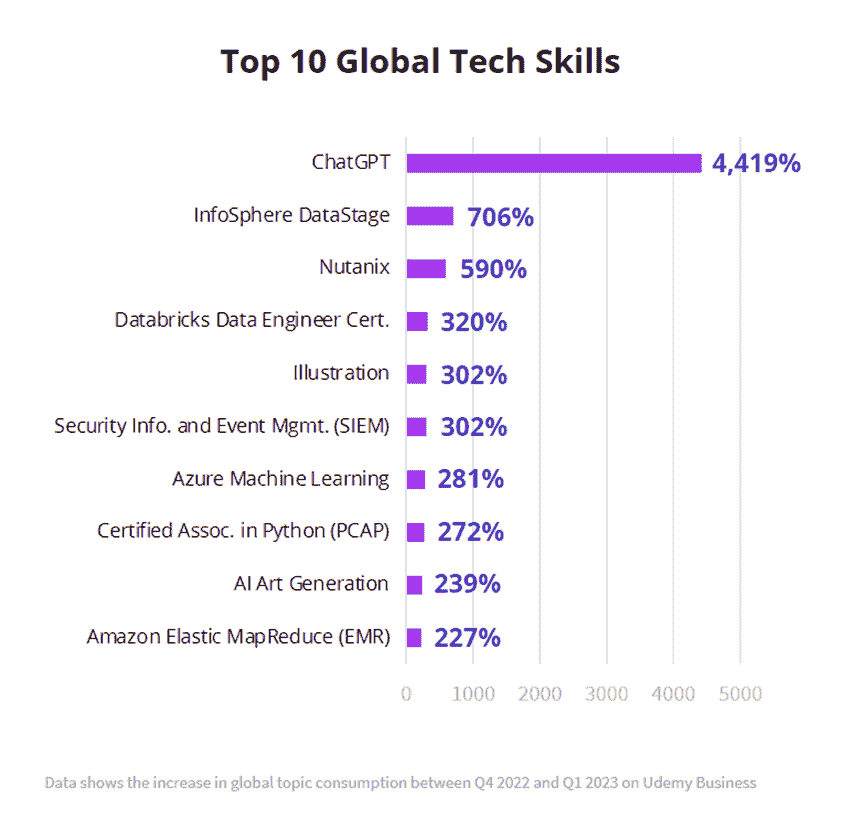

调查数据地址：https://www.unleash.ai/artificial-intelligence/chatgpt-is-the-most-in-demand-workplace-skill/

### 【苹果官方招聘：AIGC 人才猛增】

从 5 月初到现在，与 AIGC 相关的职位苹果增加了 20 多个：生成式 AI 研究科学家、生成式 AI 应用研究员、生成式 AI 机器学习工程师、视觉生成建模师、多模态工程师、NLP 产品经理等等。

苹果如何切入 AI 科研的军备竞赛，各位可以在 6 月 5 日苹果全球开发者大会上期待信息！

### 【又一视觉-语言模型的低成本版诞生！】

新加坡国立×清华大学的张傲，费豪，姚远，吉炜，黎力，刘知远，Chua Tat-Seng 提出了解决方案 VPGTrans，让视觉-语言大模型 VL-LLM 成本降低 94.8%这样！

论文地址：https://arxiv.org/abs/2305.01278

代码链接：https://github.com/VPGTrans/VPGTrans

多模态对话模型 Demo：https://vpgtrans.github.io/

### 【马化腾：AI 是互联网百年不遇的机会，类似于工业革命】

CEO 马化腾表示，“我们最开始以为 AI 是互联网十年不遇的机会，但是越想越觉得，这是几百年不遇的、类似发明电的工业革命一样的机遇。”他表示腾讯也一样在埋头研发，但是并不急于早早做完，把半成品拿出来展示。

### 【北京：变革软件领域的开发应用模式，利用生成式 AI 重构企业软件】

北京市经济和信息化局等三部门拟组织实施“北京市通用人工智能产业创新伙伴计划”

### 【OpenAi 推出 ChatGPT 官方 App 版本，上线美区苹果应用商店 AppStore】

首发当天苹果榜单第一，把连续把霸榜半年的拼多多海外版 Temu 打回榜单排名第二

### 【第七届世界智能大会“生成式 AI 产教融合创新高峰论坛”在津举办】

第七届世界智能大会“生成式 AI 产教融合创新高峰论坛”在南开大学举办。天津市人民政府副市长范少军，南开大学校长、党委副书记陈雨露，中国科协战略发展部副部长朱文辉出席并致辞。中国科学院院士、南开大学党委常委、副校长陈军主持论坛。

### 【英国电信计划到 2030 年裁员 5.5 万人 1/5 岗位将被 AI 代替】

英国电信（BT）计划在 2030 年之前削减多达 5.5 万个供岗位，以实现大幅削减成本，其中大部分岗位位于英国。多达五分之一的裁员将来自客户服务部门，因为这些员工将被包括人工智能（AI）在内的技术所取代。

### 【Meta 将推出首款定制 AI 芯片，功耗仅 25 瓦】

Facebook 母公司 Meta 分享了其数据中心项目的新细节，以更好地支持人工智能（AI）工作，包括一款内部开发的定制芯片“家族”的新成员。

### 【ServiceNow 与微软、OpenAI 建立 AI 合作伙伴关系，加入人工智能浪潮】

在数字化转型的浪潮中，ServiceNow 作为一家专注于数字工作流管理和自动化的公司，一直致力于帮助组织提高效率和改善用户体验。最近，他们宣布与微软和 OpenAI 建立合作伙伴关系，加入了人工智能浪潮，这是一项引人瞩目的举措。

# 2023 年 5 月 19 日

### 【ChatGPT 推出 iOS 版本应用 安卓版本也将很快推出】

今日消息，据外媒报道，OpenAI 首席技术官 Murati 发布推文称，该公司周四推出了 iPhone 版本的 ChatGPT 应用。她表示，ChatGPT 安卓版本也会很快推出。

1、暂支持美区 iOS 免费下载

2、功能与网页版相同

3、可以跨设备同步记录

4、支持通过语音模型 Whisper 语音输入

5、ChatGPT Plus 用户可以使用 GPT-4

传送门：https://apps.apple.com/us/app/openai-chatgpt/id6448311069?l=zh

### 【GPT+网络安全，深信服强势入局 AI 大模型赛道】

近期，深信服正式对外首秀安全 GPT 技术应用。深信服科技董事长何朝曦在现场分享了安全 GPT 技术应用的研发背景、技术应用特点及未来设想。深信服科技研发总经理梁景波、深信服安全攻防专家演示了安全 GPT 技术应用在 XDR 平台上的效果，包括高级威胁检测、安全监测调查、热门漏洞排查等，并在问答环节详细解答了媒体提问。

### 【周鸿祎公开演示大模型产品“360 智脑”及“360 鸿图”】

“我们坚持核心技术研发，已经形成‘双千亿’大模型布局。”

三六零（601360.SH）集团创始人周鸿祎在会上发表主题演讲并展示了两款大模型产品“360 智脑”以及 AI 生图工具“360 鸿图”。

### 【Meta 官宣 AI 训练与推理芯片项目，首款 MTIA 芯片部署时间未披露】

今日消息，Meta Platforms 披露了关于其数据中心项目的新细节，以更好地支持人工智能（AI）工作，包括内部开发的定制芯片“家族”。该公司称，MTIA 芯片功耗仅为 25 瓦——仅为英伟达等芯片功耗的一小部分——并且采用了一种名为 RISC-V 的开源芯片架构。Meta 承认其首款 MTIA 芯片在处理高复杂性的 AI 模型时遇到了挫折，但也指出，它在处理中低复杂性模型方面比竞争对手的芯片更有效。Meta 将其首款 MTIA 芯片描述为一次学习的机会。Meta 发言人拒绝就新款芯片的部署时间表置评。也拒绝详细说明开发可以训练模型的芯片的计划。

### 【美媒：苹果限制员工使用 ChatGPT 等外部 AI 工具，在开发自家技术之际担心泄密】

《华尔街日报》近日消息，文件显示，苹果已限制在公司内使用 ChatGPT 和其他外部 AI 工具，目前该公司正开发自家的类似技术。文件指出，苹果担心使用外部程序的员工“可能会泄露机密数据”。据悉，该公司还告知员工不要使用微软的 GitHub Copilot。

### 【美国教授用 ChatGPT “证实”论文抄袭 半个班学生惨遭挂科】

最近，得克萨斯农工大学（Texas A&M），发生了一件因 ChatGPT 而起的令人啼笑皆非的事。为了判断学生提交的论文是否作弊，一位名叫 Jared Mumm 的教授把这一重任交给了 ChatGPT。就这样，“悲剧”发生了，全班有一多半人的论文被 ChatGPT 不负责任地“认领”，因而挂了这一科。

### 【科大讯飞刘庆峰：“讯飞星火”大模型计划明年实现 GPT-4】

在 2023 天津世界智能大会上，科大讯飞董事长刘庆峰表示，旗下讯飞星火大模型将在 10 月 24 日实现对标 ChatGPT，实现中文超越 ChatGPT，英文相当于其水平。同时，刘庆峰表示，明年讯飞星火大模型达到 GPT-4 相应水平。

# 2023 年 5 月 18 日

### 【大连市科技创新大会正式召开】

百度 CTO 王海峰向会务领导展示了文心一言各种能力，并表示百度与各行业头部企业、机构共建了包括能源、金融、航天、制造、传媒、城市、社科以及影视等行业大模型。

### 【第七届世界智能大会开始！】

坐标天津，18-21 日。由天津市人民政府、国家发改委、科学技术部等多部委共同举办，吸引了智能科技领域的院士专家和世界 500 强知名企业家参会。

### 【SAP 与微软合作，通过 ChatGPT 简化招聘流程】

全球 ERP 领导者 SAP 宣布与微软达成技术合作，通过 Microsoft 365 Copilot、Azure OpenAI 等生成式 AI，帮助企业客户简化招聘等业务流程。

通过此次合作，SAP 将微软的多项类 ChatGPT 功能集成在人力资源解决方案 SAP Success Factors 中，通过自然语言就能生成职位描述、面试问题等，加速人才招聘流程。

### 【北京多单位抢抓大模型发展机遇】

北京市科委、中关村管委会，市经济和信息化局，市发展改革委会同相关单位制定了《北京市促进通用人工智能创新发展的若干措施（2023-2025 年）（征求意见稿）》，并于 5 月 12 日 - 19 日向社会公开征求意见。

优先侧重于政务、医疗、科研、金融、自动驾驶、城市治理。

相关网址：

### 【美图公司旗下美图设计室上线“AI 海报”功能，10 秒做出 100 张海报】

美图公司旗下美图设计室上线“AI 海报”功能，该功能旨在降低设计门槛，提高制作效率。在 AIGC 的加持下，让更多非专业人士也能轻松制作出高质量海报。

在场景落地方面，“AI 海报”不仅适用于电商从业者、🛰️营销用户和办公人员，还可以为广告宣传、个人活动等领域提供高效的设计方案，更好地满足用户需求，提升用户体验。

### 【阿里云中国区总裁黄海清：超过 2000 家伙伴在通义千问上测试】

在 2023 阿里云常州峰会上。阿里云智能中国区总裁黄海清表示，通义千问已有 2 千多个伙伴在测试。“未来大模型的发展是面向千行百业，面向行业的专属大模型会成为一个趋势。”黄海清还指出，以 AI 为核心的智算算力发展，未来五年复合增长率达到 52.3%，预计 2026 年整个智算算力规模会达到 1271.4EFLOPS。

相关网址：

### 【莫言在为余华颁奖时，幽默地表示给余华的颁奖辞是找了 ChatGPT 帮忙写的】

5 月 16 日，余华凭借获得《收获》文学榜 2021 年长篇小说榜榜首。在莫言给余华颁奖的环节，莫言称，颁奖词写了好几天也写不出来，找了 ChatGPT 帮忙。

### 【ChatGPT 通过美放射学委员会考试】

近期，加拿大科学家在 16 日出版的《放射学》杂志上刊登新论文称，最新版本的 ChatGPT 通过了美国放射学委员会的考试，突出了大型语言模型的潜力，但它也给出了一些错误答案，表明人们仍需对其提供的答案进行核查。

# 2023 年 5 月 17 日

### 【成都 GPT 闭门会内容有所公开】

由 NVIDIA 初创加速计划和 TGO 鲲鹏会在成都主办的“‘科技+资本’双轮驱动的 ChatGPT&LLM”闭门大咖会上，技术公司们提供了一些看法：

多模态 GPT 会是长期主战场；

昆仑万维 CEO 方汉：大模型提高人类智慧近乎不可能

2015 年之前小模型是理解语言的最先进的技术，未来大小模型联动发展和应用会是最佳路径——垂类发展着重依靠小模型

稀奇资本合伙人雷强生：更多商业机会集中在小模型和子模型方面

### 【ERP 领导者 SAP 公司与微软合作 AIGC 方向，助力客户简化招聘】

今日消息，涉及 Microsoft 365 Copilot 和 Azure OpenAI 两个大方向，并集成 GPT 功能在 SAP 公司的 SAP success factors，通过自然语言生成 JD 和细致的面试问题。

### 【毕马威确认合作微软，助力客户财税业务】

今日消息，在微软 Azure OpenAI 中通过毕马威专有数据+GPT 让业务流程缩短

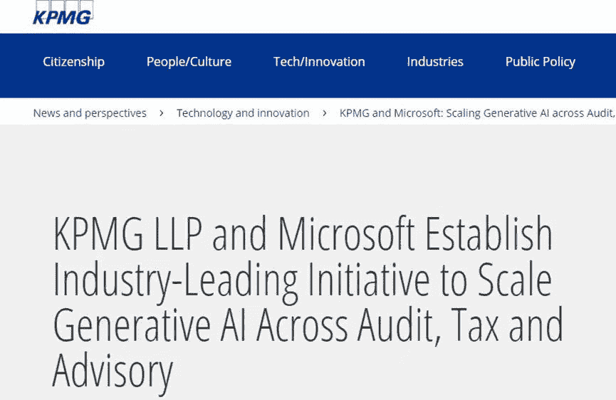

### 【医疗问答平台 Hippocratic AI 获得 5000 万美元种子轮投资】

由 General Catalyst 和 Andreessen Horowitz 领头。用于代替真人医生完成与咨询病患的丰富交流。该平台在美国医学执照考试 USMLE 的 114 项测试和认证中表现优于 GPT-4

体验地址：

### 【人工智能军备竞赛白热化：谷歌最新 AI 大语言模型数据量扩充 5 倍】

据报道，谷歌上周发布的最新大语言模型使用的训练数据，几乎是 2022 年的上一代模型的 5 倍。得益于此，该模型在编程、数学和创意写作方面的表现更为优秀。

谷歌是在其 I / O 开发者大会上发布最新通用大语言模型 PaLM2 的。内部文件显示，该模型采用了 3.6 万亿个令牌（token）进行训练。令牌指的是单词串，这是训练大语言模型的重要基础，因为这可以教给模型如何预测字符串中可能出现的下一个单词。

### 【亚马逊准备为电商增加类 ChatGPT 搜索 已在招聘研发人员】

据媒体报道，OpenAI 训练的人工智能聊天机器人 ChatGPT 大火，掀起了生成式人工智能研发及应用的浪潮，多家公司将相关技术整合到了他们的产品中，微软就将 OpenAI 的大语言模型引入了必应搜索引擎，谷歌在上周也推出了最新的人工智能语言模型“PaLM 2”，支持旗下的多款产品，包括 Bard 人工智能聊天机器人。

### 【360 与智谱 AI 宣布战略合作，共同研发千亿级大语言模型“360GLM”】

三六零（601360.SH，下称“360”）和智谱 AI 宣布达成战略合作，双方共同研发的千亿级大模型“360GLM”已具备新一代认知智能通用模型水准。

双方合作研发， 这也是基础模型和应用场景的一次有效结合。360 集团创始人周鸿祎曾多次表示，微软作为产业公司补齐了 OpenAI 的工程化、场景化、产品化和商业化能力，是微软和 OpenAI 珠联璧合的分工模式促成了这次人工智能拐点的涌现。国内应当建立大型科技企业+重点科研机构的产研协同创新模式，打造中国的“微软+OpenAI”组合引领大模型技术攻关。他表示，此次与智谱 AI 合作，正是借鉴了这种产研协同关系。

### 【孩子王：KidsGPT 将在今年“六一”期间正式推出】

有投资者在投资者互动平台向孩子王（301078.SZ）提问，“公司内测的 KidsGpt 什么时候上线？内测情况如何？”

孩子王回复称，KidsGPT 将在今年“六一”童玩节期间正式推出，更好地服务中国亲子家庭，实现“让每个童年更美好”的使命。

### 【WPS AI：将大模型（LLM）能力嵌入表格、文字、演示、PDF 四大组件】

CNMO 从 WPS 官方了解到，WPS AI 继首次亮相轻文档后，迅速进化并再次上新。支持桌面端和移动端。并用海外版向国际用户秀肌肉

# 2023 年 5 月 16 日

### 【OpenAI 将发布新的 AI 模型：开源，对付竞品】

路透社消息。应对开源界对 OpenAI 的压力。

### 【百度发布 Q1 财报，稳健业绩归功于 AIGC】

营收 311 亿元，同比增长 10%，百度智能云在本季度盈利了。

### 【OpenAI 创始人呼吁美国国会为 AI 系统制定安全标准】

美东时间 5 月 16 日，ChatGPT 缔造者、OpenAI 公司 CEO 奥特曼（Sam Altman）首次参加美国参议院司法委员会听证会，全程接近三个小时。面对议员提出有关 AI 影响选举、就业和过度集中于少数企业的问题，他呼吁美国政府对 AI 技术应进行更严厉的监管，并表示 OpenAI 以及谷歌等同行都应当承受压力。监管三要点都由 OpenAI 提供政府。

参议员 Dick Durbin 表示，大公司来到参议院“恳求我们的监督”，是很了不起的行为。

眼尖的群众发现了奥特曼逃避了极有争议的话题：AI 模型数据来源和版权

### 【国产开源的 ChatGPT 插件系统，面壁智能研发的大模型工具学习引擎】

发布于 GitHub 的 BMTools，让你可以方便调用人类现有的各种工具！从豆瓣电影到购物等等。

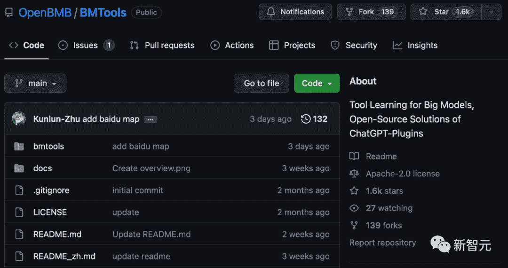

项目地址：https://github.com/OpenBMB/BMTools

令人兴奋的是，近期面壁智能联合来自清华、人大、腾讯的研究人员共同发布了中文领域首个基于交互式网页搜索的问答开源模型框架 WebCPM，这一创举填补了国产大模型该领域的空白。而 WebCPM 正是 BMTools 的成功实践。

### 【重庆人工智能创新中心正式投用：AI 集群总算力最高相当于 50 万台 PC】

近日，重庆人工智能创新中心正式投入使用。该中心是“东数西算”国家一体化大数据中心成渝枢纽节点的样板工程，布局的 AI 集群总算力，最高可相当于 50 万台 PC 的计算能力。创新中心后续计划首批为 25 家单位提供算力服务，覆盖自动驾驶、智能制造、智慧城市、生物医疗等具体应用场景；还将与重庆大学、金凤实验室共同孵化重庆首个医疗诊断领域的大模型，并面向开发者举办人工智能师资培训、昇腾 AI 创新大赛等活动。

### 【中文在线：已在有声书生产中应用 AI 主播，录制时长已超 18 万小时】

中文在线近日在分析师会议上表示，2021 年初公司就在 AI 声音方面进行探索，现实现业务落地，公司已在有声书生产中应用 AI 主播。AI 主播可以快速实现文本到语音的转化，极大地丰富了公司内容产品的多样性，目前公司有声书资源超 46 万小时，其中 AI 主播录制的有声书时长已经超过 18 万小时，占比四成。

### 【AI 歌手翻唱大火 专家提示：可能涉及多项侵权问题】

继绘画、文案之后，人工智能（AI）将触手伸向了音乐圈。“2003 年大火的歌手：孙燕姿；2023 年爆火的歌声：AI 孙燕姿。”在多个视频及音乐平台上，“AI 孙燕姿”俨然成为流量密码，多个相关视频收获上百万播放量。“AI 陈奕迅”“AI 周杰伦”等也如同雨后春笋般纷纷涌现。

AI 歌手让网友们看着新鲜，生成式人工智能（AIGC）的法律底线和监管规范也再度引发行业热议。“应当仔细审视 AI 歌手的法律风险，尤其是著作权风险。”专家表示，目前业内已有专门针对 AIGC 的监管办法公开征求意见，加速产业规范健康发展。

### Midjourney 官方中文版在 🐧 开启内测申请

据 Midjourney AI 🛰️👸号消息，Midjourney 官方中文版现已开启内测。据悉，Midjourney 官方中文版将搭载在 🐧 频道上。内测期间，每周一、周五 18 点 -20 点统一开放进频道，达到一定人数后会关闭入口。加入频道后，用户在常规创作频道中输入 `/想象` + 生成指令，即可召唤 Midjourney 机器人进行作画。除了可以调用 MJ 和 Niji 的最新模型和所有参数以外，Midjourney 还上线了多种图片修改功能，其中部分功能仅对订阅付费会员开放。

# 2023 年 5 月 15 日

### 仙剑世界等游戏接入微软云，本地化部署

今日，中手游（0302.HK）宣布了与微软云的服务框架，后续中手游的多款游戏将接入 Azure OpenAI，降本增效的同时实现新体验的 NPC 交互、UGC 编辑器使用体验、定制化的沉浸体验。其中仙剑 IP 的《仙剑世界》已经推出实机视频并开启预约，年内有望拿到版号上线

### AI 加持下 Bing 市场份额不增反降 4 月份降至 7.14%

近日消息，今年早些时候，微软推出了基于生成式人工智能的聊天机器人 BingChat，并获得了广泛关注。但近日，根据市场调查机构 Statcounter 的最新报告，今年 4 月，在 AI 加持下的 Bing，市场占有率却不升反降。

### 三星电子和 Naver 拟联手打造生成式 AI 与 AI 芯片，或今年下半年发布

《韩国经济新闻》5 月 14 日消息，韩国两大科技巨头——三星电子和 Naver 已同意联合开发一款用于企业的生成式 AI，与 ChatGPT 等工具竞争。据悉，两家公司目标最早 10 月发布。

### 360 浏览器推出 AI 工具导航“AI 商店”

360 集团创始人周鸿祎做客央视《对话》节目，宣布 360 上线 AI 商店。360AI 商店作为 AI 导航，将集成全球 AI 工具，一方面利用流量优势为研发 AI 垂直应用的创业公司提供展示窗口，另一方面让普通用户使用 AI 工具更加便捷。周鸿祎表示，大语言模型跃进式发展，中国进入“万模大战”，要让用户“用脚投票”。`ai.hao.360.com`

### 推动 AI 大模型发展，中关村科学城科创大赛全球招募项目

在近日举行的 2023 中关村论坛系列活动——中关村人工智能创新大会暨 2023 中关村科学城科创大赛发布会上，市、区联合推动中关村科学城人工智能大模型创新发展的相关举措公布，2023 中关村科学城科创大赛同步启动，面向全球招募参赛项目。

北京市政府相关负责人介绍，随着新一轮科技革命浪潮袭来，人工智能已成为国家战略布局的重点领域，北京市将持续支持中关村科学城培育新兴产业集群，推动北京人工智能产业占先发展。

### 前搜狗 CEO 王小川：未来不会用 ChatGPT 就像今天不会用 Internet 的人

快科技 5 月 14 日消息，去年 11 月，美国 OpenAI 推出了 ChatGPT，五天用户数破 100 万，两月后月活跃突破 1 个亿，ChatGPT 成为人类历史上用户数增长最快的消费级应用。

### 超越 GPT-4，华人团队爆火 InstructBLIP 抢跑看图聊天，开源项目横扫多项 SOTA

碾压 GPT-4 识图能力的多模态生成模型来了。继四月 MINI-GPT4 之后，又有华人团队最新提出的 InstructBLIP 在多项任务上实现 SOTA，是从 BLIP2 模型微调而来的模型

GPT-4 看图聊天还没上线，就已经被超越了。

# 2023 年 5 月 14 日

### 谷歌发布新型 AI 工具“MusicLM”:文字描述生成音乐

谷歌在日前的 I/O 大会发布了新型 AI 工具「MusicLM」能把文字描述转化为音乐。在 Web、Android 或 iOS 上的 AI Test Kitchen 应用程序中，用户可以输入提示，如「晚宴深情爵士乐」或「创建具有催眠效果的工业声音」，让 MusicLM 将生成多个版本的音乐。

### 谷歌推出 AI 视频对口型技术：根据翻译语言改变人物说话方式，但不开放使用

该工具旨在将视频从一种语言翻译成另一种语言，同时保留整体基调和氛围，这意味着该技术不仅可以将音频从一种语言翻译成另一种语言，还可以模仿说话者的声音、语气和面部表情，人物说话视频会根据目标语言的发音同步改变口型，最后会根据 AI 生成的语音的发音同步视频中说话者的口型。

### Sky360 项目：创建 AI 系统，实现全天候监测 UFO

一支开发团队近日发起了开源公民科学项目 Sky360，希望搭建一个覆盖全球的低成本监测网络，实现 24/7 全天候观察天空，从而发现 UFO 事件。

### 微软必应 GPT 聊天周报：引入知识卡片，优化购物、天气等内容

微软必应聊天（Bing Chat）在最新周报中，介绍了自 5 月 4 日以来引入的新功能、新特性。其中主要在聊天结果中引入知识卡片，优化购物、天气、金融和汽车相关的内容等等

### 云知声山海大模型 5 月 24 日发布

国内 AI 公司云知声宣布将于 5 月 24 日召开云知声山海大模型暨成果发布会，还将发布基于山海大模型的智慧医疗、智慧物联和企业服务的产品与解决方案。

### Meta 推出人工智能“AI Sandbox”帮助广告主生成广告 Stable Animation 发布：可根据文本生成 3D 动画模型

这是 Meta 最新的一项努力，展示其在炙手可热的人工智能领域的巨额投资正在取得回报，而公司需要面对放缓的广告增长和昂贵的元宇宙过渡。在 Meta 最近的财报电话会议上，首席财务官 Susan Li 表示，该公司今年的资本支出将在 300 亿至 330 亿美元之间，这一展望「反映了我们持续扩展 AI 能力以支持广告、Feed 和 Reels，以及对生成式 AI 计划能力的增加投资」。

### 法国兴业银行：没有 AI 热就没有美股涨

法国兴业银行策略师 Manish Kabra 表示，围绕人工智能（AI）的投资如火如荼，若非如此美国股市今年迄今就会下跌。 以英伟达为例，对 AI 趋之若鹜的投资者推动这个复杂人工智能计算任务所需芯片的生产商今年来暴涨了 96％。微软和 Alphabet Inc．的股价大涨也是拜他们所赐，因为这些科技巨头竞相在产品和服务中添加 AI 功能

### 洛天依及众多 AI 歌手最新歌曲《我有祖国，我有母语》

《我有祖国，我有母语》是洛天依演唱的最新单曲，这次参加演唱的全部为 AI 歌手，在歌词宏大的主题下，阵荣庞大的 AI 歌手洛天依、雀河、鲤沅、火涟、文栗、小夜、云灏分别演唱歌曲中的流行、戏曲、美声、童声及伴唱和音等。

# 2023 年 5 月 13 日

### Meta 测试生成式 AI 广告工具：可自动生成广告语和图像

Meta 宣布推出一个面向广告主的生成式 AI 工具，名为“AI Sandbox”。目前 Meta 正在一小群广告主中测试这个基于生成式 AI 的广告工具，预计 7 月才会大面积推广。

### Stable Diffusion 又出大招！“文生动画”震撼发布淘汰导演，DC 英雄一秒变身

Stability AI 发布了一款专为艺术家和开发人员设计的工具——Stable Animation SDK。用户可以通过多种方式创建令人惊叹的动画效果，Stable Diffusion 也能生成视频了。

### 英特尔与波士顿咨询公司联合推出企业级生成式 AI 解决方案

波士顿咨询公司（BCG）和英特尔宣布开展战略合作，利用端到端的英特尔 AI 硬件和软件实现生成式 AI（GenAI），为企业客户提供完全定制的专有解决方案，同时将私有数据隔离在可信环境中。

### OGP 打造全球首个“AI+美容仪”护肤生态，宅家也能智能美容

近日，医研科技品牌 OGP 美容仪智能系统全面升级，以创新科技为实力，首创“AI+美容仪”的抗衰理念，并将智能化技术打通全链路护肤过程，正式开启家用美容仪智能化时代。

### “AI 孙燕姿”出道即成顶流！律师：这种情况下涉嫌侵权

“AI 孙燕姿”成为新晋顶流网红，在 B 站上有近百个相关音乐视频。在某网络音乐软件上，以“AI 孙燕姿翻唱”为主题的歌单里，也有近 70 首歌曲。这位“AI 孙燕姿”，翻唱了周杰伦、王力宏、刘欢等数位歌手的歌曲，作品覆盖流行到民谣等多种风格，有的播放量甚至超过百万。

### Meta AI 研究人员演示新模型 AGRoL:有望让虚拟化身“长出”双腿

Meta AI 研究人员正趋向于呈现逼真化身腿部显示，而无需额外的追踪硬件。开箱即用，目前的 VR 系统只追踪用户的头部和手部位置。用户的肘部、躯干和腿部的位置可以使用一类称为反向运动学（IK）的算法来估计，但这有时只对肘部准确，很少对腿部进行校正。对于每组给定的头部和手部位置，都有太多潜在的解决方案。

# 2023 年 5 月 12 日

### 软银宣布加入 AI 竞赛：打造“日版 ChatGPT”

据 IT 之家消息，软银集团旗下的电信子公司软银公司宣布加入 AI 竞赛，开发类 ChatGPT 工具，该消息推动了一批与 AI 相关的日本公司在周四的股市中大涨。

### 比亚迪智能驾驶研发换帅，筹备 AI 芯片团队

在比亚迪看来，电动化是上半场、智能化是下半场。该公司也多次提到，比亚迪战略重视智能驾驶发展，并将适时推出满足消费者需求的技术与产品。

目前，比亚迪汽车已经凭借领先的三电系统和供应链垂直一体化等深厚布局拿下国内新能源领域头把交椅，然而其辅助驾驶系统却常常遭人诟病，甚至有很多车型一年到头都很难看到几次 OTA 系统更新。

### 专为安卓开发者打造！谷歌推出 AI 编程机器人 Studio Bot

谷歌在 I / O 2023 开发者大会上，面向安卓开发者推出了 AI 编程机器人 Studio Bot。该工具可以生成代码、修复 BUG、以及回答关于安卓应用开发的相关问题。

谷歌表示该机器人建立在 Codey 模型基础上。Codey 是谷歌最新推出的基础编程模型，基于最新的 PaLM2 大型语言模型（LLM）。Studio Bot 同时支持 Kotlin 和 Java 编程语言，并将直接嵌入到 Android Studio 开发工具的工具栏中。

谷歌表示 Studio Bot 不会收集开发者的代码，但会收集开发者和 Studio Bot 的对话数据。谷歌表示，该机器人仍处于“非常早期的阶段”，但它将继续训练它以改善其答案。

### IBM 发布新的人工智能和数据平台 Watsonx

近日，IBM 在年度 Think 会议上公布了企业级生成式人工智能和数据平台“Watsonx”。

据悉，该平台包括新一代 AI 平台“Watsonx.ai”、基于开放式 Lakehouse 架构搭建的数据仓库“Watsonx data”，以及 AI 治理工具包“Watsonx.governance”三个产品集，旨在为 AI 模型构建者提供开放的综合性服务。其中，Watsonx.ai 和 Watsonx data 将于 7 月正式面市，而 Watsonx.governance 预计将在 10 月面市。

### 美国网红做了一个“AI 版自己”：和网友谈恋爱每分钟收费 1 美元

近日，23 岁的 Caryn Marjorie 是 Snapchat 上拥有 180 万粉丝的网红。她最近推出了一个基于自己声音、行为和个性的 AI 语音聊天机器人，名为 CarynAI。用户只需支付每分钟 1 美元的费用，就可以让 CarynAI 做你的女朋友。

### 谷歌发布“AI 笔记本”学习工具项目 Tailwind

谷歌公司在其 I/O 开发者大会上发布 AI 文件管理工具项目“Project Tailwind”，它被描述成一种未来的笔记本和私人的人工智能模型，可以根据用户上传的文档训练。用户可以向 AI 提问，并得到关于文档的反馈。谷歌将其定位为一款学习工具，目前仍处于“早期”阶段，仅在美国开放候补测试。

### 小度手机将搭载 AI 学习大模型

小度即将发布的“小度青禾”手机，将搭载小度教育领域 AI 学习大模型。可实现从多学科教学、AI 作业辅导、个性化互动讲解、精准专项指导等全链路智能辅学服务。此外，据小度科技 CEO 透露，小度还将于近期推出全新品牌“小度青禾”。

# 2023 年 5 月 11 日

### SD 文本生视频功能实现！

继 Runway 的 Gen-2 之后，Stability AI 推出了 Stable Animation SDK 来实现惊叹的动画效果：咒语生成、咒语+图片生成、咒语+视频生成。

目前仅提供 SDK 和付费 API 服务，每 100 帧价格从 3 美分到 18 美分不等，一元人民币大概能生成 1024*1024 的 100 帧动画。

网友作品：

### 谷歌发布 AI 语言模型 PaLM 2：挑战 OpenAI

今日消息，谷歌年度开发者大会 Google I/O 2023 上，PaLM 2 大模型正式发布，准备向 OpenAI 的 GPT-4 等竞争对手发起挑战。编程数学题做作文全拿下，支持 100 多种语言。

### 打破传统拍摄方式：美图“AI 换装”为电商商家带来全新体验

美图公司旗下美图设计室上线“AI 换装”功能，“AI 换装”功能基于 AIGC 与业务的结合，旨在助力电商商家降低服装拍摄成本，提高服装上架速度和展示效果。该功能不需模特也能拍出高质量服装上身图片，可一键实现虚拟模特换装，革新服装电商图片拍摄方式，使电商商家不再需要支付昂贵的模特费用和摄影拍摄费用。

### OpenAI 开源 3D 模型生成器 Shap-E 业内人士：3D 领域的重大突破

OpenAI 日前公开了其最新的开源模型 Shap-E，这款创新型 3D 模型生成器能将描述性的文本转化为相应的 3D 模型。据悉，用户只需提供描述性的文本，就能生成具有高度细节和复杂度的 3D 模型，大大提高了创作的效率和质量。

### OpenAI 重磅研究！用 GPT-4 解析 GPT-2 样本，开启 AI 思考之门

OpenAI 今晨发布一个关于 GPT-4 语言模型解析神经元的对齐性研究成果，利用自研基于 GPT-4 技术的开源工具，来尝试计算其他架构、更简单语言模型上神经元的行为并对其进行评分，而且可以将其应用于另一种语言模型中的神经元——本次选择 4 年前发布、包含 307200 个神经元的大模型 GPT-2 为实验样本，公开了这些 GPT-2 神经元解释和分数的数据集。

### 谷歌 AI 聊天机器人 Bard 全面开放使用，增加日语、韩语支持

当地时间 5 月 10 日，谷歌公司（Google）在其 I/O 开发者大会上宣布取消其 AI 聊天机器人 Bard 的候补名单，向 180 个多个国家和地区全面开放使用，增加对日语和韩语的支持，并将“很快”扩展至 40 种语言。

谷歌还宣布了 Bard 的一系列新功能，包括支持将 Bard 的回答导出到 Gmail 和 Google Docs，与 Google 办公套件和第三方应用程序集成；引入 Google Lens 的功能，支持问答中使用图像；改进代码引用功能等。

### OpenAI 首席执行官将首次在美国国会作证，向参议院人工智能监管小组发言

美国参议院司法机构隐私、技术和法律小组委员会发布声明称，其将于 5 月 16 日听取奥特曼以及 IBM 首席隐私和信任官克里斯蒂娜·蒙哥马利（Christina Montgomery）的意见。美参议院多数党领袖查克·舒默已将监管人工智能作为优先事项。奥特曼上周接受美国消费者新闻与商业频道（CNBC）采访称："从长远来看，我们需要政府采取行动、制定法规和标准，确保我们从 AI 技术中获得尽可能多的好处，并尽量减少不利因素。”

# 2023 年 5 月 10 日

### 盖茨再次力挺 AI：革命性技术改变游戏规则 利大于弊

近期，美国广播公司（ABC News）发表了对微软创始人比尔·盖茨的采访，盖茨在采访中谈到了他对人工智能（AI）的看法，以及 AI 对世界未来的意义。

盖茨认为 AI 非常重要，将改变游戏规则。他补充称：“我们经常惊讶于它有多好，偶尔会惊讶于它不能做什么。尽管（这项技术）尚处于早期阶段，但具有革命性。”

盖茨称，他认为 AI 在所有行业都有巨大的潜力，将改变我们思考事物的方式。他举例称，在健康和教育领域，如果使用得当，AI 将会发挥绝佳的作用。

盖茨还表示，他对 OpenAI 取得的飞跃印象深刻，从 GPT-3 到 GPT-4，进步程度之大，让他惊叹不已。

### 阿里巴巴蔡崇信：不用过于担心 AI 机器人比人类更聪明甚至取代人类

对于飞速发展的人工智能及其可能的负面性，阿里巴巴集团董事会执行副主席蔡崇信在澳门国际科技创新博览会上表示，不用过于担心 AI 机器人比人类更聪明甚至取代人类。

他认为，人类的大脑还有成千上亿的细胞还没有被认识和探索，人类的潜能还有很多未被认知和开发。另外，机器人此前只能做一些重复性工作，现在 AI 虽然已经可以做简单的创意性工作，但机器人很难复制人类相互之间的关系、情商、感情、欲望等。

### AI 可识别疑难罕见肿瘤 达摩院论文荣获 CVPR 2023 Highlight

从阿里达摩院获悉，达摩院医疗 AI 团队的论文被计算机视觉国际顶会 CVPR 2023 评为 Highlight（亮点），从近万篇论文中脱颖而出。这篇论文聚焦于视觉领域著名的 OOD 难题，提出了全新的医学图像语义分割框架，能够让 AI 更准确地识别肿瘤中的疑难罕见案例，目前已在胰腺肿瘤和肝脏肿瘤上获得验证。

## 【周杰伦官宣数智人「周同学」】

近日，周杰伦亮相中国移动元宇宙总部，与中国移动达成元宇宙领域系列合作，共同推出了数智人“周同学”。

周杰伦从 2003 年开始代言“动感地带”，可以说是中国移动 20 年的忠实合作伙伴，8 日下午，中国移动动感地带官宣了“周同学”三重身份——中国移动动感星推官、中国移动 5G 元宇宙星际开拓官、中国移动 5G 视频彩铃推广大使。至此，拥有三个新角色的“周同学”正式加入中国移动，工号 0716。

## 【阅文集团侯晓楠：关注以 AIGC 为代表的人工智能对 IP 改编效率等方面的提升】

据悉，董事会委任阅文集团总裁侯晓楠出任阅文集团首席执行官。侯晓楠接任 CEO 后，在阅文内部明确了三个重点方向。首先是持续发展作家和内容生态，建立跨公司跨行业的版权保护统一战线，继续扶持科幻、现实等多元品类和新人作家，并积极探索更多内容分发路径。其次，深耕 IP 生态链和提升商业化能力，与战略伙伴建立长期互信的关系，实现《庆余年》《赘婿》《斗破苍穹》《大奉打更人》等更多 IP 的有声、动漫、影视、游戏、衍生品改编；在视觉化基础上，积极探索 IP 在游戏、衍生品等领域的延展。最后，关注前沿科技创新，关注以 AIGC 为代表的人工智能对用户创新体验、IP 改编效率方面的提升。

## 【ChatGPT 之父”推出世界币 App，或成 AI 时代的“身份证”】

据悉，人工智能机构 OpenAI 的联合创始人山姆·奥特曼（Sam Altman）的加密货币项目“世界币（WorldCoin）”推出新产品——加密钱包 World App。作为世界币推出的首款消费级产品，World App 建立在以太坊侧链 Polygon 之上，任何人都可以在任何时间下载、使用。

## 【国光电器收关注函：要求说明智能音响业务是否搭载 ChatGPT 等应用】

国光电器收到深交所关注函，要求说明公司与相关客户在 ChatGPT 领域开展合作的具体情况；说明公司主营业务与 ChatGPT 之间的关系、相关产品运用 ChatGPT 等技术的具体情况、公司智能音响业务是否已实际搭载 ChatGPT 等应用、相关产品的数量占比及收入金额。

## 【Meta 开源多感官人工智能模型结合六种类型的数据】

5 月 10 日消息，Meta 公司宣布了一个新的开源人工智能模型 ImageBind，该模型是第一个将六种类型的数据结合到一个单一的嵌入空间的模型。六种数据包括视觉（图像和视频形式）；热能（红外图像）；文本；音频；深度信息；以及最有趣的--由惯性测量单元或 IMU 产生的运动读数。该模型目前只是一个研究项目，没有直接的消费者或实际应用，但它指出了生成性人工智能系统的未来，可以创造沉浸式多感官体验。

# 2023 年 5 月 9 日

## 【正面对抗微软 BingChat：谷歌将用 AI 升级搜索引擎】

近日，一份谷歌内部文件显示，该公司将计划使用 GPT，对现有的搜索引擎进行优化升级。

据悉，谷歌内部正在开发一个名为 Magi 的 AI，该 AI 将与微软的 BingChat 类似，搜索引擎+GPT，能够帮助用户进行搜索，更便捷地获取所需信息。

## 【韩国提出以「GOV-GPT」形式在内部自主开发 AI 模型】

据韩联社消息，虽然三星电子等大公司正在限制内部使用生成人工智能（AI），现在公共部门也出现了抑制 AI 使用的氛围。日前据业内人士和当局透露，韩国国家情报院提出对各部门公务员的要求注意事项，强调在使用 OpenAI 的 GPT 系列时，只能输入公开信息，科学部、信息通信部等部门也向相关部门提供指引，它发布了 AI 安全指南以供遵循。

## 【视觉中国 AI 创意工具上线，可对版权图片进行二次创作】

近期，视觉中国官方宣布上线基于 AIGC 的新功能，允许用户基于 AIGC，实现对版权图片的二次创作。根据视觉中国介绍，目前网站支持模特转换、插画转换两项 AI 功能。其中，模特转换能够将欧美模特的照片自动处理，帮助用户便捷地获得具有东方人物特征的创意图片。而插画转换功能，则能够在照片素材的基础上，通过分析摄影作品的色彩、纹理、明暗度等特征，将摄影作品快速转换为插画作品。

# 2023 年 5 月 8 日

## 【利欧股份：旗下利欧数字推出 AIGC 平台“LEO AIAD”】

据利欧股份官微今天消息，该公司旗下利欧数字网络宣布推出面向营销全行业的 AIGC 平台“LEO AIAD”。据介绍，目前，“LEO AIAD”每天最高可实现高达 72 万张图片的产值，设计师出图的速度可从原先的平均 6 小时/图提升至 1 分钟/图。该平台已向公司全体员工开放使用。

## 【讯飞星火算力硬件主要由华为提供，华为已派驻特战队】

讯飞星火认知大模型发布会后，科大讯飞 CEO 刘庆峰透露：讯飞星火认知大模型算力硬件主要由华为提供，当前阶段不会受到限制。并且，华为已经给讯飞派驻特战队，让大模型的算法在国产硬件上应用有更好的效果。他表示：“目前国内的 AI 算力落后美国一代，但是未来 AI 竞争的关键不是算力。就国内做大模型的企业来看，算力和数据是国内企业共同的短板，而不是科大讯飞一家的短板。”

## 【Meta 从独角兽公司 Graphcore 挖来 AI 网络芯片团队】

据路透社消息，Meta Platforms 公司已聘请了一个位于挪威奥斯陆的团队，该团队直到去年年底还在英国芯片独角兽 Graphcore 开发人工智能网络技术。经确认的 10 名员工在 LinkedIn 上的个人资料显示，他们在 Graphcore 工作到 2022 年 12 月或 2023 年 1 月，随后于今年 2 月或 3 月加入 Meta。Meta 的一位发言人在回应置评请求时证实了这一招募。这 10 名员工在 LinkedIn 上的职位描述表明，该团队曾在 Graphcore 从事人工智能专用网络技术的研究，该公司开发针对人工智能工作进行优化的计算机芯片和系统。

## 【科大讯飞董事长刘庆峰：10 月 24 日前，星火大模型能力将对标 ChatGPT】

在科大讯飞星火大模型发布会上，科大讯飞董事长刘庆峰表示，讯飞星火大模型将在 6 月 9 日前，将开启实时问答，升级多轮对话能力；在 8 月 15 日前，再次提升代码能力以及多模态交互能力；在 10 月 24 日前，星火大模型将对标 ChatGPT，在中文能力上超过 ChatGPT，在英文能力上与 ChatGPT 相当。

## 【IBM 加入战局，任意大模型低成本变 ChatGPT 方法开源，个别任务超 GPT-4】

科幻中有机器人三原则，IBM 说不够，要十六原则。最新大模型研究工作中，以十六原则为基础，IBM 让 AI 自己完成对齐流程。全程只需 300 行（或更少）人类标注数据，就把基础语言模型变成 ChatGPT 式的 AI 助手。

更重要的是，整个方法完全开源，也就是说，任何人都能按此方法，低成本把基础语言模型变成类 ChatGPT 模型。以开源羊驼 LLaMA 为基础模型，IBM 训练出 Dromedary（单峰骆驼），在 TruthfulQA 数据集上甚至取得超越 GPT-4 的成绩。

# 2023 年 5 月 7 日

## 【周鸿祎预测 ChatGPT 发展：它的进化速度非常快 几年后可能会失控】

360 创始人周鸿祎今天在与俞敏洪的对话中谈到 ChatGPT，他认为其发展是指数级的，几年后可能会失控。同时他认同王小川观点：我们与国外差距大概两年。

此前，据澎湃新闻报道，周鸿祎在采访中还表示，ChatGPT 可能在 2-3 年内就会产生自我意识威胁人类。

360 大模型产品名为：360 智脑。

## 【鲲鹏和昇腾 AI 开发者超过 350+万】

合作伙伴超过 5600 家，解决方案认证超过 15500 个，其中 `openEuler`（欧拉操作系统）的商业装机量实现指数级增长，跨越生态拐点。

## 【昆仑万维：今年发布 GPT 大模型，开源】

另旗下收购的 Opera 浏览器开发商推出了适配 AI 的浏览器 Opera One

## 【📕 筹建大模型团队】

📕从 3 月份起筹备了独立的大模型团队，核心员工来自广告业务的 NLP 技术团队。目前该部门在内部为保密状态，在员工系统里也被直接隐藏。📕大模型团队的负责人为张德兵，薯名为“宇尘”，能成为📕大模型负责人，与其在视觉算法上的经验不无关系。在负责📕的大模型之前，张德兵曾担任过一年的📕智能多媒体算法负责人，主要负责 AI 和音视频算法方向。

## 【ChatGPT 推出新模式】

试验型，对应代码解释器 Alpha 测试灰度开放。

## 【查理·芒格对人工智能的一些炒作持怀疑态度】

尽管他承认人工智能将迅速改变许多行业。巴菲特赞同他的观点，虽然他预计人工智能将“改变世上的一切”但他不认为人工智能将战胜人类智慧

# 2023 年 5 月 6 日

## 【南开大学团队在京完成非人灵长类动物介入式脑机接口试验】

全球首例！该试验在猴脑内实现了介入式脑机接口脑控机械臂，这对推动脑科学领域研究具有重要意义，标志着我国脑机接口技术跻身国际领先行列。

## 【AI 语音诈骗猖獗：冒充人声，行骗成功率提高】

McAfee 发布报告称，AI 克隆受害者亲友语音准确率高达 95%，77%接听者出现经济损失，超过三分之一接听者损失超过 1000 美元，去年 AI 类诈骗得手 26 亿美元

## 【用 `API` 接入更安全了：OpenAI 称不会使用客户数据进行训练】

今天消息，OpenAI 首席执行官萨姆・奥尔特曼（Sam Altman）向 CNBC 确认，该公司不再使用 `API` 客户数据来训练其大型语言模型。

阿尔特曼在专访中说道，“用户们显然希望我们不要使用他们的数据进行训练，所以我们已经改变了我们的计划，未来我们也不会这样做了。”网络记录也显示，今年 3 月 1 日，OpenAI 悄然更新了其服务条款：“不会使用通过其 `API` 提交的任何数据来“服务改进”，包括 AI 模型训练，除非客户或组织选择加入。”

## 【学而思曝自研数学大模型 MathGPT 拟年内推出】

据悉，近期学而思表示正在进行自研数学大模型的研发，命名为 MathGPT，面向全球数学爱好者和科研机构，以数学领域的解题和讲解题算法为核心，将于年内推出基于该自研大模型的产品级应用。

## 【布局 AI 聊天机器人？京东申请注册 Chat 相关商标】

据天眼查 App 显示，近日，北京京东叁佰陆拾度电子商务有限公司申请注册“ChatRhino”商标，国际分类为网站服务，当前商标进度为申请中。

## 【Google 内部文件泄漏：我们和 OpenAI 都没护城河，开源可以打败 ChatGPT】

「我们没有护城河，OpenAI 也没有。」在最近泄露的一份文件中，一位谷歌内部的研究人员表达了这样的观点。这位研究人员认为，虽然表面看起来 OpenAI 和谷歌在 AI 大模型上你追我赶，但真正的赢家未必会从这两家中产生，因为一个第三方力量正在悄然崛起。

## 【亚马逊确认正投资生成式 AI，计划为广告商制作照片及视频】

美国科技媒体 The Information 消息，亚马逊发言人证实，该公司正组建一个团队研究 AI 工具，旨在为商家生成照片和视频，用于其平台上的广告活动。

## 【Google AI 驱动的隐私平台 Checks 让开发者的合规性核查工作更简单】

作为 Area 120 孵化器计划的一部分，Google Checks 已于 2022 年 2 月推出，旨在帮助日益关注隐私权和数据收集的应用程序开发人员。它通过让开发人员访问易于使用的工具来帮助他们简化隐私合规并节省时间。今天，谷歌宣布他们已经将 Checks 完全集成到他们的产品线中。

## 【讯飞星火认知大模型 14:00 发布！三大能力超 OpenAI 成果】

总裁刘庆峰公布了基于大模型的“1+N”产品路径，“1”指通用认知智能大模型，“N”指大模型在教育、办公、汽车、人机交互等各个领域的落地。分公司基于不同城市落地不同的 N。

科大讯飞总结七大核心能力：文本生成、语言理解，知识问答、逻辑推理、数学能力、代码能力、多模态能力。

比起提供 `API` 接口给其他平台/开发者，星火更侧重对开发者开放，实现共创。

2014 年“讯飞超脑”为星火打下基础，成为今天超越阿里百度等公司成果的基石。

刘庆峰公布了年内大模型技术持续升级的三个关键里程碑节点：6 月 9 日，将突破开放式问答、多轮对话能力明显提升、数学能力再升级；8 月 15 日，代码能力升级以及多模态交互能力提升；10 月 24 日，将实现通用模型对标 ChatGPT，中文超越 ChatGPT 的当前版本，英文能做到相当水平，并在教育、医疗等领域做到业界领先。

# 2023 年 5 月 5 日

## 【好莱坞编剧 15 年来首次大罢工：片厂不应依赖 ChatGPT 等生成式 AI 工具】

影视公司们的设想之一是让 AI 生成影视作品的草稿，再由人工润色。这在好莱坞的编剧们看来，岂止是用 AI 创作作品，简直是让人类给 AI 打工。显然，这一想法冒犯了编剧们，他们直接表示门都没有。

# 2023 年 5 月 4 日

## 【IBM：AI 代替人力计划，开始！】

根据 CEO Arvind Krishna 说法，人力资源等后台部门首当其冲放缓招聘+替换，涉及岗位 7800 左右。

CEO 还宣称：今年比过去更容易招到“人才”。此前，微软内部用 AI 新闻采集系统取代了两位数的编辑

## 【思想解码计划开始，活人思想永存计划初步实现】

美国德克萨斯大学奥斯汀分校的研究人员发表在《自然神经科学》（Nature Neuroscience） 杂志上。他们使用功能磁共振成像 （fMRI） 收集了三个人类受试者在听叙事故事时的 16 小时大脑记录。该团队分析了这些录音，以确定与单个单词相对应的特定神经刺激。该成果结合 GPT-1 和 MRI 实现人的思想重建，高达 82%准确率。这一突破为神经科学、通信和人机界面的潜在应用铺平了道路，但也引起了人们对精神隐私的担忧，强调了随着这项技术的进步，需要制定政策来保护个人免受潜在的滥用。这是无创伤的、非侵入脑部的、能解释人脑活动的，实现小说中的“读心术”效果。

# 2023 年 5 月 2 日

## 【StableVicuna 开源了】

开源地址：`https://huggingface.co/CarperAI/stable-vicuna-13b-delta`

## 【智能助理机器人 Pi：提供教练、知己、创意伙伴、评估者服务】

Inflection AI 在今天发布 Pi（heypi.com），代替人力资源的高级服务，开展善意的、精神的、心灵成长的服务。像电影《Her》一样的 AI 伙伴

## 【迂回蹭用 GPT4 的欧洲计算机学生遭到 OpenAI 邮件警告起诉】

该学生 Xtekky 在 GitHub 做出了 GPT4Free 的项目，通过 you.com、Quora 和 CoCalc 等网站 `API` 接口，让用户可以蹭用原生 GPT4，引发 OpenAI 紧张并邮件警告不删项目就起诉

# 2023 年 5 月 1 日

## 【向量数据库融资风起】

4 月 28 日，向量数据库平台 Pinecone 宣布获得 1 亿美元（约 7 亿元）B 轮融资，由 Andreessen Horowitz 领投，ICONIQ Growth 等跟投。

含有向量搜索、向量数据存储、向量嵌入等功能。

Pinecone 联合创始人兼首席执行官 Edo Liberty 则直言，如果没有 ChatGPT 的出现，我们根本不可能获得巨额融资。

Pinecone 和 Weaviate 希望简化使用流程降低成本，使得中小型企业、个人开发者也能使用向量数据库。

向量数据库是什么？把多媒体信息用向量函数进行表达，从而进行相似结构数据库的操作。

## 【谷歌优化 SD，中高端手机 12 秒出图】

有论文研究了在没有数据连接或云服务器的情况下用手机 GPU 出图。论文地址：`https://arxiv.org/pdf/2304.11267.pdf`

## 【谷歌大佬离职】

深度学习泰斗，神经网络之父 Geoffrey Hinton 在今天被外媒爆出离职，他表示对自己的毕生工作内容非常后悔。

## 【SD 家解决图片内容里的空间关系！以聊天机器人形式！】

Stability AI 重磅发布了世上首个基于 RLHF 的开源 LLM 聊天机器人——StableVicuna。

SV 可以正确理解空间关系，比如物品在镜子里的反射关系！

`img/9589216b881017e769b3ff883feb35de.png`

# 2023 年 4 月 30 日

## 【Bing 手机版已更新】

配套 GPT4，微软开发好了 Prometheus 技术确保结果更相关、即时、更精确、更安全。

在过去搜索引擎+浏览器的基础上，完成了+聊天的三合一交互。

## 【湖南万兴科技招聘热度持续升温】

万兴科技（`300624.SZ`）作为中国版 Adobe，旗下拥有万兴喵影、亿图图示、墨刀等脍炙人口产品，均已嵌入 AIGC 功能。近期也是国内首批获得 Azure OpenAI 商用服务权限者。

万兴拟用深圳的薪水，长沙的成本吸引一线城市人才，地点万兴创意科学园。

# 2023 年 4 月 29 日

## 【OpenAI 最新融资 3 亿美元】

老虎全球、红杉资本、Andreessen Horowitz、Thrive 等

## 【黑客受益 AI】

此前《ChatGpt-Benefits of Malware》的文章传开，展示了 Java 用于恶意程序。相关的，从未涉及 Java 脚本的黑客通过 ChatGPT 生成了可执行解密功能的 Python 脚本，改造后可以实现勒索功能。

白帽黑客使用带 AI 的 PassGAN 工具测试 1568 万个密码，不到 1 分钟破解 51%密码；一小时破解 65%密码；1 天破解了 71%的密码；一个月破解 81%的密码。

有黑客认为，这类 AI 工具拉低了密码破解技术掌握门槛。AI 能分析泄漏的密码库，归纳旧密码特点，率先使用高频率密码开展暴力撞库。

## 【微软 Office 部件强化！直接试用！】

当地时间 4 月 28 日微软宣布在 Microsoft Office 的 Designer 里加入标准 AI 生图功能。直接试用：

支持动画效果！

## 【达摩院×清华成果：RRHF，比肩 OpenAI 的 LLM 微调方法】

参考资料：

## 【美国大学的 LLM 挑战者——微软研究院×哥伦比亚大学×威斯康星大学——LLaVA 出炉】

能视觉聊天

参考资料：

## 【AutoGPT 稳定吗？微软推出竞对低代码 LLM 智能协作！】

可视化操作，鼠标拖拽智能协作！

开源代码：

# 2023 年 4 月 28 日

## 【AI 成 Meta 业绩会焦点，元宇宙无人问津】

继微软、谷歌之后，社交媒体和元宇宙巨头 Meta 也披露一季报。财报显示，Meta 一季度实现营收 286.45 亿美元，同比增长 3%，打破此前连续三个季度同比下降的局面。

据新浪科技报道，在今日 Meta 一季度业绩会议的问答环节，AI 成了焦点，而扎克伯格的心头好——元宇宙——则几乎缺席。据新浪科技统计发现，在 9 位分析师共提出的 13 个问题中，有 6 个问题与 AI 相关，问答中共提及了 47 次 AI；只有 1 处有关财务的问题提了一嘴元宇宙，但 Meta 高管的回答中并未提及。

## 【人工智能“走出”电脑！波士顿动力 Spot 机械狗成功集成 ChatGPT】

在早些时候，微软就曾测试过将 ChatGPT 集成至机器人，从而让它听从用户的指示进行拿取物品等行为。现在，工程师 Santiago 宣布， 成功在波士顿动力的 Spot 机械狗中，集成了 ChatGPT。

## 【ChatGPT 替代品来了 Hugging Face 发布开源聊天机器人 HuggingChat】

4 月 27 日外媒消息，人工智能初创公司 Hugging Face 发布了一款开源 AI 聊天机器人 HuggingChat，旨在成为 ChatGPT 的替代品。

## 【微软投资 AI 初见成效将带来 1%营收增量 分析师称微软可能会在人工智能领域超越谷歌】

4 月 27 日消息，虽然微软对人工智能的大手笔投资仍处于早期阶段，但有迹象表明，微软与 ChatGPT 开发商 OpenAI 的合作取得成效，已经收到了实实在在的财务效益。

## 【ChatGPT 大浪潮下，AIGC 已经开始改造时尚行业了】

线五天，用户破百万，两个月突破 1 亿...... 这是科技圈 “顶流” ChatGPT 的上线战绩，随之引发了持续至今的 AIGC 狂热潮。无所不会的对话、数秒产出的精美作图，俗称 “累不死的 AI 打工人” 正在让真实打工人倍感焦虑。

而事实上，人工智能本质是技术工具，在充满挑战的背后，蕴藏的机遇更大。企业家们兴奋地忙着如何与 AI 结合进而加速提升效率与生产力，而越来越多聪明的职员正在主动学习 AI 应用，为自己能力加码。AI 重新定义的工作方式，也让企业更加依赖和仰仗那些主动拥抱变化的创作者们，并建立新时代下的工作模式。

## 【苹果软件工程师提议将 ChatGPT 技术整合到 Siri 语音助手中】

据外媒报道，苹果（AAPL.O）软件工程师提议将 ChatGPT 等聊天机器人背后的机器学习技术整合到该公司的 Siri 语音助手中。考虑到苹果公司在过去 12 年里对 Siri 的开发一直非常谨慎，目前还不能保证苹果公司会批准这些拟议的改变。

代号为 Quartz 的新教练服务旨在保持用户锻炼积极性，人工智能驱动+情绪跟踪技术。

## 【世界最大广告集团 WPP：AIGC 是巨大机遇不是威胁】

4 月 27 日消息，全球最大广告传播集团 WPP CEO 马克・瑞德 （Mark Read） 在接受采访时表示，对于传统广告公司而言，把人工智能 （AI） 用于广告行业的创意工作更多的是机遇，而不是威胁。瑞德称，WPP 已经在使用人工智能来“加强”其创意工作，并列举了“与客户合作，使用当今市场上主要人工智能平台”的例子。他表示，WPP 这些年来一直在利用人工智能和自动化来改善客户的媒体购买计划，但“生成式人工智能”（利用系统帮助创建广告活动） 的出现，将是优化创意工作的“巨大机遇”。

## 【结合自研 AI 模型和音乐专业能力，「音律闪动」希望让每个人都能成为专业音乐创作者】

上海音律闪动公司在 2022 年成立，现已推出音乐创作辅助 AI，以 AI 写歌为主营业务的公司，当前正在打磨一款名为「歌歌 AI 写歌」的 AI 歌曲创作类产品。

公司 COO 王枢沛告诉 36 氪，目前全球范围内的 AI 创作音乐产品可分为三种技术路线。第一种是符号音乐生成路线。这种方式类似 NLP 模型的训练——人们需要先标注大量乐谱，再训练，最后形成的产品也是乐谱。但这种方式的弊端在于，生成的结果是乐谱而非音乐，"怎么把乐谱直接变成音乐，目前是一个全球范围内的难题。"王枢沛表示。

另一种是大模型思路，即直接用海量音频训练模型，但这种方式不仅需要高昂资金，生成效果也需要提升。王枢沛解释，音乐里包含的信息量很大，不仅包括歌词、人声和旋律，歌词里还分为各种语义信息，人声里还包括口音、感情表现等，旋律则可能由数十种乐器演奏而成，每种乐器都存在自己的演奏方式。"一首歌里有着庞大的信息量，比训练 ChatGPT 的难度高很多。"王枢沛表示，当前 Google 和 OpenAI 的产品采用这类路线，但在音质、音色、歌词等方面还远不及商用标准。

还有一些初创公司走的是"AI 剪辑"路线，就是积累庞大的歌曲素材库，再对这些素材打标，接着用 AI 进行剪辑。"严格来说，这不属于 AI 的生成。这些素材被提前准备好，再让 AI 找出来进行拼接。"王枢沛告诉 36 氪，在体感上这类歌曲并不流畅，再加上维护庞大的素材库需要花费不少成本，整体投入产出比不高。

他进一步告诉 36 氪，「歌歌 AI 写歌」采用的并不是大模型路线，而是由多个专业模型和专家系统组成而成的 AI 产品。"拿旋律举例，我们会有一个专有模型去做旋律的生成。整体我们有多个专有模型。"他介绍，这样做既保证了效果，算力消耗也不大。再加上，公司此前也积累了不少歌曲的版权，所以训练素材较为丰富。另外，公司还积累了把乐谱转换成音乐的音频算法。王枢沛总结，多种模型、歌曲版权以及对音乐的理解是公司的壁垒。

未来，「音律闪动」的目标用户是全球所有喜欢音乐、唱歌的普通人。公司表示，希望达成全球超过二十亿用户在其平台上进行生成、创作、分享和版权变现的目标。

# 2023 年 4 月 27 日

## 【现场拔网线！演示「式说 3.0」大模型 第四范式要做 AIGS】

第四范式首次向公众展示其大模型产品「式说 3.0」在图片理解、多轮对话、写作小说、迅速画图以及现场编写代码、工业设计、装箱工艺等功能，并首次提出 AIGS 战略（AI-Generated Software）：以 AIGC 重构企业软件。「式说」将定位为基于多模态大模型的新型开发平台，提升企业软件的体验和开发效率，实现「AIGS」。

CEO 戴文渊说：要做到 AIGS，大模型需要的未必是知识广博、十项全能冠军的通才，更重要的在于模型具备 Copilot 和思维链 CoT（chain of thoughts，多步推理）的能力

## 【百度文心一言已完成 4 次技术版本升级 大模型推理成本降至原来的十分之一】

25 日举行了百度智能云文心一言技术交流会，文心一言开启内测一个月以来，已完成 4 次技术版本升级，大模型推理成本降为原来的十分之一。

## 【阿里云张勇：已有 20 万企业用户申请接入通义千问 AI 大模型测试】

阿里云张勇透露，已有 20 万企业用户申请接入通义千问测试。同时他宣布通义千问伙伴计划正式启动，覆盖金融、通用、交通、通信、能源、电力等多个行业。此前，阿里巴巴正式宣布开放“阿里版 ChatGPT”通义千问时，张勇也宣布，钉钉和天猫精灵等产品已经接入通义千问大模型进行测试，未来阿里所有产品都将接入通义千问进行全面改造。同时，阿里将开放通义千问的能力，帮助每家企业打造自己的专属大模型。

## 【用 AI“复制”另一个你？腾讯云推出 2D 真人小样本数智人，打造“AI＋数智人工厂”】

2022 年 9 月，在央视播出的《闪亮的名字——2022 最美教师发布仪式》上，腾讯数智人“云萱”以节目主持人的身份亮相，其通过真实生动的形象和专业的主持能力，给观众带来了一场亮点颇多的节目体验。腾讯云小微数智人平台以 48 个测试项全项通过的成绩，通过了信通院首批数字人系统基础能力评测，获得数字人领域的权威标准认证。

去年，适逢中国国家博物馆创建 110 周年之际，腾讯数智人“艾雯雯”走进国博展厅，开启国博“打工人”新生活，并将在今后通过不断的学习，肩负国博形象代言人和具备多个工作岗位能力的员工的责任。

## 【普华永道将向生成式 AI 投资 10 亿美元，与微软和 ChatGPT 母公司 OpenAI 合作】

4 月 26 日消息，普华永道计划在未来三年内向旗下美国业务的 AIGC 技术投资 10 亿美元，与微软和 OpenAI 合作，使其税收、审计和咨询服务的各个方面实现自动化。

## 【天翼云：正研发预训练大模型，将在适当时机发布】

据悉，天翼云科技有限公司总经理胡志强在 2023 云生态大会上表示，天翼云正在自主研发预训练大模型，目前已经进入内部测试阶段，将在近期适当的时候发布。

## 【润和软件：公司基于大模型的新一代 AI 中枢平台计划二季度实现商用】

公司推出的基于大模型的新一代 AI 中枢平台以及四款行业应用尚处于内测自用阶段，计划 2023 年第二季度实现商用。公司的 AI 中枢平台具有高度的灵活性和扩展性，可以对接盘古、文心一言、LLaMa、OPT、GPT 等各类大模型，同时该平台配合可插拔的具有行业特性的小模型，在动态领域模型切换功能的支持下，可以快速形成智能化商业解决方案。

## 【95 后在校生团队出品 AI 开源社区平台 SwanHub】

今日开始内测！用于解决 `Git` 的代码管理不适应的 AI 研发场景的交流。

团队来自西安电子科技大学，指导老师吴佳骥和谭茗洲，有校方配奐资源，详情：`https://web.xidian.edu.cn/wujj/zhaosheng.html`

官网链接：`https://swanhub.co/`

# 2023 年 4 月 26 日

## 【OpenAI 将在未来几个月内推出 ChatGPT 企业版订阅服务】

IT 之家今日消息，OpenAI 今日宣布为 ChatGPT 引入一个新的订阅权益等级，名为 ChatGPT Business，专为满足企业客户的需求而定制。OpenAI 将该订阅描述为“适用于需要更多控制其数据的专业人士以及寻求管理其最终用户的企业。”

## 【百度文心一言推出内测专用独立 App，支持语音输入】

文心一言已经推出了内测专用独立 App，目前仅提供安卓版。界面简洁，用户可以通过键盘打字或语音输入问题，并且它的回答也可以通过语音回应。

## 【AI 创业公司 Runway 推出旗下首款应用：用手机就能生成 AI 视频】

Runway 推出了其第一个手机应用，让用户可以用自己的手机轻松制作出各种风格的 AI 视频。这款应用目前只支持 iOS 系统，免费下载，月免额度有限。

## 【ChatGPT 新增隐私选项，可让用户选择对话纪录是否被用于 ChatGPT 的训练】

OpenAI 周二开始推出新的控件，允许 ChatGPT 用户关闭他们的聊天记录。某公司在博文中写道，在聊天记录被禁用的情况下发生的任何对话都不会用于训练 OpenAI 的模型，也不会出现在“历史”边栏中。

上个月，ChatGPT 的一个漏洞让用户可以短暂地访问其他人的谈话记录，这导致外界对该聊天机器人是否能够保护用户隐私的疑虑上升。

## 【美报告称 AIGC 提高了客服岗 14%生产力】

据美国全国经济研究所（NBER）公布的最新报告，生成式人工智能可有效提高员工的生产力，对客户服务部门员工的影响最为明显。

NBER 主要调查了一家财富 500 强软件公司，5000 名客服使用一种基于 Open AI 的 GPT 大型语言模型最新版本构建的工具来协助他们履行职责。报告中所使用的衡量标准是每小时能够解决的客户问题数量，发现可以使员工的工作效率平均提高 14%。

## 【初创 AI 企业：7 天 5 万美元复刻 SD】

今天，Mosaic ML 表示：我们最新成果是不到 5 万美元复制了 Stable Diffusion，训练代码已经开放。未来普通人也有希望低门槛训练属于自己的图形类 GPT 模型。

# 2023 年 4 月 25 日

## 【360 破局 AIGC：自研 360GPT】

周鸿祎表示，360 在未来更要全方位调动资源践行“两翼齐飞”战略，一方面自研 360GPT，造“发动机”，另一方面做大场景优势，加速“360 智脑”落地进程。4 月 21 日他还要求公司每一位员工、每个产品和业务都要全面拥抱 AI。

## 【欧盟寻求年内就 ChatGPT 等生成式 AI 监管规则达成一致】

欧盟委员会执行副主席兼竞争专员玛格丽特·维斯塔格 24 日接受采访表示，欧盟希望最快今年就 ChatGPT 等生成式 AI 的监管规则达成一致，“越快越好”。维斯塔格称，欧盟拟要求提供生成式 AI 服务的公司解释其做出相关决定的原因和道德标准。

## 【超千名用户报告 OpenAI 出现使用问题】

根据网络监测跟踪网站 Downdetector 的数据，美国东部时间 4 月 23 日晚间，超千名用户报告 OpenAI 出现使用问题，多个大型网站同时出现故障。

## 【正面竞争 ChatGPT：俄罗斯推出 GigaChat 人工智能】

俄罗斯联邦储蓄银行 （Sberbank） 加入了人工智能 （AI） 聊天机器人大战，宣布已发布了一项名为 GigaChat 的技术与 ChatGPT 竞争。俄罗斯联邦储蓄银行称，GigaChat 最初将处于测试模式，仅限受邀请用户参与。GigaChat 的与众不同之处在于，它能够用俄语进行比其他外国神经网络更智能的交流。

## 【创新智能营销，华扬联众向 AI SayHi！】

洞察人工智能技术驱动的自然语言处理与创意内容生成工具，在营销领域提升工作效率的重大意义，华扬联众早在去年就搭建了由当前最强算力 GPU 集群构成的算力平台，用于 AI 模型训练和私有化部署，开发全新 AIGC 工具 HiGC 智能营销平台、品牌 VI 管理工具 BrandAI，从品牌建设、营销物料创制等多维度，探索人工智能驱动下的品牌传播推广新思路，向 AI say Hi！

## 【AI 加持、全民网红，Snapchat 开启“大改造”】

聊天机器人正在悄悄地颠覆一切，甚至包括聊天软件本身。深受青少年欢迎的社交平台 Snapchat，就引入了基于 Open AI 最新版 GPT 技术的“My AI”，想靠着机器人的加入，让聊天本身更加有趣起来。

## 【智能语音公司 SoundHound AI 发布车载 GPT，全球首款】

Chat AI for Automotive，含互联网搜索、实时数据、二次推理减少错误信息、25 种语言。

CEO 兼创始人 Keyvan Mohajer 表示公司在 OEM 技术经验丰富，欢迎嵌入。

公司成立于 2005 年，位于美国加州圣克拉拉。投资人含腾讯和美的。

## 【英伟达发布护栏技术，保证 GPT 不输出坏内容，不输入坏内容】

开源地址：[`GitHub`](https://github.com/NVIDIA/NeMo-Guardrails) - NVIDIA/`NeMo-Guardrails`: NeMo Guardrails is an open-source toolkit for easily adding program

官方参考：

# 2023 年 4 月 24 日

## 【零售商开始在引入 AI 机器人以解决库存问题】

库存机器人制造商 Brain Corp 的首席技术官 Jarad Cannon 表示：“零售商正在花费大量资金，通过他们的库存系统和销售点系统来了解进入他们商店的商品。但在日常生活中，他们没有一个好的模型来了解货架上实际发生的事情。”Simbe Robotics 和波沙·诺瓦机器人公司也推出了相应的机器人产品，用于零售商的库存管理。

## 【“没有人工智能”：美国知名科学家呼吁停止神化 AI，实现数据尊严】

近年，美国计算机科学家、视觉艺术家、计算机哲学作家及未来学家杰伦·拉尼尔（Jaron Lanier）与微软新英格兰研究院的经济学家格伦·魏尔（Glen Weyl）提出了“数据尊严”概念，强调个人有权控制和管理自己的数据，以确保数据的安全性、私密性，并保护其免受滥用或未经授权的访问。

## 【出门问问开启 AI 大模型“序列猴子”内测，同步推出四款 AIGC 产品】

近日，出门问问宣布内测探索大模型“序列猴子”，并同步开启了面向创作者的 CoPilot 产品矩阵，面向 C 端的升级版语音助手魔法小问，以及面向 B 端的企业专属大模型的内测。其中面向创作者的 CoPilot 产品矩阵包含了四款 AIGC 产品，分别为 AI 写作平台“奇妙文”、AI 绘画平台“言之画”、AI 配音平台“魔音工坊”、数字人视频与直播平台“奇妙元”。

## 【ChatGPT 运行每天或花费 70 万美元，微软开发自主芯片尝试降低成本】

据报道，芯片行业研究公司 SemiAnalysis 首席分析师迪伦·帕特尔（Dylan Patel）表示，由于 ChatGPT 运行在价格昂贵的计算基础设施之上，OpenAI 每天为运行 ChatGPT 投入的成本可能高达 70 万美元。

## 【美国学生改用 ChatGPT 写作业 肯尼亚“枪手”收入大降】

Collins 是一位自由撰稿人，过去九年间一直通过为美国学生写作业来赚钱。近来他的收入已经下降到每月 500 至 800 美元。Collins 将这归因于 ChatGPT 和其他生成式人工智能工具的迅猛崛起。

## 【ChatGPT 抢不走程序员饭碗的原因找到了？最新研究：它自动生成了 21 个程序，16 个有漏洞】

在学术界对大型语言模型的可能性和局限性的狂热兴趣中，来自加拿大魁北克大学的四名研究人员从 ChatGPT 工具入手，围绕 ChatGPT 这类工具生成代码的安全性深入的研究，最终在发布《ChatGPT 生成的代码有多安全？》（`https://arxiv.org/pdf/2304.09655.pdf`）论文中指出，「测试的结果令人担忧。甚至在某些情况下，ChatGPT 生成的代码远低于适用于大多数情况的最低安全标准。」

# 2023 年 4 月 23 日

## 【训练效果未及预期，OpenAI 31 名 ChatGPT 训练派遣工遭解雇】

据知情人士爆料和内部沟通文件显示，今年 3 月，30 余名帮助培训爆火聊天机器人 ChatGPT 背后语言模型的派遣工被解雇。Slack 内部聊天截图显示，截至 3 月 16 日，总部位于旧金山的 OpenAI 的外包公司 Invisible Technologies 解雇了 31 名派遣工。不过，OpenAI 在其整个公司范围内仍在继续招聘。一位派遣工表示，该公司的人工智能数据培训师负责提高模型的编码技能，增强它们的创造性写作能力，或者训练它们拒绝对某些话题做出响应。由于签署了保密协议，这名派遣工要求保持匿名，不过知情人证实了他的身份和就业情况。

## 【商汤发布基于“商汤日日新 SenseNova”的 AI 遥感大模型】

商汤 AI 遥感大模型以通用视觉大模型为基础，借助通用视觉大模型 10 亿级模型参数，实现全国不同地形地貌、不同影像类型、不同影像时间和谱段的高泛化能力，使 AI 遥感大模型拥有先进的地物解译能力和媲美人工标注的图斑效果，并涵盖了 46 类语义分割、5 类目标监测、4 类变化检测、2 类超分辨率算法。

## 【IT 问答网站 Stack Overflow 计划向大型 AI 开发商收取数据访问费】

4 月 22 日消息，继 Reddit 社区之后，Stack Overflow 也宣布，计划在今年年中起，向大型 AI 开发商收取数据访问费用。Stack Overflow 首席执行官 Prashanth Chandrasekar 表示，“社区平台推动了大语言模型（LLM）发展，所作出的贡献也必须得到补偿。这样我们才能投资和推动社区良性发展，保持蓬勃态势。我们认同和支持 Reddit 的做法”。

## 【APUS：发布千亿参数大模型，toC 应用先行】

全球化移动互联网公司麒麟合盛 APUS 推出了自研的千亿级参数大模型“天燕大模型 AiLMe”，以及针对垂直应用场景的四个模型文本模型“异雀八”、图像模型“异雀三”、视频模型“异雀四”、音频模型“异雀六”。

## 【ChatGPT Plugin 黑客马拉松在洛杉矶落幕】

Cerebral Valley 脑谷主办，OpenAI、Stability AI 和 Replit 等公司赞助。有 GPT4 插件独家访问权，120 名人才 24 小时赛程内完成了编程角逐。

# 2023 年 4 月 22 日

## 【周鸿祎发内部信：360 每个产品和业务都要全面拥抱人工智能 着手产品重塑】

4 月 21 日，360 集团创始人周鸿祎发布主题为“三六零人工智能总动员”的内部信，要求 360 每一位员工、每个产品和业务都要全面拥抱人工智能，适应人机协作，着手产品重塑。

## 【超 4 成人才已在职场应用 ChatGPT AIGC 人才一季度岗位、薪资猛增】

自 OpenAI 发布 ChatGPT 以来，犹如一只扇动翅膀的蝴蝶，掀起全球技术变革，相关人才市场暗流涌动。4 月 21 日，拉勾招聘发布《2023 第一季度 AIGC 人才供需报告》，洞察国内 AIGC 人才市场供需及薪酬分布等情况。报告显示，2023 年 3 月，AIGC 人才岗位需求量环比增加 42%，其中，25% 的 AIGC 算法工程师岗位月薪超 6.8 万元。

## 【比尔-盖茨：AI 将颠覆教育，但短期内“失败将远多于成功”】

盖茨认为，大量资金涌入教育科技行业将推动该领域的变革，帮助实现教育公平，但投资者应做好失败的准备：

AI 领域的不断突破无疑将颠覆教育领域，教育公平在不远处，但这并不意味着投资者应盲目进入。目前来看，许多关键进展都发生在平台层面，非常依赖谷歌、微软和 OpenAI 的突破。

## 【谷歌升级后的 AIGC——Bard——可编程和调试代码了】

谷歌正式宣布其生成式人工智能聊天机器人 Bard 可以用来参与软件开发，新功能包括帮忙编写代码、去除代码错误（`debug`）、解释代码片段，并为在线电子表格 Google Sheets 编写函数，并将代码从一种语言翻译成另一种语言（C++、Go、Java、JavaScript、Python 和 TypeScript 等 20 多种编程语言）。开发者无需复制粘贴，就可以轻松地将 Python 代码导出到 Google Colab。

## 【美国国土安全部将成立特别工作组，审查 AI 潜在危险与可利用之处】

美国国土安全部部长亚历杭德罗·马约卡斯（Alejandro Mayorkas）表示，该部门将成立一个人工智能特别工作组，审查人工智能的潜在危险和可利用之处。马约卡斯周五对外交关系委员会发表的书面讲话称：“人工智能将通过很多方式极大改变威胁格局，我们必须加以应对，并增强现有工具库来克服这些威胁。”美国务部本月早些时候宣布将为公司和监管机构找到审查人工智能系统的方法，确保人工智能的使用符合道德、值得信赖并且合法。他们将为白宫和国会提出政策建议。

## 【美国医药界“华尔街之狼”搞了个医学 AI 机器人恐引发 FTC 动手】

被称为“美国最遭人痛恨的人”、“制药兄弟”（Pharma bro）的马丁·什克雷利在本周宣布新的创业项目——名为 Dr。 Gupta 的医疗咨询对话机器人。

## 【第三届中国 IDC 行业 DISCOVERY 大会圆满召开 院士专家热议 AI 新趋势】

4 月 21 日，由中关村超互联新基建产业创新联盟与粤港澳大湾区大数据研究院联合主办、世纪互联与互联科技承办的“首届超互联新算力产业暨第三届中国 IDC 行业 DISCOVERY 大会”在北京圆满落幕。这是一场以“三生万物·行则至”为主题，聚焦新算力和 AI 新趋势的线上线下相结合的顶级思想盛宴。大会现场座无虚席，包括院士、学者、明星创业者、行业领军者在内的十数位重量级嘉宾激荡智慧，吸引 500 余名观众到会场，现场交流氛围热烈。

# 2023 年 4 月 21 日

## 【复旦大学自然语言处理实验室开发的新版 MOSS 模型正式上线】

4 月 21 日，复旦大学自然语言处理实验室开发的新版 MOSS 模型正式上线，成为国内首个插件增强的类 ChatGPT 开源大语言模型。

据悉，MOSS 是一个支持中英双语和多种插件的开源对话语言模型，`moss-moon` 系列模型具有 160 亿参数，在 FP16 精度下可在单张 A100 / A800 或两张 3090 显卡运行，在 INT4/8 精度下可在单张 3090 显卡运行，整体资源消耗极低适合中小型企业、个人开发者。

开源地址：`https://github.com/OpenLMLab/MOSS`

申请试用地址：`https://moss.fastnlp.top/`

本地部署参考：`https://mp.weixin.qq.com/s/5ALBBAtgA712PtEKKjwadA`

## 【美图秀秀 iOS 端新版本发布：输入关键词 AI 帮你画】

美图秀秀今日向 iOS 端用户推送了 9.8.60 版本，新增多种 AI 常见玩法以及美图配方等功能：

+   文生图：输入关键词，AI 帮你画；
+   AI 动漫：导入视频，穿越动漫世界；
+   AI 简笔画：随意涂鸦秒变大艺术家；
+   创意玩法一键生成，热血漫画“篮”主角。

另美图秀秀网页版：美图设计室 `design.meitu.com` 也有 AI PPT 等挂靠 AI 赛道的功能

## 【AI＋量子＋生物空间有多大？莫德纳联手 IBM 探索制药升级新路径】

美国生物技术公司莫德纳在官网宣布，其与 IBM 公司达成一项协议，将合作探索使用量子计算和人工智能等下一代技术，加速推进 mRNA 的研究。

## 【AI 竞争白热化，谷歌再出大招！合并旗下 DeepMind 和谷歌大脑】

谷歌母公司 Alphabet Inc（GOOGL，股价 105.29 美元，市值 1.35 万亿美元）宣布了一项重大的重组，将合并旗下两个主要的 AI 研究部门——DeepMind 和谷歌研究院的 Google Brain，以便于帮助该公司在 AI 领域的竞争中取得优势。DeepMind 联合创始人兼首席执行官戴米斯·哈萨比斯（Demis Hassabis）将领导这个部门。谷歌在 2014 年斥资约 5 亿美元收购了 DeepMind。

## 【亚马逊云科技 AIGC 全家桶 Bedrock 炸裂登场，开放定制，隐私拉满】

如火如荼的 AI 竞赛，亚马逊云科技也下场了。有些不同的是，除了自己构建的 AI 模型，他们还招募第三方在亚马逊云科技上托管模型。凭借这个叫 Amazon Bedrock 的平台，亚马逊云科技正式进军 AIGC 赛道。在极优性能的云基础设施上，大规模运行生成式 AI 应用，毫无疑问，亚马逊云科技在掀起一场颠覆性变革。

## 【出门问问开启 AI 大模型“序列猴子”内测，同步推出四款 AIGC 产品】

今天，人工智能公司出门问问也宣布内测探索大模型“序列猴子”。这是一款具备多模态生成能力的大语言模型，模型以语言为核心的能力体系涵盖“知识、对话、数学、逻辑、推理、规划”六个维度，能够同时支持文字生成、图片生成、3D 内容生成、语音生成和语音识别等不同任务。

## 【知乎大模型“知海图 AI”来了，要与 GPT-4 掰手腕】

此前一直被看作是“ChatGPT 概念股”的知乎，终于做出了自己的大模型。在日前举行的“2023 知乎发现大会”上，知乎方面公开了与面壁智能共建的大模型产品“知海图 AI”，而双方的合作则将以联合研发与战略投资的方式展开。据悉，目前该大模型的首个功能“热榜摘要”已启动内测，其将对知乎热榜上的问题回答进行抓取、整理和聚合，并把回答梗概展现给用户。

# 2023 年 4 月 20 日

## 【OpenAI CEO：大模型路线即将收尾】

4 月 16 日，CEO 在麻省理工学院演讲：大模型技术发展路线已经到最后阶段：塞进更多（合适的）数据；不知道还有其它什么可能性。

补充分析：

1. 版本和使用参数量对照表

   | 版本 | 参数量（亿） |
   | --- | --- |
   | 2 | 15 |
   | 3 | 1750 |
   | 4 | 估算 35000 |

2. 人类高质量信息/语料已耗尽。以低质量信息/语料训练大概率得不偿失

3. 英伟达销售业绩受益最丰（`Transformer Engine` 架构 `H100NVL`，单价 42750 美金左右）

4. 没有在开发 `GPT5` 的说法，与该收尾信息呼应合理

## 【日本横须贺市将率先在政府业务中采用 ChatGPT】

日本神奈川县横须贺市 18 日宣布，将从 20 日起在政府业务中尝试采用 ChatGPT。正式职员和部分非正式职员共约 4000 人可在约 1 个月内使用。据该市称，在所有部门尝试采用 ChatGPT 在全国地方政府中尚属首次。

## 【德国文艺创作者呼吁制定严格的 ChatGPT 监管规则】

代表 14 万多名作家和表演者的 42 家德国协会和工会在 4 月 12 日敦促欧盟加强人工智能规则草案，他们指出 ChatGPT 对他们的版权构成了威胁

## 【Stable Diffusion 背后团队发布开源大语言模型 可用于本地部署】

今天 StableLM 的阿尔法内测版本发布。高性能，低参数。其中拥有 30 亿和 70 亿参数的模型已经可以从 `GitHub` 等开源平台上下载，后续还将推出 150 亿至 650 亿参数的版本。与 Stable Diffusion 类似，StableLM 同样支持知识共享协议 CC BY-SA-4.0，开发者可以在遵守协议的情况下，将这个模型用于商业或研究活动。

## 【华人团队 MiniGPT-4 抢跑：OpenAI 有的它都有 服务器已被挤爆】

GPT-4 识图功能迟迟不开放，终于有人忍不住自己动手做了一个。MiniGPT-4 于 4 月 17 日发布，Demo 开放在线可玩。传一张海鲜大餐照片上去，就能直接获得菜谱。

阿卜杜拉国王科技大学几位中文名字的博士撰写《MiniGPT-4: Enhancing Vision-language Understanding with Advanced Large Language Models》提供

# 2023 年 4 月 19 日

## 【微软拟推出 AI 芯片，代号“雅典娜”】

微软准备推出人工智能芯片雅典娜 （Athena），用于为大模型提供动力。微软和 OpenAI 的一小部分员工已经可以使用这些芯片他们正在测试这项技术。

## 【修改几行代码让 LLM 提速 100 多倍！两周搭建 ChatGPT 缓存层，黄仁勋点赞】

AIGC 人狂喜！有了 `GPTCache`，受制于性能优化与成本的 LLM 应用，可以挣脱这些束缚，真正做到省钱、省时、省力了。

## 【ChatGPT 可能泄露商业机密，美国 FTC 称将重点关注 AI 违法行为】

以色列网络安全公司 Team8 的报告，使用 ChatGPT 等生成式人工智能可能会因此泄露客户信息和商业机密。美国 FTC 表示，将重点关注违反反歧视法或欺骗行为的公司。

## 【字节跳动旗下火山引擎发布大模型训练云平台】

火山引擎推出新版机器学习平台：支持万卡级大模型训练、微秒级延迟网络，集群性能提升 3 倍，国内有数十家企业在火山引擎上。更推出分布式云原生平台、多云安全、多云 CDN、veStack 混合云。

官方海报：

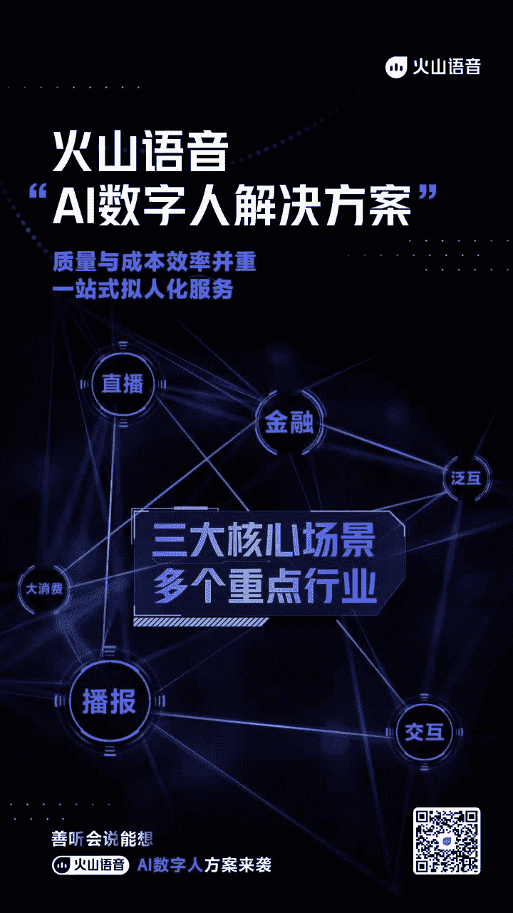

## 【钉钉个人版来了！将全面接入千问大模型】

据新京报，4 月 18 日，钉钉总裁叶军在北京宣布钉钉正式接入通义千问大模型，全面启动智能化战略。并现场实机演示了钉钉接入大模型后的一系列功能，包括使用 AI 生成推广文案、使用绘图方式创建应用、在视频会议中生成摘要等。叶军认为，未来产品形态将发生巨大变化，走向极简的趋势，“不用记住功能在哪里，只要用语言描述，其余的交给千问。此外，在 AI 的加持下，未来的数据资产价值将有所提升，数据密度会增加，数据质量也会提高，每一个 T 的存储都非常值钱，数据决定了我们的价值。”他表示，钉钉将根据法律规定做评审，通过后会面向社会开放，“所有场景成熟一个，上线一个。”钉钉个人版以 AI 能力为核心，融合 woldi、阿里云盘、钉钉会议产品，主要面向个人用户、小团队、高校师生等群体，并将全面接入千问大模型。目标是成为每个人的数字生产力工具。

# 2023 年 4 月 18 日

## 【印象 AI 今起大规模商用 已落地印象笔记旗下全线产品】

4 月 18 日，印象笔记宣布印象 AI 正式开放使用，现已落地赋能旗下全线产品，包括印象笔记、扫描宝、收藏家、印象时间、印象图记等。目前，用户已可下载最新版本体验，而印象笔记官方将在近期公布印象 AI 的商业化方案。

**传送门：**来了！「印象 AI」全面开放测试体验报名

## 【马斯克将推出“TruthGPT”人工智能平台】

马斯克说是最大限度寻求真理的人工智能，以试图理解宇宙的本质，认为这可能是通往安全的最佳途径，一个想要了解宇宙的人工智能不太可能消灭人类，因为我们是宇宙中有趣的一部分。

## 【金山办公宣布将推出 WPS AI：对标微软 Microsoft 365 Copilot】

4 月 17 日，WPS 办公助手官方🛰️👸号宣布新版 WPS 会员体系正式上线，同时表示即将推出“WPS AI”。据悉，WPS AI 将与“Microsoft 365 Copilot”功能相似，可能包含非常多的 AIGC 功能。WPS 官方暂未公布 WPS AI 功能相关的信息。（IT 之家）

## 【ChatGPT 金融业应用首批研究成果出炉 可解读美联储声明、预测股价】

ChatGPT 在两项测试中取得出色成绩，一项是解读美联储的声明是鹰派还是鸽派，另一项是确定消息面对某只股票而言是利好还是利空该技术在将新闻报道、推文和演讲稿等大量文字转化为交易信号。

## 【英伟达 AI 芯片遭国内公司“哄抢”，海外最高炒至 4 万美金以上】

英伟达的 A100 和 H100 GPU （图形处理器）正成为抢手货，微软已购买了数万颗 A100 芯片用于开发 ChatGPT。目前英伟达可向中国出售定制版 A800 和 H800 芯片，作为中国“特供版"

## 【俄罗斯也要研发自己的 ChatGPT:最快两年搞定】

美国领先，中国紧追不放，俄罗斯最快 2 年内搞定自己的 ChatGPT 至少有 3 家企业已经搞出大模型。俄罗斯的 AI 是可靠的，可验证的不干涉用户冲突，不会伤害人类。

## 【昆仑万维官宣发布千亿级大语言模型“天工”】

4 月 17 日，昆仑万维官方发文称，正式发布千亿级大语言模型“天工”，同时宣布即日起启动邀请测试。

据了解，“天工”由昆仑万维与 AI 团队奇点智源联合研发，是一个对标 ChatGPT 的双千亿级大语言模型，也是昆仑万维继 AI 绘画产品“天工巧绘”后的又一款生成式 AI 产品。昆仑万维曾在 2022 年 12 月发布 AIGC 全系列算法与模型，覆盖了图像、音乐、文本、编程等多模态的 AI 内容生成能力。昆仑万维方面表示，从“天工”目前发布版本来看，最高能支持 1 万字以上文本对话，实现 20 轮次以上用户交互。

贝壳财经记者注意到，昆仑万维 CEO 方汉在 4 月 17 日就“天工”进行了视频直播，但并未进行实机测试。方汉表示，目前整个项目累计投入数亿元人民币，组织了数百人的研发团队，未来也会加大投入。

# 2023 年 4 月 17 日

## 科大讯飞即将发布 1+N 认知大模型 筑牢 AI 研发与产业化优势

4 月 17 日，科大讯飞公告称，定于 4 月 20 日举办 2022 年度及 2023 年第一季度业绩说明会，并于 5 月 6 日举办认知大模型成果发布会。

## 值得买：将 AIGC 列为年度重点的战略项目，已与一些大模型公司达成合作关系

2023 年 4 月 18 日，值得买（300785.SZ）于近日接受调研时表示，我们将 AIGC 列为我们年度重点的战略项目，将投入极大的精力和资源使用 AIGC 推动公司方方面面的进步。

在大模型侧，我们比较明确不做大模型，而是与业内最优秀的大模型厂商合作，利用我们十多年来积累的消费内容和消费数据来尝试辅助用户消费决策的垂直模型产品。

目前，我们已经与一些大模型公司洽谈了合作，也与其中的一些达成了合作关系。

## 谷歌计划打造 AI 功能搜索引擎应对必应竞争

新必应等 AI 竞争者正成为 25 年来谷歌的“最严重威胁”，谷歌正测试项目名为"Magi”的新功能，打造一款由 AI 技术驱动的全新搜索引擎。

## 揭秘 OpenAI“红军":聘请专家攻击 ChatGPT 解决技术伦理问题

“OpenAI 想要探索模型毒性、偏见和歧视等问题。"红军”就谎言、语言操纵和危险的科学常识进行了测试。红军”提供的意见被用于模型的重新训练，解决 GPT-4 的问题。

## 幻方量化回应市场关注：AGI 不是用来炒股的"和金融没关系”

幻方量化"立新的独立的研究组织，探索 AGI 本质，表示我们做这个其实是完全独立的大模型研究，和金融没关系，长远的社会价值是我们的关注点。

## 科大讯飞即将发布 1+N 认知大模型 筑牢 AI 研发与产业化优势

4 月 17 日，科大讯飞公告称，定于 4 月 20 日举办 2022 年度及 2023 年第一季度业绩说明会，并于 5 月 6 日举办认知大模型成果发布会。

据了解，科大讯飞承建认知智能全国重点实验室和语音及语言信息处理国家工程研究中心，多年来已经在深度学习算法、大模型技术、行业大数据、知识图谱、多模态感知、系统工程技术、算力支撑等方面积累了大量成果。

科大讯飞此次发布的认知大模型成果，将进一步牢固树立科大讯飞在人工智能核心技术研发与产业化应用方面的优势，有助于公司在当前人工智能高速发展的战略机遇期把握技术先机，除了带来公司已有产品的竞争力提升和用户体验的显著改善，还提供了公司参与互联网产业格局重塑的新机遇，为科大讯飞实现“用人工智能建设美好世界”的产业梦想提供更广阔的空间。

在近日召开的人工智能大模型发展论坛上，科大讯飞副总裁、研究院院长刘聪透露，公司即将发布科大讯飞“1+N 认知大模型”，并介绍，科大讯飞于 2022 年 12 月启动生成式预训练大模型“1+N”任务攻关，其中“1”是通用认知智能大模型算法研发及高效训练底座平台，“N”是应用于教育、医疗、人机交互、办公等多个领域的专用大模型版本。

# 2023 年 4 月 16 日

## 🧣将在二季度推出 AIGC 创作助手

4 月 16 日，北京商报记者获悉，🧣将推出 AIGC（人工智能生成内容）创作助手，根据创作者习惯和热点讨论内容，辅助大 V 进行内容创作，预计于二季度开放体验。截至 2022 年四季度，🧣作者规模（1 万粉以上）143.6 万个，同比增长 6%。10 万粉以上作者新增 2 万个，100 万粉以上作者新增 3000 个。10 万粉以上新增作者主要来自于站外入驻和内生扶持，其中，站外入驻占比 53%，内生扶持占比 47%。

# 2023 年 4 月 7 日

## 斯坦福小镇：智能体的社科科研案例

当智能体的行为符合真人日常，高达 251“人”的小镇生活足够成为社科研究样本——甚至可以根据科研需要去微调。

虚拟小镇名为 Smallville，论文作者有华人身影。

期待开源。

论文地址：`https://arxiv.org/pdf/2304.03442v1.pdf`

# 2023 年 4 月 6 日

## 微软 NLP 技术大佬姜大昕离职创业：阶跃星辰

注册地上海徐汇区，注册资本两千万元；对外投资了算力公司上海智能算力科技有限公司

# 2023 年 4 月 3 日

## 斯坦福发布《人工智能指数报告》

内容跨足了人工智能的多个领域，涵盖了研发、技术能力、技术伦理、经济、教育、政策和治理、多样性以及公众态度。

全文链接：`https://aiindex.stanford.edu/wp-content/uploads/2023/04/HAI_AI-Index_Report_2023.pdf`

# 2023 年 3 月 29 日

## 首届中国 AIGC 产业峰会举办

量子位主办于北京，量子位智库发布了首份中国 AIGC 产业全景报告。

# 2023 年 3 月 23 日

## OpenAI 宣布推出插件系统

即工具学习，让 GPT 调用模型更方便自然。仅支持 OpenAI Plus 用户。

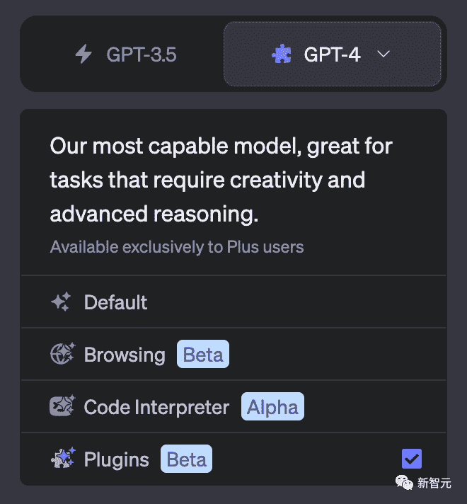

# 2023 年 2 月 27 日

## Meta 推出 LLaMa 并发布相关论文

论文地址：`https://arxiv.org/pdf/2302.13971.pdf`

---

# AI 学习交流社群

1. 持续关注并更新 AI 的相关资讯动态，永久免费在线查看，无收费内容，目标是成为最大的免费 AI 学习社群，免费学 AI 绘画，AI 写作。

进群飞书群交流学习 AI

飞书扫码进群学习

🛰️好友（`zhangyuguo94s`）

扫码加🛰️入🛰️群

2. 已建立社群聊聊 AI 发展及应用，没进群的可以扫码加入，群满可加 AI 研究爱好者大国`zyg90s`（备注：AI），已经在社群内的无需重复加入，暂无任何 AI 相关收费群、课程及服务，全部为公开公正免费整理汇总分享。

3. 关于文档负责人大国：7 年项目操盘手，互联网流量观察家，曾就职于互联网大厂，现研究 AI 实战应用，努力成为最懂 AI 的运营人。
