# Deepseek 每日大记事

> 来源：[https://yunyinghui.feishu.cn/docx/TAGEdtcafoVf41xaSntc5MYinfe](https://yunyinghui.feishu.cn/docx/TAGEdtcafoVf41xaSntc5MYinfe)

> **适用人群：**互联网关注 Deepseek 动态人群

> **首发时间：****2025**** 年 2 月 17 日**

> 更新时间：2025 年 2 月 18 日

> **内容出品方：**[Mix AI Lab](https://yunyinghui.feishu.cn/wiki/WhelwZnxQi55mpkOzatc3Xran5b?from=from_copylink)

> **内容出品人：**** **** **

> **使用建议：**如果需要快速定位到精确内容，可以使用快捷键 Ctrl +F/Command +F 的形式，搜索关键字/词，查找你想要的内容。

> **持续更新 ****D**eepseek 发展的相关资讯动态，每天一分钟，知晓 AI 圈内事儿！永久免费在线查看，欢迎收藏转发支持，文末有惊喜。

### 2025 年 3 月 14 日

【巨人网络发布行业首个 DeepSeek 原生游戏玩法】

巨人网络旗下社交推理游戏《太空杀》接入 DeepSeek，首创基于 DeepSeek 打造的原生游戏玩法“内鬼挑战”现已开启灰度测试，后续将面向全量用户开放。这是业内首次将 DeepSeek 大模型能力深入应用到游戏的玩法创新。

### 2025 年 3 月 12 日

【蝉妈妈 AI 正式接入 DeepSeek-R1 满血版】

“蝉妈妈 AI”宣布正式接入 DeepSeek-R1 满血版。“蝉妈妈 AI”依托蝉妈妈的电商数据库，能够快速及时地获取海量电商信息，涵盖品牌、小店、达人等多维度数据，再利用满血版 DeepSeek-R1 的推理能力，挖掘数据背后的趋势、策略和洞察，将复杂的数据转化为有价值的建议。目前“蝉妈妈 AI”现已开放限时免费体验。

**【硅基流动宣布 DeepSeek-R1&V3 **API 支持批量推理 价格暴降 75%】

硅基流动的 SiliconCloud 平台推出 DeepSeek-R1&V3 API 批量推理功能，价格大幅下调，可帮助用户低成本处理大批量数据任务。

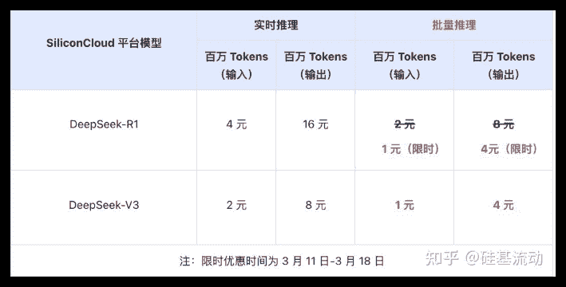

### 2025 年 3 月 11 日

【传 DeepSeek-R2 将于下周一发布，在多个关键领域实现突破】

有市场消息称，DeepSeek 下一代 AI 模型 DeepSeek-R2 或提前于下周一（3 月 17 日）正式发布。DeepSeek-R2 在多个关键领域实现突破，包括更出色的编程能力、多语言推理能力，以及以更低的成本提供更高的准确性。专业人士认为，这些特性若得以兑现，可能使其在全球 AI 竞赛中占据显著优势。这对于资产价格而言，可能又是一次重估机会。截至目前，DeepSeek 官方尚未正式公布 R2 的具体日期及技术细节等。早前市场预期 DeepSeek-R2 模型于 5 月发布。

【亚马逊云科技宣布提供完全托管的 DeepSeek-R1 模型】

亚马逊云科技宣布，DeepSeek-R1 现已作为完全托管的无服务器大语言模型（LLM）在 Amazon Bedrock 上正式可用， 这也是首个将该模型作为完全托管服务推出的云服务提供商。亚马逊云科技生成式 AI 副总裁 Vasi Philomin 表示，借助这种完全托管的实现方式，客户能够以无服务器按 token 付费的模式使用该模型，帮助他们无需管理基础设施即可实现从实验到生产的规模扩展。亚马逊透露，自 1 月下旬该模型推出以来，已有数千名客户使用 Amazon Bedrock 的自定义模型导入功能部署了 DeepSeek-R1 模型。

### 2025 年 3 月 10 日

【百度 AI 创作应用橙篇已正式接入 DeepSeek-R1 满血版】

3 月 10 日，百度文库旗下的橙篇应用正式接入 DeepSeek-R1 满血版，标志着其 AI 辅助功能的显著提升。此次升级使得橙篇能够更高效地满足用户在学习、生活及创作中的多样化需求。用户可以通过智能助手体验到极速且精准的 AI 服务，极大地提升了学习和生活的效率，成为用户的“第二大脑”。

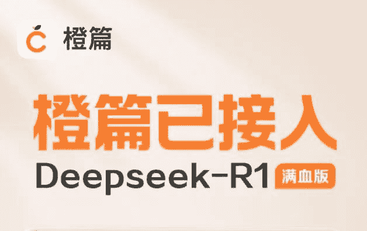

### 2025 年 3 月 7 日

【美团开源首发 INT8 无损满血版 DeepSeek R1】

3 月 7 日消息，美团搜推机器学习团队 3 月 4 日公布最新首发开源成果，实现对 DeepSeek R1 模型基本无损的 INT8 精度量化。

**DeepSeek R1 原生版**本的模型权重为 FP8 数据格式，对 GPU 芯片类型有严格限制，仅能被英伟达新型 GPU 支持（如 Ada、Hopper 架构芯片），其他型号 GPU（如 A100）无法直接部署。

目前，量化代码已经合入到了开源 LLM 推理框架 SGLang，量化模型已经发布到了 Hugging Face 社区，方便用户使用。官方测试，满血版 DeepSeek R1 部署 A100，基于 INT8 量化，相比 BF16 实现 50% 吞吐提升。

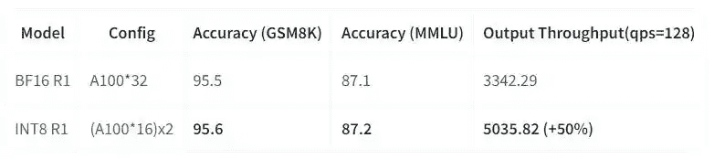

### 2025 年 3 月 6 日

**【狮腾控股：推出融合 DeepSeek 等 AI** 模型与区块链技术的开创性 AI 平台】

狮腾控股在港交所公告，公司与一家拥有 300 多名人工智能及技术工程师的中国领先的 AI 及企业软件公司盟拓数字科技达成独家合资协议，共同开发并推出 Geene，一个融合生成式 AI、区块链及大数据的开创性 AI 平台，构建安全、高效、可信赖的 AI 生态系统。该创新引擎整合全球领先的 AI 模型，包括 DeepSeek、ChatGPT（OpenAI）及 Qwen（阿里巴巴），并通过智能动态路由技术，根据查询需求自动匹配最适合的 AI 模型，确保运算效能与精准度。

### 2025 年 3 月 5 日

【**Meta 计划测试 DeepSeek **的 AI 模型，提升其 AI 营销工具】

近日，Meta 计划大力推进商业聊天机器人的发展，用 Messenger 和 WhatsApp 上的 AI 聊天机器人来吸引企业，为提供客户支持、信息和推荐，以促进销售。同时，Meta 也考虑在其广告商工具中，测试 DeepSeek 的 AI 模型。目前 Meta 正在使用自己的 AI 模型来支持这些工具。

【腾讯云智能数智人接入 DeepSeek 大模型】

近日，腾讯云智能数智人全面接入 DeepSeek 大模型。借助 DeepSeek 大模型优秀的语义理解和意图识别能力，进一步提升数智人在交互、播报等场景中的用户体验，让数智人落地到更多生产生活场景中去。通过数智人平台内置的 V3、R1 等模型，以及 100 多种 2D 小样本数智人，用户无需开发，即可以让 DeepSeek“开口说话”。同时，借助平台内置的联网能力，数智人也可以结合全网的实时信息，输出更精准的回复。

【即梦接入 DeepSeek 从提示词到绘画一步到位】

即梦与 DeepSeek 的合作为 AI 绘画爱好者带来了极大的便利。通过 DeepSeek 的智能提示词生成功能，用户不再需要为创作灵感而烦恼，只需简单输入需求，便能获得精准的提示词，进而生成高质量的图像。这一创新的联动不仅提升了创作效率，还让绘画过程变得更加流畅和愉悦。

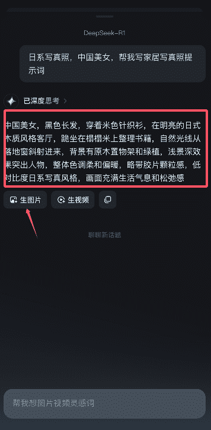

### 2025 年 3 月 4 日

**【集成 DeepSeek 和通义千问主**力模型，飞猪“AI 行程助手”明日上线】

飞猪“AI 行程助手”将于明日上线。该产品集成了 DeepSeek-R1 及阿里云通义千问旗下主力模型的能力。据透露，飞猪“AI 行程助手”将在短暂的灰度测试后面向全量用户开放。届时，用户在飞猪 App 底部的行程栏中，点击“问一问”即可体验。飞猪方面介绍，“AI 行程助手”可秒级响应用户需求，帮助用户寻找灵感、规划行程、推荐玩法、挑选产品，生成真实、详尽、富有趣味的个性化旅行方案，大幅缩短用户各处搜罗信息及整理攻略的时间。另外，“AI 行程助手”新功能也将在 4 月前密集更新。

**【中兴努比亚内嵌 DeepSee**k 版本更新，业界首次实现智能联网搜索】

近日，中兴努比亚星云 AI 推送全尺寸内嵌 DeepSeek 版本更新。新版内嵌式 DeepSeek 在业界率先实现了智能联网搜索功能，能够依据场景智能判断是否需要联网搜索，无需用户手动切换，提供更加流畅、更智能化的搜索体验。

**【联想成全球首家在 AI PC 端侧部署和运行 De**epSeek 大模型的 AI 终端品牌】

在 2025 世界移动通信大会（MWC 2025）上，全球首款端侧部署 DeepSeek 70 亿参数大模型的 AI PC 正式在海外亮相。据介绍，联想已经成为全球首家在 AI PC 端侧部署和运行 DeepSeek 大模型的 AI 终端品牌。端侧部署 DeepSeek 大模型，使联想 AI PC 的能力又一次获得大幅提升。

### 2025 年 3 月 3 日

**【深度融合 DeepSeek 与有道翻译大模**型，有道智云推出 AI 新产品语音同传】

近日，有道智云发布全新产品“有道语音同传”，基于 DeepSeek-R1 和有道翻译大模型，提供多功能的语音同传服务，在不同语言的使用者之间实现即时沟通，可广泛应用于国际会议、商务谈判、教育培训、旅游导览等场景，提升跨语言交流的效率。

**【汤姆猫：公司 AI 情感陪伴机器人产品调用了豆**包、DeepSeek 等模型的部分能力】

汤姆猫接受机构调研时表示，在底层模型上，汤姆猫 AI 情感陪伴机器人产品采用 MoE（混合专家模型）架构，搭载了公司与西湖心辰定制的“汤姆猫情感陪伴垂直模型”，同时也调用了豆包、DeepSeek 等模型的部分能力，有效增强了产品的意图识别、响应速度、数学能力等功能。后续公司持续关注 AI 大模型的升级与应用，根据产品的迭代需要积极利用优秀模型的能力，不断提升产品的功能和服务，满足多年龄段用户群体的多样化需求，并推动产品各项成本的降低。

【红松 App 全面接入 DeepSeek】

3 月 3 日，红松宣布已全面接入深度求索（DeepSeek）人工智能大模型，并推出国内首款专为 50+退休人群量身定制的智能生活助手“AI 松小智”。目前，全面搭载 DeepSeek 的红松 App5.0.0 版本已经在各大手机应用市场上线。

### 2025 年 3 月 2 日

### **2025 年 3 月 1 日**

【DeepSeek 最高日赚 346 万元？官方称理论收益并非实际】

DeepSeek3 月 1 日在开源周最后一天抛出的”暴利”数据引发热议——V3/R1 推理系统理论日利润高达 346 万元人民币（47.5 万美元）。在这组看似惊人的数字背后，是一场关于 AI 模型服务商业化的现实拷问。有行业人士认为，即便按更严谨的口径计算，DeepSeek 还是赚钱的，但卖 DeepSeek API 的厂商能否挣钱，目前业内有一些争议。DeepSeek 提到，实际上并没有这么多收入，因为 V3 的定价更低，同时收费服务只占了一部分，面向用户的网页端和应用程序免费，另外夜间还会有折扣，导致实际收入远不及理论数值。

**【腾讯元宝发布电脑版，“Deep**Seek+混元”双模型全面支持多端协同】

3 月 1 日，腾讯 AI 助手“腾讯元宝”正式发布电脑版，支持 Windows 和 macOS 系统。此次发布的腾讯元宝电脑版面向工作和学习场景打造，旨在帮助用户减轻负担、提升效率。除具备与移动端和网页版一致的核心功能外，电脑版后续还将推出更多便捷功能，如划词搜索与翻译、截图提问等，进一步提升用户体验。后续腾讯元宝电脑版还将推出更多创新功能，进一步提升用户体验。

**【DeepSeek 知乎独家发文收官**开源周，首次披露理论利润率达 545%】

3 月 1 日，DeepSeek 于知乎开设官方账号，独家发布《DeepSeek-V3/R1 推理系统概览》技术文章，首次公布模型推理系统优化细节，并披露成本利润率关键信息，标志着全球关注的“DeepSeek 开源周”正式收官。值得一提的是，文章还率先披露了 DeepSeek 的成本和利润率等关键信息。“假定 GPU 租赁成本为 2 美金/小时，总成本为$87,072/天。……如果所有 tokens 全部按照 DeepSeek R1 的定价计算，理论上一天的总收入为$562,027，成本利润率 545%。”

### **2025 年 2 月 28 日**

【DeepSeek 开源第五弹，开源并行文件系统 3FS 代码库】

DeepSeek 开源周第五天，DeepSeek 宣布开源了 Fire-Flyer 文件系统（3FS）。据介绍，这是一个高性能并行文件系统，能应对 AI 训练和推理工作负载的挑战，它利用现代 SSD 和 RDMA 网络提供共享存储层，能简化分布式应用程序的开发。

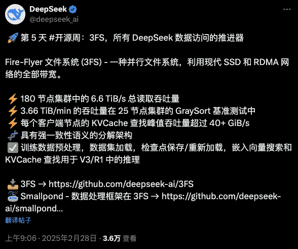

**【搭载 DeepSeek 推理模型，新品 AI **答疑笔有道 SpaceOne 首销告罄】

搭载 DeepSeek 推理模型的全新学习硬件的全面屏答疑笔“有道 SpaceOne”上市仅 10 日便已售罄。有道学习硬件官方紧急宣布：因首批库存告罄，全渠道于 3 月 1 日起开启限购预约。据介绍，有道 SpaceOne 深度融合 DeepSeek-R1 推理模型能力，将 AI 能力与教育场景、知识库优势结合，解锁学科难题深度讲解新方式，其启发式教学、逻辑可视化、耐心细致的交互优势，给用户带来了超越真人老师的答疑辅导体验，因此在开学季尤其受到家长及学生群体的青睐，销售情况异常火爆。

### **2025 年 2 月 27 日**

**【DeepSeek 宣布开源 Optimized Par**allelism Strategies】

今日，国内人工智能领军企业 DeepSeek 正式公开其开源计划的第四日成果——Optimized Parallelism Strategies（优化并行策略），重点推出双向管道并行算法 DualPipe、专家并行负载均衡器 EPLB，以及对计算-通信重叠机制的深度优化。此次技术升级直击大规模语言模型训练的核心痛点，为超万卡级集群的高效运行提供了全新解决方案。

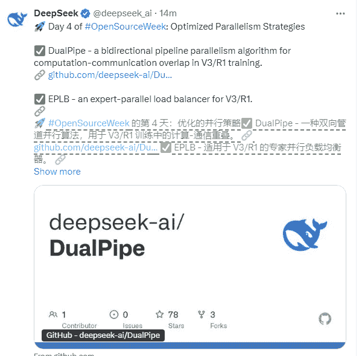

【字节旗下又一应用接入 DeepSeek】

字节跳动旗下悟空浏览器已正式接入 DeepSeek R1 模型。尽管此前，字节跳动旗下飞书和火山引擎相继宣布接入 DeepSeek，但与这些产品有所不同，悟空浏览器更偏向 C 端用户，并且是融合了抖音+番茄小说的内容端 App。目前，该产品包含豆包和 DeepSeek 两款大模型。业内人士认为，该 App 接入 DeepSeek，或将为抖音之后接入 DeepSeek 做好铺垫，但也不排除抖音会接入自家深度模型的可能性。对此说法，字节官方尚未回应。

【腾讯乐享上线企业 AI 知识库】

2 月 27 日，腾讯乐享宣布上线企业 AI 知识库，帮助企业快速搭建私有知识库。

据称结合 DeepSeek 和混元大模型的通用能力和企业私有知识库，提供的能力涵盖企业知识沉淀、更新和应用全周期，可以帮助企业建立起完善的企业知识库和管理体系，提升知识信息在企业内部流转的效率。

【Meta 将推出 Meta AI 独立应用】

2 月 27 日，知情人士爆料称，Meta 计划在今年第二季度推出独立的 AI 应用 Meta AI。

目前，Meta AI 仅能通过网页版和 Meta 旗下的应用（包括 Facebook 和 WhatsApp）使用。知情人士表示，尽管目前已经有庞大用户群可以访问 Meta AI，但如果数字助理作为独立应用程序 App 提供，用户可能会与有机会进行更深入的互动。

此外，Meta 还计划测试 Meta AI 的付费订阅服务，为 AI 助手增加更多新功能。

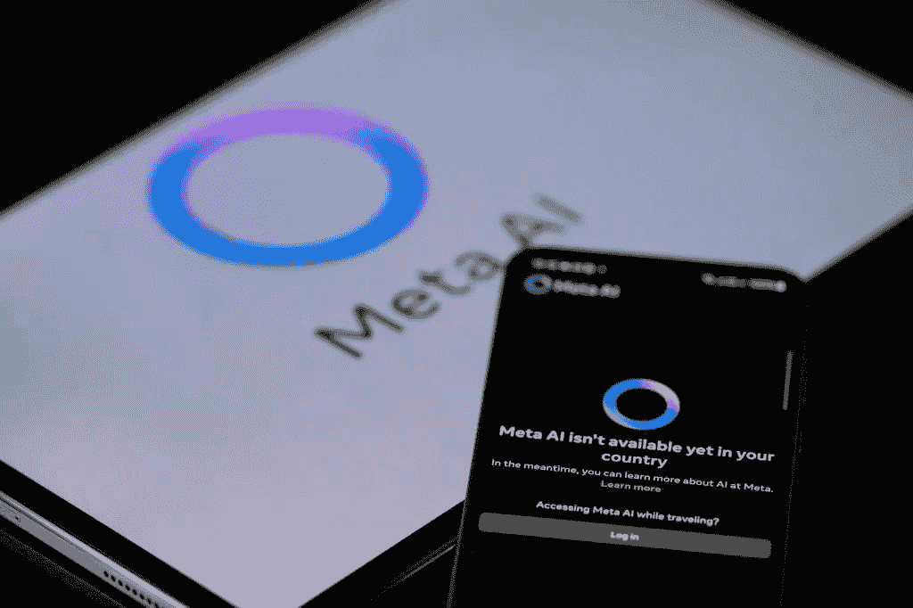

### **2025 年 2 月 26 日**

【DeepSeek 下调 API 调用价格，降幅最高达 75％】

DeepSeek 今日宣布，即日起，北京时间每日 00:30 至 08:30 的夜间空闲时段，DeepSeek 开放平台推出错峰优惠活动。在此期间，API 调用价格大幅下调：DeepSeek-V3 降至原价的 50%，DeepSeek-R1 更是低至 25%。DeepSeek 称，鼓励用户充分利用这一时段，享受更经济更流畅的服务体验。

**【**DeepSeek 开源周第 3 天：发布 DeepGEMM，FP8 GEMM 库助力 AI 训练与推理】

在开源周的第三天，中国人工智能公司 DeepSeek 推出了 DeepGEMM，这是一款支持 FP8 通用矩阵乘法的开源库，旨在为密集型和混合专家模型提供支持。该库在 NVIDIA Hopper GPU 上实现了超过 1350 TFLOPS 的 FP8 计算性能，且核心代码仅 300 行，展现出极高的效率与简洁性。

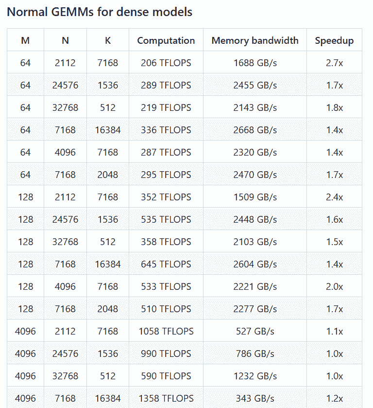

**【中国联通：针对 DeepSeek 系列模型进行**了优化升级，平均节省 30%推理计算量】

中国联通近日宣布，继 1 月开源元景“自适应慢思考”思维链大模型后，又针对 DeepSeek 系列模型进行了“自适应慢思考”优化升级，平均可节省约 30%的推理计算量，现已开源。这也是目前业界首个对 DeepSeek 系列思维链模型做“自适应慢思考”优化升级的工作。

【宠物家携手腾讯云接入 DeepSeek】

2 月 26 日，宠物家宣布战略升级，依托全国最大的宠物档案库及 500 万条护理服务数据沉淀，通过接入腾讯云大模型及 DeepSeek 智能引擎，实现 1+1+1＞3 的应用效果。据介绍，这是国内首个基于 AI 深度学习技术构建的宠物健康管理系统。

**【**字节跳动即梦考虑接入 DeepSeek，移动端新负责人曹大鹏到岗】

字节跳动的 AI 视频生成产品即梦近期有了新移动端负责人，他是原零一万物 PopAI 产品负责人曹大鹏。加入后，曹大鹏向剪映负责人张楠汇报。同时，即梦也正在考虑使用 DeepSeek。此前，字节跳动体系内的飞书已使用 DeepSeek。DeepSeek 爆火带来需求溢出和联动玩法：比如先用 DeepSeek 生成更精细的视频脚本、再在即梦生成视频。春节前后，即梦用户数增长迅速，据第三方监测平台 QuestMobile，即梦去年 12 月底的周活 76 万左右，截至 2 月中旬则接近 200 万，一个半月涨了接近 3 倍。

### **2025 年 2 月 25 日**

【DeepSeek 开源周第二日：开源 EP 通信库】

DeepSeek 官宣，今日开源 DeepEP，第一个用于 MoE 模型训练和推理的开源 EP 通信库。特点有：高效、优化的全员沟通；节点内和节点间均支持 NVLink 和 RDMA；用于训练和推理预填充的高吞吐量内核；用于推理解码的低延迟内核；原生 FP8 调度支持；灵活的 GPU 资源控制，实现计算-通信重叠。

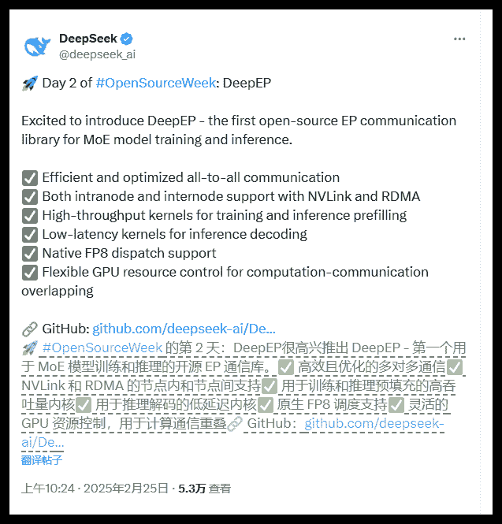

【DeepSeek 繁忙次数变少，内部人士：通过技术优化实现】

近日，有用户反馈近期 DeepSeek 算力紧张的情况有所缓解，高峰期使用 DeepSeek 已较少出现“服务器繁忙，请稍后再试”等情况。

此前，有行业从业者猜测，“DeepSeek 官方 App 可能限制了一名用户一个小时只能使用一次”。在社交媒体上也出现大量用户称 DeepSeek 对使用次数设置了上限。

对此，有接近 DeepSeek 的人士表示，“DeepSeek 没有特别限制过，但之前可能是资源不太够”，对于近期 DeepSeek 繁忙次数变少，系 DeepSeek 官方团队仍在进行技术架构优化，使得较少资源情况下仍能支持广泛用户使用。

**【波士顿动力创始人：已购买宇树机**器人 DeepSeek 创新只是个开始】

波士顿动力创始人 Marc Raibert 当地时间 2 月 24 日在美国休斯顿参加达索系统 3DEXPERIENCE World 峰会期间接受采访时称，他的智能机器人研究所 AI Institute 已经购买了中国机器人创业公司宇树科技的机器人，以测试它的能力。“我们的实验室买了宇树的人形机器人，还买了几个小型的机器人，它们相对便宜。”Raibert 表示，“即便我们是竞争对手，我们也可以买来看看它究竟能做些什么。”Raibert 特别提及这一轮由 DeepSeek 引发的中国人工智能创新热潮。

【**百度教育「拍照搜题」、「AI 写作**文」接入 DeepSeek-R1 模型】

百度于 2 月 25 日宣布其教育产品“拍照搜题”和“AI 写作文”正式接入 DeepSeek-R1 模型，标志着在 AI 教育领域的一次重大技术升级。这一接入不仅提升了学习工具的智能化水平，还为用户提供了更高效的学习体验，帮助他们掌握解题方法和写作技巧。

【DeepSeek 重新开放 API 充值】

在 DeepSeek API 开放平台注意到，DeepSeek 已重新开放 API 充值。deepseek-chat 模型优惠期结束，调用价格已变更为每百万输入 tokens 2 元，每百万输出 tokens 8 元。此前因资源紧张，DeepSeek 曾一度停止充值。

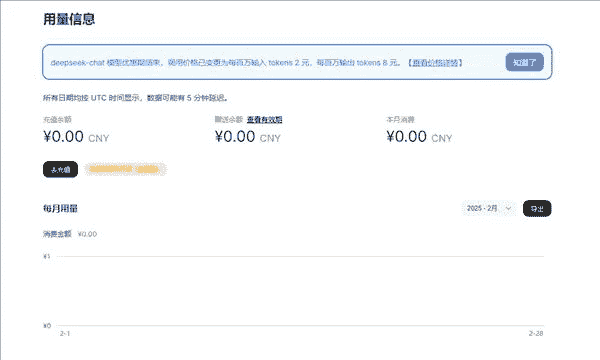

【百度教育接入 DeepSeek-R1 满血版模型，支持多模态推理】

2 月 25 日，百度教育旗下产品“拍照搜题”正式接入 DeepSeek-R1 满血版模型。用户可使用百度 App 拍照功能进入“拍照搜题”，不仅可以通过数据库提供标准答案，还能发挥 DeepSeek R1 的强大推理能力，一步步展示推导过程。此外，百度教育“AI 写作文”也同步接入了 DeepSeek 模型。只需在百度 App 搜索“作文”，使用“一键成文”功能，勾选 DeepSeek-R1 满血版即可体验。

**【联想 AI 服务器单机全面适配** DeepSeek-R1 满血版大模型】

联想正式宣布旗下大模型训推一体 AI 算力平台联想问天 WA7780 G3、大模型推理 AI 算力平台联想问天 WA7785a G3 全新升级，单机即可部署 DeepSeek-R1 满血版大模型（具备 671B 参数）。此次升级将大幅降低客户部署难度和成本，同时提升模型训练和推理性能。据了解，联想正与 DeepSeek 在个人智能与企业智能两大领域，开展更全面、深入的合作。其中，聚焦企业智能，联想中国基础设施业务与 DeepSeek 的深度融合，正快速实现从训练到推理的全链条产品适配。

### **2025 年 2 月 24 日**

**【赵天成与 Om AI Lab 团队将 DeepSe**ek R1 模型首次突破到视觉语言领域】

浙江大学博导赵天成博士与 Om AI Lab 团队宣布成功把 DeepSeek R1 从纯文本领域成功迁移到了视觉语言领域，这是 DeepSeek R1 模型首次突破到视觉推理层面。据介绍，该模型为 VLM-R1 视觉语言模型，已经具备精确的视频理解和推理能力，证实了 R1 方法的通用性，为多模态模型的训练打开了想象空间。

**【奇安信与软通动力携手打造安全的**基于 DeepSeek 的 AI 服务】

2 月 24 日，网安企业奇安信与软通动力宣布将围绕 AI 领域的安全防护展开深度协同，全面强化已接入 DeepSeek 系列大模型的天元智算平台、天璇 MaaS 平台、AI 知识库引擎等核心智能产品的安全防护能力，为企业智能化发展保驾护航，加速 AI 技术在各行业的规模化应用与价值释放。消息显示，近期奇安信还与东方国信达成战略合作，携手打造基于 DeepSeek 基座的人工智能智算平台。

【DeepSeek 启动开源周】

北京时间 2 月 24 日，DeepSeek 宣布启动“开源周”，首个开源的代码库为 Flash MLA，这是针对 Hopper GPU 优化的高效 MLA 解码内核，针对可变长度序列作了优化，目前已投入生产。

【商汤大装置 DeepSeek 企业版上线】

商汤科技在公众号发文称，经过系列优化，商汤大装置现正式推出企业版，同时完成免费版国产化适配与算力扩容，形成专业强支撑+普惠广覆盖的双擎驱动。

【华中师范大学联合腾讯云推出 DeepSeek R1 满血版】

近日，华中师范大学联合腾讯云推出了 DeepSeek R1 满血版，师生登录学校一网通办即可便捷使用。据介绍，该模型集成前沿的机器学习、深度学习等技术，以及变分自编码器和生成对抗网络（GAN）等先进算法，支持复杂学术问题分析与长文本处理，为教学和科研提供定制化支持。此外，腾讯云全套 GPU 独占资源+RAG 工程化+工作流+agent 配置能力，可实现快速创建教育教学智能体，助力教学教研、校园服务的创新。

### **2025 年 2 月 23 日**

【DeepSeek“低调”参与 2025 全球开发者先锋大会】

从 2025 全球开发者先锋大会主办方获悉，DeepSeek 参与了今年大会，但是方式颇为低调，主要是以闭门会和工作坊的形式参与。

**【清华 AIR 联合水木分子开源 DeepSeek 版多模态生****物**医药大模型 BioMedGPT-R1】

清华大学人工智能产业研究院（AIR）和北京水木分子生物科技有限公司近日携手推出了升级版的生物医药多模态开源基础大模型 BioMedGPT-R1。此前，在 2023 年，双方合作发布了开源可商用、生物医药多模态百亿参数开源基础大模型 BioMedGPT，水木分子发布了自研千亿参数多模态生物医药专业大模型 Chat DD-FM 和新一代 AI 驱动药物发现工具 Chat DD。这次 DeepSeek 版 ChatDD- R1 基座模型也已同步上线 ChatDD，赋能生物医药企业的药物研发。

【联汇科技将 DeepSeek R1 从文本模型迁移到视觉语言领域】

大模型公司联汇科技宣布，赵天成博士带领 Om AI Lab 团队成功把 DeepSeek R1 从纯文本领域成功迁移到了视觉语言领域。据介绍，该模型为 VLM-R1 视觉语言模型，已经具备精确的视频理解和推理能力，证实了 R1 方法的通用性，为多模态模型的训练打开了想象空间。

### **2025 年 2 月 22 日**

【招商积余接入 DeepSeek 大模型上线本地知识库应用】

近日，招商积余基于深度求索（DeepSeek）大模型技术结合 RAG（Retrieval-Augmented Generation）本地知识库，正式推出了积余 AI 本地知识库应用，为物业服务行业提供定制化智能解决方案，助力传统业务场景精细化、标准化智能升级。

### **2025 年 2 月 21 日**

**【联想将成为全球首个端侧部署 De**epSeek 大模型 AI PC 品牌】

在联想集团 2024/25 财年第三财季业绩沟通会上，联想集团执行副总裁兼中国区总裁刘军表示，在个人智能领域，通过天禧个人智能体系统（天禧 AS），联想的 AI PC、AI 手机和 AI 平板产品均已接入云端 DeepSeek R1 满血版大模型。刘军透露，2 月 25 日，联想将进一步升级天禧 AS，在端侧部署和运行 DeepSeek 70 亿参数（7B）的大模型，联想也将成为全球首家在端侧部署和运行这一大模型的 AI PC 品牌。

**【DeepSeek 四款模型全线**接入文心智能体平台，即日起满血版免费用】

2 月 21 日，文心智能体平台已全量上线 DeepSeek 的四款模型。除了满血版 DeepSeek R1 671B，DeepSeek R1 32B、DeepSeek-R1-14B 及 DeepSeek-V3 均支持开发者免费调用。用户可根据实际搭建需求，在创建智能体时灵活选择。据了解，百度搜索和文心智能体平台于 2 月 16 日宣布将全面接入 DeepSeek 和文心大模型最新的深度搜索功能。

**【小红书将接入 DeepSeek，A**I 搜索产品“点点” 内测深度思考功能】

小红书正在积极推动其 AI 搜索产品“点点”的发展，计划接入 DeepSeek-R1 开源模型，推出新的“深度思考”功能。目前该功能正在内测中，旨在提升用户的生活搜索体验。随着生成式 AI 的兴起，小红书也在不断探索 AI 搜索领域，推出了多个相关应用，显示出其在技术创新方面的决心和能力。

【腾讯元宝“混元+DeepSeek”技术聚合，推出图像理解功能】

近日，腾讯元宝新增“看图说话”功能，接入的 DeepSeek 可理解图片信息。据了解，腾讯元宝此次升级的核心在于“混元+DeepSeek”双模聚合技术的应用。

此前，DeepSeek 主要支持扫描图片中的文字，进行信息提取。在腾讯混元多模态技术的加持下，DeepSeek 能够理解图片中的细节、氛围以及隐藏的含义。这一转变使得腾讯元宝能够“看懂”图片，并给出自己的分析和解读。除了“看图说话”，腾讯元宝也支持文件解析、联网搜索公众号或视频号内容、微信上传文件等多种功能。

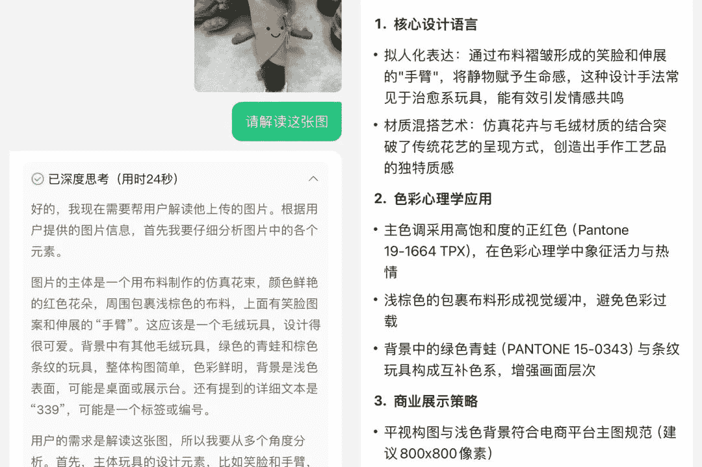

【当虹科技“DeepSeek+BlackEye”大模型一体机首发】

当虹科技发布全新一代“DeepSeek+BlackEye”多模态大模型一体机。当虹科技副总裁、传媒事业部总经理叶建华表示，DeepSeek+BlackEye 多模态大模型一体机可为电视台、互联网视频、运营商及新媒体机构提供一站式智能化解决方案。

【腾讯健康接入 DeepSeek】

腾讯健康日前通过腾讯云全面接入 DeepSeek 大模型，与腾讯自研的混元大模型“组队”，全面升级智能导诊、预问诊、健康问答、智能用药、症状自查、报告解读等就医服务场景，为医疗机构、体检中心、药械企业提供多模型部署与应用方案。

【腾讯旗下手游《和平精英》接入 DeepSeek】

腾讯旗下战术竞技手游《和平精英》宣布，将接入 DeepSeek，为数字代言人“吉莉”注入人工智能。根据计划，2 月 25 日将开启灰度测试并在短期内面向全量用户开放。据介绍，游戏大厅将开启“吉事通”入口，依托 DeepSeek 的多模态大模型技术，实现与玩家的自然语言对话、战术指导，玩家可与吉莉实时交流。此次接入是国产大模型在游戏领域的首批次应用落地。

【DeepSeek 下周起陆续开源 5 个代码库，每日解锁新内容】

DeepSeek 宣布，下周起会陆续开源 5 个代码库，每日都有新内容解锁，进一步分享新的进展。DeepSeek 介绍，当前在线服务的模块已经经过测试、部署完备，可以投入生产环境。公司将自己定义为小公司，并表示，每一次分享都会变成强有力的势能，加速行业发展的旅程。DeepSeek 还称，这个领域没有高高在上的象牙塔，只有纯粹的车库创业精神与社区共筑的创新力量。

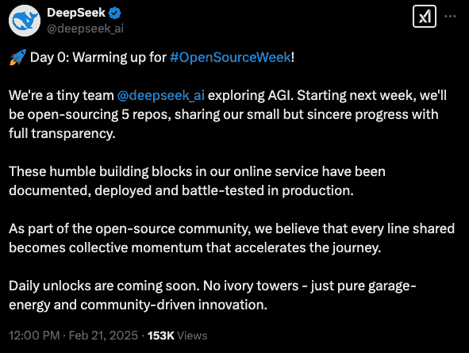

**【企业微信接入 DeepSeek，可一**键生成 7*24 小时企业“智能助理”】

企业微信新版本上线，正式发布"智能机器人"、"智能表格-客户跟进总结"等 AI 功能，灰度接入满血版 DeepSeek-R1 大模型。此次更新中，企业微信上线“智能机器人”功能，企业可免于开发，仅需配置机器人名称、角色，基于 DeepSeek、混元等大模型，即可一键创建企业专属的“智能机器人”。

### **2025 年 2 月 20 日**

【**腾讯理财通接入 DeepSeek-**R1 模型满血版，推出金融 AI 助理】

今日，腾讯理财通正式接入 DeepSeek-R1 模型满血版，同时支持腾讯混元大模型。用户下载腾讯理财通 App，首页点击搜索框或股票行情入口即可体验。据了解，此前腾讯理财通已上线 AI 服务，应用于理财通社区、智能客服等场景，升级接入 DeepSeek 后，腾讯理财通进一步整合专业金融信息数据、微信公众号文章等资源，金融服务专业性更强、时效性更高

**【昆仑万维旗下 Opera 接入 DeepS**eek R1 模型 支持本地个性化部署】

昆仑万维旗下的 Opera 团队在 Opera Developer 中接入了 DeepSeek R1 系列模型，用户可通过简单步骤在本地运行该模型，提升浏览器的 AI 能力。此次更新不仅为用户提供了更强大的本地 AI 功能，也展示了昆仑万维在 AI 技术领域的持续创新和应用能力。

【**科大讯飞发布全栈国产化一体机】**

日前，科大讯飞推出星火 DeepSeek 塔式一体机与星火 DeepSeek 一体机两款全栈国产化 AI 基础设施。两款产品均采用从底层芯片到上层应用的全国产化技术架构，通过物理隔离确保数据安全闭环。其中，讯飞星火 DeepSeek 塔式一体机支持办公室灵活部署，讯飞星火 DeepSeek 一体机适用机房部署，覆盖多种部署场景，助力开发者和科创企业加速业务创新。

### **2025 年 2 月 19 日**

【传 DeepSeek 正考虑首次外部融资】

2 月 19 日晚间，有媒体报道，DeepSeek 正在考虑首次外部融资。知情人士透露，DeepSeek 内部已经开始讨论是否接受外部融资，以获取更多的 AI 芯片和服务器资源。报道指出，中国投资公司和全国社保基金已经与 DeepSeek 取得联系，希望获得投资。DeepSeek 的高管及其母公司幻方量化的高管也正在谈论是否从专注技术研究转向一家能够创造收入并最终获利的商业企业。

【国内多所高校官宣接入 DeepSeek】

2 月 19 日，上海交通大学、华东师范大学、浙江大学、东南大学等高校在开学首日官宣接入“满血版”DeepSeek。据了解，DeepSeek 为上海交通大学 AI 应用平台提供新一代大模型底座，升级了高等数学、概率统计、线性代数、数学分析、抽象代数、信号与系统等课程的数学深度推理 AI 学习工具。此外，浙江大学人工智能科研团队还推出了 DeepSeek 系列专题线上公开课。

【新壹科技旗下秒创接入 DeepSeek】

新壹科技宣布，其视频创作平台“秒创”接入 DeepSeek 平台。此次接入 DeepSeek 能力后，秒创将为用户提供更高效的创作工具，包括自动生成视频内容、精准的语言情感分析、智能识别与分析视频中的关键元素和提示词优化等。

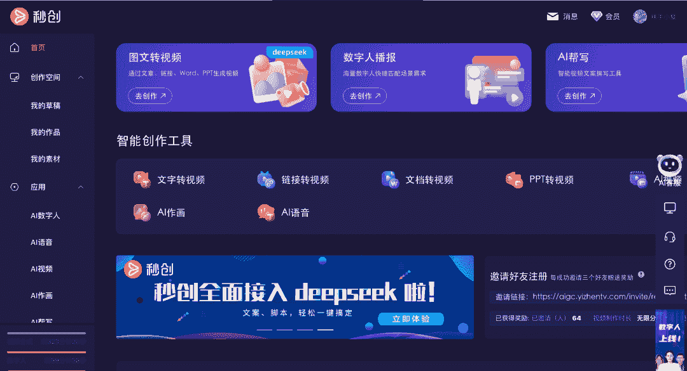

**【撞车 DeepSeek NSA，Kimi 杨**植麟署名的新注意力架构 MoBA 发布】

2 月 19 日消息，昨日（18 日），DeepSeek 发布了一篇新论文，提出了一种改进版的注意力机制 NSA，有创始人兼 CEO 梁文锋亲自参与。同一天，月之暗面发布了一篇主题类似的论文，月之暗面创始人兼 CEO 杨植麟也是该论文的署名作者之一。这篇论文提出了一种名为 MoBA 的注意力机制，据介绍，MoBA 是“一种将混合专家（MoE）原理应用于注意力机制的创新方法”。该方法遵循“更少结构”原则，并不会引入预定义的偏见，而是让模型自主决定关注哪些位置。

【快手旗下剪辑软件快影接入 DeepSeek-R1 满血版】

近日，快手旗下剪辑软件快影正式接入 DeepSeek-R1 满血版，成为行业首批接入 DeepSeek 能力的剪辑工具。快影将融合 DeepSeek-R1 模型技术，并加持可灵 AI 视频生成能力，集成文案成片、小说漫、AI 故事短片、字幕快剪等八大 AI 智能剪辑功能，且大部分功能均支持免费使用，助力创作者提升效率与质量，实现便捷创作、高效变现。

**【车车科技接入 DeepSeek 大模**型，全方位提升新能源车险服务效率与质量】

近日，车车科技新能源车险 SaaS 服务平台正式接入 DeepSeek 大模型，通过 AI 技术赋能新能源车险交易服务，在智能客服、协助定价、智能理赔等核心场景实现技术突破。在智能客服应用层面大模型能够迅速查出承保和理赔流程中的断点原因，并给出解决方案。在协助定价方面，结合行业数据、保险公司数据和车企数据，利用大模型的分析能力，为用户提供精准的车险产品匹配。在智能理赔方面，大模型协助保险公司对理赔数据进行比对处理，快速生成理赔方案和价格，将理赔案件识别时间缩短 50%以上。

**【多家公募基金抢跑算法人才招聘以应对 D**eepSeek 影响，部分岗位要求博士】

2 月以来，一批公募基金已开始抢跑春季招聘行情，发起新一轮“英雄帖”。而在 DeepSeek 本地化部署浪潮下，月内新增的基金社会/校园招聘岗位中，围绕人工智能相关的岗位出现了一定增长。部分岗位要求博士学历。多家公募已率先尝到这一技术基础设施为业务优化带来的甜头，并普遍认同其在推动基金行业方面将会有毋庸置疑的影响。

【水滴公司接入 DeepSeek】

水滴公司宣布正式接入 DeepSeek 模型产品，进一步完善保险大模型的生态战略部署。在大模型的赋能下，水滴公司研发的“AI 保险专家”已经能够覆盖语音、文本等多种交互形态，可以实现复杂对话、辅助销售规划等能力，能够独立承担意外险、医疗险等险种的部分语音沟通及咨询工作。

【虎牙直播接入 DeepSeek-R1 满血版】

近日，虎牙直播宣布接入 DeepSeek-R1。本次接入虎牙直播的 DeepSeek-R1 满血版大模型支持深度推理和联网搜索。据了解，用户可以在虎牙直播 App 首页搜索框中进入“AI 助手（DeepSeek-R1）”，通过自然语言进行 AI 搜索和对话。

### **2025 年 2 月 18 日**

【网易云音乐接入 DeepSeek-R1 大模型】

网易云音乐宣布其面向创作者研发的音乐播客生成工具与对谈播客生成工具已接入 DeepSeek-R1。同时，网易云音乐将基于 DeepSeek-R1 大模型，整合自有 AI 技术能力，在歌曲智能推荐、音乐资讯搜索、音乐人创作辅助、用户歌曲定制，及长音频内容生成、社交场景创新等多领域积极探索，为创作者及用户提供更全面、更个性化的音乐等内容服务。

**【联想小新 Pro 系列新品正式发布，接入 D**eepSeek-R1 联网满血版大模型】

2 月 18 日晚间，联想在北京举办联想小新 Pro 系列新品发售会，发布了联想小新 Pro 14 2025 款、联想小新 Pro 16 2025 款、联想小新 Pro 14 GT AI 元启版、联想小新 Pro 16 GT AI 元启版四款产品。在 AI 智能进化方面，联想小新 Pro GT AI 元启版内置的个人智能体小天，已接入 DeepSeek-R1 联网满血版大模型（671B 参数）。

【DeepSeek 推出 NSA，用于超快速的长上下文训练和推理】

DeepSeek 推出 NSA。DeepSeek 称，NSA 是一种与硬件一致且本机可训练的稀疏注意力机制，用于超快速的长上下文训练和推理。通过针对现代硬件的优化设计，NSA 加快了推理速度，同时降低了预训练成本，而不会影响性能。在一般基准测试、长上下文任务和基于指令的推理上，它的表现与完全注意力模型相当甚至更好。

【DeepSeek 公布创新型企业名单，PingPong、菜鸟等入选】

近日，有媒体向 DeepSeek 抛出了问题，除了六小龙，杭州还有哪些值得关注的创新型企业，尤其是科技公司？DeepSeek 提及 27 家公司，其中包括 PingPong、连连数字、菜鸟、启明医疗、泰格医药和中昊芯英等。据了解，PingPong 和连连数字凭借卓越的技术实力、广泛的全球支付网络以及创新的数字化服务，为跨境企业提供一站式支付解决方案。菜鸟跨境出口订单量成为全球第一，同时已大跨步开启物流技术出口。

**【网易有道推出国内首款 AI 原生学习硬件 Spac**eOne 集成 DeepSeek-R1】

网易有道于 2 月 18 日推出了革命性的学习硬件——全面屏答疑词典笔 SpaceOne，该产品以“草稿纸式推演”为核心，突破传统解题工具的局限，提供全题型深度讲解，覆盖数学、物理、化学等多个学科，极大提升学习效率。

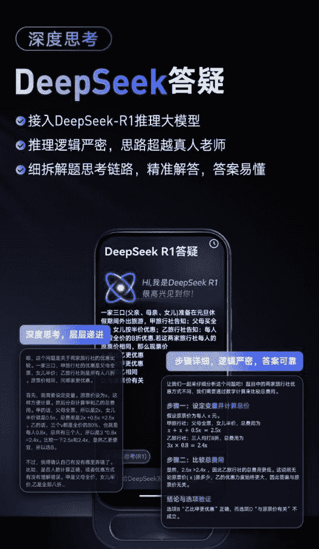

【百度搜索全量上线 DeepSeek 满血版】

目前百度搜索已全量上线 DeepSeek 满血版。用户可在百度 App 输入任意搜索词，完成一轮搜索后，在搜索结果页点击“AI+”进入 AI 搜索，再点击下方去试试“满血版”即可与 DeepSeek 对话。据了解，百度搜索和文心智能体平台于 2 月 16 日宣布将全面接入 DeepSeek 和文心大模型最新的深度搜索功能。

**【标普全球首席经济学家：DeepSeek 是一个**惊喜的突破，展现了中国经济的潜力和韧性】

面对多重不确定性，标普全球首席经济学家 Paul Gruenwald 在接受南方财经记者专访时预测，2025 年全球经济增长将接近 3%。他强调，尽管全球面临着关税及潜在通胀等一系列挑战，但中国将继续是推动全球经济增长的关键力量，预计将单独贡献全球增长的约 1%。 “比如 DeepSeek 的成功，这是一个惊喜的突破，令人惊讶，展示了在相对较少的资源条件下（如芯片等）仍然能够开发出高质量的人工智能，展现了中国经济的潜力和韧性。

**【深圳广州上线“AI 公务员” ：部署 Dee**pSeek 大模型覆盖 240 个场景】

深圳市福田区和广州市相继上线基于 DeepSeek 大模型的“AI 公务员”，标志着智慧政务建设的重要进展。福田区推出的 AI 数智员工已覆盖 240 个业务场景，显著提升政务服务效率，个性化定制生成时间大幅缩短，审核时间减少 90%。

### **2025 年 2 月 17 日**

**【阿里云：大数据开发治理平台 DataWor**ks 接入 DeepSeek 两款模型】

据阿里云官微，其一站式智能大数据开发治理平台 DataWorks 正式接入 DeepSeek-R1（671B）模型与 DeepSeek-R1-Distill-Qwen-32B 模型。

【腾讯文档正式接入 DeepSeek-R1 满血版】

腾讯文档 AI 文档助手正式接入 DeepSeek-R1 模型满血版，进一步助力用户提效。接入后，用户在 AI 文档助手中选择 DeepSeek-R1 模型即可直接使用腾讯文档小程序、网页版 AI 全屏页、移动端、桌面端均可体验（支持移动端、桌面端 3.9.5 及以上版本）。AI 文档助手专业创作能力与 DeepSeek 结合为用户提供更实用的文档总结、文档问答和摘要大纲等能力模型生成的结果可直接生成文档、表格、幻灯片、思维导图、智能文档顺畅承载输出内容，助力用户进一步思考与创作。

【中关村科金：智能客服已全面接入 DeepSeek】

近日，中关村科金宣布其智能客服已全面接入 DeepSeek，并完成超 30 个场景的实测。结果显示，超过 90%的场景，通过切换 DeepSeek V3 或 R1 模型，平均带来了 5%-20%的效果提升。据了解，此次评测覆盖多行业场景，在金融复杂文本问答场景，DeepSeek-V3 准确率达 95.1%，DeepSeek-R1 为 94.9%，整体提升 15%，有效降低转人工率。

【DeepSeek 公司主要人员发生变更】

天眼查 App 显示，近日，DeepSeek 关联公司杭州深度求索人工智能基础技术研究有限公司发生工商变更，裴湉由执行董事兼总经理改任经理、董事，新增王贤祖为财务负责人，同时经营范围新增互联网信息服务。杭州深度求索人工智能基础技术研究有限公司成立于 2023 年 7 月，法定代表人为裴湉，注册资本 1000 万人民币，经营范围包括计算机系统服务、信息系统集成服务、人工智能应用软件开发等，由梁文锋及其名下宁波程恩企业管理咨询合伙企业（有限合伙）共同持股。

**【微软 OmniParser 最新版本可将 De**epSeek 等模型转化为计算机智能体】

2 月 17 日，根据微软官网，微软日前发布视觉 Agent 解析框架 OmniParser 最新版本 V2，可将 OpenAI（4o/o1/o3-mini）、DeepSeek（R1）、Qwen（2.5VL）、Anthropic（Sonnet）等大模型，转化为“计算机使用智能体”（Computer Use Agent）。相比前代版本，OmniParser V2 在检测更微小可交互元素时精度更高、推理速度更快。具体而言，V2 通过使用更大规模的交互元素检测数据集和图标功能描述数据进行训练，并通过缩小图标描述模型的输入图像尺寸，推理延迟较前代降低 60%。

**【中信建投：腾讯接入 DeepSeek 有望带**动 API 调用量增加和本地化部署需求】

中信建投研报称，用户量激增下 DeepSeek 频繁出现“服务器繁忙”提示，以及腾讯宣布接入 DeepSeek 模型，均有望带动 API 调用量增加和本地化部署需求，1。利好有数据、有客户、有场景的软件企业，AI 产品有望带动公司 ARPU 提升和项目单价上升；2.模型私有化需求增加，利好一体机、超融合和 B 端服务外包企业。

### **2025 年 2 月 16 日**

**【百度搜索和文心智能体平台宣布将全面接入 De**epSeek 及文心大模型深度搜索功能】

2 月 16 日晚，百度搜索和文心智能体平台宣布将全面接入 DeepSeek 和文心大模型最新的深度搜索功能。搜索用户可免费使用 DeepSeek 和文心大模型深度搜索功能，文心智能体平台的开发者也将能随时调用 DeepSeek 模型创建并调优智能体。据了解，文心大模型深度搜索功能于 2 月 13 日上线，具备更强大的思考规划和工具调用能力，可为用户提供专家级内容回复，并处理多场景任务，实现多模态输入与输出。

【广州、深圳政务系统接入 DeepSeek】

据微信公众号“中国广州发布”2 月 16 日消息，广州市政务服务和数据管理局在政务外网正式部署上线 DeepSeek-R1、V3 671B 大模型，通过融合海量政务数据要素，大模型将丰富政务服务场景应用。消息称，本次大模型上线工作依托数字广州创新实验室实施已完成 DeepSeek-R1 等模型深度适配国产硬件，将通过政务专网算力推动人工智能大模型在民生政策解读系统、12345 热线工单分派等政务领域应用，政务办公、城市治理、民生服务等多个热门政务领域已率先探索应用 DeepSeek 模型优化工作和服务场景

【QQ 浏览器接入 DeepSeek-R1 满血版】

QQ 浏览器宣布正式接入 DeepSeek-R1 模型满血版，支持深度思考、联网搜索、多轮对话、历史记录回溯。在 QQ 浏览器手机或电脑端的搜狗搜索（或全网搜索）模式下搜索“DeepSeek”，或点击手机端搜索框左侧的放大镜图标选择“DeepSeek 模型”，即可直达 DeepSeek 模型 QQ 浏览器专线版，点击登陆后就能免费使用。

【腾讯多个产品正在探索接入 DeepSeek】

2 月 16 日消息，腾讯多个产品正在探索接入 DeepSeek，如腾讯云 AI 代码助手、腾讯元宝等，为用户提供更丰富的体验和服务。

### **2025 年 2 月 15 日**

【腾讯回应微信接入 DeepSeek：已在灰测阶段】

2 月 15 日晚间，有消息称，微信搜一搜在测试接入 DeepSeek-R1。对此，腾讯相关人士回应《广州日报》称，微信搜一搜在调用混元大模型丰富 AI 搜索的同时，近日正式灰度测试接入 DeepSeek。被灰度到的用户，可在对话框顶部搜索入口，看到“AI 搜索”字样，点击进入后，可免费使用 DeepSeek-R1 满血版模型，获得更多元化的搜索体验。

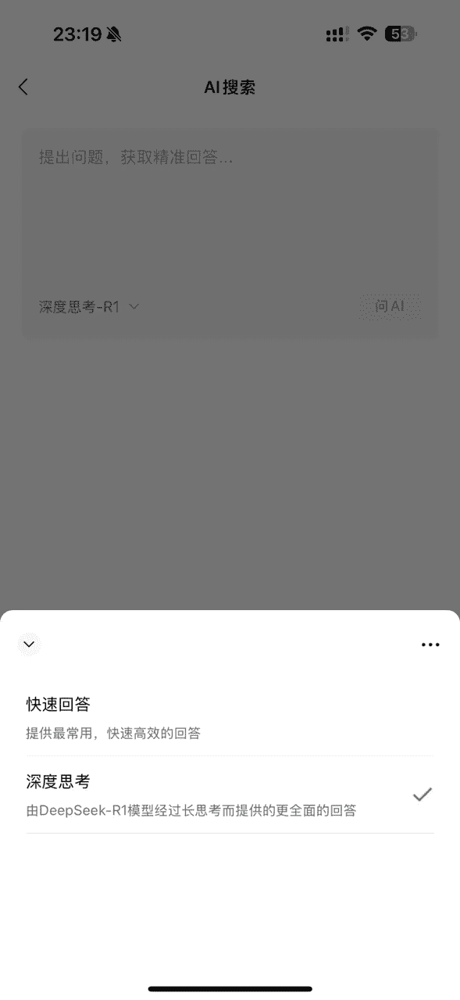

**【百度智能云发布四款千帆 DeepSeek 一**体机，单机 8 卡可承载 R1 满血版】

百度智能云正式推出千帆 DeepSeek 一体机，深度融合 DeepSeek 模型，为企业提供一站式智能解决方案，解决企业在模型使用中面临的算力不足、部署运维复杂、应用开发流程复杂、数据安全与隐私合规风险等多重挑战。

为满足企业私有化部署需求，并解决以上痛点，百度智能云千帆一体机全系支持 DeepSeek 模型家族，包括 DeepSeek-R1-671B、DeepSeek-V3-671B、DeepSeek-R1-Distill-Llama-70B、DeepSeek-R1-Distill-Qwen-32B 、DeepSeek-R1-Distill-Qwen-14B 以及基于 DeepSeek 蒸馏的行业垂类模型。

### **2025 年 2 月 14 日**

【宁畅发布 DeepSeek 大模型一体机解决方案】

宁畅正式发布 DeepSeek 大模型一体机解决方案。作为一款面向企业的“开箱即用”智能算力平台，宁畅大模型一体机，搭载 DeepSeek R1/V3 满血版模型和蒸馏版模型，通过软硬件深度协同优化，为企业提供从部署到场景定制的全栈交付能力，帮助制造、金融、医疗、科研等行业突破 AI 应用瓶颈，迈向智能化转型新阶段。宁畅推出的 DeepSeek 大模型一体机解决方案以强大性能、便捷操作、定制化服务及可靠安全保障，成为企业数智化转型的坚实后盾，也为 AI 产业蓬勃发展提供强劲动力

【中国信通院：正式启动 DeepSeek 国产化适配测评工作】

中国信息通信研究院表示，正式启动 DeepSeek 国产化适配测评工作，旨在为 DeepSeek 系列模型在多硬件多场景下的适配部署提供参考。一是评价模型在包括硬件芯片、计算设备、智算集群等软硬件系统中的适配效果；二是反映模型在软硬件系统适配过程中软件栈及工具的适配易用性及开发部署成本。测试将主要围绕表所示的 DeepSeek 不同模态、不同尺寸的系列模型，面向推理、微调、训练过程，低成本使用测试工具 AISHPerf，从适配成本、功能完备性、优化效果、性能指标等多方面开展测试评估。

【易点云：即将推出支持 DeepSeek 的 AIPC】

易点云宣布即将推出三款自研 AI PC，全面支持 DeepSeek 大模型，提供按月租赁服务，为企业本地部署 DeepSeek 大模型。据介绍，易点云推出的三款 AIPC 包括：AH21 系列（i5-14400F + RTX3050 显卡），AH21 系列（i7-14700F + RTX4060 显卡）以及旗舰版 AP21（i9-14900KF + RTX 5080 显卡）。

【联想 moto 正式接入 DeepSeek-R1 满血版大模型】

2 月 14 日，联想 moto 宣布旗下 AI 手机正式接入 DeepSeek-R1 满血版大模型（671B 参数）。通过联想小天的对话，联想 moto 手机用户即可直接体验 DeepSeek 大模型带来的更加快速、精准、智能、高效的交互体验，无需下载注册和复杂步骤操作，支持联网搜索，可使用语音提问。

【学而思正式发布接入 DeepSeek 的全新“随时问”App】

学而思正式发布接入 DeepSeek 的全新“随时问”App。据介绍，随时问 App 全方位拥抱 DeepSeek，一方面会直接接入 DeepSeek R1 为用户提供深度思考模式下的问答功能；另一方面，DeepSeek 的 V3 版本已成为学而思九章大模型的基座之一，学而思加入大量教育行业专有数据进行二次训练，并在此基础上开发学习场景的产品功能。该软件还集成了 AI 问答、AI 拍照答疑、AI 作业检查、AI 作文批改、AI 错题本等中小学生高频使用的学习工具，可以实现一站式的查漏补缺和学习辅导。

### **2025 年 2 月 13 日**

【同步宣布全面免费，OpenAI 与百度开启大模型“5.0 竞赛”】

2 月 13 日，百度文心一言在官网宣布将于 4 月 1 日 0 时起全面免费，所有 PC 端和 APP 端用户均可体验文心系列模型，包括此前需付费体验的 4.0 系列和未来将发布的 5.0。北京时间 2 月 13 日凌晨 3 点，OpenAI 首席执行官 Sam Altman 通过社交媒体宣布，GPT-4.5/5 将很快陆续发布，免费版 ChatGPT 将在标准智能设置下无限制使用 GPT-5 进行对话。业内人士认为，技术突破驱动的训练和推理成本下降，是中美 AI 免费开放大模型的底层原因。OpenAI 与百度的“5.0 竞赛”和全面免费，不仅是中美技术实力的较量，更有利于进一步降低 AI 的使用门槛。

【粉笔深度整合 DeepSeek， 实现公考培训赛道商业化新突破】

近日，职业教育企业粉笔宣布，公司已于 2024 年底全面拥抱 DeepSeek 大模型，推动粉笔自研垂域大模型性能释放，通过智能技术矩阵重构公职培训产业生态，实现用户体验智能化升级与运营效能指数级提升，为教育科技行业开辟价值增长新范式。据了解，目前技术升级已覆盖公务员考试核心场景，在用户练习点评、面试点评等关键环节构建起技术护城河。

**【百度智能云千帆 AppBuilder 完**成对 DeepSeek 模型的全面接入】

百度智能云千帆 AppBuilder 完成了对 DeepSeek 模型的全面接入，提速模型落地最后一公里。此次接入，不仅具备联网搜索及其他组件能力，RAG、Agent 以及工作流等功能，均实现了对 DeepSeek 模型的全链路支持。依托 DeepSeek 在深度思考方面的性能优势，开发者能够更高效地探索大模型应用，提升创新效率，加速各类 AI 应用从概念到落地的转化，为 AI 技术在更多领域的拓展与应用注入强大动力。

**【OpenAI CEO 奥特曼：每天都担心被超越，**计划与 DeepSeek 领导层会面】

当地时间 2 月 11 日播出的一档节目中，OpenAI CEO 山姆·奥特曼表示，“为了不让 OpenAI 被超越，每天都有压力。计划与 DeepSeek 的领导层会面。”

【腾讯元宝迎来更新，同步支持混元和 DeepSeek 模型】

腾讯 AI 助手腾讯元宝迎来更新，同时支持混元和 DeepSeek 两大模型，打开腾讯元宝并进入对话界面，即可免费使用 DeepSeek-R1 满血版模型。据了解，腾讯元宝提供的 DeepSeek 支持联网搜索，并整合了微信公众号、视频号等腾讯生态信息源，能为用户提供更稳定、实时、全面、准确的回答。

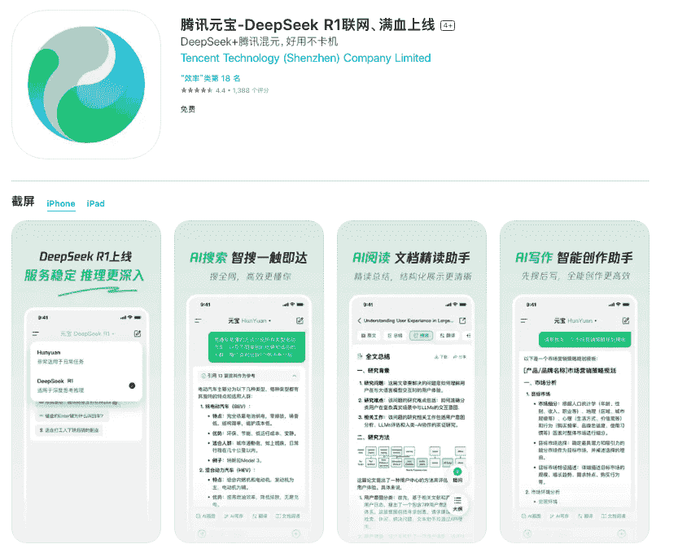

### **2025 年 2 月 12 日**

**【国家超算平台推 AI 伙伴计划：**三月免费开放 DeepSeek API】

国家超算互联网平台启动了 AI 生态伙伴加速计划，旨在为企业用户提供便利的 AI 技术应用支持。该计划包括为期三个月的 DeepSeek API 接口免费使用权限，并配备千万卡时的算力资源池。

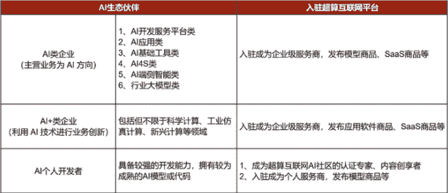

**【百度沈抖：虽然 DeepSeek **横空出世，但大模型的混战还没有完全结束】

2025 年 2 月 12 日，百度智能云事业群组（ACG）召开全员会。会上，百度集团执行副总裁、百度智能云事业群总裁沈抖提到了 ACG 在 2024 年的业绩表现，也提到了当下 DeepSeek 爆火，对 ACG 乃至整个模型赛道的影响。在应用层，ACG 旗下着重对代码助手、智能客服、数字人三个领域做了布局。沈抖先是肯定了整体的回款率，也提及了应用层的毛利有所改善，但他也坦言，虽然 DeepSeek 横空出世，但大模型的混战还没有完全结束，战况依然非常焦灼。他判断，接下来多模态的需求会进一步提升，行业的重心将从训练转移到推理，多模态会成为主流的需求。

**【IBM 首席执行官：“DeepSe**ek 时刻”将有助于推动人工智能的采用】

IBM 首席执行官 Arvind Krishna 表示，继 DeepSeek 崛起之后，对开发人工智能（AI）模型成本的估算将有助于推动该技术的采用。“我们会发现，随着成本下降，使用将激增，”Krishna 在迪拜举行的世界政府峰会上接受采访时表示，“我认为这是一种验证 —— 我们一直认为不用花那么多钱来获得这些模型。”

**【东风日产 N7 首款接入 Dee**pSeek 大模型，实现智能化人机交互】

东风日产的全新车型 N7 成功与 DeepSeek-R1 深度推理大模型融合，成为首个接入该技术的合资车企实车。N7 在智能化与人机交互方面的创新，提升了用户体验，提供个性化服务。

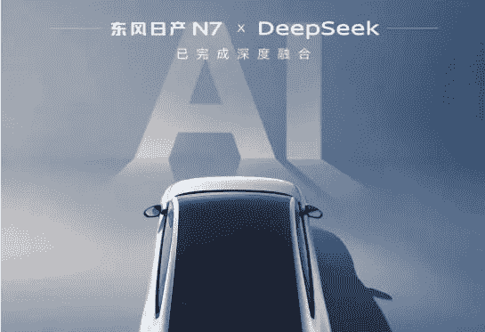

【海信电视接入 DeepSeek，AI 语音对话功能升级】

海信集团宣布其自研的星海大模型成功接入 DeepSeek，旨在提升用户在智慧生活和智慧城市领域的交互体验。通过与 DeepSeek 的融合，海信的智能技术能力显著增强，用户可通过遥控器或语音命令轻松启动对话功能，简化操作步骤。

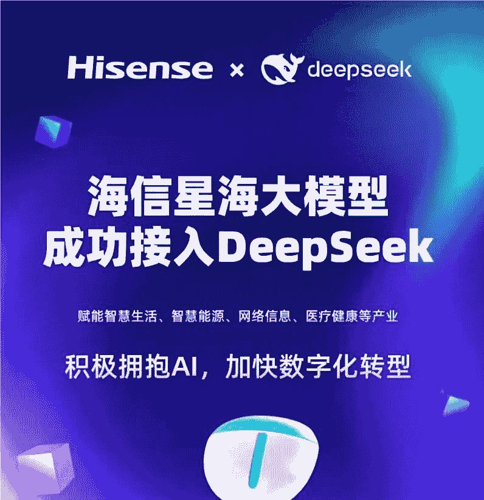

【零一万物旗下 PopAi 接入 DeepSeek-R1】

近日，零一万物公司研发的海外 AI 应用 PopAi 接入了 DeepSeek-R1 模型。这也是首个接入 DeepSeek 的 AI 六小虎之一。零一万物方面表示，其应用程序已经升级为新的 DeepSeek-R1 模型，这种强大的模型提供了更流畅、更高效的深度推理体验。据知情人士披露，DeepSeek 目前只是接入 PopAi，还处于测试阶段， PopAi 依然继续使用 Yi 大模型和通义千问大模型，这也是目前调用最多的两个模型。

【顺丰同城接入 DeepSeek 大模型】

第三方即配平台顺丰同城已接入 DeepSeek 大模型。据介绍，顺丰同城持续拓展 AI 合作“朋友圈”，与国内多个大模型厂商达成合作，包括火山豆包、腾讯混元、百度文心一言等，持续在营销策略、用户体验、多场景智能客服，骑手人脸、装备等配送规范识别，多元运力资源管理等方面进行应用提效。

【有道智云全面接入 DeepSeek】

有道智云宣布全面接入 DeepSeek。开发者可以直接在平台调用 DeepSeek 大模型能力打造 AI 智能体，结合不同业务场景，为用户打造智能助手。凭借 DeepSeek 大模型在主题识别、逻辑推理、语义理解、上下文关联、情感分析以及多语言支持等多维度的能力，有道智云的产品已实现全方位升级。

【瑞银：DeepSeek 驱动的中国股市上涨才完成一小半】

瑞银称，DeepSeek 人工智能（AI）应用程序推动的中国股市上涨之路可能还未走完一半，因为良好的流动性和较低的利率可能会给 AI 概念股带来未来价值重估的机会。“根据 4G、5G 和云计算时代的经验，涨势通常会持续 1-2 年，我们认为相关股票的表现将跑赢 50-100 个百分点，”James Wang 等策略师在报告中写道。

【猿辅导集团宣布接入 DeepSeek 最新大模型】

近日，猿辅导集团宣布旗下“小猿学练机”、“小猿口算”等全系列小猿产品接入 DeepSeek 最新大模型，并与自研猿力大模型融合，共同为青少年带来更优质的 AI 学习体验。基于大模型的 AI 问答等多个功能已在小猿学练机和小猿口算上线，更强大的功能和调优成果将在未来两月内陆续推出。

【马蜂窝 AI 智能应用接入 DeepSeek 大模型】

近日，马蜂窝宣布其自研的 AI 智能应用正式接入 DeepSeek 大模型，首阶段将优先应用于已上线发布的“AI 游贵州”、“AI 游黔西南”、“AI 游西江” 省市景区三级 AI 应用生态，进一步优化和提升贵州旅游服务的智能化水平。

### **2025 年 2 月 11 日**

【腾讯 ima 接入 DeepSeek-R1 模型】

2 月 11 日，腾讯旗下智能工作台 ima.copilot（简称 ima）接入 DeepSeek-R1 模型，用户将 ima 更新至最新版本，在使用搜、读、写和知识库的时候，可以选择腾讯混元大模型或 DeepSeek-R1 模型。ima 是腾讯在 24 年 10 月推出的以知识库为核心的 AI 智能工作台，是搜、读、写一体的效率工具。目前，ima 已上线 Windows 端、Mac 端和“ima 知识库”小程序。

**【腾讯云开发上线新能力，最少 3 行代**码将 DeepSeek 接入微信小程序】

2 月 11 日，腾讯云开发宣布能力上新，开发者能够基于最新的小程序基础库，最少仅需输入 3 行代码，就可以将满血版 DeepSeek 大模型能力接入到小程序中，快速实现智能对话、文本生成等功能。其中，云开发新用户首月套餐免费，并享有 100 万 token。据了解，云开发的 AI 能力不仅能接入小程序，还支持微信订阅号、服务号、小程序客服等多种微信生态能力的接入，并将在近期支持企业微信的接入。此外，云开发后续还计划推出工具调用、多 Agent 串联、工作流编排等 AI 能力，进一步方便开发者打造小程序智能应用。

**【李彦宏谈 DeepSeek：历史上的创新都来自于成**本降低，大模型成本每年降低 90%以上】

“回顾过去几百年的历史，创新的本质是成本下降与生产力提升。”2 月 11 日，百度创始人李彦宏在迪拜 WGS 上与阿联酋 AI 部长对谈时谈及 DeepSeek，他表示不仅在 AI 领域或 IT 行业，大多数创新都与降低成本有关。如果成本降低一定比例，生产力也随之提高同样比例。在今天，创新速度比以往都快得多。根据摩尔定律，每 18 个月，性能就会翻倍而价格减半。如今，大模型推理成本每年降低 90%以上。

【海信电视正式接入 DeepSeek】

2 月 11 日，海信电视宣布正式接入 DeepSeek，并支持满血 R1 和 V3 版本自由切换，成为行业首个搭载深度思考智能体的电视品牌。目前，海信电视正在进行用户终端的升级发布，预计 3-5 天内，所有搭载智能体的海信电视将全面支持 DeepSeek。接下来，即将上市的海信电视 2025 年新品也将全面支持 DeepSeek 服务。

**【奇安信与东方国信携手打造基于 Dee**pSeek 基座的 AI 安全智算平台】

2 月 11 日，网安企业奇安信与大数据、云计算、人工智能企业东方国信达成战略合作，携手打造基于 DeepSeek 基座的人工智能智算平台，致力于加速推动人工智能的广泛应用，并解决 AI 基座自主可控、降本增效以及开源育生态等关键问题，共同推动我国人工智能产业迈向新高度。此次合作标志着两家企业在技术创新上的深度融合，更预示着“AI+安全+算力”的无限想象空间。

**【**中关村科金：得助大模型平台 2.0 已支持 DeepSeek-V3 等 API 接入及企业私有化部署】

近日，中关村科金总裁喻友平发布内部全员信，指出 2025 年将是大模型应用元年，预计 90%的企业将接入大模型并深入到企业经营环节中。据介绍，中关村科金自研的得助大模型平台 2.0，已支持 DeepSeek-V3、DeepSeek-R1、Janus Pro 的 API 接入及企业私有化部署，支持企业使用 DeepSeek 系列模型构建大模型应用及 Agent 。

**【瓴羊智能客服产品接入 DeepSee**k，复杂推理与多场景适配能力进一步提升】

近日，瓴羊旗下智能客服产品 Quick Service 完成 DeepSeek 大模型的接入，通过 DeepSeek 的强大推理能力与瓴羊的智能客服解决方案相结合，进一步提升复杂问题推理和多场景适配方面的能力。截至目前，Quick Service 已支持多家主流大模型厂商十余款模型的接入，企业可以根据自身需求选择最合适的模型，通过 AI 与客服能力的深度融合，全面提升智能化的服务体验

**【OPPO AI 接入 DeepSeek-R1 旗下 F**ind N5 将于 2 月 20 发布】

OPPO 今日宣布将于 2 月 20 日发布其最新款折叠屏手机 Find N5。这款手机以全球最薄折叠屏为卖点，单边厚度仅约 4mm，折叠状态厚度不到 9.2mm。同时，Find N5 搭载高通骁龙 8 至尊版芯片，配备 3D 打印钛合金铰链，支持 IPX6、IPX8、IPX9 满级防水。

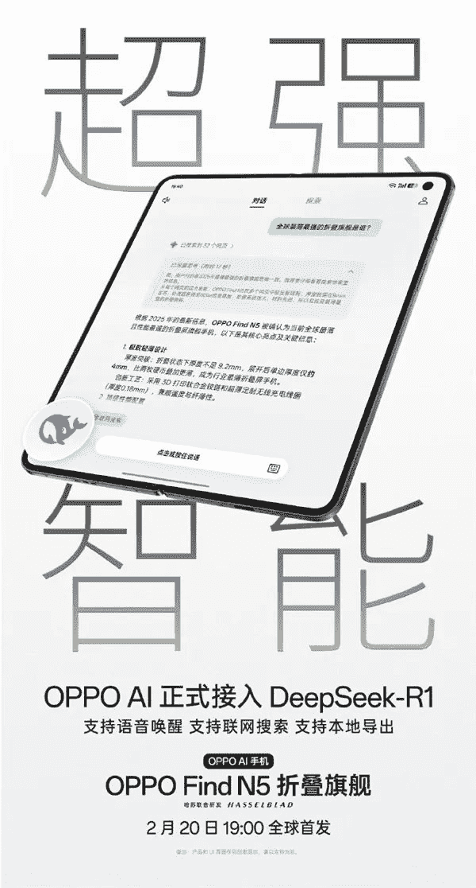

**【百度文小言 App 更新：引入 DeepSe**ek-R1 模型，拍照解题能力大幅提升】

百度文小言 App 最近更新至 4.9.0 版本，显著增强了拍照解题功能，用户能够清晰地看到解题过程中的思考步骤。此外，新版本还推出了个性化的伴学模式和创作工具，提升了学习体验。

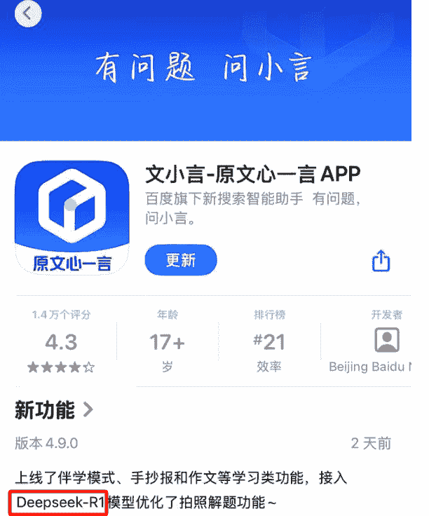

【DeepSeek 梁文峰或跻身亚洲顶级科技富豪】

2 月 11 日，彭博社对 7 位初创公司创始人及 AI 专家的调研显示，预计 DeepSeek 的估值在 10 亿美元到逾 1500 亿美元之间，估值区间的中间值为 20 亿至 300 亿美元。

根据彭博亿万富翁指数，若按上述数据估值，持有 84%股份的梁文峰将跻身亚洲最富有的科技大亨行列。

波士顿风投公司 Glasswing Ventures 创始人兼管理合伙人鲁迪娜·塞塞里说：“即便保守估计，这家公司仅凭目前区区数百万美元的营收，就能轻松获得数十亿美元的估值，更不用说考虑未来增长了。”

**【阿里巴巴的 Qwen 大模型使得斯坦福、伯克利能够开**发低成本的 DeepSeek 替代方案】

阿里巴巴的开源 Qwen2.5 模型助力低成本 AI 训练，近期斯坦福大学与伯克利大学的研究人员利用这一技术成功开发出低于 50 美元的 AI 推理模型。斯坦福的 S1 推理模型和伯克利的 TinyZero 模型，均通过阿里巴巴的 Qwen2.5-32b-Instruct 模型训练而成。

【无问芯穹异构云打通 DeepSeek-R1，多芯片适配优化】

2 月 11 日，无问芯穹异构云大模型服务平台宣布正式上线满血版 DeepSeek-R1、DeepSeek-V3，且在逐一打通 DeepSeek-R1 在壁仞、海光、摩尔线程、沐曦、昇腾、燧原、天数智芯等七个硬件平台上的便捷部署与推理服务，支持通过 Infini-AI 异构云平台一键获取 DeepSeek 系列模型与多元异构自主算力服务。

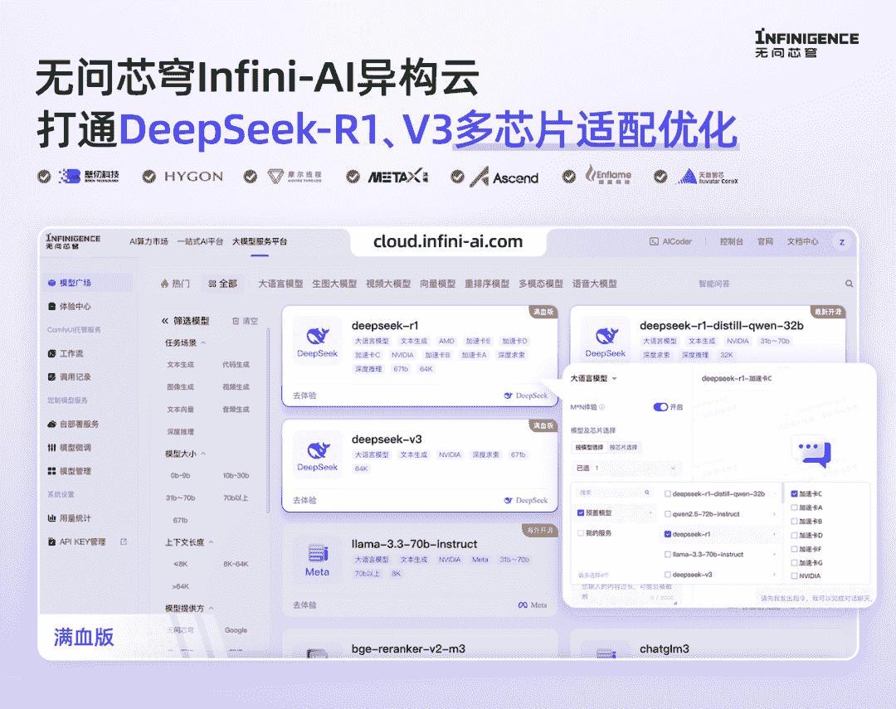

【知乎直答接入 DeepSeek-R1 模型】

知乎宣布旗下 AI 搜索产品知乎直答接入“满血版”DeepSeek-R1。目前，DeepSeek-R1 模型能力已经在知乎直答网页和知乎 App 双端集成上线。此外，知乎直答还同步上线知识库功能，集合了本地文件上传、网页收藏、RSS 订阅、知乎收藏夹等模块，用户可使用 DeepSeek-R1 模型对论文、文档、网页、知乎问答等特有内容进行信息提取、分析和分享，便于构建和管理属于用户的个人知识库。

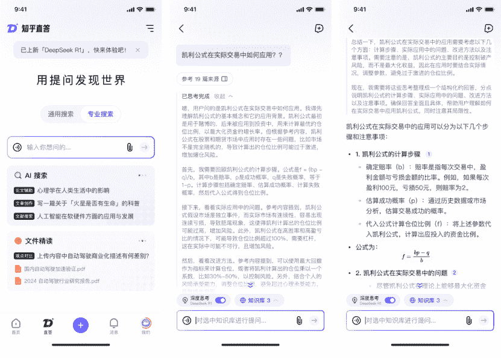

【头部企业陆续接入 DeepSeek，AI 医疗加速落地】

近日，包括医渡科技、鹰瞳科技、万达信息、智云健康等在内的数字医疗领域头部企业先后官宣接入 DeepSeek，推动 AI 医疗加速落地。业内人士认为，AI 医疗在提升医疗器械功能、检查检验结果解读、辅助临床医生决策、健康管理等多个领域的应用价值较大，是医疗企业和医院必须重视的创新方向。企业有望借助 AI 进一步提高产品竞争力，巩固行业地位和竞争优势。

### **2025 年 2 月 10 日**

**【顶级域名**** ai.com **重定向至 DeepSeek 官网】

近期，ai.com 域名重定向至中国 AI 公司 DeepSeek 官网，标志着该域名首次转向中国企业。ai.com 自 1993 年注册以来，曾在多个 AI 公司之间跳转，包括 ChatGPT 和 x.ai

【策略师：DeepSeek 的成功或提振对英伟达产品的需求】

Tiger Brokers 的市场策略师 James Ooi 在一份报告中写道，尽管英伟达的股票最初受到的打击最大，但 DeepSeek 的成功可能会提振对英伟达产品的需求。Ooi 说，DeepSeek 以美国同行的一小部分成本取得了相当的性能。Ooi 表示，人工智能软件股应该会受益于 DeepSeek 的成功，因为较低的计算成本将带来新的机会。Ooi 补充道，尽管最初人们担心低成本的人工智能模型可能会减少对高端芯片的需求，但这也可能带来对英伟达 GPU 的更高需求。

【QQ 音乐业内率先部署成 DeepSeek】

2 月 10 日，QQ 音乐宣布旗下自研 AI 助手已完成对 DeepSeek-R1 完整版大模型部署，这也是 DeepSeek 首次在音乐平台的应用。集成 DeepSeek-R1 后，用户向 QQ 音乐平台内的 AI 助手提问时，会获得更智能化、趣味化的音乐内容交互体验。目前，QQ 音乐 AI 助手 DeepSeek 音乐问答正处于测试阶段，用户点击搜索框左侧的 AI 助手入口进入后，可选择切换 AI 助手形象，与助手进行一对一深度音乐问答。

【宝宝树完成与 DeepSeek 深度融合】

宝宝树集团宣布已完成与开源大模型 DeepSeek-R1 的全面接入工作。据介绍，宝宝树创新工作室通过知识蒸馏技术，将 DeepSeek-R1 的强大推理能力迁移到更轻量级的 Mika-Brain 母婴垂域模型中，显著降低了资源消耗与使用成本。同时，通过多智能体引导机制优化 R1 输出，确保生成的回答更贴合母婴用户的需求，并设计了专门的奖励模型，以持续优化性能。

**【京东云智算服务 GCS 接入 De**epSeek，每小时低至 1.89 元】

继上线 DeepSeek-R1/V3 模型，并支持通过言犀 AI 开发计算平台进行公有云部署，以及通过 vGPU AI 算力平台、DeepSeek 大模型一体机进行私有化部署后，京东云将 DeepSeek-R1 模型的多个版本接入京东云智算服务 GCS，助力初创公司和开发者松构建自己的 AI 应用，每小时低至 1.89 元。京东云智算服务 GCS 提供 DeepSeek-R1 模型预装环境，支持轻量级模型（1.5B-7B）、中级模型（32B）的参数模型环境，满足不同开发需求。

【比亚迪杨冬生：比亚迪璇玑架构将接入 Deepseek】

在比亚迪智能化战略发布会上，比亚迪汽车新技术研究院院长杨冬生宣布，比亚迪的整车智能“璇玑架构”将接入 Deepseek R1 大模型的能力以快速提升车端和云端的 AI 能力。具体而言，在座舱端，借助 R1 大模型卓越的推理能力，比亚迪更好地理解用户的模糊意图和隐性需求，提供更加精准和个性化的服务，开启智能座舱新时代。

**

【神州数码：公司结合自有品牌产品及神州问学平台，针对 Dee**pSeek 系列模型开展了对接和部署工作】

神州数码发布异动公告，公司注意到公司股票被相关平台认为是“DeepSeek 概念股”。公司就相关事项说明如下：DeepSeek 为杭州深度求索人工智能基础技术研究有限公司推出的开源大模型，公司结合自有品牌产品及神州问学平台，针对 DeepSeek 系列模型开展了对接和部署工作。该事项对公司未来业绩影响存在不确定性，请广大投资者理性看待前沿技术的快速发展，注意投资风险。

**

【谷歌 DeepMindCEO 表示：DeepSeek 是**中国最好 AI 模型，但被过度“炒作”了】

2 月 10 日，2024 诺贝尔化学奖得主、谷歌 DeepMind CEO DemisHassabis 在一场活动中对 DeepSeek 的 AI 模型进行了评价。

他指出，DeepSeek 是中国目前最好的 AI 模型，但并没有带来任何实质性的科学进步。哈萨比斯表示，尽管 DeepSeek 的模型展示了出色的工程能力，并在短时间内完成了开发且控制了训练成本，但从技术角度来看，它并没有展示出重大的科学突破，而是使用了已知的 AI 技术。

他还提到，围绕 DeepSeek 的炒作“有点夸张”，而谷歌本周向公众发布的 Gemini 2.0 Flash 模型比 DeepSeek 的模型更为高效。此外，哈萨比斯还预测，人工智能行业正在走向通用人工智能（AGI），并可能在未来 5 年左右实现这一目标。

【百度风投 CEO 回应错过 DeepSeek】

近日，“百度风投就在 DeepSeek 楼上，却错过投资 DeepSeek”话题引发不少网友讨论。百度风投 CEO 高雪回应此事时表示，“我们就是在 DeepSeek 楼上的 VC，在 DeepSeek2024 年 5 月入驻融科资讯中心的第一时间，我们便拜访其相关负责人，并保持友好互动，但因为幻方的大模型业务没有拆分独立融资计划，所以和其他 VC 一样，目前没能有幸成为 DeepSeek 的投资人。”

高雪进一步介绍指出，百度风投（BV）是百度集团在 2017 年发起设立的独立风险投资机构，与百度的直接投资部门不同。百度风投一直专注于人工智能领域的布局和探索，已投资了超过百家中国初创科技企业。

【“满血”DeepSeek 上线讯飞开放平台，开发者可精调定制】

讯飞开放平台宣布包括“满血版”DeepSeek-V3 和 DeepSeek-R1 在内的 DeepSeek 全系大模型现已正式上线，支持公有云 API 调用和专属模型一键部署。讯飞开放平台不仅推理 API 限时免费开放，且首发 DeepSeek 大模型精调服务，支持开发者根据业务场景数据，打造专属 DeepSeek 大模型，推动企业级场景应用迈入高效化、低成本与深度定制。据统计，讯飞开放平台持续赋能超 812 万开发者团队，并与多家央国企及行业企业共同发布行业大模型。

【芯瞳 GPU 完成与 DeepSeek 的适配】

芯瞳公司宣布，芯瞳 CQ2040 系列 GPU 基于 llama.cpp 推理框架，在国内 AI 全链路自主技术闭环条件下，已成功完成 DeepSeek R1 模型的兼容适配。面对 DeepSeek 迅速出圈带来的激增需求，芯瞳推出全国产软硬一体化 AI 解决方案，满足不同规模的客户需求。

【DeepSeek 公司再申请多枚品牌标识商标】

天眼查知识产权信息显示，近日，DeepSeek 关联公司杭州深度求索人工智能基础技术研究有限公司申请注册多枚品牌标识图形商标，国际分类含科学仪器、通讯服务、网站服务等，当前商标状态均为等待实质审查。值得一提的是，该公司已成功注册多枚“DEEPSEEK”“深度求索”等商标。

**【中信建投：多家教育公司拥抱 DeepSee**k，有望加速 AI 教育产品商业化落地】

中信建投研报认为，教育是 AI 应用落地的核心场景之一，AI 技术通过降本增效使得教育兼顾高质量、普惠性和个性化成为可能，有望深度赋能教育提升交付效率以及提升学员个性化体验。目前 AI 教育应用主要场景体现在 B 端的教育信息化（如智慧教考、评测、批改等）、C 端的智能硬件产品以及智慧应用（如写作、听写、人机问答）。1 月以来多家教育公司接入 DeepSeek 大模型，高质量开源和低价模型催化下，原有教育公司的丰富垂直数据储备结合大模型推理能力，有望加速 AI 教育产品商业化落地。

【DeepSeek 火爆“吸睛”，国际投行齐发声：增配中国资产】

DeepSeek 的开年爆火不仅影响了 AI 产业的格局，也使得全球投资者的目光再度聚焦中国资产。近日，德意志银行的一篇股票策略研报引发市场热切关注。该行表示，DeepSeek 推出后，中国知识产权得到认可，中国在高附加值领域和供应链主导地位的范围正以前所未有的速度扩大。该报告认为，2025 年将是中国企业在全球崛起的一年，中国股票估值折价的现象将消失。报告还表示，A 股和港股的本轮反弹始于 2024 年，预计会在 2025 年延续并超过此前高点。

### **2025 年 2 月 9 日**

**【DeepSeek-V3 API 优惠期结束，每百万输出 **tokens 由 2 元升至 8 元】

2 月 9 日，DeepSeek-V3 API 服务的 45 天优惠价格体验期已结束，从 2 月 9 日开始将调整为新的价格：每百万输入 tokens 0.5 元（缓存命中）/2 元（缓存未命中），每百万输出 tokens 8 元。此前 DeepSeek 在优惠期内 API 价格为每百万输入 tokens 0.1 元（缓存命中）/ 1 元（缓存未命中），每百万输出 tokens 2 元。

【阿里云百炼上线全尺寸 DeepSeek 模型】

2 月 9 日，阿里云宣布百炼平台全面上线 DeepSeek-V3、DeepSeek-R1 及其蒸馏版等 6 款模型。其中 DeepSeek-V3、DeepSeek-R1 满血版可享各 100 万免费 tokens，最小尺寸的 DeepSeek-R1-Distill-Qwen-1.5B 面向用户限时免费。

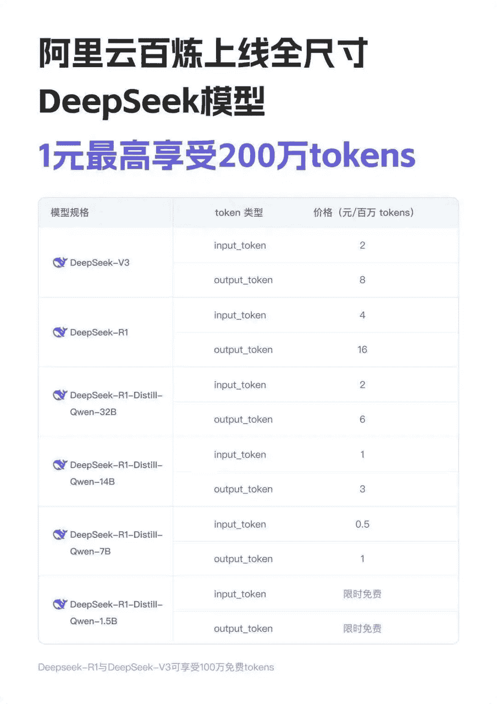

### **2025 年 2 月 8 日**

【工信部：三家基础电信企业均全面接入 DeepSeek 开源大模型】

工业和信息化部运行监测协调局发布 2025 年春节通信业务相关情况。2025 年春节期间，基础电信企业积极利用 AI 开展创新服务，融合其在 5G、云平台、大数据等方面能力，多领域布局，拓展 AI 应用场景，丰富 AI 应用供给。三家基础电信企业均全面接入 DeepSeek 开源大模型，实现在多场景、多产品中应用，针对热门的 DeepSeek-R1 模型提供专属算力方案和配套环境，助力国产大模型性能释放。

**【扣子智能体新增支持 DeepS**eek R1/V3 模型 可免费体验】

新一代 AI 应用搭建平台“扣子”正式支持 DeepSeek 的 R1 和 V3 模型，向用户开放免费体验。扣子平台旨在帮助用户快速搭建基于大模型的 Bot，并发布到各类社交平台。R1 模型具备思维链深度思考功能，V3 模型则提供更强的语言理解能力。

**【百度智能云客悦、曦灵、甄知、一见四款大模型应**用产品完成 DeepSeek 适配上线】

百度智能云旗下客悦、曦灵、一见、甄知四款大模型应用产品，正式上线接入 DeepSeek 模型的新版本，为企业智能外呼、数字人视频脚本生成、视觉智能分析、知识管理等高价值业务场景，提供更加丰富的 AI 大模型应用选择，满足用户多元化落地需求。同时，百度智能云正加速推进金融、交通、政务、汽车、医疗、工业等行业应用产品与 DeepSeek 模型的适配验证工作，积极探索大模型在智能问数、公文写作、理财助手、合规管理、医疗辅诊等行业垂直业务场景中的能力拓展与应用进化。

**【长城汽车 Coffee Agent 与** DeepSeek 已实现技术深度融合】

长城汽车自主研发的 Coffee Agent 大模型已与 DeepSeek 完成深度融合。Coffee Agent 将融合 DeepSeek R1 模型的特点，增强 Coffee Agent 的理解、思考和推理能力。此次 DeepSeek 的快速上车，依靠于长城汽车在 AI 子系统方面长期建设，支持端&云大模型的接入适配，兼容了端侧芯片平台和云端算力平台，在子系统内部完成适配后，应用立即生效可用。

**【昆仑万维天工 AI 上线 DeepSeek R1**+联网搜索，可优化 R1 偶尔崩溃问题】

昆仑万维今日宣布，旗下“天工 AI”推出 PC 版重大更新 —— 上线“DeepSeek R1 + 联网搜索”功能。官方表示，这一升级解决了 DeepSeek 联网功能无法使用的问题，还优化了 R1 版本偶尔崩溃的困扰。

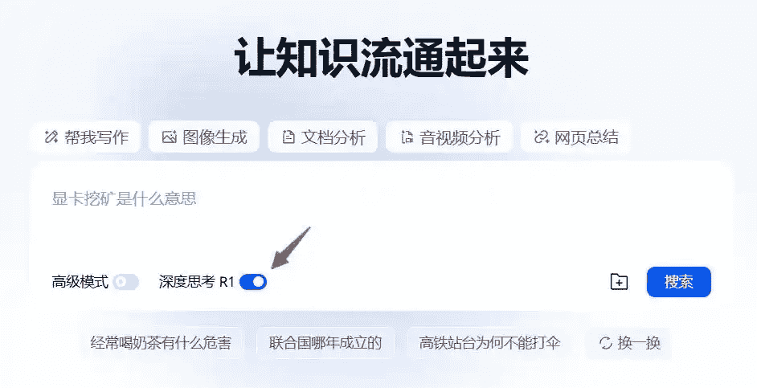

**【历史时刻：DeepSeek GitHub** 星数超越 OpenAI，仅用时两个月】

截至本周五下午两点，DeepSeek 旗下热度最高的项目 DeepSeek-V3 大模型 Star 量已达 7.77 万，超越了同平台中 OpenAI 最热门项目。

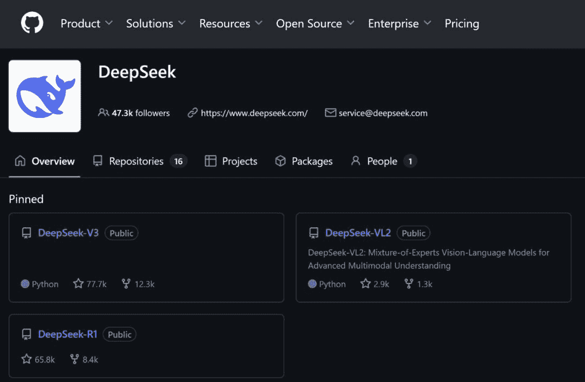

**【荣耀手机上线 DeepSeek 模型，需**升级至 MagicOS 8.0 及以上】

荣耀今日宣布上线 DeepSeek 模型，荣耀手机系统版本 MagicOS 8.0 及以上用户，将 YOYO 助理升级到 80.0.1.503 版本及以上，就能在 YOYO 智能体商店找到 DeepSeek 开始对话。

想体验这个功能的用户，可以在唤醒 YOYO 后将手机底部往上拉进入“智能体”板块，点击“DeepSeek-R1”即可。

【腾讯云上线 DeepSeek 模型 API 接口，率先支持联网搜索】

2 月 8 日，腾讯云宣布上线 DeepSeek-R1 及 V3 原版模型 API 接口，通过强大的公有云服务，腾讯云可以为用户提供稳定优质的服务。同时，腾讯云旗下大模型知识应用开发平台知识引擎也接入了这两款模型，并率先支持联网搜索，结合知识库和 RAG 能力，开发者可以借助该平台实现分钟级搭建基于 DeepSeek 大模型的联网应用。腾讯云成为国内率先支持 DeepSeek API+联网搜索的云厂商。

**【东风猛士 917 成为首个搭载** DeepSeek 的豪华新能源越野车】

猛士 917 汽车智能座舱已完成 DeepSeek-R1 模型的接入，并计划于 2025 年 4 月上海车展前，率先在猛士 917、蛟龙战甲等车型上通过 OTA 推送更新。此举将使猛士成为行业首款搭载 DeepSeek 智能系统的豪华新能源越野车型。

**【瞄准“对话即服务”智能交互入口 **360 织语全面接入 DeepSeek】

360 织语已全面接入 DeepSeek 大模型，并通过将 DeepSeek 大模型与即时通讯系统融合，为政企深度构建“对话即服务”的智能交互入口。

### **2025 年 2 月 7 日**

【DeepSeek 将参与 2025 全球开发者先锋大会】

从 2 月 7 日在上海徐汇召开的全球开发者先锋大会新闻发布会上获悉，对于 2 月 21 日至 23 日将在上海徐汇开幕的 2025 全球开发者先锋大会，大会组委会已和深度求索（DeepSeek）公司团队取得联系，DeepSeek 将会主动积极地参与到整个大会当中。

【出门问问宣布全面融合 DeepSeek】

出门问问宣布完成与最新推理大模型 DeepSeek-R1 的深度适配，并将其能力融于公司全线产品中。据介绍，出门问问联合华为云上线基于昇腾云的 DeepSeek-R1 服务，为用户带来全新的智能体验。

**【GMI Cloud 上架基于英伟达 H**200 的 DeepSeek 系列模型】

DeepSeek 在 GitHub 开源后，代码库快速吸引大量开发者关注，star 数短期内突破十万，且众多基于 DeepSeek 的二次开发项目如代码自动补全、智能文档摘要等，已在金融、医疗、科研等多领域实现高效部署，有力推动了 AI 应用的创新与落地。在这个过程中，GMI Cloud 技术团队第一时间在北美完成了对 DeepSeek R1 基于英伟达当前量产最强的 H200 GPU 服务器的部署适配和优化，构建了专属 DeepSeek - R1 推理。

**【报道：DeepSeek 在 1 月底**的用户量就超越了谷歌 Gemini】

据研究公司 SimilarWeb 估计，在短短一周内，DeepSeek 网站的用户数量就超过了谷歌的 Gemini 聊天 AI。1 月 31 日，DeepSeek.com 在美国的日访问量为 240 万次，比 Gemini 网站（150 万次）高出 60%。OpenAI 的 ChatGPT 仍然是其八倍，当天的日访问量为 1930 万次。（DeepSeek 在 1 月 28 日的访问量达到 490 万次的峰值。）DeepSeek 和 Gemini 之间的差距在美国以外更大：SimilarWeb 的数据显示，1 月 31 日，这个中国聊天 AI 在全球（基本不包括中国）的访问量为 2920 万次，是 Gemini 的三倍多。

【DeepSeek 大放异彩，AI 迎来“破圈时刻”】

DeepSeek 模型的横空出世掀起行业浪潮，多家公司迎来“破圈时刻”。一批上市公司宣布接入 DeepSeek，加速自身 AI 应用产品升级；端侧 AI 迎来加速发展契机，2025 年或将出现一波 AI 硬件创业浪潮。昆仑万维董事长兼 CEO 方汉表示，DeepSeek 高性价比模型证明只要算法先进，训练成本跟推理成本都可以大幅度下降。这将会刺激整个大模型行业快速落地，对整个行业非常有益。从发展角度来看，DeepSeek 对下游应用落地起到很好的促进作用，所有相关行业，如金融、互联网、法律等领域，都会得到极大发展。

### **2025 年 2 月 6 日**

【DeepSeek 官方入驻小红书】

2 月 6 日晚，DeepSeek（深度求索）入驻小红书并发文称，除了在小红书 DeepSeek（deepseek_ai）、微信公众号 DeepSeek、X （Twitter） DeepSeek （@deepseek_ai）平台上拥有唯一官方账号外，其他以 DeepSeek 或相关负责人名义对外发布的信息均为仿冒账号。

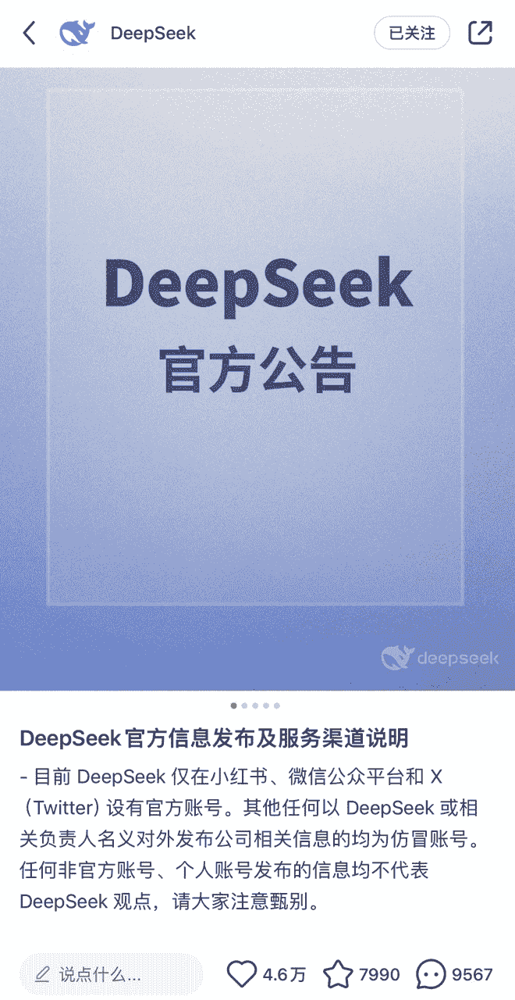

【国家超算互联网平台上线 DeepSeek R1 等系列模型】

近日，DeepSeek-R1、V3、Coder 等系列模型，已陆续上线国家超算互联网平台（www.scnet.cn），无需部署，开箱即用，平台提供全天候不间断不限量免费体验服务。

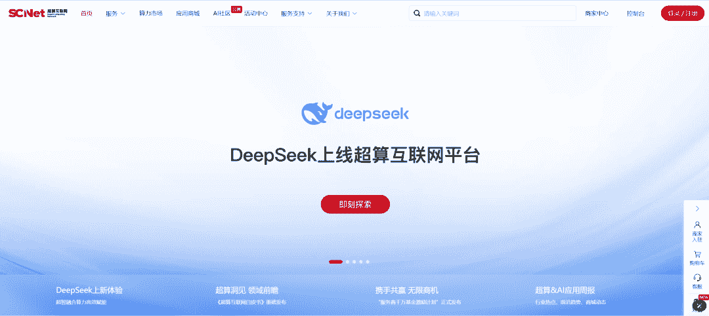

**【北大港科联合发布多模态 DeepS**eek 大模型 Align-DS-V】

北大联合香港科技大学团队基于自研框架 align-anything，将 Deepseek R1 系列模型扩展至图文模态，经过多模态训练之后，模型在文本模态、科学任务、复杂推理、数学代码等方面的表现均有提升。

【钉钉 AI 助理接入 DeepSeek，支持深度思考】

2 月 6 日，钉钉 AI 助理全面接入 DeepSeek 系列模型。用户在钉钉上创建 AI 助理时，可自主选择 DeepSeeK 系列的 R1、V3 等 3 种模型。同时，钉钉还发布了全新模板，帮助用户一键创建、发布基于 DeepSeeK 模型的 AI 助理。

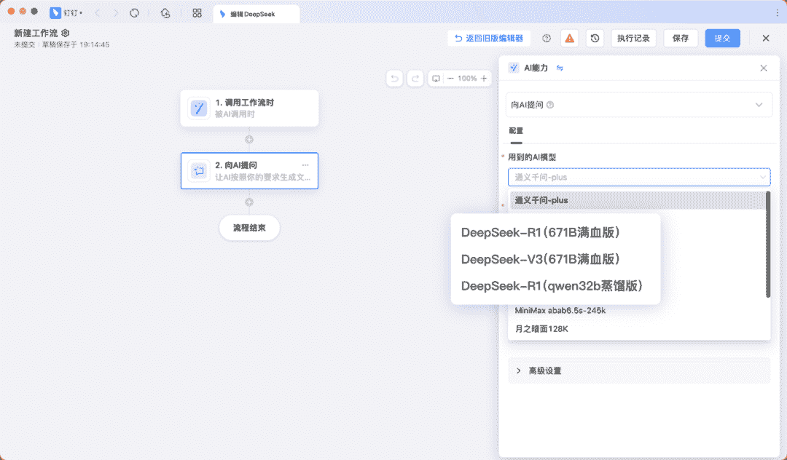

**【网易有道全面拥抱 DeepSee**k-R1，推理大模型加速个性化教学升级】

2 月 6 日，网易有道宣布全面拥抱 DeepSeek-R1，旗下 AI 全科学习助手“有道小 P”结合 DeepSeek-R1 超长思维链所提供的思考及分析能力，进一步优化了其个性化答疑功能，能够提供更具深度、更强准确性的解题思路，大幅度升级了用户体验。此外，Hi Echo、有道智云、QAnything 等产品也将全面接入 DeepSeek 推理能力，并于近日陆续升级； 融合全新推理大模型能力的智能硬件新品及“有道小 P” 2.0 版本将在不久后正式推出。

**【微盟集团：已集成 DeepSee**k，赋能 WAI Agent 能力升级】

微盟集团近日表示，公司自研大模型应用型产品微盟 WAI 已集成 DeepSeek，开始赋能 WAI Agent 能力升级，通过具备更强的推理、调度能力，从而帮助 WAI SaaS、WAI Pro 以及 WIME 等覆盖不同客户场景的产品提升能力。微盟表示，公司最早从 2024 年 3 月即开始关注 DeepSeek 的模型产出，并持续保持应用测试和效果评估。2024 年 5 月，微盟 WAI 团队首次测试了 DeepSeek  V2，2024 年 12 月开始测试 DeepSeek V3。

**【华为 ModelEngine **支持 DeepSeek 全系列本地部署】

据华为中国消息，华为 DCS AI 全栈解决方案中的重要产品 ModelEngine AI 平台，全面支持 DeepSeek 大模型 R1&V3 和蒸馏系列模型的本地部署与优化，加速客户 AI 应用快速落地。

【神州数码将 DeepSeek 集成到神州问学平台中】

2 月 6 日讯， 神州数码公众号消息，DeepSeek 系列模型首发即支持昇腾平台，神州数码旗下神州鲲泰推理服务器产品搭载昇腾硬件，可全面支持 DeepSeek 系列模型的快速部署，为用户带来更快、更高效、更便捷的 AI 开发和应用体验。为进一步推动技术创新与融合，神州数码还将 DeepSeek 集成到其自主研发的神州问学平台中，仅需 3 分钟部署 DeepSeek 模型。

【DeepSeek 日活突破 2000 万】

数据显示 DeepSeek 应用上线 20 天，日活突破了 2000 万。2 月 5 日，Deepseek Limited、DEEPSEEK （HK） LIMITED 两家公司在香港成立，企业类型均为私人股份有限公司。

值得注意的是，DeepSeek 公司即杭州深度求索人工智能基础技术研究有限公司已成功注册多枚 DeepSeek 商标，国际分类涉及社会法律、设计研究、科学仪器等。

**【DeepSeek：一切声称与 DeepSee**k 官方群组有关的收费行为均系假冒】

DeepSeek 发布关于官方信息发布及服务渠道的说明：近期注意到，部分与 DeepSeek 有关的仿冒账号和不实信息对公众造成了误导和困扰。为保障用户权益，减少虚假信息的不良影响，我们现就官方账号等问题说明如下：目前，DeepSeek 仅在微信公众号、小红书、X（Twitter）拥有唯一官方账号，其他任何以 DeepSeek 或相关负责人名义对外发布公司相关信息的，均为仿冒账号。DeepSeek 官方网页端与官方正版 App 内不包含任何广告和付费项目。目前除 DeepSeek 官方用户交流微信群外，从未在国内其他平台设立任何群组，一切声称与 DeepSeek 官方群组有关的收费行为均系假冒，请大家仔细辨别，避免财产损失。

### **2025 年 2 月 5 日**

【华为小艺已接入 DeepSeek】

华为纯血鸿蒙 HarmonyOS NEXT 版本中的小艺助手 App 已接入 DeepSeek，智能体广场已上线 DeepSeek-R1 的 Beta 版。用户可通过小艺助手与 DeepSeek 对话，实现更加无缝的 AI 体验。具体要想在小艺中体验 DeepSeek，首先需要手机是鸿蒙 NEXT 版本，其次需要将小艺助手升级到 11.2.10.310 版本及以上，然后就可以在底部的“发现”首页看到 DeepSeek。我们还试着问了“华为 Pura80 什么时候发布”，回答是预计 2025 年 5 月 -6 月发布。

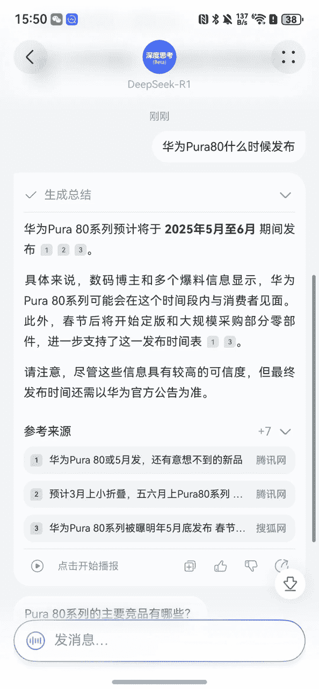

【阅文部署 DeepSeek，“作家助手”升级三大辅助创作功能】

2 月 5 日，阅文集团宣布旗下作家辅助创作产品——作家助手已集成独立部署的 DeepSeek-R1 大模型。据了解，阅文邀请全行业网文作家参与，用户下载作家助手至最新版本即可试用并参与内测，共同探索 AI 赋能网文创作的最佳实践路径。

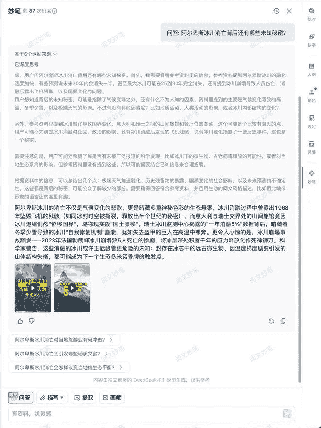

【夸夸菁领联合 DeepSeek 为数智员工升级超级大脑】

2025 年 2 月 5 日，深圳福田 AI 数智员工创新企业夸夸菁领宣布，与人工智能研究机构 DeepSeek 达成合作，基于 DeepSeek R1/V3 模型，全面升级公司核心产品数智员工超脑。

**【宝兰德：相关产品目前已接入 D**eepSeek、QWen 等通用大模型】

宝兰德在互动平台表示，公司相关产品目前已接入 DeepSeek、QWen、ChatGLM、文心一言等通用大模型且已有成功案例，助力行业用户打造面向垂直领域的 AI Agent 应用，同时针对底层算力也已适配基于昇腾系列 NPU 卡，能够充分调度、使用昇腾 NPU 算力进行训练和提供推理服务。

【奇安信：QAX 安全大模型深度接入 DeepSeek】

奇安信宣布已完成与 DeepSeek（深度求索）的全面深度接入。奇安信方面表示，其 QAX 安全大模型已全面完成了 DeepSeek 的深度接入，率先将其引入到威胁研判、安全运营、渗透测试和漏洞管理、身份与访问管理、网络钓鱼防护、恶意软件和勒索软件防护、数据泄露防护、安全培训、供应链安全等场景之中。

【美图：公司旗下产品采用了 DeepSeek 技术】

据摩根士丹利透露，美图公司旗下的美图设计室已采用 DeepSeek 技术，主要为 AI 生成 PPT 相关功能。

【金山办公正与 Deepseek 进行对接测试】

DeepSeek 给 AI 应用带来更大想象力，今日金山办公一度触及 20cm 涨停。对于金山办公是否会接入 DeepSeek，有接近金山办公的人士表示，金山办公正在与 Deepseek 进行对接测试，未来是否合作要看后续发展。

【中国联通宣布联通云与 DeepSeek 实现多场景深度对接】

中国联通今日宣布，联通云已基于星罗平台实现国产及主流算力适配多规格 DeepSeek-R1 模型，兼顾私有化和公有化场景，提供全方位运行服务保障。联通云基于 A800、H800、L40S 等多款主流算力卡，预置 DeepSeek-R1 多尺寸模型，用户可按需灵活选择、快速扩展，快速搭建 DeepSeek-R1 推理和微调环境。

【万兴科技：已完成 DeepSeek-R1 大模型适配并落地多产品】

万兴科技 2 月 5 日在互动平台表示，公司已完成推理大模型 DeepSeek-R1 的适配，并落地融合相关能力于万兴喵影、亿图图示、亿图脑图 MindMaster、万兴 PDF 等产品。

【国家超算互联网平台已上线 DeepSeek 多款大模型】

据国家超算网互联网官微，目前 DeepSeek-R1、V3、Coder 等系列模型已登陆超算互联网平台，涵盖目前火爆的从 1.5B 到 14B 的蒸馏模型，以及从 7B 到 32BDeepSeek Chatbot 可视化界面， 还会陆续上线 32B、70B 等更多版本。就个人用户和小微企业用户普遍面临因硬件等限制无法部署 DeepSeek 系列模型的困境，超算互联网平台凭借其强大的超智融合算力、存力与良好生态兼容性，让用户无需下载到本地部署及其它复杂操作，就可对 DeepSeek 各类模型进行在线推理、部署，或进一步定制化训练与开发。

**【当虹科技 BlackEye 多模态视听**大模型完成 DeepSeek 深度融合】

据当虹科技官微，近日，当虹科技 BlackEye 多模态视听大模型正式融合 DeepSeek-R1 和 DeepSeek Janus Pro，并完成视听传媒、工业与卫星、车载智能座舱等多行业垂类场景的数据调优训练，以更低的成本全面开启了“DeepSeek+视听+行业端侧”的大模型应用之旅，可为视听传媒、工业与卫星、车载智能座舱等行业客户提供更低成本的大模型部署及全新的大模型体验。

【京东云全面上线 DeepSeek-R1/V3】

京东云已正式上线 DeepSeek-R1 和 DeepSeek-V3 模型，支持公有云在线部署、专混私有化实例部署两种模式，供用户按需部署，快速调用。开发者和企业可以在京东云官网，进入言犀 AI 开发计算平台的“AI 资产市场“中，选用该模型进行一键部署。专混私有化算力实例部署模式，已经同步上线京东云 vGPU AI 算力平台，为金融、企业、政府等客户提供数据不出域的私有化模型推理服务。

**【腾讯云 TI 平台上架 DeepSe**ek 系列模型，支持免费体验和一键部署】

近日，腾讯云 TI 平台宣布上架 DeepSeek 系列模型，包括“满血”的 V3、R1 原版模型，参数量达到 671B；以及基于 DeepSeek-R1 蒸馏得到的系列模型，参数规模从 70B 到 1.5B 不等。TI 平台全面支持 DeepSeek 系列模型的一键部署。此外，为便于开发者零门槛开箱，TI 平台也限时开放了 R1 模型的免费在线体验。作为企业级机器学习平台，TI 平台还提供模型服务管理、监控运营、资源伸缩等能力，帮助企业和开发者将 DeepSeek 模型高效、稳定地接入实际业务中。

### **2025 年 2 月 4 日**

【**阿里 Qwen2.5-Max 在大模型竞**技场榜单上反超 DeepSeek-V3】

2 月 4 日，阿里 Qwen2.5-Max 在大模型竞技场榜单上超越 DeepSeek-V3、Claude 3.5 Sonnet、Llama 3.1 405B 等模型，以总分 1332 的成绩位列总榜第七。在编程、数学等方面表现格外突出，能够与满血 o1、DeepSeek-R1 并列第一。

据悉，Chatbot Arena 是由 LMSYS Org 推出的大模型性能测试平台，目前集成了 190 多种模型，采用模型两两组队交给用户盲测，根据真实对话体验对模型能力进行投票。Chatbot Arena LLM Leaderboard 是全球顶级大模型的最权威、最重要的竞技场。在其新开的网页应用开发 WebDev 榜单上，Qwen2.5-Max 也冲进了前十。

### **2025 年 2 月 3 日**

【**百度智能云上架 DeepSeek R1**/V3，上线首日超 1.5 万家客户调用】

2 月 3 日，百度智能云宣布 DeepSeek-R1 和 DeepSeek-V3 模型上架百度智能云千帆平台，调用的价格仅为 DeepSeek-V3 官方刊例价 3 折，DeepSeek-R1 官方刊例价 5 折。模型上线首日，已有超 1.5 万家客户通过千帆平台进行模型调用。

此外，华为云、腾讯云 TI 平台、火山引擎、阿里云、亚马逊 AWS、微软 Azure、英伟达等多家海内外科技厂商近日也陆续宣布接入 DeepSeek 模型。

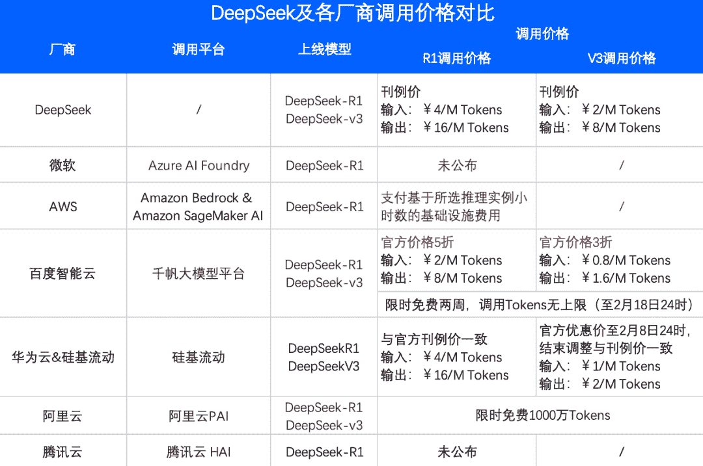

【郭明錤称 DeepSeek 爆红加速 AI 模型“设备端化”趋势】

2 月 3 日，分析师郭明錤发文称，随着 DeepSeek 的爆红，AI“设备端化”趋势将加速。他表示，此前台积电与英伟达均预测设备端 AI 将在 2026 年显著增长，因此英伟达专注于设备端的 AI PC 处理器 N1X/N1 预计将在今年第四季度和 2026 年上半年开始量产。

然而 DeepSeek 的爆红改变了这一情况，相应 DeepSeek R1 模型在设备端取得了较高的性能，且不少用户实际上对各大云端联网模型存在顾虑。因此 DeepSeek 爆红实则引发业界加速引入设备端 AI，郭明錤预计未来会有更多类似 DeepSeek 的开源模型。

### **2025 年 2 月 1 日**

**【DeepSeek 在 140 **个市场的移动应用下载量排行榜上位居榜首】

DeepSeek 在 140 个市场的移动应用下载量排行榜上位居榜首，其中印度占新增用户的最大比例。数据显示，自平台推出以来，印度的下载量占所有平台的 15.6%。

微博话题 DeepSeek 成精、DeepSeek 拿捏人情世故、DeepSeek 高情商冲上微博热搜。网友们纷纷晒出与 DeepSeek 的对话，有网友评论称“和 deepseek 对话太有意思了，它真的好懂”。还有网友评论表示 deepseek 双商都高懂人情世故。

斯坦福大学计算机科学系和电子工程系副教授、人工智能实验室主任吴恩达在个人社交媒体上发表对 DeepSeek 的评论，指出中国在生成式 AI 领域正在赶超美国，开源权重模型正在将基础模型层商品化，且规模化并非 AI 进步的唯一道路，算法创新正在迅速降低训练成本。

著名投资人、方舟投资 CEO“木头姐”凯西·伍德在采访中表示，DeepSeek 证明了在 AI 领域成功并不需要那么多钱，并且加速了成本崩溃。

另外，美国科技公司亚马逊、英伟达、微软等已上线部署支持用户访问 DeepSeek-R1 模型。

### **2025 年 1 月 31 日**

1 月 31 日，英伟达宣布 DeepSeek-R1 模型现已在 build.nvidia.com 上作为 NVIDIA NIM 微服务预览版提供。DeepSeek-R1 NIM 微服务可以在单个 NVIDIA HGX H200 系统上每秒提供多达 3872 tokens。

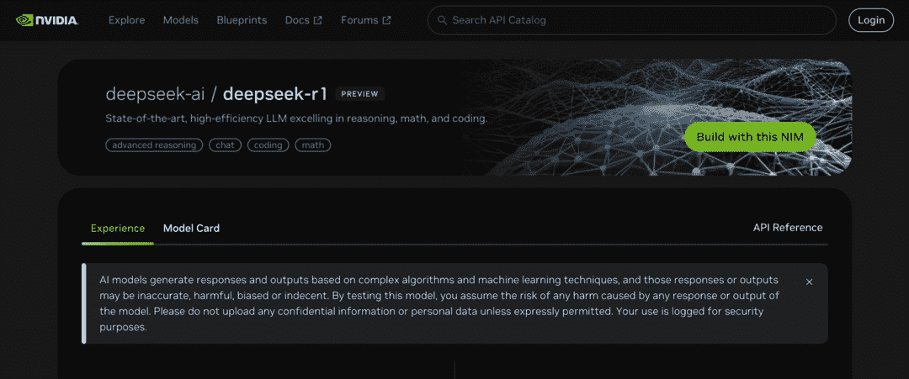

同日，亚马逊云科技也宣布用户可以在 Amazon Bedrock 和 Amazon SageMaker AI 中部署 DeepSeek-R1 模型。

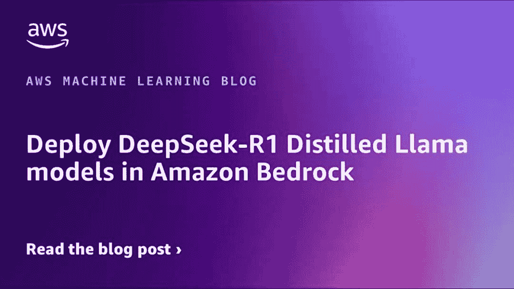

官方表示，Amazon Bedrock 适合希望通过 API 快速集成预训练模型的团队；Amazon SageMaker AI 则非常适合自己进行高级定制、训练和部署、调用基础设施的团队。用户还可以通过 Amazon EC2、Amazon SageMaker AI，使用 Amazon Trainium 和 Amazon Inferentia，用更具性价比的方式部署 DeepSeek-R1-Distill。

### **2025 年 1 月 29 日**

**【国际顶尖学术期刊 Nature（自然）发布**了第一篇 Deepseek 相关的文章】

国际顶尖学术期刊 Nature（自然）发布了第一篇题为：Scientists flock to DeepSeek: how they’re using the blockbuster AI model 的新闻文章指出，科学家们正在纷纷涌入 DeepSeek，从 AI 专家到数学家再到认知神经学家，他们为 DeepSeek-R1 的高性能和低成本所惊叹。

负责五角大楼 IT 网络的国防信息系统局采取行动，阻止了员工登陆这家中国初创公司的网站，此前，国防部员工至少登录使用了 2 天。

美国新任商务部长提名人霍华德·卢特尼克称，“DeepSeek 这家中国 AI 公司声称以极低成本开发了 AI 聊天机器人。他们怎么做到的？利用了他们从我们这里拿走、窃取并利用的东西。这太离谱了，必须加以解决。”他还暗示将对涉及中国的出口管制采取坚定立场：“让他们竞争，但不要用我们的工具与我们竞争。我会非常坚定地坚持这一点。”

彭博社称，美国政府正在研究对向中国出售英伟达公司芯片实施额外限制的可能性。报道指出，限制措施将涉及英伟达公司的 H20 芯片，但关于限制措施的决定很可能不会很快做出。此前，美国商务部发布文件称，对先进芯片和人工智能模型的出口实施新限制，以保护“国家安全”，防止这些技术被“不友好国家”利用。

当日，科技巨头阿里巴巴发布了其迄今为止最先进的大语言模型——Qwen2.5-Max（通义千问旗舰版），并称其性能优于 GPT-4o、DeepSeek-V3 以及 Llama-3.1-405B。而上周，月之暗面联合字节跳动发布了新的推理模型 Kimi 1.5 和 Kimi 1.5 1.5-pro，并称其在某些基准测试中的表现优于 GPT-o1。

### 2025 年 1 月 28 日（除夕）

【DeepSeek 推出了另一款模型——Janus-Pro-7B】

DeepSeek 推出了另一款模型——Janus-Pro-7B，能够根据文本提示生成图像，也就是所谓的“文生图”，其性能与 OpenAI 的 DALL-E 3 以及 Stability AI 的 Stable Diffusion 相当。

DeepSeek 官网发出公告，其线上服务遭受大规模恶意攻击，攻击 IP 地址均来自美国，包括 DDos 攻击和密码爆破攻击，新用户无法注册，服务无法正常提供。

360 集团创始人周鸿祎在微博上表示，如果 DeepSeek 有需要，360 愿意提供网络安全方面的全力支持。同时 360 还发布了《关于全力支持国产大模型 DeepSeek 的倡议书》，承诺将全力以赴为 DeepSeek 提供全方位网络安全防护。

美国多名官员称 DeepSeek 是 “偷窃”，并开展国家安全调查，海军也向相关人员发出邮件示警，“不得以任何形式下载、安装或使用 DeepSeek 模型”。

白宫人工智能与加密货币主管戴维・萨克斯表示，美国在人工智能领域仍领先中国 3 到 6 个月，但 DeepSeek 的 R1 模型追赶速度非常快。

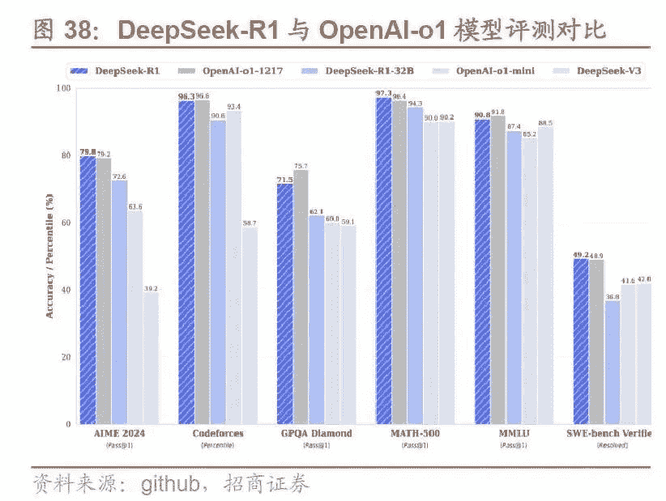

【DeepSeek 被大规模网络攻击，IP 地址均在美国】

1 月 28 日凌晨，DeepSeek 官网的服务状态页面显示：“近期 DeepSeek 线上服务受到大规模恶意攻击，注册可能繁忙，请稍等重试。已注册用户可以正常登录，感谢理解和支持。”DeepSeek 这次受到的网络攻击，IP 地址都在美国。

稍早前，DeepSeek0 点 06 分发布的公告表示，为了应对平台遭遇大规模攻击的情况，DeepSeek 暂时限制了 +86 手机号以外的注册方式，已注册用户可以正常登录。

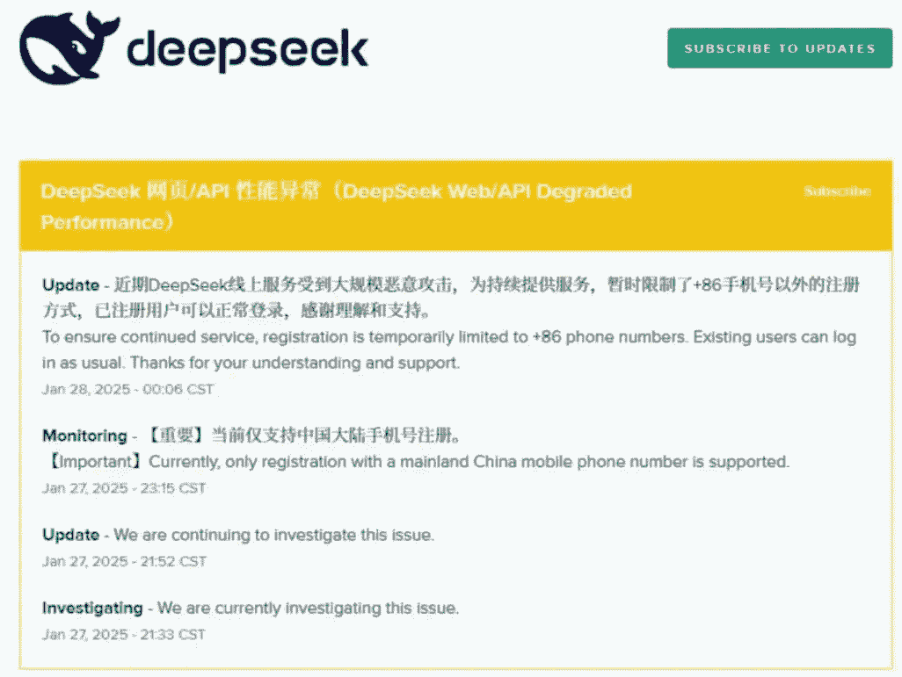

【**OpenAI CEO：DeepSeek-R1 令人印象深**刻，将推出更好的模型，重新考虑开源战略】

1 月 28 日，OpenAI CEO Sam Altman 在 X 上发文称，DeepSeek-R1 令人印象深刻，尤其是考虑到其价格和功能性后。另外，他还表示新的对手令人振奋，同时将推出更好的模型。

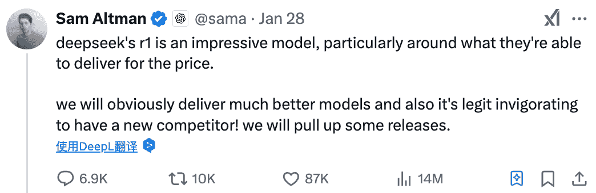

1 月 31 日，据外媒 Seeking Alpha 报道，Altman 在社交媒体平台 Reddit 上的“Ask Me Anything”活动中表示，OpenAI 需要“弄清楚另一种开源战略”，但并非团队所有人都持有这种观点，并且弄清楚该策略不是“我们当前的最高优先事项”。OpenAI 首席产品官 Kevin Weil 在同一活动中表示，公司正在考虑开源较旧的 AI 模型。

### **2025 年 1 月 13 日**

【DeepSeek 公司推出 App 版本】

DeepSeek 公司推出 App 版本，使用 V3 大模型。DeepSeek 报告称其 V3 模型的训练成本仅为 600 万美元。与 OpenAI 声称的训练 GPT-4 所花费的 1 亿多美元，以及 Anthropic 训练其最新版本的 Claude 模型所花费的几千万美元相比，这个数字似乎低得惊人，这些信息叠加了 APP 的好用，迅速引发热议。

### 2024 年 12 月 26 日

**【深度求索（DeepSeek）正式上线全新系列模型 De**epSeek-V3 首个版本并同步开源】

12 月 26 日晚间，AI 公司杭州深度求索（DeepSeek）正式上线全新系列模型 DeepSeek-V3 首个版本并同步开源。公司称，DeepSeek-V3 多项评测成绩超越了 Qwen2.5-72B 和 Llama-3.1-405B 等其他开源模型，并在性能上和世界顶尖的闭源模型 GPT-4o 以及 Claude-3.5-Sonnet 不分伯仲。

并且，DeepSeek 将模型 API 服务定价调整为每百万输入 tokens0.5 元（缓存命中）/2 元（缓存未命中），每百万输出 tokens8 元，以期能够持续地为大家提供更好的模型服务。DeepSeek 还决定为全新模型设置长达 45 天的优惠价格体验期：26 日起至 2025 年 2 月 8 日，DeepSeek-V3 的 API 服务价格仍然是每百万输入 tokens0.1 元（缓存命中）/1 元（缓存未命中），每百万输出 tokens2 元。