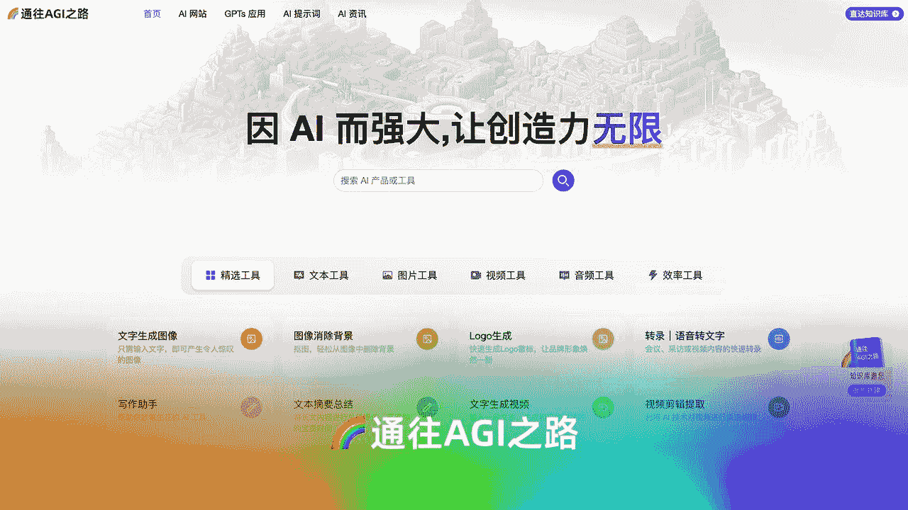
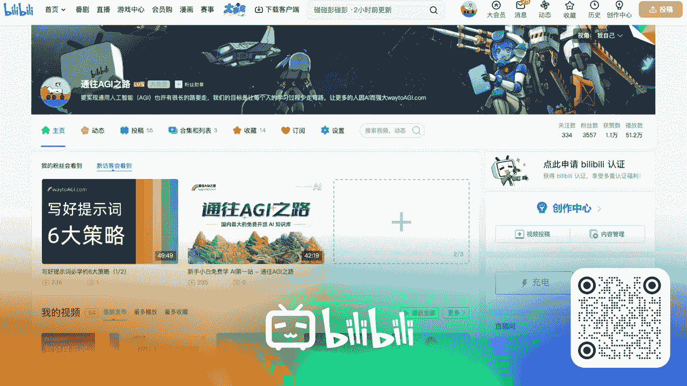
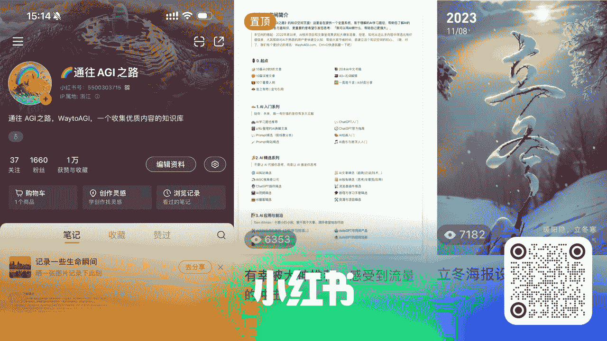
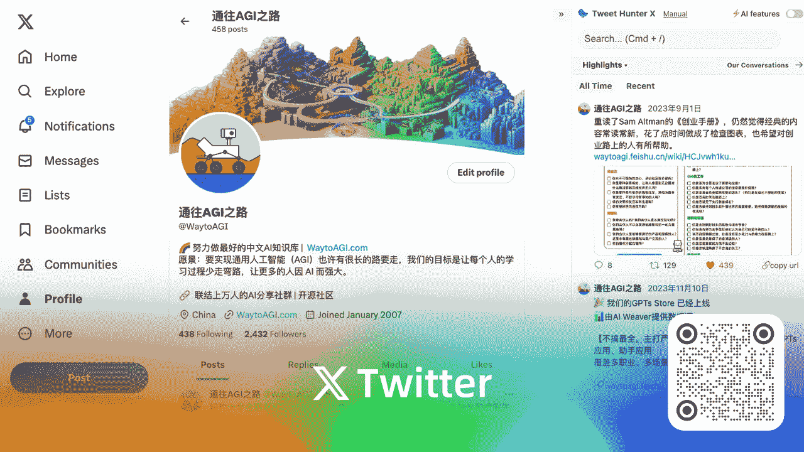

# 1. WaytoAGI 文章精选

> 来源：[https://waytoagi.feishu.cn/docx/IhnLdWeUvoP5F1xrE4IcMp3Snge](https://waytoagi.feishu.cn/docx/IhnLdWeUvoP5F1xrE4IcMp3Snge)

## 🎯  愿景和目标

> 要实现通用人工智能（AGI）也许有很长的路要走，

> 我们的目标是让每个人的学习过程少走弯路，让更多的人因 AI 而强大。

## 🔖  简介  |  W[aytoAGI.com](http://waytoAGI.com)

欢迎来到《通往 AGI 之路》知识库！这里旨在提供一个全面系统的 AI 学习路径，帮助您了解从 AI 常见名词到 AI 应用等各方面知识，更重要的是希望引发您思考：「我可以用 AI 做什么，帮助自己更强大」。

→ 返回 waytoagi.com 首页

知识库有什么：

+   **深度洞察**：由专栏作家撰写的深度文章，探讨AI应用、智能体等领域的最新见解。

+   **入门路径**：加入 AI 爱好者和行业专家的行列，共同探讨、学习和成长。

+   **技术教程**：精选的 AI 技术指南和实战项目案例，助您提升技能，掌握实用知识。

公众号：通往 AGI 之路

[WaytoAGI.com 网站](http://www.waytoagi.com)

内置知识库 AI 助手

[B 站｜Bilibili](https://space.bilibili.com/259768893)

以视频普及 AI 知识

[小红书](https://www.xiaohongshu.com/user/profile/6457d2e4000000001f030dbe)

AI 消息及时传递

[ X ｜ Twitter](https://twitter.com/WaytoAGI)

知识库精选内容同步

