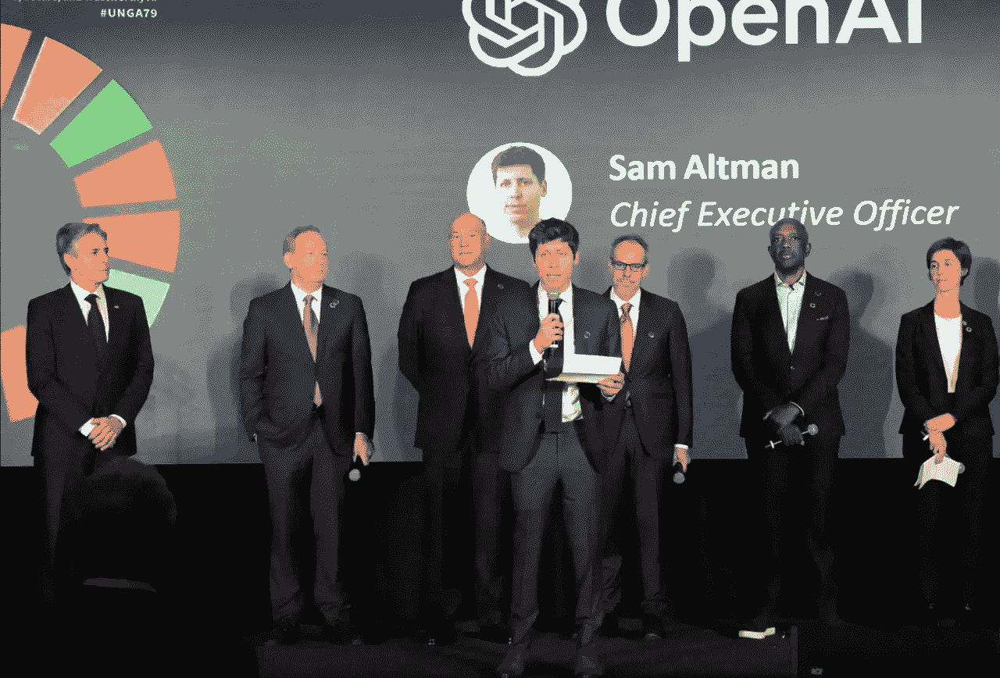
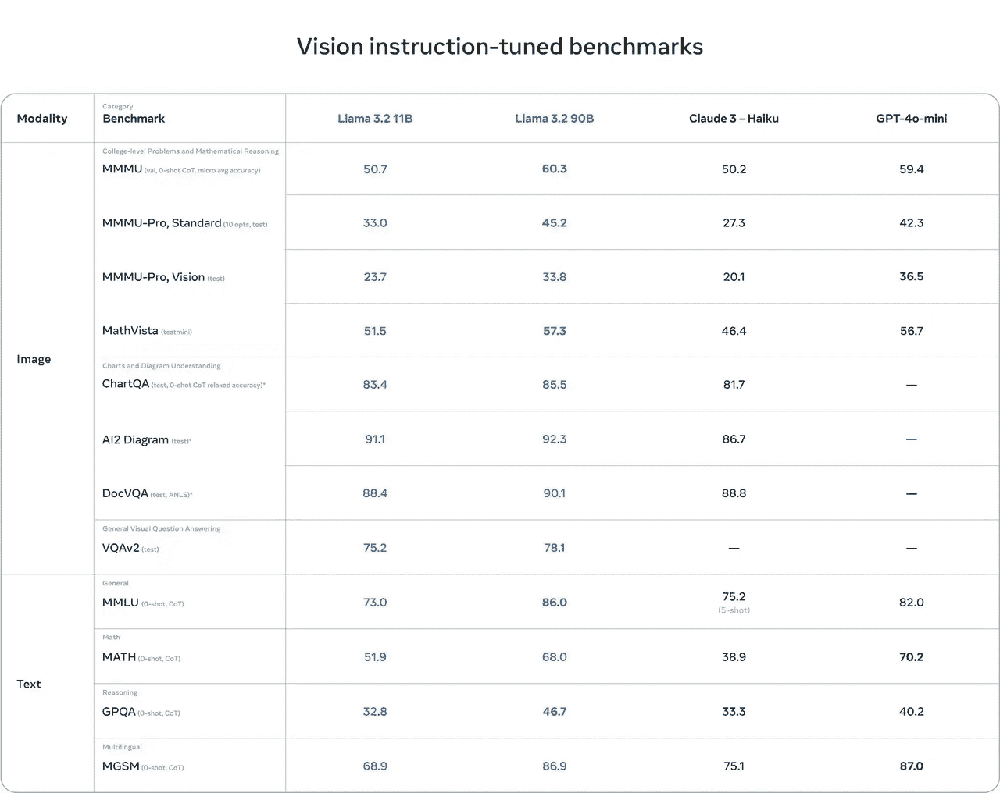
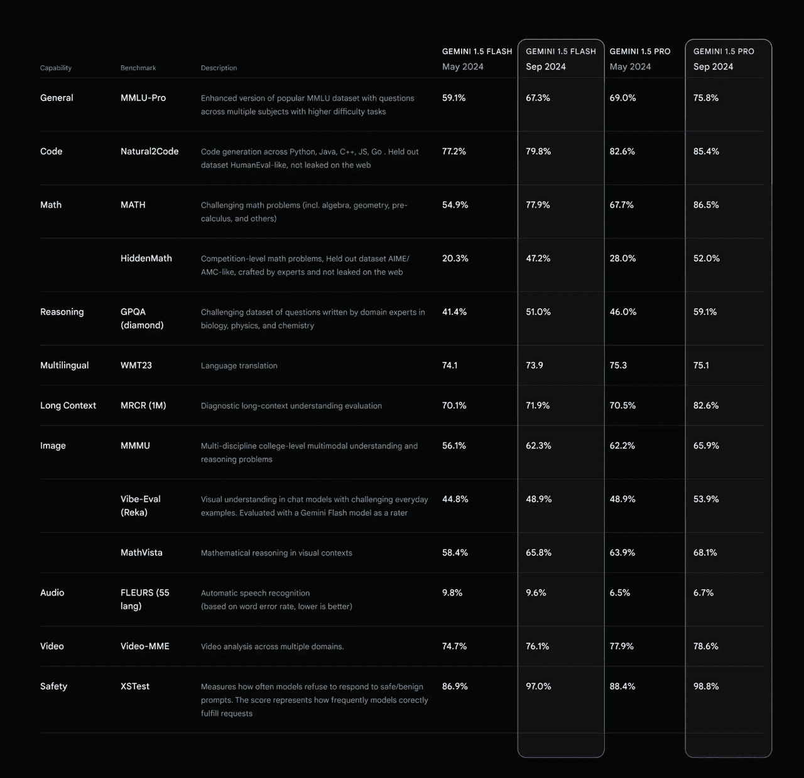
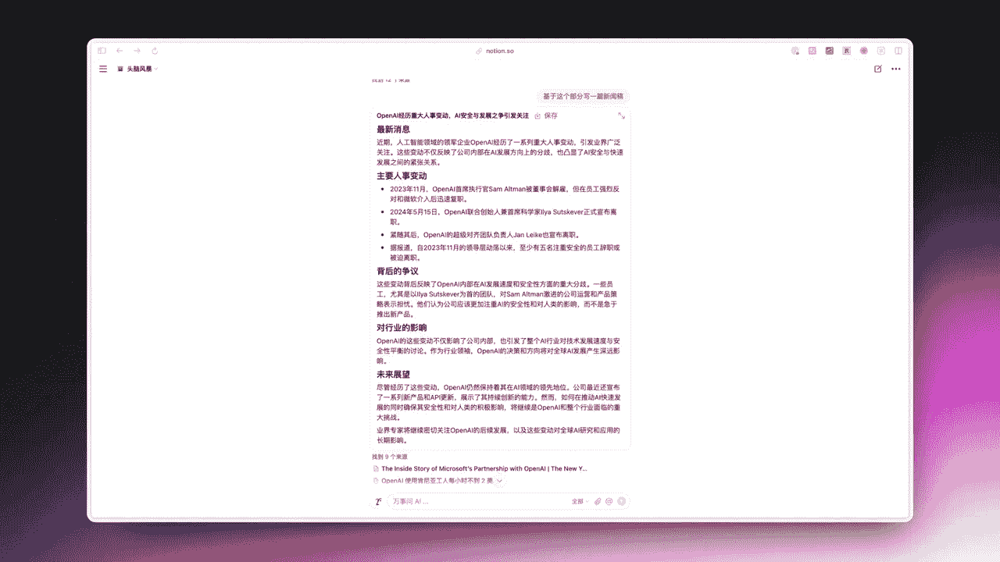
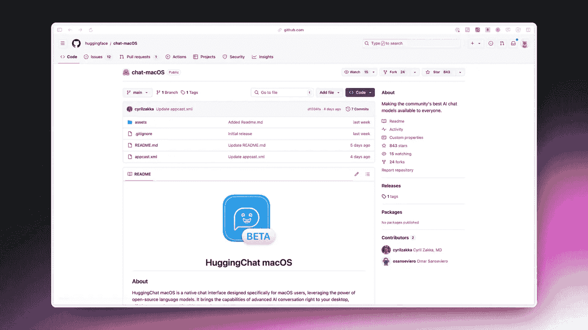
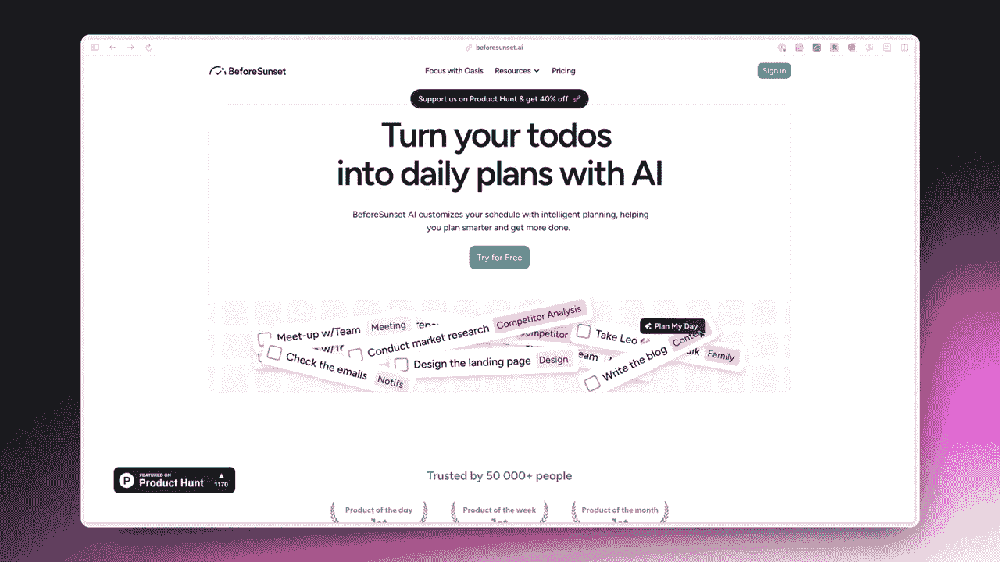

# AIGC Weekly #90

> 来源：[https://waytoagi.feishu.cn/docx/Wv0GdKAUho855Exix8bcI7kPnEh](https://waytoagi.feishu.cn/docx/Wv0GdKAUho855Exix8bcI7kPnEh)

> 🔗 原文链接： h[ttps://quail.ink/o](https://quail.ink/op7418/p/aigc-weekly-90)p7418/p/aigc-wee...

> ⏰ 发表时间：2024-9-30

> 作者：歸藏

## 上周精选 ✦

### Open AI 内斗落幕，元老全部退出

Open AI 的宫斗基本已经完全落幕了，[去年内斗的时候硬挺 S](https://x.com/miramurati/status/1839025700009030027)am 的 CTO Mira 也宣布离职 ，跟 Mira 一起离职的还有三个 Open AI 的老人。

Sam 也发了一条内容稳定了一下军心，顺便宣布了Open AI 新的高层领导任命，Mark、Jakub、Kevin、Srinivas、Matt、Josh。

同时 Sam 还在准备 65 亿美元的新一轮融资，完成后 Open AI 的估值会到 1500 亿美元，这轮闹剧结束后传言说苹果不再跟进这一轮融资了。

**WSJ 还放出了 ****一**份 Open AI 内部的爆料 ：

+   Ilya 辞职的时候，OpenAI 高管担心他们的离开可能引发更大规模的人员流失，因此努力尝试让 Sutskever 回来。但是后面又反悔了，没让 Ilya 回去。

+   为了在 Google 年度开发者大会之前推出 GPT-4o，安全团队只有 9 天时间测试模型，连续工作 20 小时，没有时间复查他们的工作。

+   Brockman 经常要求对长期计划的项目进行临时变更，这迫使包括首席技术官 Murati 在内的其他高管不得不出面协调。

**另外纽约时报还放出了 ****O**pen AI 针对这轮融资给投资人看的数据 ：

+   2023年8月月收入达到3亿美元,比2023年初增长了1700%

+   2024年预计年收入约37亿美元

+   截至2023年6月,月活跃用户约3.5亿,相比2023年3月的1亿有大幅增长，ChatGPT付费用户约1000万

+   2023年预计为7亿美元，2024年预计将增长至27亿美元

+   2024年预计亏损约50亿美元(不包括股权薪酬等某些大额支出)

### Meta 发布 Llama 3.2 多模态 LLM

Meta Connect 2024 上小扎基本坚定了 Meta 接下来一段时间的发展方向，核心就是 AI 和 AR，大家都开始赌 AI 领域计算平台的新入口了，不然还是给苹果微软做嫁衣。

主要 **发布了四个模型 **Llama 3.2 11B 和 90B 两个多模态 LLM，还有 1B 和 3B 两个小型语言模型：

+   11B 和 90B，支持图像推理用例，例如文档级理解，包括图表和图形、图像的描述以及视觉定位任务。

+   Llama 3.2 视觉模型在图像识别和视觉理解任务中与 Claude 3 Haiku 和 GPT4o-mini 比都具有竞争力。

+   Llama 3.2 1B 和 3B 支持 128K Token的上下文，并在移动设备常见任务比如摘要、总结、指令遵循上都很强，同时针对 Arm 处理器进行了优化。

+   发布Llama Stack 发行版，集成了单节点、本地、云和设备，支持即插即用的 RAG 和工具启用的应用程序。

软件层面也有一些 AI 应用的更新：

+   用户和 Meta AI 进行语音聊天，同时可以切换很多名人的声音。

+   正在测试在Facebook 和 Instagram 动态中自动推送 AI 生成的内容，Meta AI 专为你创建的图像。

+   Meta AI 现在还可以获取图片的信息，之后还可以通过文本提示对已有的图片进行局部编辑。

+   如果将你已有的图片分享到Instagram Story的时候，Meta AI 还会主动为照片生成背景。

+   Meta AI 翻译工具：可以自动翻译 Reels 的音频，支持增加口型同步。目前支持英语和西班牙语互相翻译。

### [Gemini 发布一大波更新](https://developers.googleblog.com/en/updated-gemini-models-reduced-15-pro-pricing-increased-rate-limits-and-more/)

谷歌也在上周进行了一系列针对 Gemini 的更新，主要是发布了两个新的模型型号 Gemini-1.5-Pro-002 和 Gemini-1.5-Flash-002。

+   1.5 Pro 价格降低 >50%（提示的输入和输出 <128K）

+   1.5 Flash 的速率限制提高了 2 倍，1.5 Pro 的速率限制提高了约 3 倍

+   输出速度提高 2 倍，延迟降低 3 倍

+   新版的1.5 Pro 和 Flash 整体素质提高，数学、长上下文和视觉上有大幅增加，但是更新后模型的默认输出长度比以前的模型短约 5-20%。

## 其他动态 ✦

+   Open AI 的 [高级语音模式全量上线 ](https://x.com/OpenAI/status/1838642444365369814)，新版增加了自定义指令、记忆功能、五种新声音以及改进的口音。改进了某些外国语言的对话速度、流畅度和口音。

+   即梦上线字节两款新的 DiT 视频生成模型 ，S 模型正在进行内测，P 模型也即将开始测试，同时 AI 音乐功能也已经上线，测试版本上线类似抖音的 AI 短视频信息流能力。

+   美图的 AI 短片生成平台 MOKI 上线 ，整体类似 LTX，输入大纲可以直接生成整个AI 短片，测试了一下，模型质量限制的产品的能力。

+   NotebookLM 再次升级 ，支持开始支持总结音频和视频文件，支持上传、谷歌云盘以及直接贴网站和Youtube连接。生成的音频播客现在支持分享，会有单独的收听页面。

+   Artificial Analysis 的图片模型评分网站 上突然出现一个叫蓝莓（Blueberry） 的图像生成模型。评分碾压了 FLUX 和 Ideogram 以及 Midjourney。

+   [The Information 报道 Op](https://www.theinformation.com/articles/openai-is-revamping-sora-ai-video)en AI 正在对 Sora 进行更新 。计划推出能产生更高质量、更长时长视频片段的新版本。

## 产品推荐 ✦

### Notion 升级到更加全面的 AI 功能

Notion 发布全新重构的 AI 功能，野心很大啊。AI 可以检索除了 Notion 本身还有其他办公软件比如 Slack 的内容。支持更加自由的 AI 指令，比如直接用自然语言让 AI 总结某个文档。支持上传 pdf 及图片获取总结。支持 GPT-4 和 Claude 两个模型。新的 AI 功能形象设计的很好。

### HuggingChat macOS

试了一下 Huggingface chat 这个 Mac 客户端。支持上传文件、更换模型以及联网搜索。功能挺全的，不过响应有点慢。

### BeforeSunset AI：AI 帮你从待办安排日程

BeforeSunset AI 是一个专注于智能日程安排的平台，它通过智能规划帮助用户更高效地管理时间和任务。

BeforeSunset AI 的特点包括智能调度、选择首选规划技巧、优化日程、查找最佳时间、待办事项助手、周度和月度视图、移动应用、任务管理等。用户可以通过这些功能保持组织性、专注性和控制性，同时平衡工作和个人生活。

## 精选文章 ✦

### [广告的终结](https://www.backgroundnoise.blog/p/the-end-of-advertising)

主要讨论了广告为互联网内容提供资金支持的模式正在随着人工智能的发展而逐渐消亡，以及这一变化对开放网络的深远影响。

+   尽管我们表面上讨厌广告，但实际上我们通过广告支持的内容消费模式，以注意力为代价，享受着 “免费” 的内容。广告是互联网发展的基石，支撑着开放网络的运作。

+   随着 AI 的发展，特别是像 ChatGPT 和 Perplexity 这样的答案引擎的使用，我们对广告的关注度正在下降，这直接影响了广告收入。

+   高质量的内容将因为广告支持的减少而变得更加珍贵，而普遍化的内容可能需要转向订阅模式来维持。

+   AI 服务将尝试创造新的广告形式，以继续资助内容创作，同时内容提供商可能会直接向 AI 服务收费以补偿广告收入的减少。

+   随着 AI 对内容消费方式的影响，我们与内容提供商之间的经济关系将变得更加直接和事务性，这可能会导致内容消费的分层化，增加有与无之间的差距。

### ColPali： 利用视觉语言模型进行高效文档检索

介绍了一种名为 ColPali 的文档检索方法，它利用视觉语言模型直接对文档页面的图像进行编码，提高了文档检索的效率和性能。

+   ColPali 方法通过直接使用文档页面的图像编码，简化了文档检索流程，减少了对 OCR 和文档布局检测模型的依赖。

+   ColPali 利用视觉语言模型（PaliGemma-3B）和视觉变换器（SigLIP-So400m）将文档图像分割成补丁，并将这些补丁投射到语言模型空间，以获得高质量的上下文化补丁嵌入。

+   在查询阶段，ColPali 采用 ColBERT 风格的晚期交互操作，有效地匹配查询标记和文档补丁，从而实现快速检索。

+   ColPali 在 ViDoRe 基准上的表现显示，它在视觉复杂性高的文档检索任务中优于其他方法，包括使用强大的专有视觉模型的基线方法。

## 重点研究 ✦

### Emu3：下一个 Token 预测就是你所需要的一切

通过预测下一个词或token的方式来理解和生成文本、图像和视频。只用一个简单的transformer模型就能完成多种任务；

支持图片生成、视频生成、视频延长、图片内容识别等任务。主要生成的视频看起来效果很不错，感觉是条可以投入的新路子。

### AI2 推出了 Molmo 完全开源的多模态LLM

他们这个图片标注的功能非常好，不止可以语言描述位置和数量还会在图片上标出来。在学术基准和人类评估上几乎达到了 GPT-4V 的性能。

发布的模型包括MolmoE-1B、Molmo-7B-O、Molmo-7B-D、Molmo-72B。同时还会开源他们的多模态训练数据集 PixMo。

### MIMO：可控角色视频合成与空间分解建模

可以用图片的角色替换视频中的一个人物，而且保证动作和其他表现的一致性。

图像的角色是真人或者 2D 动漫人物都可以。

支持空间上非常复杂的动作。

也可以只根据给出的 3D 骨骼动画迁移图片角色。

支持跨场景和分镜迁移角色。

### HelloMeme：面部迁移模型

又一个看起来非常不错的面部动画迁移模型 HelloMeme。而且还会开源，语音驱动不好的话用视频给一个很自然的结果也不错。

他们通过微调了一个 Animatediff 模型实现的，这个很好。还可以接入 SD1.5 模型生成图片后直接变成说话视频。