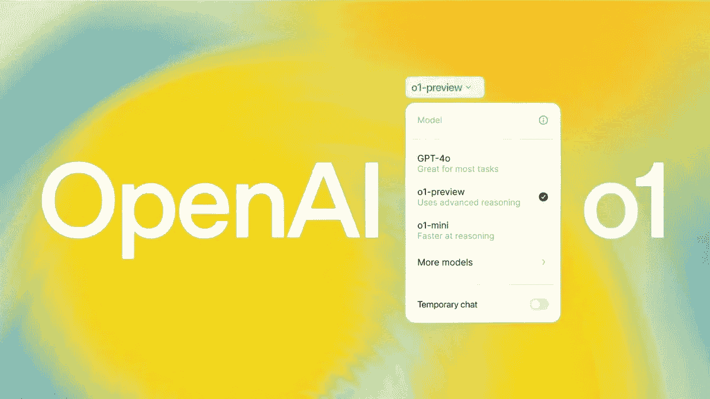
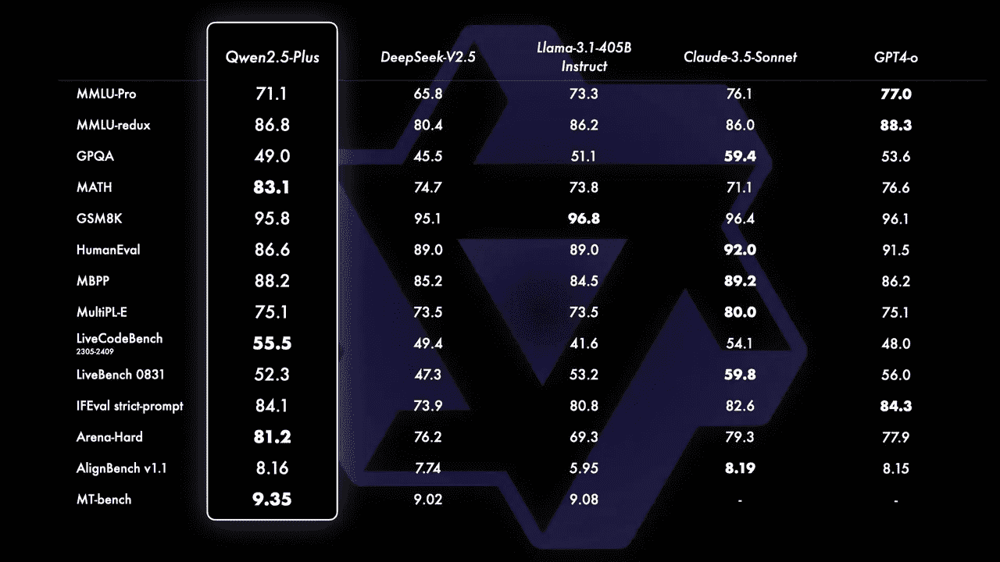
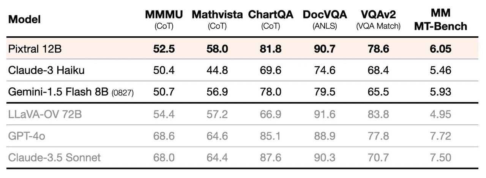
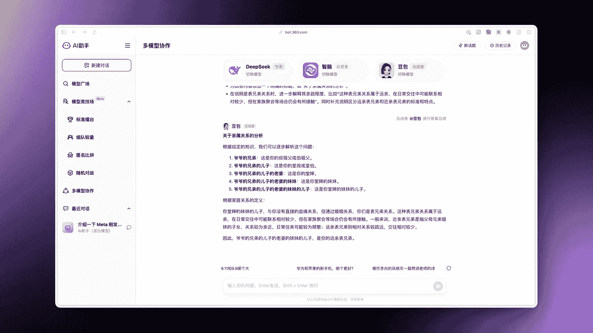
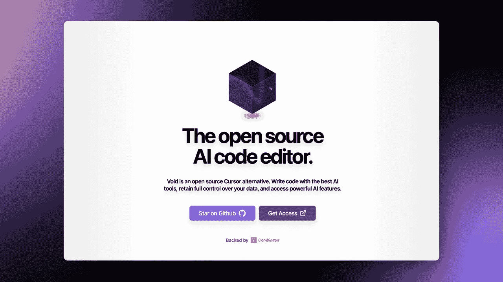
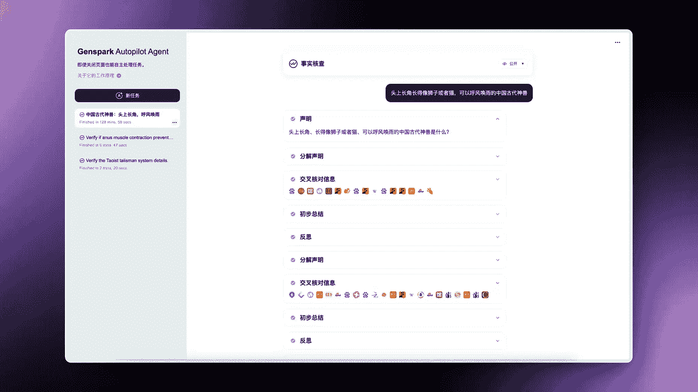
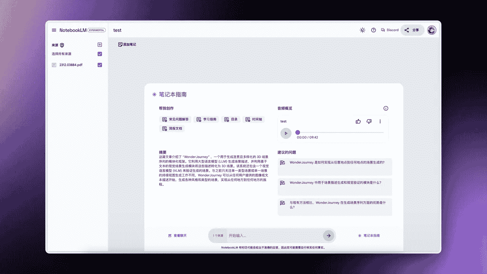
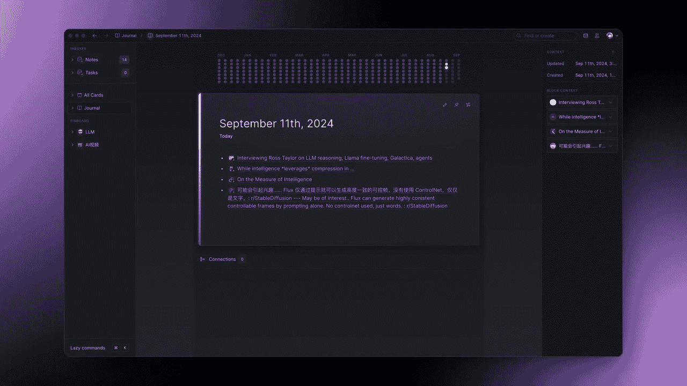

# AIGC Weekly #89

> 来源：[https://waytoagi.feishu.cn/docx/S3XudonXgoPgq2xhfKhcVBm3nch](https://waytoagi.feishu.cn/docx/S3XudonXgoPgq2xhfKhcVBm3nch)

> 🔗 原文链接： h[ttps://quail.ink/o](https://quail.ink/op7418/p/aigc-weekly-89)p7418/p/aigc-wee...

> ⏰发布时间：2024-09-23

## 上周精选 ✦

### Open AI 发布 o1 推理模型

这两周最大的新闻就是 OpenAI o1 模型了，不过热度下降很快，模型能力和普通人的需求脱节了，大部分人没有用这类的模型的需求，也没办法提出好问题来测试。

Sam 自己也说目前的 o1 所处的位置可能类似 GPT-2 的时期，只是开了个好头，证明了这条路是可以走通的。

o1 通过复杂的任务推理，解决比以前的科学、编码和数学模型更难的问题。模型在物理、化学和生物学方面表现与博士生类似。一共两个模型 OpenAI o1-mini 和 o1-preview。

在国际数学奥林匹克（IMO）资格考试中，GPT-4o 只正确解决了 13% 的问题，而推理模型的得分为 83%。他们的编码能力在 Codeforces 竞赛中达到了第 89 个百分点。

就是做个记录，就不复读公告和技术报告内容了，这两周都被发烂了，估计都看过了。

### 阿里开源 Qwen2.5 系列一堆模型

为了云栖大会发货准备的弹药非常充足，Qwen 2.5 把主要类型模型和大小全部都覆盖到了。

Qwen2.5: 0.5B, 1.5B, 3B, 7B, 14B, 32B, 以及72B;

Qwen2.5-Coder: 1.5B, 7B, 即将推出的32B;

Qwen2.5-Math: 1.5B, 7B, 以及72B；

Qwen-Plus，Qwen-Turbo，Qwen-VL-Max 的 API。

**主要升级内容：**

Qwen2.5 获得了显著更多的知识，在编程能力和数学能力有大幅提升。

在指令执行、生成长文本、理解结构化数据以及生成结构化输出方面有显著改进。

对各种system prompt更具适应性，增强了角色扮演实现和聊天机器人的条件设置功能。

Qwen2.5-Coder 使即使较小的编程专用模型也能在编程评估基准测试中表现出媲美大型语言模型的竞争力。

Qwen2.5-Math 支持 中文 和 英文，并整合了多种推理方法，包括CoT、PoT和 TIR。

### Moshi：可以进行实时语音对话的文本语音模型

K[yutai](https://kyutai.org/Moshi.pdf) 开源 Moshi，一个可以进行实时语音对话的文本语音模型。期待类似的开源中文实时语音模型。而且发了 技术报告 ，里面有一些实现细节。

+   采用多流架构，能够同时处理用户和系统的语音输入，并生成相应的语音输出。

+   的理论延迟为160ms，实际为200ms，远低于自然对话中的几秒钟延迟。

+   能够同时处理语音和文本信息，支持复杂的对话动态，包括同时说话和打断。

+   支持实时流式推理，能够在生成语音的同时进行语音识别和文本到语音的转换。

### Mistral AI 开源 Pixtral 12B 多模态 LLM

试了一下对图像的理解很好，中文能力也还可以，这个模型大小也合适，可以用来做很多本地的图片任务了。

+   Mistral Nemo 12B 的直接替代品

+   从头开始训练的新型 400M 参数视觉编码器

+   搭配基于 Mistral Nemo 的 12B 多模态解码器

+   能处理可变的图像尺寸和纵横比

+   支持128k上下文窗口中的多个图像

模型下载：https://huggingface.co/mistralai/Pixtral-12B-2409

在线体验：https://t.co/U1ZPywdTj5

### Runway 发布视频转视频功能

目前视频生成模型在人物精细动作以及场景一致性保持方面的问题还很大，短期看不到结局的希望。

Runway这种视频转视频就变成一个很好的过渡方案，低成本的道具加表演，很容易就可以增加特效或者局部改变内容，甚至转变风格。

提示词响应精确，稳定性很高。不止可以换风格，还可以换氛围，甚至加特效。

你可以直接改变一段视频的天气、季节、甚至地理风貌。也可以把视频变成 2D 插画、粘土风格、3D 游戏建模。

这里有我的 [测试视频 ](https://x.com/op7418/status/1834842366034784603)。

## 其他动态 ✦

+   [AI 生成前端代码工具 V](https://x.com/v0/status/1837558595808088149)0 现在支持 从外部 API 获取数据 ，v0 Premium 用户可以直接把生成的页面发布到自定义的子域名。

+   可灵 [更新 1.5 模型 ](https://klingai.kuaishou.com/release-notes)，画质及提示词理解能力大幅提升，1.0 增加运动笔刷功能。

+   即梦上线 基于 Loopy 的对口型功能 ，非常强，但是跟 Heygen 还有差距。

+   Luma 成为首个 [完全开放 API 能力 ](https://lumalabs.ai/dream-machine/api)[的 DiT 视频模型，同时发](https://github.com/lumalabs/ComfyUI-LumaAI-API?tab=readme-ov-file)布了对应的 官方 Comfyui 插件 。

+   [谷歌给 youtube ](https://deepmind.google/discover/blog/empowering-youtube-creators-with-generative-ai/)创作者中心 增加了几个 AI 能力 ，Veo 模型将YouTube Shorts 生成视频背景，Inspiration 功能可以帮助创作者生成视频标题、缩略图和大纲，自动配音可以自动将创作者视频转换为其他的语言。

+   阿里发布 [通义万相视频生成模型 ](https://tongyi.aliyun.com/wanxiang/)，支持文生视频和图生视频，特别优化了中式元素的概念理解与生成表现力。

+   单图 ID 保持项目 PuLID 已经开始支持 FLUX 。

+   [Adobe 发布视频生成模型 ](https://blog.adobe.com/en/publish/2024/09/11/bringing-gen-ai-to-video-adobe-firefly-video-model-coming-soon)，Firefly Video 将会在几个月内公开测试。

+   Vidu 视频生成模型 [发布原生 ID 保持功能 ](https://www.vidu.studio/create/img2video)，支持上传任意主体图片，生成与主体保持一致的视频。

+   FLUX 现在已经可以 [训练概念滑块 Lora 了 ](https://github.com/rohitgandikota/sliders)，可以通过概念滑块对生成的图片实现更细力度的控制。

+   Tripo 发布 [2.0 3D 模型生成模型 ](https://x.com/tripoai/status/1836790302876524615)，能够生成前所未有的形状和纹理质量，具有卓越的结构精度和丰富的细节。

## 产品推荐 ✦

### AI助手：多模型思维链及模型竞技场

AI 助手用了多个国内顶尖模型整合了一个思维链功能，继续发挥单挑不过就群殴的优势。

你现在可以选择三个模型分别作为专家、反思者和总结者三个步骤对一个问题进行答复。

即使第一个专家模型回答有问题或者不完善，后面的反思者和总结者也可以纠正问题给出正确答案。

这个功能上了之后模型幻觉和错误问题可以得到很大的抑制，同时回答的质量也会大幅提高。

涉及逻辑推理问题的正确率虽然没有刚发布的 O1好，但是要比 4O 高非常多。

另外他们还推出了国内模型版本的 LLM 模型竞技场，可以用多种方式对国内主流 LLM 进行测试。

### Void ：开源的 Cursor

支持跟Cursor一样的功能比如Tab补全代码，Ctrl + K编辑选中内容。支持用 AI 搜索代码库，支持编辑和查看底层提示。

可以使用任何本地的 LLM 驱动，也可以使用Claude、GPT 或 Gemini 的 API，不会留存你的数据。

### [Genspark AI 搜索推出 Autop](https://mainfunc.ai/blog/genspark_autopilot_agent)ilot Agent 异步 AI 智能体

Genspark AI 搜索推出 Autopilot Agent 异步 AI 智能体。可以处理复杂的研究、交叉检查、数据收集和其他耗时的任务。对一些需要复杂推理或者核查的事实性问题查询非常有帮助。

### NotebookLM：为长内容生成对谈播客

Google 的 NotebookLM 现在可以将多个长文内容总结整理之后再生成对谈播客帮助理解和学习。

生成的播客对话非常的自然和流畅比其他专门做的语言模型效果都好很多。

[配合 HeyG](https://x.com/op7418/status/1836376761396814128)en 的虚拟人生成，直接就可以 搞定视频内容 ，还可以保证人物 ID 一致。

### FiveThirtyNine：自动化概率预测 AI

FiveThirtyNine 自动化预测 AI，提供对各种查询的概率预测。针对未发生的事件预测准确率高达87%。运行逻辑是：

+   在网上查询涉及到预测内容的信息

+   基于事实摘要给出确定和不确定的理由

+   根据每个理由的强度和重要性进行评分

+   最后去掉极端负面和偏见给出最终概率

### Lazy：AI 内容收集和笔记工具

用 Raycast 的方式收藏和整理内容，选中内容一键拉起之后直接保存，效率非常高，把摩擦降到最低。AI 介入了收集和查询的每个环节：

+   收藏的时候 AI 智能打标签

+   支持对收藏内容进行总结整理等多个操作

+   也可以对 AI 提问，会根据收藏的内容回答

+   收藏内容格式支持很全，可以在软件里预览

+   自动支持来源和人物筛选，比如某个人的推特

目前测试的话需要 30 美元三个月付费，没有免费试用，介意的话可以等等。

## 精选文章 ✦

### a16z 专访李飞飞及World Labs联创

李飞飞和她的学生前几天刚刚创办了 World Labs，专注于构建构建大型世界模型。a16z对他们做了一次专访，介绍了他们为什么要研究空间智能以及与现在语言模型的区别。看完会对他们做的事情有更深的了解。

关于两者的这个区别这里很有意思：

语言是纯人工生成的信号，3D世界遵循物理定律,有其固有的结构和材料属性。

这么说来如果老马的XAI的目标是研究宇宙的话，更应该去发力空间智能了。

### Open AI 研究员分享下阶段 LLM 训练核心

Open AI 研究员 Hyung Won Chung 放出了他去年的一次分享。可能刚好讲到了可能关于 o1 的核心训练思路。

他的逻辑是 **不要“教授”，要激励 **。

比如涉及 RL 时候常用来举例子的 AlphaGo。不要告诉模型如何才能赢得棋局，而应该引导模型学习什么是好的走法。

另一个非常好的比喻是：

"教人喜欢吃鱼并使其饥饿"：创造激励，让人自主学习包括钓鱼在内的多种获取食物的方法。

### Open AI 举办了一个关于 Open AI o1 的 AMA

Open AI 举办了一个关于 Open AI o1 的 AMA。回答了非常多用户和开发者关注的o1 问题：

+   强调 o1 不是一个“系统”而是一个经过系统训练的模型。

+   mini 在某些方面确实更好，只是世界知识不够多

+   o1 模型即将支持更大的输入上下文

+   o1 本身是有多模态能力的

+   CoT token 不会被公开

+   提示可以影响模型思考问题方式

+   强化学习 (RL) 用于改善 o1 中的 CoT，GPT-4o 无法仅通过提示匹配其 CoT 性能

+   正在为模型添加广泛的世界知识

### [李继刚汉语新解及其他提示词](https://mp.weixin.qq.com/s/5YIpazVampk0y2j2konnKQ)

上周在中文 AI 圈子李继刚的汉语新解提示词甚至比 o1 发布还要热度高一些，这个提示词第一次让很多人知道原来提示词还能这么写，同时 Claude 原来这么强大。

汉语新解这个提示词直接输入到 Claude 中就可以直接生成一个排版精良的解释卡片，而且 Claude 输出文案也非常厉害。

这里面除了提示词外的核心要素就是两个一个是 Claude 3.5 的强大能力以及Artifact这个功能。

可惜的是国内没有一个模型用这个提示词能够复现 Claude 3.5 的结果，甚至 Artifact 这个功能都只有 Deepseek 做了。有时候真不知道这几家的产品团队和工程师每天上班是个什么状态。

[一泽自我介绍卡片提示词 ](https://zkv549gmz8.feishu.cn/wiki/YRf2wb6BAil2j9kXMiVcfGBSnhd)。

任意领域 + 任意单词 = 方法论卡片 。

### Runway：在生成媒体时代开拓新界面

Runway 探讨了一下他们关于未来生成式媒体工具界面和交互的设计原则。还展示了一些 Demo，对其他类似产品也可能会有很大的启发。未来的产品界面需要帮助生成多样化和动态化的内容。

主要遵循四个基本原则：

+   激发灵感与探索发现：能够促进"生成式白日梦"的系统,在这里,创作的过程与最终成果同样重要。

+   精准控制：将提供精细的调节能力,允许创作者在像素级别微调他们的作品。提供清晰的机制来与各种变体进行交互,深入可能性的潜在空间。

+   即时反馈：界面应该提供强大的、实时的反馈机制,将创作过程转变为真正的对话。你的每一个操作都能立即看到效果。

### a16z：垂直 SaaS：现在植入了 AI

主要探讨了垂直软件即服务（Vertical SaaS, VSaaS）如何通过人工智能（AI）的融合，实现提高每客户收入、扩大市场范围以及降低客户获取成本，进而进入一个新的发展时代。

+   VSaaS 通过融合 AI，能够显著提高每客户的收入，这是通过减少对人力资源的依赖来实现的，尤其是在销售、市场营销、客户服务、运营和财务等方面。

+   VSaaS 的发展经历了三个阶段：第一阶段是云计算，第二阶段是云计算与 fintech 的结合，第三阶段是云计算 + fintech+AI 的结合，这一阶段是目前对该类别影响力最大的力量。

+   AI 的融入将使得 VSaaS 公司能够提供更全面的服务，从而进一步提高每客户的收入，并可能完全替代某些业务运营中的人力。

+   通过 AI，VSaaS 公司可以将劳动力转化为软件，这为 VSaaS 公司提供了进一步增长的空间，因为劳动力支出远远超过了软件支出。

### [数据管道是新的秘密武器](https://www.heavybit.com/library/article/ai-infrastructure-top-challenges-data-inference)

主要探讨了人工智能基础设施中数据管道和推理主机的挑战，以及企业如何准备好人工智能项目，并逐步过渡到更适合其特定用例的机器学习基础设施。

+   数据管道和推理是 AI 基础设施中最大的挑战。企业需要构建能够处理高质量私有数据集的数据管道，并在成本可行的前提下安全、隐私保护地运行推理。

+   数据管理在 AI 领域正经历着 “DevOps 时刻”，转向 CI/CD 文化和技术，以持续创建和改进数据集和模型。

+   企业在 AI 基础设施建设中可能会经历四个阶段：使用云服务商开始 AI 项目，扩展数据管道并提高数据隐私，优化成本并考虑内部推理主机，以及寻找适合特定用例的 ML 基础设施。

### [为什么通才拥有未来](https://every.to/chain-of-thought/why-generalists-own-the-future)

在 AI 的影响下，达内・芒普（Dan Shipper），Every 的首席执行官（CEO）和联合创始人，探讨了为何通用型人才将主宰未来。

他指出，尽管有人认为在 AI 时代，成为一个擅长多项事但精通无一的人是危险的，但这种观点只是对通用型人才的一种简单理解。

通用型人才不仅仅是拥有广泛的基础知识，他们通常是好奇心旺盛的人，喜欢从一个领域跳跃到另一个领域。他们擅长解决那些领域专家难以应对的问题，能够将不同领域的知识融合在一起。

+   随着 AI 的发展，大型语言模型在处理专业知识方面变得越来越熟练，但在处理全新问题时仍然有限，这为通用型人才提供了机会。

+   在分配经济体系中，通用型人才能够有效地利用 AI 作为工具，而不是被 AI 取代。

+   历史上，通用型人才与专家之间的关系一直在变化，从古希腊的 ATHENS 到现代社会，复杂性的增加一度导致了专业化的需求，但 AI 的出现可能会重新平衡这种关系。

+   通用型人才的真正优势在于他们快速学习新知识和解决新领域中的问题的能力，而不是简单地积累广泛的基础知识。

+   在分配经济中，胜利者不是懂得所有答案的专家，而是能够提出正确问题的人。

## 重点研究 ✦

### Anthropic：介绍上下文检索

Anthropic 发布了一种可以大幅增加 RAG 检索准确性的方案。Contextual Retrieval embeddings + contextual BM25，检索失败几率降低 49%。

**主要方法是：**

+   使用 Claude 为每个文本片段生成上下文。具体做法是将文本片段和整个文档一起输入给 Claude

+   在进行嵌入 处理之前，先将生成的上下文添加到每个文本片段的前面。

+   在检索步骤中，结合使用上下文嵌入和上下文 BM25 技术。

需要配合提示缓存来使用，不然会消耗大量 Token。

### [g1：在 Groq 上使用 Llama-](https://github.com/bklieger-groq/g1)3.1 70b 创建类似 o1 的推理链

Groq 搞了个开源的 Open AI o1。g1 主要利用 Llama-3.1 70b 和 Groq 硬件，通过类似 o1 的推理链来提升LLM的逻辑推理能力。

与 o1 不同，g1 展示了所有推理标记，并使用了开源模型。g1 在解决简单逻辑问题时的准确率在 60-80% 之间。

### [1X：“世界模型”和评估机制](https://www.1x.tech/discover/1x-world-model)

机器人制造公司 1X Technologies 介绍了他们训练的“世界模型”和评估机制。

在机器学习中，一个 世界模型 是一个可以想象世界如何根据智能体行为演变的计算机程序。

模型可以从同一起始图像序列中预测出不同机器人行为提议的多种未来场景。也够预测如刚体相互作用。

评估世界模型的方式：

+   直接从原始传感器数据中学习一个模拟器，并利用它在数百万种场景中评估策略。

+   收集了数千小时 EVE 人形机器人互动的数据，训练能够从观察中预测未来视频的世界模型。

+   主要评估分类有：行动可控性、对象一致性、物理规律

### Qwen2.5-Coder 技术报告

Qwen 2.5 代码模型的技术报告，大致介绍了模型的训练过程和评估结果。

+   数据收集与清理：从GitHub和其他公共代码仓库中收集了超过5.5万亿标记的数据，包括源代码、文本-代码对齐数据、合成数据、数学数据和文本数据。使用弱模型分类器和评分器过滤低质量内容。

+   数据混合：通过实验确定了最佳的代码、数学和文本数据混合比例为70:20:10，最终训练数据集包含5.2万亿标记。

+   预训练策略：采用文件级预训练、仓库级预训练和指令微调的三阶段训练方法。文件级预训练关注单个代码文件，仓库级预训练扩展上下文长度至32,768标记，指令微调则使用精心设计的指令数据集。

### [Playground v3：利用深度](https://arxiv.org/abs/2409.10695)融合大型语言模型改进文本到图像的对齐方式

Playground v3 发布了这次没开源，但是发了论文，核心变化是把一个 Llama3- 8B 塞到了模型里。

+   Playground v3采用了一种新的模型结构，完全集成了一个大型语言模型（LLM），特别是Llama3-8B，以增强其在提示理解和遵循方面的能力。

+   该模型采用了DiT风格的模型结构，每个图像模型的Transformer块与LLM中的相应块设置相同，包括匹配的参数如隐藏维度大小、注意力头数和注意力头维度。

+   在训练过程中，模型使用了多级字幕，通过在不同迭代中随机选择一个字幕来减少数据集偏差并防止过拟合。

+   为了提高重建性能，训练扩展到了512 × 512分辨率，并使用了一个具有16个通道的自定义变分自编码器（VAE）。

### Seed-Music：字节音乐生成模型

Doubao 团队推出了 Seed-Music，一套高级音乐生成系统，能够生成多语言的表现力强的旋律歌曲，支持精细的音符级调整和用户自有声音的融合，同时提供了一种新颖的零样本歌唱声音转换方法。

Seed-Music 采用了自回归语言模型（LM）和扩散模型的混合方法，支持歌词到歌曲（Lyrics2Song）、歌词到乐谱再到歌曲（Lyrics2Leadsheet2Song）以及音乐编辑等多种功能。Lyrics2Song 能够将自然语言歌词转换为带有表现力的短 Audio 片段或完整歌曲，同时支持音频提示和无歌词的乐器音乐生成。