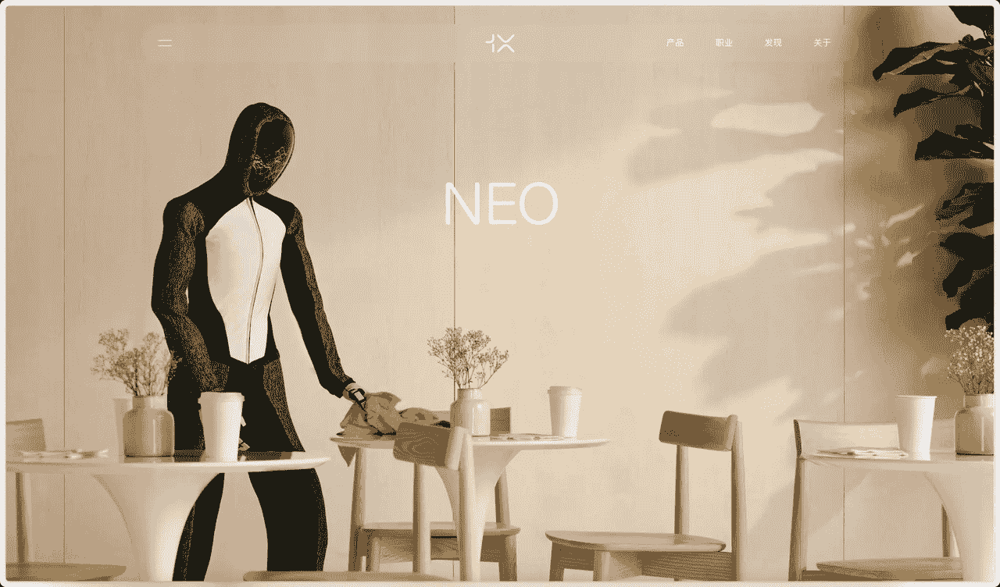
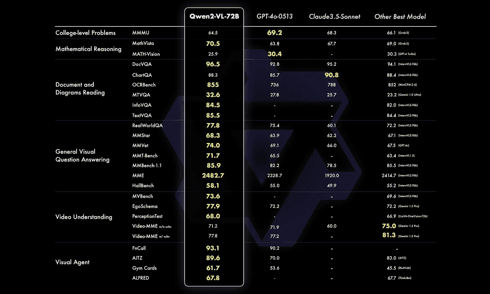
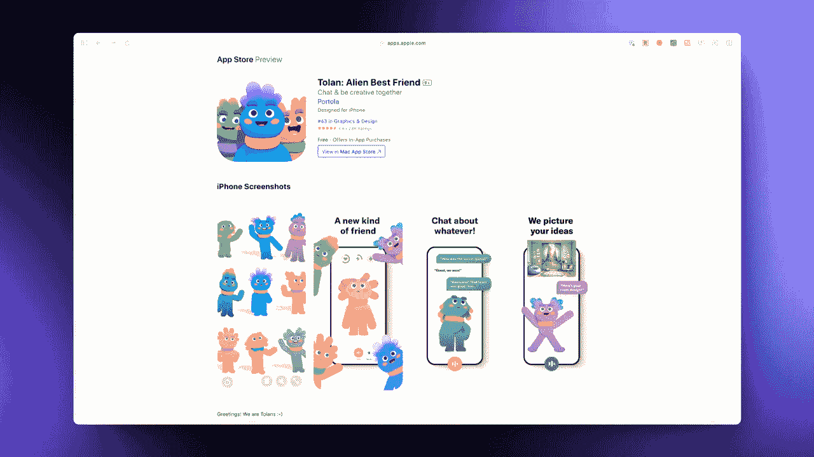
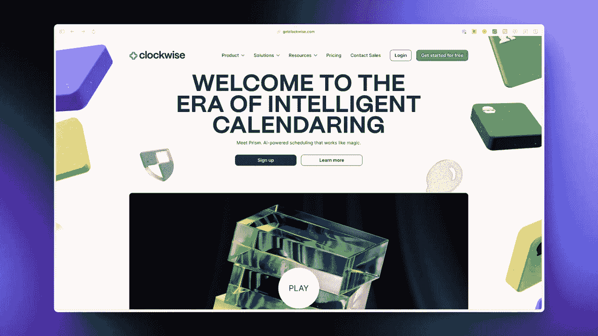
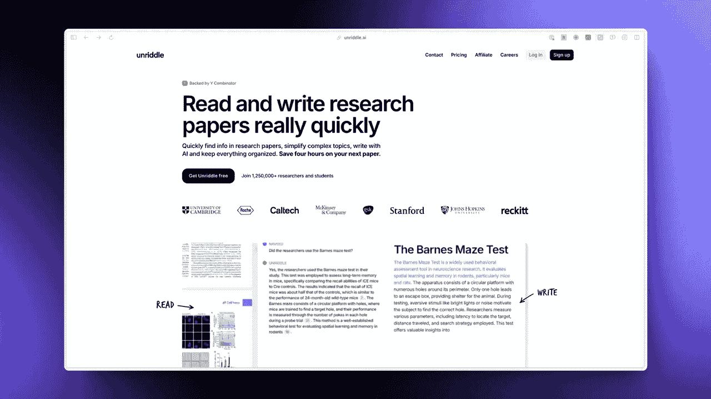

# AIGC Weekly #87

> 来源：[https://waytoagi.feishu.cn/docx/LrCpde2eWoli6bxaiMOco2IcnJe](https://waytoagi.feishu.cn/docx/LrCpde2eWoli6bxaiMOco2IcnJe)

> 🔗 原文链接： h[ttps://quail.ink/o](https://quail.ink/op7418/p/aigc-weekly-87)p7418/p/aigc-wee...

> ⏰ 发表时间：2024-09-02

> 作者：歸藏

> **上**周自己挑选数据训练了一个 FLUX 风格 Lora，整体会让生成的图片更加简洁，会有更多灰色内容，感兴趣可以试试。

> Liblib：https://www.liblib.art/modelinfo/e74abc022540492284f153fad54b3e07?from=personal_page

> Civitai：https://civitai.com/models/698954?modelVersionId=782092

> 顺便帮可灵模型团队 [招一个设计师 ](https://x.com/op7418/status/1828414686699950117)，主要职能是负责可灵的训练数据质量，保证模型美学表现以及工作流优化。发消息可以备注歸藏这里来的。

# 上周精选 ✦

## 1X 发布消费级人形机器人 NEO Beta

OpenAI 投资的机器人创业公司 1X 推出了他们的家用消费级机器人NEO Beta。

演示看起来很厉害，同时让机器人穿上衣服不漏出机械原件的演示也有一定的传播动力。

1X 预计最早2025年向付费客户交付家用机器人，他们机器人的主要特点有自主研发的"肌腱驱动"技术、注重机器人的柔顺性和安全性、低齿轮比,高功率电机设计、类似人类肌肉的驱动系统。

在制造流程上高度垂直整合,从原材料到成品全程自主生产，分阶段组装:核心部件 -> 子系统 -> 最终组装 -> 验证测试。

从演示来看还不太能做复杂的家务，只能帮忙整理简单的东西或者将置顶的东西拿给人类，不过在 LLM 的加持下最近厉害的机器人公司越来越多了。

## Open AI 新的推理模型已经训练完成

高质量合成数据的重要性再一次被证明。

Open AI 的逻辑 **是**使用一个足够庞大且非常不经济的推理模型（Strawberry）生产优质合成数据帮助训练下一个阶段的普适模型（猎户座） 。

同时逸散的部分合成数据顺便用来微调和蒸馏上一代模型 GPT-4，确保上一代模型的持续微小进步（GPT-4o）。

据 The Information 报道，OpenAI 可能会在今年秋天发布Strawberry的ChatGPT版本。

Strawberry 这个模型的推理能力相较于现在的模型大幅加强，可以真正实现将思考时间转化为输出质量，它的增强逻辑应该能更有效地解决与语言相关的挑战。

Sam 也说他们已经邀请美国国家安全部门开始测试他们的先进模型。

另外还有一个规划中的代号 “Orion（猎户座）“旗舰语言模型，旨在超越 GPT-4。Strawberry 将通过为 Orion 生成数据来做出贡献。Strawberry 和高质量合成数据的结合可能会减少 Orion 中的错误。

**Stra**wberry可能用了跟斯坦福 研究 Quiet-STaR 类似 的方法 。又重新看了一下这个论文，Quiet-STaR 通过三个步骤提高模型推理能力：

**并行生成理由 **：首先，在输入序列的每个标记位置并行生成多个理由。每个理由的长度为t，并在每个理由的开始和结束处插入学习的起始和结束标记。

**混合后理由和基础预测 **：然后，使用一个混合头从每个理由的隐藏状态输出和原始文本标记的隐藏状态输出中生成一个权重，该权重决定了在后续标记预测中使用多少后理由的预测逻辑。

**优化理由生成 **：最后，使用REINFORCE算法优化理由生成参数，以增加使未来文本更可能的理由的可能性。

## 一亿上下文长度的 LLM：LTM-2-Mini

Magic 发布了一个具有 1 亿 Token 上下文的模型 LTM-2-mini。1 亿 Token相当于大约 1000 万行代码或大约 750 本小说。

+   LTM 模型不依赖于模糊的记忆，而是能够在推理时处理高达 100M token 的上下文信息。

+   现有的长上下文评估方法存在隐含的语义提示，这降低了评估的难度，使得 RNN 和 SSM 等模型能够得到好的评分。

+   Magic 团队提出了 HashHop 评估方法，通过使用哈希对，要求模型存储和检索最大可能的信息量，从而提高了评估的准确性。

+   LTM-2-mini 模型在处理超长上下文时，其序列维度算法的成本远低于 Llama 3.1 405B 模型的注意力机制。

## 阿里开源支持视频理解的多模态 LLM Qwen2-VL

国内现在还没有特别好的多模态闭源模型尤其是支持视频理解的，阿里这就开源了。不过最大的Qwen2-VL 72B 没有开源，只开源了比较小规模的 2B 和 7B。

Qwen2-VL 基于 Qwen2 打造，相比 Qwen-VL，它具有以下特点：

1.  读懂不同分辨率和不同长宽比的图片 ：Qwen2-VL 在 MathVista、DocVQA、RealWorldQA、MTVQA 等视觉理解基准测试中取得了全球领先的表现。

1.  **理解20分钟以上的长视频 **：Qwen2-VL 可理解长视频，并将其用于基于视频的问答、对话和内容创作等应用中。

1.  能够操作手机和机器人的视觉智能体 ：借助复杂推理和决策的能力，Qwen2-VL 可集成到手机、机器人等设备，根据视觉环境和文字指令进行自动操作。

1.  **多语言支持 **：为了服务全球用户，除英语和中文外，Qwen2-VL 现在还支持理解图像中的多语言文本，包括大多数欧洲语言、日语、韩语、阿拉伯语、越南语等。

模型架构上值得注意的内容：

+   **Qwen2-VL** 在架构上的一大改进是实现了对 原生动态分辨率 的全面支持。与上一代模型相比，Qwen2-VL 能够处理任意分辨率的图像输入，不同大小图片被转换为动态数量的 tokens，最小只占 4 个 tokens。

+   架构上的另一重要创新则是 多模态旋转位置嵌入（M-ROPE） 。传统的旋转位置嵌入只能捕捉一维序列的位置信息，而 M-ROPE 通过将原始旋转嵌入分解为代表时间、高度和宽度的三个部分，使得大规模语言模型能够同时捕捉和整合一维文本序列、二维视觉图像以及三维视频的位置信息。

# 其他动态 ✦

+   MiniMAX 发布 [视频生成模型 ](https://hailuoai.com/video)[，目前只支持](https://x.com/op7418/status/1829814872563204327)文生视频，免费使用，我的 测试在这里 。

+   [海外最大的图像模型分享网站](https://civitai.green/models) Civitai 新开了一个 Civita Green 站点，里面只有安全的图片和模型，没有色情内容。

+   [Runway Ge](https://x.com/runwayml/status/1829591480664768993)n3 视频生成模型现在 支持视频延长功能 ，最多可以延长到 40 秒。

+   [AI 电话营销平台Bl](https://x.com/usebland/status/1828882563588612233)and AI获得了 2200 万美元融资 。支持用任何语言或声音交谈、通过 Agents 自定义自己的客服机器人、可以同时处理数百万的通话。

+   Midjourney [开始研发硬件 ](https://x.com/midjourney/status/1828839444130214208)，开始招人，去年就挖了一个在苹果做 VisionPro 的人入职。

+   谷歌 Gemini 更新了类似 GPTs [和 Cluad](https://blog.google/products/gemini/google-gemini-update-august-2024/)e projects 的 功能 Gem ，现在也支持使用Imagen 3 生成图片了。

+   Cerebras 推出 世界上最快的 LLM 推理服务 ，Llama 3.1 8B 的生成数独可以到每秒1800Token，70B 可以达到 450 Token。

+   谷歌发布了一个 Gemini 1.5 Flash 8B 的新模型 。还有一个Gemini 1.5 Pro 新版模型具有更好的提示词响应以及代码能力。

+   [Claude Artifac](https://www.anthropic.com/news/artifacts)ts 已经向所有 付费和免费用户在全平台开放 ，包括他们的 iOS 端和安卓客户端。

+   Midjourney [审美偏好和性格关系调研 ](https://www.midjourney.com/surveys?survey=personality-ambi)来了。这次会要求你回答 180 个问题测试出你的性格分数。

+   [Anthropic 这事做的还](https://docs.anthropic.com/en/release-notes/system-prompts#july-12th-2024)挺好的。他们发布了一个页面展示 Claude 系统提示的变化 。

+   XLabs 发布了 基于 FLUX 的 Deforum 视频生成项目 。Deforum可以通过控制不同阶段的提示词生成快速变化的动画。

+   Cohere 发布了 Command R 和 R+的新版本模型 ，在推理、编码、工具使用和多语言 RAG 方面性能均有提升。同时相较于上个版本模型的价格也降低了。

+   智谱开源了 CogVideoX-5B DiT 视频生成模型 ，应该是第一个规模比较大的DiT开源视频模型。

# 产品推荐 ✦

## Tolan：人格化的 ChatBot

一个友好的小外星人，你可以和他谈论任何事情，他甚至可以帮助你想象你的想法。看起来支持类似实时语音能力，小外星人的形象也可以自定义非常可爱。

## Clockwise：基于 AI 的日历工具

Clockwise 是一个基于 AI 的时间管理日历工具，旨在通过智能调度帮助个人和团队更高效地管理时间。

它能够像魔术一样工作，为团队和公司制定完美的日程安排，并根据偏好进行调整。该工具能够处理复杂的日程，重新安排事件，以便找到忙碌团队的会面时间，或者安排紧急会议。

## Unriddle：AI 论文写作工具

Y Combinator 支持的研究工具，旨在加速研究人员和学生阅读和撰写研究论文的过程，提供 AI 辅助的信息检索、内容理解和写作功能，支持多种文件格式，并提供协作和安全性功能。

用户可以在多篇文档上生成 AI 助手，提出问题以快速提取和总结数据。此外，Unriddle 还提供了高级写作辅助功能，如段落润色、翻译、缩短文本，以及生成论文大纲和从互联网引用来源。

# 精选文章 ✦

## [Anthropic CEO 访谈：人工智能](https://www.youtube.com/watch?v=7xij6SoCClI)的发展、风险、以及 SB 1047 法案

主持人 Noah Smith 和 Eric Benz 采访了 Anthropic CEO Dario Amodei。在采访中，Amodei 分享了他的学术背景和对人工智能（AI）的兴趣，以及他在 Anthropic 的工作。他讨论了 AI 的发展轨迹，包括深度学习的突破以及他在 OpenAI 期间对 GPT 和强化学习的贡献。Amodei 强调了 AI 规模法则（scaling laws）的重要性，即随着模型规模的增加，AI 性能也相应提升。

Amodei 对 AI 公司的竞争环境进行了分析，认为 AI 的未来可能会类似于太阳能行业，即虽然技术的价值巨大，但利润可能会被压缩。他还讨论了 AI 对劳动力的影响，包括技能梯度的压缩和劳动力的重新分配。此外，他探讨了 AI 在生物技术和制造业中的潜在应用，以及这些技术如何可能改变世界。

在安全和风险方面，Amodei 讨论了 AI 的自主行为和滥用的可能性，以及国家安全的相关问题。他提到了 AI 可能对国际关系产生的影响，特别是在美国与中国之间的竞争中。他还提到了 AI 对个人隐私和监控状态的潜在风险。

最后，Amodei 对即将到来的加州法案 SB 1047 表示支持，该法案旨在通过要求 AI 公司制定安全计划来管理 AI 的风险。他认为这项法案在某种程度上平衡了速度和安全的需求，并且可以促进 AI 安全领域的进步。

## [Perplexity CEO 访谈：他退出 OpenAI，并在](https://www.youtube.com/watch?v=LwzGyFM28SI)两年内创建了价值 30 亿美元的创业公司

Ishan Sharma 与 Perplexity 创始人 Arin 的对话，Arin 分享了他从 IIT Madras 毕业、获得 UC Berkeley 的博士学位，到加入 OpenAI 和最终创立 Perplexity 的故事。

Arin 谈到了他在人工智能领域的兴趣和对大型科技公司如 Google 的挑战，以及他如何利用大语言模型和传统搜索工具结合的方法，创建了一个与众不同的搜索引擎 Perplexity。他还讨论了与竞争对手的关系，包括 Google 和 OpenAI，以及他如何看待风险和竞争，以及他在创业过程中的学习和成长。

此外，他还提到了 Perplexity 如何通过提供高质量的搜索服务和透明度来吸引用户，以及他对于创业公司如何吸引投资者和员工的看法。Arin 强调了创业公司需要的关键技能，如深度学习和广度理解，以及如何处理失败和挫折。

## [自 2023 年以来，Llama 增](https://ai.meta.com/blog/llama-usage-doubled-may-through-july-2024/)长了 10 倍，是人工智能创新的领先引擎

Meta 发布的 Llama 开源成绩单，主要就是晒数据突出自己对于开源 AI 生态的贡献，里面的数据都挺有用的做对比的时候可以参考。

+   Llama 在 HuggingFace 上的下载量接近 3.5 亿次。与去年同期相比，下载量增长了 10 倍多。

+   Llama 在过去一个月的下载量已达 2000 万次。这使得 Llama 成为领先的开源模型系列。

+   Llama 的使用量从 2024 年 1 月到 7 月增长了 10 倍，尤其是在 5 月至 7 月期间，随着 Llama 3.1 版本的发布，其在主要云服务提供商合作伙伴那里的代币体积使用量翻了一番。

## Anthropic 如何构建 Artifacts

Artifacts 的开发始于研究科学家 Alex Tamkin 在 “WIP Wednesday” 会议上展示的一个简陋原型，他希望通过减少创建和查看 HTML 代码的周期时间来加快开发速度。

随后，产品设计师 Michael Wang 帮助将这个原型开发成适合生产的体验。技术栈包括 Streamlit、Node.js、React、Next.js 和 Tailwind CSS。

Artifacts 的开发过程中，团队不仅使用了 Claude 来加快软件开发速度，还利用了 Claude 的能力来解决编码问题和实现特定的交互模式。

安全工程师 Ziyad Edher 确保了 Artifacts 的模型安全性和产品安全性。尽管团队规模较小，但在三个月内，他们 succesfully 地将 Artifacts 从概念设计到产品发布。

该功能的成功超出了开发团队的预期，并可能标志着生成式人工智能（GenAI）成为更加协作工具的方向。

## 高效深度学习：优化技术的全面概述

文章首先介绍了不同的数据类型（如 Int16/Int8/Int4、Float32、Float16、Bfloat16、TensorFloat32、E4M3 和 E5M2）及其在内存消耗中的作用。接着分析了模型训练中的内存消耗主要来源于模型状态（包括优化器状态、梯度和参数）和残余状态（如激活、临时缓冲区和内存碎片）。文章进一步探讨了量化技术，包括对称和非对称线性量化，以及量化的时机和粒度，以及如何处理异常值。

在参数高效微调（PEFT）部分，文章详细介绍了 LoRA（低秩适应）和 QLoRA（量化 LoRA）的方法，以及它们如何减少内存和存储使用。文章还提到了 Flash Attention、梯度累积、8 位优化器、序列打包等技术，这些技术都有助于提高训练效率和减少资源消耗。此外，文章还介绍了 torch.compile 的使用，以及如何通过多查询注意力（MQA）和分组查询注意力（GQA）来优化注意力机制。

最后，文章讨论了集体操作和分布式训练方法，包括数据并行性（DP）、模型并行性、张量并行性和流水线并行性，以及 FSDP（全分片数据并行）的概念和工作流程。

## [**人工智能工程师的崛起**](https://www.latent.space/p/ai-engineer)

主要探讨了人工智能工程师职位的兴起及其对软件工程领域的影响，强调了 AI 工程师与传统机器学习工程师的不同，以及 AI 工程师在产品化 AI 技术和应用 AI 模型方面的重要性。

随着基础模型的能力和开源 API 的可用性，人工智能工程师（AI Engineer）这一职位正在迅速涌现。AI 工程师不仅要掌握 API 文档，还需要编写软件，甚至是编写 AI 的软件。AI 工程师的角色已经在多个领域得到了广泛应用，从大公司到创新型初创企业，以及独立黑客，他们在推动 AI 技术转化为实际产品方面发挥着关键作用。AI 工程师的数量预计将超过传统的机器学习工程师，成为本十年最受欢迎的工程师职位。

文章进一步分析了 AI 工程师与机器学习工程师的区别，指出 AI 工程师通常不需要从事模型训练，而是专注于评估、应用和产品化 AI 技术。AI 工程师使用的工具和技术包括最新的 AI 模型、开源工具和自动化代理。尽管 AI 工程师的角色正在明确，但市场上仍有关于 AI 和 ML 之间差异的语义辩论。

# 重点研究 ✦

## 字节开源适用于 FLUX 的 Hyper SD 加速模型

字节开源了 FLUX Dev 的 Haper SD Lora。只需要 8 步或者 16 步就可以用 FLUX 生成图片，大幅减少 FLUX 的生成时间。

他们还有一个Huggingface 空间演示 FLUX 8 步 Lora 的效果。测试了一下 8 步模型相较于原始版本效果确实有明显折损，但是可以接受。

## [CSGO： ](https://csgo-gen.github.io/)[**文本到图像生成中的内容样式组合**](https://csgo-gen.github.io/)

该模型在文本到图像生成中实现了高质量的内容和风格的组合。

研究团队构建了一个名为 IMAGStyle 的大规模数据集，包含 210,000 张图像三元组，用于训练和研究。CSGO 模型通过独立的特征注入明确地将内容和风格特征分离开来，实现了图像驱动的风格转换、文本驱动的风格化合成以及文本编辑驱动的风格化合成。该模型不需要进一步的微调便可进行推理，并且保留了原始文本到图像模型的生成能力。

## [谷歌研究游戏内容的实时生成](https://gamengen.github.io/)

谷歌发布 GameNGen 基于扩散模型的实时游戏引擎。能够在高质量下实时与复杂环境进行长时间的交互。可以在单个 TPU 上以超过 20 帧每秒的速度互动模拟经典游戏 DOOM。

**训练分为两个阶段：**

+   训练一个自动代理来与环境交互，记录代理的训练轨迹。这些轨迹作为生成模型的输入数据。

+   使用Stable Diffusion v1.4模型，并对其进行条件化，使其能够根据代理的轨迹生成图像。

## 无额外损失的专家混合模型负载均衡新方法

Deepseek 新论文一种新的负载均衡方法,叫做"无损失平衡"(Loss-Free Balancing)。传统方法通过加入额外的损失函数来控制负载均衡,但这会干扰模型训练。

新方法不引入额外损失,而是直接调整每个专家的路由分数,从而实现更好的负载均衡和模型性能。实验表明,这种方法在1B和3B参数规模的模型上都取得了更好的结果。

## Agentic 系统的自动化设计

这篇论文提出了一个新的研究方向,叫做"自动设计智能系统"(ADAS)。它的目标是让AI自动设计出更强大的AI系统,而不是人工去设计。研究者们开发了一个叫"元代理搜索"的算法,让一个"元代理"AI不断尝试编写新的AI代理程序。通过在多个任务上的实验,他们发现这种方法可以发现比人工设计更好的AI系统。这种方法有潜力大大加快AI系统的开发速度,但也需要注意安全问题。