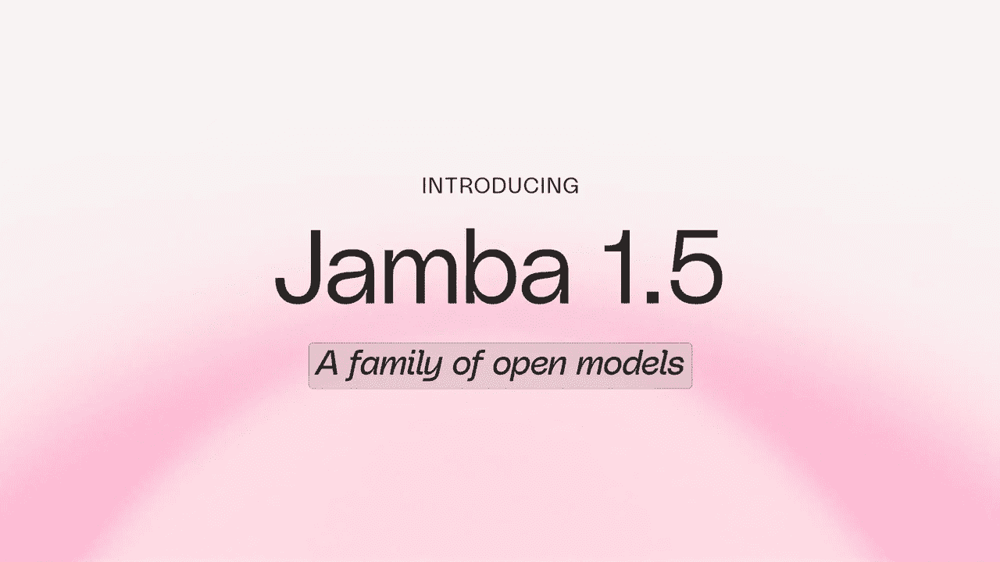
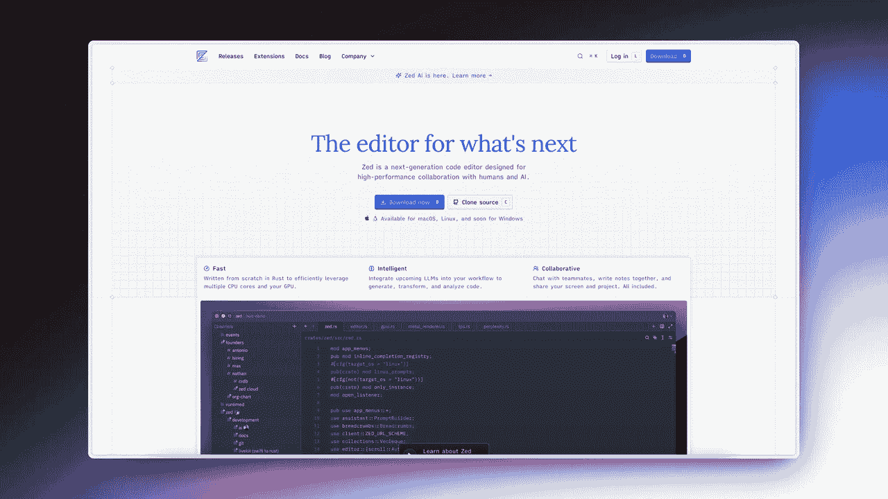
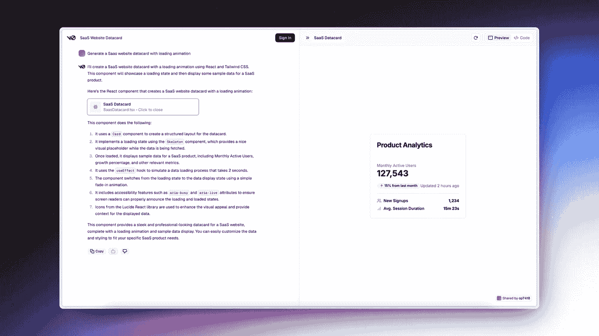
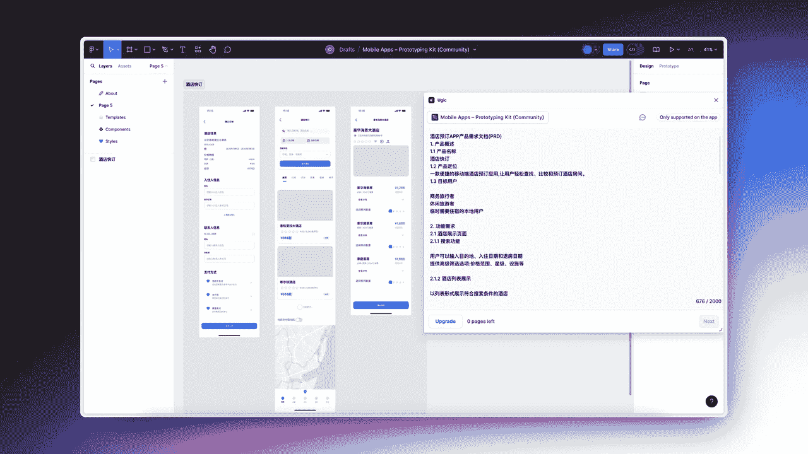

# AIGC Weekly #86

> 来源：[https://waytoagi.feishu.cn/docx/RG95dH3jFo7Xr5xunNMcpKZBnFh](https://waytoagi.feishu.cn/docx/RG95dH3jFo7Xr5xunNMcpKZBnFh)

> 🔗 原文链接： h[ttps://quail.ink/o](https://quail.ink/op7418/p/aigc-weekly-86)p7418/p/aigc-wee...

> ⏰ 发表时间：2024-08-26

# 上周精选 ✦

## Ideogram 发布了 2.0 图像生成模型

图像生成质量大幅提高，产品易用性改善，最强的文字生成能力。尝试了一下发现真的很离谱，不只是文字生成这么简单，可以实现复杂排版搭配色彩控制。做一些简单的营销海报完全可以一步到位。

+   **图像风格控制 **：包括现实、设计、3D 和动漫。

+   **调色板控制 **：可以生成符合您特定调色板的图像。

+   **移动端 APP **：iOS 应用发布，安卓稍后。

+   **API 发布 **：2.0 0.08 美元一张图的成本。

+   **搜索社区图片 **：公共创作库现在可基于文本搜索。

+   **Magic Prompt **：魔术提示和描述得到显着改进。

这里是 [我的体验 ](https://x.com/op7418/status/1826504118191751392)，用详细的提示词生成了两个酒店官网设计稿和圣诞促销海报。

他们也发布了一个 [官方教程 ](https://x.com/op7418/status/1827230350915072110)如何用一个手绘涂鸦图片生成一个饮品的宣传海报。

## [Jamba 1.5系列模型：非 Tr](https://www.ai21.com/blog/announcing-jamba-model-family)ansformer 模型首次追上先进模型

AI21 推出了新的 Jamba 1.5 模型家族，包括 Jamba 1.5 Mini 和 Jamba 1.5 Large，这些模型采用了创新的 SSM-Transformer 架构。

这是第一次非 Transformer 架构的模型追上市场上领先的其他 Transformer 模型。

+   256K 的有效上下文窗口

+   长文本速度快 2.5 倍，同尺寸最快

+   本地支持结构化的 JSON 输出、函数调用

+   除了英语之外支持多种其他语言

他们还开发了一个专门针对 MoE **模型的量化方案Exper**tsInt8。 这项技术提供了四个优势：

+   速度快，量化过程只需几分钟；

+   不依赖于校准，这一有时不稳定的过程通常需要几个小时或几天；

+   仍然可以使用 BF16 来保存大规模激活；

+   允许 Jamba 1.5 Large 适配单个 8 GPU 节点，同时利用其 256K 的完整上下文长度。

# 其他动态 ✦

+   [ComfyUI 发布](https://blog.comfy.org/comfyui-v0-1-x-release-devil-in-the-details-2/)了一个相对大的 版本更新 0.10 ，已经支持在ComfyUI中使用循环和条件语句，前端代码迁移到 TypeScript，新的搜索和设置 UI，实验性 FP8 算法支持以及 GGUF 量化支持。

+   Cluade 开始 [支持 LaTeX 数学公式 ](https://x.com/AnthropicAI/status/1826667671364272301)的渲染。

+   Cu[rsor 宣布获得了来自A](https://x.com/cursor_ai/status/1826656532072923219)ndreessen Horowitz、Jeff Dean、John Schulman、Noam Brown 以及 Stripe 和 Github 的创始人 的 6000 万美元融资 。

+   [Googl](https://aistudio.google.com/app/gallery)e 给 Gemini 的 AI studio 增加了一个 提示词库 。可以帮助你学习一些常见需求的 Gemini 提示词写法。

+   [PixVerse](https://x.com/PixVerse_/status/1826446286675153175) 视频生成模型更新到 V2.5 版本 。第一个支持运动笔刷的 DiT 模型，模型质量大幅提升。

+   Midjourney [网页版版本全量上线 ](https://x.com/midjourney/status/1826305298560418171)，同时开启免费使用，未付费账号可以免费使用 25 次。

+   X-Lab 已经发布了 FLUX 的 IPapadter 模型 。支持512x512 和 1024x1024 分辨率。实验性模型迁移的稳定性和可靠性不太行。

+   GPT-4o 现在 [可以微调 ](https://x.com/OpenAIDevs/status/1825938486568038569)了。每个组织每天可以获得 100 万个 Token 的免费额度。持续到 9 月 23 日。

+   Luma 发布了他们 1.5 版本的视频生成模型更新 。文生视频能力大幅提高，同时图生视频也有一定的提升。

+   [Hotshot ](https://hotshot.co/)发布了他们的视频生成模型，一些常见的场景效果不错，但是泛化性不行。

+   Noam Shazeer，Character AI 的前首席执行官，在本月重返谷歌后，将担任谷歌最重要的人工智能项目 Gemini 的共同技术负责人 。他将与谷歌 AI 长期研究者 Jeff Dean 和 Oriol Vinyals 合作开发 Gemini

+   [亚马逊CE](https://x.com/ajassy/status/1826608791741493281)O分享了AI代码辅助工具给他们带来的 效率提升 ，开发人员直接采纳了 79% 的 AI 自动生成的代码变更建议，升级到Java 17 的平均时间从 50 个开发工作日变成几个小时，预计每年可带来 2.6 亿美元的效率提升。

# 产品推荐 ✦

## Zed AI ：新的 AI 代码编辑器

发布了 Zed AI，一个集成了人工智能辅助编程功能的文本编辑器，通过与 Anthropic 合作，利用其 Claude 3.5 Sonnet 模型，提供了一个性能优化的在线服务，旨在提高开发者处理复杂代码库的生产力。

Zed AI 的核心特性包括一个助手面板和内联代码转换功能。助手面板允许开发者通过文本编辑器与 AI 模型交互，可以插入代码片段、会话历史、文件内容等，并提供了一系列斜杠命令（如 /tab 、 /file 、 /terminal 等）来帮助构建上下文。内联转换功能则允许开发者通过自然语言提示进行代码转换和生成，同时保持对代码的完全控制。

## Vercel V0：AI 前端代码和界面生成

Vercel 升级了 V0，加入对话式 UI 界面。这才是 Claude Artifact 的完全体，太强了。

+   集成了最新的 Next.js、React 和 Web 开发知识

+   能够运行 framer-motion 等 npm 包

+   实现了更快速、更可靠的流式处理功能

我让他写了一个 Saas 平台的数据卡片，还给加上了加载动画，UI 设计也很好。

## Ugic：Figma AI UI 生成插件

即时发布了AI 界面设计插件Ugic，吊打 Figma 自家的 AI 能力，真正拉低 UI 设计门槛。

+   支持调用你自己的设计组件库生成界面

+   可以将超长产品 PRD 拆解为具体的页面设计

+   支持十多种语言

+   支持干涉设计过程

如果你是独立开发者和产品，你现在只需要一个好一些全面点的组件库和清楚的脑子就行。

# 精选文章 ✦

## a16z 发布新一期 AI 应用 Top 100 排名

相比六个月前的一期变化还是挺大的，一些值得关注的要点：

+   与 6 个月前相比有 30% 的新公司

+   名次进步最大的是Suno ，从第 36 名到第 5 名

+   移动端最多的应用是图像和视频编辑，占 22%

+   Luzia值得关注，主要服务西班牙语用户

+   字节多款应用上榜，包括 Coze、豆包、CiCi、醒图、Gauth

+   美学和约会应用开始增加，主要为用户提供美学和照片建议帮助用户更有吸引力。

+   Discord 流量是值得关注的，相当多的应用都是在 Discord 完成的 PMF 验证。

## [如何评估大语言模型的有效性](https://eugeneyan.com/writing/llm-evaluators/)

详细讨论了 LLM-Evaluators 的关键考虑因素，如选择合适的基准、评估方法（直接评分、成对比较、参考基准评估）、使用的指标（分类指标和相关性指标），以及如何对齐评估标准。

此外，还探讨了 LLM-Evaluators 在不同应用场景中的效果，如评估有害输出、摘要质量、问答准确性等。网页还提到了多种 LLM-Evaluators 的评估技巧、对齐工作流程、微调模型的方法，以及对 LLM-Evaluators 的批判性分析和支持证据。

## [新的LLM训练前和训练后后范式](https://magazine.sebastianraschka.com/p/new-llm-pre-training-and-post-training)

主要介绍了四大新型大型语言模型（LLM）的预训练和后训练范式，分别是 Alibaba 的 Qwen 2、Apple 的 Apple Intelligence Foundation Language Models（AFM）、Google 的 Gemma 2 和 Meta AI 的 Llama 3.1，并详细分析了这些模型的特点、训练方法和技术创新。

+   Qwen 2 模型具有强大的性能和良好的多语言能力 ，并且在预训练和后训练中都使用了合成数据。

+   数据质量的重要性超过了数据数量的重要性 ，这一点在 Qwen 2 和 AFM 的预训练中得到了体现。

+   Apple 在 AFM 模型的预训练中采用了三阶段的方法 ，并且在后训练中引入了新的算法，如 iTeC 算法和 RLHF with Mirror Descent 算法。

+   Google 的 Gemma 2 模型专注于提高模型效率 ，而不是增加训练数据集的大小，后训练过程包括了监督 finetuning 和 RLHF。

## [深度学习中的非线性新视角](https://towardsdatascience.com/a-fresh-look-at-nonlinearity-in-deep-learning-a79b6955d2ad)

主要探讨了深度学习中非线性激活函数的重要性，以及它们如何帮助模型捕捉复杂的非线性关系，并提供了一个新的视角来理解激活函数的作用，即它们如何确保模型的最后一层可以从前一层得到线性可分的表示。

激活函数的使用引入了模型的归纳偏置，使得模型的输出层前的表示必须是线性可分的。这一点通过对 XOR 问题的深入分析得到了证实，其中 ReLU 激活函数使得输入在特征空间中变得线性可分，从而使得最后一层的线性回归能够正确分类。

文章进一步探讨了线性可分性的概念，并通过引入线性分类器探针来分析更深层次的模型。这些探针在每个层次后训练一个线性回归模型来预测最终输出，从而评估该层次的表示线性可分性。

## [如何将 Llama-3.1 8B 修剪和蒸馏为英伟达Llam](https://developer.nvidia.com/blog/how-to-prune-and-distill-llama-3-1-8b-to-an-nvidia-llama-3-1-minitron-4b-model/)a-3.1-Minitron 4B 模型

NVIDIA 技术博客介绍了如何通过剪枝和知识蒸馏将 Llama-3.1 8B 模型缩减为 Llama-3.1-Minitron 4B 模型的方法。

提供了一个详细的流程，用于将大型的 Llama-3.1 8B 模型通过剪枝和知识蒸馏技术转换为更小的 Llama-3.1-Minitron 4B 模型。剪枝是一种减少模型大小的技术，它通过移除模型中的一些参数来减少计算需求和内存占用，而不显著降低性能。知识蒸馏则是一种模型压缩方法，它通过让一个小模型（学生模型）学习一个大模型（教师模型）的输出来提高小模型的性能。

## 如何构建 Townie —— 一个能够生成全栈应用的应用程序

Posma 描述了自己如何通过 Val Town 平台构建 Townie 的原型，包括如何使用 Vercel 的 AI SDK、如何通过 LLM 生成代码、如何处理数据库持久性问题、如何实现前后端代码的分离以及如何优化成本和速度。

他还展示了如何通过 “Make Real” 功能将绘图转换为具有后端的 HTML，以及如何通过 E-VALL-UATOR 评估 LLM 生成的代码质量。

## Anthropic 的提示工程互动教程

**Anthropic 发布**了两个用来学习提示工程的教程， 完成课程后，将能够学到 ：

+   掌握一个良好提示的基本结构

+   识别常见故障模式，并学习解决它们的“80/20”技术

+   了解Claude的优点和缺点

+   从头开始为常见用例构建强大的提示

另一个课程是面向中高级人员的，将学习如何将关键提示技术融入复杂的实际提示中。

# 重点研究 ✦

## [Phi 3.5 系列模型](https://huggingface.co/microsoft/Phi-3.5-mini-instruct)

微软发布 Phi 3.5 系列模型。包括Phi 3.5 Mini、Phi 3.5 MoE和Phi 3.5 Vision。

Phi 3.5 Mini 只有 3.8B，但是测试分数超过了Llama-3.1 8B和Mistral 7B等模型。

Phi 3.5 MoE 有 42B，但在生成时只有 6.6B 参数活跃，表现超过了Gemini-Flash，接近GPT-4o-mini的性能。

Phi 3.5 Vision模型拥有4.2B参数，支持多帧图像理解。

## HALVA：语言模型幻觉减弱和视觉助手

HALVA 是由 Pritam Sarkar 和 Sayna Ebrahimi 在 Google 云端人工智能研究团队中开发的，旨在减少多模态大型语言模型（MLLMs）中的物体幻觉问题。

物体幻觉指的是模型在描述时错误地描述了不存在于输入图像中的物体或其属性。为了解决这个问题，HALVA 采用了基于数据增强的对比微调方法，通过生成真实和幻觉的对比性样本来训练模型，使其更倾向于生成真实的描述。

## 可以生成文本和图像的统一模型训练方法

Transfusion 模型通过结合语言建模和扩散模型的训练目标，实现了对文本和图像的同时理解和生成。该模型在训练时使用不同的损失函数处理不同的数据模态：对于文本使用语言建模目标（下一个词汇的预测），对于图像使用扩散模型目标。通过在同一序列中混合文本和图像数据，并在每个训练步骤中同时暴露模型于两种模态的数据和损失函数，Transfusion 能够有效地处理多模态数据。研究人员通过预训练多个不同规模的 Transfusion 模型，发现该模型在不同的单模态和跨模态基准测试中都表现出良好的可扩展性。

Meta 的论文，这是一组用于四项基本以人为中心的视觉任务的模型 - 2D 姿势估计、身体部位分割、深度估计和表面法线预测。

原生支持 1K 高分辨率推理，并且非常容易通过简单微调在超过 3 亿张野外人类图像上预训练的模型来适应个别任务。

## MegaFusion：将扩展扩散模型推向更高分辨率图像生成

它将现有基于扩散的文本到图像生成模型扩展到高效的更高分辨率生成，而无需额外的微调或额外的适应。

采用了一种创新的截断和中继策略，以跨不同分辨率的去噪过程，实现了以粗到细的方式进行高分辨率图像生成。此外，通过整合扩张卷积和噪声重新调度，进一步调整了模型的先验以适应更高的分辨率。