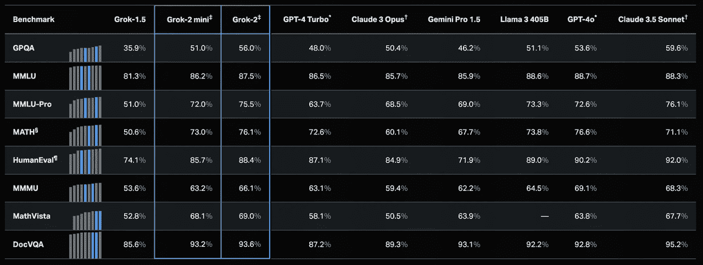
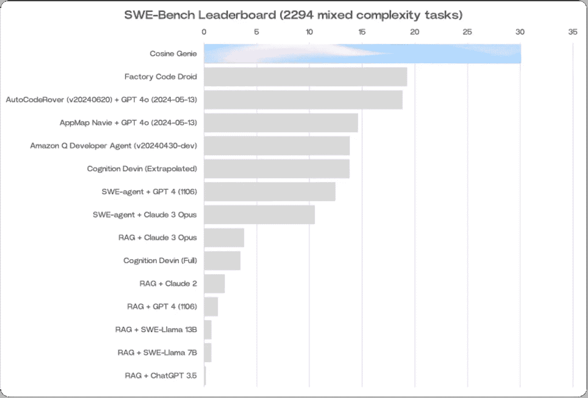
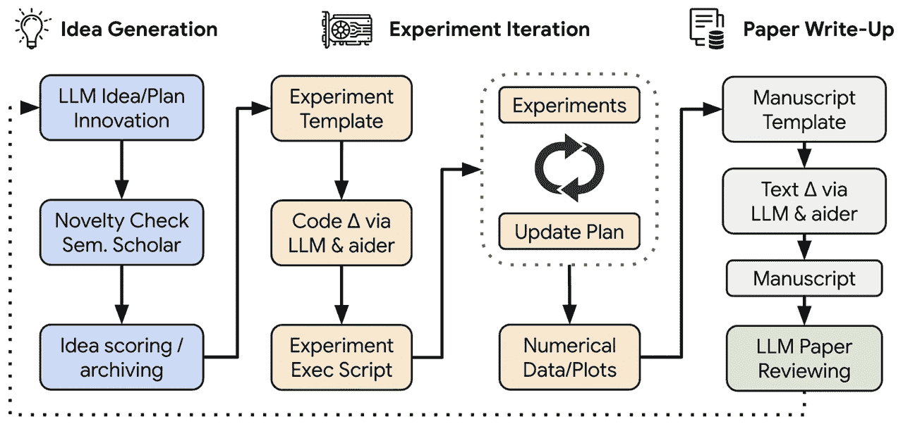
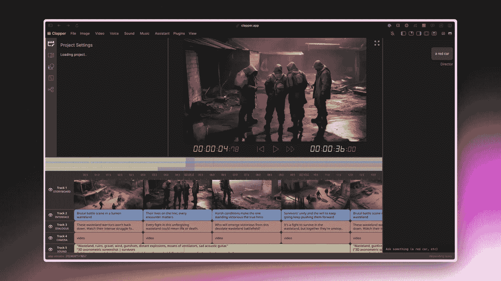
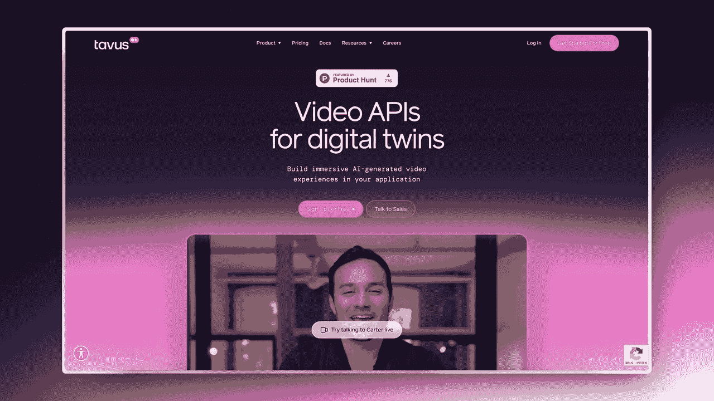
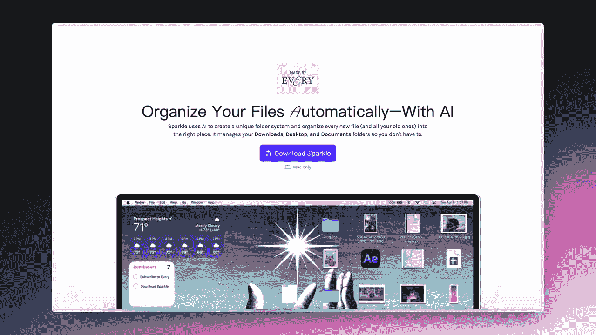
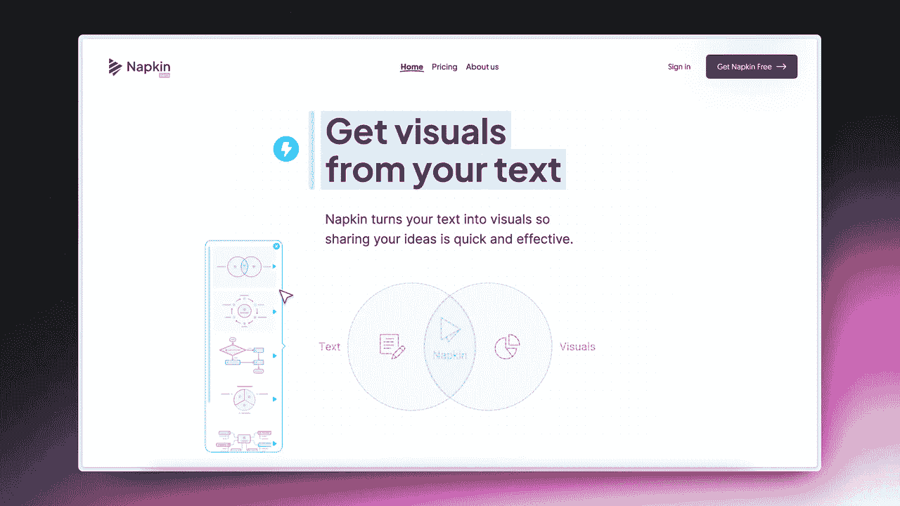
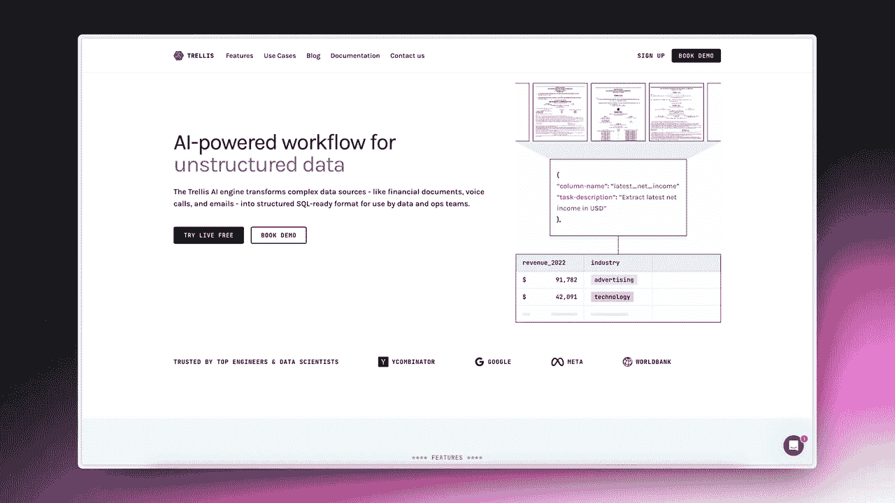

# AIGC Weekly #85

> 来源：[https://waytoagi.feishu.cn/docx/CS0adnTn2oAoYZxVYQucNYStnWg](https://waytoagi.feishu.cn/docx/CS0adnTn2oAoYZxVYQucNYStnWg)

> 🔗 原文链接： h[ttps://quail.ink/o](https://quail.ink/op7418/p/aigc-weekly-85)p7418/p/aigc-wee...

> ⏰发布时间：2024-08-19

> 作者：歸藏

# 上周精选 ✦

## 谷歌发布Pixel 手机以及 AI 功能

[谷歌上周集中发布了他们的 2](https://store.google.com/category/phones?utm_source=keyword&utm_medium=google_oo&utm_campaign=GS108056)4 年硬[件内容包括 新的 Pixel](https://store.google.com/product/pixel_watch_3?utm_source=keyword&utm_medium=google_oo&utm_campaign=GS108057) 9 手机 ， Pixel 9 Pro Fold ， Pixel Watch 3 和 Pixel Buds Pro 2 。

同时出了硬件之外大部分的时间都是在讲 AI 跟硬件的结合，而且其中的重头戏 Gemini live 已经在美国开始推送了，而且新手机上立刻可用，在 AI 硬件的进度上安卓这次领先苹果不少。

**主要的 AI 内容有：**

+   Gemini 升级推出 Gemini Live，支持实时语音对话和摄像头视频沟通，而且跟系统内置 APP 深度打通，比如可以直接通过 Gemini 展示谷歌地图内容和记录 Todo。

+   Pixel 的摄影和视频加了 AI 功能，Add Me 可以帮助你拍合照，支持 20 倍的 AI 变焦功能，Magic Editor 支持用 AI 编辑你的照片，Auto Frame扩图可以重新构图照片。

+   Pixel Studio AI 画图应用，imagen3 模型驱动，可以通过输入提示词生成图片和编辑生成的图片。

+   新的 Pixel Weather 应用程序使用AI来补充传统的天气报告，可以获得更准确的天气预报，比如雨何时开始和停止。

+   Keep 支持让 Gemini 帮你创建列表比如一些事情的详细待办。

+   Pixel Screenshots 支持帮你保存、组织和回忆你手机里面所有截图的信息，截图可检索这个太重要了，这是手机上最方便的记录形式。

+   通话备注支持帮你整理和保存对话中的关键信息，激活的话通话的人会收到通知。

+   Pixel Watch 使用机器学习自动检测睡眠并开启睡眠模式。

+   Pixel Watch 3 引入脉搏丢失检测功能，可以检测心脏突然停止跳动时发生的脉搏丧失事件。

+   Pixel Buds Pro 2 耳机支持 AI 降噪技术，降噪幅度是上一代产品的两倍。

+   Pixel Buds Pro 2，可以在不拿出手机的情况下获得 Gemini 的帮助，Gemini 可以在耳机里面跟你对话，这个在面试和演讲作弊很有用啊，户外没办法用手机的场景也很有用。

## [xAI 发布 ](https://x.ai/blog/grok-2)[**Grok-2 系列模型**](https://x.ai/blog/grok-2)

老马的 XAI 发布 Grok-2 Beta 版本。在LMSYS的成绩超过了Claude 3.5 Sonnet 和 GPT-4-Turbo。

Grok-2 和 Grok-2 mini 目前在 𝕏 上测试，这个月可以通过 API 使用。

𝕏 上的 Grok 界面也获得了更新，𝕏 Premium 和 Premium+ 用户都可以访问新模型。图片生成能力用的最近非常火的 FLUX 图像生成模型。

XAI 还说他们内容使用类似LMSYS的流程来对模型进行评估，在每次互动中，AI 导师模型会看到 Grok 生成的两个回应。根据指南中概述的具体标准选择更优秀的回应。专注于评估模型在两个关键领域的能力：遵循指示和提供准确的事实信息。

Grok-2 在推理检索内容和工具使用能力方面显示出显著改进，例如正确识别缺失信息、推理事件序列以及丢弃无关的帖子。

这一点在结合推特内容分析上明显变好了，你可以 让 Grok 分析你的内容以及互动来改善账号的运营情况。

他们下一步将会发布 Grok 多模态模型的预览。

## Genie：新的世界最强 AI 编程 Agent 产品

Genie 宣布自己打造出了世界上最强的 AI 编程 Agents 产品。在 SWE-Bench 评估中获得了 30.08% 的分数，在 SWE-Lite 中获得了 50.67%。可以完美模拟人类工程师的认知过程、逻辑和工作流程。

Genie 的设计目标是使其具有 “自主性”，能够根据所见内容逻辑行动。为了实现这一点，数据集需要能够代表这种逻辑行动，包括在未知代码库中找到执行任务所需的先决信息。

Genie 的推理特性包括 **规划、检索、编写和运行代码 **四个主要过程，通过模拟人类的行为而非基础语言模型的行为，从而实现了更高的性能。

Genie 的训练中还 **采用了自我改进的方法 **，通过使用模型自身生成的数据来提高性能，这种方法使得模型在面对错误时的反应能力得到了显著提升。

## [The AI Scientist：可以进](https://sakana.ai/ai-scientist/)行自主科学发现和论文撰写的 Agents

Sakana AI 宣布开发了一个名为 “The AI** Scientist” 的**系统，它能够 自动化地进行科学发现过程。

包括自动生成研究想法、编写代码、执行实验、总结实验结果、生成图表、撰写科学论文，并且还能进行自动化的同行评审。

该系统能够在大约 15 美元的成本内完成每篇论文的生成，尽管当前版本的论文可能存在一些缺陷，但已经能够达到顶级机器学习会议的 “弱接受” 标准。

该系统的创新之处在于它能够在不断迭代的过程中，利用先前的想法和反馈来改进新一代的研究想法，从而模仿人类科学社区的行为。

The AI Scientist 已经在机器学习领域的多个子领域进行了研究，包括扩散模型、transformers和 grokking，并发现了新的贡献。

这里是 The AI Scientist 自动生成的完整论文： Adaptive Dual-Scale Denoising

The AI Scientist 生成内容主要包括四个过程：

+   **创意生成 **。给定一个起始模板，AI 科学家首先“脑力激荡”出一系列新颖的研究方向。

+   **实验迭代 **。给定一个想法和一个模板，AI 科学家的第二阶段首先执行提出的实验，然后获得并生成图表以可视化其结果。

+   **论文写作 **。最后，AI 科学家以 LaTeX 标准机器学习会议论文的风格，撰写了简洁而富有信息的进展报告。

+   **自动论文审阅 **。这项工作的关键方面是开发一个自动LLM驱动的审阅者，能够以接近人类准确度评估生成的论文。

# 其他动态 ✦

+   [Anthrop](https://x.com/alexalbert__/status/1823751966893465630)ic API 推出 提示缓存功能 ，输入成本降低 90%，并将延迟降低 80%。

+   InstantX 发布了 FLUX 的 UnionControlnet 模型 。这一个模型集合了 Canny、Depth、Pose、Tile 等多个 Controlnet 模型。

+   DeepSeek 开源 [数学定理证明模型 ](https://mp.weixin.qq.com/s/O4aC9dvJC30sfSQyYgbcow)Prover-V1.5，通过构建类似 AlphaGo 的封闭图学习环境，在高中和大学的数学定理测试中都获得了非常好的结果。

+   Midjourney 网页版终于修复了稀烂的图像编辑功能。局部重绘加上更改图像比例以及提示词编辑都融合到了一个新的界面中。

+   Gen-3 Alpha Turbo 模型正式开放给所有用户使用，生成速度可提高 7 倍，价格仅为原版 Gen-3 Alpha 的一半。

+   [Synclabs 发布他们的](https://x.com/synclabs_so/status/1805649915030421995)新版唇形同步模型 lipsync-1.7.1 ，牙齿和嘴型极其精准，英文效果比中文好。不足是嘴部清晰度低，如果原视频清晰度本身很高的话，割裂感很重。

# 产品推荐 ✦

## Clapper app：AI 剪辑工具

非常强的网页端 AI 生成和视频剪辑工具。接入了 AI 视频需要的各种 API，包括图片生成、LLM、语音生成、音乐生成、视频生成。时间轴直接生成对应内容，然后进行编排和剪辑。传统界面和无线画布相互切换，一个用来发散构思，一个用来预览和精细编辑。

## [Tavus：数字孪生服务提供商](https://www.tavus.io/)

Tavus 提供了两种主要的视频 API 产品：视频生成和对话式视频界面。

视频生成 API 允许用户通过 AI 数字双生从脚本中生成视频，而对话式视频界面 API 则使得用户能够与 AI 数字双生进行实时对话。

这些产品基于 Tavus 的先进模型 Phoenix-2，该模型能够生成高度逼真的数字复制品，具有自然的面部运动和表情，支持多达 30 种语言，并且能够在不同的环境中录制用于创建自定义复制品。

## Sparkle：用 AI 自动整理文件

使用 AI 创建独特的文件夹系统，并将每个新文件（以及所有旧文件）整理到正确的位置。它可以管理您的下载、桌面和文档文件夹。

## Napkin：文本转换为信息图表

Napkin AI 是一个将文本内容转换为视觉图像的工具，旨在通过生成图表、流程图等视觉元素来加速和提高业务故事讲述的效果。

使用 Napkin AI 的过程包括粘贴文本、生成相关视觉内容、编辑和个性化设计元素（如图标、装饰元素、连接线、颜色和字体），以及将最终的视觉内容导出为 PNG、PDF 或 SVG 格式，以便在不同的场景中使用，如演示文稿、博客、社交媒体和文档。Napkin AI 的使用案例包括自动生成的信息图表、图表、流程图等。

## Trellis AI：从非结构化内容中提取数据

Trellis AI 引擎能够将复杂的数据源，如金融文档、电话和邮件，高效地转换成结构化的 SQL 格式，以便数据和运营团队使用。

Trellis AI 通过大型语言模型（LLMs）和查询处理器，确保了对非结构化数据源的正确模式和准确结果的生成。它能够执行多种操作，如总结公司描述、提取保险提供者名称、分类支持查询、分析客户信息中的情感、提取电子邮件中的客户姓名、对贷款申请进行分类等。

# 精选文章 ✦

## [**没**](https://www.latent.space/p/answerai)有经理，只有一个由 12 人组成的团队成功交付数千个产品 — Answer.ai 的 Jeremy Howard

Latent Space 播客的一集，采访了 Answerai 的两位创始人，他们采用了一种非传统的管理模式，即没有经理的团队，通过实际的项目和研究展示了如何高效地开发和推出成功的产品。

Answer.ai 还在模型继续预训练、优化器和学习率调度、OpenAI 治理危机的预测、BERT 模型的更新、FastHTML 的开发、对话工程以及 AI 愿望清单和预测等方面进行了研究和开发。

## [Google 前 CEO 埃里克·施密](https://x.com/dotey/status/1824571720843370918)特近期在斯坦福 CS323 课堂上的访谈

Eric Schmidt，曾任谷歌 CEO10 年的领导者，在斯坦福大学计算机学院的会议上发表了一次自我放飞的演讲。链接是宝玉的留档视频和中文翻译。

Schmidt 批评了谷歌在 AI 领域的表现，认为公司过于注重员工的生活质量而忽视了竞争。

他赞扬了像马斯克和台积电这样的公司，他们通过要求员工过度劳作来取得成功。

Schmidt 还提到了自己曾经低估 CUDA 的重要性，以及微软与 OpenAI 合作时的疑虑。

他指出了 TikTok 在创业和盗版音乐方面的策略，并对 OpenAI 的星际之门项目的巨额投资和能源需求表示担忧。

他提到了开源在 AI 领域的不可持续性，以及 AI 将如何加剧财富和技术资源不平等。

## [RAG 效果评估教程](https://www.comet.com/site/blog/rag-evaluation-framework-ragas/)

介绍如何使用 RAGAs 框架评估 RAG 应用的性能。

并通过构建元数据链和记录到 CometML-LLM 来监控复杂的生成过程。

详细教了 RAGAs 的评估指标、评估数据集的准备、评估过程的实现，以及如何使用 CometML 监控和记录评估链的每个步骤。

## 使用 Unsloth 超高效微调 Llama 3.1

一个非常详细的 LLM SFT 教程。介绍了如何使用 Unsloth 库对 Llama 3.1 模型进行微调。包括SFT 的技术细节、实践步骤和优化方法。

文章首先对 SFT 进行了全面的介绍，阐述了它与提示工程的区别和适用场景，详细描述了主要技术如 LoRA 的超参数、存储格式和聊天模板。接着，文章详细展示了如何在 Google Colab 中使用 Unsloth 库对 Llama 3.1 8B 模型进行状态艺术的优化和 QLoRA 微调。作者提供了所有代码，并指出了在资源受限的情况下如何进行更高效的微调，包括使用更小的数据集和选择合适的 GPU。最后，文章还讨论了微调后的模型评估、偏好对齐、量化和部署的方法。

## [AI的三个发展阶段、和移动互联网](https://www.xiaoyuzhoufm.com/episode/66b7909133591c27be2480c3)的异同、未来的演进路线|对谈创新工场汪华

在这期播客中，我们回顾了移动互联网当年发生了什么，为什么绝大多数聪明人在 2008 到 2012 年之间都不认可移动互联网的机会，我们也再次把 AI 和移动互联网做了比较，汪华给出的答案我认为是对这个问题答案最好的阐述。

可以说，这期内容更清晰的梳理了 AI发展的机会、逻辑、框架，也讲清了未来几年的演进路线，对之前大家讨论的很多问题给出了答案。当然，我们也聊了很多当下 AI 和一级市场的问题，但不论如何，正如汪华结尾所说，对 AI，我们的内心都是火热的。

## 使用 SimpleTuner 训练 FLUX Lora 教程

在这个 YouTube 视频中，Markury AI 频道的主讲向观众展示了如何使用 SimpleTuner 这一专业软件来训练 FLUX LoRA 模型。尽管 SimpleTuner 缺乏图形用户界面（GUI）和 Windows 系统支持，但主讲使用 RunPod 平台进行了演示，并指出在录制过程中遇到了文档有些过时的问题。主讲提供了一个快速视频，概述了整个训练过程，并分享了一些相关链接，包括 RunPod、FLUX 训练快速入门指南、Caption Helper、最新的硬件要求、LoRA 测试空间以及如何在 ComfyUI 中使用 LoRA 的工作流程。

# 重点研究 ✦

## Agent Q：一个自我监督代理推理和搜索的框架

没等来 Q* 等来了Agent Q，具有规划和自我修复能力的 AI Agents。结合了搜索、自我反思和强化学习，创造出最先进的自主网络代理，能够进行规划和自我修复。

在OpenTable 预订餐厅任务中，使用Agent Q方法并配备MCTS搜索能力，成功率最终提高到95.4%。

将引导蒙特卡洛树搜索（MCTS）搜索与自我批判机制相结合，并使用直接偏好优化（DPO）算法的离策略变体对代理互动进行迭代微调。允许LLM代理从成功和失败的轨迹中有效学习，从而提高它们在复杂的多步推理任务中的泛化能力。

## ControlNeXt：一种新的 Controlnet 模型

ControlNeXt,一种新的 Controlnet 模型，支持对图片生成和视频的控制。与原来的 SD 生态兼容。训练资源需求更少，几百步就可以收敛。仅添加了一个轻量级模块，保持了高效的推理时间。

目前他们自己发布了 SDXL 的 Canny 模型以及 SD1.5 大部分的控制模型，还有基于 SVD 的单图生成运动视频，还有一个基于 SD3 的图片放大模型。

## 谷歌最新的图像生成模型 Imagen 3 技术报告

谷歌关于 Imagen 3 的论文，这是谷歌最新的文本转图像模型。在训练过程中的一些方法包括：

1.  **数据预处理 **：首先，模型在一个包含图像、文本和相关注释的大型数据集上进行训练。为了确保数据的质量和安全性，采用了多阶段过滤过程，包括移除不安全的、暴力的或低质量的图像，消除AI生成的图像，以及使用去重管道和降低相似图像的权重。

1.  **合成注释 **：每个图像都与原始注释和合成注释配对。合成注释使用Gemini模型生成，以增加注释的语言多样性和质量。然后应用过滤器以移除不安全的注释和个人身份信息。

1.  **模型训练 **：Imagen 3模型使用最新的Tensor Processing Unit (TPU)硬件进行训练，以提高训练效率。训练过程中使用了JAX库，以便利用最新的硬件加速大规模模型的训练

## LongWriter：释放长上下文LLM的10,000+字生成能力

这篇论文主要研究如何提高大语言模型(LLM)的最大输出长度。研究发现,目前大多数LLM的输出长度被限制在2000字左右,远低于它们能处理的输入长度(10万字以上)。

为了解决这个问题,研究者提出了一种叫"AgentWrite"的方法,可以自动生成超长文本数据。他们用这种方法创建了一个叫"LongWriter-6k"的训练数据集,包含6000条长文本样本。

通过用这个数据集训练现有模型,他们成功地把模型的最大输出长度提高到了1万字以上,而且输出质量没有下降

## VITA：迈向开源交互式全方位多模态 LLM

VITA是一个开源的多模态大语言模型,它可以同时处理视频、图像、文本和音频信息。

与其他模型相比,VITA的独特之处在于它不仅能理解多种类型的信息,还能提供自然的交互体验。

VITA引入了无需唤醒的交互和音频打断功能,大大提升了人机交互的自然度和流畅度。

比如,它可以在没有唤醒词的情况下回答问题,还能在说话过程中被打断并及时回应新的问题。这种能力让VITA更接近于真人对话的体验。