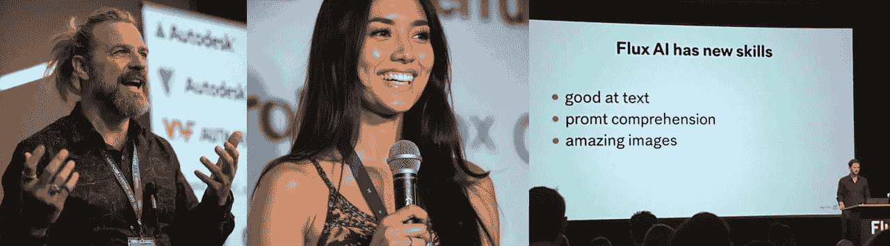
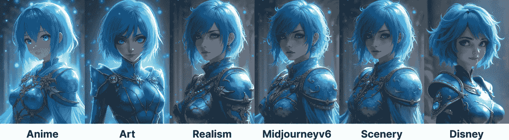
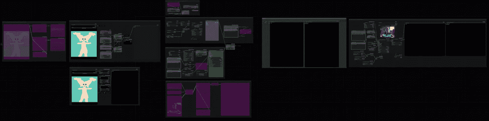
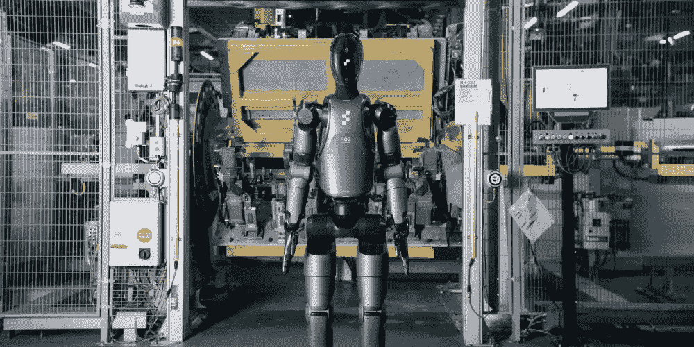
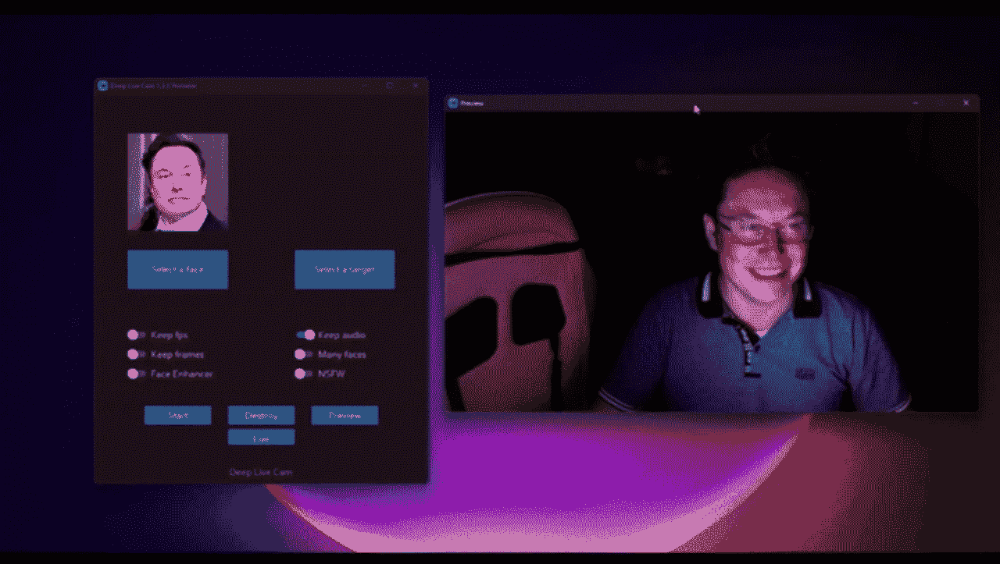
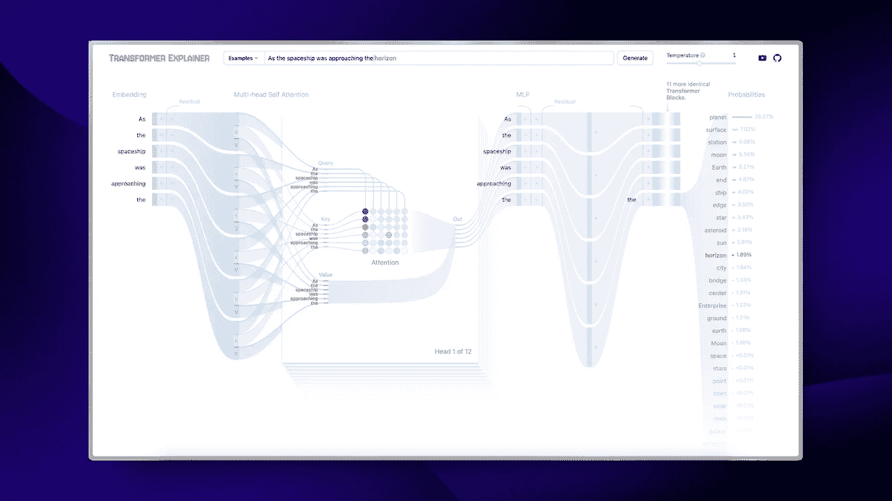
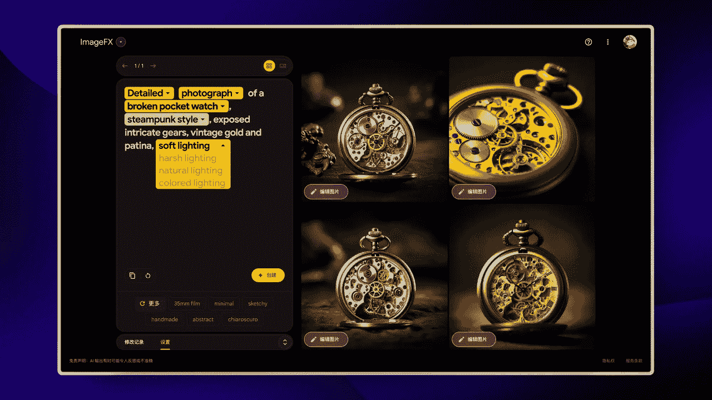
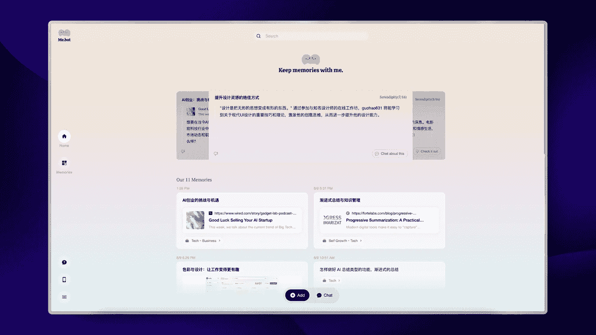
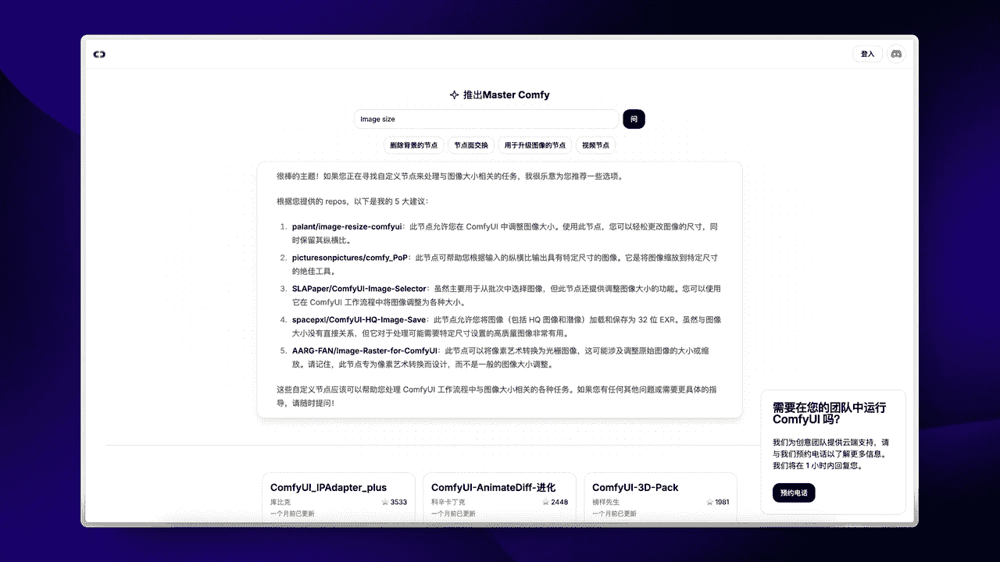

# AIGC Weekly #84

> 来源：[https://waytoagi.feishu.cn/docx/UBBndkxEFohCR2xe3fkcbhYmnee](https://waytoagi.feishu.cn/docx/UBBndkxEFohCR2xe3fkcbhYmnee)

> 🔗 原文链接： h[ttps://quail.ink/o](https://quail.ink/op7418/p/aigc-weekly-84)p7418/p/aigc-wee...

> ⏰ 剪存时间：2024-08-1 2

> 作者：歸藏

# 上周精选 ✦

## FLUX 的周边生态发展迅速

前段时间由于 SD3 的问题，开源的图片生态发展一度停滞，值得关注的新项目和模型几乎没有。

FLUX 上周发布后这个态势被快速改变了，由于其优秀的图片质量，高昂的训练成本并没有阻止开源社区。

[而且由于在其偏向](https://x.com/javilop/status/1821814987737735344)真实的美学调教风格，也使生成的 发布会写实图片 在推上的热度爆发使得 FLUX 模型快速出圈。再加上 Runway 把那张 AI 生成的照片变成视频 让更多人对现在图像和视频模型的发展进度有了更多的了解。

目前 Xlabs 已经发布了基于 FLUX 的 Con[trolne](https://github.com/XLabs-AI/x-flux)t 模型和 Lora 模型 的训练脚本 。

他们还顺便发布了一个 FLUX 的 Canny Controlnet 模型，[另外这里还有 In](https://huggingface.co/InstantX/FLUX.1-dev-Controlnet-Canny-alpha)stant ID 作者的新组织 InstantX 训练的一个 Canny 模型 也可以试试。

Xlabs 也跟 Lora 训练脚本一起发布了他们的多个 Lo[ra，其中这个火](https://huggingface.co/XLabs-AI/flux-RealismLora)遍推特的图片就是用那个 写实 Lora 做的。

具体的 Lora 包括 mjv6_lora、动漫 Lora、写实 Lora、迪士尼Lora、风景_lora、艺术 Lora

Xlabs Lora 下载：https://huggingface.co/XLabs-AI/flux-RealismLora

[另外社区也开始利](https://civitai.com/models/633553?modelVersionId=710421)用这些训练脚本训练 Lora 了，比如这个 动漫 Lora 。

SD 模型训练工具 [simpletuner ](https://github.com/bghira/SimpleTuner/blob/main/documentation/DEEPSPEED.md)支持了 FLUX Lora 的训练，如果你想要训练 FLUX Lora 模型的话可以用这个。

一个全面的 FLUX [的 Comfyui 工作流 ](https://github.com/Ling-APE/ComfyUI-All-in-One-FluxDev-Workflow)，支持 FLUX Lora、ControlNet 的加载，支持文生图、图生图。

## Figure 发布 Figure 02 人形机器人

Figure 上周发布了 Figure 02 人形机器人，他们说这是世界上最先进的 AI 硬件。2023 年 2 月他们就完成了 Figure 02 的概念设计，用了 18 个月才将这个机器人变成实体。

**语音到语音 **:能够通过内置麦克风和扬声器连接自定义 AI 模型与人类对话。

**摄像头 **:AI 驱动的视觉系统由 6 个内置 RGB 摄像头组成。

**手部 **:第四代手具有 16 个自由度并具有人类等同的力量。

**内置大语言模型 (VLM) **:使机器人摄像头能够快速进行常识性视觉推理。

**电池 **:机器人躯干内的 2.25 千瓦时定制电池组提供超过 50% 的能量。

**CPU/GPU **:提供比上一代多 3 倍的计算和 AI 推理能力。

## Deep Live Cam：单图实现实时直播换脸

前几天引起人们对 AI 写实能力警惕的另一个项目，只需要一张图片就可以实现实时的直播换脸。

从演示来看角度大的话还是会穿帮，另外换脸的清晰度和原来视频的清晰度差别比较大，不过这玩意 确实很危险，简单的可以用来顶替面试，严重点用来诈骗。

这里有演示视频：https://x.com/MatthewBerman/status/1821949143918489794

使用方式的话先选择一个脸部，然后点击直播，等待十几秒钟，直播会跟真实的视频有十几秒到 30 秒的延迟，取决于硬件水平。

# 其他动态 ✦

+   [阿里发布通义发布支持语音](https://qwenlm.github.io/blog/qwen2-audio/)输入的模型 Qwen2-Audio ，该模型能够分析音频信息，包括语音、声音、音乐等，并配有文本说明。

+   阿里推出 Qwen2-Math 系列的LLM ，专注于提高解决数学问题的能力。模型包括Qwen2-Math-Instruct-1.5B/7B/72B，其中 72B 在数学测试中超过了 GPT-4o 和 Claude 3.5。

+   谷歌的 Gemini 1.5 Flash 也降价了 。输入成本下降了 78%，输出成本下降了 71%。1.5 Flash 现在所有人都可以微调。

+   Mistral 发布了 La Plateforme 。支持用自己的数据对已有的 Mistral模型进行微调。另外还有 Agents 平台，支持对模型进行详细调整构建 Agents。

+   Comfyui 上周主要更新内容 有提供 Hunyuan DiT 和 FLUX 的支持，第四个稳定版本发布，新的 TypeScript 前端将推出，引入更强大的核心执行引擎，允许实现 for 循环等高级功能。

+   GPT-4o 0806 模型推出 ，输入Token便宜 50%，输出Token便宜 33%。还支持了结构化输出，另外支持 16K 的输出长度。

+   Groq 宣布获得 6.4 亿美元的 D 轮融资 ,目前估值为 28 亿美元。此轮融资由 BlackRock Private Equity Partners 管理的基金和账户领投。

+   Cursor AI 宣布获从 a16z、Thrive 等公司获得了 6,000 万美元的 A 轮融资 ，估值达到 4 亿美元。

+   John Schulman是 OpenA[I 的联合创始人之](https://x.com/gdb/status/1820644694264791459)一，他已经离开该公司 加入了竞争对**手 AI 初创公司 A**nthropic 。Greg Brockman 也在推上 宣布自己开始休假 。据 The Information 报道，ChatGPT 的产品负责人 Peter Deng 也即将离职。

# 产品推荐 ✦

## [TRANSFORMER EXPLAINER](https://poloclub.github.io/transformer-explainer/)：通过交互动画学习Transformer

Transformer Explainer 一个交互式可视化工具。可以帮助普通人用 GPT-2 为例子了解 Transformer。

它可以在浏览器里面实时运行 GPT-2，用户能够尝试自己的输入并实时观察 Transformer 的内部组件和参数如何预测下一个Token。

谷歌的图片**生成模型 Imagen** 3 开放给所有人使用了。用Catjourney的提示词试了一下，怎么说呢，谷歌一贯水准过于正确，图片美观度很差。支持局部重绘通过提示词对图片进行编辑。

只要涉及人物，你就得仔细斟酌提示词写法，不然大概率无法出图。

不过他们 关于提示词的交互很好 。LLM会分析提示词类型，并且给出相关词语你可以直接切换。而且在图片生成的各个状态的表现形式都很清晰。

## [Mebot：AI 内容收集工具](https://app.me.bot/)

感觉像是加了 AI 的 MyMind 和 Dot 的合体。支持收集文章、视频、音频或者图片各种媒体的内容，AI 会自动总结和分类，同时还会发散一些问题给你。

右侧有类似 Dot 的 Chat 机器人可以聊天，同时搜索的时候也不止搜索你自己的内容。

## Wordware：AI Agents 构建平台

上个星期大火的 AI 毒舌推特点评工具就是基于这个平台构建的，这类平台的重点是把数据、AI 工具以及支付方式都集成了，可以发挥用户的主观能动性，只要用户不断产出爆款玩法就可以不断引流提高收入。

## Master Comfy：ComfyUI 自定义节点查询

Master Comfy 这玩意牛皮。可以通过 AI 查找你需要的 ComfyUI 节点。

输入你的诉求，LLM 就可以给出可以实现这个功能的节点。

目前已经支持了 1200 个自定义节点包，作者用了Groq 构建的，速度也很快。

# 精选文章 ✦

## Andrej Karpathy 关于 RLHF 的科普

在大型语言模型（LLM）训练的三个主要阶段中，强化学习人类反馈（RLHF）是最后一个阶段，紧接着预训练和监督微调（SFT）之后。Karpathy 对 RLHF 的批评在于，尽管它被认为是 RL 的一种形式，但实际上它远远没有 RL 那么强大。

1.  RLHF 与传统的 RL 相比，缺乏强大的特性。

1.  RLHF 的奖励模型是对人类喜好的一种模仿，而不是真正的问题解决目标。

1.  RLHF 存在两个根本问题：一是奖励模型可能会误导优化；二是模型很容易学会游戏化奖励模型，找到对抗性例子。

1.  尽管 RLHF 有其局限性，但它在构建 LLM 助手方面仍然是有益的，因为它利用了人类标注者在选择最佳答案时的优势。

1.  RLHF 有助于减少 LLM 的幻觉现象，因为它可以通过奖励模型对 LLM 进行监督，教会它避免错误的事实知识。

1.  目前尚未在开放领域的问题解决任务中有效地实现生产级别的实际 RL。

## [**什么是 AI 时代的好设计？**](https://www.figma.com/blog/what-is-good-design-in-the-age-of-ai/)

**Figma 最**近搞了一个期刊叫 Prompt 专门探讨 AI 对体验和产品设计的影响以及如何将两者更好的跟 AI 融合。

第一篇内容就是邀请他们自己的产品设计师探讨一下这个问题：

**随着人工智能技术的发展，设计将成为产品开发中的关键差异化因素，而优秀的**设计在 AI 时代意味着什么，以及如何引导团队在技术快速变化的背景下实现这一点 。

从建立算法基础到构想全新的协作创作模式,深入探讨如何打造 AI 驱动的产品——这些产品不仅能自动化设计流程,更能提升设计质量。

## DeepMind 专家：我如何使用 AI

DeepMind 的专家写了一篇 8 万字的文章介绍自己如何使用 AI。

在过去一年中，作者每周至少花费几个小时与 LLMs 交流，并对其能够解决的日益复杂任务印象深刻。作者列举了多种使用 LLMs 的例子，包括构建完整的应用程序、学习使用各种框架、优化代码以提高性能、简化大型代码库、编写研究论文的初步实验代码、自动化单调的任务和一次性脚本、作为 API 参考和搜索引擎使用，以及解决已经解决的问题以及修复错误。

## [吴恩达：适合初学者的 ](https://x.com/AndrewYNg/status/1821206887913943110)[**AI Python 课程**](https://x.com/AndrewYNg/status/1821206887913943110)

吴恩达新课教你用 AI 学习专注于 AI 领域的 Python 编程课程，搞 AI 还是需要学一下 Python 的。

AI Python 初学者课程是一 系列四门短期课程，可教任何人编程，无论当前的技 术水平如何。

生成式人工智能正在改变编码。本课程以与该领域未来发展方向一致的方式教授编码，而不是以过去的方式：

(1) 人工智能作为编码伴侣。经验丰富的程序员正在使用人工智能来帮助编写代码片段、调试代码等。我们采用这种方法并描述使用聊天机器人进行编码的最佳实践。在整个课程中，您将可以访问人工智能聊天机器人，它将成为您自己的编码伴侣，可以在您编码的每一步为您提供帮助。

(2) 通过构建 AI 应用程序进行学习。您将编写与大型语言模型交互的代码，以快速创建有趣的应用程序来定制诗歌、编写食谱和管理待办事项列表。这种实践方法可以帮助您了解如何编写调用强大 AI 模型的代码，这将使您在工 作和个人项目中更有效率。

## [如何构建生成式人工智能平台](https://huyenchip.com/2024/07/25/genai-platform.html)

本文详细阐述了构建生成式 AI 平台的各个方面。首先，作者指出生成式 AI 应用程序在部署时存在许多相似之处，并概述了平台的常见组件，包括模型 API、上下文增强、安全措施、模型路由和网关、缓存策略、复杂逻辑和操作编写，以及观测性和 AI 流程编排。

# 重点研究 ✦

## [ml_mdm - Matryos](https://github.com/apple/ml-mdm)hka Diffusion Models

苹果开源了一个新的图像生成模型和训练方法。

这个模型仅使用包含 1200 万张图像的 CC12M 数据集，就展现出了强大的零样本泛化能力。

提出了一种新的扩散过程，它能同时对多个分辨率的输入进行去噪处理，并使用了一种嵌套 UNet (Nested UNet) 架构。

在这种架构中，小尺度输入的特征和参数被嵌套在大尺度的特征和参数中。

## MindSearch:模仿人类思维的AI搜索助手

MindSearch是一种新型的AI搜索系统,通过模仿人类思维方式来解决复杂的网络信息检索和整合问题。它主要包含以下特点:

1.  多智能体框架:由WebPlanner和WebSearcher两种智能体组成。WebPlanner负责整体规划,WebSearcher负责具体搜索。

1.  图形化推理:将复杂问题分解为一个有向无环图,逐步构建解决方案。

1.  代码驱动规划:WebPlanner通过生成Python代码来操作图形结构,充分利用大语言模型的编程能力。

1.  层次化检索:WebSearcher采用从粗到细的检索策略,有效处理海量网页内容。

1.  上下文管理:通过多智能体设计,有效管理长文本上下文,提高处理效率。

实验表明,MindSearch在封闭式和开放式问答任务上都取得了显著的性能提升,相比ChatGPT和Perplexity.ai等现有系统,能够提供更深入、广泛和准确的回答。

## [IP Adapter Instruct: 使用Ins](https://unity-research.github.io/IP-Adapter-Instruct.github.io/)truct提示解决基于图像生成条件的歧义

扩散模型在图像生成方面表现出色，但通过文本提示控制生成过程存在局限性。文本提示难以准确描述图像风格或细粒度结构（如面部特征）。

IPAdapter-Instruct模型通过在指令提示中指定用户意图，实现了高效的多任务训练，同时保持了单任务模型的性能。

该模型将多个适配器压缩成一个提示和图像组合，同时保持与基础扩散模型的兼容性。主要限制在于训练数据集的创建耗时且受限于源数据的可用性。未来的工作希望结合像素级精确指导和语义指导，使用指令提示来传达用户意图。

## GMAI-MMBench：面向通用医疗人工智能的综合多模态评估基准

GMAI-MMBench，一个全面的多模态评估基准，旨在测试大型视觉-语言模型（LVLMs）在真实世界临床场景中的能力。

由 285 个数据集构成，涵盖 39 种医学图像模态、18 个临床相关任务、18 个部门和 4 种感知细粒度，以视觉问答（VQA）格式构建。 此外，实现了一个词汇树结构，允许用户定制评估任务，满足各种评估需求，并大力支持医疗人工智能研究和应用。

## [Lumina-mGPT： ](https://arxiv.org/abs/2408.02657)[**多模态自回归模型**](https://arxiv.org/abs/2408.02657)

Lumina-mGPT，这是一系列多模态自回归模型，能够完成各种视觉和语言任务，特别擅长从文本描述中生成灵活逼真的图像。

与现有的自回归图像生成方法不同，Lumina-mGPT 采用了一个预训练的仅解码器变压器作为建模多模态令牌序列的统一框架。一个简单的仅解码器变压器与多模态生成预训练（mGPT）结合，利用大规模交错文本-图像序列上的下一个Token预测目标，可以学习广泛和通用的多模态能力，从而实现逼真的文本到图像生成。

在这些预训练模型的基础上，提出了灵活渐进式监督微调（FP-SFT），在高质量的图像-文本对上完全释放它们在任何分辨率下进行高美学图像合成的潜力，同时保持它们的通用多模态能力。