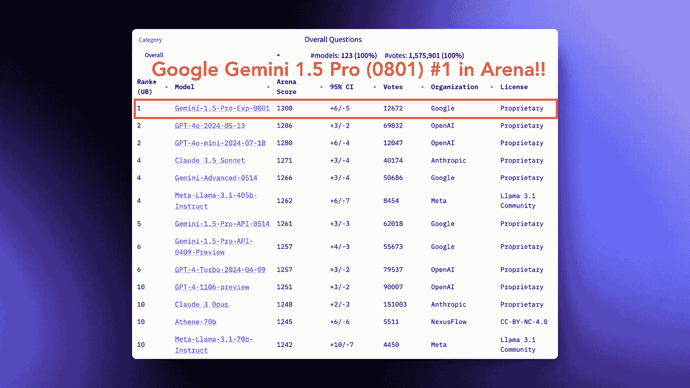
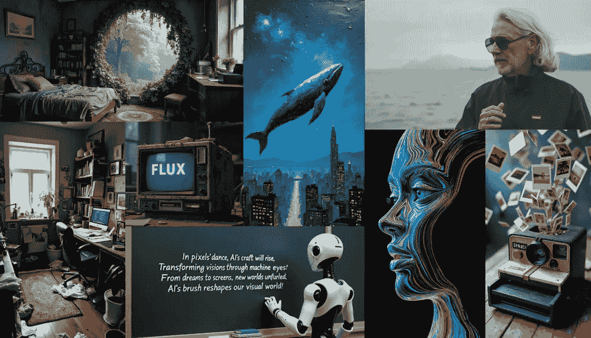
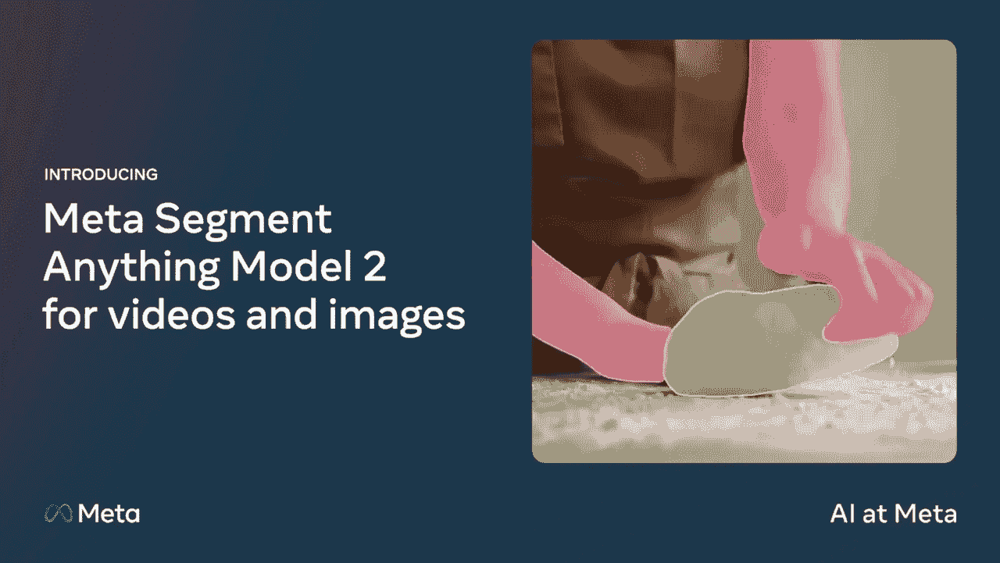
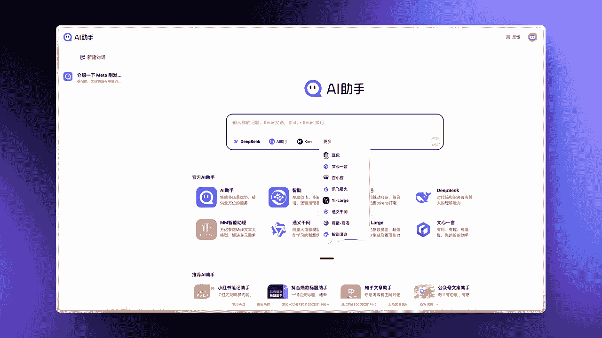
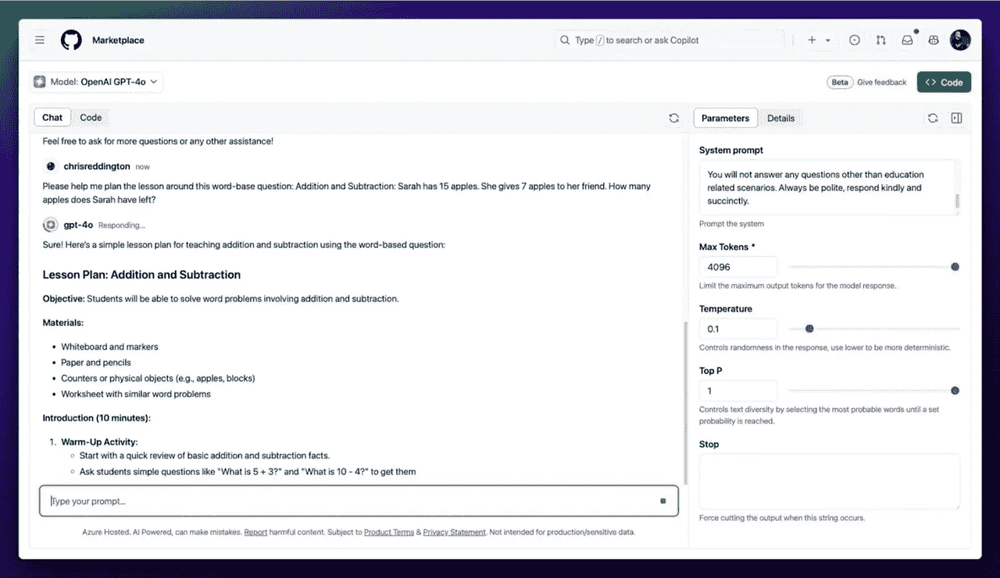
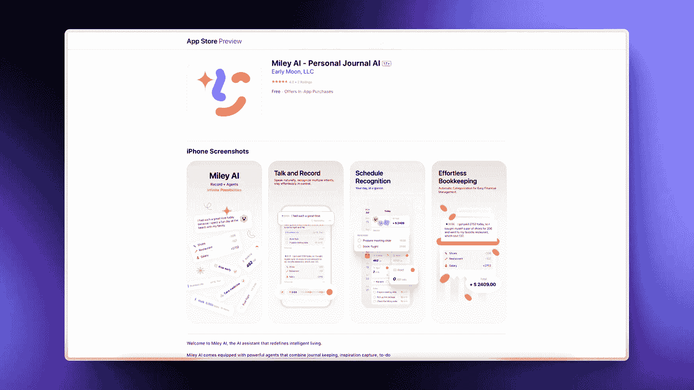
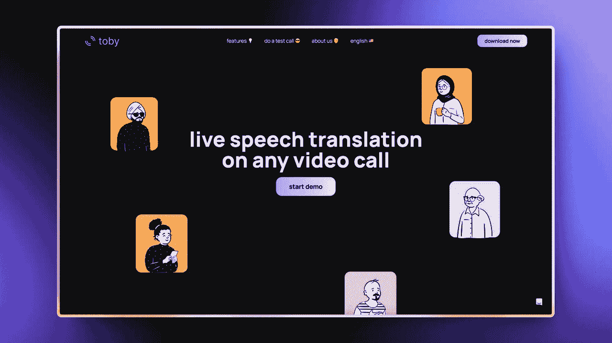
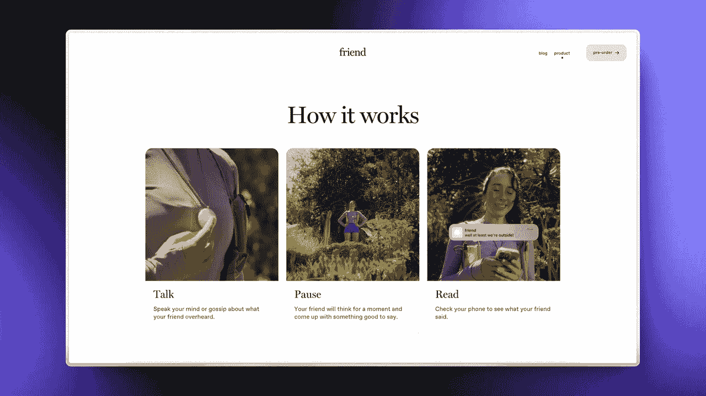
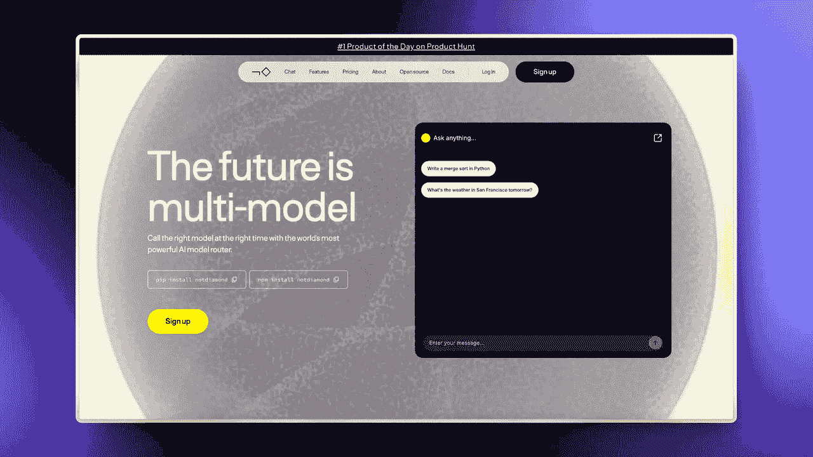

# AIGC Weekly #83

> 来源：[https://waytoagi.feishu.cn/docx/SJn1dVR65oBYLAxyurtcnKXpn6g](https://waytoagi.feishu.cn/docx/SJn1dVR65oBYLAxyurtcnKXpn6g)

> 🔗 原文链接： h[ttps://quail.ink/o](https://quail.ink/op7418/p/aigc-weekly-83)p7418/p/aigc-wee...

> ⏰ 发表时间：2024-08-04

> 作者：歸藏

# 上周精选 ✦

## [Google 发布 Gemma 2](https://developers.googleblog.com/en/smaller-safer-more-transparent-advancing-responsible-ai-with-gemma/?_bhlid=5811c5dce25719cc96adfd54bc6818d0aa07cc11) 2B 和 Gemini 1.5 Pro

Google 上周也开始发力了，先后发布了 Gemini 1.5 Pro 和 Gemma 2 2B 模型。

其中 Gemini 1.5 Pro 0801 在 LLM 竞技场的综合排名超过了 GPT-4o mini 变成了第一位。谷歌说这是一个实验版本还不算正式版本，所以只 在 AI Studio 中提供 。

但是从测试来看 Gemini 1.5 Pro 0801 的多模态能力非常强大，基本超过了 GPT-4o 和 Claude 3.5，而且它支持音频以及视频，我用一个一个多小时的播客文件试了一下，十几秒就总结好了。

另外 Google 还发布了 Gemma 2 2B 这个可以在设备端运行的模型，这个模型在 LLM 竞技场上的得分也超过了一众比它大很多的 LLM。

这是量化过的 Gemma 2 2B 再加上 MLX 之后 在 iPhone 15pro 上的运行效果 。

而且这个模型还内置了谷歌新发布的安全分类器 ShieldGemma，这个分类器可以有效检测仇恨言论、骚扰、性暗示内容以及危险内容。

## [FLUX 开源图像的新标杆](https://blackforestlabs.ai/announcing-black-forest-labs/)

开源图像领域在 SD3 模型出现问题之后就有一蹶不振的趋势，新玩意和玩法越来越少，大家急需一个足够强大的图像模型来保证社区发展。

刚好这个模型就来了，前 Stability AI 核心成员 Robin Rombach 创立了一个新的公司并且获得了 3200 万美元的融资。同时他们直接发布了一个系列的图像生成模型，其中两个还是开源的。

从我自己的测试和这几天各种测试来看，这个模型在各种意义上真的接近了 Midjourney 的质量。

他们发布的 FLUX 系列模型包括：

+   FLUX.1 [pro]: FLUX.1 的最佳版，提供最先进的性能图像生成，拥有一流的提示跟随、视觉品质、图像细节和输出多样性。

+   FLUX.1 [dev]：FLUX.1 [dev]是用于非商业应用的一个开放权重的导向精馏模型。直接从 FLUX.1 [pro]精馏而来，FLUX.1 [dev]获得了类似的质量和提示词依从能力，同时比相同尺寸的标准模型更高效。可以非商业使用。

+   FLUX.1 [schnell]：最快型号专为本地开发和个人使用而设计。FLUX.1 [schnell]在 Apache 2.0 许可下公开可用。同时已经获得了 ComfyUI 的支持，可以直接使用。

而且他们正在训练类似 Sora 的 DiT 视频生成模型，可能也会开源，官网上放的视频可能是他们视频生成模型的样片。

不过他们的负责人好像表示由于 Dev 和 Schnell 都是从 Pro 模型蒸馏来的所有两个模型的微调效果都不会很好，希望有大神可以解决这个问题。

另外使用 Fp8 版本的 Dev 模型可以稳定在 4090 上本地运行，也有可以在 16G 或者 12G 显存上运行的方法，就是有点麻烦。

你可以在这里快速体验 FLUX 系列模型：https://replicate.com/collections/flux

这里下载模型：https://huggingface.co/black-forest-labs

这里是 ComfyUI 的工作流：https://comfyanonymous.github.io/ComfyUI_examples/flux/

## Meta 发布 SAM 2 分割模型

上周 Meta 在图像领域也继续发力，发布了 Meta Segment Anything Model 2 （SAM 2）图像分割模型。

用于实时、可提示的图像和视频对象分割，实现了视频分割体验的飞跃，实现了图像和视频应用之间的无缝使用。SAM 2 在图像分割准确性方面超越了以前的能力，并且与现有作品相比，实现了更好的视频分割性能，同时需要三分之一的交互时间。

SAM 2 还可以分割任何视频或图像中的任何对象（通常描述为 0-shot 泛化），这意味着它可以应用于以前未见过的视觉内容，无需自定义适应。

同时发布的还有一个 SA-V：最大的视频分割数据集，SA-V 数据集包含的注释数量多出一个数量级，视频对象分割数据集中的视频数量大约是现有数据集的 4.5 倍。

SA-V 的主要特点有：大约 51000 个视频上有超过 600,000 个遮罩注释。展示地理多样性、真实场景的视频，搜集自 47 个国家。覆盖整个对象、对象部分以及具有挑战性的情况的注释，例如对象被遮挡、消失和重新出现。

[这个演示 ](https://x.com/op7418/status/1818580570114605128)就很离谱，SAM2 可以从一个非常模糊，画面非常负责的航拍视频中稳定跟踪和分割指定人物。

这里下载模型：https://github.com/facebookresearch/segment-anything-2

这里体验 SAM2：https://sam2.metademolab.com/

# 其他动态 ✦

+   Meta 发布了一个 [Playground ](https://sam2.metademolab.com/demo)用来测试他们的 AI 功能，目前支持四个工具 Segment Anything 2，Illustration Animation，Audiobox 和一个语音翻译工具。

+   [Stability AI 推出](https://stability.ai/news/introducing-stable-fast-3d)了 Stable Fast 3D ，这是一种新的 3D 生成模型，可在短短 0.5 秒内将单个图像转换为详细的 3D 资产。

+   [Figure 即将在](https://x.com/Figure_robot/status/1819388819638309286) 0806 发布他们的新机器人 ，预告的预告拍的很好，机器人很精致完全不像工程机。

+   Hedra 宣布了 1000 万美元的融资 ，用于打造下一代故事讲述技术，为内容创作者赋能。

+   Runway 发布了 Gen3 的 Turbo 版本 ，推理成本和生成速度大幅下降。生成速度比原始模型快了 7 倍，未来也会免费提供给用户，费用也大幅降低。同时发布了图生视频功能也已经上线。

+   [著名的 AI 绘画产品](https://leonardo.ai/news/supercharging-leonardo-with-canva/) Leonardo 宣布自己 被 Canva 收购 ，未来原始的站点依然会更新和运营。

+   著名的 AI 陪伴型应用 Character AI 被谷歌收购 ，核心研发团队加入谷歌，公司谷歌注资继续独立运营。

+   Midjourney [V6.1 版本更新 ](https://x.com/midjourney/status/1818342703618482265)。最大的变化是更丰富的画面细节和清晰度，即使远处的人脸也不容易崩了。新增--q 2 模式，生成图片会有更多纹理。

+   Open AI 推 出了 GPT-4o 长输出版本 ，最多可以输出 64K Token。这个模型每百万 Token 18 美元。

+   [又一个 DiT 视频生成模型，](https://www.vidu.studio/create) 生数科技的 Vidu 上线了 ，目前来看处于第二梯队。

+   苹果的 AI 功能终于上了，iOS Beta 18.1 更新之后的 15pro 和 Max 可以启用，国行手机无法绕过限制启用。

+   快手的开源表情视频生成工具 [LivePortrait ](https://poe.com/LivePortrait)，现在支持将人类表情迁移到动物面部上去。

+   Cohere 推出 Prompt Tuner 提示词优化工具 ，使用可定制的优化和评估循环来改进生成语言用例的提示。

# 产品推荐 ✦

## AI 助手：汇总国内所有大语言模型的 AI 工具

前几天受 360 邀请参加了一下他们主办的 ISC.AI 峰会，在分会场跟橘子、卡兹克、坤导、林亦的小白一起聊了一下 AI 产品。

其实大家虽然都跟 AI 相关，细分领域还是不太一样的，比如橘子比较关注效率工具、坤导本身是视频创作者，所以还是可以碰撞出一些火花的。

但是大家有个共识就是 AI 的渗透还是不不太够，需要更多的高阶创作者以及不断降低 AI 产品的使用门槛。

当天 360 也发布了一个集合了全国 15 家模型厂商所有 LLM 模型的 AI 助手，在对所有模型进行详细测试明确了模型能力之后在利用 360 自研的搜索意图判断能力和 AI 模型路由，在用户问问题的时候用对应领域最好的模型回答。这个综合模型的效果甚至全面超过了 GPT-4o。

当天早上我也在朋友圈转发了一下这个产品，令我惊讶的是对这个产品感兴趣的不是业内的朋友，而是之前对 AI 了解不都只有个大概认知的很多普通朋友，甚至跑来找我要地址。

我这才意识到普通用户对于一个足够好的和能力全面的模型有多大的需求，现有的各个产品由于国内模型的问题，还没有一个能力足够全面的工具，但是需求是存在的，也不是都可以像我们这样可以正常使用现在最好的模型。

回到用户需求上，为用户解决问题，先想这些再去想模型，要使用自己的模型，但是不止要使用自己的模型。

## GitHub Models：模型测试工具

GitHub 发布了 GitHub Models，使开发者能够利用包括 Llama 3.1、GPT-4o、Phi 3 和 Mistral Large 2 等在内的顶尖 AI 模型。这些模型可以在 GitHub 的交互式模型游乐场中免费测试，开发者可以在那里实验、比较、测试和部署 AI 应用程序。GitHub Models 还提供了无缝的过渡，允许开发者在 Codespaces 和 VS Code 中将模型引入到他们的开发环境中。目前需要加入等待列表才能使用。

## Miley AI：移动端 AI 记录软件

狈狈新 app，又一个语音笔记软件。

支持更多的内容分析，会将你录入的内容自动变成 todo、习惯打卡、运动记录、记账等。

这类应用确实降低了记录成本，原来因为麻烦不愿意记录的，也可以低成本记录内容了。

## [Toby：实时视频翻译](https://www.trytoby.com/)

Toby 是一个创新的桌面应用程序，它能够在视频通话中实时翻译语音，Toby 提供的功能包括双向实时翻译、讲义和听写稿以确保信息准确传递，以及个性化的词汇表。

## [Friend：AI 语音项链](https://www.friend.com/index.html)

Friend 是一款即将推出的交流设备，用户可以通过预订的方式获得。宣传片 24 小时内获得了 1200 万的播放。

该产品的工作原理包括与设备对话、暂停让设备思考以及阅读设备的回应。Friend 设备具有 “一直在听” 的特性，当通过蓝牙连接时，它会持续倾听并形成自己的思考，但它的回应是自愿的。使用 Friend 设备需要手机配合，目前仅支持 iOS 设备，并且需要互联网连接。

## [Not Diamond：将每个请求路由](https://www.notdiamond.ai/)到最佳的 LLM，以优化成本、延迟和性能

Not Diamond 人工智能模型路由器，它在主要基准测试中超越了所有现有的基础模型，同时显著降低了成本和延迟。该路由器可以直接使用，也支持用户使用自己的评估数据训练定制路由器，以适应特定用例。Not Diamond 支持快速选择最合适的模型，并能够在流传一个 Token 的时间内完成选择。此外，它还支持联合提示优化，消除了手动调整和实验的需要。

# 精选文章 ✦

## 生成式人工智能对在线知识社区的影响

探讨了大型语言模型（LLMs）如 ChatGPT 对在线知识社区的影响，特别是在 Stack Overflow 和 Reddit 开发者社区的用户参与度和内容创作方面。

+   通过对 Stack Overflow 和 Reddit 开发者社区的分析，研究发现 ChatGPT 的推出导致 Stack Overflow 的网站访问量和问题提交量显著减少，尤其是在 ChatGPT 领域能力强的话题中。而 Reddit 的开发者社区却没有显示出类似的下降，这可能是因为 Reddit 社区的社会结构更为紧密，能够缓冲 LLMs 的负面影响。

+   研究表明，在 ChatGPT 发布后，Stack Overflow 上的用户活动中，新用户更有可能退出社区，而且提出的问题变得更加复杂和高级。这表明初学者可能更依赖于 ChatGPT 而不是人类同行，同时社交较少的用户更容易受到 LLMs 的影响。

+   研究强调，社区结构和用户间的社交联系对于维持社区活力和吸引力至关重要。管理者应该鼓励社交化活动，作为补充纯粹的信息交换，以对抗 LLMs 可能带来的社区退化。

## Llama 3.1 论文精读 · 1. 导言【论文精读·54】

断更许久的 AI 大神李沐的 B 站账号终于恢复了更新，讲的是 Llama 3.1 的论文的第一部分导言部分。

+   Meta 发布了 Llama 3.1 系列新模型，最大参数规模达 405B，支持多语言和工具使用。这一系列模型采用 128K 的上下文长度和稠密架构，进一步巩固了 Llama 在开源模型领域的领先地位。Llama 团队规模已扩大至数百人，他们强调简化模型设计，使用 15T 多语言数据进行训练，在数据量和质量间寻求平衡。

+   Llama 模型采用预训练和后训练两个阶段。预训练阶段简单预测下一个词，而后训练阶段则按照指示执行任务或提升能力。Llama 团队采用简单直接的后训练过程，强调使用朴实的算法来维持低复杂度。在评估中，团队探讨了不同规模模型的表现、考试解法、模型记忆能力以及各种答题方式对模型调教的影响。

+   Mistral 公司发布了 120B 参数的 Large Enough 模型，声称其性能优于 Llama 3。这引发了 Mistral 与 Meta（Llama 团队）之间的争议。Mistral 强调其模型的性价比和优越性，而 Meta 对此表示不满，甚至更新了相关协议。两家公司之间的竞争和纷争引发了业内广泛关注，也为未来 AI 模型发展带来了更多期待。

## [LLM 幻觉指数特别报告](https://www.rungalileo.io/hallucinationindex)

**LLM Hallucination **Index - RAG Special 主要介绍了一个评估大型语言模型（LLM）幻觉现象的指数，涵盖了 22 款领先的模型，并通过不同长度的上下文测试，评估了它们的表现，特别关注了基于检索增强生成（RAG）的任务。

评估过程包括三种不同长度的上下文测试：短上下文（少于 5k tokens）、中上下文（5k 到 25k tokens）和长上下文（40k 到 100k tokens）。通过这些测试，网页提供了模型在不同上下文长度下的表现数据，并总结了一些趋势，例如开源模型在性能上逐渐接近闭源模型，以及模型在长上下文测试中的表现可能不逊于短上下文测试。

## [量化的视觉指南](https://newsletter.maartengrootendorst.com/p/a-visual-guide-to-quantization)

详细探讨了量化技术在大型语言模型（LLMs）中的应用。作者首先指出了 LLMs 参数众多且需要大量内存的问题，然后介绍了量化的目的是在不失太多精度的情况下减少参数的位宽，例如从 32 位浮点数减少到 8 位整数。文章分为四个部分：第一部分讨论了 LLMs 的问题以及如何表示数值；第二部分介绍了量化的基础知识，包括对称和非对称量化，以及范围映射和裁剪；第三部分探讨了后训练量化（PTQ），包括动态和静态量化，以及 4 位量化的方法如 GPTQ 和 GGUF；第四部分则介绍了量化感知训练（QAT），以及如何使用 BitNet 将模型权重量化到 1 位，并提到了 1.58 位量化的优势和方法。

## a16z：为什么人工智能将改变下一代销售技术

主要讨论了人工智能（AI）如何彻底改变未来的销售技术，强调 AI 将重塑销售流程和工作流程，并可能导致现有的销售软件栈发生根本性变化。

每个初创企业与现有企业之间的竞争，实际上是看谁能在对方创新之前获得分销权。在销售技术领域，人们容易认为像 Salesforce 和 Hubspot 这样的现有企业拥有优势。然而，由于 AI 的到来，这些公司的核心系统记录和销售工作流程可能会被根本性地重塑。AI 不仅能够从文本、图像、语音和视频等多种模式中提取客户洞察，还能够自动化销售流程，如潜在客户的研究和电话准备等。文章进一步探讨了 AI 如何改变销售活动，以及新兴的 AI 本地销售解决方案如何不仅仅是现有类别的 AI 增强版本，而是能够实现新的主动销售动作，并服务于多种用例。

## 一个 AI 能制作基于数据的视觉故事吗？

The Pudding 的团队对 AI 的能力进行了探索性的测试，通过与 AI（特别是 Anthropic 的 AI 产品 Claude）的互动，尝试创建一个数据驱动的故事。他们将整个过程分为四个阶段：创意生成、数据收集与分析、故事板与原型制作以及开发与写作。在每个阶段，他们都对 AI 的表现进行了评估和打分。

整体而言，AI 在辅助完成特定任务方面表现出一定的能力，但在处理复杂的编程问题和创造性的内容创作方面存在明显的不足。The Pudding 的团队认为，尽管 AI 可以作为一个有用的工具，但它目前还不能完全取代人类在数据驱动故事创作方面的工作。

## 你应该如何实现 AI 功能的货币化？

作者 Palle Broe，曾在 Uber 和 Templafy 担任过定价策略职务，并为多家科技公司提供了货币化策略咨询。他在这篇文章中分析了 44 家科技公司如何对 AI 产品和特性进行定价，并基于这些数据和自身经验，提出了一个框架，帮助其他公司决定如何定价自己的 AI 产品和特性。

文章深入探讨了直接货币化的三种核心策略：增值服务、独立产品和捆绑在计划中但价格增加。文章还提供了一个决策图表，帮助公司根据 AI 特性的普及度和用户对其价值的认可程度来决定定价策略。

# 重点研究 ✦

## Fotographer ai Fuzer v0.1：超越图像生成控制

Fotographer 出了一个很牛的商品图拍摄项目。效果比只用 IC light 的工作流好非常多，而且玻璃之类的东西跟环境融合也很好。商标和文字也可以完全保留。

需要上传已经抠图的产品图片，输入背景提示词和前景对产品的提示词描述。

## [Apple Intelligence Founda](https://arxiv.org/pdf/2407.21075)tion Language Models

苹果发布了一篇 47 页的论文。详细介绍了他们 AI 系统的全部架构。相当的坦诚了。

Apple 为其智能功能开发的两个基础语言模型 - AFM-on-device（约 30 亿参数）和 AFM-server（更大的服务器模型）。详细描述了模型架构、训练数据、训练过程、推理优化和评估结果。

这对于了解下一代设备端机器学习技术的发展方向非常有帮助。期待后续会有更多相关信息发布。

这里有 [VB 的详细总结和翻译 ](https://x.com/op7418/status/1818220057354465281)。

## HoloDreamer：从文本描述生成全景 3D 世界

HoloDreamer 这个项目可以生成封闭的 3D 场景。

从演示来看质量高的离谱，感觉可以成为 AI 视频里面场景一致性的解决方案。

先生成高清全景图作为整个 3D 场景的整体初始化，然后用 3D 高斯散射 技术快速重建 3D 场景。

从而实现视角一致且完全封闭的 3D 场景创建。

## HumanVid: 为相机可控的人体图像动画揭秘

1CUHK 和上海 AI lab 的论文，HumanVid 可以从角色照片生成视频，同时允许用户控制人物和摄像机动作。从演示来看效果好的有点离谱，希望可以尽快放出代码和模型。

提出了 HumanVid，这是为人类图像动画量身定制的第一个大规模高质量数据集，结合了精心设计的真实世界数据和合成数据。对于真实世界数据，我们从互联网编制了大量免版税的真实世界视频。通过一个精心设计的基于规则的过滤策略，我们确保包括高质量视频，结果是拥有 1080P 分辨率的 20000 个人为中心视频收集。我们使用 2D 姿势估计器和基于 SLAM 的方法进行人类和摄像机运动标注。对于合成数据，我们收集了 2300 个免版税的 3D 头像资产，以增加现有的可用 3D 资产。 值得注意的是，我们引入了一种基于规则的摄像机轨迹生成方法，使合成流程能够融入多样化和精确的摄像机运动注释，这在现实数据中很少见。

## Anthropic：解释性研究中新的五大挑战

解释性研究中面临的五大挑战，包括特征提取的不完整性、跨层超пози问题、注意力超пози问题、干扰权重问题以及从微观到宏观的理解转换问题。作者们认为，尽管存在这些挑战，但仍然有理由乐观，因为可能存在一些尚未探索的问题，这些问题可能有较低的门槛。此外，这些问题不会像以往的超пози问题那样相互阻碍，因此可以并行攻克。

## Tora：面向轨迹的 DIT 用于视频生成

这是第一个面向轨迹的 DiT 框架，同时整合了文本、视觉和轨迹条件以用于视频生成。具体而言，Tora 包括轨迹提取器（TE）、时空 DiT 和运动引导融合器（MGF）。TE 将任意轨迹编码为具有层次结构的时空运动补丁，使用 3D 视频压缩网络。MGF 将运动补丁整合到 DiT 块中，以生成遵循轨迹的一致视频。我们的设计与 DiT 的可扩展性完美契合，可以精确控制视频内容的动态，包括不同持续时间、宽高比和分辨率。